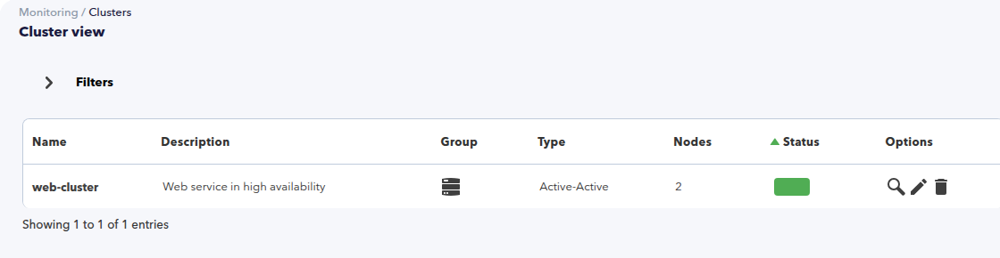
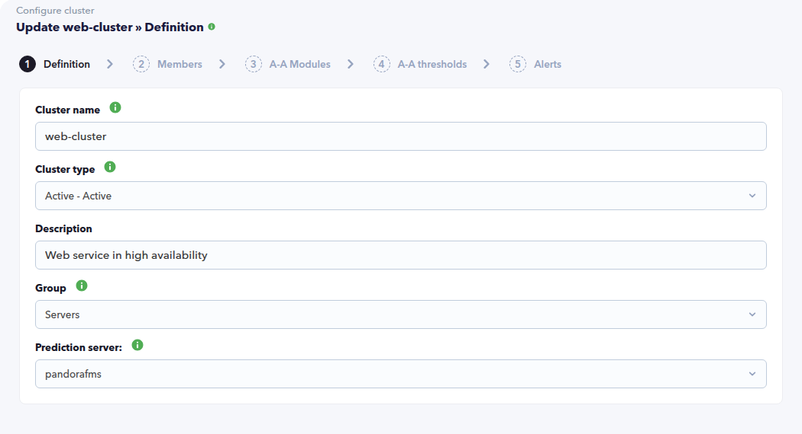
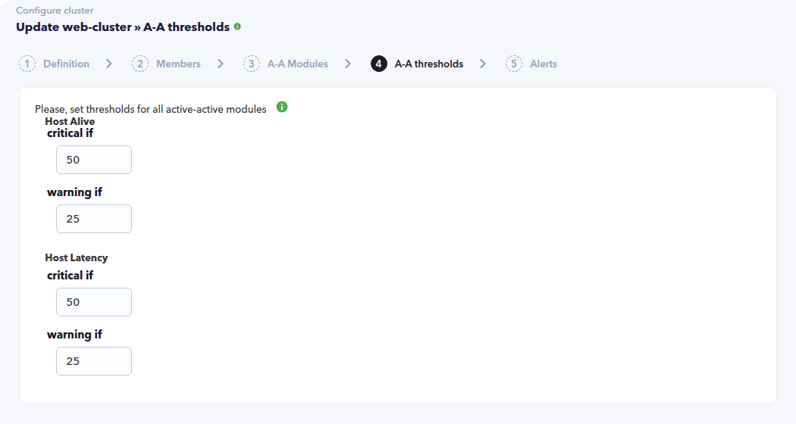
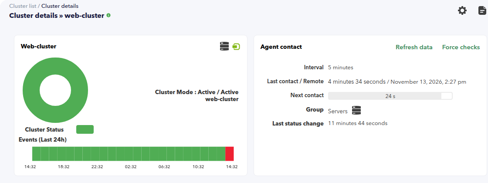

# Cluster monitoring

Monitoring a cluster is not the same as watching each node separately: it means watching the service they provide as a whole. The cluster view in Pandora FMS groups several agents under a single status, so a partial failure is seen for what it is, a service problem, and not as a collection of separate modules each telling its own story.

## What it is and when to use it

The feature groups agents that provide the same service and summarises their status in a single element. It does not depend on the operating system or the application: it relies on the modules that already exist on the agents.

There are two types of cluster:

| Type | How it works | What is monitored |
|---|---|---|
| Active-active (AA) | All nodes are in service and the work is shared among them. | Common modules present on every node. |
| Active-passive (AP) | Only one node is in service; the rest remain on standby. | Common modules on every node and balanced modules on the active node. |

A cluster contains two kinds of elements:

- **Common elements:** modules that must remain active on every node. They are the foundation of clustering.
- **Balanced elements:** modules that run only on the active node and move from one node to another. They only make sense in active-passive clusters.

When the cluster is created, the wizard generates its own agent, named after the cluster, and a module called "Cluster status" that summarises the status of the whole. That agent is the one shown in the view and the one used for alerts.

## Requirements

| Requirement | Detail |
|---|---|
| Network server | A network server (Network type) must be running. The wizard field is labelled **Prediction server**, but it only lists network servers, and that server performs the cluster calculations. |
| Agents | One or more agents with the modules to be evaluated; at least two are recommended. |
| Module names | Common modules must have the same name on every node. |
| Permissions | `AR` to view the list; `AW` globally and on the cluster group to open the detail and to create or edit. The edit and delete options are only shown with `AW` on the group. |

## Planning the monitoring

In an active-active cluster, common modules must exist on every agent with the same name. If a module is missing on one node, it does not appear in the list of common modules and cannot be selected. If a module that is already part of the cluster later disappears from a node, that node counts as down. Create identical monitors on every agent before assembling the cluster.

In an active-passive cluster, common modules follow the same rule. Balanced modules are configured only on the active node and added to the cluster in the corresponding wizard step. To monitor "the active node" without duplicating modules, use conditional monitoring: the module only reports when the preconditions you defined are met.

Modules on the passive node are not created automatically. If the standby node should have its own monitors, create them by hand and add them to the cluster afterwards.

## Creating a cluster

The path is **Operation → Monitoring → Cluster View**. In the list, click **New cluster** to open the wizard.

### Definition

The first step collects the cluster data:

| Field | What it indicates |
|---|---|
| Cluster name | Name of the cluster and of the agent created with it. |
| Cluster type | Active-active or active-passive. |
| Description | Free text to identify the service. |
| Group | Group the cluster agent will belong to. |
| Prediction server | Network server (Network type) that will perform the calculations. Although the field is labelled "Prediction server", the wizard only offers network servers. |

Click **Next** to move on to the members.

### Members and common modules

In **Members**, select the agents that make up the cluster. In **A-A Modules**, the wizard shows only the modules shared by all members; choose the ones that are critical for the service. If a module does not appear, check that it exists with the same name on every agent.

### Active-active module thresholds

In **A-A thresholds**, set for each common module the percentage of nodes in a state other than normal that triggers the warning and the critical status. The condition is "equal or greater": if the cluster has six nodes and you want a warning when three fail, set the threshold to 50 %.

The default value is 0 %. In Pandora FMS, a threshold of 0 means no threshold is set: the module will not change status on its own. Set the warning and critical thresholds before finishing; otherwise the cluster will not reflect failures.

### Active-passive modules

In **A-P module**, select the balanced modules you want to follow. The list shows the modules of every agent in the cluster, not only the common ones. In **Critical A-P modules**, the wizard lets you mark balanced modules as critical.

The wizard does not configure thresholds for balanced modules: it creates them with a threshold of 0, which is equivalent to not setting a threshold.

### Alerts and completion

In **Alerts**, you can add alerts on the cluster elements so that an action runs when they change to a specific status. These are the standard Pandora FMS alerts, explained in detail in chapter 5.5.

Click **Finish**. The wizard flags the cluster for recalculation by the network server and opens the view. The calculation is asynchronous: until the server processes it, the view may show the previous status.

## Cluster view and status

The list shows the name, description, group, type, number of nodes, status and options of each cluster. The status comes from the "Cluster status" module.

The detail view brings together the cluster status, the mode (active-active or active-passive), an events chart for the last 24 hours, the list of modules with their status and the associated alerts. The **Reload** button refreshes the information.

The status is calculated at two levels:

| Element | Calculation |
|---|---|
| Active-active module | Percentage of nodes in a state other than normal. A cluster module missing on a node counts as down. |
| Active-passive module | Most recent value among the nodes, ignoring unknown ones. |
| Cluster status | The worst status of all its elements: normal, warning or critical. |

The "Cluster status" module data uses three values: 0 for normal, 1 for warning and 2 for critical; its thresholds are fixed at 1 and 2, and the user does not configure them. Modules in unknown status also count as critical for the cluster status. If there is no data from any element, the module does not update its status.

## Editing and deleting

The edit icon in the list opens the same wizard with the current data. You can change the definition, members, modules, thresholds and alerts. The **Update and continue** and **Go back** buttons let you move forward and backward without losing what you have entered.

The trash icon deletes the cluster. The operation removes its agent, its modules and its relationships with the nodes, and it does not ask for confirmation: check that it is the right cluster before clicking.

## Alerts

Cluster alerts are the standard Pandora FMS alerts. You can apply them to the "Cluster status" module to watch the status of the whole, or to specific modules to watch one element. The **Alerts** step of the wizard lets you create them during configuration; afterwards they are managed like any other alert.

## Best practices and common problems

- **Identical names.** A common module must have the same name on every node. If two modules share a name on the same agent, the wizard cannot decide which one to use and shows an error.
- **Thresholds at 0 %.** This is the default value and means no threshold is set: the module does not change status. Set both thresholds on every module before considering the cluster finished.
- **Modules on the passive node.** They are not created automatically. If the standby node should have its own monitors, create them by hand and add them to the cluster.
- **Node without a cluster module.** If a module that is part of the cluster is missing on a node, it counts as down, not as unknown. A badly provisioned agent raises the cluster failure percentage.
- **Network server.** If the selected network server (field **Prediction server**) is not running, the cluster status is not updated. Check it before looking for the problem on the agents.
- **Permissions.** `AR` allows viewing the list; opening the detail and creating or editing require `AW` globally and on the cluster group. The edit and delete options are only shown with `AW` on the group.
