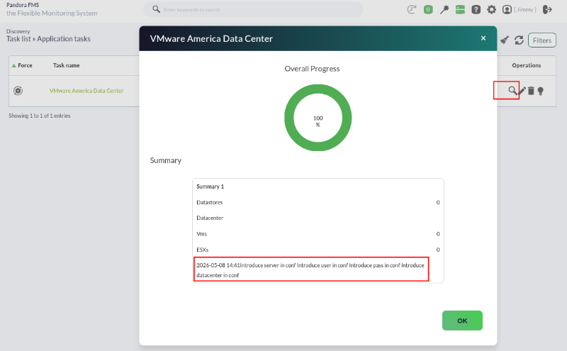
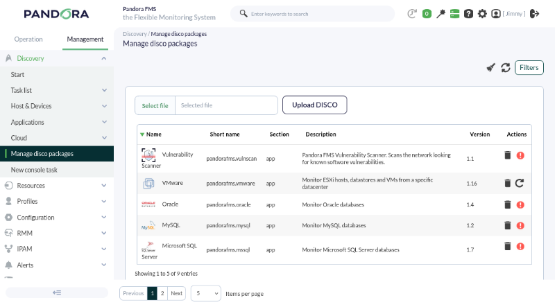

# Creating discovery plugins

A Discovery plugin is a `.disco` package: a ZIP with a form and the executables behind it. The console paints the form, the server runs the commands and, if the script returns data, agents and modules appear as if someone had created them by hand. The hard part is not the ZIP, but the contract: which fields are declared, what the script receives and what JSON it has to return. That is what this chapter documents.

This chapter is the authoring reference for `.disco` packages. Using Discovery, creating tasks and their lifecycle are covered in [2.3 · Automatic monitoring and discovery with Discovery](../parte-2/2.3-monitorizacion-y-descubrimiento-automatico-con-discovery.md). Local and remote server plugins, which have nothing to do with this, are covered in [9.8 · Creating local plugins](9.8-creacion-de-plugins-locales.md) and [9.9 · Creating remote plugins](9.9-creacion-de-plugins-remotos.md).

## What a `.disco` package is and what it is not

A `.disco` package is a renamed ZIP file. Inside there is, at a minimum, a `discovery_definition.ini`; optionally, a `logo.png` and all the scripts, executables and libraries the plugin needs. The console reads the INI, validates the definition, stores the metadata and paints the task creation wizard. The Discovery server receives the executables and runs the commands declared by the package with the values the user filled in the form.

The difference from other Pandora FMS extensions is worth making clear before starting:

| Extension | What it adds | Documented in |
|---|---|---|
| `.disco` package | A Discovery wizard: a form and executables that create agents and modules. | This chapter. |
| Local plugin | A command the plugin server runs on the machine where the server is installed. | 9.8. |
| Remote plugin | A command the plugin server runs against a remote system. | 9.9. |
| Console extension | A new page or action inside the Web console. | 9.10. |

A `.disco` package installs nothing on the monitored machine. It does not deploy an EndPoint or leave files there: it queries what is available (an API, a database, a hypervisor) and brings the data into Pandora FMS. Creating the task, its interval, its server and its alerts is covered in [2.3](../parte-2/2.3-monitorizacion-y-descubrimiento-automatico-con-discovery.md); here you only build the package that task runs.

## Requirements

| Requirement | Detail |
|---|---|
| Format | ZIP file with a `.disco` extension. The console rejects any other extension. |
| Definition | `discovery_definition.ini` at the root of the ZIP, not inside a folder. |
| Syntax | PHP INI format: sections in brackets, arrays with keys and comments with `;`. |
| `short_name` | Unique, with letters, numbers, dots, hyphens and underscores. The `pandorafms.` prefix is reserved for official packages. |
| Section | `app`, `cloud` or `custom`. It is the Discovery tab where the wizard will appear. |
| Execution | At least one `exec`. The package's own executables are declared in `execution_file`. |
| Environment | The interpreter and libraries used by the script must exist on the Discovery server; the package does not install them. |
| Permissions | Administrator user to upload and manage packages in **Discovery → Manage disco packages**. |
| Server | An active Discovery server to run the tasks, with its tokens configured (see [9.3](9.3-referencia-completa-de-configuracion-del-servidor.md)). |
| Version | A declared version string, visible in the console; it is worth increasing it on every change. |

None of this depends on an Enterprise licence. Creating `.disco` packages works the same in any edition; official packages with their own conditions, such as the SAP one, apply them when they run, not when they are packaged.

## Anatomy of the package

A minimal package looks like this:

```text
example.http.disco
├── discovery_definition.ini
├── logo.png                  (optional)
└── demo_http.py
```

The `discovery_definition.ini` is the contract. `logo.png` is optional: if it is missing, the console uses a generic icon. Scripts and libraries are referenced with paths relative to the package root. Avoid absolute paths: the package is copied to another directory and would stop working.

The console stores the definition and the logo, and copies the executables to the Discovery servers. On the server, the files declared in `execution_file` are resolved under `<incomingdir>/discovery/<short_name>/`, and the console gives them execution permission. That is why everything you are going to run must be declared in `execution_file` or in the password scripts; a script that is not listed there can be copied, but it will not be granted execution permission.

The INI and the logo are not copied to the server: the definition travels through the console database and the server only needs the executables. If a package appears in the list but its files are not on the server, the synchronise button in **Manage disco packages** copies them again (see [2.3](../parte-2/2.3-monitorizacion-y-descubrimiento-automatico-con-discovery.md)).

## The `discovery_definition.ini` file

The INI is organised in blocks. Three are fixed and the rest are fields, selector or tree blocks with whatever name the author chooses:

| Block | Required | What it is for |
|---|---|---|
| `discovery_extension_definition` | Yes | Metadata, executables and executions of the plugin. |
| `config_steps` | No | Steps of the task form. |
| `tempfile_confs` | No | Temporary configuration files for executions. |
| Field blocks (`custom_fields`) | If referenced | Fields of each step. |
| `custom_select` and `custom_tree_data` blocks | If referenced | Custom options and trees. |

The INI uses **macros**: text keys that start and end with an underscore and contain only letters and numbers, for example `_url_` or `_param1_`. A valid macro follows `_…_`; hyphens, dots or spaces are not allowed inside the name. At run time, the macro is replaced by its value.

Values accept the usual PHP INI types: `STRING` for text, `NUMBER` for numbers, `BOOL` for `true`/`false`, `1`/`0` or `yes`/`no`, and `VALUE` for any of them. In arrays, `VALUE_N` means the value can be repeated. Strings with spaces or special characters go in quotes.

### The `discovery_extension_definition` block

| Parameter | Required | What it does |
|---|---|---|
| `short_name` | Yes | Unique identifier of the package. Only letters, numbers, dots, hyphens and underscores. The `pandorafms.` prefix is reserved for official packages. |
| `section` | Yes | Console section: `app` (Applications), `cloud` (Cloud) or `custom` (Custom). |
| `name` | Yes | Visible name of the wizard. |
| `version` | Yes | Visible version. It is recommended to change it on every modification, however small. |
| `description` | No | Description shown in the package list. |
| `execution_file` | No | Array of scripts and executables in the package. The key is a valid macro and the value is a relative path. The console grants execution permission. |
| `exec` | Yes | Array of commands the server runs. At least one. They run in order and each one produces its own summary. |
| `passencrypt_script` | No | Relative path to the script that encrypts passwords from the console. |
| `passencrypt_exec` | No | Encryption command. It only accepts the `_passencrypt_script_` and `_password_` macros. |
| `passdecrypt_script` | No | Relative path to the script that decrypts passwords from the console. |
| `passdecrypt_exec` | No | Decryption command. It only accepts the `_passdecrypt_script_` and `_password_` macros. |
| `default_value` | No | Default values for the form macros. The key is the macro and the value depends on the field type. |

A minimal skeleton:

```ini
[discovery_extension_definition]
short_name = example.http
section = custom
name = Example HTTP
version = "1.0"
description = "Checks an HTTP endpoint and creates an agent with two modules"

execution_file[_exec1_] = "demo_http.py"
exec[] = "'_exec1_' --conf '_tempConf_'"
```

`execution_file` and `exec` are arrays: you can declare several entries with different keys, and `exec` uses them in the order they appear. The paths in `execution_file` are replaced by the real file path on the server; that is why it is worth putting quotes around them in `exec`, especially if the path can contain spaces.

`default_value` accepts one value per field type:

| Field type | Default value |
|---|---|
| `string` | Text. |
| `number` | Number. |
| `password` | Text. |
| `textarea` | Text. |
| `checkbox` | `true` or `false`. |
| `select` | One value from the list. |
| `multiselect` | JSON array with the selected values, for example `["a","b"]`. |
| `tree` | JSON array with the selected values. |

Do not put real passwords in `default_value`: the default value is stored as one more value of the task and does not go through the form encryption. For secrets, use a `password` field with `encrypt_on_true` or a credential selector.

The `passencrypt_*` and `passdecrypt_*` parameters are used by the console, not by the server. `passencrypt_exec` runs when the form is saved to turn the text into the encrypted value; `passdecrypt_exec` runs when the field is shown again to recover the text. The server receives the stored value, that is, the encrypted one if the field was encrypted, so the plugin must know how to decrypt it. If the package does not include that logic, do not mark the field for encryption.

### Server macros

In addition to the form macros, the server replaces these keys in executions:

| Macro | Value |
|---|---|
| `__taskMD5__` | MD5 of the task identifier. Useful for generating unique file names. |
| `__taskInterval__` | Task execution interval, in seconds. |
| `__taskCron__` | Task cron expression, or empty if it does not use cron. |
| `__taskGroup__` | Name of the task group. |
| `__taskGroupID__` | Identifier of the task group. |
| `__temp__` | Temporary directory configured on the server. |
| `__incomingDir__` | Data incoming directory of the server. |
| `__consoleAPIURL__` | URL of the console API. |
| `__consoleAPIPass__` | Password of the console API. |
| `__consoleUser__` | Console user configured on the server. |
| `__consolePass__` | Password of that user. |
| `__pandoraServerConf__` | Full path to the `pandora_server.conf` file. |

These macros are only replaced in server executions. The `script_data_fields` commands, which the console runs to build dynamic forms, do not receive them.

## Configuration steps (`config_steps`)

The `config_steps` block defines the steps the user sees after the common first step of the task. Each step has a name and a source of fields:

| Parameter | Required | What it does |
|---|---|---|
| `name` | Yes | Step name. |
| `script_data_fields` | Yes, if the step has no `custom_fields` | Command the console runs to obtain the step fields in JSON. |
| `custom_fields` | Yes, if the step has no `script_data_fields` | Name of the field block shown in the step. |
| `fields_columns` | No | Number of form columns: `1` or `2`. Default is `2`. |

The keys of this block are positional: if provided, they must be numeric and different from 0; in practice, number them from 1. If a step declares both sources, the console shows the fields returned by `script_data_fields` first and then those from `custom_fields`.

```ini
[config_steps]
name[1] = Endpoint
custom_fields[1] = endpoint
fields_columns[1] = 1

name[2] = Options
script_data_fields[2] = "'_exec1_' --fields '_url_'"
```

The `script_data_fields` command runs in the console, not on the server. The console replaces the `execution_file` macros with their real path, passes the values already filled in previous steps and expects a **JSON array of objects**, even if there is only one field:

```json
[
  {
    "macro": "_mode_",
    "name": "Mode",
    "type": "select",
    "mandatory_field": false,
    "select_data": {
      "basic": "Basic",
      "full": "Full"
    }
  }
]
```

The keys of each object are the same as those of a static field, with two differences: `select_data` is an object `value: text` and `tree_data` is an array of nodes, not the name of a block. If the command fails or returns something that is not JSON, the step shows the script error instead of the fields. If it returns an object with a single `error` key, the console shows that message as an error.

## Form fields (`custom_fields`)

Each field block is referenced from a step with `custom_fields`. Its name is free, as long as it matches the reference:

```ini
[endpoint]
macro[1] = _url_
name[1] = URL
type[1] = string
placeholder[1] = "http://192.0.2.10/"
```

| Parameter | Required | What it does |
|---|---|---|
| `macro` | Yes | Macro where the value is stored. Format `_…_`, letters and numbers only. |
| `mandatory_field` | No | `false` to make the field optional. If omitted, the field is mandatory. |
| `name` | Yes | Visible field label. |
| `tip` | No | Help text shown next to the label. |
| `type` | Yes | Control type: `string`, `number`, `password`, `textarea`, `checkbox`, `select`, `multiselect` or `tree`. |
| `placeholder` | No | Example text inside the field, for `string` and `textarea`. |
| `show_on_true` | No | Macro of a checkbox; the field is only shown when that checkbox is on. |
| `encrypt_on_true` | No | Macro of a checkbox; the password field is encrypted when saved when that checkbox is on. |
| `select_data` | Yes for `select` and `multiselect` | Name of a `custom_select` block or one of the Pandora selectors. |
| `tree_data` | Yes for `tree` | Name of a `custom_tree_data` block. |

The eight types and what each one renders:

| `type` | Control | Stored value |
|---|---|---|
| `string` | Single-line text box. | Text. |
| `number` | Numeric box. | Number. |
| `password` | Masked box. | Text; it can be encrypted. |
| `textarea` | Multi-line box. | Text, with line breaks. |
| `checkbox` | Yes/no switch. | Boolean (`1` or `0`). |
| `select` | Single-option drop-down. | One value. |
| `multiselect` | Multiple selector. | JSON array with the selected values. |
| `tree` | Multi-level tree. | JSON array with the selected values. |

Two warnings that save trouble. First: the key the console reads is `mandatory_field`; `required_field`, which appears in old examples, is ignored and the field remains mandatory. Second: even if `mandatory_field` is `true`, `multiselect` and `tree` fields accept that nothing is selected; the mandatory check does not apply to empty lists.

`show_on_true` and `encrypt_on_true` point to the macro of a checkbox in the same form. The checkbox can be in another step, but it must exist. If the macro does not exist or is not a checkbox, the field will not behave as expected.

## Selectors with Pandora data

`select` and `multiselect` fields can use data from the console itself. The value stored in the task and the value the script receives are not always the same:

| `select_data` | The selector shows | Stores | The script receives |
|---|---|---|---|
| `agent_groups` | Agent group names. | Group ID. | Group name, or empty if it does not exist. |
| `agents` | Agent aliases. | Agent name. | Agent name, or empty if it does not exist. |
| `module_groups` | Module group names. | Group ID. | Group name, or empty. |
| `modules` | Module names. | Module name. | Module name, or empty. |
| `module_types` | Module type descriptions. | Type name. | Type name. |
| `status` | Status names. | Status constant. | Status constant. |
| `tags` | Tags. | Tag ID. | Tag name, or empty. |
| `alert_templates` | Alert templates. | Template ID. | Template name, or empty. |
| `alert_actions` | Alert actions. | Action ID. | Action name, or empty. |
| `interval` | Interval selector. | Seconds. | Seconds. |
| `credentials.custom` | Custom credentials. | Credential ID. | JSON in base64 with `user` and `password`. |
| `credentials.aws` | AWS credentials. | Credential ID. | JSON in base64 with `access_key_id` and `secret_access_key`. |
| `credentials.azure` | Azure credentials. | Credential ID. | JSON in base64 with `client_id`, `application_secret`, `tenant_domain` and `subscription_id`. |
| `credentials.gcp` | Google Cloud credentials. | Credential ID. | JSON in base64 with the fields of the service document. |
| `credentials.sap` | SAP credentials. | Credential ID. | JSON in base64 with `user` and `password`. |
| `credentials.snmp` | SNMP credentials. | Credential ID. | JSON in base64 with `community`, `version`, `securityLevelV3`, `authUserV3`, `authMethodV3`, `authPassV3`, `privacyMethodV3` and `privacyPassV3`. |
| `credentials.wmi` | WMI credentials. | Credential ID. | JSON in base64 with `user`, `password` and `namespace`. |
| `os` | Operating system names. | System ID. | System name, or empty. |

The `status` constants are the usual ones: `0` normal, `1` critical, `2` warning, `3` unknown and `5` not started. The selector shows the names, but the script receives the number.

The `agent_groups` case deserves a separate line. The script receives the **name** of the group, not its ID. If the package is going to return `monitoring_data`, the agent's `id_group` field needs a numeric ID; either the script resolves it on its own, or it is omitted and the agent is created in the server autocreate group (`autocreate_group`, 10 by default), as long as that group is configured. For most packages, the second option is enough; if the group is part of the contract, resolve it explicitly.

Credentials are stored in the [Credential manager](../parte-2/2.2-gestor-de-credenciales.md) and the script receives the JSON already resolved and encoded in base64. The form field only shows the credential identifier; the username and password are not copied into the task definition. The keys of each credential type are described in [2.3](../parte-2/2.3-monitorizacion-y-descubrimiento-automatico-con-discovery.md).

## Custom selectors and trees

When the options do not come from Pandora, they are declared in a `custom_select` block and referenced from `select_data`:

```ini
[modes]
option[basic] = Basic
option[full] = Full
```

The `option` key is the value that is stored and the text is what the user sees. The block can have any name; the one that matters is the one written in `select_data`.

For a tree, use a `custom_tree_data` block. Each level declares its elements and, if it has children, the block that contains them:

| Parameter | Required | What it does |
|---|---|---|
| `name` | Yes | Element text. |
| `selectable` | Yes in the current validation | `true` or `false`. If the element can be selected, it must be indicated; validation rejects a tree without this parameter. |
| `macro` | No if the element is not selectable | Macro where the element value is stored. If omitted on a selectable element, the value goes to the tree macro. |
| `value` | Yes if the element is selectable | Value that is stored. |
| `children` | No | Name of the block with the child elements. It cannot point to a block that is already above it in the same tree. |

A two-level tree:

```ini
[resources]
name[1] = Servers
selectable[1] = false
children[1] = resources_servers

name[2] = Databases
selectable[2] = false
children[2] = resources_databases

[resources_servers]
name[1] = web01
selectable[1] = true
macro[1] = _targets_
value[1] = web01

name[2] = web02
selectable[2] = true
macro[2] = _targets_
value[2] = web02

[resources_databases]
name[1] = db01
selectable[1] = true
macro[1] = _targets_
value[1] = db01
```

The selected values are stored as a JSON array, for example `["web01","db01"]`, and are replaced in executions like any other macro. Two more rules: a tree macro cannot match the macro of a field outside the tree, and a block cannot be a child of itself or of one of its ancestors.

## Temporary files (`tempfile_confs`)

Many plugins need a configuration file instead of twenty arguments on the command line. `tempfile_confs` generates it:

```ini
[tempfile_confs]
file[_tempConf_] = "
[CONF]
url = _url_
timeout = _timeout_
mode = _mode_
log = __temp__/__taskMD5__.log
"
```

The key is a valid macro and the value is the file content. When that macro appears in an execution, the server creates a temporary file with that content, replaces the macros inside it with their values and replaces the macro with the file path. The file is rewritten on each task run; it is not deleted automatically.

The content can use any form macro and the server macros: `__temp__`, `__taskMD5__`, `__taskInterval__`, etc. It is the convenient way to pass a multi-line configuration to a script without fighting shell quotes.

## Script output

The server runs each `exec` command with the task timeout and captures its standard output and standard error. The exit code decides: if a command ends with a code other than `0`, the task is left as failed. If the timeout is reached, the task also fails and the summary records `The execution timed out.`.

Standard output must be JSON. The server interprets it like this:

- The `summary` key is shown as a two-column table: its keys on the left and its values on the right.
- The `info` key adds one more row to that table.
- Any other key is also added to the summary.
- If the output is not JSON, it is stored as text in the summary.
- If the output is empty and there is standard error, the error is stored; if there is no error either, `The execution returned no output. Is the server out of memory?` is stored.

Each command produces its own table: `Summary 1`, `Summary 2`, etc. The summary is stored with the task and is read from the summary icon in the task list. A failed run also leaves its summary; in fact, it is the first thing to look at when something goes wrong.



To create agents and modules, the JSON adds the `monitoring_data` key. Its full structure is this:

```json
{
  "summary": {
    "SUMMARY_FIELD_1": "SUMMARY_VALUE_1",
    "SUMMARY_FIELD_N": "SUMMARY_VALUE_N"
  },
  "info": "ADDITIONAL_INFO",
  "monitoring_data": [
    {
      "agent_data": {
        "agent_name": "AGENT_NAME",
        "agent_alias": "AGENT_ALIAS",
        "os": "OS",
        "os_version": "OS_VERSION",
        "interval": "INTERVAL",
        "id_group": "ID_GROUP",
        "address": "ADDRESS",
        "description": "DESCRIPTION",
        "agent_version": "AGENT_VERSION",
        "parent_agent_name": "PARENT_AGENT_NAME",
        "timezone_offset": "TIMEZONE_OFFSET"
      },
      "module_data": [
        {
          "name": "NAME",
          "data": "DATA",
          "type": "TYPE",
          "description": "DESCRIPTION",
          "max": "MAX",
          "min": "MIN",
          "post_process": "POST_PROCESS",
          "module_interval": "MODULE_INTERVAL",
          "min_critical": "MIN_CRITICAL",
          "max_critical": "MAX_CRITICAL",
          "min_warning": "MIN_WARNING",
          "max_warning": "MAX_WARNING",
          "disabled": "DISABLED",
          "min_ff_event": "MIN_FF_EVENT",
          "datalist": "DATALIST",
          "status": "STATUS",
          "unit": "UNIT",
          "timestamp": "TIMESTAMP",
          "module_group": "MODULE_GROUP",
          "custom_id": "CUSTOM_ID",
          "str_warning": "STR_WARNING",
          "str_critical": "STR_CRITICAL",
          "critical_instructions": "CRITICAL_INSTRUCTIONS",
          "warning_instructions": "WARNING_INSTRUCTIONS",
          "unknown_instructions": "UNKNOWN_INSTRUCTIONS",
          "tags": "TAGS",
          "critical_inverse": "CRITICAL_INVERSE",
          "warning_inverse": "WARNING_INVERSE",
          "quiet": "QUIET",
          "module_ff_interval": "MODULE_FF_INTERVAL",
          "alert_template": "ALERT_TEMPLATE",
          "crontab": "CRONTAB",
          "min_ff_event_normal": "MIN_FF_EVENT_NORMAL",
          "min_ff_event_warning": "MIN_FF_EVENT_WARNING",
          "min_ff_event_critical": "MIN_FF_EVENT_CRITICAL",
          "ff_timeout": "FF_TIMEOUT",
          "each_ff": "EACH_FF",
          "module_parent": "MODULE_PARENT",
          "module_parent_unlink": "MODULE_PARENT_UNLINK",
          "cron_interval": "CRON_INTERVAL",
          "ff_type": "FF_TYPE",
          "min_warning_forced": "MIN_WARNING_FORCED",
          "max_warning_forced": "MAX_WARNING_FORCED",
          "min_critical_forced": "MIN_CRITICAL_FORCED",
          "max_critical_forced": "MAX_CRITICAL_FORCED",
          "str_warning_forced": "STR_WARNING_FORCED",
          "str_critical_forced": "STR_CRITICAL_FORCED"
        }
      ]
    }
  ]
}
```

In `agent_data`, `agent_name` is mandatory and must be unique and stable: if it changes on every run, new agents will be created instead of updating the existing one. `agent_alias` is the readable name; if it is missing, `agent_name` is used. `address` is the agent address and `os` or `id_os` is the operating system; if the name is not recognised, `Other` is used. `id_group` must be a numeric group ID; if it is omitted, the server autocreate group is used. `id_parent`, `longitude`, `latitude`, `altitude`, `position_description`, `custom_id`, `url_address`, `agent_mode` and `extra_data` are also accepted, even though they do not appear in the skeleton.

In `module_data`, the essential keys are `name`, `type` and `data`. `type` is the module type identifier (`generic_data`, `generic_data_string`, `generic_proc`, etc.; the full list is in [2.20](../parte-2/2.20-configuracion-comun-de-los-modulos.md)). `module_interval` is a multiplier of the agent interval; if `cron_interval` is set, it takes precedence. The thresholds (`min_warning`, `max_warning`, `min_critical`, `max_critical`) and their text versions (`str_warning`, `str_critical`) are applied when the module is created. Unrecognised keys do not break anything: they are stored as extended module information. In addition to the skeleton, the processor accepts `extra_data`, `dynamic_interval`, `dynamic_min`, `dynamic_max` and `dynamic_two_tailed`.

One detail that explains many "my module does not appear" cases: new modules are only created on new agents or on agents in learning mode. On an agent that already exists and is not in learning mode, the plugin updates the modules it already has, but does not add new ones. If the package is going to add modules to pre-existing agents, those agents must be in learning mode, or they must be created by the package itself.

The contract above is the direct path: the script writes the JSON to standard output and the server creates the agents. Official packages usually use the `pandoraPlugintools` library and send the data over Tentacle, which the data server processes through its usual path; that route is outside this reference. For a package of your own, JSON is simpler and needs no additional dependencies.

## Complete example

The `example.http` package checks a URL and creates an agent with two modules: the HTTP status code and the response time. It has a single step and uses a temporary file to pass the configuration to the script.

```text
example.http.disco
├── discovery_definition.ini
└── demo_http.py
```

The INI:

```ini
[discovery_extension_definition]
short_name = example.http
section = custom
name = Example HTTP
version = "1.0"
description = "Checks an HTTP endpoint and creates an agent with two modules"

execution_file[_exec1_] = "demo_http.py"
exec[] = "'_exec1_' --conf '_tempConf_'"

default_value[_url_] = "http://127.0.0.1/"
default_value[_timeout_] = 5
default_value[_mode_] = "basic"
default_value[_notify_] = 0
default_value[_label_] = ""

[config_steps]
name[1] = Endpoint
custom_fields[1] = endpoint
fields_columns[1] = 1

[endpoint]
macro[1] = _url_
name[1] = URL
type[1] = string
placeholder[1] = "http://192.0.2.10/"
tip[1] = "URL to check. The agent is created with its host as address."

macro[2] = _timeout_
name[2] = "Timeout (s)"
type[2] = number
mandatory_field[2] = false

macro[3] = _mode_
name[3] = Mode
type[3] = select
select_data[3] = modes
mandatory_field[3] = false

macro[4] = _notify_
name[4] = Add a label
type[4] = checkbox

macro[5] = _label_
name[5] = Label
type[5] = string
show_on_true[5] = _notify_
mandatory_field[5] = false

[modes]
option[basic] = Basic
option[full] = Full

[tempfile_confs]
file[_tempConf_] = "
[CONF]
url = _url_
timeout = _timeout_
mode = _mode_
notify = _notify_
label = _label_
"
```

The script:

```python
#!/usr/bin/env python3
import argparse
import configparser
import hashlib
import json
import sys
import time
import urllib.parse
import urllib.request


def main():
    parser = argparse.ArgumentParser()
    parser.add_argument("--conf", required=True)
    args = parser.parse_args()

    config = configparser.ConfigParser()
    config.read(args.conf)

    url = config.get("CONF", "url", fallback="")
    timeout = config.getint("CONF", "timeout", fallback=5)
    mode = config.get("CONF", "mode", fallback="basic")
    notify = config.getboolean("CONF", "notify", fallback=False)
    label = config.get("CONF", "label", fallback="")

    if not url:
        print("url is required", file=sys.stderr)
        return 2

    start = time.time()
    try:
        with urllib.request.urlopen(url, timeout=timeout) as response:
            status = response.getcode()
        elapsed = round((time.time() - start) * 1000, 2)
    except Exception as error:
        print(f"request failed: {error}", file=sys.stderr)
        return 1

    host = urllib.parse.urlsplit(url).hostname or url
    agent_name = "example_http_" + hashlib.md5(url.encode()).hexdigest()[:12]
    info = f"Mode: {mode}"
    if notify and label:
        info += f". Label: {label}"

    output = {
        "summary": {
            "URL": url,
            "HTTP status": status,
            "Response time (ms)": elapsed,
        },
        "info": info,
        "monitoring_data": [
            {
                "agent_data": {
                    "agent_name": agent_name,
                    "agent_alias": f"Example HTTP {host}",
                    "address": host,
                    "os": "Other",
                    "interval": 300,
                    "description": "Created by the example .disco package",
                },
                "module_data": [
                    {
                        "name": "HTTP status",
                        "type": "generic_data",
                        "data": status,
                        "description": "Last HTTP status code",
                        "min_warning": 400,
                        "max_warning": 499,
                        "min_critical": 500,
                        "max_critical": 599,
                    },
                    {
                        "name": "Response time",
                        "type": "generic_data",
                        "data": elapsed,
                        "unit": "ms",
                        "description": "Time to first byte",
                        "min_warning": 1000,
                        "min_critical": 3000,
                    },
                ],
            }
        ],
    }

    json.dump(output, sys.stdout)
    return 0


if __name__ == "__main__":
    sys.exit(main())
```

The form shows the URL, the timeout, the mode and the checkbox; the "Label" field only appears when the checkbox is on. When the task runs, the server creates the temporary file, runs `demo_http.py --conf <file>`, receives the JSON and creates the `Example HTTP <host>` agent with the "HTTP status" and "Response time" modules. The run summary shows the URL, the code and the time; subsequent runs update the same modules.

The agent does not carry `id_group`: it is created in the server autocreate group. If the package must respect the task group or the one chosen by the user, add `id_group` with the corresponding numeric ID.

## Installing, testing and debugging

The package is built as a normal ZIP and renamed to `.disco`:

```sh
zip -r example.http.disco discovery_definition.ini demo_http.py
```

The ZIP must have the files at its root; if the folder containing them is compressed, the console will not find the INI. Then, in **Discovery → Manage disco packages**, click **Select file**, choose the `.disco` and upload it with **Upload DISCO**. The console validates the INI, installs the package and copies the executables.



Validation rejects the package without saying "almost": if the `discovery_extension_definition` block or the `short_name` is missing, if the `short_name` has characters that are not allowed, if `section` or `name` is missing, if the section is not `app`, `cloud` or `custom`, if there is no `exec` or any of them is empty, if a key in `default_value`, `execution_file` or `tempfile_confs` does not have macro format, if a `config_steps` step uses a key that is not numeric or is 0 or has no `name` and a field source, if a field has no `macro`, `name` or `type`, if the type is not one of the eight, if a `select` or `multiselect` has no `select_data` or the reference does not exist, if a tree has no `tree_data` or points to a non-existent block or to an ancestor, or if a `custom_select` has no `option`.

If the `short_name` starts with `pandorafms.`, the console warns that the prefix is reserved for official packages and asks for confirmation; it does not prevent it. If another package with the same `short_name` already exists, it warns and offers to overwrite it with all its content. There is no version comparison: uploading the same `short_name` replaces the package, so change the version to know what you have installed.

After installation, the wizard appears in its section (Applications, Cloud or Custom). Create a task like any other (see [2.3](../parte-2/2.3-monitorizacion-y-descubrimiento-automatico-con-discovery.md)), force the first run and check the summary. If the package creates agents, they appear in the console with their modules; if they do not appear, the summary usually says why.

To iterate, change the file, upload the package with the same `short_name` and the new version. Existing tasks keep their values; new default values apply to macros that are missing. If you have touched files outside the package or the copy to the servers was left half done, the synchronise button in **Manage disco packages** copies them again.

When something fails, the check order is this:

1. Run the script by hand with a sample configuration file and check the exit code. If it fails there, stop: the problem is in the script.
2. Check that the output is a single valid JSON: `python3 -m json.tool output.json`, or pipe the output through `jq` if you have it.
3. Check permissions and the interpreter. The script must be in `execution_file` and have a valid `#!` or an interpreter available on the server.
4. Check the paths. The server resolves the package executables under `<incomingdir>/discovery/<short_name>/`; do not count on the task working directory being that one, so use absolute paths or resolve them from the script itself.
5. Check the task timeout. The timeout applies to each command; a script that takes longer is cut off and the task fails.
6. Look at the server log (`log_file`, `/var/log/pandora_server.log` by default; see [9.3](9.3-referencia-completa-de-configuracion-del-servidor.md)). The server records the command it runs and execution errors.

There is no need to restart the Discovery server after uploading a package: the console updates the definition and the files, and the server reads them when it runs the task.

## Best practices and common mistakes

- **Stable `short_name`.** Changing it creates another application and leaves the tasks of the previous one orphaned. If the package is an evolution, keep the `short_name` and raise the version.
- **Version up to date.** The console does not compare versions, but the list shows the one that is there. A version that never changes is an invitation to doubt what is installed.
- **Relative paths.** Everything inside the package is referenced from its root. Absolute paths work on your machine and fail on the server.
- **Declared executables.** If a script is not in `execution_file`, it will not be granted execution permission. The same applies to the password scripts.
- **Dependencies inside or documented.** The package does not install libraries. If the script needs `requests`, `paramiko` or a database client, either include it or check that it exists on the server and document it.
- **Secrets out of the INI.** Do not put passwords in `default_value` or in the temporary file. Use a `password` field with encryption or a credential from the Credential manager.
- **Encrypted passwords, with decryption.** If you use `encrypt_on_true`, the server receives the encrypted value. The plugin must decrypt it; the `passencrypt_*` and `passdecrypt_*` scripts are for the console.
- **Stable `agent_name`.** A different name on every run creates a new agent every time. Use an identifier derived from the resource, not a random number.
- **Stable module names.** Changing a module name creates another module; the previous one keeps its data and its alerts.
- **JSON only on STDOUT.** Debug messages go to STDERR or a file. One extra `print` turns the output into non-JSON and the summary into text.
- **Fail with a non-zero code.** If the script cannot do its job, exit with an error. An empty JSON with code 0 leaves the task as successful and the problem is discovered later.
- **Readable summaries.** The `summary` keys are read by a person. `status_code`, `URL` or `Response time` make sense; `res` and `v1` do not.
- **Unique temporary files.** Use `__taskMD5__` in file names so that two tasks do not step on each other. Clean up what you create: `tempfile_confs` files are rewritten on every run, but they are not deleted on their own, and the files your script creates are yours.
- **`mandatory_field`, not `required_field`.** The console reads `mandatory_field`; old examples with `required_field` leave the field mandatory even if you do not want it.
- **`selectable` in trees.** The current validation rejects a tree element without `selectable`. Always declare it, whether `true` or `false`.
- **Test failure.** A URL that does not respond, a malformed JSON, a timeout and a temporary file with line breaks. If the package has only been tested on the happy path, it has not been tested.
