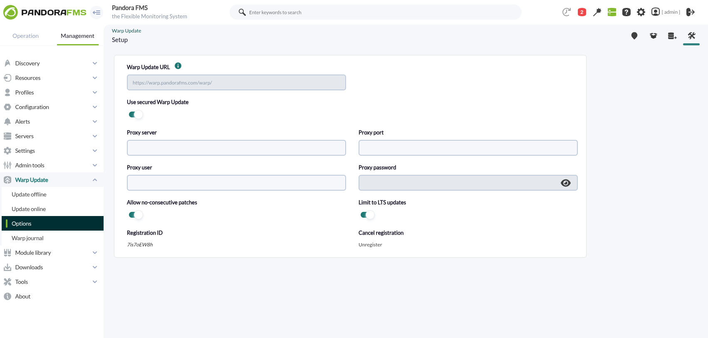
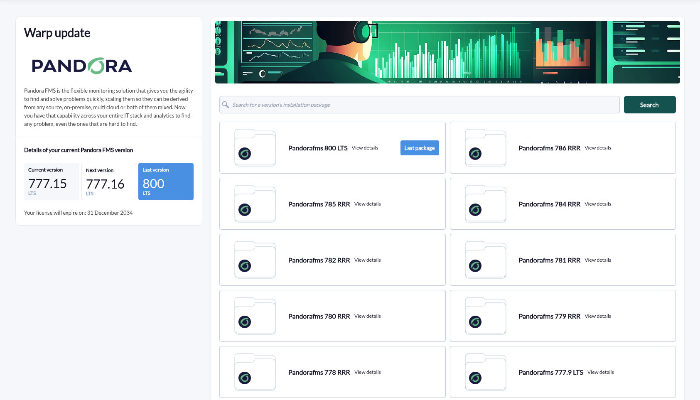
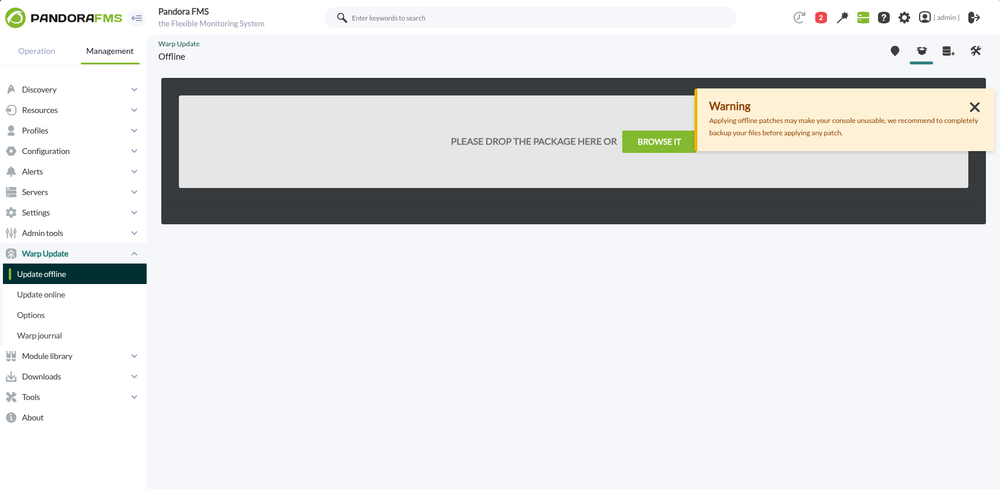
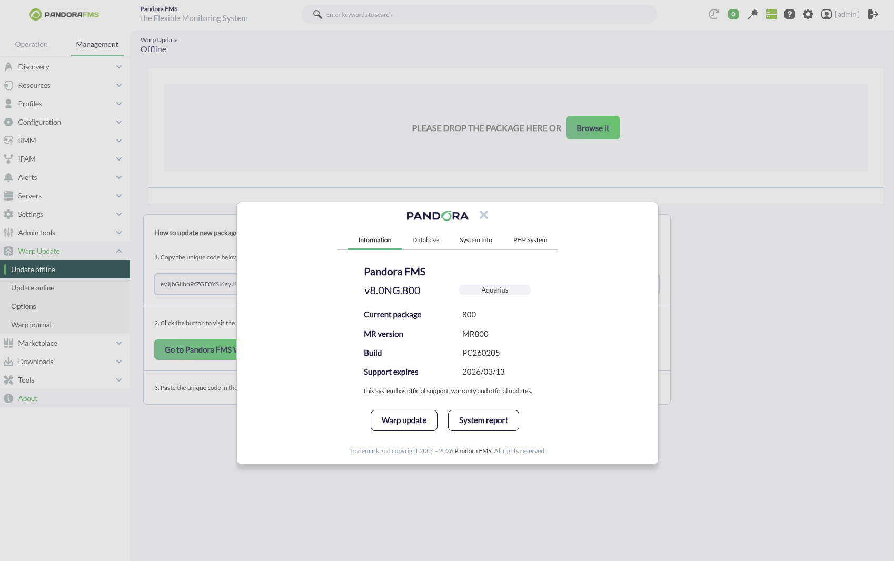
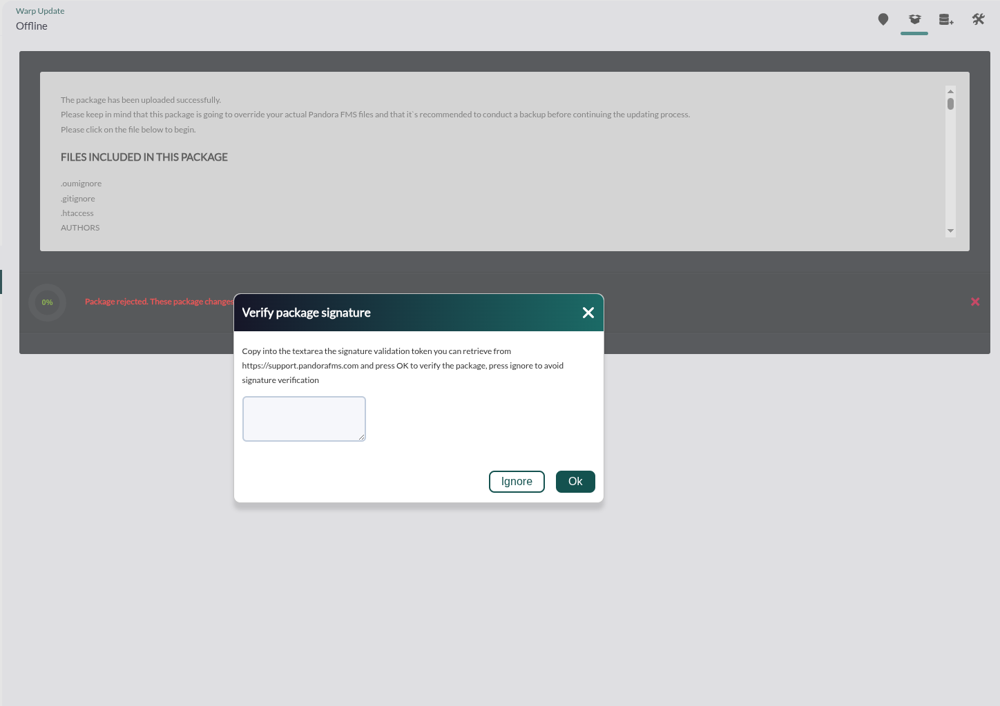
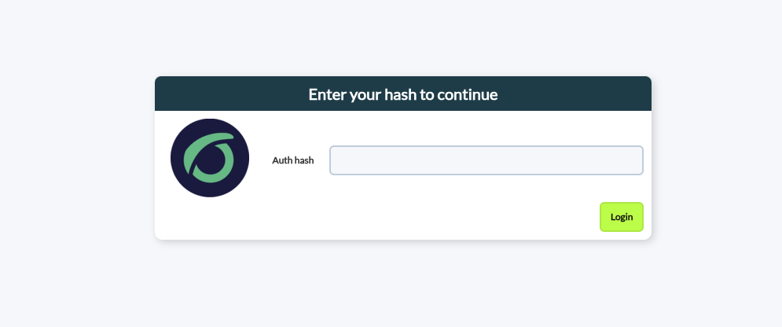
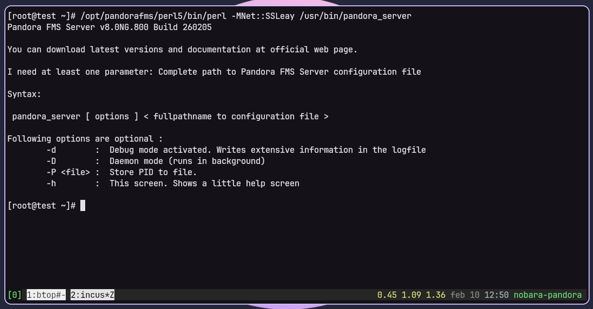
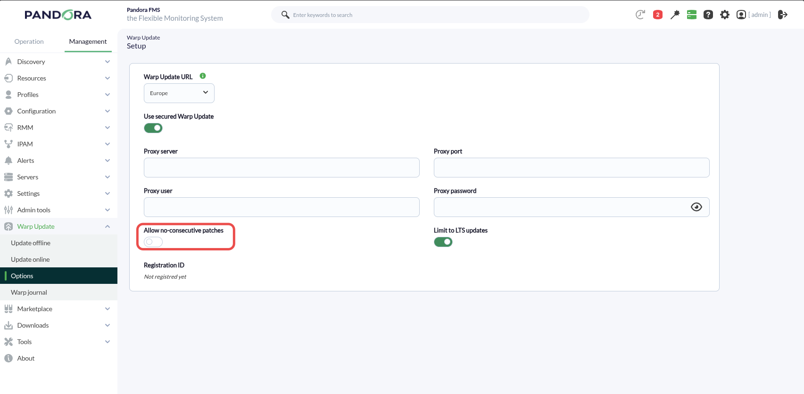
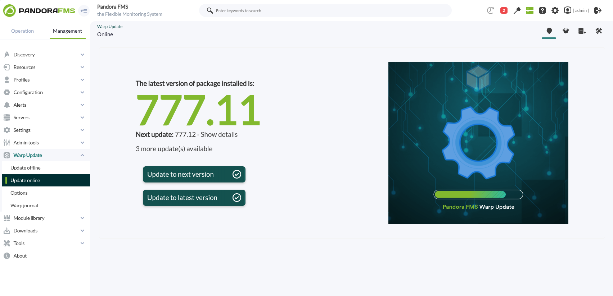
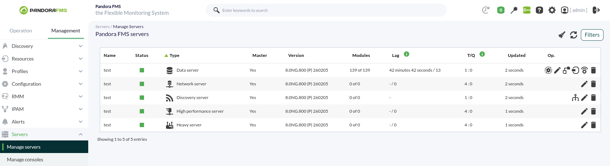

# Mise à jour de la LTS 777 vers la 800

Partir de la LTS 777 n'est pas une mise à jour ordinaire : c'est un saut. La
console ne passe pas de la 777 à la 800 d'un seul coup, et le chemin suit un
ordre qu'il vaut mieux ne pas modifier. Cette annexe décrit ce chemin précis. La
procédure générale de Warp Update et la mise à jour manuelle se trouvent dans
[Mises à jour](../parte-1/1.4-actualizaciones.md) ; on n'ajoute ici que ce qui
change quand le point de départ est la 777.

La LTS 800 est la version actuellement supportée, la 777 ne l'est plus
([Politique de versions et de support](../parte-1/1.3-versiones-y-estabilidad.md)).
Qui est encore en 777 a deux options : conserver une installation qui ne reçoit
plus de correctifs, ou faire le saut. Voici la seconde.

## Quand utiliser cette annexe

Cette annexe s'adresse aux installations en 777.x, avec ou sans correctifs, qui
veulent arriver à la 800 LTS. Ce n'est pas le guide de Warp Update, qui se
trouve dans [Mises à jour](../parte-1/1.4-actualizaciones.md), ni la politique
de versions, qui se trouve dans
[Politique de versions et de support](../parte-1/1.3-versiones-y-estabilidad.md).

Il y a trois chemins, et ils ne servent pas à la même chose :

| Chemin | Quand l'utiliser | Ce qu'il faut savoir |
|---|---|---|
| Warp Update Offline | Toujours. C'est la méthode recommandée | Il permet d'appliquer les paquets un par un et de contrôler l'ordre. C'est la base de cette annexe |
| Warp Update Online | Seulement si vous êtes à un saut de la 800, par exemple en 777.15 ou en 785 | Avec beaucoup de versions intermédiaires, il est plus lent et accumule plus de points de défaillance. On ne l'utilise pas dans un Command Center |
| Mise à jour par paquets | Dernier recours, après avoir parlé au support | C'est la même procédure pour n'importe quelle version, décrite dans [Mises à jour](../parte-1/1.4-actualizaciones.md) |

Une condition prime sur les autres : si l'installation est en dessous de la
777.3, il faut d'abord arriver à la 777.3 par la méthode hors ligne. Les paquets
intermédiaires s'appliquent dans l'ordre et ne peuvent pas être sautés.

## Prérequis et point de départ

Avant de télécharger quoi que ce soit, il faut savoir d'où l'on part. La version
installée, le paquet actuel, la version du MR et le *build* se lisent dans
**Gestion → À propos** (**About**).

| Prérequis | Détail |
|---|---|
| Version de départ | 777.x, avec ou sans correctifs. Noter la version et le paquet affichés par **À propos** avant de toucher à quoi que ce soit |
| Système d'exploitation, base de données et PHP | Ceux de la version 800. La matrice en vigueur se trouve dans [Prérequis du serveur](../parte-1/1.1-instalacion.md#requisitos-del-servidor) et dans [Politique de versions et de support](../parte-1/1.3-versiones-y-estabilidad.md) |
| Espace disque | Au moins 15 Go libres pour le processus de mise à jour |
| Accès à la console | Utilisateur administrateur |
| Accès au serveur | SSH ou terminal local sur la machine de Pandora FMS |
| Poste avec internet | Pour télécharger les paquets depuis le portail de Warp |
| Sauvegarde | *Snapshot* de la machine ou copie complète de tous les composants avant d'appliquer le premier paquet |

Les versions du système d'exploitation, de la base de données et de PHP dépendent
de la LTS cible et changent avec la matrice de support. C'est pourquoi on les
référence ici au lieu de les recopier : un chiffre isolé dans une annexe vieillit
plus mal qu'un lien vers la matrice.

L'assistant de mise à jour lui-même rappelle la sauvegarde avant d'appliquer un
correctif. Ce n'est pas une formalité : si le saut tourne mal, pouvoir revenir en
arrière fait la différence entre un après-midi et une semaine.

## Le chemin des paquets : de 777.x à 777.16 puis à 800

La 777 ne saute pas directement à la 800. Le guide passe d'abord par la
**777.16**, le correctif qui sert de pont dans la branche, et de là applique la
**800**. Ce saut non consécutif est précisément ce que permet l'option
**Autoriser les patchs non consécutifs** de Warp Update, qui est désactivée par
défaut et qu'il faut activer à la main.

Les trois fichiers à télécharger sont les suivants :

| Fichier | Ce qu'il met à jour |
|---|---|
| `package_777.16.LTS.fms` | Console et schéma de la base de données, jusqu'à la 777.16 |
| `package_800.LTS.fms` | Console et schéma de la base de données, jusqu'à la 800 LTS |
| `pandorafms_server-780NG.800.tar.gz` | Le serveur |

Si l'installation est dans une version antérieure à la 777.3, le premier tronçon
se fait avec des paquets `.oum` :

| Fichier | Ce qu'il met à jour |
|---|---|
| `package_777.1.oum` | Premier correctif de la branche 777 |
| `package_777.2.oum` | Deuxième correctif |
| `package_777.3.oum` | Troisième correctif. Met la console en état d'appliquer le reste |

On les applique un par un, dans cet ordre, et ce n'est qu'ensuite que l'on
continue avec la 777.16 et la 800.

## Warp Update Offline

C'est la méthode recommandée pour tout environnement et la plus rapide quand il
faut franchir plusieurs versions. La différence avec les autres mises à jour
tient à l'ordre et à quelques étapes qui n'existent que pour ce saut.

### Préparer les paquets

La première étape consiste à activer **Autoriser les patchs non consécutifs**
(**Allow no-consecutive patches**) dans **Gestion → Warp Update → Options** et à
enregistrer la modification.



Les paquets se téléchargent depuis le portail de Warp. La console indique la
version installée, la suivante et la dernière, et propose les fichiers de chaque
version.



Si la console n'est pas enregistrée, elle demandera une adresse e-mail avant de
donner accès aux téléchargements.

### Appliquer les paquets dans l'ordre

Depuis **Gestion → Warp Update → Mise à jour hors ligne** (**Update offline**),
on glisse le fichier dans la zone de dépôt ou l'on utilise **Naviguer**
(**Browse it**).



On applique d'abord `package_777.16.LTS.fms`, puis `package_800.LTS.fms`. Si tout
s'est bien passé, on applique le paquet du serveur,
`pandorafms_server-780NG.800.tar.gz`.

Dans les grands sauts comme celui de la 777.3 à la 777.15 ou à la 800, la
console change beaucoup. Si un écran s'affiche mal ou ne se rafraîchit pas, on
vide le cache du navigateur et l'on recharge avant de croire le processus cassé.

À la fin, **À propos** doit afficher le paquet 800 et le MR correspondant.



### La signature du paquet 777.3

La mise à jour de la 777.2 à la 777.3 comporte deux étapes supplémentaires. Lors
de l'application de `package_777.3.oum`, la console demande une signature. On
choisit l'option d'ignorer et l'on attend la fin.



C'est une étape héritée de la branche 777. Ignorer la vérification ici n'est pas
une habitude à reproduire pour les autres paquets : si la signature échoue sur un
paquet ultérieur, le problème est ailleurs et il vaut mieux consulter le support
avant de continuer.

Si l'application s'est bien passée, au rechargement apparaît un écran différent
avec un *hash* d'authentification et un lien vers le nouveau Warp Update. On
copie le code, on suit le lien et on le colle dans le portail.



Ce code est à usage unique et donne accès aux téléchargements de la licence. On
ne le partage pas et on ne le laisse pas dans une capture publiée.

### Terminer le serveur par SSH

Warp Update met à jour la console et le schéma, mais le serveur nécessite une
dernière étape manuelle. On exécute, en tant qu'utilisateur `root` :

```bash
/opt/pandorafms/perl5/bin/perl -MNet::SSLeay /usr/bin/pandora_server
```

La commande lance le binaire avec le Perl du produit, sans fichier de
configuration. Ce n'est pas une option `--version` : le serveur affiche sa
bannière et l'aide, puis s'arrête.



La sortie doit commencer par `Pandora FMS Server v8.0NG.800 Build …`. Si elle
n'apparaît pas encore, le paquet est peut-être en train de finir de s'installer :
attendez entre une et cinq minutes et vérifiez à nouveau.

Une fois la version confirmée, on arrête l'ancien serveur, on vérifie qu'il est
arrêté, on démarre le nouveau et on vérifie de nouveau :

```bash
systemctl stop pandora_server
systemctl status pandora_server
systemctl start pandora_server
systemctl status pandora_server
```

### Remettre Warp dans son état normal

La dernière étape consiste à désactiver **Autoriser les patchs non consécutifs**
dans les options de Warp Update.



Tant que cette option est active, n'importe quel opérateur peut sauter la
séquence des correctifs. La laisser activée « au cas où » revient à laisser
ouverte une porte dont on n'a pas besoin.

## Warp Update Online

La méthode en ligne est viable quand l'installation est proche de la 800, par
exemple en 777.15 ou en 785. Avec beaucoup de versions intermédiaires, elle est
plus lente et comporte plus de variables susceptibles d'échouer.

Deux avertissements à ne pas perdre :

- Dans un **Command Center**, on n'utilise pas cette méthode. On met à jour avec
  Warp Update Offline.
- En dessous de la 777.3, il faut d'abord arriver à cette version par la méthode
  hors ligne.

Dans **Gestion → Warp Update → Mise à jour en ligne** (**Update online**), la
console affiche la version installée, la prochaine mise à jour et combien il en
reste.



On peut avancer version par version avec **Mettre à jour vers la prochaine
version** (**Update to next version**) ou demander le saut complet avec **Mise à
jour vers la dernière version** (**Update to latest version**). Certaines mises à
jour sont marquées comme obligatoires et interrompent le processus : il faut
appuyer de nouveau sur le bouton. C'est le comportement prévu, pas une erreur.

La vue des mises à jour peut ne pas se rafraîchir pendant qu'elle reçoit des
changements. Si elle n'avance pas pendant un moment, on recharge la page.

La clôture du serveur est la même que dans la méthode hors ligne : elle se fait
par SSH avec les commandes de la section
[Terminer le serveur par SSH](#terminer-le-serveur-par-ssh).

## Installation par paquets

Si les deux méthodes précédentes échouent, il reste la mise à jour manuelle par
paquets. Avant de la tenter, mieux vaut parler au support : c'est le chemin qui
comporte le plus d'étapes et celui qui prévient le moins quand quelque chose ne
colle pas.

La procédure n'est pas recopiée ici parce qu'elle est la même pour n'importe
quelle version et se trouve déjà dans
[Mises à jour](../parte-1/1.4-actualizaciones.md), dans la section sur la mise à
jour manuelle. L'ordre ne change pas : console, schéma de la base de données et
serveur.

## Passer à PHP 8.4 (facultatif)

Après la migration, changer de PHP n'est pas obligatoire, mais c'est recommandé.
La procédure par distribution se trouve dans
[Mise à jour des versions de PHP](a1-actualizacion-de-versiones-de-php.md), avec
les blocs de commandes complets pour Rocky Linux / RHEL et pour Ubuntu Server
22.04.

## Vérifier que la migration est terminée

Il reste trois vérifications, et aucune n'est superflue :

- **À propos** : le paquet et le MR sont ceux de la 800.
- **Serveurs** (**Servers**) : la colonne **Version** de tous les serveurs
  indique 800.
- **Journal de Warp** (**Warp journal**) : le registre de ce qui a été appliqué,
  dans quel ordre, par qui et quand.



Si les trois éléments ne concordent pas, la mise à jour n'est pas terminée. La
vérification générale se trouve dans
[Mises à jour](../parte-1/1.4-actualizaciones.md), et pour tout doute que le
registre ne résout pas, l'étape suivante est le support.
