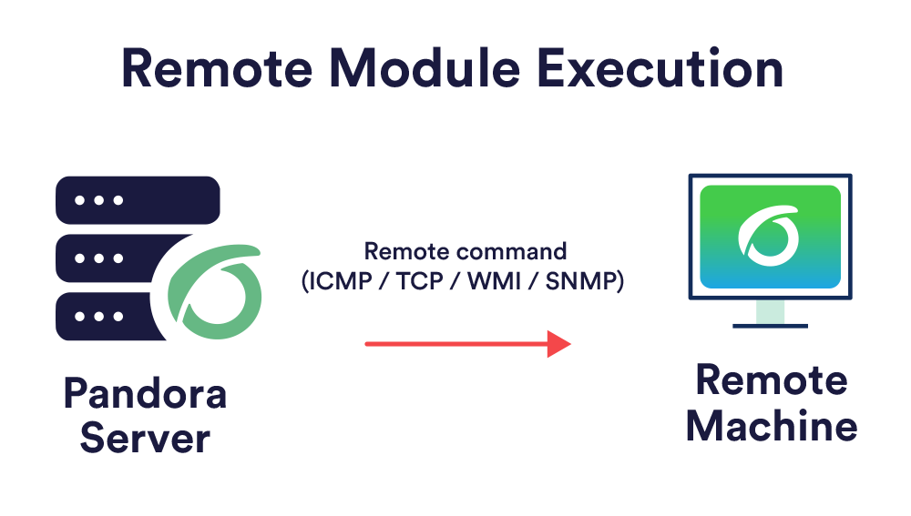
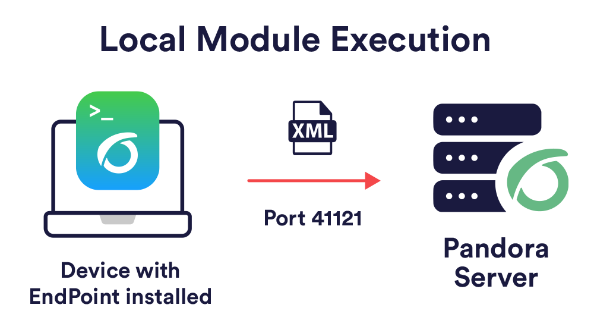
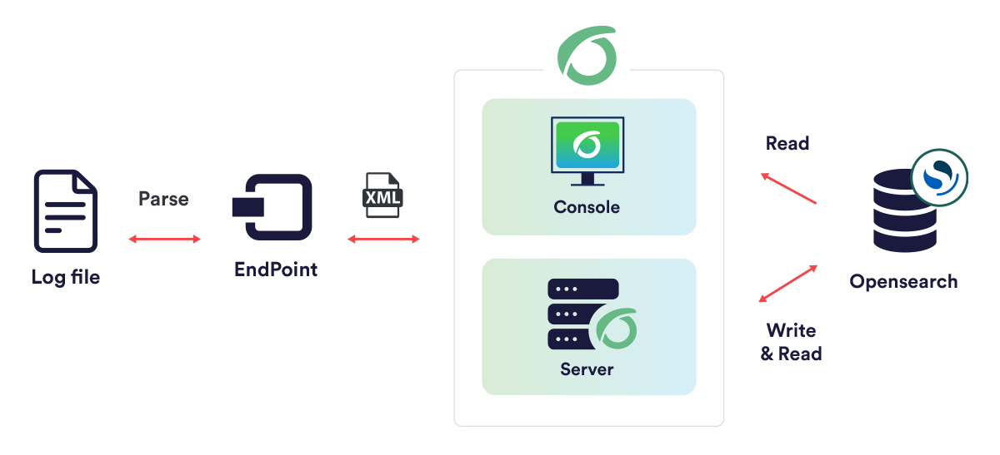
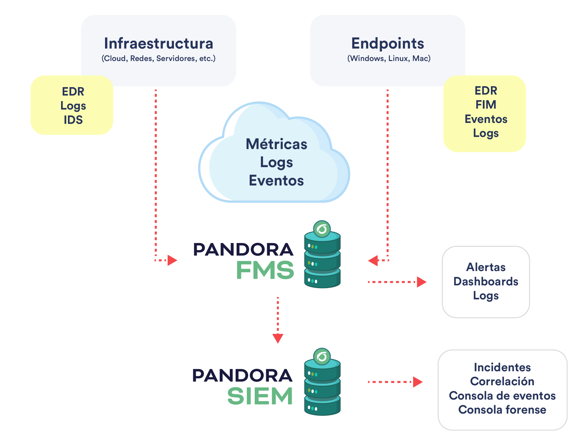
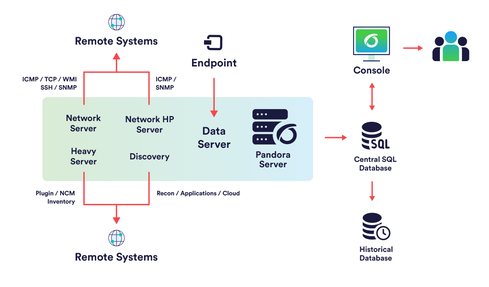
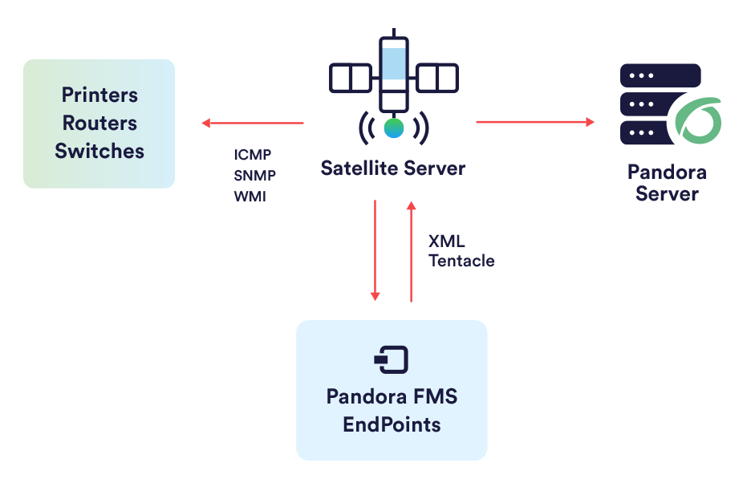
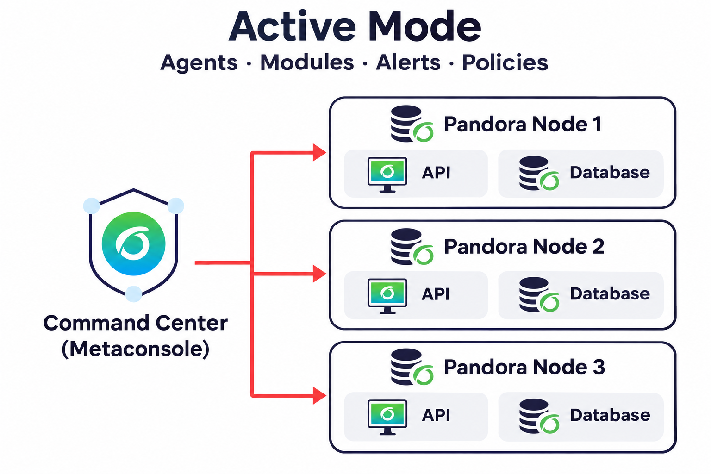
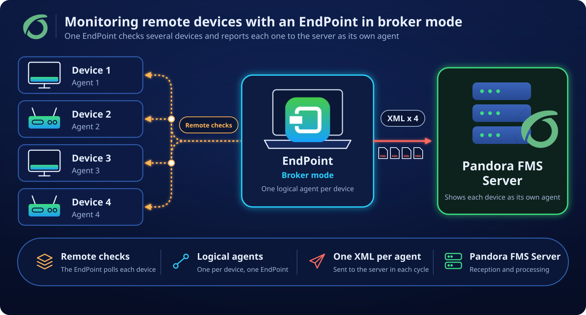
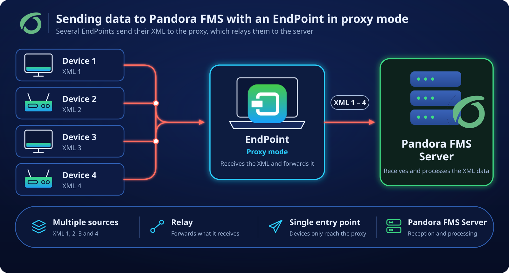

# Introduction et architecture

Pandora FMS ne se comprend pas en regardant une capture de la console. On le
comprend quand on sait d'où vient chaque donnée, qui l'apporte et où elle est
stockée. Ce chapitre fait ce parcours : ce qui peut être supervisé, avec quelle
pièce et quelle topologie il faut pour que les données arrivent. Les parties
suivantes développent chaque sujet en détail. Ici se trouve la carte.

## Introduction à Pandora

Pandora FMS supervise les systèmes, les réseaux, les applications et les
services. L'unité avec laquelle il travaille n'est pas la machine, c'est
l'**agent** : un conteneur logique de modules. Il est associé à un groupe et,
éventuellement, à une ou plusieurs adresses IP. Un agent peut recevoir des
données locales (d'un EndPoint installé sur l'équipement) ou distantes (d'une
vérification réseau), et le plus fréquent est qu'il en reçoive des deux côtés.

Chaque module stocke une seule métrique, avec un nom unique dans l'agent, et sa
valeur s'interprète par **seuils** : de là viennent les états `NORMAL`,
`AVERTISSEMENT` et `CRITIQUE`, plus l'état `INCONNU` quand un module cesse de
recevoir des données. Avec ces états, on génère des événements et on déclenche
des alertes. Tout le reste de ce chapitre, ce sont des façons d'alimenter ce
mécanisme.

### Supervision à distance

C'est le serveur qui s'en charge : c'est lui qui sort interroger. Rien ne
s'installe sur l'appareil, il faut seulement avoir une visibilité réseau vers
lui. C'est la voie naturelle pour les équipements réseau et pour tout ce qui
n'accepte pas de logiciel par-dessus.

Avec SNMP, on interroge les OID qu'expose le fabricant. Et on écoute les *traps*
que l'appareil envoie de lui-même, sans que personne ne les demande. Sur les
machines MS Windows, la vérification à distance se fait par WMI, avec des
identifiants. Et pour le reste, il y a les tests réseau classiques : ICMP (ping,
latence, jitter), TCP avec défi et réponse pour vérifier qu'un port répond, et
des vérifications web statiques, qui contrôlent la disponibilité et le contenu,
pas une transaction utilisateur complète.

{ .diagrama }

Une différence qu'il vaut mieux avoir claire dès le départ : une vérification à
distance vit ou meurt par le réseau. S'il n'y a pas de chemin jusqu'à l'appareil,
il n'y a pas de donnée, et vous aurez beau insister avec les nouvelles
tentatives, vous ne le réglerez pas depuis la console. Pour ces cas, il y a les
topologies plus bas.

### Supervision avec EndPoints

L'EndPoint est le programme que l'on installe sur l'équipement et qui exécute
les vérifications depuis l'intérieur. C'est là que se trouve la vraie puissance.
Toute donnée que l'on peut obtenir avec une commande ou un script est à sa
portée, et l'inventaire aussi : logiciels installés, disques, services. Et il
peut agir sur le système quand on le lui demande : démarrer un service,
supprimer un fichier temporaire.

L'EndPoint regroupe tout ce qui concerne l'intervalle dans un unique fichier XML
et l'envoie au serveur avec Tentacle, sur le port `41121/TCP`. L'intervalle par
défaut est de `300` secondes. Depuis la version 784, certaines vérifications
admettent des intervalles allant jusqu'à `15` secondes : ICMP (latence et ping)
et SNMP numériques. Les modules asynchrones ne descendent jamais sous cinq
minutes, et la console vous avertit si vous essayez de le forcer.

{ .diagrama }

Avec EndPoint, il y a trois modes de travail pour les modules qui arrivent dans
le XML. En **apprentissage**, ils se créent tout seuls. En **normal**, ils ne se
créent que s'ils sont déclarés dans la console. En **auto-désactivé**, cela se
passe comme en apprentissage, mais l'agent s'éteint si tout passe à inconnu.
Choisir l'un ou l'autre est une décision d'exploitation, pas un détail de
configuration : cela définit qui commande ce qui est supervisé, l'équipement ou
la console.

### Supervision des environnements cloud et des API

Les fournisseurs cloud et les services externes ne laissent pas installer un
EndPoint chez eux, et bien souvent ne laissent pas non plus les sonder par ICMP.
La voie, c'est l'API qu'ils publient. Pour cela, Pandora FMS utilise sa
bibliothèque de modules et de plugins : il existe des plugins spécifiques pour
les plateformes cloud et un plugin générique de requête vers une API
(`ApiRequest`) pour ce qui n'en a pas. Le résultat est stocké comme un module de
plus, il hérite donc des seuils, des alertes et de tout ce qui précède. Si le
service a une API, il peut être supervisé ; s'il n'en a pas, ce que l'on vérifie
est la disponibilité du point d'accès.

### Supervision des applications (Discovery)

Discovery fait le saut entre superviser ce que vous connaissez déjà et découvrir
ce qui existe. L'assistant explore le réseau et détecte les équipements et les
appareils. Il identifie le système d'exploitation et leur applique un modèle de
supervision : ce qui est trouvé commence à remonter sans passer par le
formulaire de création. En plus du réseau, Discovery sert à inventorier les
environnements virtuels, les bases de données et les applications avant de les
superviser.

La valeur est au démarrage : sur un grand réseau, créer à la main des centaines
d'appareils représente des semaines de travail avec des oublis garantis.
Discovery le transforme en un moment de révision et une liste d'exceptions.

### Rapports

Superviser sans présenter les données, c'est collectionner. Les rapports, les
tableaux de bord (*dashboards*) et les consoles visuelles transforment
l'information en décisions : tendances, respect des SLA et planification de
capacité.

Chaque utilisateur peut monter son propre tableau de bord avec des widgets :
graphiques, résumés d'état, cartes. Les rapports regroupent des données de
plusieurs agents et modules, avec des calculs et des formats différents. Pour ce
qui n'est pas encore arrivé, il y a les modules de prédiction : capacité,
tendance et opérations arithmétiques sur d'autres modules. Celui de capacité
répond à la question utile : combien de jours restent avant que le disque ne se
remplisse, si tout reste pareil. Ils servent à avertir avant l'incident, pas à
l'expliquer après.

### Console d'événements

La console d'événements montre, en temps réel, ce qui se passe. C'est un
instantané, pas un historique. Les événements sont classés par sévérité (de
maintenance et informatif jusqu'à critique, en passant par avertissement) et ils
sont la matière première des alertes, qui ajoutent la notification et
l'escalade.

Elle peut sembler une fonction ancienne dans un outil moderne, et elle l'est.
Elle reste aussi le moyen le plus rapide de répondre à la question « qu'est-ce
qui est cassé ? » sans ouvrir vingt graphiques. Beaucoup d'outils du secteur
n'ont pas de console d'événements comme celle-ci, et cela se remarque justement
quand il y a urgence.

### Logs

Pandora FMS collecte les logs de multiples origines dans une seule console,
triés par l'horodatage auquel ils ont été traités, en conservant aussi
l'horodatage d'origine du fichier. Le texte est stocké tel quel, sans structure,
dans OpenSearch, qui est ce qui supporte le volume.

{ .diagrama }

Le serveur syslog analyse le journal système de la machine où il est installé et
le serveur de logs permet de les corréler et de déclencher des alertes dessus.
C'est la matière première du SIEM et l'outil de *troubleshooting* quand le
problème n'est pas dans l'état d'un module, mais dans ce que le système
racontait pendant qu'il échouait.

### Sujets réseau (Netflow, SNMP, IPAM, NCM, shell distant)

Ici se regroupe ce qui regarde le réseau comme sujet, et non comme moyen :

- **NetFlow et sFlow** analysent le trafic en temps réel à partir des données
  qu'envoient les appareils (ou d'une sonde avec *port-mirror*). Le collecteur
  écoute sur `9995/UDP`. C'est la façon de savoir qui parle avec qui et combien,
  quand SNMP ne vous dit que combien de paquets passent par l'interface.
- **SNMP** est le protocole d'interrogation et de réception de *traps*
  (`162/UDP`) pour tout l'équipement réseau.
- **IPAM** (version 731 ou ultérieure) gère les adresses IP de vos réseaux : il
  découvre les *hosts* d'un sous-réseau, détecte quand ils cessent de répondre,
  résout leurs noms et approche le système d'exploitation. Il fonctionne
  indépendamment du fait que ces machines soient supervisées ou non.
- **NCM** (Network Config Management) entre par Telnet ou SSH dans les appareils
  pour sauvegarder leur configuration, la restaurer et exécuter des commandes,
  avec des modèles par fabricant et par modèle. Il a besoin du serveur Heavy en
  marche.
- Le **shell distant** couvre l'accès manuel : terminal web pour les équipements
  gérés par Telnet ou SSH, et contrôle à distance graphique avec Pandora RC pour
  Windows, Linux et macOS.

### SIEM

Un SIEM collecte, filtre, normalise, corrèle et présente des événements de
sécurité. Ce que Pandora FMS ajoute au concept, c'est que la collecte est déjà
faite. Les logs qui alimentent le SIEM sont les mêmes que ceux que la plateforme
collecte déjà. Le moteur d'événements de sécurité s'appuie sur ce travail
préalable, au lieu de monter un second système à part.

{ .diagrama .diagrama-ancho }

Lors de l'installation, il est recommandé que les EndPoint soient au moins en
version 783 pour profiter de toutes les fonctions. Le SIEM s'active depuis la
console et active ses propres serveurs ; avec lui arrivent les modèles de
normalisation, les événements de sécurité et leur corrélation.

### RMM

RMM est le sigle de *Remote Monitoring and Management*. Dans Pandora FMS, c'est
la pièce qui permet de programmer des tâches depuis la console et de faire
exécuter ces tâches par les agents en local, en rapportant ensuite le résultat.
Il entre en jeu à partir de la version 778 et s'appuie sur trois composants :
l'agent RMM, le serveur RMM (qui stocke les scripts et les exécutions) et le
service Tentacle RMM, qui relie les deux par le port `41123/TCP`.

C'est la base de la gestion à distance de nombreux équipements à la fois :
distribuer des logiciels, appliquer des changements et laisser la trace de ce
qui a été exécuté sur chaque machine, sans y entrer une par une.

## Architecture

Pandora FMS est né comme un monolithe (serveur, console et base de données sur la
même machine) et c'est toujours la façon la plus raisonnable de commencer. Mais
aucun composant n'est condamné à vivre à côté des autres : ils se séparent quand
le réseau, le volume ou l'organisation le demandent. La décision d'architecture
n'est pas prise par le produit, elle est prise par votre infrastructure.

### Console

La console web est la face visible et aussi la porte de l'automatisation. La
même console que vous utilisez à la main est celle qui expose l'API pour que les
scripts travaillent. C'est là que vivent les permissions (groupes, profils et
tags) qui décident qui voit et qui administre chaque chose. Et elle peut être
déployée sur plusieurs serveurs, pour répartir la charge ou pour servir des
groupes d'utilisateurs différents.

### Serveur

Le serveur de Pandora FMS est une seule application. À l'intérieur, il porte
plusieurs serveurs spécialisés, qui s'exécutent comme des processus concurrents
et avec leur propre nombre de threads. La configuration de tous ces serveurs vit
dans `pandora_server.conf`, dans `/etc/pandora`.

{ .diagrama }

Ceux-ci sont **actifs par défaut** :

- **Data Server** : traite les paquets XML qu'envoient les EndPoint et les
  convertit en données, événements et alertes.
- **Network Server** : exécute les vérifications à distance : ICMP, TCP, SNMP,
  WMI, contrôles web et les modules de prédiction.
- **Heavy Server** : s'occupe des tâches qui demandent plus de muscle : plugins,
  NCM et inventaire.
- **Network High Performance Server** : déplace ICMP et SNMP en bloc, pensé pour
  des volumes élevés.
- **Discovery Server** : explore le réseau et exécute les tâches programmées de
  découverte.

Ceux-ci sont **désactivés**, pour ne les allumer que lorsqu'on en a besoin :

- **SNMP Console** : reçoit les *traps* SNMP via `snmptrapd` et les traite.
- **Event Server** : met les événements en relation et déclenche les alertes
  associées.
- **Alert Server** : exécute toutes les alertes de supervision, pour qu'une
  alerte lente ne retarde pas les vérifications.
- **Log Server** : c'est celui qui permet de générer des alertes à partir de
  logs.
- **Syslog Server** : analyse le syslog de la machine où il est installé et le
  stocke dans OpenSearch.
- **NetFlow Server** : collecte et traite les flux NetFlow et sFlow.
- **WUX Server** : exécute des transactions web complexes dans un navigateur
  réel, avec Selenium Grid.
- **SIEM Server** et **SIEM Event Server** : normalisent les logs et génèrent les
  événements de sécurité.
- **MADE Server** : le moteur de détection d'anomalies (*Monitoring Anomaly
  Detection Engine*).
- **RMM Server** : héberge les scripts et les exécutions que téléchargent les
  agents RMM.
- **Mainframe Server** : supervision des environnements *mainframe* (z/OS).
- **Sync Server** : va chercher les données dans les réseaux isolés, comme
  expliqué dans les topologies plus bas.

Il y a un troisième groupe, celui des serveurs qui **dépendent du serveur
maître** :

- **Policy Manager** : applique les politiques aux agents. Quand un changement
  touche des centaines d'agents à la fois, le travail entre dans une file
  d'opérations et c'est ce serveur qui la traite.
- **Migration Server** : déplace des agents entre les nœuds d'un Command Center,
  en prenant les tâches dans une file priorisée. Il n'existe que dans les
  environnements Command Center.
- **Autoprovision Server** : le serveur d'auto-approvisionnement. Il reçoit les
  agents qui arrivent sans destination et décide dans quel nœud ils sont créés,
  selon la stratégie configurée : par tour, le nœud le moins chargé ou des
  règles propres (par alias, par sous-réseau…).

Les trois démarrent avec le maître d'un nœud ou d'un Command Center, qui est là
où leur travail a du sens.

La liste s'est peu à peu raccourcie avec les versions. Depuis la 784, plusieurs
serveurs ont été regroupés dans d'autres pour ne pas gaspiller de mémoire sur
des processus qui ne servaient plus : prédiction, WMI et contrôles web sont
passés au Network Server ; plugins, NCM, inventaire et exportation au Heavy
Server ; et ICMP et SNMP au Network High Performance Server.

Sur la répartition de charge : il peut y avoir plusieurs serveurs du même type
travaillant en même temps. Dans chaque type, il y a un principal et le reste
sont des secondaires, mais tous travaillent ; si un secondaire tombe, le
principal absorbe ce qui lui était assigné. La haute disponibilité agit sur une
autre couche : avec deux nœuds en actif/passif, celui qui reste vivant prend
tout le travail. L'état et la charge de chaque serveur se voient depuis la
console elle-même, parce que le système se supervise lui-même comme il supervise
n'importe quoi d'autre.

### EndPoint

L'EndPoint est le programme qui tourne sur l'équipement supervisé. Nous l'avons
déjà vu dans la première moitié du chapitre : il collecte les données
localement, les empaquette dans un XML et les envoie au serveur par Tentacle à
chaque intervalle. Quand il n'a pas de chemin direct vers le serveur, il peut
envoyer ses données via un serveur satellite ou via un autre EndPoint qui fait
*proxy*.

C'est la pièce qu'il faut installer, mettre à jour et, de temps en temps,
désinstaller sans laisser de trace. La partie installation est dans
[Installation](1.1-instalacion.md) ; ce qui importe ici, c'est que sa présence
est la frontière entre la supervision locale et la supervision à distance.

### Serveur satellite

Le serveur satellite est un serveur autonome qui s'installe près du réseau
distant. Il n'a pas besoin de se connecter à la base de données : il exécute les
vérifications et envoie les résultats en XML par Tentacle, comme le ferait un
EndPoint. C'est la réponse quand vous ne pouvez pas atteindre certains appareils
par le réseau et que vous ne pouvez pas non plus installer quoi que ce soit
dessus.

{ .diagrama }

Il a deux vertus qu'il vaut la peine de connaître. La première est la vitesse :
il peut exécuter jusqu'à 500 vérifications par seconde, et même s'il n'envoie
les données au serveur que de temps en temps, s'il détecte un changement d'état
il le notifie aussitôt. La seconde est qu'il se découvre lui-même : il trouve
les appareils par SNMP ou WMI, crée les agents correspondants et génère les
modules d'interfaces, trafic, CPU, mémoire et disques sans intervention.

Et il se gère à distance. Le satellite interroge le serveur toutes les quelques
secondes (toutes les 30 par défaut) pour savoir s'il y a des changements dans sa
configuration ou dans celle des agents qu'il a détectés. Il applique ce qui lui
arrive depuis la console. C'est lui qui initie la connexion, donc **aucun port
n'a besoin d'être exposé** sur le réseau distant. Et quand il faut l'atteindre
depuis le serveur, par exemple pour l'assistant SNMP, c'est aussi lui qui ouvre
un tunnel SSH inverse.

### Base de données

Tout ce que collecte la plateforme finit dans la base de données, le composant
dont dépend tout le reste. Pandora FMS travaille avec MySQL, MariaDB ou Percona.
En pratique, on en gère deux : celle de temps réel et celle d'historique, vers
laquelle les données passent quand il n'est plus nécessaire de les interroger à
la seconde.

La base de données peut être répliquée pour la haute disponibilité en
actif/passif ou montée en cluster actif/actif avec équilibrage. C'est là, avec
l'historique, que se décide quel niveau de détail vous gardez et pendant combien
de temps : bon marché en disques, cher en requêtes lentes.

### Command Center

Le Command Center est la couche au-dessus de tout ce qui
précède. Il gère plusieurs installations de Pandora FMS (les **nœuds** ou
instances) depuis une seule interface : les voir ensemble, synchroniser leur
configuration et opérer sur toutes. Chaque nœud conserve sa propre base de
données et son propre serveur. Le Command Center ne les remplace pas : il les
coordonne. C'est ainsi que l'on atteint des centaines de milliers d'appareils
sans regarder nœud par nœud. Et l'on peut offrir un service multi-entreprise
depuis un seul point d'accès.

{ .diagrama .diagrama-ancho }

La synchronisation va dans deux directions. Le Command Center interroge la base
de données ou l'API de chaque nœud pour ce qu'il administre : agents, modules,
alertes, politiques. Et il reçoit par réplication ce qui se génère en continu,
comme les événements.

{ .diagrama .diagrama-ancho }

Les utilisateurs, groupes, modèles et tags vivent des deux côtés, parce qu'ils
doivent être là où on les utilise. Cela dit, c'est un environnement avancé et
avec ses propres exigences : il s'installe sur les mêmes systèmes d'exploitation que le reste du
produit (RHEL, Rocky Linux, AlmaLinux et Ubuntu Server, dans leurs versions
prises en charge) ; le détail se trouve dans [Installation](1.1-instalacion.md).

## Topologies, schémas et modèles de supervision

Nous arrivons au point qui décide de tout le reste. La topologie ne se choisit
pas par goût. Elle se déduit d'une seule question : dans quelle direction la
communication peut-elle s'établir. Le reste du chapitre est la réponse, cas par
cas.

### Réseaux accessibles

C'est le cas confortable et celui qui couvre la majorité des installations. Il y
a deux variantes, et elles peuvent coexister :

- Le serveur de Pandora FMS atteint ce qu'il supervise, il peut donc faire de la
  supervision à distance centralisée.
- Ou les EndPoint installés sur les équipements atteignent le serveur, ils
  remontent donc sans problème.

Si votre réseau remplit l'une des deux conditions (ou les deux), vous n'avez
besoin de rien d'autre dans cette partie.

### Réseaux difficiles d'accès

Ici la communication existe, mais pas dans la direction qui vous arrangerait. On
la résout avec une pièce intermédiaire. Laquelle, cela dépend de l'endroit où se
situe la coupure :

- Si le serveur **n'atteint pas** le réseau, on déploie un **agent broker** sur
  un équipement ayant accès aux deux côtés.
- Si les EndPoint **n'atteignent pas** le serveur, on utilise le mode *proxy* des
  EndPoint ou un serveur satellite qui fait office d'intermédiaire.
- S'il y a **plusieurs réseaux que le serveur ne peut pas sonder en même
  temps**, la solution passe par plus d'un serveur satellite, ou par plusieurs
  serveurs de Pandora FMS connectés à la même base de données.
- Quand le satellite peut sortir mais ne peut pas être atteint, il admet un
  **tunnel SSH inverse** (depuis la version 785). C'est lui qui ouvre le port sur
  le serveur et le redirige vers son propre SSH. La console peut ainsi
  l'atteindre pour lancer l'assistant SNMP ou la console SNMP.

{ .diagrama-oscuro }

{ .diagrama-oscuro }

### Réseaux inaccessibles

Quand le réseau distant ne peut pas initier de communication vers le serveur, on
retourne le raisonnement avec le **Sync Server**. Le serveur principal prend
l'initiative et va chercher les données sur un serveur Tentacle déployé dans le
réseau isolé, qui fait office d'entrepôt temporaire. L'information s'y accumule
jusqu'à ce que le principal la télécharge. Ce qui a été téléchargé disparaît de
l'entrepôt.

La différence avec le satellite est justement celle-là : le satellite **envoie**,
le Sync Server **va chercher**. Si aucune des deux directions n'est possible, il
n'y a pas de supervision qui tienne et il vaut mieux le savoir avant de la
promettre.

### Grands environnements

Le volume casse les petites solutions, et il ne se règle pas avec une seule
astuce. La première chose est de répartir le travail entre plusieurs serveurs de
Pandora FMS, tous contre la même base de données, et de compter sur la haute
disponibilité pour que la plateforme reste debout quand un nœud tombe : celui
qui reste vivant relocalise automatiquement le travail de celui qui est tombé.

À partir de là, chaque problème a sa forme. Le Command Center résout les cas
grands :

- **Command Center avec plusieurs nœuds** : chaque installation conserve sa base
  de données et sa capacité, et le Command Center les présente et les gère comme
  une seule. C'est la réponse à plusieurs équipes, plusieurs clients ou
  plusieurs sites avec une administration différente.
- **Réseaux distants qui exigent une sonde locale** : un réseau de serveurs
  satellites remonte vers un nœud qui vit dans ce même réseau. Le nœud n'a pas
  besoin d'atteindre chaque appareil, seulement le satellite qu'il a à côté.
- **Sondage à haute vitesse avec filtrage** : le satellite exécute les
  vérifications à grande vitesse et n'envoie pas chaque lecture ; il filtre à la
  source et remonte au nœud uniquement les changements d'état. On supervise
  ainsi avec détail là où le débit de données ne permettrait pas de le faire
  autrement.

### Autres cas organisationnels

Tout ce qui complique un déploiement n'est pas réseau, et il vaut mieux ne pas
confondre :

- **Dualité de remontée** : un agent peut envoyer ses données à deux serveurs de
  Pandora FMS différents, même si un seul d'entre eux le gère. Utile dans les
  migrations et dans les environnements à deux maisons.
- **Gestion fragmentée** : répartir l'administration d'une partie des
  équipements entre des personnes différentes. Ce n'est pas un problème
  d'architecture, c'est un problème de permissions, et il se règle avec des
  groupes, des tags et des profils.
- **Polling distribué** : plusieurs serveurs exécutant des vérifications à
  distance contre la même base de données, pour répartir le travail sans
  dupliquer l'installation.

Le résumé utile de tout le chapitre tient en une phrase : avant de concevoir
quoi que ce soit, dessinez comment Pandora FMS atteint chaque réseau et comment
l'information revient. Si ce dessin est clair, l'architecture se choisit toute
seule. S'il ne l'est pas, n'importe quel schéma copié dans un manuel vous durera
jusqu'au premier changement de pare-feu.
