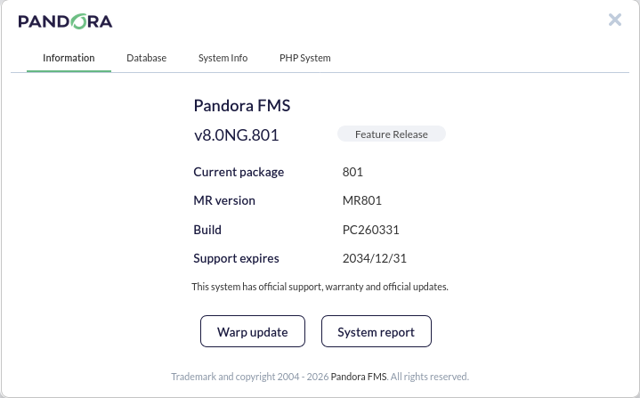
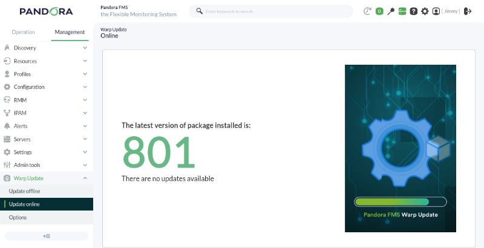
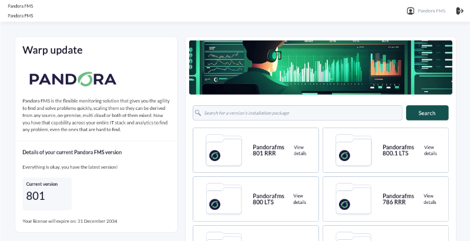

# Mises à jour

Mettre à jour Pandora FMS n'est pas une urgence, c'est de la maintenance. Et
comme toute maintenance, cela se fait quand c'est le moment et avec la
sauvegarde déjà faite, pas un vendredi après-midi parce qu'une version vient de
sortir. Ce chapitre explique les deux façons de mettre à jour une installation :
l'automatique et la manuelle. Et ce qu'il faut faire des pièces qui ne suivent
pas le même chemin : les EndPoint et les serveurs satellites.

## Introduction

Une installation de Pandora FMS comporte trois pièces qui se mettent à jour
ensemble : la **console web**, le **schéma de la base de données** et le
**serveur**. Depuis la version 784, le serveur regroupe plusieurs services en
moins de processus. Mettre à jour le serveur revient donc à mettre à jour le
paquet entier.

Il y a deux chemins pour le faire :

- **Warp Update** : des assistants depuis la console elle-même qui
  téléchargent, appliquent et vérifient la mise à jour. C'est le chemin
  recommandé.
- **Mise à jour manuelle** : les mêmes paquets, appliqués à la main, composant
  par composant. C'est plus laborieux et cela demande plus d'attention, mais
  cela donne le contrôle total du processus et cela sert quand l'assistant ne
  peut pas être utilisé.

Aucune des deux ne touche les **EndPoint** ni les **serveurs satellites** :
chacun a son propre mécanisme, et ils sont à la fin du chapitre.

La dernière version, le MR du schéma et la date de fin de support de la licence
se consultent dans **Management → About**. Il vaut la peine d'avoir cet écran
sous la main avant et après toute mise à jour : c'est lui qui dit d'où vous
venez et où vous êtes arrivé.

{ .diagrama }

Et avant de commencer, la chose habituelle, mais dite clairement : **faites un
snapshot de la machine ou une sauvegarde de tous les composants**. Si quelque
chose tourne mal, la façon simple de le réparer est de revenir en arrière. Et
cela ne fonctionne que s'il existe un point vers lequel revenir.

Pour que la section Warp Update apparaisse dans le menu, il faut avoir activé
**Enable update manager** dans **Management → Settings → System Settings →
Advanced**. S'il n'est pas activé, la console masque tout le bloc de mise à jour
et il semble que la fonctionnalité n'existe pas.

## Warp Update

Warp Update met à jour la console web, le schéma de la base de données et le
serveur de façon automatique, au moyen d'assistants. On y accède depuis
**Management → Warp Update** et il comporte trois écrans de travail, plus un
pour les options.

**Warp Update Online** télécharge et installe depuis les dépôts officiels, donc
la console a besoin d'un accès sortant à internet. Pour l'utiliser, il faut
s'enregistrer avec une adresse électronique. L'assistant affiche la version
installée et les versions vers lesquelles on peut monter : uniquement les LTS,
ou aussi les consécutives, selon la configuration. Et les notes de version,
dans **Show details**, avant de décider.

{ .diagrama }

**Warp Update Offline** fait la même chose sans connexion aux dépôts.
L'administrateur télécharge les paquets de son côté et les charge dans
l'assistant. Pour les télécharger, il faut saisir une adresse électronique et
copier le code d'accès unique que la console associe à la licence ; avec ce code
on entre dans le dépôt, qui indique la version installée, la suivante et la
dernière, et permet de télécharger trois fichiers :

| Fichier | Ce qu'il met à jour |
|---|---|
| `package_XXX.XXX.fms` | La console web et le schéma de la base de données. |
| `pandorafms_server-XXXXX.tar.gz` | Le serveur. |
| `.sig` | La signature des deux précédents, pour vérifier qu'ils n'ont pas été altérés. |

Ils se chargent un par un depuis l'assistant (**Browse it**), on vérifie que ce
qui s'affiche à l'écran correspond à ce que l'on veut appliquer, et on lance le
processus. Il convient de mettre à jour d'abord la console et le schéma, puis le
serveur ensuite. Chaque fichier doit tenir dans les limites `post_max_size` et
`upload_max_filesize` de `/etc/php.ini`, sinon le chargement échouera sans autre
explication qu'une erreur de taille.

{ .diagrama }

Si vous venez de la LTS 777, le chemin concret —quels paquets, dans quel ordre et quelles étapes ne peuvent pas être sautées— se trouve dans
[Mise à jour de la LTS 777 vers la 800](../anexos/a6-actualizacion-de-la-lts-777-a-la-800.md).

**Warp journal** laisse la trace de ce qui a été fait : version mise à jour,
s'il s'agissait du serveur ou de la console, si cela venait d'online ou
d'offline, qui l'a lancé et quand. C'est le premier arrêt quand quelque chose ne
colle pas après une mise à jour.

Les **Options** de Warp Update sont peu nombreuses et délicates :

- **Limit to LTS updates** : limite la mise à jour aux versions LTS, qui sont
  celles à support étendu.
- **Allow no-consecutive patches** : uniquement en offline, permet de sauter
  d'une version à une version non consécutive. Il est désactivé par défaut, et
  c'est très bien ainsi.
- **Warp Update URL**, **Use secured Warp Update** et **Proxy server** : ce ne
  sont pas des champs à toucher par curiosité. Avant de les modifier, consultez
  le support.

## Mise à jour manuelle

La mise à jour manuelle utilise les mêmes paquets que le mode offline
télécharge, mais appliqués à la main dans le terminal, avec l'utilisateur
**root**. L'ordre n'est pas négociable : **console, schéma de la base de données
et serveur**. La procédure est valable pour EL 7, EL 8, EL 9 et Ubuntu 22.04
LTS.

### Console

On copie le paquet `.fms` dans le répertoire de la console, on le décompresse
et on accepte de tout remplacer :

```bash
mv package_XXX.XXX.fms /var/www/html/pandora_console/
cd /var/www/html/pandora_console/
unzip package_XXX.XXX.fms
# à la question pour chaque fichier remplacé : A (All)
```

Ensuite on met à jour le numéro de paquet dans la base de données, en
remplaçant `XXX` par la version cible :

```bash
mysql -u root -p -D pandora -e "UPDATE tconfig SET value=XXX WHERE token='current_package'"
```

### Schéma de la base de données

On exécute le metteur à jour du MR :

```bash
/usr/bin/php /var/www/html/pandora_console/godmode/um_client/updateMR.php
```

### Serveur

On décompresse le paquet du serveur, on l'installe et on redémarre le service :

```bash
tar -xzvf pandorafms_server-XXXXX.tar.gz
cd pandora_server/
./pandora_server_installer --install
systemctl restart pandora_server
```

### EndPoint

Ils ne passent pas par Warp Update, et il n'est pas nécessaire d'y aller
machine par machine. La façon confortable est la **mise à jour automatique**
avec des collections de fichiers et le plugin `pandora_update`. On dépose le
nouveau binaire de l'EndPoint dans une collection. L'EndPoint exécute le plugin
avec le nom de cette collection et compare le binaire de la collection avec
celui qu'il exécute. S'ils diffèrent, il s'arrête, se remplace et redémarre
avec le nouveau. Chaque architecture a besoin de sa propre collection (un
binaire pour Windows 32 bits et un autre pour 64 bits, par exemple), et le
processus laisse une trace dans un journal qui peut être surveillé avec un
module `async_string`. On peut aussi installer la nouvelle version à la main,
avec l'installateur de chaque système d'exploitation (Linux, MS Windows). Dans
un environnement avec des centaines ou des milliers d'appareils, c'est un
travail que la collection fait toute seule.

### Serveur satellite

Le satellite n'est pas touché par Warp Update non plus : il se met à jour avec
son propre installateur, le même que celui utilisé pour l'installer. Dans la mise
à jour vers la 785, il y a en outre une étape de migration de politiques, parce
que les modules de type Dataserver des agents de Satellite sont passés au type
Satellite ; tant que cette migration n'est pas terminée, les changements de
politique n'atteignent pas ces agents.

### Vérification

Une fois le travail terminé, on regarde **Management → About** pour confirmer le
paquet et le MR, et **Management → Servers** pour voir la version dans la colonne
**Version** de tous les serveurs. Si les trois pièces ne coïncident pas, la mise
à jour n'est pas terminée.
