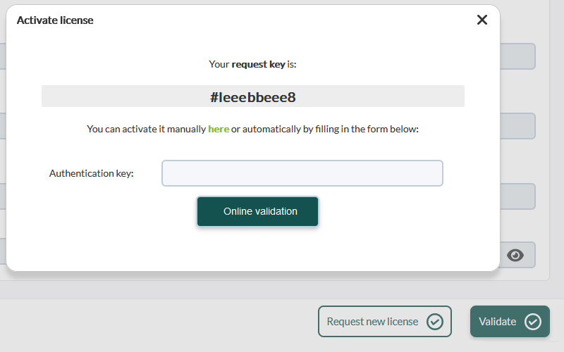

# Licences

Pandora FMS est licencié par **appareils**, pas par métriques. Cette décision a
des conséquences pratiques sur l'architecture. Un commutateur de 24 ports peut
remonter des centaines de modules sans coûter plus de licence que le
commutateur. Et ajouter des logs, de la sécurité ou de l'inventaire ne renchérit
rien : c'est inclus. Ce que l'on paie, c'est le nombre d'appareils supervisés
et, dans certains cas, par quel chemin on paie.

Ce chapitre ne parle pas de prix : cela relève des ventes. Il parle du modèle de
licence qui convient à quelle architecture, car c'est ce qui conditionne un
déploiement.

Pour se repérer avant d'entrer dans le détail, voici la correspondance entre ce
qu'il faut superviser (et ce qui se contracte à part) et la licence qui
s'applique :

| S'il faut superviser… | Il faut… | Et en plus… |
|---|---|---|
| Serveurs, applications, cloud, virtualisation | **Pandora ONE** (la plus élevée) | — |
| Équipements réseau sans agent installé | **Pandora NMS** | Admet le décompte par modules |
| Postes de travail (PC) | **Pandora RMM** | **Inclut RC SaaS** ; le RC on-premise se paie à part |
| Plusieurs installations avec une vision unique | **Command Center** | Licence **supplémentaire** à celle des nœuds, par **nœud actif** |
| Sécurité (SIEM) | **Pandora SIEM** | Un **pourcentage** de Pandora ONE, Pandora RMM ou Pandora NMS |
| SAP, IBM i ou z/OS | Le plugin de chacun | Vendu séparément |
| Contrôle à distance des équipements | **Pandora RC** | À part : **RC SaaS est inclus avec la licence Pandora RMM**, le RC on-premise se paie à part |
| Gestion des incidents et des actifs | **Pandora ITSM** | A sa propre licence |
| Ne rien vouloir maintenir | **Pandora MaaS** | Abonnement uniquement |

## Types de licence

### Licences perpétuelles et par abonnement

La version on-premise admet deux modèles. Le logiciel et les fonctionnalités
sont les mêmes dans les deux cas :

- **Licence (perpétuelle)** : elle s'acquiert une fois. Chaque année, le support
  et la maintenance sont renouvelés, pour continuer à recevoir des correctifs et
  des versions nouvelles.
- **Abonnement** : il se paie chaque année. Les deux reviennent à peu près au
  même sur cinq ans. Le choix porte donc sur la trésorerie (moins
  d'investissement initial) ou sur l'imputation de la dépense, pas sur les
  fonctionnalités.

La version dans le cloud (**Pandora MaaS**) n'a que l'abonnement, avec un
engagement annuel : là, rien ne s'installe ni ne se maintient, et la plateforme
se met à jour toute seule.

Une licence on-premise inclut, sans coût supplémentaire :

- Le support technique 8×5 par outil de tickets, sans limite d'incidents ; le
  24×7 avec téléphone dédié se contracte à part. La portée, les horaires et ce
  qui reste en dehors figurent dans la
  [licence d'utilisation](https://pandorafms.com/downloads/PandoraFMS_Licencia.pdf).
- **Les mises à jour** : correctifs et versions nouvelles.
- **Toutes les fonctionnalités**, sans coupes : collecte et supervision des
  logs, sécurité, Discovery, **serveurs satellites**, déploiement à distance des
  EndPoint, inventaire et RMM, entre autres.
- L'accès à la bibliothèque de modules, à la base de connaissances et au code
  Enterprise.

De cette liste, deux choses valent la peine d'être retenues. **Le serveur
satellite ne fait pas l'objet d'une licence à part** : il fait partie de la
licence, ce n'est pas un complément. Et **la fonctionnalité d'expérience
utilisateur web (WUX) est incluse dans Discovery**.

Et que se passe-t-il si l'on cesse de payer. Les deux modèles se comportent
différemment : avec une licence on-premise, le logiciel **continue de
fonctionner** et l'on perd seulement le support, les correctifs, les versions
nouvelles et l'accès à la bibliothèque Enterprise. Avec le paiement à l'usage,
si l'on ne paie pas, le logiciel cesse de fonctionner.

Les conditions légales (garantie sur le logiciel, portée et exclusions du
support, et responsabilité) sont développées dans la
[licence d'utilisation](https://pandorafms.com/downloads/PandoraFMS_Licencia.pdf).

### Comment on compte : agents ou modules

L'écran de licence de la console est celui qui fait foi. Le champ qui décide de
la façon de compter est le **Limit mode** : **agents** ou **modules**.

**Par agents.** On compte le nombre d'agents, et chaque agent peut embarquer
**tous les modules dont il a besoin** : il n'y a pas de plafond. Un agent est
n'importe quel appareil supervisé : un serveur, un routeur, un commutateur, un
point d'accès, un NAS. En virtualisation, chaque machine virtuelle avec sa propre
adresse IP. Les appareils surveillés par SNMP comptent aussi comme un agent,
même s'ils n'ont rien d'installé dessus.

**Par modules.** On compte le nombre de modules, pas celui des équipements. Une
licence de 5 000 modules se répartit comme on veut. 5 000 agents avec un module
chacun. Ou 50 agents avec 100 modules chacun. Ou toute combinaison intermédiaire.

Laquelle convient ? Cela dépend de la façon dont le parc grandit :

- La licence **par agents donne une montée en charge « sans surprises »** quand
  le détail se multiplie à l'intérieur d'un même équipement. Un serveur de bases
  de données avec vingt bases de données peut remonter des centaines de modules
  sans dépenser plus de licence que le serveur.
- La licence **par modules est plus efficace et plus facile à comprendre** quand
  on veut surveiller peu de chose sur beaucoup d'appareils. Si de chaque caméra
  on ne veut qu'un ping, chaque caméra finit par être un agent avec un module.
  Compter des modules là est moins cher et plus clair que compter des agents.

Les deux modèles ne valent pas pour toutes les licences :

- La licence **Pandora NMS** admet bien le mode de licence par modules.
- La licence **Pandora RMM** n'est pas compatible avec le mode de licence par
  modules.

Deux règles de plus qui affectent le décompte :

- **Minimum** : la licence minimale pour contracter avec support est de **100
  agents**, ou son équivalent en modules quand on compte par modules.
- **Par environnement, pas par serveur** : une installation est licenciée en
  entier, pas pièce par pièce. Les nœuds qui sont en passif pour la haute
  disponibilité **ne comptent pas** : un environnement avec des répliques ou de
  la redondance fonctionne avec une seule licence. L'exception est le **Command
  Center**, qui est licencié par **nombre de nœuds actifs** (les répliques ne
  comptent pas là non plus).
- **Licence mixte** : on peut combiner des **types** de licence dans la même
  installation (par exemple 10 de Pandora ONE, 50 de Pandora NMS et 500 de
  Pandora RMM), mais on ne mélange pas les façons de compter ni les modèles de
  paiement : l'installation est **entièrement par agents ou entièrement par
  modules**, et **entièrement perpétuelle ou entièrement par abonnement**.

### Licences supplémentaires

Il y a des pièces qui ne sont **pas** incluses dans la licence de supervision
et qui se contractent à part.

#### Command Center

Sa licence est **supplémentaire** à celle de supervision des nœuds (Pandora
ONE, Pandora NMS ou Pandora RMM) et se compte par **nœuds actifs**. Les
répliques de redondance ne s'ajoutent pas. Chaque nœud gère de l'ordre de
**2 000 agents**, même s'il peut en faire plus selon l'environnement.

Un exemple le montre clairement. Un environnement de **10 000 agents avec 4
nœuds** porte **une seule licence de 10 000 agents** : la licence est celle de
l'environnement, pas de chaque nœud. Et **la licence de Command Center** pour ces
quatre nœuds. S'il y avait en plus des nœuds en passif pour la haute
disponibilité, ils ne compteraient pas.

#### Pandora RC

Le contrôle à distance (bureau et shell de Windows, Linux et Mac depuis le
navigateur) est un produit avec sa propre licence : il n'entre pas dans la
licence de supervision même s'il est utilisé depuis la même console. Avec la
licence **Pandora RMM**, le **RC en mode SaaS** est inclus ; le **RC on-premise
est indépendant et se paie à part**.

#### SAP

Le plugin de SAP n'entre pas non plus dans la licence de supervision : il est
vendu et licencié séparément.

#### IBM i et z/OS

Les plugins d'**IBM i (AS400)** et de **grand système (z/OS)** suivent le même
chemin : licence à part. Ce sont, avec SAP, les exceptions au « tout inclus » de
la licence de supervision. Ce ne sont pas des développements maison.

#### Pandora SIEM

La fonctionnalité de sécurité est licenciée comme un **pourcentage de la licence
de supervision** (Pandora ONE, Pandora RMM ou Pandora NMS) et s'active depuis la
console.

#### Pandora ITSM

La gestion des incidents, des actifs et des projets est un autre produit, avec
sa propre licence : il s'intègre à Pandora FMS mais n'entre pas dans la licence
de supervision.

Ce qu'il n'y a **pas** à prendre en licence à part, même si cela en a l'air : le
**serveur satellite**, la collecte des logs, la découverte, l'inventaire et le
déploiement à distance des agents. Tout cela est dedans.

### Pandora ONE, Pandora NMS et Pandora RMM

Les trois licences se comprennent mieux ensemble. Ce qui les sépare, ce n'est pas
ce que vous pouvez faire avec la plateforme, mais à quels appareils elles
s'appliquent :

- **Pandora ONE est la licence la plus élevée** : elle couvre tout type
  d'appareil, avec EndPoint ou par vérification à distance. Elle s'applique à
  tout ce qui n'est pas spécifiquement réseau ou poste de travail.
- **Pandora NMS n'inclut que des vérifications à distance** : elle est pensée
  pour des systèmes exclusivement réseau (routeurs, commutateurs, éléments de
  réseau) sans rien installer dessus. Elle admet le mode de licence par
  modules. Si l'un de ces équipements a besoin en plus d'une vérification
  locale, on le couvre en combinant des types de licence (voir la licence
  mixte, plus haut).
- **Pandora RMM est orientée postes de travail (PC)**, pas serveurs : c'est la
  licence des machines de bureau Mac et Windows.

La règle qui les unit est simple : **la licence FMS (Pandora ONE) se calcule
comme tous les agents qui ne sont ni Pandora NMS ni Pandora RMM**. Un parc mixte
n'oblige pas à choisir une seule licence : on peut les combiner. Mais chaque
appareil paie le type qui lui correspond.

Autour de ces trois, il y a d'autres modalités : **Pandora Free**, avec les
mêmes fonctionnalités que Pandora ONE mais **gratuite jusqu'à 50 agents ou 600
moniteurs** ; **Pandora MaaS**, la version cloud gérée ; et les éditions
d'entrée (**Pandora Open**, maintenue par la communauté, et **Pandora MINI**),
qui sont une autre conversation.

## Installation de la licence

La licence s'installe depuis la console elle-même, dans **Management → Setup →
License** (*Licence*). La première chose nécessaire est l'**AuthKey** : la clé
que Pandora FMS (ou son distributeur) envoie par courrier électronique ou dans un
PDF. C'est un numéro de 12 à 15 chiffres, et **il ne sert qu'une fois**. Avec
elle, on génère la licence de *votre* installation.

Une installation nouvelle fonctionne comme **Pandora Free** (50 agents de
limite) jusqu'à ce qu'une vraie licence soit installée. Si l'on n'y touche pas,
ce n'est pas qu'elle est cassée : elle est sans licence.

L'assistant démarre avec **Request new license**, qui ouvre la boîte de dialogue
d'activation. Là apparaît une donnée qu'il vaut la peine de noter : la **request
key** de l'installation, un code court du type `#1ceebbee8`. Avec elle et avec
l'AuthKey, il y a deux chemins.

{ .diagrama }

### En ligne

On saisit l'AuthKey dans le champ **Authentication key** et on appuie sur
**Online validation**. La console génère la licence, la valide auprès du serveur
et la laisse installée.

À partir de là, il n'y a plus besoin d'y toucher : elle se rafraîchit toute
seule. Le bouton **Sync license online** sert à le forcer et à vérifier que tout
est en ordre. Il répond *« License is up to date »* s'il n'y a pas de
changements et *« License updated successfully »* s'il y en avait. Les deux
erreurs que l'on voit à cette étape sont *« Error while connecting to licence
server »*, quand la console n'atteint pas le serveur, et *« Invalid response
while validating license »*, quand elle l'atteint mais que la réponse n'est pas
valide.

### Hors connexion

Quand la console ne peut pas sortir sur internet, on utilise la **request key**
qu'affiche la boîte de dialogue. On la copie et on la porte au **portail de
Warp** (le même qui sert les paquets de mise à jour) ou on l'envoie au support.
Ce qu'ils renvoient est la licence. Cette clé se colle dans le champ **Customer
key** de l'écran de licence et on enregistre.

Il n'y a pas de validation en ligne, donc la licence reste telle qu'elle a été
installée. Il convient de garder la clé renvoyée et de répéter la demande quand
vient le moment de renouveler.

À l'enregistrement, l'écran de licence montre la photo de ce qui est contracté :
date d'expiration, **Platform Limit** (la limite) et **Current Platform Count**
(ce qu'il y a, avec des éléments activés et désactivés). Ensuite, **License
Mode**, **Limit mode** (agents ou modules) et **License Type** (console ou
Command Center). Et les limites par type : **One Limit**, **NMS Limit**, **RMM
limit** et **SAP limit**.

Trois choses de plus qui épargnent des appels au support :

- Si la licence est de type **Command Center**, il n'y a pas à activer les
  nœuds un par un : la licence du Command Center les active automatiquement.
- **Ne démarrez pas le démon `pandora_server`** avec la version Enterprise
  installée avant d'avoir activé la partie Enterprise de la console : il
  remontera des erreurs.
- Si l'installation est un Command Center, la licence se propage depuis le
  Command Center vers tous les nœuds.

Pour les prix, les quotas et les changements de modèle, il faut parler aux
ventes : cette page explique ce que couvre chaque licence et comment elle
s'accorde avec l'architecture, pas ce qu'elle coûte.
