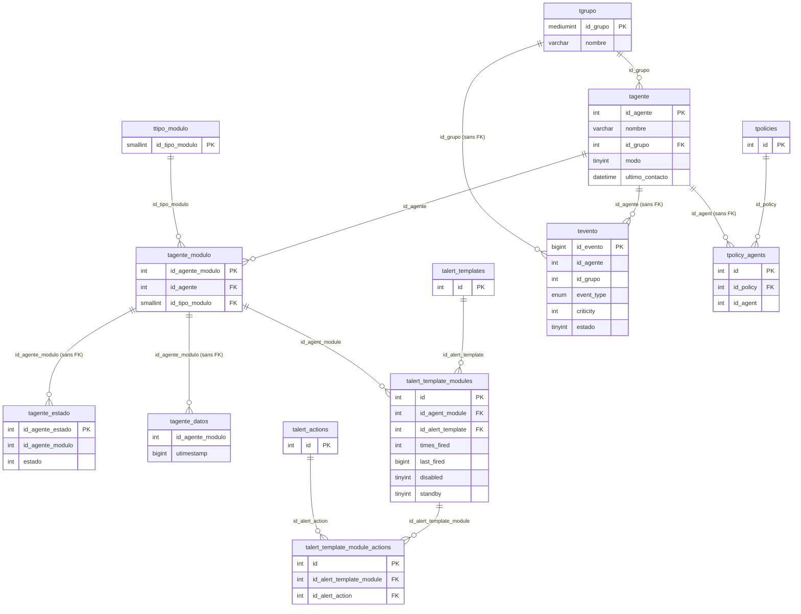

# Schéma de la base de données

Toute l'information de Pandora FMS —agents, modules, alertes, événements,
utilisateurs, politiques— vit, au final, dans quelques tables MySQL. Il est
tentant de regarder directement là-dedans quand l'interface ne donne pas la
réponse rapide qu'il faut : un rapport avec du SQL personnalisé, un `SELECT` de
diagnostic à trois heures du matin, un script qui a besoin de savoir dans quelle
colonne le serveur garde le dernier contact d'un agent. Ce chapitre est la carte
de ce territoire : quelles tables existent, à quoi sert chacune et comment elles
se relient.

!!! warning "Avant de toucher à la base de données"
    Le schéma change entre les versions —colonnes nouvelles, tables qui
    apparaissent ou disparaissent, types qui s'ajustent— sans autre avis que le
    changelog de chaque build. Cette page documente la version indiquée dans
    l'en-tête de la [référence des tables](10.2-referencia-de-tablas.md), qui
    est toujours alignée sur le code réel. Pour lire ou écrire des données de
    Pandora FMS depuis l'extérieur, la voie recommandée est
    l'API REST :
    elle est stable entre les versions et n'exige pas de connaître le schéma
    interne. Accéder directement à la base de données est un dernier recours,
    sans garantie de compatibilité, et **il ne faut jamais écrire
    directement** sur des tables gérées par le produit : le serveur et la
    console web partent du principe qu'ils sont les seuls à écrire là, et une
    ligne touchée à la main peut laisser l'agrégation des données, un compteur
    ou une file de tâches dans un état qu'ils ne savent pas interpréter
    eux-mêmes. Pour des requêtes en lecture seule, préférez toujours une
    réplique ou la base de données d'historique à la base principale en
    production.

Un détail qui surprend la première fois : la console web garde les textes (noms
d'agent et de module, descriptions…) avec les caractères spéciaux convertis en
entités HTML, si bien que `Router & Firewall` apparaît dans la table comme
`Router &amp; Firewall`. Il faut en tenir compte pour filtrer par nom. Et les
modules supprimés depuis la console ne disparaissent pas sur-le-champ : ils
restent marqués avec `delete_pending = 1` jusqu'à ce que le serveur les élimine,
c'est pourquoi les requêtes de modules les excluent.

Ce chapitre couvre la base de données principale, celle d'historique et celle du
Command Center. Il ne couvre pas les bases de données de tiers avec lesquelles
Pandora FMS s'intègre (SIEM externes, CMDB, etc.) : celles-là ont leur propre
schéma et restent hors du périmètre de cette documentation.

## Vue d'ensemble : bases de données, moteur, fichiers et version

Une installation de Pandora FMS peut compter jusqu'à trois bases de données
distinctes, toutes avec le même moteur :

- **Base de données principale** (`pandora`) : la seule obligatoire. Elle garde
  la configuration complète et les données récentes de supervision.
- **Base de données d'historique** (facultative, activée avec
  `history_db_enabled`) : même schéma que les tables de données de la
  principale, pensée pour retenir des séries temporelles au-delà de ce que la
  principale purge. Voir [Base de données
  d'historique](#base-de-donnees-dhistorique-ce-qui-bouge-quand-et-comment-elle-est-purgee).
- **Base de données du Command Center** : dans les installations avec Command
  Center, chaque nœud conserve sa propre base principale et le Command Center
  ajoute une base à lui avec des tables `tmetaconsole_*`. Voir [Command
  Center](#command-center-tables-propres-et-synchronisation).

Le moteur pris en charge est Percona Server for MySQL 8 —recommandé, surtout
au-delà de 4 000 agents— ou MySQL 8 / MySQL 8.4 depuis la build 785 ; la table
complète des prérequis est dans
[Installation](../parte-1/1.1-instalacion.md).

Le schéma se définit dans deux fichiers qui se chargent une seule fois, à
l'installation : `pandoradb.sql` (structure : les 271 tables) et
`pandoradb_data.sql` (données de départ : types de module, configuration par
défaut, catalogues). À partir de là, deux jetons de la table `tconfig` —
`db_scheme_version` (par exemple `8.0NG`) et `db_scheme_build` (par exemple
`PD260915`)— identifient la version de schéma installée, et la console les
compare avec la version du paquet pour avertir des bases de données obsolètes.

Entre versions majeures, les changements de schéma arrivent sous forme de
fichiers `extras/mr/<numéro>.sql`, un par *build*. La console garde dans
`tconfig` le jeton `MR` avec le numéro le plus élevé déjà appliqué et, à chaque
contrôle de mises à jour, propose comme en attente les fichiers de numéro
supérieur ; une fois appliqué, le fichier est déplacé vers `extras/mr/updated/`
et le jeton `MR` est mis à jour. Ils ne s'exécutent pas à la main, sauf si la
procédure de mise à jour l'indique explicitement.

## Carte par zone fonctionnelle

Les 271 tables du schéma ne sont pas organisées en différents `SCHEMA` ni en
bases de données séparées —elles vivent toutes dans la même base de données—,
mais elles répondent bien à une répartition fonctionnelle claire. Le tableau
suivant regroupe les tables par la zone qu'elles couvrent ; c'est une
construction de cette documentation pour faciliter la navigation, pas une
structure déclarée dans le moteur.

| Zone fonctionnelle | Ce qu'elle couvre | Nb de tables |
|---|---|---|
| Agents et supervision (noyau) | Agents, modules, leur configuration et leurs données | 37 |
| Groupes et organisation | Hiérarchie de groupes et de catégories | 4 |
| Alertes | Modèles, actions et commandes d'alerte | 16 |
| Événements | Journal des événements et son cycle de vie | 10 |
| Politiques | Configuration déployée en bloc sur les agents | 13 |
| Utilisateurs, profils et sessions | Comptes, permissions et sessions actives | 16 |
| Notifications et messagerie | Avis internes et messages entre utilisateurs | 11 |
| Rapports et visualisation | Rapports, graphiques, tableaux de bord, consoles visuelles | 34 |
| Discovery et reconnaissance | Tâches de découverte du réseau | 9 |
| Cartes réseau et SIG | Cartes réseau et géolocalisation | 17 |
| Cluster et haute disponibilité | Configuration de cluster d'agents | 3 |
| Command Center | Nœuds, synchronisation et migration entre nœuds | 14 |
| Gestionnaire d'identifiants | Stockage d'identifiants réutilisables | 1 |
| Serveurs, configuration et maintenance | Serveurs, configuration globale, sauvegardes | 13 |
| Traps SNMP | Traps reçus et leur normalisation | 2 |
| IPAM (gestion des adresses IP) | Réseaux, sous-réseaux et adresses IP gérés | 8 |
| NCM (Network Config Manager) | Configuration des équipements réseau | 12 |
| RMM (Remote Monitoring & Management) | Gestion à distance des équipements | 7 |
| SIEM | Règles et décodeurs d'événements de sécurité | 12 |
| Sécurité et vulnérabilités | Vulnérabilités et correctifs détectés | 3 |
| Arrêts planifiés | Fenêtres de maintenance planifiée | 3 |
| Tags | Étiquetage de modules et de politiques | 3 |
| Services | Services composés d'autres éléments | 2 |
| Auto-configuration d'agents | Règles d'auto-configuration d'agents nouveaux | 3 |
| Commandes distantes (console web) | Commandes distantes exécutables depuis la console | 2 |
| [Collections](../parte-2/2.9-colecciones.md) et plugins | Collections de fichiers et catalogue de plugins | 2 |
| Langues et traduction | Traductions de l'interface | 3 |
| Divers / utilitaires internes | Tables de support sans zone propre | 11 |

Pour le détail des colonnes, des types, des clés et des commentaires de
n'importe quelle table de cette liste, la [référence des
tables](10.2-referencia-de-tablas.md) réunit les 271 tables regroupées par cette
même zone, avec un lien direct vers chacune.

## Tables du noyau en détail et diagramme de relations

Une poignée de tables concentre la plus grande partie des requêtes habituelles.
Les connaître par cœur évite plus d'un retour à la référence complète :

- **Agent et inventaire des modules.** `tagente` garde un enregistrement par
  agent (`id_grupo` référence `tgrupo` ; `modo` est le mode d'apprentissage du
  module à sa création, pas un état de l'agent — voir
  [Codes et énumérations](#codes-et-enumerations)). Chaque module de cet agent
  est une ligne dans `tagente_modulo` (`id_agente` référence `tagente`,
  `id_tipo_modulo` référence `ttipo_modulo`, le catalogue des types de module).
  Le dernier état connu de chaque module vit dans `tagente_estado` : une ligne
  par module, avec `id_agente_modulo` et `id_agente` qui pointent vers les
  tables précédentes par convention de nom, sans `FOREIGN KEY` déclarée.
- **Données des modules.** Les séries temporelles se répartissent en quatre
  tables selon le type de donnée : `tagente_datos` (numériques),
  `tagente_datos_string` (chaîne), `tagente_datos_inc` (incrémentales) et
  `tagente_datos_log4x` (logs). Les quatre sont indexées par
  `id_agente_modulo` + `utimestamp`, également sans `FOREIGN KEY` déclarée —le
  volume qu'elles déplacent chaque jour déconseille ce contrôle à chaque
  insertion (voir [Base de données
  d'historique](#base-de-donnees-dhistorique-ce-qui-bouge-quand-et-comment-elle-est-purgee)).
- **Alertes.** Un modèle d'alerte (`talert_templates`) est affecté à un module
  concret via `talert_template_modules` (`id_agent_module` référence
  `tagente_modulo`, `id_alert_template` référence `talert_templates` ; là
  vivent aussi `times_fired`, `last_fired`, `disabled` et `standby`). Chaque
  affectation déclenche une ou plusieurs actions via
  `talert_template_module_actions`, qui pointent vers `talert_actions` et, de
  là, vers `talert_commands`.
- **Événements.** `tevento` est une ligne par événement généré, avec `id_agente`,
  `id_grupo`, `id_agentmodule` et `id_alert_am` comme références par convention
  (sans `FOREIGN KEY` déclarée). `event_type` est un `ENUM` fermé avec les types
  d'événement possibles ; `criticity` et `estado` sont les codes décrits dans la
  section suivante.
- **Politiques.** `tpolicies` est l'en-tête d'une politique ; `tpolicy_agents`
  et `tpolicy_groups` définissent sur quels agents ou groupes elle s'applique,
  et `tpolicy_modules` et `tpolicy_alerts` quels modules et alertes elle déploie
  sur eux.
- **Gestionnaire d'identifiants.** `tcredential_store` garde chaque identifiant
  sous son `identifier` comme clé primaire ; `product` est un `ENUM` avec les
  types d'identifiant pris en charge (`CUSTOM`, `AWS`, `AZURE`, `GOOGLE`, `SAP`,
  `WMI`, `SNMP`). Le détail fonctionnel complet est dans
  [Gestionnaire d'identifiants](../parte-2/2.2-gestor-de-credenciales.md), et son
  chiffrement dans [Chiffrement de la base de
  données](../parte-9/9.5-cifrado-de-la-base-de-datos.md) ; ici, seule la forme
  de la table nous intéresse.

Le diagramme suivant résume ces relations. Les lignes continues marquent une
`FOREIGN KEY` déclarée dans le schéma ; le reste sont des relations par
convention de nom de colonne, sans restriction déclarée dans le moteur.



## Codes et énumérations

Plusieurs colonnes gardent des entiers qui n'ont de sens qu'avec leur table de
significations à portée de main.

**État de module** (colonne `estado` de `tagente_estado`) : valeurs que le
serveur garde réellement.

| Code | Signification |
|---|---|
| `0` | Normal |
| `1` | Critique |
| `2` | *Warning* |
| `3` | Inconnu (*unknown*) |
| `4` | Non démarré — valeur initiale à la création du module, avant de recevoir la première donnée |

Les constantes de console `AGENT_MODULE_STATUS_*` ajoutent des valeurs
supplémentaires, mais ce sont des **valeurs de filtre** de l'interface, pas
quelque chose que la colonne garde jamais : `5` (non démarré, dans les filtres),
`6` (non normal, regroupement), `7` (normal forcé) et `100`/`200`/`300`
(critique, *warning* ou normal avec une alerte déclenchée). Ne pas confondre
colonne et filtre : si l'on interroge `estado` directement en SQL, seules les
valeurs `0` à `4` apparaîtront.

**État de l'agent :** aucune colonne ne le garde. La console web le calcule à
partir des compteurs de `tagente` (`normal_count`, `warning_count`,
`critical_count`, `unknown_count`, `notinit_count`, `total_count` et
`fired_count`, celui des alertes déclenchées), que le serveur tient à jour. Pour
savoir comment se porte un agent en SQL, on regarde ces compteurs.

**Mode de l'agent** (colonne `modo` dans `tagente`) : `0` normal, `1`
apprentissage (*learning*), `2` autodésactivé (*autodisable*). La colonne a `0`
par défaut, mais en pratique les agents naissent à `1` : c'est la valeur
qu'utilisent le serveur à la création d'un agent depuis un XML et la console web
lors d'un ajout à la main.

**Type de module** (table `ttipo_modulo`) : catalogue avec id, nom interne (par
exemple `generic_data`), catégorie numérique et type de donnée (`numeric`,
`boolean`, `string`). Il y a près de quarante types ; le catalogue complet est
dans la ligne `ttipo_modulo` de la [référence des
tables](10.2-referencia-de-tablas.md#ttipo_modulo).

**État d'événement** (colonne `estado` dans `tevento`) : `0` nouveau, `1`
validé, `2` en cours.

**Type d'événement** (colonne `event_type` dans `tevento`, `ENUM` fermé) :
`going_unknown`, `unknown`, `alert_fired`, `alert_recovered`,
`alert_ceased`, `alert_manual_validation`, `recon_host_detected`, `system`,
`error`, `new_agent`, `going_up_warning`, `going_up_critical`,
`going_down_warning`, `going_down_normal`, `going_down_critical`,
`going_up_normal`, `configuration_change`, `ncm`.

**Criticité d'événement** (colonne `criticity` dans `tevento`) : `0`
maintenance, `1` informatif, `2` normal, `3` *warning*, `4` critique, `5` mineur
(*minor*), `6` majeur (*major*). Les valeurs `20`, `21` et `34` sont des
combinaisons qu'utilisent les filtres de la console (`20`, non normal ; `21`,
critique ou normal ; `34`, *warning* ou critique) et ne sont pas des criticités
propres à un événement concret.

**Alertes déclenchées :** il n'existe pas de colonne d'« état » unique pour une
alerte. Elle se déduit de `talert_template_modules.times_fired` (compteur de
déclenchements) et `last_fired` (horodatage du dernier) ; `standby` et
`disabled` contrôlent si l'alerte peut se déclencher tout court.

## Base de données d'historique : ce qui bouge, quand et comment elle est purgée

La base d'historique est facultative (`history_db_enabled` dans `tconfig`, à côté
de `history_db_host`, `history_db_port`, `history_db_name` et du reste des
paramètres de connexion, configurables depuis **Réglages → Configuration du
système → Base de données d'historique**). Quand elle est active, le serveur y
déplace —tâche périodique de `pandora_db.pl`— les données de séries temporelles
des modules (`tagente_datos`, `tagente_datos_string`) et, le cas échéant, les
événements et les traps. Le détail exact du déplacement est une fonctionnalité
Enterprise et ne se trouve pas dans l'arborescence community, donc il n'est pas
documenté ici.

Dans la base principale, le même processus périodique purge les données qui ont
déjà atteint leur échéance, avec ces limites par défaut :

| Paramètre | Par défaut | Purge |
|---|---|---|
| `days_purge` | 45 jours | `tagente_datos` |
| `string_purge` | 7 jours | `tagente_datos_string` |
| `event_purge` | 7 jours | `tevento` |
| `days_delete_not_initialized` | 7 jours | Agents qui passent ce temps sans démarrer |
| `days_compact` | 0 (désactivé) | Compactage des données anciennes |

La base de données d'historique, quand elle est active, a son propre cycle de
purge —la même fonction, exécutée sur la connexion d'historique— avec ses
propres limites (`history_db_days`, `history_db_string_days`) : elle n'hérite
pas des jours de la base principale.

Pour dimensionner de combien chaque base va grossir selon le nombre d'agents et
de modules, voir
[Analyse volumétrique et conceptions pour la haute
capacité](../parte-9/9.14-analisis-de-volumetria-y-disenos-para-alta-capacidad.md),
que l'on ne répète pas ici.

## Command Center : tables propres et synchronisation

Le Command Center a sa propre base de données, avec des tables préfixées
`tmetaconsole_*` qui répliquent ou mettent en cache de l'information des nœuds
gérés —elles ne remplacent jamais les tables équivalentes de chaque nœud, qui
restent la source d'origine de ces données—.

Les tables clés sont :

- `tmetaconsole_setup` : enregistrement de chaque nœud, avec son URL et les
  identifiants de connexion à sa base de données, son API et sa console —
  chiffrés si le
  [chiffrement de la base de données](../parte-9/9.5-cifrado-de-la-base-de-datos.md)
  est actif—.
- `tmetaconsole_agent` : agents synchronisés depuis les nœuds, avec leur nœud
  d'origine.
- `tmetaconsole_agent_secondary_group` : groupes secondaires répliqués depuis
  les nœuds.
- `tmetaconsole_ha_databases` : bases de données de haute disponibilité
  enregistrées par nœud.
- `tmetaconsole_license_limit_cache` : cache de la limite de licence agrégée de
  tous les nœuds.

La synchronisation et la migration d'éléments entre nœuds utilisent un second
groupe de tables : `tsync_queue` (file de synchronisation), `tmigration_queue`
et `tmigration_module_queue` (files de migration d'agents et de modules entre
nœuds), `tmerge_error`, `tmerge_steps` et `tmerge_queries` (fusion de nœuds) et
`tnode_relations` (relation entre chaque élément et son nœud d'origine). Quand
la migration déplace des données de module entre des nœuds qui ont la base de
données d'historique activée, l'opération touche aussi cette connexion
d'historique en origine et en destination, pas seulement la base principale de
chaque nœud.

L'enregistrement et la gestion des nœuds depuis l'interface sont couverts dans
leur propre chapitre de Command Center ; cette section ne répète pas cette
procédure.

## Données chiffrées

Ce chapitre est, par convention de tout le site, le seul endroit où l'on nomme
des tables et des colonnes : les autres pages —y compris
[Chiffrement de la base de
données](../parte-9/9.5-cifrado-de-la-base-de-datos.md)— renvoient ici au lieu
de les répéter. Avec le chiffrement actif, ces colonnes gardent la valeur
chiffrée au lieu de l'originale : mots de passe de modules de plugin et
identifiants SNMPv3 dans `tagente_modulo` et `tpolicy_modules` ; mots de passe
de modules d'inventaire Enterprise ; champs personnalisés d'agent marqués comme
type mot de passe dans `tagent_custom_data` ; plusieurs jetons de mot de passe
dans `tconfig` (courrier SMTP, LDAP/Active Directory, base de données
d'historique, réplication de la console, API, proxy de mises à jour, Pandora RC,
commandes distantes, hash d'accès entre nœuds) ; les mots de passe de connexion
à chaque nœud dans `tmetaconsole_setup` ; et utilisateur, mot de passe et champs
additionnels de chaque identifiant dans `tcredential_store`.

Toutes sont conservées en `TEXT` ou `VARCHAR` : le chiffrement n'utilise aucun
type binaire dédié, il produit du texte en base64. Cela a une conséquence
directe pour qui interroge la base à la main : un `SELECT` sur l'une de ces
colonnes renvoie la valeur chiffrée, pas l'originale. Pour la lire en clair, il
faut le mécanisme de chiffrement et de déchiffrement, pas une requête SQL — voir
[Chiffrement de la base de
données](../parte-9/9.5-cifrado-de-la-base-de-datos.md) pour la liste complète
des données protégées et la procédure d'activation.

## Requêtes en lecture seule utiles

Une poignée de requêtes couvre la plupart des besoins de diagnostic ponctuel.
Toutes sont en lecture seule et respectent l'avertissement du début du chapitre :
préférer une réplique ou la base de données d'historique à la principale en
production.

Agents qui ne contactent pas depuis plus d'un jour :

```sql
SELECT nombre, direccion, ultimo_contacto
FROM tagente
WHERE disabled = 0
  AND ultimo_contacto < NOW() - INTERVAL 1 DAY;
```

Modules en état critique en ce moment :

```sql
SELECT a.nombre AS agente, m.nombre AS modulo
FROM tagente_estado e
JOIN tagente_modulo m ON e.id_agente_modulo = m.id_agente_modulo
JOIN tagente a ON e.id_agente = a.id_agente
WHERE e.estado = 1
  AND m.disabled = 0
  AND m.delete_pending = 0;
```

Événements par criticité sur les dernières 24 heures :

```sql
SELECT criticity, COUNT(*)
FROM tevento
WHERE utimestamp > UNIX_TIMESTAMP(NOW() - INTERVAL 1 DAY)
GROUP BY criticity;
```

Alertes qui se sont déclenchées au moins une fois, avec leur dernier
déclenchement :

```sql
SELECT m.nombre AS modulo, t.times_fired, FROM_UNIXTIME(t.last_fired) AS ultimo_disparo
FROM talert_template_modules t
JOIN tagente_modulo m ON t.id_agent_module = m.id_agente_modulo
WHERE t.times_fired > 0;
```

Données d'un module sur une plage de dates :

```sql
SELECT FROM_UNIXTIME(utimestamp) AS fecha, datos
FROM tagente_datos
WHERE id_agente_modulo = ?
  AND utimestamp BETWEEN UNIX_TIMESTAMP('2026-01-01') AND UNIX_TIMESTAMP('2026-01-31')
ORDER BY utimestamp;
```

Nombre d'agents par groupe :

```sql
SELECT g.nombre AS grupo, COUNT(*) AS agentes
FROM tagente a
JOIN tgrupo g ON a.id_grupo = g.id_grupo
GROUP BY g.nombre
ORDER BY agentes DESC;
```

Champs personnalisés d'un agent concret :

```sql
SELECT f.name, d.description
FROM tagent_custom_data d
JOIN tagent_custom_fields f ON d.id_field = f.id_field
WHERE d.id_agent = ?;
```

Modules sans données (inconnus) regroupés par groupe :

```sql
SELECT g.nombre AS grupo, COUNT(*) AS modulos_desconocidos
FROM tagente_estado e
JOIN tagente_modulo m ON e.id_agente_modulo = m.id_agente_modulo
JOIN tagente a ON e.id_agente = a.id_agente
JOIN tgrupo g ON a.id_grupo = g.id_grupo
WHERE e.estado = 3
  AND m.disabled = 0
  AND m.delete_pending = 0
GROUP BY g.nombre;
```
