# Supervision avec des EndPoints

L'EndPoint est le logiciel qui s'installe dans la machine à superviser pour en
tirer le meilleur parti : les processus, les services, les fichiers, tout ce qui
ne se voit que de l'intérieur. Pandora FMS en maintient trois, un en Go, un
autre en Perl et un autre en C++ pour Windows, qui partagent le format de
configuration et le protocole d'envoi, mais diffèrent dans ce que chaque système
d'exploitation permet. Ce chapitre couvre ce que fait un EndPoint, comment faire
les premiers pas avec lui et comment gérer sa configuration depuis la console
web sans toucher le fichier à la main à chaque fois.

## Qu'est-ce qu'un EndPoint

Un EndPoint fait, en boucle, toujours la même chose : il lit son fichier de
configuration, exécute les modules qu'il a définis, rassemble le résultat dans un
XML et l'envoie au serveur par Tentacle. Ce cycle se répète toutes les `interval`
secondes, sans plus d'ambition ni de mystère. La complexité, s'il y en a, tient à
la décision des modules à exécuter, pas au mécanisme de livraison.

Il convient de ne pas confondre deux choses au nom proche. L'**agent** est le
conteneur logique qui existe dans la console web : un nom, des modules, un
historique. L'**EndPoint** est le processus installé sur la machine qui alimente
cet agent en données. La plupart du temps, les deux vont de pair — un EndPoint, un
agent —, mais l'agent peut exister sans aucun EndPoint derrière et recevoir des
données par une autre voie : la supervision distante (SNMP, WMI, contrôles réseau
depuis le serveur ou depuis un serveur satellite), l'insertion par API ou un
plugin de *discovery*. La question qui tranche entre installer un EndPoint et
recourir à la supervision distante est simple : avez-vous besoin de quelque chose
qui ne se voit que de l'intérieur de la machine — un processus, un fichier de
log, l'utilisation réelle du CPU, un script à vous —, ou ce que l'on voit de
l'extérieur suffit-il ? La seconde option ne demande pas de toucher la machine
cible ; la première, oui.

L'installation de l'EndPoint se trouve dans
[Installation en ligne de l'EndPoint](../parte-1/1.1-instalacion.md#installation-en-ligne-de-lendpoint)
et ses variantes hors ligne. Ici, on part du principe qu'il est déjà installé et
en marche.

### Les trois EndPoints : Go, Perl et Windows

| EndPoint | Langage | Systèmes | Service | Configuration |
|---|---|---|---|---|
| Go | Go | Linux x86_64 | `systemd` (`pandora_agent_daemon`) | `/etc/pandora/pandora_agent.conf` |
| Unix (Perl) | Perl | Autres Unix : AIX, HP-UX, Solaris, BSD, macOS ; et Linux sur les architectures sans binaire Go | `systemd` (`pandora_agent_daemon`) | `/etc/pandora/pandora_agent.conf` |
| Windows | C++ | MS Windows | Service `PandoraFMSAgent` | `pandora_agent.conf` dans le dossier d'installation |

Sous Linux, l'EndPoint Go est aujourd'hui celui qui s'installe par défaut et
celui qui est recommandé, et il a de bonnes raisons de l'être. C'est un unique
binaire autonome, compilé de façon statique et sans bibliothèques externes : il
ne réclame ni interpréteur, ni modules, ni versions précises de quoi que ce soit
d'installé sur la machine. Le peu qu'il utilise du système, ce sont les outils
que tout Linux apporte d'origine (`sh`, `ps`, `df`) et le client Tentacle, qui
voyage dans le même paquet. Cela le rend idéal pour un déploiement à grande
échelle sur les systèmes avec lesquels il est compatible : on le copie, on le
lance et il fonctionne, sans surprises de dépendances d'une machine à l'autre. Et
comme Go compile de façon croisée pour de nombreux systèmes d'exploitation et
architectures, le même code peut produire des binaires pour d'autres plateformes
sans rien réécrire ; aujourd'hui, le paquet officiel est distribué pour Linux
x86_64.

!!! tip "Un seul binaire, zéro dépendance"
    Pour déployer des EndPoints sur de nombreuses machines Linux x86_64,
    l'EndPoint Go est l'option la plus commode : il n'y a rien à préparer sur le
    système avant de l'installer.

L'EndPoint Perl entre en jeu dans deux situations : les systèmes Unix qui ne sont
pas Linux (AIX, HP-UX, Solaris, les BSD, macOS) et les architectures Linux pour
lesquelles il n'existe pas de binaire Go, soit aujourd'hui `x86`, `armv7l` et
`aarch64`. L'installateur en ligne détecte l'architecture tout seul et passe à
une compilation de Perl depuis les sources sans qu'il faille le demander
expressément. Sous Windows, le seul candidat est l'EndPoint natif en C++.

Les trois parlent la même langue vers le serveur : même format de
`pandora_agent.conf`, même syntaxe `module_begin` / `module_end`, même XML de
données et même transport Tentacle. Ce qui change de l'un à l'autre — les types
de module qu'il prend en charge, la présence d'un watchdog, la façon de le
redémarrer — est signalé section par section au fil de leur apparition.

## Premiers pas avec un EndPoint fraîchement installé

Un EndPoint fraîchement installé enregistre l'agent dans la console web dès qu'il
envoie son premier XML : il n'y a pas à le créer à la main. Cela est possible
grâce à l'autocréation d'agents du serveur (`autocreate 1` dans
`pandora_server.conf`), qui est activée par défaut dans tous les environnements.
L'agent apparaît dans le groupe que déclare l'EndPoint — si ce groupe n'existe
pas, dans le groupe de réserve que fixe `autocreate_group` sur le serveur — avec
l'intervalle et les modules que le modèle de configuration apporte d'usine : sous
Linux et Windows, une poignée de modules de base (charge CPU, connexions TCP et
plugins d'utilisation du disque, de la mémoire et du réseau), suffisants pour
vérifier d'un coup d'œil que l'envoi fonctionne. L'intervalle par défaut est de
300 secondes (cinq minutes) ; le changer revient à modifier `interval` dans le
fichier de configuration.

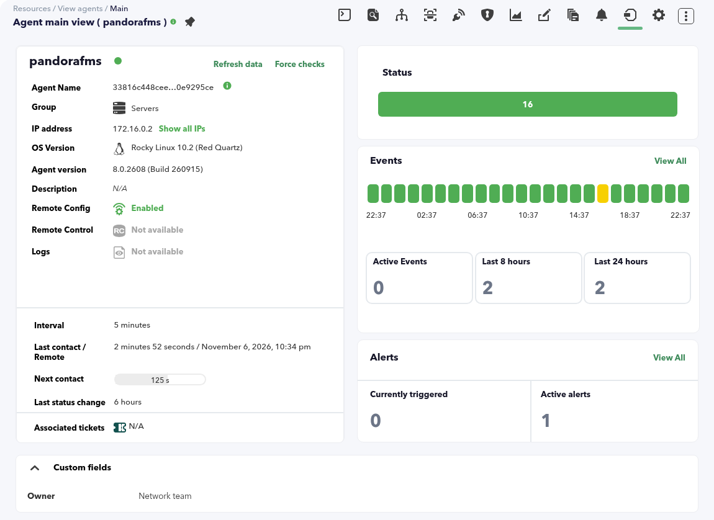{ .captura }

!!! note "Si l'agent n'apparaît pas"
    Avec `autocreate 0` sur le serveur, les données d'un agent qui n'existe pas
    dans la console sont écartées. C'est une option de sécurité pour les
    environnements où seuls des agents créés à la main sont admis ; si
    l'EndPoint envoie et que l'agent n'apparaît pas, c'est la première chose
    qu'il convient de vérifier.

Sous Linux, l'EndPoint tourne comme service `systemd` sous le nom
`pandora_agent_daemon` :

```bash
systemctl start pandora_agent_daemon
systemctl stop pandora_agent_daemon
systemctl restart pandora_agent_daemon
```

L'ancien script de démarrage de `/etc/init.d` est encore présent dans quelque
paquet, mais il est retiré : il se contente d'avertir qu'il faut utiliser
`systemctl` et se termine sans rien faire. Ne l'utilisez pas et ne documentez pas
de procédures à son sujet.

Sous Windows, l'EndPoint tourne comme le service `PandoraFMSAgent` :

```powershell
NET START PandoraFMSAgent
NET STOP PandoraFMSAgent
```

La configuration réside dans `/etc/pandora/pandora_agent.conf` sous Linux et Unix
— le même fichier pour l'EndPoint Go et l'EndPoint Perl ; dans une installation
avec son propre chemin, dans `<préfixe>/etc/pandora/` — et dans
`pandora_agent.conf` à l'intérieur du dossier d'installation sous Windows (par
défaut, `C:\Program Files\pandora_agent`). Tout changement manuel dans ce fichier
exige de redémarrer le service pour être appliqué ; si la configuration distante
est active, il faut en outre tenir compte de ce qui est expliqué plus bas, car un
changement local peut finir écrasé.

### Paramètres essentiels de pandora_agent.conf

Parmi les nombreux jetons que `pandora_agent.conf` accepte, voici ceux que l'on
touche le premier jour. Le reste — les modules à part — se trouve dans la
[référence complète de configuration de l'EndPoint](../parte-9/9.1-referencia-completa-de-configuracion-del-endpoint.md).

| Paramètre | Ce qu'il fait | Par défaut |
|---|---|---|
| `server_ip` | IP ou FQDN du serveur Pandora FMS auquel l'EndPoint rend compte. | `localhost` |
| `interval` | Secondes entre chaque cycle de collecte et d'envoi. | `300` |
| `group` | Groupe auquel l'agent est affecté dans la console web. | Aucune valeur dans le code ; les modèles d'installation apportent `Servers`. |
| `agent_alias` | Nom visible de l'agent dans la console. S'il reste vide, il prend le nom de la machine (*hostname*). À ne pas confondre avec `agent_name`, l'identifiant interne que le serveur utilise pour ne pas dupliquer des agents : changer l'alias ne renomme pas l'agent. | Vide (hostname) |
| `remote_config` | Permet de modifier cette configuration et ses modules depuis la console. Le sujet est traité en détail dans la section suivante. | `0` dans le code ; les modèles d'installation le laissent à `1` |
| `debug` | Avec `1`, l'EndPoint consigne plus de détail dans son log et, après l'envoi de chaque XML, en conserve une copie dans le dossier temporaire (avec le suffixe `sent`) au lieu de l'effacer. Les données sont envoyées de la même manière : cela sert à voir ce qui est envoyé exactement, pas à tester en cachette. | `0` |

## Configuration distante depuis la console web

!!! warning "Elle est activée d'usine"
    Les modèles d'installation de Linux et de Windows apportent
    `remote_config 1` : tout EndPoint installé avec le paquet standard permet,
    dès la première minute, à quiconque a accès à la console de modifier sa
    configuration et ses modules sans toucher la machine. L'installateur en
    ligne ne change cette valeur que si on lui passe explicitement la variable
    `PANDORA_REMOTE_CONFIG` ; si l'on ne touche à rien, elle reste active. Si le
    jeton `remote_config` manque purement et simplement du fichier, la valeur
    que suppose le code est `0`, mais ce n'est pas ce qu'apporte l'installation
    standard : c'est la situation d'un fichier modifié à la main et tronqué.
    Avant de considérer qu'un EndPoint est fermé aux changements distants,
    vérifiez le jeton.

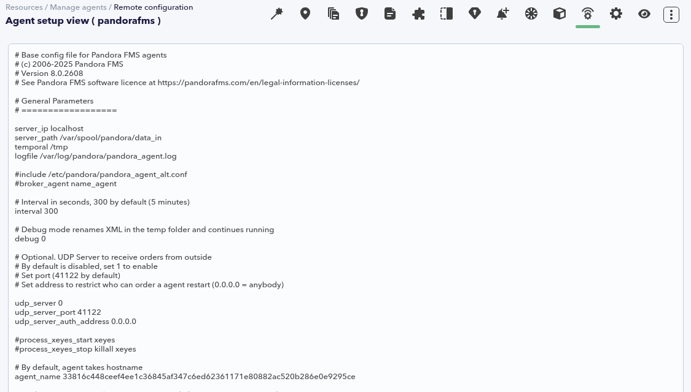{ .captura }

Avec la configuration distante active, la console peut remplacer le
`pandora_agent.conf` de l'EndPoint en entier et créer ou modifier des modules
locaux sans que personne ne se connecte à la machine. Le mécanisme sous-jacent
est le même dans les trois EndPoints, avec des nuances : à chaque cycle,
l'EndPoint calcule le MD5 de sa configuration actuelle et le compare à celui qui
se trouve sur le serveur.

- Si le serveur n'a pas encore de MD5 pour cet agent, l'EndPoint téléverse sa
  configuration locale : c'est le premier contact, et la console part de ce qui
  existait déjà sur la machine au lieu d'exiger de l'écrire de zéro.
- Si le MD5 du serveur diffère du MD5 local, l'EndPoint télécharge la
  configuration nouvelle et la laisse comme fichier actif.
- S'ils coïncident, rien ne se passe : c'est le cas normal, cycle après cycle.

La désactiver est aussi simple que de mettre `remote_config 0` et de redémarrer
le service ; à partir de là, les changements n'entrent qu'en modifiant le fichier
à la main sur la machine.

Deux autres pièces de la configuration qu'il convient de connaître dès le début :
les *custom fields* de l'agent, que l'EndPoint peut déclarer dans son fichier
(`custom_field1_name`, `custom_field1_value` et les suivants) et qui, avec la
configuration distante active, se modifient aussi depuis la console ; et les
groupes protégés par mot de passe : si le groupe de la console exige un mot de
passe, l'EndPoint doit le déclarer avec `group_password` pour que le serveur crée
l'agent dans ce groupe.

Un champ personnalisé ne se remplit que s'il existe déjà dans la console sous ce
même nom (**Ressources → Champs personnalisés** ; tout sur ces champs est dans
[2.21, Champs personnalisés de l'agent](2.21-configuracion-comun-de-los-agentes.md#champs-personnalises-de-lagent)) ; s'il n'existe pas, le serveur
écarte la valeur sans plus. C'est là que se définit aussi son type : texte libre,
liste de valeurs, mot de passe (la console l'affiche avec des astérisques) ou
lien. Pour un champ de type lien, l'EndPoint envoie une paire avec le texte et
l'adresse :

```conf
custom_field1_name Documentation
custom_field1_value ["Manuel du serveur","https://intranet.example.com/srv01"]
```

Une différence entre EndPoints, et non des moindres : l'EndPoint Perl applique la
configuration distante avec n'importe quel `transfer_mode` (`tentacle`, `ssh`,
`ftp` ou `local`), tandis que l'EndPoint Go ne le fait qu'avec `tentacle` ou
`local` ; avec `ssh` ou `ftp`, il ne télécharge pas de configuration distante.

### Autoconfiguration des EndPoints

La configuration distante a une extension naturelle pour les grands déploiements :
l'autoconfiguration, qui applique un groupe, des politiques ou une configuration
supplémentaire à chaque EndPoint nouveau dès qu'il s'enregistre, selon des règles
définies à l'avance, sans les toucher un par un. Le sujet est expliqué en détail
dans [Mécanismes d'auto-approvisionnement](../parte-6/6.6-mecanismos-de-autoprovision.md).

## Superviser les bases du système

Avant de penser à des scripts propres ou à des intégrations exotiques, il convient
de couvrir l'évident : combien de CPU et de mémoire libre il reste, combien
d'espace disque il reste, si un processus ou un service sont toujours vivants.
C'est 80 % de ce que l'on demande à un EndPoint, et une bonne partie arrive
faite : sans rien configurer, le modèle avec lequel il est installé collecte déjà
l'essentiel.

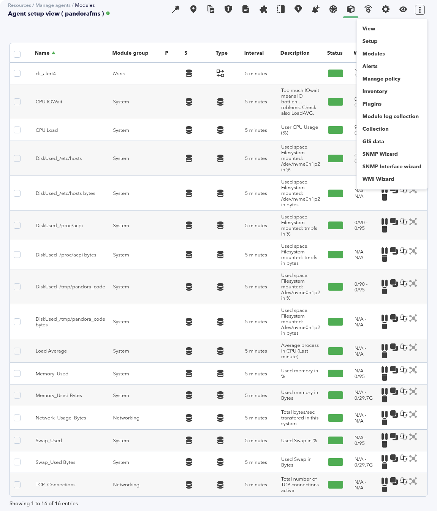{ .captura }

| Ce qui sort d'usine | Linux (Go et Perl) | Windows |
|---|---|---|
| Utilisation du CPU | Module `CPU Load` (avec `vmstat`), plus `CPU IOWait` et `Load Average` | Module `CPU Load` (interroge WMI) |
| Utilisation de chaque disque (%) | Plugin `pandora_df_used` | Plugin `df_percent_used.vbs` |
| Utilisation de la mémoire (%) | Plugin `pandora_mem_used` (inclut le *swap*) | Plugin `mem_percent_used.vbs` |
| Trafic réseau | Plugins `pandora_netusage` et `net_usage` | Plugin `network.vbs` |
| Connexions TCP | Module `TCP_Connections` | Module `TCP_Connections` |
| Services connus | Plugin `autodiscover --default` : il détecte les services habituels (bases de données, serveurs web…) et surveille leur état, leur CPU et leur mémoire | Idem, avec `autodiscover.exe --default` |
| Informations matérielles (CPU, RAM, disques, interfaces) | Plugin `hardware_info`, une fois par jour | Idem, avec `hardware_info.exe` |

Malgré cela, il convient de savoir comment faire chaque chose à la main : pour
surveiller un disque, un processus ou un service précis, pour ajuster des seuils
ou pour remplacer le modèle par le vôtre. Ce qui suit décrit les modules natifs de
chaque EndPoint : d'abord ce qui est commun aux trois, ensuite ce qui change
selon le système d'exploitation.

### Modules communs à tous les EndPoints

Go, Perl et Windows partagent ces cinq modules avec la même syntaxe :

| Module | Ce qu'il mesure |
|---|---|
| `module_cpuusage` | Pourcentage d'utilisation du CPU. |
| `module_freememory` | Mémoire libre, en MB. |
| `module_freepercentmemory` | Mémoire libre, en %. |
| `module_freedisk` | Espace libre sur une partition ou une unité, en MB. |
| `module_freepercentdisk` | Espace libre sur une partition ou une unité, en %. |

```conf
module_begin
module_name CPU
module_type generic_data
module_cpuusage
module_end

module_begin
module_name Mémoire libre
module_type generic_data
module_freememory
module_end

module_begin
module_name Mémoire libre (%)
module_type generic_data
module_freepercentmemory
module_end

module_begin
module_name Disque / libre (%)
module_type generic_data
module_freepercentdisk /
module_end
```

`module_freedisk` et `module_freepercentdisk` ont besoin de savoir quelle unité
regarder : sous Linux et Unix, le point de montage tel qu'il apparaît dans `df`
(`/`, `/var`) ; sous Windows, la lettre de l'unité (`C:`). Le reste de la
définition — quel disque, quelle partition — ne se devine pas : si le point de
montage ou la lettre n'existent pas sur la machine, le module ne génère pas de
donnée.

`module_cpuusage` admet en option le numéro du cœur à mesurer (`0` le premier,
`1` le second…) ; sans valeur, ou avec `all`, il agrège l'utilisation de tous les
cœurs en une seule.

### Supervision spécifique à Linux et Unix (EndPoints Go et Perl)

Sous Linux et le reste des Unix, `module_proc` et `module_service` sont le même
module sous deux noms : ils cherchent, parmi les processus en cours, celui dont
la ligne de commande complète — telle que l'affiche `ps aux`, depuis le nom du
binaire et au-delà — coïncide exactement avec le paramètre. Le résultat est `1`
s'il y a une correspondance et `0` s'il n'y en a pas ; ce n'est **pas** un
décompte de processus, donc peu importe qu'il y ait une instance du processus en
cours ou cinq. Il n'existe ni mode asynchrone ni watchdog : si le processus meurt,
le cycle suivant le reflète, et la surveillance s'arrête là.

```conf
module_begin
module_name SSHD actif
module_type generic_proc
module_service /usr/sbin/sshd -D
module_end
```

!!! warning "La ligne de commande entière, pas seulement le nom"
    `module_service sshd` ne trouve rien si le processus réel tourne comme
    `/usr/sbin/sshd -D`. Il faut copier la ligne telle que l'affiche `ps aux`,
    arguments compris.

Deux modules exclusifs à Unix ajoutent du détail sur ce même processus :
`module_cpuproc` (utilisation du CPU) et `module_memproc` (mémoire résidente, en
MB). Tous deux exigent le même type de correspondance exacte que `module_proc`,
et si le processus ne tourne pas, le module ne génère pas de donnée pendant ce
cycle. Est également exclusif à Unix `module_occupiedpercentdisk`, le pendant de
`module_freepercentdisk` : le pourcentage occupé au lieu du pourcentage libre.

```conf
module_begin
module_name SSHD, utilisation du CPU
module_type generic_data
module_cpuproc /usr/sbin/sshd -D
module_end

module_begin
module_name Disque / occupé (%)
module_type generic_data
module_occupiedpercentdisk /
module_end
```

Pour tout ce qu'un module natif ne couvre pas, il y a `module_exec` : il exécute
la commande ou le script qu'on lui passe et prend sa sortie standard comme
donnée. Sous Linux et Unix, il s'exécute via `/bin/sh`, et sur certains systèmes
(Debian et ses dérivés, surtout) ce `/bin/sh` est `dash`, pas `bash` : si la
commande utilise une syntaxe propre à `bash` (`[[ ]]`, *arrays*, `source`…), elle
échoue en silence ou avec un résultat différent de celui attendu dans un terminal
interactif. La façon sûre de l'éviter est d'envelopper la commande dans
`bash -c`.

```conf
module_begin
module_name Connexions établies
module_type generic_data
module_exec bash -c "ss -tn state established | wc -l"
module_end
```

### Supervision spécifique à MS Windows

Sous Windows, `module_service` et `module_proc` cessent d'être le même module et
chacun regarde une chose différente.

`module_service` vérifie l'état d'un service par son **nom court** — l'interne,
celui qui apparaît dans la colonne « Nom du service » du gestionnaire de
services, pas le nom d'affichage —, entre guillemets s'il contient des espaces.
Il renvoie `1` si le service est en cours et `0` s'il est arrêté ou n'existe pas.

```conf
module_begin
module_name Spooler d'impression
module_type generic_proc
module_service Spooler
module_end
```

`module_proc` cherche par nom de processus, extension `.exe` comprise
(`notepad.exe`, pas `notepad`), et contrairement à Unix il renvoie bien le nombre
d'instances en cours, pas un simple oui/non.

```conf
module_begin
module_name Instances de notepad
module_type generic_data
module_proc notepad.exe
module_end
```

Les deux modules admettent sous Windows un mode asynchrone (`module_async`) : au
lieu d'attendre l'intervalle suivant, l'EndPoint surveille les changements d'état
et envoie la donnée dès qu'ils se produisent. Pour les services, il s'appuie sur
les notifications du journal d'événements du Gestionnaire de contrôle des
services ; sur les éditions de Windows qui ne les proposent pas (les Home),
l'EndPoint passe tout seul à vérifier l'état toutes les 10 secondes. Les modules
asynchrones ne sont pas admis sur les agents broker.

Le watchdog (`module_watchdog yes`) se greffe sur le mode asynchrone et
transforme le module en surveillant actif. Attention à la valeur : sans elle, le
watchdog ne s'active pas.

- **Services.** Si le service s'arrête, l'EndPoint le relance lui-même ; il n'y a
  pas de commande à indiquer.

    ```conf
    module_begin
    module_name Spooler d'impression
    module_type generic_proc
    module_service Spooler
    module_async yes
    module_watchdog yes
    module_end
    ```

- **Processus.** Il faut lui dire comment le relancer avec `module_start_command`
  (sans cela, l'EndPoint écarte le module et le note dans son log).
  `module_startdelay` et `module_retrydelay` fixent, en millisecondes, l'attente
  avant le démarrage et entre les tentatives, et `module_retries` le nombre de
  tentatives. Le processus est lancé comme le service de l'EndPoint lui-même,
  c'est-à-dire comme `SYSTEM` ; pour le lancer dans la session de l'utilisateur
  qui a le bureau ouvert, on ajoute `module_user_session yes`.

    ```conf
    module_begin
    module_name Notepad
    module_type generic_proc
    module_proc notepad.exe
    module_async yes
    module_watchdog yes
    module_start_command c:\windows\notepad.exe
    module_startdelay 3000
    module_retrydelay 2000
    module_retries 5
    module_end
    ```

Windows n'a pas de `module_cpuproc`, `module_memproc` ni
`module_occupiedpercentdisk` : pour l'utilisation du CPU ou de la mémoire d'un
processus précis sous Windows, il faut recourir à `module_perfcounter` ou à
`module_wmiquery` (voir plus bas).

## Créer vos propres modules

La première chose que l'on décide en créant un module, c'est son type
(`module_type`) : il dit au serveur quelle classe de donnée il reçoit et comment
calculer son état. Voici ceux qui s'utilisent dans un EndPoint :

| Type | Ce qu'il reçoit | Comment il s'interprète |
|---|---|---|
| `generic_data` | Un nombre. | La valeur telle quelle ; l'état vient des seuils. C'est le type par défaut. |
| `generic_proc` | `1` ou `0`. | État direct : `1` est normal et `0`, critique. Pour « est-il vivant ? ». |
| `generic_data_string` | Un texte. | Le texte tel quel ; l'état vient des seuils de texte. |
| `generic_data_inc` | Un compteur qui ne fait que croître. | La vitesse de variation par seconde entre deux lectures (octets/s, requêtes/s…). |
| `generic_data_inc_abs` | Un compteur qui ne fait que croître. | La différence absolue entre deux lectures, sans division par le temps. |
| `async_data`, `async_proc`, `async_string` | La même chose que leurs équivalents `generic_*`. | Des données qui n'arrivent pas à intervalles fixes (événements, changements d'état). Elles ne passent jamais à inconnu : si aucune donnée n'arrive dans le double de leur intervalle, elles reviennent à normal (`async_recovery 1` sur le serveur, la valeur par défaut). |
| `log` | Des lignes de log. | Ce n'est pas une donnée de supervision : il va à la collecte de logs. |

Les deux incrémentaux ont besoin d'une lecture antérieure pour calculer quoi que
ce soit, si bien que la première donnée qu'ils envoient est écartée. La liste
complète des types de module de Pandora FMS, y compris ceux de la supervision
distante, est traitée dans
[Introduction et architecture](../parte-1/1.2-introduccion-y-arquitectura.md).

Tout module, natif ou propre, se déclare avec la même enveloppe : `module_begin`
ouvre la définition, `module_end` la ferme, et entre les deux vont `module_name`
(obligatoire), le module de donnée lui-même (`module_exec`, l'un des modules
natifs précédents…) et, éventuellement, `module_description`, `module_type` (par
défaut, `generic_data`, une valeur numérique) et les jetons de seuil :
`module_min_warning`, `module_max_warning`, `module_min_critical`,
`module_max_critical` marquent les plages d'avertissement et de critique ;
`module_str_warning` et `module_str_critical` font la même chose par comparaison
de texte ou expression régulière pour les modules de type chaîne. `module_unit`
ajoute une unité à la valeur affichée dans la console web (`%`, `GB`…) et
`module_group` regroupe des modules liés sous une même rubrique dans la vue de
l'agent. Les trois EndPoints admettent ces jetons avec le même nom et le même
effet.

```conf
module_begin
module_name Disque /var libre (%)
module_type generic_data
module_freepercentdisk /var
module_min_warning 20
module_min_critical 10
module_unit %
module_group Disque
module_end
```

Par défaut, chaque module s'exécute à tous les cycles de l'EndPoint, c'est-à-dire
toutes les `interval` secondes. Pour l'espacer, il y a `module_interval`, qui ne se
mesure pas en secondes mais en cycles : c'est un multiplicateur de l'`interval`
général. Avec `interval 300` (cinq minutes), un module avec `module_interval 4`
s'exécute un cycle sur quatre, toutes les 20 minutes. Cela sert pour des
vérifications coûteuses ou qui ne changent pas souvent, sans toucher au rythme
des autres modules.

```conf
module_begin
module_name Paquets en attente de mise à jour
module_type generic_data
module_exec apt list --upgradable 2>/dev/null | grep -c upgradable || true
module_interval 12
module_end
```

Si ce qu'il faut est un intervalle fixe dans le temps, indépendant d'`interval`
(une fois par jour, toutes les heures), il y a `module_absoluteinterval`, qui est
expliqué dans [Supervision planifiée](#supervision-planifiee).

Pour ce qu'aucun module natif ne couvre, `module_exec` accepte n'importe quelle
commande ou script installé sur la machine et transforme sa sortie standard en
donnée du module ; c'est la porte d'entrée des plugins locaux, dont le
développement est traité dans
[Création de plugins locaux](../parte-9/9.8-creacion-de-plugins-locales.md).

Deux règles avant les exemples. La première : la commande doit renvoyer une valeur
unique, sur une seule ligne. La seconde, celle qui cause le plus de déboires : si
la commande se termine avec un code de sortie différent de `0`, l'EndPoint écarte
la donnée même si elle a écrit quelque chose. Sous Linux et Unix, la commande est
lancée avec `sh -c` ; sous Windows, avec `cmd.exe /c`.

Utilisateurs avec une session ouverte sur un serveur Linux, avec avertissement à
partir de cinq :

```conf
module_begin
module_name Utilisateurs connectés
module_type generic_data
module_exec who | wc -l
module_min_warning 5
module_end
```

Y a-t-il une sauvegarde des dernières 24 heures ? Le module renvoie `1` ou `0` et,
comme il est de type `generic_proc`, le `0` met le module en critique sans définir
de seuils :

```conf
module_begin
module_name Sauvegarde récente
module_type generic_proc
module_exec [ -n "$(find /backup -name '*.tar.gz' -mtime -1)" ] && echo 1 || echo 0
module_end
```

Sous Windows, l'équipe attend-elle un redémarrage pour finir d'appliquer des mises
à jour ? `reg query` renvoie un code d'erreur quand la clé n'existe pas, ce qui
est justement le cas normal, si bien que `&& … ||` transforme le résultat en un
`1` ou un `0` qui se termine toujours bien :

```conf
module_begin
module_name Redémarrage en attente
module_type generic_data
module_exec reg query "HKLM\SOFTWARE\Microsoft\Windows\CurrentVersion\WindowsUpdate\Auto Update\RebootRequired" >nul 2>&1 && echo 1 || echo 0
module_min_warning 1
module_end
```

!!! tip "Le code de sortie, toujours sous contrôle"
    Un `grep -c` qui ne trouve rien écrit `0`, mais sort avec le code `1` et
    l'EndPoint jette la donnée. Si une commande peut échouer dans le cas normal,
    forcez la sortie avec `&& echo … || echo …` ou terminez le tube par une
    commande qui finit toujours bien, comme `wc -l`.

### Créer des modules depuis la console web

Avec la configuration distante active (voir plus haut), la console web permet de
créer et de modifier ces mêmes modules locaux sans toucher `pandora_agent.conf` à
la main : le formulaire génère les mêmes jetons que ceux vus dans cette section et
l'EndPoint les récupère lors de sa vérification suivante de la configuration
distante. Sans configuration distante, la seule voie est de modifier le fichier
directement sur la machine.

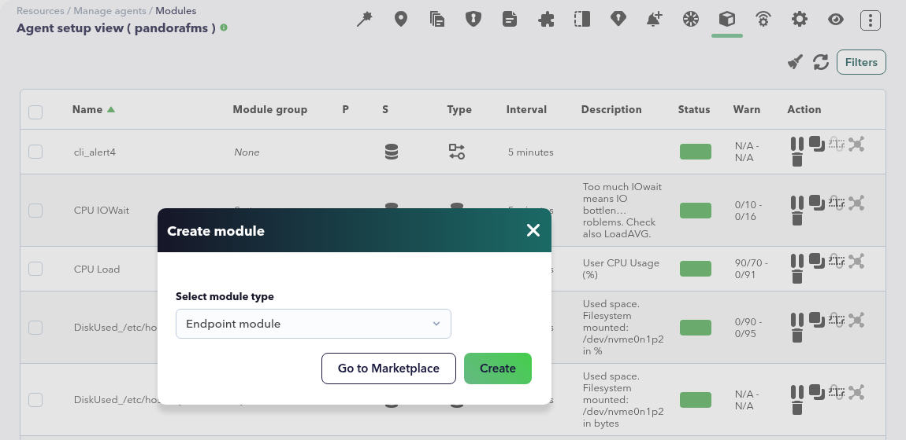{ .captura }

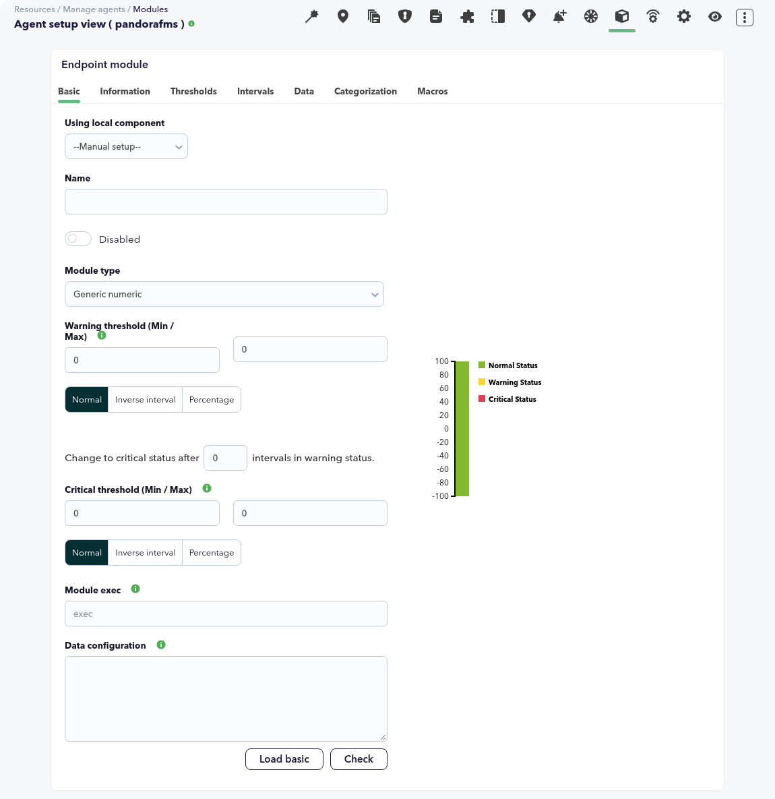{ .captura }

Le premier élément de ce formulaire n'est pas un champ vide à remplir, mais un sélecteur : **Utilisation d'un composant local**. Avant de saisir quoi que ce soit à partir de zéro, il vaut la peine de savoir ce qu'il cache ; c'est l'objet de la section suivante.

### Composants locaux : des modules déjà prêts

Écrire à la main le module qui mesure la mémoire libre d'un Linux ou l'espace d'un disque Windows a son charme la première fois, et aucun la dixième. C'est pourquoi la console conserve des **composants locaux** : des modules d'EndPoint déjà préparés, avec leur définition `module_begin … module_end`, leur type de donnée, leurs seuils et leur description, prêts à être chargés dans le formulaire de création d'un module.

Un composant est un modèle, pas un module vivant. Quand vous en choisissez un, la console copie ses champs dans le formulaire — nom, type, seuils, la commande de *Module exec* et le bloc *Configuration des données* — et, à partir de là, c'est un module local comme un autre, que vous pouvez retoucher avant d'enregistrer. Aucun lien ne subsiste avec le composant : le modifier ou le supprimer plus tard ne change pas les modules déjà créés à partir de lui.

!!! note "Ce ne sont pas les modules qu'apporte l'EndPoint d'origine"
    Les modules qui apparaissent d'eux-mêmes sur un EndPoint fraîchement installé (CPU Load, utilisation des disques, mémoire…) proviennent du modèle de configuration de l'EndPoint lui-même, décrit dans [Superviser les bases du système](#superviser-les-bases-du-systeme). Les composants locaux forment un catalogue à part, qui n'entre en jeu que lorsque vous créez un module depuis la console.

**Utiliser un composant.** Avec la configuration distante activée, dans l'édition de l'agent :

1. Dans l'onglet des modules, cliquez sur « Créer un module » et choisissez le type « Module de point de terminaison ».
2. Dans **Utilisation d'un composant local**, choisissez d'abord le groupe. Les composants dépendent du même arbre de groupes de composants que les composants distants, par exemple « Operating Systems » → « UNIX Systems » → « Linux ».
3. Une seconde liste déroulante apparaît avec les composants du groupe. Choisissez-en un et le formulaire se remplit.
4. Vérifiez ce qui a été chargé, ajustez ce qu'il faut — le nom, un seuil, le point de montage d'un disque — et enregistrez.

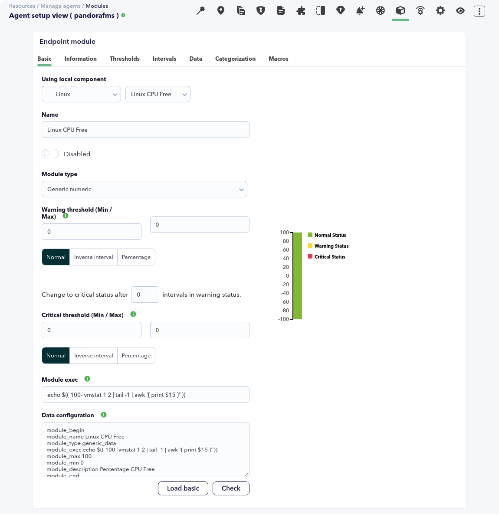{ .captura }

Lisez le bloc *Configuration des données* avant d'enregistrer : c'est le seul moyen de savoir ce que l'EndPoint va réellement exécuter.

**Ce que la console apporte d'origine.** Plus d'une cinquantaine de composants, regroupés par technologie :

| Groupe | Exemples de composants |
|---|---|
| Linux | `Linux CPU Free`, `Linux Load Average`, `Linux Memory Free`, `Linux Disk Free`, `SSH Status`, `Free i-nodes`, `Linux Zombie processes`, `Disk_IO_Wait`, `OpenedFiles` |
| Microsoft Windows | `Windows CPU Load`, `Windows Free Memory`, `Windows Free Disk C`, `Windows_Update_LastRun`, `Microsoft Firewall`, `Microsoft Antivirus`, `Kaspersky Antivirus` |
| Citrix | `Citrix_Sessions`, `Busy XML Threads`, `Windows Users Connected`, les services `Serv_IMA` et `Serv_HCA`, et huit modules d'événements Windows (`Event 1000`, `Event 1004`…) |
| Solaris, BSD, HP-UX, MacOS et AIX | CPU système et utilisateur (`CPU_System`, `cpu_user`), espace libre de la partition racine (`disk_root_free`), mémoire et swap libres, charge moyenne et surveillance de démons (`InetdDaemon`, `sshDaemon`) |

**Les gérer et créer les vôtres.** Les composants s'administrent dans « Gestion » → « Configuration » → « Modèles » → « Composants locaux » (« Gestion du composant local »). La liste affiche le nom, la description et le groupe de chacun, avec les actions de duplication et de suppression sur chaque ligne et le bouton « Créer » pour un nouveau.

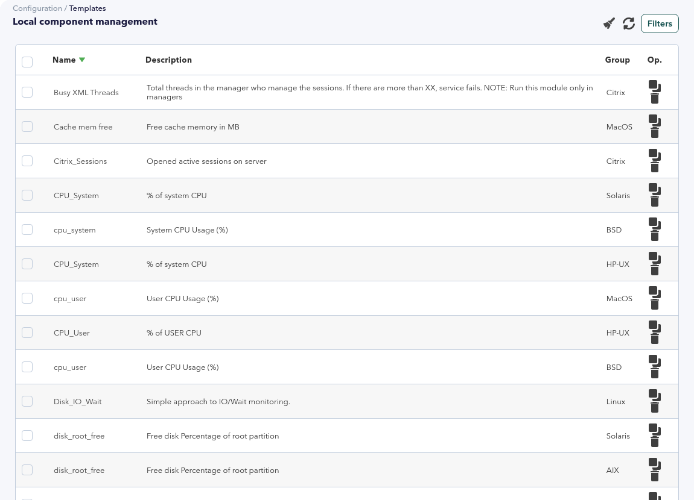{ .captura }

Le formulaire d'un composant est le même que celui d'un module, avec un champ **Groupe** en plus et sans l'onglet des intervalles. Il y a deux façons d'avoir le vôtre : le créer de zéro avec « Créer », ou dupliquer un composant fourni et l'adapter, ce qui est presque toujours plus rapide puisque la définition est déjà écrite. Un composant personnalisé sert à ce que sert tout modèle : le module qui se répète sur cinquante agents s'écrit une seule fois.

Les composants **distants** (réseau, SNMP et WMI, exécutés par le serveur) reposent sur la même idée et sont expliqués dans [Composants réseau : ne pas partir de zéro](2.6-monitorizacion-de-redes.md#composants-reseau-ne-pas-partir-de-zero).

## Supervision avancée de MS Windows

L'EndPoint Windows ajoute une poignée de modules qui n'ont pas d'équivalent en Go
ni en Perl, parce qu'ils dépendent de technologies propres à Windows.

`module_wmiquery` exécute une requête WQL contre WMI et `module_wmicolumn` indique
quelle colonne du résultat prendre comme valeur du module :

```conf
module_begin
module_name Mémoire physique libre (KB)
module_type generic_data
module_wmiquery SELECT FreePhysicalMemory FROM Win32_OperatingSystem
module_wmicolumn FreePhysicalMemory
module_end
```

Si la requête renvoie plusieurs lignes, le module recueille une donnée par ligne ;
pour une valeur unique, il convient que la requête n'en renvoie qu'une.

`module_perfcounter` lit directement un compteur de performance de Windows (les
mêmes que montre le Moniteur de performances). Les noms des compteurs sont dans la
langue du système : l'exemple vaut pour un Windows en espagnol. Pour les compteurs
qui expriment un taux (« par seconde »), `module_cooked 1` fournit la valeur déjà
calculée au lieu du compteur brut.

```conf
module_begin
module_name Octets reçus par le réseau
module_type generic_data
module_perfcounter \Interfaz de red(*)\Bytes recibidos/segundo
module_cooked 1
module_end
```

Le visualiseur d'événements de Windows se lit avec `module_logchannel` (celui qui
est recommandé) ou avec `module_logevent`, conservé pour compatibilité. Les deux
filtrent par journal (`module_source`, le seul obligatoire), type, code
d'événement, application ou motif, et leur usage principal est la collecte de
logs, qui a son propre chapitre :
[Collecte et supervision des logs](2.19-recoleccion-y-monitorizacion-de-logs.md).

Enfin, `module_exec_powershell` exécute la commande ou le script indiqué via
PowerShell (`powershell -C "<commande>"`), pour tout ce qui se résout mieux avec
une cmdlet qu'avec une commande de `cmd.exe` :

```conf
module_begin
module_name Services arrêtés
module_type generic_data
module_exec_powershell (Get-Service | Where-Object {$_.Status -eq 'Stopped'}).Count
module_end
```

## Plugins EndPoint

Un plugin local ressemble à `module_exec` en ce qu'il s'agit d'un programme
installé sur la machine que l'EndPoint exécute à chaque cycle, mais avec une
différence importante : il ne renvoie pas une donnée, mais des modules entiers. Le
plugin écrit dans sa sortie le XML d'un ou de plusieurs modules (nom, type,
donnée, description…) et l'EndPoint l'ajoute tel quel à son fichier de données.
C'est pourquoi un seul plugin comme `pandora_df_used` crée un module pour chaque
disque qu'il trouve. Les trois EndPoints l'admettent avec `module_plugin`, et
comme avec `module_exec`, si le plugin se termine avec un code de sortie différent
de `0`, sa sortie est écartée.

La forme la plus courte est une ligne isolée, qui s'exécute à chaque cycle :

```conf
module_plugin nagios_plugin_wrapper Disco_tmp /usr/lib/nagios/plugins/check_disk -w 20% -c 10% -p /tmp
```

S'il faut ajuster la façon dont il s'exécute, `module_plugin` va aussi dans un
bloc `module_begin` / `module_end`, à côté des jetons qui contrôlent l'exécution :
`module_interval` (tous les combien de cycles de l'EndPoint : `2`, un sur deux),
`module_absoluteinterval` (un intervalle propre, comme `1d`), `module_timeout`
(secondes de marge avant de le considérer comme échoué) ou `module_crontab`. Dans
ce cas, `module_name` et `module_type` ne sont pas nécessaires : le nom, le type
et la donnée, c'est le plugin lui-même qui les met dans son XML. Les modèles
d'installation font déjà ainsi :

```conf
module_begin
module_plugin hardware_info
module_absoluteinterval 1d
module_end

module_begin
module_plugin autodiscover --default
module_timeout 30
module_end
```

Le paquet de Linux et Unix apporte déjà plusieurs plugins prêts à l'emploi dans
son dossier de plugins — certains, comme `pandora_df_used` ou `autodiscover`, sont
déjà apparus dans le tableau de supervision par défaut — et il suffit de les
citer par leur nom, sans chemin. Parmi eux se trouve `nagios_plugin_wrapper`, qui
exécute un plugin Nagios déjà écrit (son premier argument est le nom du module ;
le reste, l'appel au plugin avec ses paramètres) et convertit son code de sortie
et son texte en un module de Pandora FMS, sans rien réécrire. Sous Windows, les
plugins que le paquet apporte sont des scripts VBScript et des exécutables isolés
dans le dossier `util\` (les mêmes `df_percent_used.vbs`,
`mem_percent_used.vbs` ou `autodiscover.exe` du tableau précédent) ; un plugin
propre en PowerShell s'invoque comme n'importe quelle autre commande, avec
`module_plugin` :

```conf
module_plugin powershell.exe -File "%ProgramFiles%\pandora_agent\util\mi_plugin.ps1"
```

Écrire un plugin propre, dans n'importe quel langage, est traité dans
[Création de plugins locaux](../parte-9/9.8-creacion-de-plugins-locales.md).

### Collections de fichiers

Pour ne pas copier un plugin à la main sur chaque machine, il existe les
[collections](2.9-colecciones.md) : des paquets de fichiers que l'on téléverse une
fois dans la console web et que l'on affecte aux EndPoints qui en ont besoin,
lesquels les téléchargent et les laissent prêts pour qu'un `module_plugin` les
utilise. Les trois EndPoints les admettent ; la façon de les créer, de les
affecter et de les utiliser depuis les politiques est expliquée dans leur
chapitre, [Collections](2.9-colecciones.md).

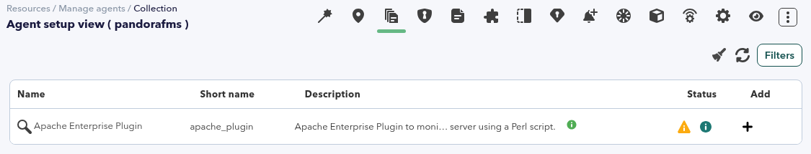{ .captura }

!!! note "Configuration distante, condition préalable"
    Les collections se distribuent par le même canal que la configuration
    distante (voir [Configuration distante depuis la console web](#configuration-distante-depuis-la-console-web)) :
    sans elle active, il n'y a aucun moyen de pousser une collection vers
    l'EndPoint.

## Supervision avancée avec l'EndPoint

### Supervision conditionnelle

Une précondition (`module_precondition`) décide si le module arrive à s'exécuter ;
une condition (`module_condition`) évalue le résultat déjà obtenu. Les deux
partagent la même syntaxe, dans les trois EndPoints :

| Forme | Syntaxe | Elle est remplie quand |
|---|---|---|
| Comparaison numérique | `<opérateur> <valeur> <commande>` | La valeur satisfait `<opérateur> <valeur>`. Opérateurs : `>`, `<`, `=` et `!=` (il n'y a ni `>=` ni `<=`). |
| Intervalle | `(<minimum>,<maximum>) <commande>` | La valeur se situe entre les deux bornes, bornes exclues. |
| Expression régulière | `=~ <motif> <commande>` | La valeur coïncide avec `<motif>`. |

Ce qui change, c'est d'où vient la valeur et ce que fait la commande :

- Dans une **précondition**, l'EndPoint exécute d'abord la `<commande>` et compare
  sa sortie. Si un module en a plusieurs, toutes doivent être remplies ; si l'une
  échoue, le module ne s'exécute pas pendant ce cycle.
- Dans une **condition**, la valeur est la donnée que le module vient d'obtenir.
  Si elle est remplie, l'EndPoint lance la `<commande>` à part, comme action de
  réponse (redémarrer quelque chose, nettoyer un dossier…) ; la donnée du module
  ne change pas.

Une précondition pour éviter les fausses alarmes : le module vérifie s'il existe
une sauvegarde récente sur une ressource réseau montée sur `/backup`, mais
seulement si cette ressource est montée. Si elle ne l'est pas, le module ne
s'exécute pas pendant ce cycle, au lieu de marquer en critique une sauvegarde
qu'il n'a même pas pu regarder :

```conf
module_begin
module_name Sauvegarde récente
module_type generic_proc
module_precondition = 1 mountpoint -q /backup && echo 1 || echo 0
module_exec [ -n "$(find /backup -name '*.tar.gz' -mtime -1)" ] && echo 1 || echo 0
module_end
```

Une condition comme action de réponse : le module mesure à quel point le disque
racine est occupé et, s'il dépasse 90 %, l'EndPoint efface les logs compressés de
plus de 30 jours. La donnée est envoyée de la même manière ; l'effacement est un
effet à part :

```conf
module_begin
module_name Disque / occupé (%)
module_type generic_data
module_occupiedpercentdisk /
module_condition > 90 find /var/log -name '*.gz' -mtime +30 -delete
module_min_warning 85
module_end
```

### Supervision intensive

La supervision intensive sert à être averti avant qu'une chose ne tombe, sans
multiplier les données envoyées. Elle s'active avec le jeton global
`intensive_interval`, en secondes et plus court qu'`interval` : l'EndPoint se met
à faire un tour toutes les `intensive_interval` secondes. À chaque tour, il
exécute les modules marqués avec `module_intensive_condition`, mais n'envoie leur
donnée que lorsque leur respect de la condition change, ou lorsque leur intervalle
normal arrive à échéance. Avec `intensive_interval` à `0` (la valeur par défaut),
il vaut la même chose qu'`interval` et il n'y a pas de supervision intensive. La
condition utilise la même syntaxe que celles du tableau précédent, sans commande.

```conf
# Partie générale du fichier
interval 300
intensive_interval 10

module_begin
module_name Ping de la passerelle
module_type generic_proc
module_exec ping -c 1 -W 1 192.168.1.1 >/dev/null 2>&1 && echo 1 || echo 0
module_intensive_condition = 0
module_end
```

### Supervision planifiée

Il y a deux façons qu'un module ne suive pas le rythme normal de l'EndPoint.

`module_absoluteinterval` lui donne un intervalle propre, en temps réel et non en
cycles comme `module_interval`. Il admet un nombre avec suffixe (`30s`, `15m`,
`6h`, `1d`) ou, sans suffixe, un nombre de cycles d'`interval`. En dessous,
l'EndPoint le traduit en cycles en arrondissant à la hausse : avec
`interval 300`, un `module_absoluteinterval 7m` s'exécute tous les deux cycles,
c'est-à-dire toutes les 10 minutes. Il ne convient donc pas d'en attendre plus de
précision que celle de l'`interval` lui-même.

Ce qui le distingue vraiment de `module_interval`, c'est la mémoire : les trois
EndPoints enregistrent l'heure de la dernière exécution du module dans un fichier
de référence (`.ref`), de sorte que l'intervalle est respecté même si l'EndPoint
redémarre. Un module quotidien s'exécute une fois par jour, pas une fois par jour
plus une par redémarrage. La valeur spéciale `once` fait que le module s'exécute
une seule fois et le convertit en asynchrone.

```conf
module_begin
module_name Certificat web : jours avant expiration
module_type generic_data
module_exec echo $(( ( $(date -d "$(openssl x509 -enddate -noout -in /etc/ssl/certs/web.pem | cut -d= -f2)" +%s) - $(date +%s) ) / 86400 ))
module_absoluteinterval 1d
module_end
```

`module_crontab` va un pas plus loin : le module ne s'exécute que lorsque l'heure
coïncide avec une expression cron de cinq champs (minute, heure, jour du mois,
mois, jour de la semaine) ; les autres cycles ne font rien. C'est ce qui convient
à ce qui n'a de sens qu'à une heure précise, comme une fermeture nocturne ou un
rapport hebdomadaire.

```conf
module_begin
module_name Rapport hebdomadaire généré (lundi, 9:00)
module_type generic_proc
module_exec [ -f /var/reports/weekly.done ] && echo 1 || echo 0
module_crontab 0 9 * * 1
module_end
```

### Post-traitement, flip-flop et autres réglages du module

Une poignée de jetons, communs aux trois EndPoints, ajustent comment la donnée
est traitée une fois obtenue, sans toucher à la façon dont elle est obtenue. Ce
sont les équivalents dans le fichier de configuration des champs du formulaire
décrits dans
[2.20, Configuration commune des modules](2.20-configuracion-comun-de-los-modulos.md) :

| Jeton | Ce qu'il fait |
|---|---|
| `module_postprocess` | Facteur par lequel le serveur multiplie la valeur numérique à la réception (pour convertir des octets en MB, par exemple). L'EndPoint l'envoie tel quel avec la donnée. |
| `module_ff_interval`, `module_ff_type`, `module_each_ff`, `module_min_ff_event*` | Ils ajustent le *flip-flop* : combien de changements d'état consécutifs sont nécessaires pour que le serveur déclenche un événement, au lieu d'un par changement. |
| `module_timeout` | Secondes de marge pour que la commande ou le plugin du module se termine avant de le considérer comme échoué. |
| `module_save <variable>` | Enregistre la valeur du module dans la variable d'environnement indiquée, pour que les modules exécutés ensuite l'utilisent. |

`module_async`, déjà vu dans la supervision de services et de processus de
Windows, est exclusif à cet EndPoint : il convertit le module en un surveillant
qui avertit dès qu'il change d'état, au lieu d'attendre le cycle. Ni Go ni Perl ne
l'implémentent.

## L'EndPoint comme point de supervision du réseau

### Contrôles distants depuis l'EndPoint

Un EndPoint peut aussi surveiller une autre machine du réseau depuis là où il est
installé, sans que cette machine ait son propre EndPoint. La différence entre
systèmes est de fond, pas de nuance : Windows apporte des modules natifs pour
cela ; sous Linux et Unix, avec Go ou avec Perl, il n'existe pas d'équivalents et
on les construit avec `module_exec`.

Sous Windows, `module_ping` lance un ping contre l'hôte indiqué et donne `1` ou
`0` selon qu'il obtient une réponse ; `module_ping_count` et `module_ping_timeout`
ajustent le nombre de tentatives et le temps d'attente. `module_tcpcheck` vérifie
si un port TCP répond, avec `module_port` pour indiquer lequel et `module_timeout`
pour la marge d'attente. `module_snmpget` lance une requête SNMP et prend la
valeur renvoyée comme donnée du module, avec `module_snmp_version`,
`module_snmp_community`, `module_snmp_agent` (l'hôte) et `module_snmp_oid`.

```conf
module_begin
module_name Ping vers la passerelle
module_type generic_proc
module_ping 192.168.1.1
module_ping_count 2
module_ping_timeout 1
module_end

module_begin
module_name Port web du serveur
module_type generic_proc
module_tcpcheck 192.168.1.10
module_port 443
module_end
```

Sous Linux et Unix, le même résultat s'obtient avec `module_exec`, appuyé sur les
outils du système. Ici s'applique la même règle que dans tout autre `module_exec` :
le code de sortie décide si la donnée est envoyée, il faut donc le forcer
explicitement au lieu de se fier à celui de la commande.

```conf
module_begin
module_name Ping vers la passerelle
module_type generic_proc
module_exec ping -c 1 -W 1 192.168.1.1 >/dev/null 2>&1 && echo 1 || echo 0
module_end

module_begin
module_name Port web du serveur
module_type generic_proc
module_exec nc -z -w 2 192.168.1.10 443 && echo 1 || echo 0
module_end

module_begin
module_name Uptime par SNMP
module_type generic_data
module_exec snmpget -Ovq -c public -v 2c 192.168.1.10 sysUpTime.0
module_end
```

Pour la supervision réseau depuis l'extérieur de la machine cible — sans besoin
d'aucun EndPoint —, il y a la supervision distante, dans
[Supervision des réseaux](2.6-monitorizacion-de-redes.md).

### Mode broker

Un EndPoint en mode broker cesse de rendre compte comme un agent unique et se met
à générer et envoyer, dans le même cycle, un ou plusieurs agents supplémentaires :
chaque `broker_agent <nom>` dans `pandora_agent.conf` lève un agent enfant avec sa
propre configuration, dérivée de celle de l'EndPoint principal (même serveur, même
intervalle, même mode de transfert), mais avec son propre nom et ses propres
modules. C'est ce qui permet, par exemple, qu'un unique EndPoint installé sur une
passerelle rende compte des données de plusieurs appareils situés derrière elle,
chacun comme son propre agent dans la console.

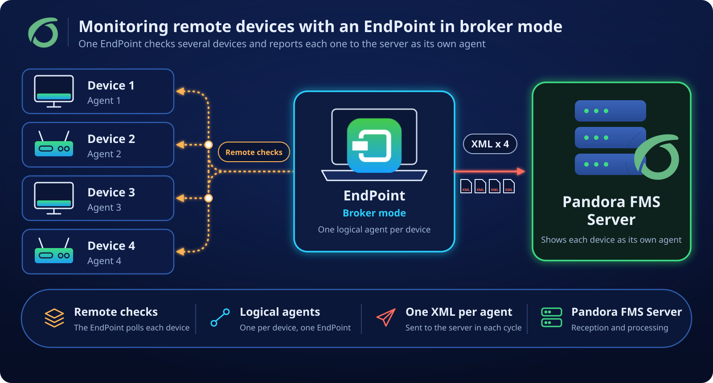{ .diagrama-oscuro }

Les trois EndPoints l'admettent. Dans l'EndPoint Windows, les agents broker
n'admettent pas de modules asynchrones : un module avec `module_async` dans la
configuration d'un broker est écarté.

```conf
broker_agent Router-planta-1
broker_agent Router-planta-2
```

### Mode proxy

En mode proxy, l'EndPoint cesse de se limiter à envoyer ses propres données et se
met aussi à servir d'intermédiaire Tentacle pour d'autres EndPoints de son réseau
qui n'atteignent pas directement le serveur. Au démarrage avec `proxy_mode 1`, il
lève son propre serveur Tentacle local (`tentacle_server`) à l'écoute sur
`proxy_address` et `proxy_port` (par défaut, toutes les interfaces et le port
`41121`, le même que celui du serveur), et réachemine ce qu'il reçoit vers
`server_ip` et `server_port`. `proxy_max_connection` limite les connexions
simultanées qu'il accepte (par défaut, `10`) et `proxy_timeout` le temps d'attente
de chacune (par défaut, `1` seconde). Les EndPoints qui s'appuient sur le proxy
n'ont qu'à pointer leur `server_ip` vers la machine qui fait office de proxy, au
lieu du serveur réel.

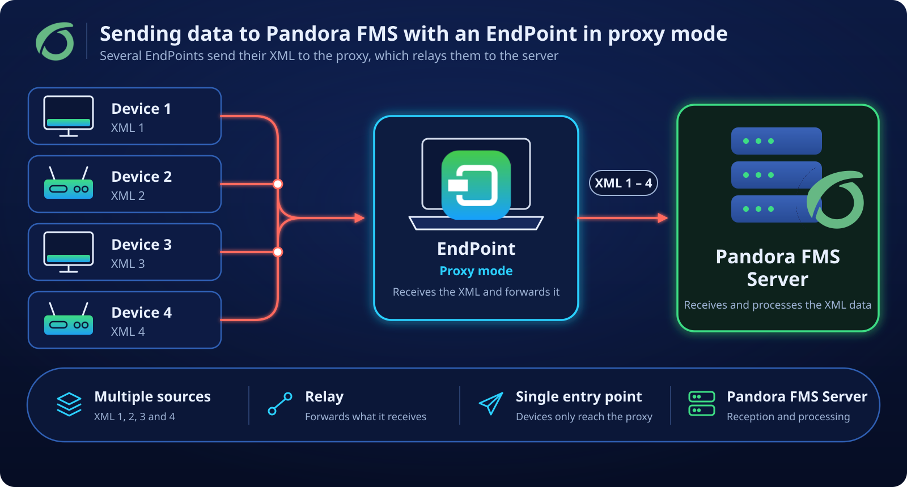{ .diagrama-oscuro }

```conf
# Sur l'EndPoint qui fait office de proxy
proxy_mode 1
proxy_address 0.0.0.0
proxy_port 41121
```

### Serveur secondaire

`secondary_mode` décide si l'EndPoint envoie aussi ses données à un second
serveur, en plus du principal (`server_ip`), dans quelles circonstances et,
avec `ha_fallback`, s'il l'utilise également pour la configuration distante :

| Valeur | Comportement |
|---|---|
| `never` (par défaut) | L'envoi ne se fait que vers le serveur principal. |
| `on_error` | On essaie d'abord le principal ; seulement s'il échoue, on envoie au secondaire. |
| `always` | L'envoi se fait vers les deux serveurs, toujours. |
| `ha_fallback` | Identique à `on_error` pour les données et, si le principal n'est pas disponible, la configuration distante est récupérée depuis le secondaire. |

Le serveur secondaire se configure avec son propre jeu de jetons en miroir —
`secondary_server_ip`, `secondary_server_port`, `secondary_transfer_mode`,
`secondary_server_ssl`, `secondary_server_path`, `secondary_server_user`,
`secondary_server_pwd` —, indépendants de ceux du serveur principal. C'est la voie
pour ne pas cesser de rendre compte quand le serveur principal n'est pas
disponible, ou pour alimenter en même temps deux installations de Pandora FMS
distinctes, sans dépendre du mode proxy ni d'une architecture distribuée complète.

Avec `ha_fallback`, si l'EndPoint ne peut pas lire la configuration distante du
serveur principal, il la cherche sur le secondaire avec les mêmes jetons
`secondary_*`. Si elle n'y est pas non plus, il y envoie son
`pandora_agent.conf` local et son MD5 pour pouvoir être géré aussi depuis ce
serveur. Le téléchargement utilise Tentacle (sous Windows, un
`secondary_transfer_mode` vide équivaut à `tentacle` ; Go accepte aussi
`local`). Tant que le principal répond, le secondaire n'est pas consulté, et la
configuration déjà envoyée au secondaire n'est pas supprimée au retour du
principal : l'agent ne compare pas les deux copies, leur gestion revient donc à
l'administrateur de l'environnement.

`ha_fallback` est disponible dans les EndPoints Go et Windows.

```conf
secondary_mode ha_fallback
secondary_server_ip 10.0.0.5
secondary_transfer_mode tentacle
```

## Actions distantes sur l'EndPoint

Les EndPoints Perl et Windows peuvent écouter des ordres par un petit serveur UDP :
il s'active avec `udp_server 1` (il arrive désactivé), écoute sur
`udp_server_port` (`41122` par défaut) et ne sert que les adresses de
`udp_server_auth_address` (`0.0.0.0`, la valeur par défaut, admet n'importe
laquelle). L'EndPoint Go n'a pas de serveur UDP.

Les ordres qu'il comprend sont peu nombreux et délibérément limités :

| Ordre | Ce qu'il fait | Perl | Windows |
|---|---|---|---|
| `REFRESH AGENT` | Force une exécution immédiate du cycle : l'EndPoint collecte et envoie ses données sans attendre l'intervalle. | Oui | Oui (voir la note) |
| `START PROCESS <nom>` / `STOP PROCESS <nom>` | Exécute la commande définie dans `process_<nom>_start` / `process_<nom>_stop`. Sans ce jeton, l'ordre est rejeté. | Oui | Oui |
| `START SERVICE <nom>` / `STOP SERVICE <nom>` | Démarre ou arrête le service Windows indiqué, uniquement s'il est autorisé avec `service_<nom> 1`. | Non | Oui |

```conf
udp_server 1
udp_server_port 41122
udp_server_auth_address 10.0.0.20
process_backup_start /usr/local/bin/run_backup.sh
process_backup_stop /usr/local/bin/stop_backup.sh
```

```conf
udp_server 1
udp_server_auth_address 10.0.0.20
service_spooler 1
process_informe_start C:\scripts\informe.bat
```

!!! note "Trois mots sous Windows"
    L'EndPoint Windows exige que tout ordre comporte exactement trois mots ;
    c'est pourquoi, pour le rafraîchir, l'ordre est `REFRESH AGENT *`. C'est la
    forme qu'utilise l'action d'alerte « Restart agent » fournie d'origine ; si
    un ordre de deux mots ne fait rien sur un EndPoint Windows, voilà la raison.

Depuis le serveur, les ordres s'envoient avec `udp_client.pl`
(`/usr/share/pandora_server/util/udp_client.pl <ip> 41122 "<ordre>"`), qui est ce
qu'utilisent la commande d'alerte « Remote agent control » et l'action
« Restart agent ».

Pour exécuter des commandes ou des scripts arbitraires sur l'EndPoint depuis la
console, sans dépendre de ce serveur UDP ni d'actions prédéfinies, il y a
l'exécution distante de commandes et de scripts :
[Exécution distante de scripts et de commandes](../parte-3/3.4-ejecucion-remota-de-scripts-y-comandos.md).

## Autres techniques de supervision

Trois mécanismes de plus, d'usage ponctuel, complètent ce qu'un EndPoint peut
apporter au-delà de ses modules :

- **KeepAlive.** Un module de type `keep_alive` qui passe en critique quand
  l'agent cesse d'envoyer des données. Il se crée seulement depuis la console web
  (même sans configuration distante) et ne laisse pas de trace dans
  `pandora_agent.conf`.
- **Command Snapshot.** Un module de type texte qui recueille la sortie complète
  d'une commande longue (`ps aux`, `netstat -n`) pour la voir dans la console
  telle quelle, comme une capture. Il faut pour cela activer l'option *Command
  line snapshot* dans la configuration de la console web. Avec l'EndPoint Go,
  cela ne fonctionne pas : `module_exec` ne prend que la première ligne de la
  sortie.
- **Supervision d'images.** Un module de type texte (`generic_data_string` ou
  `async_string`) dont la donnée est une image encodée en base64
  (`data:image/jpeg;base64,…`), que la console affiche comme image au lieu de
  comme texte. Normalement, c'est un plugin qui le génère.

L'EndPoint participe aussi à deux domaines qui ont leur propre chapitre :
l'inventaire du système, dans [Inventaire](../parte-3/3.1-inventario.md), et la
collecte de logs, dans
[Collecte et supervision des logs](2.19-recoleccion-y-monitorizacion-de-logs.md).

### Surveiller des fichiers texte avec module_regexp

`module_regexp` surveille un fichier texte en cherchant les lignes nouvelles qui
remplissent `module_pattern` (une expression régulière) ; `module_pattern_exclude`
écarte celles qui, le remplissant, coïncident en plus avec cet autre motif. Ce
qu'il renvoie dépend du type : avec `generic_data`, combien de lignes coïncident ;
avec `generic_proc`, `1` s'il y en a une ; avec `generic_data_string`, les lignes.
Les trois EndPoints l'admettent avec les mêmes jetons, y compris
`module_pattern_exclude` : malgré ce que dit quelque documentation ancienne, il
n'est pas exclusif à Linux, il fonctionne aussi dans l'EndPoint Windows. Seul
Windows ajoute `module_noseekeof` : avec `1`, le module relit le fichier entier à
chaque exécution au lieu de seulement ce qui a été ajouté depuis la précédente.

```conf
module_begin
module_name Erreurs dans le log de l'application
module_type generic_data_string
module_regexp /var/log/miapp/error.log
module_pattern ERROR
module_pattern_exclude ERROR_CONOCIDO
module_end
```

C'est le mécanisme minimal pour surveiller un fichier isolé ; pour une collecte de
logs véritable — centralisée, avec de multiples sources et une recherche
postérieure —, il y a
[Collecte et supervision des logs](2.19-recoleccion-y-monitorizacion-de-logs.md).

## Fonctionnement interne

Tout ce qui précède — modules, plugins, collections — débouche sur le même
mécanisme de livraison. Il convient de le comprendre une fois, car il explique
d'un coup pourquoi l'agent apparaît tout seul dans la console, ce que fait
vraiment `debug 1` et pourquoi un tampon plein ne jette pas les données à la
poubelle.

**Le XML de données et l'autocréation.** À chaque cycle, l'EndPoint rassemble le
résultat de tous ses modules dans un unique document XML, enveloppé dans une
balise `<agent_data>` avec les attributs de l'agent (nom, alias, groupe,
intervalle, version…) et un `<module>` pour chaque module, avec son nom, son type
et sa donnée. Ce fichier s'écrit d'abord dans le dossier `temporal` sous le nom
`<hash de l'agent>.<timestamp>.data` et c'est de là qu'il est envoyé ; le XML n'est
pas généré directement à la volée au moment de l'envoi, si bien qu'il reste
toujours une trace sur le disque pendant que le cycle dure. C'est ce même XML que
le serveur traite pour créer l'agent et ses modules la première fois qu'ils
apparaissent (`autocreate 1`, déjà vu dans
[Premiers pas avec un EndPoint fraîchement installé](#premiers-pas-avec-un-endpoint-fraichement-installe)) :
il n'y a pas deux formats différents, l'un pour la création et l'autre pour le
quotidien.

**Modes apprentissage, normal et autodésactivé.** Qu'un module nouveau du XML
finisse dans la console dépend aussi du mode de l'agent, qui se choisit en le
modifiant dans la console web :

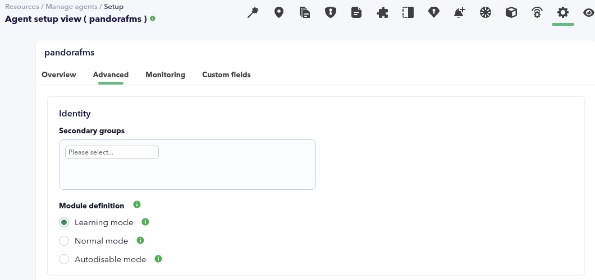{ .captura }

| Mode | Ce qu'il fait avec le XML |
|---|---|
| Mode apprentissage (par défaut) | Il crée les modules nouveaux et met à jour les données de l'agent (adresse IP, intervalle, version du système d'exploitation et de l'EndPoint, champs personnalisés) ainsi que la configuration des modules qui existent déjà, sauf ceux qui viennent d'une politique. |
| Mode normal | Il ne traite que les données des modules qui existent déjà : les nouveaux sont écartés et les données de l'agent que le XML envoie n'écrasent pas celles de la console. |
| Mode autodésactivé | Comme le mode apprentissage, mais le serveur désactive l'agent quand tous ses modules (sans compter les asynchrones) passent à inconnu, et le réactive dès que de nouvelles données arrivent. Pensé pour les machines qui apparaissent et disparaissent. |

C'est la première suspicion quand quelqu'un ajoute un `module_begin` à l'EndPoint,
vérifie que le XML sort bien et que le module n'apparaît jamais : l'agent est en
mode normal et le serveur, obéissant, l'ignore.

**Transfert : Tentacle, SSH, FTP et local.** L'envoi proprement dit est fait par un
programme externe que l'EndPoint lance contre le fichier `.data`, selon
`transfer_mode` : les trois EndPoints admettent les quatre modes — `tentacle` (par
défaut), `ssh` (avec `scp`), `ftp` et `local` (une copie de fichier, pour quand
l'EndPoint tourne sur la même machine que le serveur) — avec le même répertoire en
Go, Perl et Windows.

!!! note "Tentacle, le mode par défaut"
    `tentacle` est celui que les modèles d'installation apportent, et son client
    voyage dans le paquet de l'EndPoint lui-même ; `ssh` et `ftp` dépendent du
    fait que la machine ait `scp` ou un client FTP.

Avec Tentacle, deux jetons activent des options du client : `server_ssl 1` ajoute
`-c` (chiffrement) à l'appel de `tentacle_client`, et `server_pwd` ajoute
`-x <clé>` (mot de passe partagé avec le serveur). Les deux se traduisent de la
même façon dans les trois EndPoints.

**Le tampon de XML.** Si l'envoi du cycle échoue — serveur tombé, réseau coupé —,
l'EndPoint jette par défaut ce XML : le tour suivant en génère un nouveau et la
donnée perdue ne revient pas. `xml_buffer 1` change cette politique : le fichier
`.data` qui n'a pas pu être envoyé reste dans `temporal` et l'EndPoint réessaie de
l'envoyer, avec celui du tour suivant, au cycle d'après. La politique s'applique
de la même façon en Go, Perl et Windows, avec les trois mêmes limites, toutes de
même valeur par défaut (`1024`, dans le sens que chacune indique) :

| Jeton | Limite |
|---|---|
| `temporal_min_size` | Mégaoctets libres minimaux sur la partition de `temporal` ; en dessous, rien de nouveau n'est enregistré dans le tampon. |
| `temporal_max_files` | Nombre maximal de fichiers `.data` accumulés dans `temporal`. |
| `temporal_max_size` | Mégaoctets maximaux occupés par ces fichiers dans leur ensemble. |

Avec `xml_buffer 0` (la valeur par défaut), ces trois limites ne sont même pas
vérifiées : l'EndPoint n'accumule rien qui ne puisse être envoyé dans l'instant.

**`debug`, encore une fois.** Il est déjà apparu dans
[Paramètres essentiels de pandora_agent.conf](#parametres-essentiels-de-pandora_agentconf) :
avec `debug 1`, l'envoi ne change pas — la donnée sort de la même façon, cycle
après cycle — mais l'EndPoint cesse de vérifier la configuration distante et les
collections à chaque tour et conserve chaque `.data` envoyé avec le suffixe `sent`
au lieu de l'effacer, pour pouvoir le revoir ensuite.

**`autotime`.** Par défaut, l'EndPoint met dans le XML l'heure locale de la machine
sur laquelle il tourne (`timestamp`). Avec `autotime 1`, cet attribut disparaît du
XML et c'est le serveur qui met sa propre heure de réception en traitant la
donnée. Cela sert pour les EndPoints sur des machines dont l'horloge n'est pas
fiable — une machine virtuelle mal synchronisée, un appareil sans NTP — et qui,
autrement, généreraient des données avec une marque temporelle décalée. Le
comportement est identique dans les trois EndPoints.


## Comparatif des fonctionnalités entre EndPoints

Avant d'installer un EndPoint précis sur une machine, il convient d'avoir sous la
main ce qu'il est capable de faire et ce qu'il ne l'est pas. Le tableau résume par
fonctionnalité, pas jeton par jeton — cela se trouve dans la
[référence complète de configuration de l'EndPoint](../parte-9/9.1-referencia-completa-de-configuracion-del-endpoint.md),
qui détaille chaque jeton un par un avec sa compatibilité exacte.

| Fonctionnalité | Go | Perl | Windows |
|---|---|---|---|
| Modules natifs de base (CPU, mémoire, disque) | Oui | Oui | Oui |
| Modules de processus sous Unix (`module_proc`/`module_service` oui/non, `module_cpuproc`, `module_memproc`, `module_occupiedpercentdisk`) | Oui | Oui | Non |
| Service et processus sous Windows avec mode asynchrone et watchdog | Non | Non | Oui |
| WMI, compteurs de performance, visualiseur d'événements, PowerShell | Non | Non | Oui |
| Contrôles réseau natifs (`module_ping`, `module_tcpcheck`, `module_snmpget`) | Non (avec `module_exec`) | Non (avec `module_exec`) | Oui |
| `module_exec` | Oui, première ligne de la sortie | Oui | Oui |
| Plugins locaux (`module_plugin`) | Oui | Oui | Oui |
| Collections de fichiers | Oui | Oui | Oui |
| Configuration distante | Oui, seulement `tentacle` et `local` | Oui, les quatre modes de transfert | Oui, les quatre modes de transfert |
| Précondition, condition, intensive, `module_crontab`, `module_absoluteinterval` | Oui | Oui | Oui |
| Mode broker | Oui | Oui | Oui, sans modules asynchrones dans les agents broker |
| Mode proxy | Oui | Oui | Oui |
| Serveur secondaire | Oui | Oui | Oui |
| Serveur UDP (actions distantes) | Non | Oui | Oui |
| `module_regexp` | Oui | Oui | Oui, en plus avec `module_noseekeof` |
| Modes de transfert du XML de données (`tentacle`, `ssh`, `ftp`, `local`) | Les quatre | Les quatre | Les quatre |
| Tampon de XML (`xml_buffer`) | Oui | Oui | Oui |


## Dépannage

La plupart des problèmes avec un EndPoint se ramènent à l'une de ces
vérifications, dans l'ordre où il convient de les faire.

1. **L'agent apparaît-il dans la console ?** Si rien n'apparaît, vérifiez
   `autocreate` sur le serveur (voir
   [Premiers pas avec un EndPoint fraîchement installé](#premiers-pas-avec-un-endpoint-fraichement-installe))
   et que l'EndPoint atteint le serveur : le port de Tentacle (`41121` par
   défaut) doit être accessible entre les deux machines.
2. **Le fichier de configuration est-il celui que vous croyez ?** Avec la
   configuration distante active, un changement fait à la main sur la machine
   peut être écrasé par le serveur au cycle suivant si le MD5 ne coïncide pas
   (voir
   [Configuration distante depuis la console web](#configuration-distante-depuis-la-console-web)).
   Comparez le fichier local avec celui que montre la console avant de considérer
   un changement comme perdu.
3. **Le plugin ou le `module_exec` ont-ils les permissions et le chemin
   corrects ?** Un plugin propre ou un script hors du dossier de plugins
   nécessitent le chemin complet, et le fichier, la permission d'exécution
   (`chmod 755` sous Linux et Unix).
4. **La sortie et le code de sortie sont-ils ceux qu'attend l'EndPoint ?**
   Exécutez la commande ou le plugin à la main, dans le même compte que celui
   avec lequel tourne l'EndPoint, et vérifiez deux choses : que le code de sortie
   est `0` (sinon, l'EndPoint écarte la donnée même si elle a écrit quelque chose
   de bon) et que la sortie est exactement ce que l'on attend — une seule valeur
   pour `module_exec`, un XML complet et valide pour un plugin —. Pour vérifier le
   XML d'un plugin, `xmllint` est plus fiable que de le regarder à l'œil. Comme un
   plugin écrit un ou plusieurs `<module>` isolés, sans élément racine, il faut
   les envelopper avant de les valider :

    ```bash
    (echo "<plugin>"; ./mi_plugin; echo "</plugin>") | xmllint --noout -
    ```

5. **Mode debug.** Avec `debug 1` (voir
   [Paramètres essentiels de pandora_agent.conf](#parametres-essentiels-de-pandora_agentconf)),
   chaque `.data` envoyé est conservé avec le suffixe `sent` dans le dossier
   `temporal`, si bien que l'on peut ouvrir et vérifier exactement ce que chaque
   module ou plugin a généré pendant ce cycle, sans attendre qu'il arrive dans la
   console.
6. **Le log de l'EndPoint.** Sous Linux et Unix,
   `/var/log/pandora/pandora_agent.log` par défaut (`logfile` dans
   `pandora_agent.conf`) ; sous Windows, `pandora_agent.log` dans le dossier
   d'installation, et `pandora_debug.log` à côté si le mode debug est actif.
7. **Redémarrer le service** après tout changement manuel dans le fichier de
   configuration : `systemctl restart pandora_agent_daemon` sous Linux et Unix,
   `NET STOP` / `NET START PandoraFMSAgent` sous Windows (voir
   [Premiers pas avec un EndPoint fraîchement installé](#premiers-pas-avec-un-endpoint-fraichement-installe)).
8. **Exécuter l'EndPoint à la main, sans le service.** Chaque EndPoint a sa
   propre façon de tourner hors du service, utile pour voir les messages au fur
   et à mesure qu'ils se produisent : l'EndPoint Go admet
   `pandora_agent --once /etc/pandora` pour un seul cycle de collecte et d'envoi ;
   l'EndPoint Windows admet `PandoraAgent.exe --process` pour tourner comme
   processus d'utilisateur au lieu de comme service, et `--test-ssh` /
   `--test-ftp` pour essayer séparément ces deux modes de transfert avec la
   configuration actuelle.

!!! tip "Permissions de l'EndPoint, pas seulement du plugin"
    Sous Linux, le service `pandora_agent_daemon` tourne comme `root` sauf si
    `pandora_user` est fixé dans la configuration ; sous Windows, le service
    tourne comme `SYSTEM`. Une commande qui fonctionne dans un terminal
    interactif peut échouer à l'intérieur de l'EndPoint si elle dépend de
    variables d'environnement ou de permissions que seul l'utilisateur qui a
    ouvert ce terminal possède.

Pour ce qui n'est pas spécifique à l'EndPoint — erreurs du serveur, de la console
web ou d'autres composants —, il y a le
[guide général de résolution des problèmes](../parte-9/9.13-troubleshooting-con-pandora.md).
