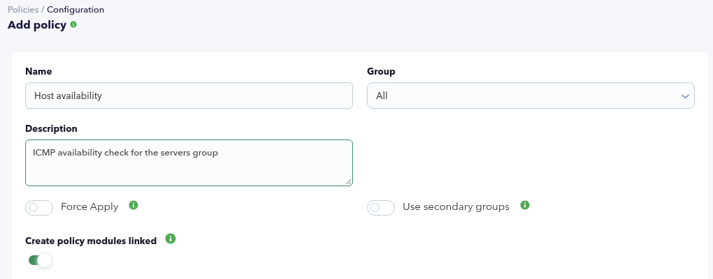
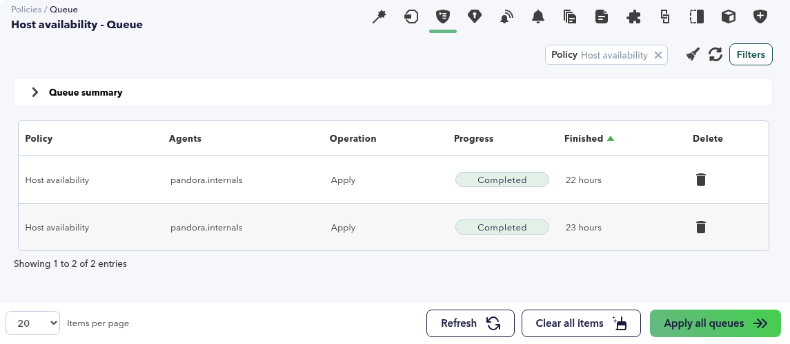
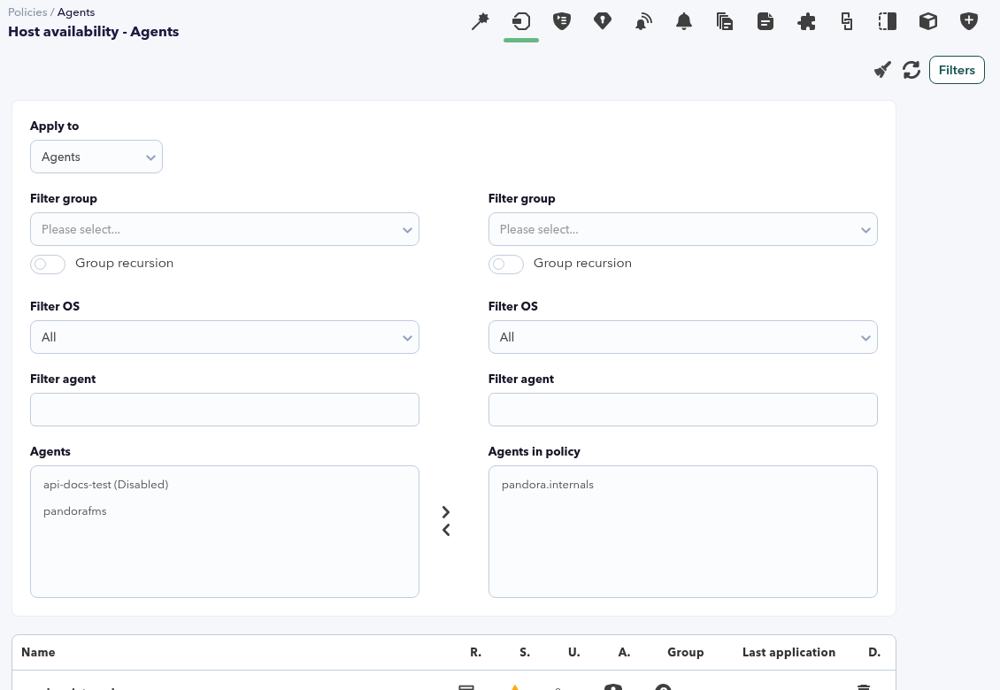
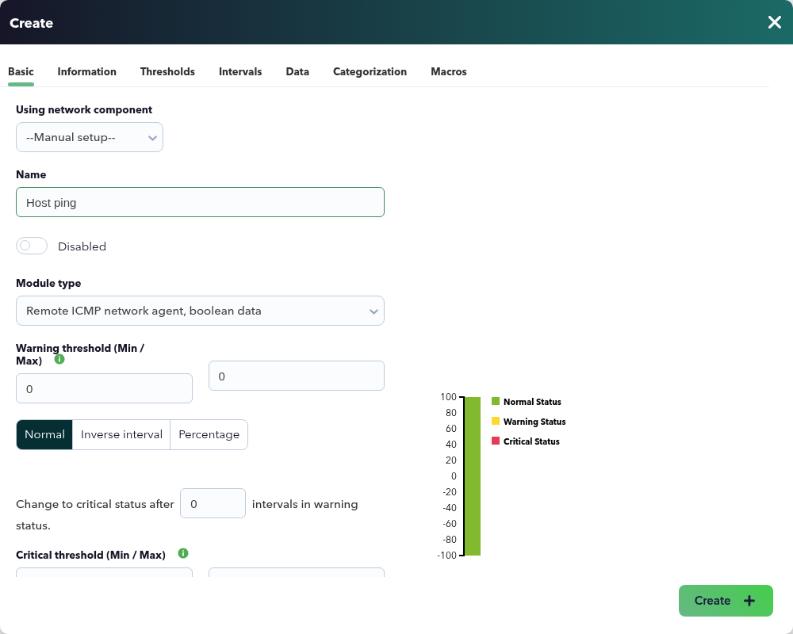
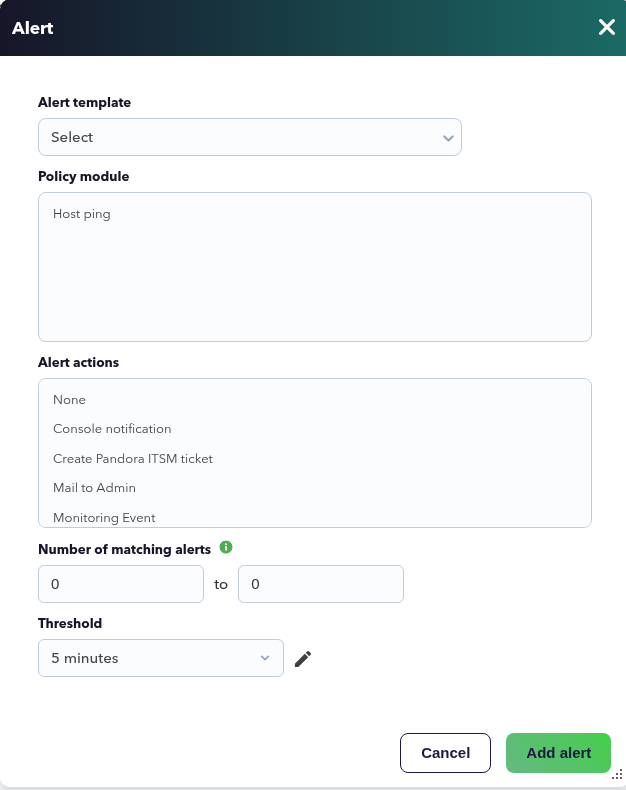
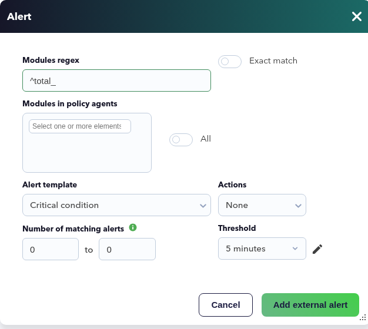
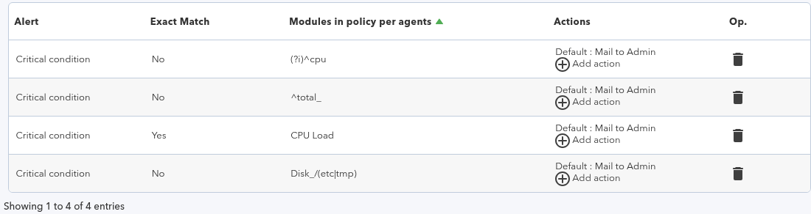
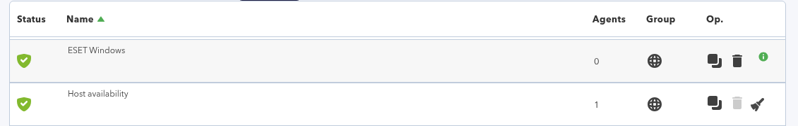

# Politiques de supervision

Un module de disponibilité configuré séparément sur vingt agents exige vingt
modifications quand le critère de supervision change. Une politique permet de le
définir une seule fois, d'y associer les destinataires et de demander son
application. Enregistrer ne suffit pas : il faut mettre le changement en file
d'attente et vérifier que le serveur l'a appliqué.

## 2.10.1 Ce que résout une politique et ce qui reste hors de son champ

Une politique regroupe une configuration partagée par plusieurs agents :
modules, alertes, plugins, collections et autres éléments qui se gèrent depuis
ses onglets. On la définit une seule fois, on l'associe à des agents ou à des
groupes et on l'applique ; le serveur se charge de créer cette configuration
sur chaque destinataire.

**Un cas d'usage.** Une entreprise veut surveiller par ping la disponibilité de
tous ses serveurs web, qui se trouvent dans le groupe « Web ». Sans politique,
elle devrait créer le module ICMP sur chaque agent et recommencer à chaque
nouveau serveur. Avec une politique, le travail est le suivant :

1. On crée la politique et on y définit un unique module ICMP de
   disponibilité.
2. On associe le groupe « Web » plutôt que les agents un par un.
3. On demande l'application et le serveur crée le module sur chaque agent du
   groupe.

À partir de là, la politique continue de travailler seule. Quand un serveur
entre dans le groupe, le serveur le détecte lors d'une conciliation ultérieure
et lui applique la politique sans que personne n'intervienne. Quand il faut
changer le seuil du module, on le modifie une seule fois dans la politique et on
l'applique de nouveau. Et si un serveur précis a besoin d'un seuil différent, on
délie son module : il conserve sa propre configuration sans quitter la
politique. Les sections [2.10.3](#2103-associer-des-agents-et-des-groupes) et
[2.10.4](#2104-modules-de-la-politique-et-exceptions-par-agent) détaillent
chaque étape.

**Quand l'utiliser.** La politique est l'outil pour un changement commun qui
doit être maintenu sur les destinataires à mesure qu'ils entrent et sortent.
Elle ne convient pas à tout :

| Besoin | Que faire |
|---|---|
| Configuration commune et persistante pour un ensemble d'agents | Une politique |
| Configuration propre à un seul agent | Modifier cet agent, ou une exception de module non lié |
| Un changement ponctuel sur de nombreux agents déjà existants | Les [opérations massives](2.11-operaciones-masivas.md) |

Les opérations massives n'agissent qu'une fois sur les agents sélectionnés :
elles ne surveillent pas qui arrive ensuite et ne remplacent pas cette
association persistante.

**Ce qu'elle ne fait pas.** Une politique ne transforme pas la modification d'un
agent en une opération instantanée sur tous les autres. Ni la création du module
ni la sélection du groupe ne prouvent à elles seules que la supervision
fonctionne déjà : la file d'attente montre le travail demandé, et le module sur
l'agent et ses données permettent de vérifier le résultat. Quand la
configuration doit arriver jusqu'à la machine, interviennent en plus son
EndPoint et la configuration distante.

## 2.10.2 Créer, appliquer et retirer une politique

Dans la console web, depuis **Gestion → Ressources → Gérer les politiques**, on
crée une politique et on lui attribue un nom et un groupe. Le formulaire permet
aussi d'ajouter une description et de configurer **Forcer l'application**,
**Utiliser des groupes secondaires** et **Créer des modules de politique liés**.
Cette dernière option décide si les *nouveaux* modules créés par la politique sur
l'agent naissent liés ; elle ne transforme pas automatiquement en modules liés
ceux qui s'y trouvaient déjà et qui sont adoptés. **Forcer l'application** offre
de forcer la création de modules même lorsque l'EndPoint n'a pas de configuration
distante ; en outre, un fichier de configuration qui ne peut être lu ou écrit ne génère pas
l'événement d'erreur et ne bloque pas l'application. Il ne faut pas y voir une
garantie de livraison de la configuration à la machine sans cette condition.

Une politique ne fait rien tant qu'elle n'est pas appliquée. Après la création,
le travail suit toujours le même cycle en quatre étapes :

1. **Définir.** Dans **Modules**, on définit le module de disponibilité et, dans
   **Agents**, on ajoute un agent ou un groupe. Enregistrer laisse le changement
   en attente d'application, et l'onglet **Agents** le signale par « Must be
   applied ». Rien n'a encore été exécuté sur aucune machine.
2. **Demander l'application.** On la met en file d'attente depuis la ligne d'un
   agent, depuis celle d'un groupe ou, pour tous les destinataires à la fois, avec
   **Appliquer toutes les files d'attente**. Aucune des trois n'est immédiate :
   chacune ajoute seulement une opération à la file d'attente.
3. **Attendre la fin.** Dans **File d'attente**, chaque ligne est une opération
   avec sa politique, l'agent, le type d'opération, la progression et la date de
   fin. La file d'attente reste vide tant que l'application n'est pas demandée.
4. **Vérifier le résultat.** On consulte l'état d'application dans **Agents** et
   le module créé sur l'agent destinataire. Une opération marquée comme terminée
   dans la file d'attente ne prouve pas que le module fonctionne ; et si elle
   reste incomplète ou si le module n'apparaît pas, appliquer de nouveau n'est
   pas une vérification : il faut comprendre pourquoi.

Avant l'étape 2, il convient de vérifier dans **Agents** et **Modules** quels
changements sont en attente, pour ne pas appliquer à l'aveugle.

Sur la capture, deux applications sont déjà terminées. Chaque ligne peut être
supprimée avec sa corbeille, et **Effacer tous les éléments** vide entièrement la
file d'attente. Les filtres permettent de ne garder qu'un type d'opération, un
agent, ou seulement les opérations terminées ou incomplètes.

La file d'attente distingue deux types d'application, ceux que propose le filtre
d'opération, en plus de **Supprimer** :

| Opération | Ce qu'elle fait |
|---|---|
| **Appliquer (base de données et fichiers)** | Applique la politique en entier : met à jour la console et écrit la configuration sur les machines |
| **Appliquer (seulement base de données)** | Met à jour ce que la console enregistre, mais ne garantit pas qu'aucun fichier ne soit écrit : elle ne conditionne que la suppression de modules, et d'autres chemins d'application peuvent continuer à écrire de la configuration |

Pour les changements qui doivent atteindre la configuration distante d'un
EndPoint, on utilise l'application complète et l'on vérifie le résultat sur le
destinataire.

Quand on modifie la politique ou qu'on marque un élément pour retrait, le cycle
se répète : enregistrer, examiner les éléments en attente, mettre en file
d'attente, attendre et vérifier. Si l'on retire un agent, l'onglet **Agents**
permet de le marquer comme en attente de suppression et d'annuler la marque avant
d'appliquer. Le serveur traite le retrait et nettoie l'association : les modules
adoptés conservent leur existence, les modules liés créés par la politique sont
retirés et les modules non liés, déjà détachés de la définition, peuvent
subsister. Les alertes de politique assignées à ces modules et les modules
d'inventaire que la politique avait assignés à l'agent disparaissent aussi.
Vérifiez l'agent après l'opération : le nettoyage de ses fichiers ne
s'achève pas toujours. La suppression de la politique entière est expliquée dans
la section [2.10.12](#21012-rechercher-dupliquer-importer-exporter-et-supprimer-des-politiques).

## 2.10.3 Associer des agents et des groupes

L'onglet **Agents** de la console web distingue deux origines d'affectation.
Lorsqu'on sélectionne un agent et qu'on l'ajoute directement, l'association est
enregistrée comme en attente d'application. Dans la liste, on peut vérifier son
état et, si l'on marque son retrait, il reste en attente jusqu'au prochain
traitement ; la marque peut être annulée avant ce moment. La file d'attente
permet de suivre l'opération demandée pour cet agent.

Pour l'exemple du module de disponibilité, on peut ajouter d'abord un agent
direct et appliquer la politique. Ensuite, dans **Appliquer à**, on sélectionne
**Groupes**, on ajoute le groupe de machines et l'on met en file d'attente
l'application du groupe. L'état « en attente » du groupe n'équivaut pas à une
règle déjà active : le serveur ne concilie que les agents des groupes dont
l'association figure comme appliquée. On vérifie donc d'abord que le groupe
apparaît comme appliqué, puis on contrôle la file d'attente et les modules des
agents qui lui appartiennent.

L'option **Utiliser des groupes secondaires** inclut les agents qui appartiennent
au groupe sélectionné comme groupe secondaire, en plus de ceux qui l'ont comme
groupe principal. Elle n'équivaut pas à sélectionner automatiquement tous les
groupes enfants : lorsqu'on ajoute un groupe, la sélection récursive des
descendants est une autre opération qui enregistre ces groupes séparément. Par
exemple, si le groupe « Services » a un sous-groupe « Web », sélectionner
uniquement « Services » ne signifie pas avoir associé « Web ». En revanche, un
agent ayant « Services » pour groupe secondaire peut entrer par cette association
si l'option correspondante a été activée.

Une fois l'association de groupe appliquée, la conciliation du serveur compare
ses agents actuels à ceux associés par cette voie. Quand un nouvel agent entre,
elle ajoute son association et met son application en file d'attente ; quand il
sort, elle marque le retrait et met en file d'attente la suppression
correspondante. Une création ultérieure n'est pas instantanée : il faut vérifier
à la fois la file d'attente et le module sur le nouvel agent. Si un agent était
aussi associé directement, la conciliation conserve l'affectation directe lorsqu'il
quitte le groupe.

## 2.10.4 Modules de la politique et exceptions par agent

Dans l'onglet **Modules** de la console web, on choisit le type, on ouvre son
formulaire avec **Créer** et l'on enregistre la définition dans la politique.
Pour l'exemple, on sélectionne **Module réseau ICMP** et l'on définit un contrôle
de disponibilité avant d'appliquer aux destinataires. À la différence de la
création du module sur un agent individuel, il est défini ici pour les agents
associés à la politique. Les fondamentaux des modules locaux et réseau sont
expliqués dans [Supervision avec des EndPoints](2.1-monitorizacion-con-endpoints.md)
et [Supervision des réseaux](2.6-monitorizacion-de-redes.md).

Le sélecteur comprend aussi des modules pour EndPoint, TCP, SNMP, WMI, exécution
distante, web, prédiction, interrogation et personnalisation par API, plugins et
expérience utilisateur, selon les serveurs disponibles. Il propose en outre ICMP,
SNMP, WMI, SSH, exécution et TCP du serveur satellite. On choisit le type avant
d'enregistrer la définition de politique ; les modules satellite ne
s'appliquent qu'aux destinataires compatibles : le serveur ignore un module
satellite pour un agent sans configuration satellite.

Une modification du module dans **Modules** laisse la politique en attente
d'application. L'icône de suppression le marque pour retrait, avec la possibilité
de l'annuler avant la prochaine application. Une fois la politique appliquée, on
examine le module concret sur chaque agent concerné. Si l'on change le nom et que
le nouveau existe déjà sur un agent, la coïncidence peut modifier le module
adopté ou retiré : avant de renommer, on examine les coïncidences sur les
destinataires. Il ne faut pas prendre la coïncidence de nom pour une preuve que
les deux définitions sont interchangeables.

La relation de chaque module avec la politique comporte deux axes indépendants :

| Axe | Ce qu'il indique | Effet à l'application |
|---|---|---|
| Liaison | Lié ou non lié à la définition commune | Le module lié suit les modifications ; le non lié conserve ses réglages individuels |
| Origine | Créé par la politique ou adopté parce qu'il existait déjà sur l'agent | L'adopté est conservé et se détache au retrait de la définition ; un module créé par la politique peut être supprimé |

Un nouveau module naît lié ou non selon **Créer des modules de politique liés**.
Un module préexistant de même nom et de type compatible peut être adopté : il
naît **non lié** pour conserver la configuration individuelle, même si la
politique a activé la création de modules liés. « Adopté » n'est pas un troisième
état de liaison. Si le type ne coïncide pas dans le chemin normal d'adoption, le
serveur ignore ce module au lieu de le convertir sans autre forme de procès. La
comparaison se fait par famille de module (EndPoint, réseau, plugin ou
prédiction), et non par type exact. Un module adopté conserve intégralement sa
configuration propre (port, IP de destination, paramètres du plugin,
communauté SNMP) : la politique ne l'écrase pas.

Lors d'une nouvelle application, un module lié retrouve la définition de la
politique et perd les modifications faites sur l'agent ; un module non lié ou
adopté conserve les siennes. Renommer un module de la politique a un effet qu'il
faut connaître : si le nouveau nom coïncide avec un module de l'agent et que
celui-ci est adopté, le module que la politique avait créé sous l'ancien nom est
supprimé. Délier un module en a un autre : ses alertes de politique cessent
d'appartenir à la politique et deviennent des alertes ordinaires de l'agent.

Dans la liste des modules, on peut désactiver et activer sans supprimer,
dupliquer, supprimer en bloc et copier vers une autre politique ; la copie omet
ceux qui existent déjà sous ce nom à la destination et signale qu'elle a été
partielle. L'état se propage lors de l'application suivante. Créer un module
d'EndPoint marque la politique pour mettre à jour la base de données et les
fichiers de configuration de l'agent ; les autres types ne modifient que la
console.

Pour conserver une exception sur un agent, on y délie son module de
disponibilité. Ce changement passe par un état en attente et exige d'appliquer de
nouveau la politique. Tant que le module reste non lié, on ne doit pas lui
promettre les modifications ultérieures de la définition commune. Pour le
ramener à la définition, l'onglet **Relation en cours** de la politique liste les
modules non liés par agent : on sélectionne le module et l'on clique sur
**Lien** ; ensuite, on vérifie son application dans la **File d'attente** et sur
l'agent. Il existe aussi un état en attente lors de la reliaison. Si l'on annule
une transition encore en attente, l'état peut revenir directement au précédent
sans attendre une autre application.

Quand on retire la définition du module, le serveur détache l'adopté sans le
supprimer et supprime celui créé par la politique. Lorsqu'on retire un agent, il
se passe la même chose, et les modules non liés cessent de pointer vers cette
définition. Vérifiez le résultat agent par agent : une coïncidence de nom avec
une autre politique ou un échec lors de la mise à jour de la configuration
peuvent altérer ce que l'on observe.

## 2.10.5 Modules d'inventaire d'une politique

L'onglet **Modules d'inventaire** de la console web affecte à la politique une
définition d'inventaire distant déjà disponible dans le système. Il ne crée pas
sur chaque EndPoint un bloc local `module_inventory` : ce bloc appartient à la
configuration des modules locaux, alors qu'ici on prépare une définition que le
serveur associe aux agents destinataires.

On clique sur **Ajouter**, on choisit le module d'inventaire dans la liste
organisée par système d'exploitation, on fixe l'intervalle et l'on saisit les
identifiants que requiert le type d'inventaire. Le formulaire admet des champs
personnalisés lorsqu'ils sont activés. Il faut choisir un module disponible et
vérifier que le destinataire remplit ses conditions d'accès ; l'associer à la
politique n'installe pas d'outils et n'accorde pas d'identifiants sur la machine
interrogée. Un même module d'inventaire ne s'ajoute pas deux fois à la même
politique.

Depuis la liste, on peut modifier l'intervalle, les identifiants et les champs
personnalisés, ou marquer le module pour retrait et annuler cette marque. Lors de
la modification, on vérifie les valeurs des champs personnalisés avant
d'enregistrer ; on ne présume pas que le formulaire récupère les précédentes. La
modification ne change pas le type de module sélectionné. Après l'enregistrement,
on examine l'opération dans la **File d'attente** et l'on applique la politique.
Le serveur crée ou met à jour l'affectation d'inventaire distant de chaque agent ;
si elle était marquée pour retrait, il supprime cette affectation. On vérifie
sur l'agent que la définition d'inventaire figure et, après son exécution, que
des données arrivent. La présence de la définition ne prouve pas que
l'interrogation distante ait fonctionné. La gestion générale de l'inventaire se
trouve au chapitre [3.1](../parte-3/3.1-inventario.md).

## 2.10.6 Assistants SNMP, d'interfaces SNMP et WMI

Dans la console web, le sous-menu **Assistant de l'agent** de la politique offre
trois accès : **Assistant du SNMP**, **Assistant des interfaces SNMP** et
**Assistant du WMI**. Tous explorent une cible indiquée dans le formulaire,
présentent des candidats et permettent de créer des définitions de modules dans
la politique. Ils n'explorent pas automatiquement chaque agent à
l'enregistrement de la politique : on sélectionne d'abord les résultats, puis on
crée les modules et, séparément, on applique la politique à ses destinataires.

- **Assistant du SNMP :** on indique l'IP de l'appareil, le serveur qui fera
  l'interrogation, le port et la version SNMP. On fournit la communauté ou, pour
  SNMPv3, les identifiants d'authentification et de confidentialité
  correspondants. L'exploration interroge les composants distants disponibles et
  affiche les résultats compatibles pour choisir quels modules créer. S'il n'y a
  aucun résultat, on vérifie la connectivité, les identifiants et les composants
  avant d'insister sur la création.
- **Assistant des interfaces SNMP :** il utilise les paramètres SNMP de connexion
  pour découvrir les interfaces de l'appareil choisi. Il permet de filtrer par
  interface et par états opérationnel ou administratif, et de sélectionner les
  modules d'interface que l'on souhaite incorporer. Si aucune interface
  n'apparaît, il n'y a pas de sélection valide à appliquer du simple fait de se
  trouver dans l'onglet de la politique.
- **Assistant du WMI :** on indique l'IP, le serveur d'interrogation, l'espace de
  noms et les identifiants WMI. On peut aussi importer des identifiants visibles
  depuis le coffre. On exécute l'interrogation et l'on sélectionne les résultats
  des composants WMI avant de créer les modules.

L'assistant partage l'interface de celui d'un agent individuel, mais son chemin
d'enregistrement est différent : lorsqu'il est ouvert depuis une politique,
**Créer des modules** insère les modules sélectionnés dans **Modules** de cette
politique. Un nom qui y existe déjà peut empêcher la création de ce candidat. On
examine d'abord la liste des modules de la politique, puis la **File d'attente**
et, après l'application, les modules concrets des agents affectés. Les modules sont créés avec un
intervalle de 300 s et le groupe de modules choisi dans l'assistant ; on les
modifie ensuite dans **Modules**. Les modules de plugin ou WMI pointent vers
l'adresse de chaque agent, et non vers l'IP explorée. L'exploration
d'une IP ne garantit pas que les identifiants, l'adresse de destination ou le
type de module conviendront ensuite pour tous. La
[supervision des réseaux](2.6-monitorizacion-de-redes.md) explique SNMP et WMI ;
l'[annexe A4](../anexos/a4-ampliar-los-asistentes-snmp-y-wmi-con-componentes-propios.md)
explique comment étendre le catalogue de composants des assistants.

## 2.10.7 Alertes et alertes externes

Une politique affecte des modèles d'alerte de deux façons, dans deux onglets
distincts. **Alertes** pointe vers des modules que la politique définit
elle-même dans **Modules**. **Alertes externes** pointe vers des modules qui
existent déjà sur les agents de la politique et les identifie par leur nom. Dans
les deux cas, la politique ne fait qu'*affecter* des éléments déjà créés : le
modèle, qui définit quand l'alerte se déclenche, et les actions, qui définissent
ce qui se passe alors (par exemple, envoyer un courriel ou exécuter une
commande). Une alerte peut porter plusieurs actions, chacune avec sa propre
plage de déclenchements et son seuil. Les modèles, les actions, les
notifications et l'escalade se conçoivent à part, au chapitre
[5.5](../parte-5/5.5-alertas-y-notificaciones.md).

Ce sont deux outils voisins pour des fins différentes. On les explique
séparément, puis on réunit ce qu'ils ont en commun.

| | Alertes | Alertes externes |
|---|---|---|
| Module cible | Un module défini dans **Modules** de la politique | Tout module des agents de la politique dont le nom correspond |
| Module non lié | L'alerte n'est pas appliquée | L'alerte est appliquée quand même |
| Activer, désactiver ou mettre en attente | Oui | Non |
| Changer le modèle ou le module | On retire l'alerte et l'on en crée une autre | On retire l'entrée et l'on en crée une autre |

### Alertes sur les modules de la politique

**Quand les utiliser.** Quand l'alerte accompagne un module que la politique
crée elle-même. Par exemple, la politique de disponibilité définit le module
ICMP « Host ping » et veut prévenir lorsqu'il échoue : on affecte à ce module le
modèle d'alerte de panne, et chaque agent qui reçoit le module reçoit aussi
l'alerte.

Dans **Alertes**, le bouton
**Ajouter** ouvre une fenêtre avec le modèle, un ou plusieurs modules de la
politique (**Module de la politique**), les actions (**Actions d'alerte**, à
sélection multiple) et deux réglages d'exécution. Le modèle est obligatoire :
sans lui, la console refuse la création. Si l'on choisit plusieurs modules, une
alerte est créée par module, et la console énumère ceux qui sont restés sans
alerte parce qu'ils en avaient déjà une avec ce modèle dans la politique.

Si aucune action n'est choisie, l'alerte utilise l'action par défaut du modèle
et la liste l'indique par « Par défaut ». Quand des actions sont choisies, deux
réglages contrôlent le moment de leur exécution :

- « Number of matching alerts » fixe à quels déclenchements consécutifs de
  l'alerte l'action intervient : `0` et `0` signifient toujours ; le même nombre
  N dans les deux champs, seulement au déclenchement N ; `0` et M, jusqu'au
  déclenchement M ; N et M, du déclenchement N au déclenchement M.
- **Seuil** est le délai minimal entre deux exécutions de cette action. Par
  défaut, il est de cinq minutes.

On peut ensuite ajouter d'autres actions depuis la liste de la politique avec
**Ajouter une action**, chacune avec ses propres valeurs, ou les retirer avec
leur icône de suppression. La console permet aussi d'activer, de désactiver ou
de mettre en attente une alerte et de la marquer pour retrait ; la marque
apparaît barrée dans la liste et peut être annulée avant l'application. Ce
n'est pas un formulaire pour modifier le modèle depuis la politique.

**À l'application.** Le serveur cherche sur chaque agent le module associé à cette
définition et crée ou met à jour son alerte si le module est **lié**, avec l'état
actif, désactivé ou en attente qu'elle a dans la politique. Il ignore l'alerte
sur un module non lié et ne peut pas l'associer à un module qui n'existe pas
encore sur l'agent. On vérifie donc d'abord le module, puis l'alerte et ses
actions sur un agent destinataire, et pas seulement le compteur d'alertes de la
politique.

### Alertes externes

**Quand les utiliser.** Quand l'alerte doit atteindre des modules que la
politique ne définit pas : ceux qui existent déjà sur les agents, créés à la
main, par un assistant ou par une autre politique. Par exemple, tous les modules
de disque d'un parc hétérogène, sans avoir à créer dans la politique un module
pour chacun. La politique ne connaît pas ces modules : elle les trouve par leur
nom, et c'est pourquoi la façon de comparer les noms est l'essentiel de cet
onglet.

Dans **Alertes externes**, le bouton **Ajouter** ouvre une fenêtre offrant deux
façons d'indiquer les modules, qui peuvent se combiner dans la même création :

- **Expressions régulières de modules**, avec l'interrupteur **Concordance
  exacte** : un nom de module ou une expression pour en trouver plusieurs.
- **Modules dans les agents de la politique** : la liste des noms de modules que
  possèdent les agents de la politique, à sélection multiple, avec
  l'interrupteur **Tout**. Chaque nom choisi est enregistré comme une entrée à
  concordance exacte.

Le modèle, les actions, la plage de déclenchements et le seuil fonctionnent comme
dans **Alertes**. Chaque texte indiqué dans **Expressions régulières de modules**
et chaque nom choisi dans la liste génèrent une entrée propre dans l'onglet.

**Comment les noms sont comparés.** Avec **Concordance exacte** activée, le nom
du module doit être identique au texte indiqué, lettre par lettre et en
distinguant les majuscules ; il n'y a pas de caractères génériques. Avec
l'interrupteur désactivé, ce qui est l'état à l'ouverture du formulaire, le texte
est interprété comme une expression régulière Perl et l'alerte atteint tous les
modules dont le nom la satisfait. Trois règles évitent les surprises :

- **L'expression n'est pas ancrée.** Elle correspond à n'importe quelle position
  du nom : `cpu` trouve aussi `System_cpu_load`. Pour délimiter, on utilise `^`
  au début et `$` à la fin.
- **Elle distingue majuscules et minuscules.** `cpu` ne trouve pas un module
  nommé `CPU Load`. Pour les ignorer, on fait précéder l'expression de `(?i)`.
- **Les caractères spéciaux ont leur sens habituel** (`.`, `*`, `(`, `|`, `[`,
  `$`). Pour chercher un nom littéral qui en contient, le plus simple est
  d'activer **Concordance exacte**.

Avec un agent qui possède les modules `CPU Load`, `Disk_/`, `Disk_/etc/hosts`,
`Disk_/tmp/pandora_code` et neuf modules dont le nom commence par `total_`, ces
textes donnent les résultats suivants :

| Texte | Concordance exacte | Modules qui reçoivent l'alerte |
|---|---|---|
| `CPU Load` | Activée | `CPU Load` |
| `^total_` | Désactivée | Les neuf modules `total_…` |
| `cpu` | Désactivée | Aucun : `CPU Load` s'écrit avec des majuscules |
| `(?i)^cpu` | Désactivée | `CPU Load` |
| `Disk_/(etc|tmp)` | Désactivée | `Disk_/etc/hosts` et `Disk_/tmp/pandora_code`, mais pas `Disk_/` |

Une expression invalide, comme une parenthèse non fermée, n'est pas refusée à
l'enregistrement : la console l'accepte et le serveur ne l'applique à aucun
module ; il n'en garde trace dans son journal qu'avec un niveau de détail élevé.
Si une alerte externe n'atteint aucun module, la première chose à vérifier est
l'expression. Une politique n'enregistre pas non plus deux entrées avec le même
modèle et le même texte, que **Concordance exacte** soit activée ou non : si
plusieurs critères sont nécessaires pour un modèle, on les réunit dans une seule
expression, comme `^(web|app)_`. Il convient de vérifier dans la liste que la
nouvelle entrée est bien apparue.

La liste affiche le modèle, le caractère exact de la concordance, le texte, les
actions et l'opération de retrait ; on peut la filtrer par modèle, par nom de
module et par action. Il est possible d'ajouter ou de retirer des actions et de
marquer l'entrée pour retrait, ou d'annuler la marque, mais pas de modifier son
texte ni son modèle : pour changer le critère, on prépare une autre entrée et
l'on retire la précédente.

**À l'application.** Le serveur compare chaque entrée aux modules
des agents affectés à la politique à ce moment-là, qu'ils soient liés ou non,
créés par la politique, préexistants ou issus d'une autre politique ; il exclut
ceux qui sont marqués pour suppression. Sur chaque module qui correspond, il
crée l'alerte si elle n'existe pas. Un module qui apparaît plus tard sur l'agent
et satisfait l'expression ne reçoit l'alerte qu'à l'application suivante. Un nom
présent seulement sur un autre agent ne crée pas de nouveau module.

### Ce qu'elles ont en commun

À chaque application, les actions de l'alerte sur l'agent sont remplacées par
celles de la politique, aussi bien dans **Alertes** que dans **Alertes
externes** : une action ajoutée à la main à cette alerte sur l'agent disparaît.
Quand un retrait est appliqué, le serveur supprime l'alerte de tous les modules
qui correspondaient. Lorsque plusieurs politiques peuvent agir sur le même
module, on examine le résultat sur l'agent : il n'y a pas de priorité
universelle. Après l'application, on vérifie quels modules précis ont reçu
l'alerte et que leurs actions sont bien celles attendues.

**Limites et permissions.** Tant qu'une application est en cours, la console ne
permet ni d'ajouter ni de retirer des alertes ou des actions et affiche
« Cette politique est en application et ne peut pas être modifiée ». Un
administrateur disposant de la permission **AW** voit tous les modèles et toutes
les actions ; les autres utilisateurs ne voient que ceux des groupes où ils ont
la permission d'écriture d'alertes (**LW**). À l'ajout, la console avertit,
lorsque la politique compte déjà 1000 alertes (250 pour les alertes externes),
que dépasser ce seuil a un impact sérieux sur les performances. En pratique,
une expression bien délimitée remplace de nombreuses entrées isolées.

## 2.10.8 Plugins d'EndPoint dans une politique

L'onglet **Plugins d'agents** de la console web stocke des blocs de configuration
qui finiront sur l'EndPoint. On utilise **Ajouter** pour indiquer la commande
d'exécution, le temps maximal, l'intervalle normal ou absolu et, quand c'est
nécessaire, des options supplémentaires du module. On peut ensuite modifier le
bloc, le désactiver ou l'activer, ou le marquer pour retrait et annuler ce
retrait. Désactiver commente le bloc configuré ; cela ne supprime pas
l'exécutable.

Ce n'est pas la même chose que de créer un **Module de plug-in** dans
**Modules** : celui-ci est un module défini dans la politique pour les agents de
la console ; **Plugins d'agents** ajoute une instruction `module_plugin` à la
configuration distante que lit l'EndPoint. La distinction compte avant de
chercher un résultat : dans ce second cas, il faut vérifier le bloc de
configuration et l'exécution sur la machine, en plus des données reçues par
l'agent.

Avec l'intervalle **Absolu**, l'onglet affiche une icône d'aide à côté de
**Mode intervalle** et les options supplémentaires doivent inclure
`module_name` ; sans lui, le formulaire n'enregistre pas et affiche un
avertissement.

Créer un plugin ou le marquer pour retrait laisse la politique en attente
d'application ; le modifier, l'activer ou le désactiver, non : il faut alors
mettre l'application en file d'attente à la main depuis **File d'attente**. Le
serveur inclut les blocs de plugin non retirés lorsqu'il écrit la configuration
distante du destinataire. Un plugin désactivé reste écrit dans cette
configuration, mais commenté. Sur l'EndPoint, on vérifie que la
commande pointe vers un exécutable réellement disponible et que le module produit
des données. La politique distribue la *configuration*, pas le binaire dont la
commande a besoin. Pour distribuer un fichier, on peut associer une
[collection](2.9-colecciones.md), qui a son propre cycle de publication et de
synchronisation. La configuration d'un seul EndPoint est expliquée dans
[Supervision avec des EndPoints](2.1-monitorizacion-con-endpoints.md).

## 2.10.9 Collections associées à la politique

Une collection déjà créée et publiée s'ajoute dans l'onglet **Collections** de la
politique depuis **Collections à ajouter**. Après avoir cliqué sur l'icône
d'ajout, elle apparaît dans **Collections dans la politique**. Cette association
marque la politique pour application ; elle ne republie pas le paquet de la
collection. Dans les deux listes, une icône indique si la collection est à jour ou
obsolète ; la politique ne bloque pas l'application pour cette raison, il
convient donc de le vérifier avant d'appliquer. Seules sont proposées les
collections des groupes sur lesquels on a la permission **AW**, et pendant que la
politique s'applique, on ne peut pas la modifier. Sa création, sa publication et sa synchronisation sont expliquées dans
[Collections](2.9-colecciones.md).

On examine la **File d'attente** et l'on applique la politique. Le serveur
incorpore la référence à la collection dans la configuration distante des
agents ; l'EndPoint utilise cette référence pour contrôler le paquet et le
télécharger le cas échéant. L'état de la file d'attente confirme l'application de
la politique, pas que chaque machine a déjà reçu le paquet : on vérifie la
collection sur un EndPoint destinataire et son état de synchronisation.

Pour la retirer, on utilise l'icône de suppression dans **Collections dans la
politique** ; l'entrée est marquée et l'on peut annuler la marque avant
d'appliquer. On vérifie ensuite qu'elle disparaît de la configuration distante de
l'agent. On ne promet pas une suppression immédiate des fichiers locaux : le
nettoyage dépend du cycle et des conditions de l'EndPoint. L'avertissement de
performance affiché à l'ajout de nombreuses collections est une mise en garde de
l'interface, pas une limite de fonctionnement à prendre comme une exigence.

## 2.10.10 Modules de collecte de journaux

L'onglet **Collecte de journaux de modules** de la console web définit quels
journaux liront les EndPoints de la politique. Dans **Ajouter**, on choisit
**Fichier journal** pour indiquer le chemin du fichier et, le cas échéant, le
type de source, le motif de recherche et le motif d'exclusion. **Canal
d'événements Windows** utilise un canal ou une source d'événements et permet de
filtrer par type, code et motif. On attribue un nom au module et l'on décide s'il
reste activé. Le mode fichier génère une définition de lecture de fichier ; le
mode canal en génère une d'événements Windows : ce ne sont pas des sources
interchangeables.

La liste sépare les modules de fichiers de ceux d'événements Windows. Depuis
celle-ci, on peut les modifier, les activer ou les désactiver et les marquer
pour retrait ; un retrait en attente peut être annulé. Enregistrer le formulaire
consigne le bloc dans la politique, mais le chemin de création et de modification
ne marque pas à lui seul son état d'application. Il faut ouvrir la **File
d'attente**, mettre l'application en file et attendre le traitement, au lieu
d'interpréter l'avis « créé » comme « livré ». Il en va de même pour le
retrait : l'avis « supprimé » indique seulement que le module est marqué, et il
ne disparaît pas de l'EndPoint avant l'application de la politique.

Le serveur incorpore au fichier distant les blocs de collecte non retirés ; en
appliquant un retrait, il cesse d'inclure le bloc. Sur un EndPoint destinataire,
on vérifie la configuration reçue, que la source indiquée existe et que des
entrées de journal arrivent après le cycle d'exécution. La prise en charge des
canaux d'événements est propre aux EndPoints Windows. Définir ce module depuis une
politique ne remplace pas non plus la préparation du système qui reçoit et
stocke les journaux. L'explication générale se trouve au chapitre [2.19](2.19-recoleccion-y-monitorizacion-de-logs.md).

## 2.10.11 FIM depuis une politique

Dans **Surveillance de l'intégrité des fichiers** de la console web, deux
contrôles ne doivent pas être confondus. **Appliquer FIM à partir de cette
politique** permet à cette politique d'intervenir dans FIM pour ses destinataires ;
**Activer FIM** détermine si la configuration de suivi reste active. Avec les deux
activés, on indique les fichiers à observer et, selon le cas, la profondeur et le
nombre maximal de fichiers par répertoire, la taille maximale, les extensions
exclues et la durée de cache. On enregistre avec **Mise à jour**, on examine la
**File d'attente** et l'on applique.

Le serveur consulte d'abord si la politique doit appliquer FIM, puis la valeur
d'activation. Si les deux autorisent le suivi, il génère une configuration FIM
distante distincte pour chaque agent et son contrôle d'intégrité ; si FIM est
appliqué mais désactivé, il suit un autre chemin qui désactive le module FIM de
cet agent. Retirer **Appliquer FIM à partir de cette politique** cesse d'associer
la politique à FIM sur l'agent et écarte la configuration FIM enregistrée dans la
politique, mais ne touche pas aux fichiers FIM de l'agent et ne désactive pas son
module : il ne faut pas le présenter comme une garantie de suppression de toute
configuration locale préalable. Activer FIM ne fait que réactiver le module FIM
que l'agent possède déjà ; la politique ne le crée pas. Les fichiers à surveiller
s'écrivent un par ligne.

Pour vérifier le résultat, on examine d'abord la file d'attente puis, sur un
EndPoint destinataire disposant de la configuration distante, la configuration
FIM reçue et le module qui exécute le suivi. L'EndPoint a en outre besoin que
l'exécutable FIM soit disponible ; recevoir une définition ne l'installe pas. Les
consommateurs d'EndPoint sous Unix, Go et Windows consultent la configuration
distante et distinguent si le suivi est activé, mais un échec de téléchargement
ou d'exécution peut empêcher d'obtenir des résultats même si la file d'attente
s'est vidée. Si la machine a déjà une autre configuration FIM, vérifiez dans ce
cas précis laquelle s'applique. L'explication générale de FIM se trouve au chapitre [7.6](../parte-7/7.6-fim.md).

## 2.10.12 Rechercher, dupliquer, importer, exporter et supprimer des politiques

La liste **Gérer les politiques** de la console web permet de chercher par partie
du nom, de filtrer par groupe et d'étendre ce filtre aux groupes descendants avec
**Récursion**. Elle affiche aussi l'état de chaque politique : à jour, en attente
de modifications dans la base de données, en attente d'application complète ou
avec une opération en cours. L'indicateur de la liste ne remplace pas la
vérification de la **File d'attente** et des agents. Si l'utilisateur ne voit pas
une politique attendue, on vérifie en plus son accès au groupe : la liste se
limite aux groupes qu'il peut gérer. Copier, supprimer et purger exigent **AW**
sur le groupe de la politique et n'apparaissent que là où la gestion est
autorisée. Le filtre de la liste interroge les
définitions de la console où on l'ouvre : en gestion centralisée, celles du
Command Center ; sur un nœud non centralisé, celles de ce nœud. Il ne faut pas le
confondre avec la recherche globale de l'en-tête, ni promettre des résultats
agrégés de tous les nœuds depuis ce filtre.

L'icône **Copier** de la liste crée une autre définition avec un nom dérivé de
l'original. Elle copie les réglages généraux, les modules et leurs alertes
associées, les alertes externes, les collections, les plugins d'EndPoint et les
modules de collecte de journaux. Elle ne copie pas les agents, les groupes
affectés, les modules d'inventaire distant ni la configuration FIM. On ouvre la
copie, on examine chaque onglet nécessaire, on affecte des destinataires et l'on
applique. La copie s'appelle « <nom> copy » (ou « copy (2) » et suivants si le
nom est pris) et est créée entière ou pas du tout : si un élément échoue, rien
ne reste à moitié fait et l'on est averti par « Impossible de le copier ». Si
l'original a des modules, la copie apparaît comme en attente de mise à jour ;
sans agents, elle n'a rien appliqué sur aucune machine.

Pour échanger une définition au moyen d'un fichier **`.prd`**, on utilise
**Ressources → Exportation/importation des ressources** : dans **Exporter**, on
choisit **Politique** et la politique concrète, puis l'on télécharge le fichier ;
dans **Importer**, on sélectionne le `.prd` et l'on examine le résultat du
processus. La liste **Gérer les politiques** offre elle aussi le téléversement
d'un `.prd` de politique avec **Sélectionner un fichier** et **Téléverser**.
L'importateur attend des données de type `policy` ; il n'accepte pas n'importe
quel fichier du seul fait qu'il porte cette extension. Le format inclut les
relations d'agents, de groupes, d'inventaire, de modules, d'alertes, de
collections, de plugins et de journaux, mais la configuration FIM ne figure pas
parmi les éléments de politique qu'exporte ce chemin. Certaines références
peuvent manquer à la destination et l'importateur peut omettre des éléments :
après l'importation, on examine la définition, les associations et la file
d'attente avant de l'appliquer, sans promettre une restauration complète de
l'installation d'origine. Importer exige de gérer le groupe de la politique :
sinon le processus est entièrement annulé, et les éléments de groupes sans
permission sont omis avec un avis.

Les fichiers exportés peuvent contenir des paramètres de modules et des
identifiants d'inventaire. On les manipule comme du matériel sensible : on ne les
publie pas et on ne les intègre pas au dépôt de documentation.

Il existe en outre une exportation héritée **`.ptr`** : elle produit du XML et
propose d'inclure ou non les agents. **Ce n'est pas le `.prd` précédent** et il
ne faut pas le charger comme tel dans son importateur. La présence de cette option
d'exportation ne démontre pas que tous les onglets actuels, comme FIM et les
modules de journaux, disposent d'un chemin d'importation équivalent. S'il faut
transférer une politique entre environnements, on vérifie expressément le
contenu du fichier choisi et ce qui apparaît à la destination.

La colonne des agents ne compte pas les agents désactivés ni ceux marqués pour
retrait, mais ceux-ci empêchent aussi de supprimer la politique : elle peut
afficher zéro agent et avoir **Supprimer** désactivé. Supprimer une politique
efface aussi ses entrées de la file d'attente ; dans le Command Center, la
politique est d'abord nettoyée sur les nœuds.

Pour supprimer une politique qui a encore des agents, on n'utilise pas **Supprimer**
d'emblée : la liste désactive cette action et propose **Supprimer tous les
agents**. Cette dernière demande met en file d'attente le retrait des agents et
des groupes ; on attend qu'elle se termine, on vérifie dans la **File d'attente**
et sur les agents que la politique a cessé de s'appliquer et l'on revient à la
liste. Ce n'est que lorsqu'il n'y a plus d'agents associés que **Supprimer** est
activé. Une application en cours bloque en outre la modification et les demandes
de purge ou de suppression depuis ce chemin. Supprimer la définition de la
console n'équivaut pas à certifier que chaque EndPoint a nettoyé ses fichiers :
on inspecte les destinataires avant de considérer le retrait comme terminé.

## 2.10.13 Permissions et gestion depuis le Command Center

La gestion ordinaire des politiques dans la console web exige la permission **AW**
(écriture des agents). L'accès à une politique concrète vérifie la permission sur
son groupe ; la liste récupère les politiques des groupes que l'utilisateur peut
gérer. Pour entrer dans la fiche d'une politique, on vérifie en plus **AW** sur le
groupe général. Ces vérifications ne doivent pas être confondues avec un tableau
universel de permissions pour chaque opération : les formulaires d'agents, de
modules et de collections appliquent aussi leurs propres filtres et contrôles.

Un administrateur passe toutes ces vérifications. « Sur le groupe général »
signifie **AW** sur le groupe **All** : un utilisateur qui a **AW** seulement sur
un groupe concret ne peut pas ouvrir la fiche.

### Centralisée ou non centralisée

Le Command Center peut travailler avec les politiques de deux façons, et c'est
cela qui décide où elles se modifient. La différence de base est la suivante :

| | Gestion centralisée | Gestion non centralisée |
|---|---|---|
| Où se modifient les politiques | Dans le Command Center, sous **Gestion centralisée → Gestion des politiques** | Sur chaque nœud, dans sa propre liste de politiques |
| Ce que montre le nœud | Un avis de lecture seule qui renvoie au Command Center | Les contrôles de gestion habituels |
| Ce qu'offre le Command Center | La liste et les onglets de la politique, y compris la **File d'attente**, avec des opérations dirigées vers les nœuds | Le **Gestionnaire de politiques**, avec les onglets **Appliquer**, **File d'attente** et **Synchronisation** |
| Permission requise dans le Command Center | **AW** | **PM** (ou être administrateur) |

En mode centralisé, l'avis du nœud n'est pas une promesse que tout appel direct
à l'API du nœud soit bloqué : on décrit ici le chemin d'utilisation de
l'interface.

Pour appliquer depuis le Command Center en mode centralisé, on sélectionne la
politique et l'agent ou le groupe dans son onglet **Agents**, ou l'on utilise
**Appliquer toutes les files d'attente** dans **File d'attente**. On consulte
ensuite l'opération, la progression et le nœud correspondant ; si l'un ne
répond pas, la file d'attente peut avertir qu'il manque des informations. La
liste des politiques signale aussi les nœuds qui ont une synchronisation en
attente et des opérations dans leur file. L'application centrale n'équivaut pas
à une exécution simultanée et correcte sur tous les nœuds. On vérifie le
résultat sur le nœud et sur un agent destinataire, en particulier s'il y avait
des opérations en attente ou des échecs de connexion.

En mode non centralisé, le Command Center ne fait que répartir l'application et
la file d'attente depuis le **Gestionnaire de politiques** ; les politiques se
créent et se modifient sur chaque nœud.

L'architecture entre nœuds et les pannes partielles sont expliquées au chapitre
[6.3](../parte-6/6.3-command-center.md). En attendant, les états de la file d'attente et la vérification sur chaque
destination sont la référence opérationnelle.
