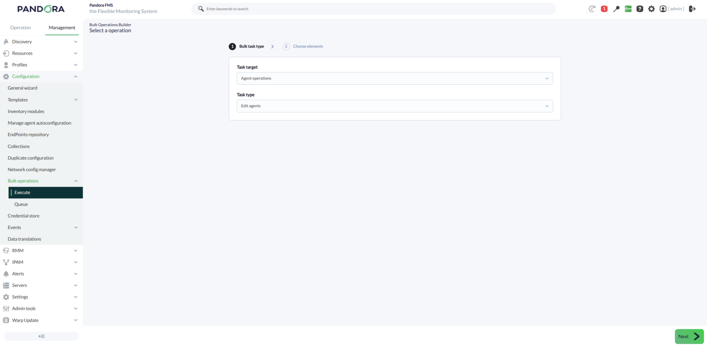
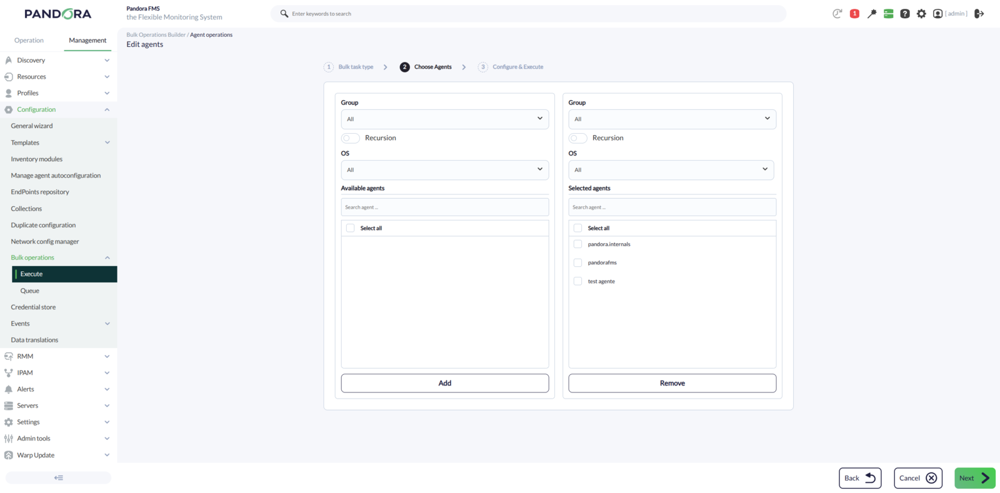
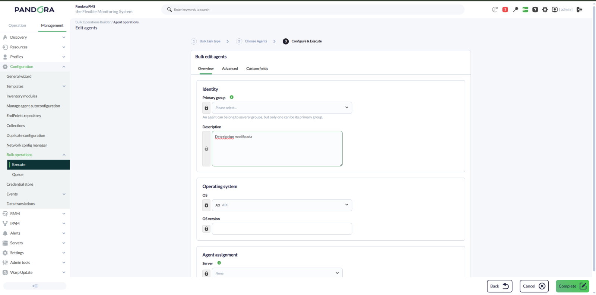
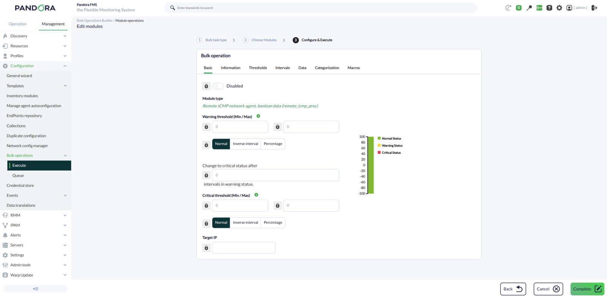
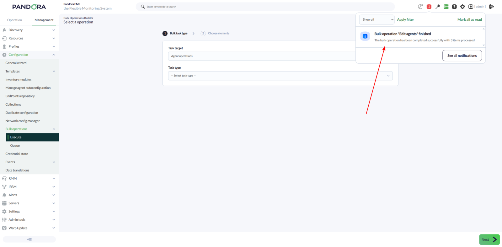

# Opérations massives

Changer l'intervalle d'un module, c'est trois clics. Le changer dans les
quatre cents modules `CPU Load` d'un parc de serveurs Linux, c'est mille
deux cents clics, un après-midi perdu et, presque à coup sûr, deux ou trois
modules oubliés que quelqu'un trouvera dans six mois en se demandant pourquoi
ce serveur-là avance à un autre rythme. Les **opérations massives** existent
pour cela : choisir une fois ce qui change, choisir une fois à qui cela
s'applique, et laisser Pandora FMS faire le travail répétitif.

L'outil a été entièrement refait. Là où il y avait un sous-menu par type
d'élément, chacun avec son formulaire et ses manies, il y a désormais un
unique assistant par étapes qui fonctionne de la même façon pour les agents,
les modules, les alertes, les politiques, les utilisateurs et les alertes
SNMP. Trois idées le soutiennent :

- **Un assistant par étapes.** Vous choisissez d'abord l'opération, ensuite
  les éléments concernés et, à la fin, les changements ou la confirmation.
- **Un verrou par champ.** Dans les modifications, ce qui n'est pas
  déverrouillé n'est pas touché. Fini le « laissez le champ vide et croisez
  les doigts ».
- **Une file d'attente.** L'opération s'exécute en arrière-plan, par lots,
  pendant que l'opérateur continue de travailler ; à la fin, il est prévenu.

!!! warning "Une opération massive de suppression ne se défait pas"
    Supprimer cent agents coûte la même chose que supprimer un seul : un
    bouton. Il n'y a ni corbeille ni retour en arrière. Avant de confirmer une
    suppression, vérifiez la liste des éléments sélectionnés avec la même
    attention que pour un `rm -rf`.

## Accès et structure de l'assistant

Les opérations massives se trouvent dans **Gestion → Configuration →
Opérations massives**, avec deux entrées :

- **Exécuter** : l'assistant qui construit et lance l'opération.
- **File d'attente** : les opérations en attente ou en échec (voir
  [La file d'attente des opérations](#la-file-dattente-des-operations)).

Toutes les opérations suivent la même trame :

1. **Type de tâche massive.** Vous choisissez l'**Objectif de la tâche**
   (agents, modules, alertes, politiques, utilisateurs ou alertes SNMP) et le
   **Type de tâche** (modifier, supprimer, copier, ajouter…).
2. **Choisir les éléments.** Vous sélectionnez les agents, modules,
   politiques, utilisateurs ou alertes sur lesquels l'opération agit.
3. **Étapes suivantes, selon l'opération.** Une modification se termine par
   **Configurer et exécuter** ; une suppression, par une confirmation avec le
   décompte des éléments ; les opérations d'alertes et de copie ajoutent des
   étapes intermédiaires (modèles, actions, destinations).

Les boutons sont identiques dans tout l'assistant : **Suivant**, **Retour**,
**Annuler** et, à la dernière étape, **Compléter**, qui lance l'opération.

Voici les opérations disponibles :

| Objectif de la tâche | Types de tâche |
|---|---|
| Opérations de l'agent | Éditer les agents · Supprimer les agents |
| Opérations du module | Modifier les modules · Modifier les modules satellite · Supprimer les modules · Copier des modules entre agents |
| Opérations d'alerte | Ajouter des alertes · Éditer les alertes · Supprimer les alertes · Ajouter des actions d'alerte · Supprimer des actions d'alerte |
| Opérations de politiques | *Modules :* modifier des modules, modifier des modules satellite, copier des modules entre politiques, copier des modules d'agents · *Alertes :* ajouter et supprimer des alertes, ajouter et supprimer des actions d'alerte · *Alertes externes :* ajouter et supprimer des alertes externes, ajouter et supprimer leurs actions |
| Opérations d'utilisateur | Éditer les utilisateurs · Ajouter des profils aux utilisateurs · Supprimer des profils d'utilisateur |
| Opérations d'alertes SNMP | Éditer les alertes SNMP · Supprimer les alertes SNMP |

Dans la liste déroulante des politiques, les types de tâche apparaissent
regroupés en trois blocs (Modules, Alertes et Alertes externes) : ils sont
nombreux et, sans regroupement, trouver celui que l'on cherche était un
exercice de patience.

Ce qui apparaît dans cette liste dépend des permissions de l'utilisateur
(voir [Permissions](#permissions)) : un objectif pour lequel il n'y a pas de
permission n'est tout simplement pas proposé.

### Le brouillon : sortir et revenir sans perdre le travail

Chaque fois que vous appuyez sur **Suivant**, l'assistant enregistre dans un
**brouillon** ce qui a été choisi jusqu'à ce moment. Si l'opérateur passe à un
autre écran (ou s'il est interrompu, ce qui est courant), en revenant à
**Exécuter** l'assistant reprend l'opération là où elle en était.

Il n'y a qu'un seul brouillon par utilisateur : choisir un nouveau type de
tâche à la première étape écarte le précédent. **Annuler**, à n'importe quelle
étape, l'écarte aussi et ramène à la première étape vide. En appuyant sur
**Compléter**, le brouillon passe dans la file d'attente et disparaît : il ne
reste rien à reprendre.

L'assistant ne proteste que lorsqu'il y a une raison. Si vous tentez d'avancer
sans avoir sélectionné aucun élément, il vous prévient et ne vous laisse pas
continuer ; tant que vous n'essayez pas, il n'affiche aucune erreur.

## Sélectionner des éléments

La deuxième étape utilise un sélecteur à deux panneaux : à gauche, les
éléments disponibles ; à droite, les éléments sélectionnés. Vous cochez des
cases et les faites passer d'un côté à l'autre avec **Ajouter** et
**Supprimer** ; la case **Tout sélectionner** coche tout ce que le panneau
affiche à ce moment.

Pour les agents, les filtres sont :

| Filtre | Ce qu'il fait |
|---|---|
| Groupe | Affiche les agents du groupe choisi |
| Récursivité | Inclut les agents des sous-groupes |
| SE | Filtre par système d'exploitation |
| Rechercher | Filtre par nom |

Le sélecteur inclut les agents activés et désactivés de la même façon, et
n'affiche que ceux des groupes que l'utilisateur peut gérer.

Pour les modules, vous choisissez d'abord les agents (avec les mêmes filtres),
puis leurs modules, avec ces filtres supplémentaires :

| Filtre | Ce qu'il fait |
|---|---|
| Type de module | Modules de données, de réseau, de plugin, de prédiction, WMI, web ou WUX |
| Type de données du module | Booléen, numérique, texte, incrémental… |
| Modules communs | Affiche seulement les modules (par nom) que possèdent tous les agents sélectionnés |
| Rechercher | Filtre par nom du module |

Le filtre **Modules communs** est celui qui rend l'opération réellement
utile : avec cinquante agents sélectionnés, l'activer ne laisse que les
modules qui existent chez les cinquante, et ce sont en général justement ceux
que vous voulez toucher.

Deux exclusions méritent d'être présentes à l'esprit avant de chercher un
module qui n'apparaît pas :

- **Les modules qui appartiennent à une politique n'apparaissent pas** dans
  Modifier les modules ni dans Supprimer les modules. Ils se modifient depuis
  les opérations de politiques (voir [Opérations sur les
  politiques](#operations-sur-les-politiques)), car toute modification faite
  à la main sur l'agent serait écrasée par la politique à son application
  suivante.
- **Modifier les modules exclut les modules Satellite**, qui ont leur propre
  opération (**Modifier les modules satellite**) parce que leur configuration
  est différente.

## Le verrou : ce qui change et ce qui est respecté

L'ancienne question de toute modification massive est de savoir comment
distinguer « je ne veux pas changer ce champ » de « je veux laisser ce champ
vide ». La réponse précédente consistait à le laisser vide ou à choisir
« Sans changement » dans une liste déroulante, selon l'écran. La réponse
actuelle est un **verrou** à côté de chaque champ.

- Tous les champs apparaissent **verrouillés** par défaut (verrou fermé,
  champ en grisé).
- Un champ verrouillé **n'est pas envoyé** : chaque élément conserve la valeur
  qu'il avait.
- En cliquant sur le verrou (**Cliquez pour déverrouiller**), le champ est
  activé et **s'applique tel quel**. Si vous le déverrouillez et le laissez
  vide, la valeur est effacée dans tous les éléments sélectionnés.

Cette dernière règle est celle qui mord. Déverrouiller un champ par curiosité
et appuyer sur **Compléter** équivaut à le vider dans tous les éléments. Si
vous avez déverrouillé quelque chose que vous ne vouliez pas toucher, il
suffit de le verrouiller de nouveau avant de terminer.

Le verrou se propage aux blocs dépendants : les macros d'un plugin et la
configuration Satellite d'un module commencent elles aussi verrouillées et
doivent être ouvertes explicitement.

!!! example "Changer seulement l'intervalle"
    Vous voulez passer à 10 minutes tous les modules `CPU Load` des agents
    du groupe `Servidores-Linux`, sans toucher aux descriptions ni aux
    seuils. À l'étape 2, vous filtrez le groupe avec récursivité, vous activez
    **Modules communs** et vous sélectionnez `CPU Load`. À l'étape 3, vous
    déverrouillez seulement l'intervalle, vous le fixez à 10 minutes et vous
    appuyez sur **Compléter**. Tout le reste, verrouillé, reste comme il était
    dans chaque module.

Le verrou s'utilise dans les modifications d'agents, de modules, de modules
Satellite et de modules de politique. Les modifications d'utilisateurs et
d'alertes SNMP ne l'utilisent pas : là, chaque champ ne s'applique que s'il
est rempli. Les opérations qui créent quelque chose de nouveau (ajouter des
alertes ou des actions) n'en ont pas besoin non plus, car il n'y a pas de
valeur précédente à respecter.

## Opérations sur les agents

### Modifier des agents

Étapes : **Type de tâche massive → Choisir les agents → Configurer et
exécuter**.

La troisième étape réutilise le même formulaire de modification d'un agent,
avec ses onglets (**Aperçu**, **Avancé** et **Champs personnalisés**) et avec
chaque champ protégé par le verrou. Toute donnée modifiable sur un agent peut
être modifiée ici en bloc : groupe principal, description, système
d'exploitation, serveur attribué, champs personnalisés…

À l'exécution, Pandora FMS revérifie la permission d'écriture sur le groupe de
chaque agent. Si un agent sur lequel l'utilisateur n'a pas de permission s'est
glissé dans la sélection, cet agent n'est pas modifié et la tentative est
enregistrée dans le journal d'audit.

### Supprimer des agents

Étapes : **Type de tâche massive → Choisir les agents → Confirmer l'opération
de suppression**.

La dernière étape n'a pas d'options : elle indique combien d'agents vont être
supprimés et prévient que l'action ne peut pas être annulée. Si l'un d'eux
échoue, les autres continuent et l'erreur est enregistrée dans la file
d'attente.

Sur un nœud dont la gestion est centralisée depuis le Command Center, cette
opération n'est pas proposée : les agents se suppriment depuis le Command
Center.

!!! example "Nettoyer un laboratoire"
    Pour supprimer les agents de test du groupe `Laboratorio` : objectif
    **Opérations de l'agent**, type **Supprimer les agents** ; à l'étape 2,
    vous filtrez par le groupe `Laboratorio`, **Tout sélectionner** et
    **Ajouter** ; à l'étape 3, vous vérifiez le décompte et vous appuyez sur
    **Compléter**.

## Opérations sur les modules

### Modifier des modules

Étapes : **Type de tâche massive → Sélectionner les modules → Configurer et
exécuter**.

Vous pouvez mélanger des modules de tout type, mais le mélange décide des
champs affichés. Le formulaire n'affiche que ce qui a du sens pour tous les
modules sélectionnés à la fois, en fonction de deux choses : le type de
données du module (booléen, numérique, texte…) et le type de contrôle
(données, réseau, plugin, WMI, web…).

Ainsi, avec deux modules ICMP booléens, vous pouvez modifier les seuils ; avec
une sélection qui mélange ICMP, plugins et modules de données, les seuils et
les champs propres à chaque contrôle disparaissent et le formulaire l'indique
par un avertissement (« non disponible ; des modules de types différents ont
été sélectionnés »). Il ne reste que le commun (description, intervalle, état
activé ou désactivé…), expliqué dans [2.20, Configuration commune des
modules](2.20-configuracion-comun-de-los-modulos.md).

Une règle est héritée de la modification individuelle : si un type de module
ne permet pas de modifier un champ dans son formulaire normal, il ne le permet
pas non plus dans la modification massive, même si le reste des modules de la
sélection le pouvait.

Deux restrictions concernent le **module parent** :

- Vous ne pouvez choisir un parent que si tous les modules sélectionnés
  appartiennent au même agent.
- Aucun des modules sélectionnés ne peut être le parent de la sélection ; un
  module ne peut pas être son propre parent.

!!! tip "Où sont passées les opérations de plugins"
    L'ancienne section des opérations de plugins n'existe plus. Pour activer
    ou désactiver des modules de plugin ou modifier leurs macros en bloc,
    vous utilisez **Modifier les modules** avec le filtre **Type de module**
    sur les modules de plugin. Les macros ne sont modifiables que si tous les
    modules sélectionnés utilisent le même plugin.

### Modifier des modules satellite

Comme **Modifier les modules**, mais limité aux modules qu'un serveur Satellite
collecte, avec leur configuration spécifique (elle aussi sous verrou).

### Supprimer des modules

Étapes : **Type de tâche massive → Sélectionner les modules → Confirmer
l'opération de suppression**. Comme pour les agents, la dernière étape affiche
le décompte et n'a pas de retour en arrière. Les modules de politique
n'apparaissent pas ici non plus.

### Copier des modules entre agents

Étapes : **Type de tâche massive → Sélectionner les modules → Agents de
destination → Confirmer**. Vous choisissez les modules source, puis les agents
qui les recevront et, dans la confirmation, il est indiqué combien de modules
seront copiés dans combien d'agents.

## Opérations sur les alertes

Ces opérations travaillent avec des alertes associées à des modules d'agent.
Toutes partagent le démarrage : **Sélectionner les modules → Sélectionner les
modèles**.

| Type de tâche | Étapes après le choix des modules et des modèles |
|---|---|
| Ajouter des alertes | Choisir les actions → Confirmer |
| Éditer les alertes | Configurer les alertes |
| Supprimer les alertes | Confirmer |
| Ajouter des actions d'alerte | Choisir les actions → Confirmer |
| Supprimer des actions d'alerte | Choisir les actions → Confirmer |

La confirmation indique combien de modèles et d'actions sont attribués (ou
retirés) et à combien de modules. Les modèles, les actions et le
fonctionnement des alertes elles-mêmes sont expliqués dans leur chapitre
propre.

## Opérations sur les politiques

Les opérations de politiques se divisent en trois blocs. Toutes travaillent sur
la définition de la politique, pas sur les agents : **après tout changement, il
faut appliquer la politique** pour qu'elle arrive à ses agents (voir
[Politiques de supervision](2.10-politicas-de-monitorizacion.md)).

**Modules :**

| Type de tâche | Étapes |
|---|---|
| Modifier des modules | Sélectionner des modules de politiques → Configurer et exécuter (avec verrou) |
| Modifier des modules satellite | Idem, pour les modules Satellite de la politique |
| Copier des modules entre politiques | Sélectionner des modules de politiques → Politiques de destination → Confirmer |
| Copier des modules d'agents | Sélectionner des modules d'agents → Politiques de destination → Confirmer |

La dernière est la façon commode de transformer en politique quelque chose qui
a été réglé finement à la main sur un agent : vous l'essayez sur un, vous le
copiez dans la politique et vous l'appliquez au reste.

**Alertes** (sur les modules de la politique) : ajouter et supprimer des
alertes, ajouter et supprimer des actions d'alerte. Les étapes sont les mêmes
que dans les [opérations sur les alertes](#operations-sur-les-alertes), mais la
deuxième étape choisit des modules de politiques.

**Alertes externes** (définies au niveau de la politique, pas du module) :
ajouter et supprimer des alertes externes et leurs actions. Ici, la deuxième
étape choisit des politiques, pas des modules.

## Opérations sur les utilisateurs

| Type de tâche | Étapes |
|---|---|
| Éditer les utilisateurs | Sélectionner des utilisateurs → Configurer et exécuter |
| Ajouter des profils aux utilisateurs | Sélectionner des utilisateurs → Configurer les profils |
| Supprimer des profils d'utilisateur | Sélectionner des utilisateurs → Configurer les profils à supprimer → Confirmer |

**Éditer les utilisateurs** change des préférences, pas des identités :
langue, taille de bloc des listes, page d'accueil, filtre d'événements et de
journaux par défaut, temps d'auto-rafraîchissement, pages avec
auto-rafraîchissement et fuseau horaire. Chaque champ ne s'applique que s'il
est rempli.

**Ajouter des profils aux utilisateurs** attribue une combinaison de profil et
de groupe à tous les utilisateurs sélectionnés ; **Supprimer des profils
d'utilisateur** la retire.

## Opérations sur les alertes SNMP

| Type de tâche | Étapes |
|---|---|
| Éditer les alertes SNMP | Choisir les alertes SNMP → Configurer les alertes |
| Supprimer les alertes SNMP | Choisir les alertes SNMP → Confirmer l'opération de suppression |

Dans le sélecteur, chaque alerte apparaît avec son identifiant devant
(`[ID Alert: 1] - <description>`), ce qui est utile lorsqu'il y en a plusieurs
avec des descriptions semblables.

La modification permet de changer la description, l'OID, l'OID personnalisé,
l'IP d'origine du trap, le type et le sous-type de trap, le groupe, la valeur
unique et les champs variables du trap (jusqu'à 20). Chaque champ ne s'applique
que s'il est rempli. Le fonctionnement des alertes de traps est expliqué dans
[Supervision des traps SNMP](2.7-monitorizacion-de-traps-snmp.md).

## La file d'attente des opérations

En appuyant sur **Compléter**, l'assistant n'attend pas que l'opération se
termine : il l'envoie dans la file d'attente, revient à la première étape et
affiche l'avis **Opération en file d'attente**. Le serveur web la traite en
arrière-plan par lots, et l'opérateur peut préparer la suivante pendant ce
temps.

À la fin, bien ou mal, une notification arrive dans la console avec le nom de
l'opération et le nombre d'éléments traités.

La page **File d'attente** n'affiche que ce qui est **en attente** ou a
**échoué** ; les opérations terminées avec succès disparaissent de la liste
(la notification est l'avis de fin). Pour chaque entrée, elle affiche :

| Colonne | Contenu |
|---|---|
| Type d'opération | L'opération lancée |
| Utilisateur | Qui l'a lancée |
| État | En attente ou en échec |
| Erreur | Bouton **Afficher l'erreur** avec le détail, s'il y en a un |
| Progression | Barre de progression, qui se met à jour seule toutes les deux secondes |
| Créé | Date et heure de lancement |
| Op. | Supprimer l'entrée |

La file d'attente ne réessaie pas. Une opération en échec se consulte avec
**Afficher l'erreur**, se supprime de la liste et, une fois le problème
corrigé, se relance depuis **Exécuter**.

### Taille des lots et limites de PHP

L'opération n'est pas traitée d'un seul coup, mais par lots. La taille est
fixée par **Limite pour les opérations massives**, dans **Configuration →
Configuration système → Comportement** (bloc **Autres**) : le nombre d'éléments
traités dans chaque fournée, pour qu'une opération volumineuse n'épuise pas la
mémoire. Elle accepte des valeurs entre 100 et 2000 ; par défaut, elle vaut la
moitié de `max_input_vars` de PHP. Voir
[Référence complète de configuration de la console](../parte-9/9.2-referencia-completa-de-configuracion-de-la-consola.md).

| Exigence | Détail |
|---|---|
| `max_input_vars` de PHP suffisant | Si le formulaire envoie plus de champs que PHP n'en accepte, l'assistant prévient avant l'envoi : les éléments en trop pourraient se perdre. Avec des sélections très grandes, augmentez la valeur dans `php.ini` ou divisez l'opération |
| Limite pour les opérations massives | Entre 100 et 2000 éléments par lot ; par défaut, la moitié de `max_input_vars` |

Comme l'opération est traitée en arrière-plan, elle ne dépend plus de
`max_execution_time` ni de `max_input_time` de PHP.

## Opérations massives depuis le Command Center

Dans le Command Center, les opérations massives apparaissent comme
**Opérations massives** dans son menu de gestion, avec les mêmes entrées
**Exécuter** et **File d'attente**, mais avec un catalogue réduit :

| Objectif de la tâche | Types de tâche disponibles |
|---|---|
| Opérations de l'agent | Éditer les agents · Supprimer les agents |
| Opérations d'utilisateur | Éditer les utilisateurs |

Les opérations sur les modules, les alertes, les politiques et les alertes
SNMP ne sont pas disponibles dans le Command Center ; elles se font sur chaque
nœud. Le fonctionnement du Command Center et sa relation avec les nœuds sont
expliqués dans leur chapitre propre.

## Permissions

| Accès | Permission nécessaire |
|---|---|
| Menu **Opérations massives → Exécuter** | Écriture d'agents (AW) |
| Page **File d'attente** | Gestion de Pandora FMS (PM) |
| Opérations de l'agent et du module | Lecture ou écriture d'agents (AR/AW) |
| Supprimer les agents | En plus, que le nœud ne soit pas géré de façon centralisée depuis le Command Center |
| Opérations d'alerte et d'alertes SNMP | Écriture ou gestion d'alertes (LW/LM ; LW pour les alertes SNMP) |
| Opérations de politiques | Lecture ou écriture d'agents (AR/AW), sur un nœud sans gestion centralisée |
| Opérations d'utilisateur | Gestion d'utilisateurs (UM) |

Outre la permission de voir l'opération, son exécution vérifie la permission
sur le groupe de chaque élément : le sélecteur ne propose que des agents de
groupes que l'utilisateur peut gérer, et si l'un d'eux ne remplit pas la
condition au moment de l'exécution, il est ignoré et le cas est consigné dans
le journal d'audit.
