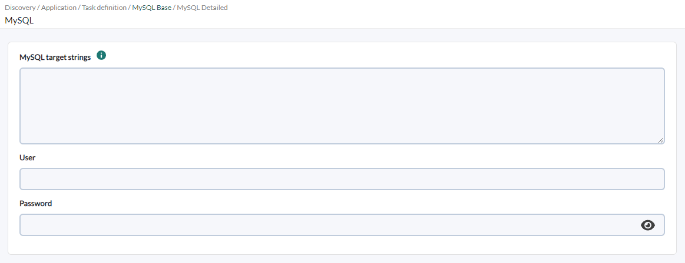
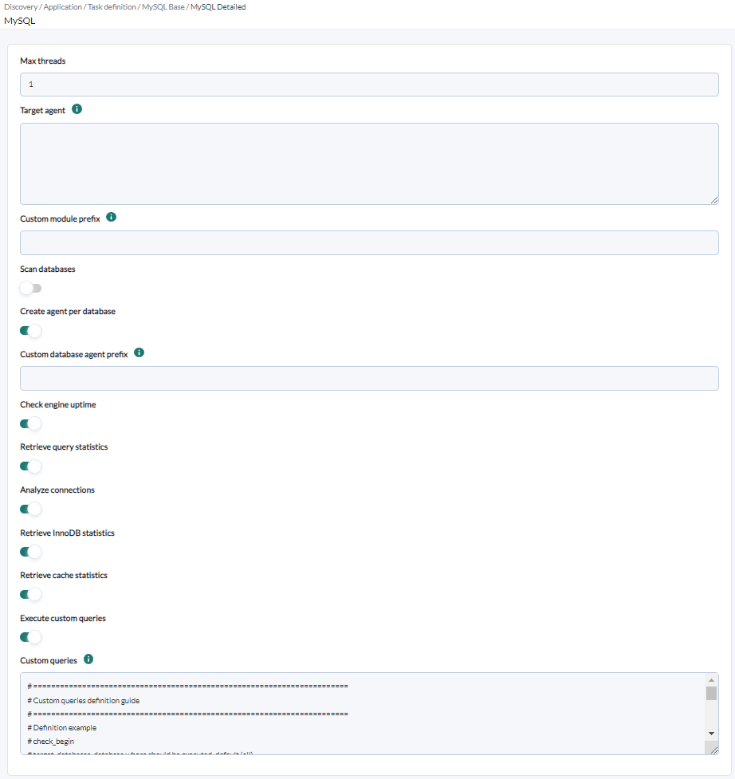
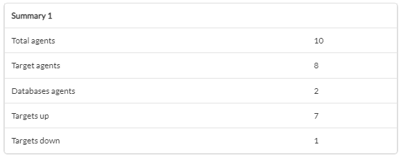

# Supervision des applications

Une base de données qui ne répond pas ne prévient pas : elle cesse simplement de
répondre, et le plus courant est que les utilisateurs s'en aperçoivent en
premier. Installer un EndPoint sur chaque serveur de bases de données pour les
surveiller est une option, mais pas la seule, ni la plus commode quand les
instances se comptent par dizaines et vivent sur des machines qui ne sont pas
toujours les vôtres. Avec Discovery, un paquet .disco du Marketplace et une
tâche dans **Discovery → Applications** suffisent : le serveur interroge
l'application à distance à chaque intervalle et crée, ou met à jour, les agents
et modules correspondants. Sans rien d'installé sur l'hôte supervisé.

L'installation d'un paquet .disco et le déroulement d'une tâche pas à pas sont
racontés une seule fois, dans [Comment fonctionne la tâche d'un paquet .disco](2.3-monitorizacion-y-descubrimiento-automatico-con-discovery.md#comment-fonctionne-la-tache-dun-paquet-disco).
Ici ne reste que ce qui est propre aux applications. Un avertissement
préalable : la section Applications n'affiche que ce qui est installé ; si la
case d'une application manque, c'est son paquet .disco qui manque
([Les sections de Discovery](2.3-monitorizacion-y-descubrimiento-automatico-con-discovery.md#les-sections-de-discovery)).

Ce chapitre s'arrête à sept applications du catalogue, mais ce qu'il raconte
vaut pour toutes les autres : tout paquet .disco d'Applications s'installe, se
configure et s'exécute de la même façon, avec la [tâche d'un paquet .disco](2.3-monitorizacion-y-descubrimiento-automatico-con-discovery.md#comment-fonctionne-la-tache-dun-paquet-disco).
Ce qui change de l'une à l'autre, ce sont les champs qu'elle demande et les
modules qu'elle crée, et ce détail (tous ses champs, les modules qu'elle
génère, les requêtes personnalisées) vit dans la page de chaque plugin de la
[documentation des intégrations](https://pandorafms.com/docs/integrations/latest/es/)
et dans sa fiche du [Marketplace](https://marketplace.pandorafms.com/), et il
n'est pas recopié ici. Pour une application qui n'apparaît pas dans ce tableau,
vous la cherchez par son nom sur ces deux sites.

| Application | Nom court du catalogue | Détail |
|---|---|---|
| MySQL | `pandorafms.mysql` | [Documentation des intégrations](https://pandorafms.com/docs/integrations/latest/es/discovery/mysql-discovery/) et [Marketplace](https://marketplace.pandorafms.com/entries/pandorafms.mysql) |
| Microsoft SQL Server | `pandorafms.mssql` | [Documentation des intégrations](https://pandorafms.com/docs/integrations/latest/es/discovery/mssql-discovery/) et [Marketplace](https://marketplace.pandorafms.com/entries/pandorafms.mssql) |
| PostgreSQL | `pandorafms.postgresql` | [Documentation des intégrations](https://pandorafms.com/docs/integrations/latest/es/discovery/postgresql/) et [Marketplace](https://marketplace.pandorafms.com/entries/pandorafms.postgresql) |
| MongoDB | `pandorafms.mongodb` | [Documentation des intégrations](https://pandorafms.com/docs/integrations/latest/es/discovery/mongodb-discovery/) et [Marketplace](https://marketplace.pandorafms.com/entries/pandorafms.mongodb) |
| Oracle | `pandorafms.oracle` | [Documentation des intégrations](https://pandorafms.com/docs/integrations/latest/es/) et [Marketplace](https://marketplace.pandorafms.com/entries/pandorafms.oracle) |
| Apache | `pandorafms.apache` | [Documentation des intégrations](https://pandorafms.com/docs/integrations/latest/es/discovery/apache-discovery/) et [Marketplace](https://marketplace.pandorafms.com/entries/pandorafms.apache) |
| NGINX | `pandorafms.nginx` | [Documentation des intégrations](https://pandorafms.com/docs/integrations/latest/es/discovery/nginx/) et [Marketplace](https://marketplace.pandorafms.com/entries/pandorafms.nginx) |

La virtualisation (VMware, Proxmox) et les orchestrateurs (Kubernetes)
apparaissent aussi dans la section Applications, mais ils ont leur propre
chapitre : [Supervision des environnements
virtualisés](2.16-monitorizacion-entornos-virtualizados.md) et [Supervision des
conteneurs et des orchestrateurs](2.13-monitorizacion-de-contenedores-y-orquestadores.md).

## Exemple complet : une tâche MySQL

MySQL sert d'exemple parce que c'est le cas typique : une liste d'instances, un
utilisateur avec des permissions de lecture et un agent par instance. Les étapes
génériques (définir la tâche, la forcer, lire le résumé) sont dans 2.3 ; ce qui
suit est seulement ce qui est propre à une base de données.

1. **Ce que demande le paquet .disco.** Après la première étape de définition,
   le paquet .disco ajoute deux étapes. **MySQL Base** demande la liste des
   instances (`SERVEUR:PORT`, avec 3306 par défaut ; une par ligne ou séparées
   par des virgules), l'utilisateur et le mot de passe.

   

   **MySQL Detailed** demande les threads, si l'on veut un agent par base de
   données, les préfixes, les groupes de métriques et les requêtes
   personnalisées.

   

   L'utilisateur et le mot de passe vont dans des champs propres, de type mot de
   passe, et non dans le
   [Gestionnaire d'identifiants](2.2-gestor-de-credenciales.md) : MySQL est l'un
   des paquets .disco qui fonctionne ainsi.

2. **Préparer l'utilisateur dans MySQL.** Le plugin ne fait que lire, et il
   convient que son utilisateur fasse de même :

    | Exigence | Détail |
    |---|---|
    | Réseau | Accès depuis le serveur Discovery jusqu'à chaque instance (port 3306 par défaut). |
    | Données | Permission `SELECT` sur les tables des bases de données et sur celles de `INFORMATION_SCHEMA`. |
    | État du serveur | Permissions `SHOW STATUS` et `SHOW VARIABLES`. |

    Un exemple : un utilisateur `pandora_monitor` avec ces permissions et une
    instance `mysql-prod-01:3306`. Les permissions sont celles qu'énumère la
    page du plugin dans la documentation des intégrations ; il convient de ne
    lui accorder que ce que votre politique de supervision exige.

3. **Remplir et exécuter.** Vous enregistrez avec **Configuration complète** et
   vous forcez la tâche depuis la liste, comme décrit dans
   [La liste des tâches](2.3-monitorizacion-y-descubrimiento-automatico-con-discovery.md#la-liste-des-taches).

4. **Ce qu'elle crée.** Un agent par instance joignable, avec son module de
   connexion et les modules du moteur qui ont été laissés activés. **Scan
   databases** ajoute les métriques par base de données, et avec **Create agent per
   database** chaque base de données a son propre agent, avec celui de
   l'instance comme parent. Une instance injoignable ne crée pas d'agent : elle
   est comptée dans **Targets down** du résumé de la tâche.

   

## Bases de données

Après le parcours de MySQL, ce qui change d'une base de données à l'autre, ce
sont les particularités. Le tableau les recueille ; le reste de la mécanique
(agent par instance, option d'agent par base de données, module de connexion)
est identique.

| Application | Ce qu'elle apporte | Préparation spécifique | Plus d'informations |
|---|---|---|---|
| **Microsoft SQL Server** | Agent par instance et, si demandé, par base de données ; métriques d'instance et de base de données ; requêtes personnalisées ; délais d'attente propres à la connexion et à la requête (5 secondes par défaut). | Un login avec `VIEW SERVER STATE`, et `SELECT` pour les requêtes personnalisées. Le mode ODBC est facultatif et exige le pilote ODBC 17 et unixODBC sur la machine qui exécute le plugin. | [Documentation des intégrations](https://pandorafms.com/docs/integrations/latest/es/discovery/mssql-discovery/) et [Marketplace](https://marketplace.pandorafms.com/entries/pandorafms.mssql) |
| **PostgreSQL** | Agent par cible et, avec **Scan databases**, par base de données ; disponibilité, activité, connexions, cache de tampons, stockage, transactions et statistiques de tables. | Utilise un **identifiant Custom** du [Gestionnaire d'identifiants](2.2-gestor-de-credenciales.md) au lieu d'un utilisateur et d'un mot de passe dans la tâche. Le rôle doit pouvoir se connecter aux bases supervisées et lire leurs vues de statistiques. | [Documentation des intégrations](https://pandorafms.com/docs/integrations/latest/es/discovery/postgresql/) et [Marketplace](https://marketplace.pandorafms.com/entries/pandorafms.postgresql) |
| **MongoDB** | Agent par cible ; métriques du moteur et par base de données ; une étape propre pour les requêtes personnalisées. | Les cibles sont des URI de connexion, avec l'utilisateur à l'intérieur (port 27017 par défaut). Rôles `read` ou `dbAdmin` sur les bases de données et `clusterMonitor` ou `clusterAdmin` pour les statistiques du serveur. | [Documentation des intégrations](https://pandorafms.com/docs/integrations/latest/es/discovery/mongodb-discovery/) et [Marketplace](https://marketplace.pandorafms.com/entries/pandorafms.mongodb) |
| **Oracle** | Paquet .disco présent dans le catalogue d'Applications. | Il n'y a pas de page de plugin dans la documentation des intégrations : ses champs et ses permissions ne sont pas décrits ici. | [Documentation des intégrations](https://pandorafms.com/docs/integrations/latest/es/) et [Marketplace](https://marketplace.pandorafms.com/entries/pandorafms.oracle) |

Avec trois d'entre elles (MySQL, Microsoft SQL Server et MongoDB), l'utilisateur
et le mot de passe, ou l'URI qui les porte, s'écrivent dans la tâche elle-même ;
avec PostgreSQL, l'identifiant d'une entrée du gestionnaire d'identifiants
suffit. Si le mot de passe d'un utilisateur de supervision change souvent, la
différence compte.

## Serveurs web : Apache et Nginx

Les serveurs web ne s'interrogent pas en SQL mais en HTTP : chacun publie un
point de terminaison d'état que le plugin lit et convertit en modules. Avant de
créer la tâche, il faut avoir ce point de terminaison actif sur le serveur
supervisé.

| Application | Exigence sur le serveur | Ce qu'elle crée | Plus d'informations |
|---|---|---|---|
| **Apache** | `mod_status` activé, avec la réponse `server-status?auto` exploitable par une machine et restreinte à l'IP du système qui exécute le plugin. L'authentification de base n'est nécessaire que si le point de terminaison l'exige. | Un agent par emplacement réseau distinct entre les URL, avec un module de disponibilité (« Apache Connection ») et un module par ligne clé/valeur de la réponse. | [Documentation des intégrations](https://pandorafms.com/docs/integrations/latest/es/discovery/apache-discovery/) et [Marketplace](https://marketplace.pandorafms.com/entries/pandorafms.apache) |
| **NGINX** | Module `ngx_http_stub_status_module` compilé et `stub_status` exposé ; authentification de base facultative. | Un agent par URL, avec des modules de connexions actives, acceptées et gérées, de requêtes, et de connexions en lecture, en écriture et en attente, en plus de la disponibilité. | [Documentation des intégrations](https://pandorafms.com/docs/integrations/latest/es/discovery/nginx/) et [Marketplace](https://marketplace.pandorafms.com/entries/pandorafms.nginx) |

Un avertissement au sujet d'Apache : `server-status` compte des choses du
serveur que personne n'a de raison de lire. Il doit être ouvert seulement à
l'IP de qui supervise, pas au monde entier. Le plugin Apache, de plus, livre
les données sous forme de fichiers XML par Tentacle (la destination et le port
sont des champs de la tâche), au lieu de répondre uniquement avec le JSON que
décrit 2.3 ; le résultat dans la console est le même.

## Ce que l'on obtient et lien avec les politiques

Le résultat, ce sont des agents normaux, dans le groupe de la tâche, avec leurs
modules, qui se mettent à jour à chaque exécution. Pour vérifier le premier
résultat : vous forcez la tâche, vous ouvrez son résumé depuis la liste des
tâches (« Voir le résumé ») et vous cherchez les agents créés. Si quelque chose
n'apparaît pas, le résumé l'explique souvent (« Terminé » ne garantit pas que
le plugin ait trouvé quelque chose) : voir
[Quand cela échoue](2.3-monitorizacion-y-descubrimiento-automatico-con-discovery.md#quand-cela-echoue)
et le tableau de dépannage de la page du plugin dans la documentation des
intégrations.

Pour appliquer de façon homogène des alertes et d'autres configurations aux
agents créés, l'endroit est [Politiques de
supervision](2.10-politicas-de-monitorizacion.md).

## Références et liens

- Marketplace : <https://marketplace.pandorafms.com/>. Chaque paquet .disco du
  catalogue y a sa fiche, avec le nom court du tableau de l'introduction.
- [Documentation des intégrations](https://pandorafms.com/docs/integrations/latest/es/) : une page par plugin (MySQL, Microsoft SQL
  Server, PostgreSQL, MongoDB, Apache et NGINX).
- Identifiants réutilisables : [Gestionnaire d'identifiants](2.2-gestor-de-credenciales.md).
- Créer vos propres paquets .disco : [Création de plugins de discovery](../parte-9/9.7-creacion-de-plugins-de-discovery.md).
