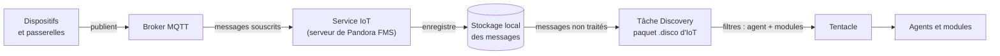

# Supervision IoT

Un capteur de température d'atelier n'a pas de place pour un EndPoint. Le
compteur d'une installation solaire ni le lecteur de porte d'un entrepôt non
plus. Ce qu'ils ont presque tous, en revanche, c'est un moyen de publier ce
qu'ils mesurent sur un **broker MQTT** : un serveur de messagerie auquel les
dispositifs envoient des données par *topics* (les « canaux » nommés du
protocole, du type `fabrica/linea-a/temperatura`). Pandora FMS s'appuie
précisément sur cela. Il ne parle pas au capteur : il écoute le broker, collecte
ce qui est publié sur les topics qui l'intéressent et le transforme en agents et
en modules comme ceux de n'importe quel autre équipement.

Le résultat concret, c'est que tout ce qui est capable de publier un message MQTT
peut être supervisé, avec ses graphiques, ses seuils et ses alertes, sans rien
installer sur le dispositif. Ce chapitre montre comment fonctionne cette chaîne,
comment la configurer et, surtout, quels modules sortent de quels messages, avec
des exemples réels.

| Exigence | Détail |
|---|---|
| Broker MQTT | Accessible depuis l'équipement du serveur de Pandora FMS. Les dispositifs publient dessus ; Pandora FMS ne fait que s'y abonner. |
| Serveur de Pandora FMS | Inclut le service IoT (`pandora_iot_server`), qui collecte les messages. |
| Paquet .disco d'IoT | Installé dans la console. La tâche qu'il crée transforme les messages en agents et en modules. |
| Tentacle | La tâche envoie les données générées par Tentacle, comme n'importe quel autre paquet .disco. |
| Permissions | La configuration du service IoT n'est accessible qu'aux utilisateurs administrateurs. |

L'installation du paquet .disco et le cycle de vie commun de ses tâches sont
expliqués dans [2.3 (Supervision et découverte automatique avec
Discovery)](2.3-monitorizacion-y-descubrimiento-automatico-con-discovery.md#installer-mettre-a-jour-et-desinstaller-un-paquet-disco)
et ne sont pas répétés ici. Ce qui suit est propre à l'IoT ; le guide de
l'intégration, avec la référence complète des réglages et des options, se trouve
dans [IoT Discovery](https://pandorafms.com/docs/integrations/latest/fr/discovery/iot/).

## Comment cela fonctionne

La chaîne compte quatre maillons, et il vaut mieux les avoir clairs, car chacun
échoue d'une manière différente.

1. **Les dispositifs publient** des messages sur le broker, chacun sur son topic.
2. **Le service IoT** maintient une connexion unique avec le broker, s'abonne aux
   topics configurés et enregistre chaque message reçu dans un stockage local du
   serveur.
3. **La tâche Discovery** du paquet .disco d'IoT s'exécute à chaque intervalle,
   lit les messages qu'elle n'a pas encore traités et leur applique les
   **filtres** que vous avez définis.
4. **Pour chaque groupe de messages qui correspond à un filtre**, la tâche génère
   un agent avec ses modules et l'envoie à Pandora FMS par Tentacle. À partir de
   là, c'est un agent normal.



Trois limites expliquent presque tout ce qui suit :

- **Une seule connexion.** Ajouter des topics n'ajoute ni connexions ni
  processus : le service envoie une unique demande d'abonnement avec tous les
  filtres de topic.
- **Qualité de service 0.** Les abonnements sont toujours demandés en QoS 0
  (remise au plus une fois, sans accusé de réception) et ce n'est pas
  configurable. Si la connexion tombe un instant, les messages publiés pendant
  cet intervalle ne sont pas récupérés.
- **Rétention limitée.** Les messages sont supprimés du stockage au terme d'un
  délai (24 heures par défaut), que la tâche les ait traités ou non. Une tâche
  qui ne s'exécute pas dans ce délai perd les messages.

## Activer et configurer le serveur IoT

Le service est installé avec le serveur, mais il est éteint. Il s'active avec
l'interrupteur **Activer le serveur IoT** de **Réglages → Configuration du
système → Configuration générale**, onglet **Caractéristiques**. Une fois
activé, une page propre apparaît, réservée aux utilisateurs administrateurs :
**Réglages → Configuration du système → Serveur IoT**.

!!! note "Libellés dans la console en espagnol"
    Certains libellés de cette page apparaissent dans la console en espagnol avec
    un texte qui ne correspond pas à leur fonction. Le tableau les identifie par
    leur nom d'origine et par ce qu'ils font.

| Champ | Ce qu'il fait | Valeur par défaut |
|---|---|---|
| Server configuration | Chemin du fichier de configuration que le serveur génère pour le service. | `/etc/pandora/pandora_iot_config.ini` |
| Server host | Adresse du broker MQTT. | `test.mosquitto.org` |
| Server port | Port du broker. | `1883` |
| Server protocol | Transport : `tcp`, `websockets` ou `unix`. | `tcp` |
| Server user / Server password | Identifiants du broker, s'il les exige. | vide |
| Server topic | Topic ou topics auxquels s'abonner (voir plus bas). | `testtopic/#` |
| Enable SSL / Trust SSL certificate | Chiffrement de la connexion (voir l'avertissement). | désactivé / activé |
| Database location / Database name | Dossier et nom du stockage local des messages. | `/opt/pandora/pandora_iot_server/db`, `pandora_iot.db` |
| Data cleaning interval | Secondes minimales entre deux nettoyages des messages expirés. | `300` |
| Data cleaning period | Ancienneté, en secondes, à partir de laquelle un message est supprimé. | `86400` (24 heures) |
| Log name / Log location | Nom et dossier du journal du service. | `pandora_iot.log`, `/var/log/pandora/` |
| Log level | Niveau de détail du journal. | `info` |
| Max log bytes / Log rotation count | Taille maximale du journal actif et nombre de fichiers archivés conservés. | `50000000`, `3` |

Les valeurs par défaut de l'hôte et du topic pointent vers un broker public de
test : elles servent à vérifier que tout démarre, pas en production. La première
chose à changer est le broker.

### Topics

Le champ **Server topic** accepte deux formes :

- **Un seul filtre**, comme `fabrica/#`.
- **Plusieurs filtres**, comme un tableau JSON sur une seule ligne :
  `["fabrica/+/temperatura", "fabrica/+/estado", "alertas/#"]`.

Les jokers sont ceux de MQTT : `+` remplace exactement un niveau
(`fabrica/+/temperatura` correspond à `fabrica/linea-a/temperatura`, mais pas à
`fabrica/linea-a/sala-1/temperatura`) et `#` remplace tous les niveaux restants
et doit se trouver à la fin (`alertas/#` correspond à `alertas`,
`alertas/sitio-a` et à tout ce qui en dépend). Un tableau mal formé (virgule
finale, guillemets simples, membres vides) empêche le service de démarrer avec
l'erreur `Invalid topic configuration`. Le champ accepte 200 caractères au
maximum, crochets et guillemets compris.

Seuls les messages des topics souscrits arrivent au stockage : un filtre de la
tâche ne verra jamais un message dont le topic n'est pas dans cette liste. Et
rappelez-vous que le broker décide des filtres qu'il accepte selon ses propres
règles d'accès.

### Chiffrement de la connexion

Pour chiffrer la connexion, il faut activer **Enable SSL** et **Trust SSL
certificate** en même temps. Avec **Trust SSL certificate** activé, le service
**ne vérifie pas le certificat du broker** : le trafic est chiffré, mais rien ne
confirme que le broker est bien celui qu'il prétend être. Avec **Enable SSL**
activé et **Trust SSL certificate** désactivé, le service ne configure pas le
chiffrement. Si votre environnement exige de valider le broker, cette version ne
le propose pas ; il vaut mieux résoudre la question au niveau du réseau (accès
restreint au broker, par exemple).

### Quand les changements prennent effet

Le serveur de Pandora FMS écrit le fichier de configuration du service et le
démarre **à chaque démarrage**. C'est pourquoi les changements faits sur la page
du serveur IoT **ne s'appliquent qu'après le redémarrage de `pandora_server`**.
Une fois le redémarrage fait, vous pouvez vérifier le service depuis le système :

```bash
systemctl status pandora_iot_server
```

Dans le journal du service (`/var/log/pandora/pandora_iot.log` par défaut) doit
apparaître, pour chaque topic, une ligne comme celle-ci :

```text
MQTT broker accepted subscription to factory/+/temperature with QoS 0
```

Si en revanche le broker refuse un filtre, le journal l'indique avec le motif.

## La tâche Discovery du paquet IoT

Le service ne fait que collecter. C'est la tâche du paquet .disco d'IoT qui décide
quels agents et quels modules naissent ; elle se crée et se gère comme n'importe
quelle autre (voir [Comment fonctionne la tâche d'un paquet
.disco](2.3-monitorizacion-y-descubrimiento-automatico-con-discovery.md#comment-fonctionne-la-tache-dun-paquet-disco)).
Son assistant comporte deux étapes propres en plus de la première, commune :

| Étape | Champ | Ce qu'il fait |
|---|---|---|
| Iot base | DB path | Chemin complet du stockage des messages. Par défaut, `/opt/pandora/pandora_iot_server/db/pandora_iot.db` ; il doit correspondre à **Database location** et **Database name** du service. |
| Iot base | Time window | Sans effet dans cette version : laissez-le vide. |
| Iot base | Tentacle IP / Tentacle port | Destination des données générées. Par défaut, `127.0.0.1` et `41121`. |
| Iot base | Tentacle extra options | Facultatif. Dans cette version, il ne s'applique pas à l'envoi. |
| Iot detailed | Max threads | Fils d'exécution avec lesquels les messages sont traités (par défaut, 1). |
| Iot detailed | Filter messages modules | C'est ici que s'écrivent les filtres. C'est le cœur du paquet et il a sa propre section plus bas. |

Deux conditions influent sur le résultat :

- **La tâche doit pouvoir lire le stockage.** Le stockage est un fichier local du
  serveur où tourne le service IoT, la tâche doit donc s'exécuter sur ce même
  équipement. Si **DB path** ne correspond pas ou si le fichier n'existe pas, la
  tâche signale qu'elle ne trouve pas le fichier et ne génère rien.
- **Le groupe des agents vient de la tâche.** Les agents sont créés dans le
  groupe configuré à la première étape de la tâche, et leur intervalle est celui
  de la tâche.

À chaque exécution, la tâche lit les messages qu'elle n'a pas encore traités, les
passe dans les filtres, génère les agents et les **marque comme traités** : un
message n'est traité qu'une seule fois. Le résumé de l'exécution affiche deux
compteurs, **Total agents** et **Total messages** (les agents générés et les
modules créés).

## Filtres : du message au module

Chaque filtre décrit un module : quels messages le produisent, quelle valeur il
porte et de quel agent il fait partie. Les filtres s'écrivent dans le champ
**Filter messages modules**, l'un derrière l'autre, entre `filter_begin` et
`filter_end` :

```text
filter_begin
filter_module_name Temperatura
filter_module_type generic_data
filter_topic linea-a
filter_message "value"
filter_message_capture_json $.value
filter_module_value __json1__
filter_end
```

| Directive | Obligatoire | Ce qu'elle fait |
|---|---|---|
| `filter_module_name` | Oui | Nom du module. Accepte les macros. |
| `filter_module_type` | Oui | Type du module : `generic_data`, `generic_data_string`, `generic_proc`… |
| `filter_module_value` | Oui | Valeur du module. Accepte les macros. |
| `filter_topic` | Non | Texte ou expression régulière qui doit correspondre au topic. Sans elle, tous correspondent. |
| `filter_topic_exact_match` | Non | `1` : le texte doit apparaître tel quel dans le topic. `0` (par défaut) : expression régulière. |
| `filter_message` | Non | Texte ou expression régulière qui doit correspondre au contenu du message. |
| `filter_message_exact_match` | Non | Identique à la précédente, pour le message. |
| `filter_message_capture_regex` | Non | Expression régulière avec groupes de capture ; chaque groupe alimente une macro `__regexN__`. |
| `filter_message_capture_json` | Non | Chemins JSONPath séparés par `\|` (par exemple, `$.soil.moisture`) ; chaque chemin alimente une macro `__jsonN__`. |

Les macros utilisables dans `filter_module_name` et `filter_module_value` :

| Macro | Remplacée par |
|---|---|
| `__topic__` | Le topic exact du message. |
| `__regexN__` | Le groupe de capture N de `filter_message_capture_regex`. |
| `__jsonN__` | Le résultat du chemin N de `filter_message_capture_json`. |

Quatre règles changent le résultat, et mieux vaut les connaître avant d'écrire le
premier filtre :

1. **L'agent porte le nom du texte de `filter_topic`.** Pas celui du topic du
   message : celui du texte du filtre. Tous les filtres qui partagent le même
   `filter_topic` alimentent le même agent ; des textes différents créent des
   agents différents. Un `filter_topic` court et propre (`linea-a`) donne un
   agent bien nommé ; un `filter_topic` avec le chemin complet donne un agent
   nommé avec le chemin complet.
2. **Pour distinguer les modules d'un même agent, on utilise le message.** Comme
   deux filtres de même `filter_topic` vont au même agent, ce qui les sépare est
   `filter_message` : la température en JSON d'un côté, le littéral `ONLINE` de
   l'autre.
3. **Un module, une valeur par exécution.** Si plusieurs messages d'une même
   exécution produisent un module du même nom dans le même agent, seul le premier
   est conservé. Les autres sont marqués comme traités et n'arrivent pas à
   Pandora FMS. Si les dispositifs publient plus vite que la tâche ne s'exécute,
   l'intervalle de la tâche décide de la résolution des données.
4. **Un message peut alimenter plusieurs filtres**, et un message qui ne
   correspond à aucun filtre est quand même marqué comme traité.

## Exemples et résultats

Les exemples suivants ont été testés avec un broker Mosquitto, le service IoT et
le processeur du paquet. Les tableaux montrent ce que le processeur génère pour
Pandora FMS.

### Une usine avec deux lignes et une serre (JSON)

Les dispositifs publient ces messages :

| Topic | Message |
|---|---|
| `factory/line-a/temperature` | `{"sensor":"t1","value":21.4,"unit":"C"}` |
| `factory/line-a/status` | `ONLINE` |
| `factory/line-b/temperature` | `{"sensor":"t2","value":35.8,"unit":"C"}` |
| `greenhouse/zone1` | `{"temp":24.5,"humidity":61,"soil":{"moisture":38}}` |

Les topics souscrits sont
`["factory/+/temperature", "factory/+/status", "greenhouse/#"]` et les filtres
de la tâche :

```text
filter_begin
filter_module_name Temperature
filter_module_type generic_data
filter_topic line-a
filter_message "value"
filter_message_capture_json $.value
filter_module_value __json1__
filter_end
filter_begin
filter_module_name Line status
filter_module_type generic_proc
filter_topic line-a
filter_message ^ONLINE$
filter_module_value 1
filter_end
filter_begin
filter_module_name Temperature
filter_module_type generic_data
filter_topic line-b
filter_message_capture_json $.value
filter_module_value __json1__
filter_end
filter_begin
filter_module_name Humidity __topic__
filter_module_type generic_data
filter_topic greenhouse/zone
filter_message_capture_json $.humidity
filter_module_value __json1__
filter_end
filter_begin
filter_module_name Soil state
filter_module_type generic_data_string
filter_topic greenhouse/zone
filter_message_capture_json $.soil.moisture
filter_module_value Moisture __json1__ %
filter_end
```

Le résumé de la tâche indique `Total agents: 3` et `Total messages: 5`, et ces
agents apparaissent dans la console :

| Agent | Module | Type | Valeur |
|---|---|---|---|
| `line-a` | Temperature | `generic_data` | `21.4` |
| `line-a` | Line status | `generic_proc` | `1` |
| `line-b` | Temperature | `generic_data` | `35.8` |
| `greenhouse/zone` | Humidity greenhouse/zone1 | `generic_data` | `61` |
| `greenhouse/zone` | Soil state | `generic_data_string` | `Moisture 38 %` |

Remarquez trois choses. La ligne A a deux modules parce que ses deux filtres
partagent `filter_topic`. L'agent `greenhouse/zone` regroupe les zones qui
correspondent à ce texte, et la macro `__topic__` évite que les modules de zones
différentes s'écrasent : `Humidity greenhouse/zone1`,
`Humidity greenhouse/zone2`… Et le module de chaîne (`Moisture 38 %`) montre
que la valeur n'est pas forcément le nombre nu : elle peut se composer de texte
fixe et de macros.

### Messages qui ne sont pas du JSON : portes et compteurs

Tous les dispositifs ne parlent pas JSON. Avec des messages en texte brut, on
capture par expressions régulières :

| Topic | Message |
|---|---|
| `sensors/door1` | `OPEN` |
| `sensors/door2` | `CLOSED` |
| `meters/m1` | `temp=24.5;hum=61` |

```text
filter_begin
filter_module_name Door __topic__
filter_module_type generic_data_string
filter_topic sensors/door
filter_message_capture_regex ^(OPEN|CLOSED)$
filter_module_value __regex1__
filter_end
filter_begin
filter_module_name Humidity
filter_module_type generic_data
filter_topic meters/
filter_message_capture_regex temp=([0-9.]+);hum=([0-9]+)
filter_module_value __regex2__
filter_end
```

| Agent | Module | Valeur |
|---|---|---|
| `sensors/door` | Door sensors/door1 | `OPEN` |
| `sensors/door` | Door sensors/door2 | `CLOSED` |
| `meters/` | Humidity | `61` |

Les portes finissent dans un seul agent avec un module par porte, grâce à
`__topic__`. Le compteur montre comment `__regex2__` récupère le deuxième groupe
de capture (l'humidité) et laisse la température de côté ; pour avoir aussi la
température, un autre filtre avec le même `filter_topic` et `__regex1__`
suffirait.

### Que faire des modules une fois créés

Les modules générés sont des modules Pandora FMS normaux : ils apparaissent dans
l'agent, se représentent en graphiques et peuvent servir dans des alertes, des
rapports et des tableaux de bord comme ceux de n'importe quel autre agent. Les
seuils d'état se définissent sur chaque module une fois qu'il existe.

## Vérifier et diagnostiquer

Quand quelque chose n'apparaît pas, parcourez la chaîne dans l'ordre de
circulation du message, de gauche à droite.

| Symptôme | Cause probable | Quoi vérifier |
|---|---|---|
| Le service ne démarre pas | Configuration invalide (`Invalid topic configuration`), permissions manquantes sur les dossiers ou broker injoignable. | `systemctl status pandora_iot_server` et le journal du service. |
| Les changements de la page du serveur IoT restent sans effet | La configuration est écrite au démarrage du serveur. | Redémarrer `pandora_server`. |
| Aucune ligne d'abonnement accepté dans le journal | Le broker est injoignable ou refuse les identifiants. | Hôte, port, protocole, utilisateur, mot de passe et pare-feu. |
| Le broker refuse un filtre | Règles d'accès du broker ou syntaxe de joker incorrecte. | Le motif enregistré pour chaque filtre. |
| La tâche signale qu'elle ne trouve pas le fichier de la base de données | **DB path** ne correspond pas au stockage, ou la tâche ne tourne pas sur l'équipement du service. | Que le chemin soit exactement `Database location` + `Database name`. |
| La tâche se termine sans agents | Aucun filtre ne correspond aux messages en attente, ou les messages ont expiré avant l'exécution. | Le `Total agents` du résumé ; les topics souscrits ; que l'intervalle de la tâche soit inférieur à la période de rétention. |
| Il manque une valeur qui a bien été publiée | Plusieurs messages portaient le même module dans la même exécution et seul le premier est conservé. | Raccourcir l'intervalle de la tâche ou publier moins souvent. |
| L'agent a un nom inattendu | Le nom vient du texte de `filter_topic`. | Ajuster `filter_topic` (voir règle 1). |
| Les valeurs ne sont pas extraites | Le chemin JSONPath ne correspond pas au message, ou l'expression régulière n'a pas les groupes attendus. | Tester le chemin ou l'expression sur un message réel ; les chemins JSON utilisent la syntaxe `$.campo.subcampo`. |

Le journal du service n'enregistre les messages et les insertions qu'avec
`Log level` en `debug`. À ce niveau, le journal inclut aussi les paramètres
chargés au démarrage, **mot de passe compris**, il ne faut donc pas le laisser en
`debug` en production.
