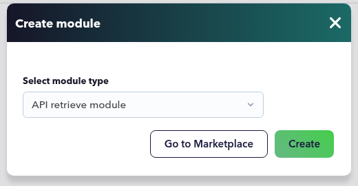
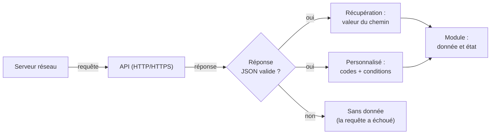
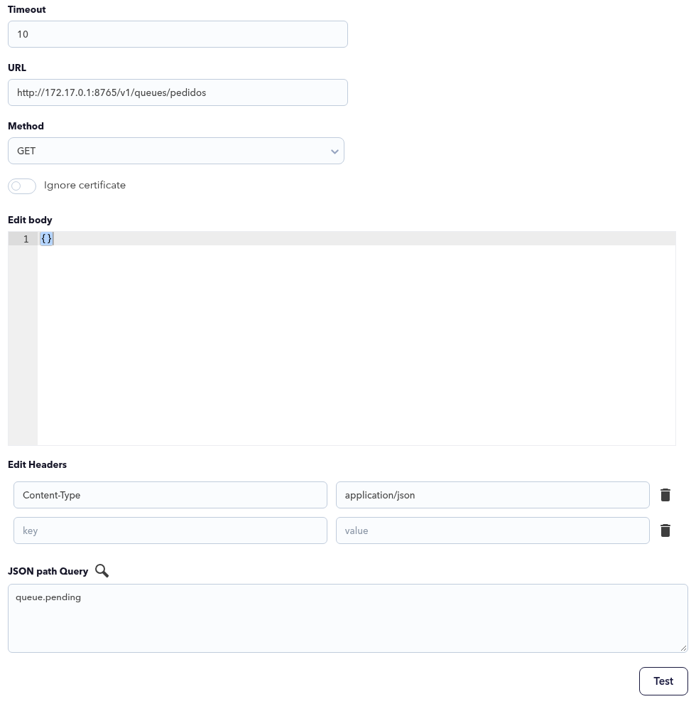
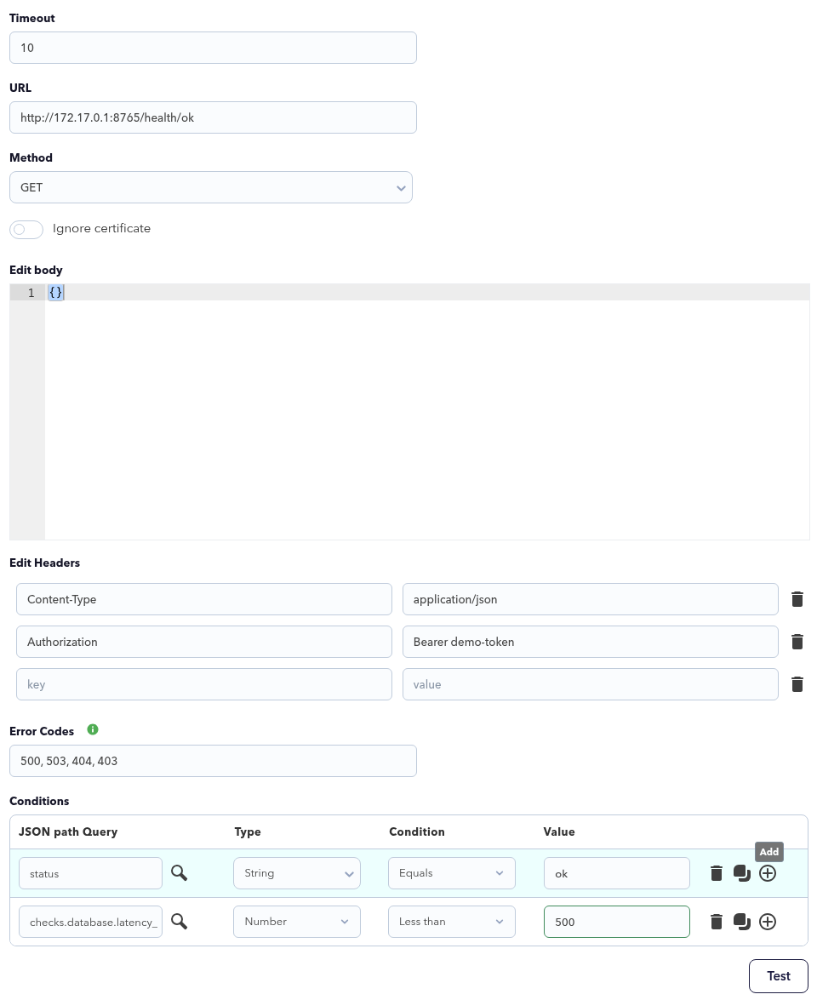
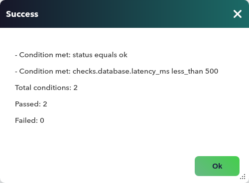

# Supervision des API

Que le serveur web réponde ne signifie pas que le service fonctionne. Un `ping`
répond, le port 443 est ouvert, le processus figure dans la liste… et l'API
renvoie un `200` avec un corps qui dit `"status": "degraded"`, ou une file
d'attente avec cent vingt-huit commandes non consommées, ou un `503` que personne
n'a vu parce que le feu du tableau de bord de supervision reste au vert.
Aujourd'hui, presque tout ce qui compte dans une entreprise se consulte en HTTP
et se répond en JSON, et une vérification du type « le port est-il ouvert ? »
reste souvent insuffisante.

Pandora FMS résout cela avec des **modules de type API** : le serveur envoie une
requête HTTP(S) à l'adresse que vous indiquez, lit la réponse et la transforme en
module. Sans plugin, sans script et sans rien installer sur le système qui expose
l'API. Deux questions peuvent être posées à une API, et chacune a son module :

- **« Quelle valeur renvoie-t-elle ? »** Un nombre, un texte ou un vrai/faux
  extrait de la réponse. C'est le **module de récupération d'API**.
- **« Est-elle en bonne santé ? »** Un état, normal ou critique, qui vient de la
  comparaison du code HTTP et de plusieurs champs de la réponse avec ce que vous
  attendez. C'est le **module personnalisé d'API**.

| Exigence | Détail |
|---|---|
| Serveur réseau | Les modules d'API sont exécutés par le serveur réseau de Pandora FMS. Si aucun n'est actif, la console ne propose pas ces types à la création d'un module. |
| Connectivité | L'équipement du serveur doit atteindre l'URL de l'API (nom, port et pare-feu compris). |
| Réponse | JSON. Si l'API répond autre chose, le module ne traite rien. |
| Création | Uniquement dans les modules d'agent, de politique et dans les opérations en masse. Ils ne sont pas disponibles comme composants réseau. |

Ce chapitre traite de ce qui est propre aux modules d'API : la requête,
l'extraction de la donnée et l'évaluation des conditions. Les champs communs à
tous les modules (intervalle, groupe, seuils) fonctionnent comme dans le reste ;
les alertes sont dans [5.5, Alertes et
notifications](../parte-5/5.5-alertas-y-notificaciones.md) et la répartition des
modules entre de nombreux agents, dans [2.10, Politiques de
supervision](2.10-politicas-de-monitorizacion.md).

## Les types de module API

À la création d'un module d'agent, le sélecteur de type propose deux entrées
nouvelles, à côté du module web et de celui de prévision :



| Entrée du sélecteur | Type de donnée | À quoi elle sert |
|---|---|---|
| Module de récupération d'API (*API retrieve module*) | Numérique, booléen ou alphanumérique, au choix | Enregistrer la valeur qui se trouve à un point précis de la réponse : une file d'attente, une latence, une version, un indicateur. |
| Module personnalisé d'API (*API custom module*) | Booléen | Décider si l'API va bien : 1 si toutes les conditions sont remplies, 0 sinon. |

En interne, ce sont quatre types de module, car celui de récupération se dédouble
selon la donnée qu'il enregistre :

| Type | Donnée | Ce qu'il enregistre |
|---|---|---|
| API retrieve numeric data | Numérique | Le nombre trouvé dans le chemin. |
| API retrieve boolean data | Booléen | 1 si la valeur trouvée est `true` ; 0 dans tout autre cas. |
| API retrieve alphanumeric data | Alphanumérique | Le texte trouvé. Si le chemin pointe vers un objet ou une liste, il enregistre son contenu sous forme de texte JSON. |
| API custom retrieve | Booléen | 1 ou 0 selon les conditions. |

La règle de choix tient en une ligne. Si vous voulez **la valeur** (pour la
représenter en graphique, pour lui mettre des seuils), utilisez la récupération.
Si vous voulez **un verdict** sur la santé de l'API, utilisez le personnalisé. Et
si vous avez besoin des deux, ce sont deux modules sur la même URL : ils ne se
gênent pas.

## Comment cela fonctionne

Le module ne passe par aucun EndPoint. C'est le serveur réseau qui l'exécute,
comme un module réseau ou un module web :

1. Quand le module doit s'exécuter (selon son intervalle), le serveur réseau
   construit la requête avec l'URL, la méthode, les en-têtes et, le cas échéant,
   le corps.
2. Il envoie la requête avec le temps maximal configuré. Si elle échoue, il
   réessaie : trois tentatives par défaut, que l'on change avec le champ
   **Retries** de l'onglet **Data**. Il accepte des réponses jusqu'à 20 Mo.
3. Il vérifie que la réponse est du JSON.
4. Selon le type, il extrait la valeur d'un chemin (récupération) ou évalue le
   code HTTP et les conditions (personnalisé).
5. Il traite le résultat comme celui de n'importe quel autre module : la donnée
   est enregistrée, l'état est calculé avec les seuils et les alertes se
   déclenchent.



Un détail qu'il vaut mieux garder en tête : quand la requête échoue (l'API ne
répond pas, la réponse n'est pas du JSON ou l'URL est vide), le module **ne reçoit
pas de donnée**. Il ne passe pas en critique pour autant : il reste sans nouvelle
valeur et, si la panne persiste, finit en état inconnu à l'expiration de son
intervalle. C'est pourquoi le module personnalisé a ses propres codes d'erreur
(voir plus bas) : ils permettent de transformer une panne précise de l'API en
critique.

## Configurer la requête

Les deux modules partagent le bloc de la requête, dans l'onglet **Basic** du
formulaire de création ou d'édition du module (les autres onglets, communs à tous
les modules, sont dans [2.20](2.20-configuracion-comun-de-los-modulos.md)) :



| Champ | Ce qu'il fait | Valeur par défaut |
|---|---|---|
| Timeout | Secondes d'attente de la réponse avant de la considérer comme un échec. C'est celui de cet onglet : le champ *Timeout* de l'onglet **Data** n'intervient pas dans ces modules. | `10` |
| URL | Adresse complète de l'*endpoint*, avec le schéma (`http://` ou `https://`). Elle est obligatoire : sans URL, le module ne s'exécute pas. | vide |
| Method | `GET`, `POST`, `PUT` ou `DELETE`. | `GET` |
| Ignore certificate | S'il est activé, le certificat de l'API n'est pas validé. À n'utiliser qu'en test ou avec des certificats internes que vous ne pouvez pas corriger : cela désactive la vérification que vous parlez bien à qui vous croyez. | désactivé |
| Edit Headers | En-têtes HTTP de la requête, sous forme de paires clé-valeur. | `Content-Type: application/json` |
| Edit body | Contenu de la requête. Utile avec `POST`, `PUT` et `DELETE`. | `{}` |

Trois règles expliquent la plupart des modules qui « ne font pas ce qu'ils
devraient » :

- **Le corps n'est envoyé que si la méthode n'est pas `GET` et si l'en-tête
  `Content-Type` vaut exactement `application/json`.** Si vous changez cet
  en-tête, le corps est ignoré sans avertissement.
- **L'authentification passe par les en-têtes.** Il n'y a pas de champs
  utilisateur et mot de passe : une API à *jeton* se consulte avec un en-tête
  comme `Authorization: Bearer <token>`, et une API à clé, avec l'en-tête que
  cette API exige. Gardez en tête que l'en-tête fait partie de la configuration
  du module : quiconque peut voir ou modifier le module peut donc voir le
  *jeton*.
- **Les en-têtes arrivent tels quels en `GET`.** Le serveur s'identifie en outre
  avec l'agent utilisateur `Pandora-API-Client/1.0`, au cas où l'API filtre
  là-dessus.
- **C'est le serveur qui interroge, pas la console.** La requête part de
  l'équipement du serveur de Pandora FMS. Que l'API soit visible depuis votre
  navigateur ne prouve pas qu'elle le soit depuis le serveur.

!!! warning "Content-Type en POST et PUT"
    Lors des tests avec la version 8.0NG.805, l'API de destination a reçu les
    `POST` et `PUT` avec `Content-Type: application/x-www-form-urlencoded` bien
    que l'en-tête du module soit `application/json` ; le corps est bien arrivé
    intégralement. Si votre API exige exactement `application/json`,
    vérifiez-le avec une requête réelle avant de valider le module.

## Extraire une donnée de la réponse

Le module de récupération enregistre ce qu'il trouve dans la **requête de chemin
JSON** (*JSON path Query*). Le chemin s'écrit avec les noms des champs séparés
par des points, et les éléments d'une liste sont numérotés à partir de zéro :

| Réponse de l'API | Chemin | Valeur |
|---|---|---|
| `{"queue": {"name": "pedidos", "pending": 128}}` | `queue.pending` | `128` |
| `{"queue": {"name": "pedidos", "pending": 128}}` | `queue.name` | `pedidos` |
| `{"items": [{"id": 7}, {"id": 9}]}` | `items.1.id` | `9` |

!!! warning "Ce n'est pas du JSONPath complet"
    La console parle de « JSONPath » dans ses messages, mais la syntaxe réelle
    est celle des points du tableau. Un chemin comme `$.queue.pending`,
    `queue['pending']` ou `items[?(@.id==9)]` ne trouve rien. Les noms de champ
    qui contiennent un point ne sont pas utilisables non plus.

Les modules de récupération ont leurs seuils d'avertissement et critique dans le
même onglet **Basic**, comme tout module avec donnée ; leur fonctionnement est
décrit dans [2.20](2.20-configuracion-comun-de-los-modulos.md).

Inutile d'écrire le chemin à la main. Une fois l'URL renseignée, le bouton en
forme de loupe de **JSON path Query** lance une requête préalable et affiche la
réponse sous forme d'arbre ; en cliquant sur une valeur et en confirmant, le
chemin se remplit tout seul. Ce bouton fait la requête **depuis la console**, pas
depuis le serveur : il peut donc fonctionner même si le serveur n'atteint pas
l'API (et inversement). Le bouton **Test** fait la même chose et affiche le
résultat du chemin avant l'enregistrement.

Le type de module décide de ce qui est fait de la valeur :

| Type | Valeur trouvée | Donnée du module |
|---|---|---|
| Numérique | `128` | `128` |
| Alphanumérique | `"2.4.1"` | `2.4.1` |
| Alphanumérique | un objet, comme `queue` dans le premier tableau | Son contenu sous forme de texte JSON ; l'ordre des champs peut changer (`{"pending":128,"name":"pedidos","consumers":4}`) |
| Booléen | `true` | `1` |
| Booléen | `"true"` (texte) | `1` |
| Booléen | `false`, `"ok"`, `1` ou toute autre chose | `0` |

Si le chemin est vide, si la réponse n'est pas du JSON ou si le chemin n'existe
pas dans la réponse, le module n'enregistre rien lors de cette exécution.

## Vérifier l'état d'une API

Le module personnalisé n'extrait pas de valeur : il rend un verdict. Sa donnée
vaut `1` (normal) quand tout va bien et `0` (critique) quand quelque chose ne
colle pas. Il n'a pas de seuils propres : l'état est décidé par les codes
d'erreur et les conditions.

L'évaluation suit un ordre fixe :

1. **Codes d'erreur.** Le champ **Error Codes** est une liste de codes HTTP
   séparés par des virgules. Par défaut, dans un module neuf : `500, 404, 403`.
   Si la réponse en contient un, le module passe à `0` et rien d'autre n'est
   évalué.

    !!! warning "Écrivez les codes sans espaces"
        Lors des tests avec la version 8.0NG.805, avec des espaces après les
        virgules (`500, 503, 404, 403`, qui est aussi le format de la valeur par
        défaut), seul le premier code est reconnu : un `503` ou un `404` ne
        mettent pas le module à `0`. Sans espaces (`500,503,404,403`), ils
        fonctionnent tous. En attendant la correction, écrivez la liste sans
        espaces.
2. **Conditions.** Si le code n'est pas dans la liste, chaque condition est
   évaluée. **Toutes** doivent être remplies pour que le module vaille `1` ; il
   suffit qu'une seule échoue pour qu'il vaille `0`. Un module sans conditions
   vaut `1` tant que le code n'est pas dans la liste.



Chaque condition se compose de quatre pièces :

| Élément | Ce que c'est |
|---|---|
| JSON path Query | Le chemin du champ à évaluer, avec la même syntaxe à points que dans la section précédente. Il se remplit avec la loupe. |
| Type | Le type de donnée attendu : `Null`, `String`, `Number` ou `Boolean`. |
| Condition | L'opérateur de comparaison (il dépend du type ; tableau suivant). |
| Value | La valeur de comparaison. Elle n'est pas utilisée par les opérateurs qui n'en ont pas besoin. |

Les opérateurs disponibles dépendent du type choisi :

| Type | Opérateurs | Remplie si |
|---|---|---|
| Boolean | Is true / Is false | Le champ est vrai / faux. Ils n'utilisent pas *Value*. |
| Null | Equals / Not equals | Le champ est / n'est pas nul. |
| Number | Equals / Not equals | Le nombre est égal à / différent de l'attendu. |
| Number | Greater than / Less than | Il est supérieur / inférieur à l'attendu. |
| String | Equals / Not equals | Le texte est égal à / différent de l'attendu. |
| String | Contains / Not contains | Le texte contient / ne contient pas l'attendu. |
| String | Is empty / Is not empty | Le champ est vide / n'est pas vide. Ils n'utilisent pas *Value*. |
| String | Regex match | La valeur correspond à l'expression régulière, sans distinguer les majuscules. |

Quelques règles qui changent le résultat :

- **Un chemin qui n'existe pas compte comme une condition non remplie.** Si l'API
  change de format et que le champ disparaît, le module passe à `0`, ce qui est
  justement le but.
- **Le type doit correspondre à la donnée.** Avec le type `Number`, un champ non
  numérique ne remplit pas la condition.
- **Les codes d'erreur sont évalués sur une réponse JSON.** Si l'API répond une
  erreur avec un corps qui n'est pas du JSON (une page HTML d'erreur, par
  exemple) ou sans corps, la requête est considérée comme un échec et le module
  reste sans donnée au lieu de passer à `0` (vérifié avec un `500` et un corps
  HTML). Si ce cas vous intéresse, surveillez aussi que le module ne reste pas en
  état inconnu.

La console inclut un bouton **Test** sous les conditions. Il lance la requête et
affiche quelles conditions sont remplies, combien ont été évaluées (*Total
conditions*), combien passent (*Passed*) et combien non (*Failed*).


 Utilisez-le toujours avant d'enregistrer : cela coûte bien moins cher que de
découvrir une condition mal écrite à trois heures du matin.

## Exemples et résultats

Les trois exemples utilisent une API fictive sur `api.example.com`. Ils ont été
reproduits dans une console 8.0NG.805 avec une API de test locale, et les
résultats sont ceux que le module a renvoyés.

!!! example "File de commandes en attente (récupération numérique)"
    On veut représenter en graphique combien de commandes attendent dans la file
    et alerter si elles dépassent 500.

    Configuration : type de module de récupération d'API, donnée **numérique** ;
    URL `https://api.example.com/v1/queues/pedidos` ; méthode `GET` ; requête de
    chemin `queue.pending` ; seuil critique à partir de 500.

    Réponse de l'API :

    ```json
    {"queue": {"name": "pedidos", "pending": 128, "consumers": 4}}
    ```

    Résultat : le module vaut `128` et se représente en graphique comme
    n'importe quel module numérique. Quand l'API renverra `"pending": 612`, le
    seuil le mettra en critique et les alertes associées se déclencheront.

!!! example "Version déployée (récupération alphanumérique)"
    On veut savoir quelle version tourne en production, pour voir dans
    l'historique quand elle a changé.

    Configuration : donnée **alphanumérique** ; URL
    `https://api.example.com/v1/info` ; requête de chemin `build.version`.

    Réponse : `{"build": {"version": "2.4.1", "commit": "9f3c2ab"}}`

    Résultat : le module vaut `2.4.1`. Chaque déploiement apparaît comme un
    changement de valeur.

!!! example "Santé de l'API avec un en-tête d'authentification (personnalisé)"
    On veut un seul module qui mette l'API en critique si elle n'est pas saine,
    si la base de données est lente ou si elle répond par une erreur.

    Configuration : module personnalisé d'API ; URL
    `https://api.example.com/v1/health` ; méthode `GET` ; en-têtes
    `Content-Type: application/json` et `Authorization: Bearer <token>` ; codes
    d'erreur `500,503,404,403` (sans espaces) ; deux conditions :

    | JSON path Query | Type | Condition | Value |
    |---|---|---|---|
    | `status` | String | Equals | `ok` |
    | `checks.database.latency_ms` | Number | Less than | `500` |

    Résultat selon ce que répond l'API :

    | Réponse | Module | Pourquoi |
    |---|---|---|
    | `200` avec `{"status": "ok", "checks": {"database": {"latency_ms": 120}}}` | `1` | Code hors de la liste et les deux conditions sont remplies. |
    | `200` avec `{"status": "degraded", "checks": {"database": {"latency_ms": 120}}}` | `0` | La première condition échoue. |
    | `200` avec `{"status": "ok", "checks": {"database": {"latency_ms": 900}}}` | `0` | La seconde condition échoue : 900 n'est pas inférieur à 500. |
    | `200` avec `{"status": "ok"}` | `0` | `checks.database.latency_ms` n'existe pas. |
    | `503` avec `{"error": "unavailable"}` | `0` | Code dans la liste d'erreurs (et, en plus, `status` manque). |
    | `200` avec une page HTML | sans donnée | La réponse n'est pas du JSON. |

## Utilisation avec des politiques et des opérations en masse

Les modules d'API peuvent être créés de la même manière que les autres modules
réseau :

- **Sur un agent**, depuis son formulaire de modules.
- **Dans une politique**, pour répartir le même module entre de nombreux agents
  (voir [2.10, Politiques de
  supervision](2.10-politicas-de-monitorizacion.md)). C'est le cas typique d'une
  API avec le même contrat dans plusieurs environnements.
- **Avec des opérations en masse**, pour changer un champ (un *timeout*, un
  en-tête) dans beaucoup de modules à la fois (voir [2.11, Opérations
  massives](2.11-operaciones-masivas.md)).

!!! note "Secrets dans les en-têtes"
    Une politique qui transporte un *jeton* dans un en-tête le distribue à tous
    les modules qu'elle génère. Si le *jeton* expire ou tourne, il faut le
    changer dans la politique (ou avec une opération en masse), pas agent par
    agent.

## Vérifier et diagnostiquer

| Symptôme | Cause probable | Vérification |
|---|---|---|
| La console ne propose pas les types d'API à la création du module. | Aucun serveur réseau actif, ou création d'un composant réseau. | Vérifiez dans la liste des serveurs qu'un serveur réseau tourne ; créez le module sur un agent. |
| Le module n'a aucune nouvelle donnée. | L'API ne répond pas, la réponse n'est pas du JSON ou l'URL est vide. | Rejouez la requête depuis l'équipement du serveur (`curl -i <url>`) avec les mêmes en-têtes et vérifiez que la réponse est du JSON. |
| Le module de récupération n'enregistre rien. | Le chemin n'existe pas dans la réponse ou il est mal écrit (par exemple, avec `$.` devant). | Utilisez la loupe pour choisir le chemin sur la réponse réelle. |
| Le module booléen vaut toujours `0`. | La valeur du chemin n'est pas `true`. Un `1` ou un `"ok"` valent `0`. | Passez à un module numérique ou à un module personnalisé avec des conditions. |
| Un code de la liste d'erreurs (par exemple `503` ou `404`) ne met pas le module à `0`. | La liste est écrite avec des espaces après les virgules et seul le premier code est reconnu. | Réécrivez la liste sans espaces : `500,503,404,403`. |
| Le module personnalisé vaut `0` et l'API répond bien. | Une condition n'est pas remplie : chemin inexistant, type qui ne correspond pas ou opérateur erroné. | Cliquez sur **Test** : il indique combien de conditions échouent. |
| Le corps n'arrive pas à l'API. | Méthode `GET`, ou l'en-tête `Content-Type` n'est pas exactement `application/json`. | Vérifiez la méthode et l'en-tête. |
| Erreur de certificat (HTTPS). | Certificat expiré, auto-signé ou avec un nom qui ne correspond pas. | Corrigez-le dans l'API ; en dernier recours seulement, activez **Ignore certificate**. |
| Le module personnalisé vaut `1` alors que l'API est cassée (par exemple, elle répond `401`). | Le code n'est pas dans la liste d'erreurs et aucune condition ne le détecte : sans conditions, tout ce qui n'est pas dans la liste donne `1`. | Ajoutez le code à **Error Codes** (`401` si l'authentification échoue) et définissez au moins une condition sur le corps. |
| La loupe fonctionne, mais pas le module. | La console atteint l'API et le serveur non (ou l'inverse). | Testez la requête depuis chaque équipement séparément. |

Pour voir ce que le serveur fait de chaque requête, consultez son journal
(`/var/log/pandora/pandora_server.log`). Les échecs de la requête (URL vide,
requête en échec) apparaissent avec l'identifiant du module ; le détail des
exécutions correctes et des réponses qui ne sont pas du JSON ne se voit qu'en
augmentant la verbosité du serveur.
