# Collecte et supervision des logs

Les *logs* sont ce fichier que personne ne regarde avant que quelque chose
prenne feu à trois heures du matin et qu'il faille reconstituer ce qui s'est
passé. Pandora FMS les collecte depuis toutes les origines que vous lui
indiquez — le journal d'événements de Windows, les fichiers texte de n'importe
quel Unix, le *syslog* de n'importe quelle machine — et les dépose dans une
seule console, classés par ordre d'arrivée. Ce chapitre explique comment
activer cette collecte, comment demander les *logs* à chaque EndPoint et ce que
l'on peut en faire ensuite.

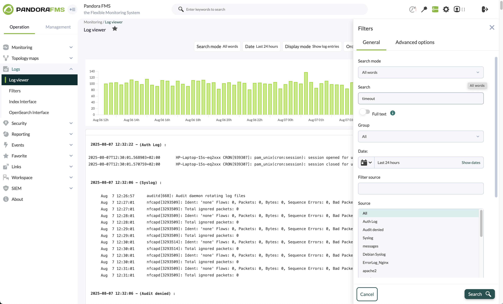

Pandora FMS ne stocke pas les *logs* dans sa base de données de supervision. Il
les conserve dans **OpenSearch**, un moteur de recherche conçu pour le texte, et
c'est pourquoi le premier prérequis — avant de toucher quoi que ce soit dans la
console — est de disposer de ce moteur et de pouvoir y accéder. Le reste du
chapitre part du principe que c'est le cas ; l'installation et la configuration
du moteur ont leur propre annexe technique.

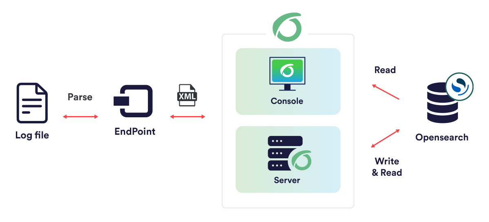

!!! note "Ce que ce n'est pas"
    La supervision de *logs* non structurés n'est pas un SIEM. Pandora FMS
    conserve le texte tel quel, sans l'analyser, et le met à votre disposition
    pour que vous puissiez le rechercher. Si ce que vous voulez, c'est corréler
    des événements et lancer des *rules*, cela relève de
    [Pandora SIEM](../parte-7/7.2-siem.md), qui s'appuie sur ces mêmes données.

## Comment ça marche

La chaîne compte quatre maillons et il vaut la peine de les avoir clairs, car
chacun peut échouer de son côté.

1. L'**EndPoint** lit le journal d'événements ou le fichier texte et place les
   *logs* bruts — au format *RAW* — dans le XML de rapport qu'il envoie déjà
   normalement. Aucun canal séparé n'est nécessaire.
2. Le **Data Server** de Pandora FMS reçoit ce XML, qui transporte à la fois la
   supervision et les *logs*. En le traitant, il sépare l'une des autres.
3. Les **références** de l'EndPoint qui a rapporté et de l'origine du *log* sont
   enregistrées dans la base de données principale. Le texte du *log*, non : le
   texte part vers OpenSearch.
4. OpenSearch l'indexe. Pandora FMS crée **un nouvel index chaque jour** par
   instance, avec un nom du type `pandorafms-<identifiant>-<annee.mois.jour>`,
   plus un index auxiliaire d'origines qui se termine par `-sources`.

Le serveur découpe le contenu reçu par sauts de ligne, de sorte que chaque ligne
physique devient un document OpenSearch. L'exception, ce sont les **événements
Windows**, qui arrivent déjà sous forme de bloc et sont enregistrés entiers.
Depuis la version 806, juste après ce découpage, le serveur remplace dans chaque
entrée toutes les occurrences du littéral `{{\n}}` par un vrai saut de ligne. Le
remplacement est postérieur au découpage, il ne crée donc pas de nouveaux
documents : une entrée logique reste un document. C'est ce qui permet à une
entrée multiligne de s'afficher comme un bloc dans la visionneuse (voir
[Entrées de log multilignes](#entrees-de-log-multilignes)).

Les *logs* voyagent sur le réseau encodés, pour éviter qu'un format bizarre ne
casse le transport. Si vous voulez en plus qu'ils voyagent chiffrés, on utilise
[Tentacle chiffré](../parte-9/9.4-referencia-completa-de-tentacle.md) ; rien de
particulier n'est à faire pour les *logs*, c'est le même transport sûr que celui
qui s'applique au reste du XML.

Une tâche de maintenance du serveur efface les informations anciennes au-delà de
l'intervalle que vous fixez (par défaut, **30 jours**). Ce n'est pas une
suppression brutale : le serveur élimine les documents par date et, lorsqu'un
index reste vide, il l'élimine aussi.

Le **Syslog Server** est le raccourci. Au lieu d'attendre qu'un EndPoint lise un
fichier et l'envoie, ce composant lit directement le *syslog* de la machine où
vit le serveur et le traite sur place. Pour des volumes élevés de *syslog*, il
est nettement plus rapide, et il permet de répartir la charge : plusieurs
EndPoints d'un côté et plusieurs serveurs *syslog* distants de l'autre.

## Prérequis

| Prérequis | Détail |
|---|---|
| OpenSearch | Installé, démarré et accessible depuis le serveur de Pandora FMS. Sans lui, il n'y a nulle part où stocker les *logs*. |
| Collecteur de *logs* | Activé dans la console web (section suivante). S'il est désactivé, les modules de type *log* sont purement et simplement écartés. |
| `rsyslog` | Uniquement si vous allez utiliser le **Syslog Server** ; il s'installe sur le serveur et, si besoin, sur les clients qui envoient. |
| Ports | Celui du moteur de recherche (`9200` par défaut) pour le collecteur, et le `514` (TCP et UDP) pour la collecte de *syslog*. |

## Configuration du collecteur de logs

Menu **Management → Settings → System Settings → Log collector** (*Gestion →
Réglages → Configuration du système → Collecteur de logs*). Il s'active avec
**Activate Log Collector** et se confirme avec **Update**. Tant que vous ne
l'activez pas, cet écran n'affiche que l'interrupteur.

À l'activation apparaissent les **OpenSearch options**, qui sont celles qui
relient la console au moteur :

| Option | À quoi elle sert |
|---|---|
| **OpenSearch IP** | Adresse ou nom du serveur OpenSearch. |
| **Use https** | Activez-la si le moteur écoute en HTTPS. |
| **OpenSearch Port** | Port TCP ; `9200` par défaut. |
| **Number of logs viewed** | Combien d'enregistrements affiche la visionneuse de *logs* ; `50` par défaut. |
| **Days to purge old information** | Jours avant de supprimer ce qui a été collecté ; `30` par défaut. |
| **Basic authentication** | Utilisateur (**User**) et mot de passe (**Password**) si le moteur les demande. Il est fortement recommandé de les renseigner. |

L'écran lui-même vous dit si la connexion fonctionne : **OpenSearch is
running.** quand tout est en ordre, **Unauthorized** quand les identifiants ne
sont pas corrects et **There is no OpenSearch defined. Empty ip or port.** quand
l'adresse ou le port manque. Cet indicateur est le moyen le plus rapide de
savoir si le problème vient de la configuration ou du réseau.

!!! warning "Index configuration : n'y touchez que si vous savez ce que vous faites"
    Le bloc **Index configuration** modifie la façon dont OpenSearch construit
    l'index. Une configuration incorrecte peut déstabiliser le système, alors ne
    le déplacez pas par curiosité. De plus, les changements de modèle
    s'appliquent **à partir de l'index suivant** : ils ne réécrivent pas ce qui
    est déjà indexé.

Les options du bloc **Index configuration** sont les suivantes :

- **Indexing size** : longueur maximale, en caractères, qu'OpenSearch indexe de
  chaque ligne comme valeur complète (*keyword*). Les lignes qui la dépassent
  sont toujours enregistrées et peuvent être cherchées par mots, mais elles
  restent en dehors des recherches par expression régulière (mode REGEX). Par
  défaut, `2000`.
- **Number of shards** : fragments primaires de l'index ; `1` par défaut. Il ne
  se fixe qu'à la création de l'index : il ne peut pas être modifié sur un index
  déjà fermé.
- **Number of replicas** : répliques de chaque fragment ; `0` par défaut. Mettre
  `0` économise du disque, mais un redémarrage du nœud laisse les informations
  temporairement indisponibles et une corruption devient une perte définitive.
- **Auto expand replicas** : ajuste les répliques uniquement en fonction du
  nombre de nœuds, avec une plage du type `0-1` ou `all` comme plafond. Si les
  règles d'affectation empêchent de placer toutes les répliques, le cluster peut
  rester dans l'état `YELLOW`.

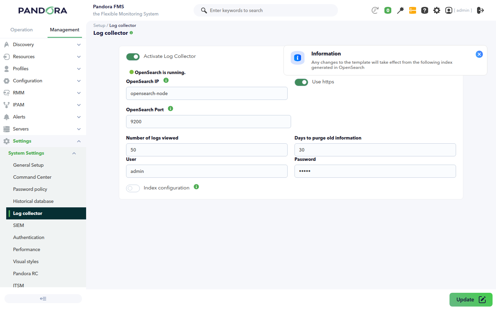

## Collecter les logs avec les EndPoints

La collecte réelle est faite par les **EndPoints**, aussi bien sous Windows que
sous Unix (Linux, macOS, Solaris, HPUX, AIX, BSD…). Pour créer les modules depuis
l'assistant **Module log collection**, le collecteur doit déjà être configuré, et
si vous allez ajouter des modules de type **Windows event channel**, l'EndPoint
doit être un EndPoint Windows. Le reste des modules et leurs jetons généraux se
trouvent dans [Supervision avec des EndPoints](2.1-monitorizacion-con-endpoints.md)
et dans la [référence complète de configuration de
l'EndPoint](../parte-9/9.1-referencia-completa-de-configuracion-del-endpoint.md).

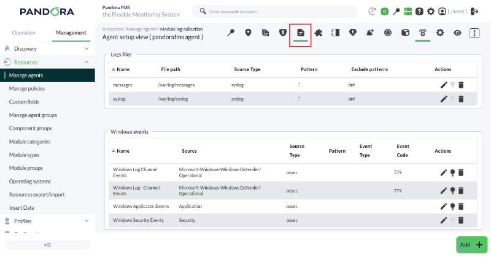

La collecte fournie avec le produit (les EndPoints Unix, Windows et Go, ainsi
que les *plugins* inclus) envoie **une ligne physique par entrée** et ne réunit
pas les lignes d'une même entrée logique ; l'exception, ce sont les événements
Windows, qui sont déjà enregistrés comme un bloc. Pour qu'une entrée s'affiche
comme un bloc, il faut utiliser une collecte propre (par exemple un *plugin*
sur mesure) qui sache où commence et où finit l'entrée, l'envoie sur une seule
ligne et code ses sauts de ligne internes avec le marqueur `{{\n}}`. Le
mécanisme et ses limites sont décrits dans [Entrées de log
multilignes](#entrees-de-log-multilignes) ; écrire ce *plugin* est une autre
tâche. Sans le marqueur, tout se comporte exactement comme avant.

### Logs en texte brut

Pour surveiller un fichier texte, on utilise un module de type `log` avec le
jeton `module_regexp`, qui pointe vers le chemin du fichier. Un exemple de module
sous Linux :

```text
module_begin
module_name Syslog
module_description Collecte du fichier de messages du système
module_type log
module_regexp /var/log/messages
module_pattern .*
module_pattern_exclude DEBUG
module_end
```

Sous Windows, la syntaxe est la même, seul le chemin change :

```text
module_begin
module_name Apache_log
module_description Collecte du log d'Apache
module_type log
module_regexp C:\server\logs\apache.log
module_source_type apache
module_pattern .*
module_end
```

`module_pattern` filtre les lignes qui vous intéressent et
`module_pattern_exclude` exclut celles qui ne vous intéressent pas. D'autres
exemples maison :

```text
module_begin
module_name apache_access
module_type log
module_regexp /var/log/httpd/access_log
module_pattern .*
module_pattern_exclude \s200\s|\s301\s
module_source_type web-log
module_end

module_begin
module_name Audit denied
module_type log
module_regexp /var/log/audit/audit.log
module_pattern denied
module_end

module_begin
module_name Secure
module_type log
module_regexp /var/log/secure
module_pattern Failed|failure|invalid|denied|accepted|root
module_end
```

!!! warning "`module_type log` n'enregistre rien en base de données"
    Un module avec `module_type log` n'est pas stocké comme un module normal :
    il est envoyé au collecteur de *logs*. Si le collecteur est désactivé, **les
    informations sont écartées**. C'est la cause numéro un du « j'ai mis le
    module et je ne vois rien ».

Autrefois, la collecte sous Linux se faisait avec des *plugins*. Depuis la
version 781, c'est la méthode recommandée ; les *plugins* ont été relégués au
rang d'héritage.

### Événements MS Windows avec `module_logchannel`

Sous Windows, outre les fichiers, on peut lire le **journal d'événements**. C'est
à cela que sert `module_logchannel`, qui remplace l'ancien `module_logevent`. Ce
dernier fonctionne encore pour des raisons de compatibilité, mais il n'est plus
pris en charge depuis la version LTS 2025 et n'a de sens que sur des systèmes
Microsoft anciens (Windows 7, Windows 2003 ou antérieurs). Sur un Windows
moderne, `module_logchannel`.

Le format général est celui-ci :

```text
module_begin
module_name MyEvent
module_type log
module_logchannel
module_source <logName>
module_eventtype <niveau de l'événement (facultatif)>
module_eventcode <identifiant de l'événement (facultatif)>
module_application <origine (facultatif)>
module_pattern <sous-chaîne à rechercher (facultatif)>
module_source_type <type de log pour le SIEM (facultatif)>
module_end
```

Deux avertissements valent la peine d'être lus avant de se battre avec les
filtres. Le premier : seuls les événements **postérieurs à la dernière
exécution** de l'EndPoint sont pris en compte. À la première exécution, tout ce
qui existait déjà dans le journal n'est pas collecté ; l'envoi commence à partir
de là. Le second : les noms des paramètres sont sensibles à la casse, copiez-les
donc tels quels.

#### `module_source`

C'est la source qui est à l'origine de l'événement : l'ancienne classification de
Windows NT (Système, Application, Sécurité…). Ne la confondez pas avec
`module_application`, qui identifie l'application. Vous pouvez utiliser l'une ou
l'autre, mais l'une des deux est nécessaire.

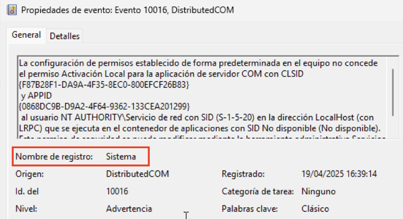

Même si la visionneuse d'événements vous l'affiche traduit — « Système »,
« Application », « Sécurité » —, ici **ils s'écrivent en anglais** : `System`,
`Application`, `Security`. Les noms longs se copient tels quels, sans
traduction :

```text
Microsoft-Windows-DeviceManagement-Enterprise-Diagnostics-Provider/Administration
```

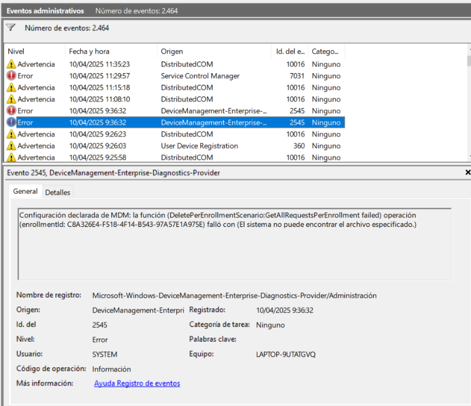

#### `module_source_type`

C'est le type de *log* que consomment les *decoders* et les *rules* du SIEM. Si
vous l'omettez, `syslog` est utilisé par défaut. Les types que l'outil gère
habituellement sont `syslog`, `ids`, `web-log`, `squid`, `host-information` et
`ossec`.

!!! tip "Tous les types ne sont pas actifs d'usine"
    Le moteur de decoders n'apporte pas tous ces types prêts à l'emploi. Dans
    l'installation par défaut sont actifs `ossec` (événements de Windows),
    `web-log`, `ids`, `firewall` et `syslog` ; `squid` et `windows` se trouvent
    dans le dossier des decoders désactivés, et `host-information` n'existe pas
    en tant que tel. Avant de choisir un type, vérifiez quels decoders vous avez
    actifs dans le [chapitre SIEM](../parte-7/7.2-siem.md).

Pour le SIEM, les événements de Windows sont traités avec `ossec`. Cet exemple
collecte tous les événements de sécurité :

```text
module_begin
module_logchannel
module_name Security_Events
module_type log
module_source Security
module_source_type ossec
module_end
```

#### `module_eventtype`

Filtre facultatif par niveau de l'événement. Les valeurs sont celles de la
visionneuse d'événements :

| Code | Type d'événement |
|---|---|
| `0` | Audit réussi |
| `1` | Critique |
| `2` | Erreur |
| `3` | Avertissement |
| `4` | Information |

Pour ne garder que les avertissements de sécurité :

```text
module_begin
module_logchannel
module_name Security_Events_Warning
module_type log
module_source Security
module_eventtype 3
module_source_type ossec
module_end
```

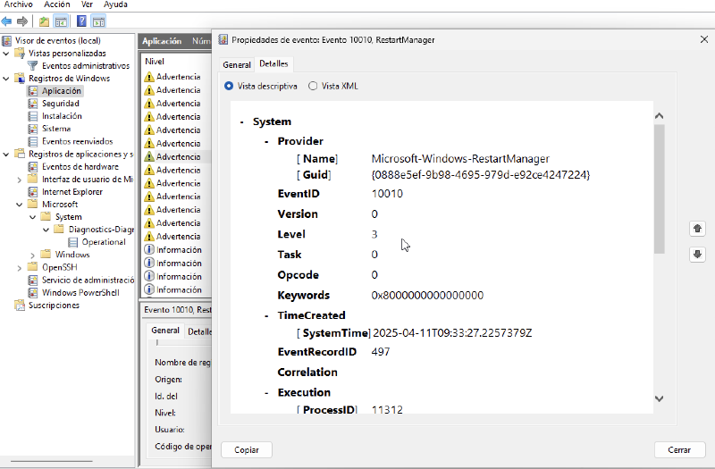
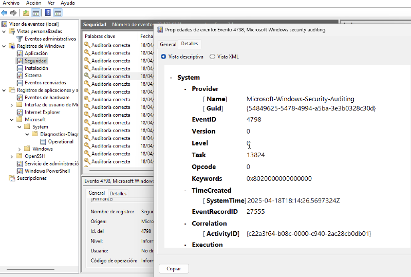

#### `module_eventcode`

Filtre facultatif par **identifiant d'événement**, l'`eventID` que vous voyez
dans la visionneuse. C'est le filtre le plus précis de tous. Cet exemple ne prend
que les événements dont l'identifiant est `4798` :

```text
module_begin
module_logchannel
module_name Security_Events_4798
module_type log
module_source Security
module_eventcode 4798
module_source_type ossec
module_end
```

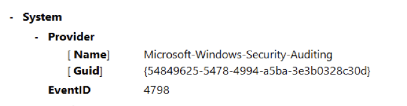

#### `module_application`

Origine de l'événement, facultative. Pour obtenir le nom exact du fournisseur,
sélectionnez un événement dans la visionneuse Windows, ouvrez **Propriétés** et
copiez le champ **Full name**. Si le nom contient des espaces, **ne le mettez pas
entre guillemets**. Par exemple :

```text
module_begin
module_name Pandora_Events_Windows
module_type log
module_logchannel
module_application Pandora FMS
module_source Application
module_end
```

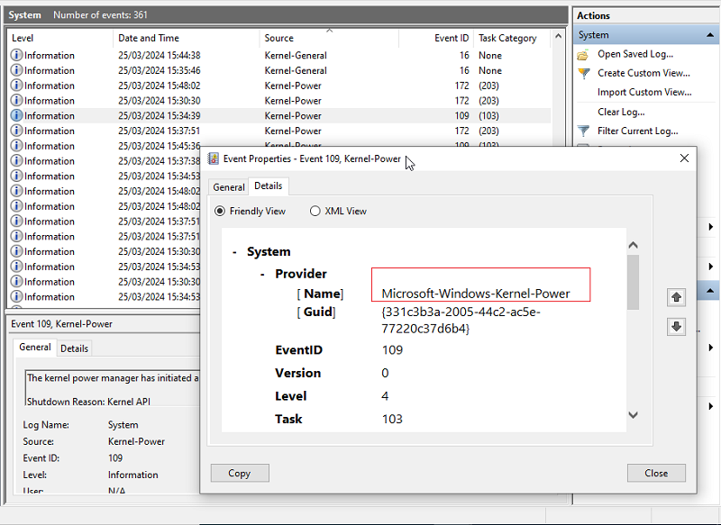

À titre de référence, les fournisseurs qui apparaissent le plus sont ceux du
système d'exploitation lui-même (`Microsoft-Windows-Winlogon`,
`Microsoft-Windows-Security-Auditing`, `Microsoft-Windows-WindowsUpdateClient`,
`Microsoft-Windows-TaskScheduler`…), ceux des applications et des services
(`MSSQLSERVER`, `Windows Defender`, `Windows Firewall`, `VSS`…), ceux utiles au
diagnostic avancé (`Microsoft-Windows-Kernel-General`,
`Microsoft-Windows-DistributedCOM`, `Microsoft-Windows-Ntfs`…) et ceux de tiers
(`VMware Tools`, `Oracle Database`, `Symantec Endpoint Protection`, `TeamViewer`,
`Apache Service`…). Chaque application utilise le sien et il y en a des
centaines.

### Événements de Windows et Sysmon

**Sysmon** (System Monitor) est un utilitaire gratuit de Microsoft, inclus dans
le paquet Sysinternals, qui enregistre en détail des activités que la visionneuse
d'événements classique laisse passer : création et exécution de processus,
connexions réseau entrantes et sortantes, modifications du registre Windows,
chargement de DLL, accès aux fichiers, injection de code dans des processus
légitimes. C'est un matériau courant des tentatives d'intrusion et des
déplacements latéraux, et c'est pourquoi il intéresse autant en cybersécurité.

Il fonctionne en installant un pilote en mode *kernel* qui écrit au fur et à
mesure dans la visionneuse d'événements. Pandora FMS le collecte comme un canal
de plus de l'EndPoint Windows et l'envoie au serveur. La combinaison Sysmon +
Pandora FMS + Pandora SIEM offre une visibilité bien supérieure à celle du
journal traditionnel : détection précoce d'attaques avancées, alertes
automatiques sur les événements que vous définissez et un historique corrélable
pour l'investigation ou l'audit.

Sysmon est fourni dans le paquet *Sysinternals Suite* et son fichier de
configuration est long : le superviser « en totalité » pénalise les performances
de la machine et du système qui reçoit les données. Pour les événements Sysmon,
il faut utiliser **ce** module, avec le nom et le type exacts :

```text
module_begin
module_name WinEvtLog
module_type log
module_logchannel
module_source Microsoft-Windows-Sysmon/Operational
module_source_type windows
module_end
```

Ici `module_source_type windows` remplace `ossec`, et le nom `WinEvtLog` est
celui qu'attendent les *rules* de Pandora SIEM.

!!! warning "Sysmon n'est pas prêt d'usine"
    Le canal Sysmon doit être activé et ses decoders et règles affinés ; dans
    une installation récente, les decoders et règles de `windows`/`sysmon` sont
    désactivés et le canal Windows actif est celui d'`ossec`. Ne partez pas du
    principe qu'il suffit de poser le module pour voir les événements traités
    par le SIEM : vérifiez les decoders et les règles dans
    [Pandora SIEM](../parte-7/7.2-siem.md).

## Pandora FMS Syslog Server

Le **Syslog Server** permet à Pandora FMS d'analyser le *syslog* de la machine
où réside le serveur et de l'enregistrer dans OpenSearch. Son avantage est qu'il
unifie les origines sans dépendre du fait que chaque machine ait un EndPoint :
toute machine capable d'exporter du *syslog* peut lui envoyer ses messages. Et
pour la commodité : **chaque hôte dont arrivent des *logs* génère
automatiquement son agent** s'il n'existait pas.

L'installation de `rsyslog` concerne à la fois le serveur et les clients :

```bash
dnf install rsyslog
```

Sur le serveur, modifiez `/etc/rsyslog.conf` et activez l'écoute par **TCP** et
**UDP** :

```conf
# Réception syslog par UDP
module(load="imudp")
input(type="imudp" port="514")

# Réception syslog par TCP
module(load="imtcp")
input(type="imtcp" port="514")
```

Redémarrez le service et vérifiez que le port `514` écoute :

```bash
systemctl restart rsyslog
netstat -ltnp
```

Sur le client, dans son `/etc/rsyslog.conf`, activez le transfert vers le serveur
(remplacez `remote-host` par l'adresse réelle) :

```conf
action(type="omfwd" Target="remote-host" Port="514" Protocol="tcp")
```

!!! warning "La limite de 8 KB et les origines fantômes"
    Par défaut, `rsyslog` coupe les messages à 8 KB. Un *log* plus long est
    découpé en plusieurs entrées et les suivantes perdent le nom de l'hôte, ce
    qui crée des origines — et des agents — nouveaux qui n'existent pas. Pour
    l'éviter, augmentez la taille maximale :

    ```conf
    $MaxMessageSize 512k
    ```

    Et, si vous le pouvez, créez les agents avec **alias as name** égal au
    *hostname* du client : ainsi ils ne se dupliquent pas.

Pour activer la fonctionnalité sur le serveur de Pandora FMS, modifiez
`pandora_server.conf` :

```conf
# Activer (1) ou désactiver (0) le serveur Syslog de Pandora FMS
syslogserver 1

# Chemin absolu du fichier d'entrée que lit le Syslog Server
syslog_file /var/log/messages

# Nombre de threads du Syslog Server
syslog_threads 2

# Nombre maximal de lignes en file du Syslog Server
syslog_max 65535
```

Et, bien sûr, il faut dire au dispositif ou au client d'envoyer ses *logs* au
serveur. Sans cela, le serveur écoute dans le vide.

### Filtres au niveau du serveur de Pandora FMS

Le serveur peut trier ce qui entre avec deux jetons de `pandora_server.conf`.
`syslog_whitelist` **n'admet que** ce qui correspond à l'expression régulière et
écarte le reste. `syslog_blacklist` **écarte** ce qui correspond et laisse entrer
le reste. Les deux arrivent désactivés.

La liste blanche s'applique en premier — elle réduit le travail de la liste
noire — et la liste noire, à la fin. L'expression est sensible à la casse :
`windows` n'est pas `Windows`. Et il y a deux pièges :

- Si vous activez `syslog_whitelist` **sans** expression, **rien** n'entre. Avec
  l'expression `.*` de l'exemple, tout entre.
- Si vous activez `syslog_blacklist` **sans** expression, rien n'est bloqué.

## Interface d'OpenSearch : le Log Viewer

Une fois le collecteur en marche et des données à l'intérieur, tout se consulte
depuis **Operation → Logs → Log viewer** (*Opération → Logs → Visionneuse de
logs*).
L'écran montre les occurrences par unité de temps et permet de filtrer par date,
groupe, agent, origine et mot-clé.

Le champ **Search** est le plus utile. Il se combine avec le mode de recherche
(**Search mode**), qui propose quatre options :

- **Exact match** : le *log* **contient** la chaîne exacte.
- **All words** : il contient **tous** les mots, dans n'importe quel ordre. C'est
  le mode par défaut.
- **Any word** : il contient **l'un** des mots, dans n'importe quel ordre.
- **REGEX** : le texte est traité comme une expression régulière.

Si vous cochez l'option d'afficher le **contexte**, la visionneuse vous montre en
plus les lignes voisines du résultat, qui expliquent souvent plus que la ligne
elle-même.

Avec le champ **Search** vide, il n'y a pas de filtrage par contenu : la
visionneuse liste toutes les entrées de la période, avec les filtres de date,
d'agent et d'origine que vous avez posés. Écrivez un terme (le nom de l'agent, un
mot du message) seulement pour restreindre les résultats.

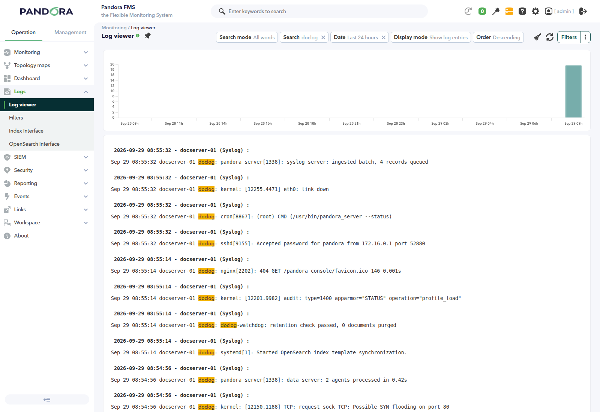

### Affichage et recherche avancés

Dans l'onglet **Advanced options**, on peut changer la vue et transformer les
*logs* en graphiques. Le **Display mode** décide si l'on affiche des entrées de
texte ou un graphique. Pour le graphique, il faut choisir un **modèle de
capture** (**Use capture model**) : un ensemble d'expressions régulières et
d'identifiants qui extraient des valeurs de chaque ligne.

Le modèle par défaut est **Apache log model**, qui comprend l'`access_log`
d'Apache au format standard et dessine les temps de réponse regroupés par page et
par code de réponse. Quelques autres modèles sont fournis d'usine et vous pouvez
créer les vôtres avec les boutons de modification et de création.

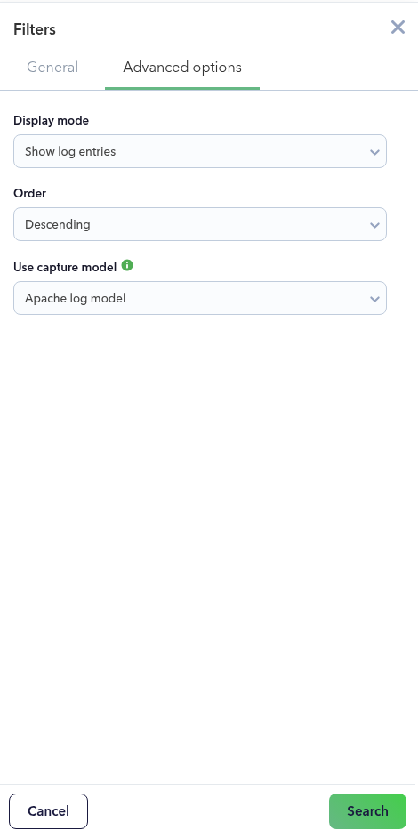

### Entrées de log multilignes

Une *stack trace* ne tient pas sur une ligne. Une requête et sa réponse XML non
plus, ni une exception avec vingt cadres de pile. Jusqu'à la version 806, la
visionneuse découpait ces entrées en une ligne par ligne physique ; depuis la
806, elle peut les afficher pour ce qu'elles sont, un seul bloc, si la collecte
le demande.

Le serveur ne devine pas où commence et où finit une entrée : c'est la collecte
qui le décide. Pour qu'une entrée s'affiche entière, la collecte doit l'envoyer
comme **une seule ligne physique** et, à l'intérieur, coder chaque saut de ligne
interne avec le marqueur littéral `{{\n}}` (deux accolades, une barre oblique
inversée, `n` et deux accolades). Le marqueur est exactement celui-là : `{{/n}}`
ne fonctionne pas.

À partir de là, le serveur fait trois choses, dans cet ordre :

1. Il découpe le contenu reçu par sauts de ligne, comme toujours, et obtient une
   chaîne par entrée.
2. Il remplace **toutes** les occurrences de `{{\n}}` dans chaque chaîne par un
   vrai saut de ligne.
3. Il indexe l'entrée comme **un seul document** OpenSearch, avec les sauts à
   l'intérieur du contenu.

Comme le remplacement est postérieur au découpage, aucun document
supplémentaire n'apparaît : une entrée logique reste un document. La visionneuse
affiche le contenu dans un `<pre>` avec ajustement de ligne (`pre-wrap`), donc
les sauts apparaissent tels quels, comme dans les événements Windows.

Par exemple, la collecte envoie cette ligne :

```text
2026-06-11 16:49:57 ERROR Traitement de la requête 471{{\n}}  at Service.Process (Service.cs:120){{\n}}  at Host.Run (Host.cs:45)
```

Et la visionneuse affiche une seule entrée de trois lignes :

```text
2026-06-11 16:49:57 ERROR Traitement de la requête 471
  at Service.Process (Service.cs:120)
  at Host.Run (Host.cs:45)
```

!!! note "Ce qui ne change pas"
    - La collecte incluse continue d'envoyer une ligne par entrée et le serveur
      la découpe de la même manière. Sans le marqueur, la visionneuse s'affiche
      exactement comme avant.
    - Aucune migration de données, aucun changement de mapping ni nouvel index :
      les index existants continuent d'être utilisés.
    - Les **événements Windows** étaient déjà enregistrés comme un seul document
      et ne passent pas par le découpage ; leur comportement ne change pas.
    - Il n'y a aucune nouvelle option de configuration et aucun redémarrage
      particulier au-delà de la mise à jour habituelle du serveur.
    - Une entrée est un événement. Si une ligne contient le littéral `{{\n}}`
      par hasard, il deviendra aussi un saut de ligne ; c'est peu probable, mais
      bon à savoir.
    - Toutes les lignes du bloc partagent la date du cycle de collecte, pas la
      leur.

!!! tip "Regrouper dans la visionneuse n'est pas la solution"
    Le regroupement par agent, origine et date dans la visionneuse a été écarté.
    Le champ `@timestamp` est celui du cycle de collecte, donc ce regroupement
    réunirait toutes les entrées de l'exécution, et non une entrée logique. Le
    regroupement relève donc de la collecte.

Pour le SIEM, l'entrée arrive déjà décodée : un seul événement avec ses sauts de
ligne, et les *decoders* et les *rules* s'appliquent au bloc complet, pas à
chaque ligne. C'est expliqué dans [SIEM](../parte-7/7.2-siem.md#collecte-de-logs-pour-le-siem).

### Filtres fréquents

Si vous répétez la même combinaison de filtres, enregistrez-la : **Save filter**,
vous lui donnez un nom et **Save**. Ensuite vous la retrouvez avec **Load
filter**, en la choisissant dans la liste. Un filtre enregistré peut être écrasé
par les changements en cours.

Dans **Operation → Logs → Filters**, ces filtres s'administrent : les modifier,
les supprimer un par un ou en bloc, et en créer de nouveaux.

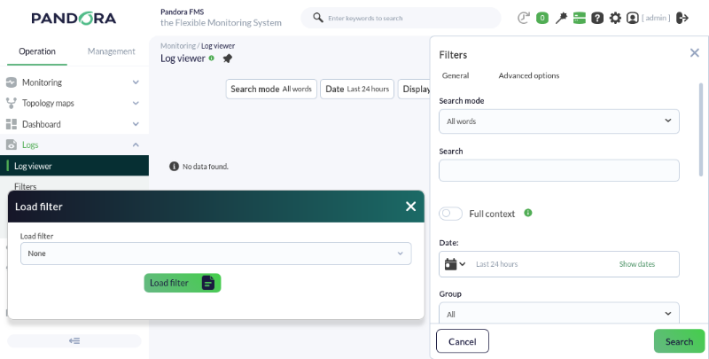

### Filtres enregistrés comme éléments épinglés

Le système d'épinglage de Pandora FMS permet de garder le **Log viewer** à portée
de main dans le menu, avec les filtres déjà posés. Cela se fait avec l'icône de
punaise située à côté du titre de la section. Au rechargement du filtre, la
punaise apparaît désactivée, et si vous cliquez dessus l'épinglage est retiré.
Les éléments épinglés sont indépendants des filtres fréquents ; ils ne se gênent
pas entre eux.

## Log Source dans la vue de l'agent

Chaque agent qui envoie des *logs* le signale dans sa propre fiche (voir [2.21, Configuration commune des agents](2.21-configuracion-comun-de-los-agentes.md#les-onglets-de-la-vue-de-lagent)
pour les autres onglets). Dans la vue
de l'agent apparaît un encadré **Logs** avec une ligne par origine, où vous voyez
la **date de la dernière mise à jour** et un bouton **Review** (la loupe) qui
ouvre le Log Viewer déjà filtré par cet agent et cette origine. C'est le moyen le
plus commode de passer de « cet agent a cessé d'envoyer des *logs* » à « voici
ses derniers messages ».

Par défaut, l'encadré comme la visionneuse travaillent sur les **dernières 24
heures** ; cela se change au besoin.

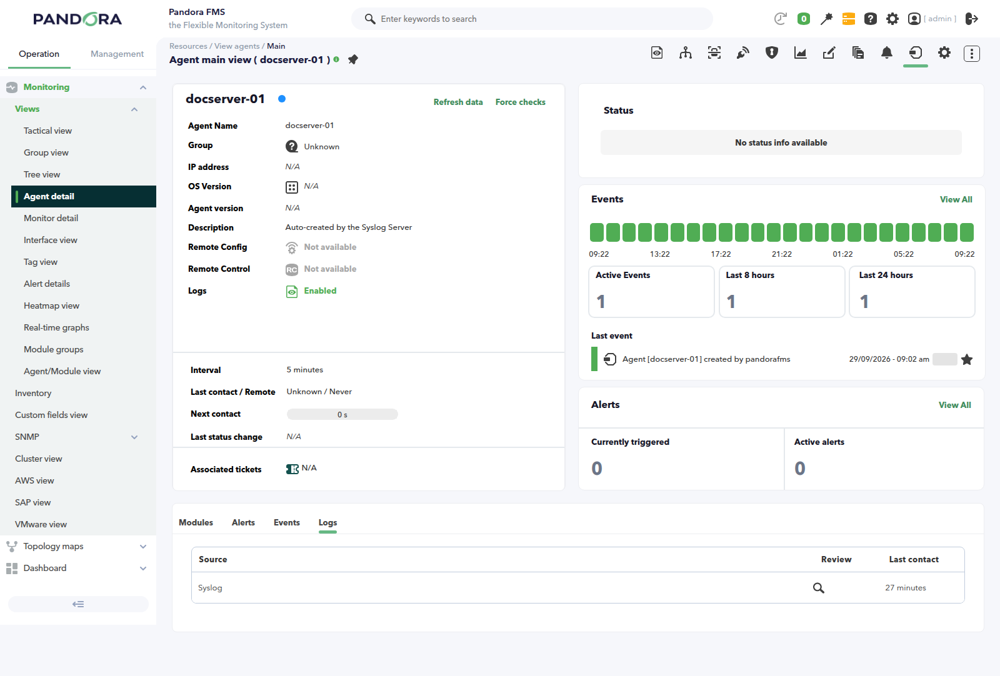

## Superviser le moteur de logs lui-même

Et si c'est le moteur lui-même qui se tait ? Lorsque le collecteur est activé, le
serveur de Pandora FMS se surveille lui-même : il génère une batterie de modules
sur OpenSearch et les ajoute à son **agent d'autosupervision**
(`pandora.internals` par défaut). Ils apparaissent comme n'importe quel autre
module, dans **Resources → Manage agents** (*Ressources → Gérer les agents*), à
l'intérieur de cet agent.

Ils sont quatorze, en plus des modules internes habituels du serveur :

| Module | Ce qu'il mesure | Valeurs |
|---|---|---|
| **Log server connection** | Connexion au moteur | `1` connecté ; `0` sans connexion |
| **Total sources** | Origines distinctes avec des *logs* | Nombre entier (`0` ou plus) |
| **Total documents** | Documents (lignes) stockés | Nombre entier (`0` ou plus) |
| **Opensearch nodes online** | Nœuds qui répondent dans le cluster | Nombre entier (`0` ou plus) |
| **Opensearch CPU %** | CPU du cluster | `0`–`100` % |
| **Opensearch available memory** | Mémoire libre du système | `0`–`100` % |
| **Opensearch JVM heap usage** | Utilisation du tas (*heap*) de la JVM | `0`–`100` % |
| **Opensearch Disk usage** | Disque utilisé | `0`–`100` % |
| **Opensearch Total shards** | Occupation de la capacité de fragments par nœud | `0`–`100` % (peut dépasser `100` s'il y a plus de fragments que de capacité) |
| **Opensearch Index Health** | Santé de l'index le plus récent | `green`, `yellow` ou `red` |
| **Opensearch Index Status** | État de l'index le plus récent | `open` ou `close` |
| **Opensearch daily index** | L'index le plus récent est celui du jour | `0` oui ; `1` non |
| **Opensearch index deletion** | Purge des index anciens | `0` normalement ; `1` la purge ne se fait pas |
| **Longest data archived** | Date de la donnée la plus ancienne | Date `AAAA-MM-JJ HH:MM:SS` |

Avec cela, on détecte ce qui fait vraiment mal : que le moteur a cessé d'ingérer
des *logs*. Pour le savoir sans regarder à la main, montez une alerte sur l'un de
ces modules, comme pour n'importe quel autre
([Alertes et notifications](../parte-5/5.5-alertas-y-notificaciones.md)).

## Permissions

La visionneuse suit les permissions habituelles sur les agents. Pour l'ouvrir, il
faut la permission de **lecture des agents** (`AR`). Sans elle, l'écran ne
s'affiche pas. Les recherches respectent en outre les groupes sur lesquels
l'utilisateur a une permission de lecture, comme le reste de la console web.
