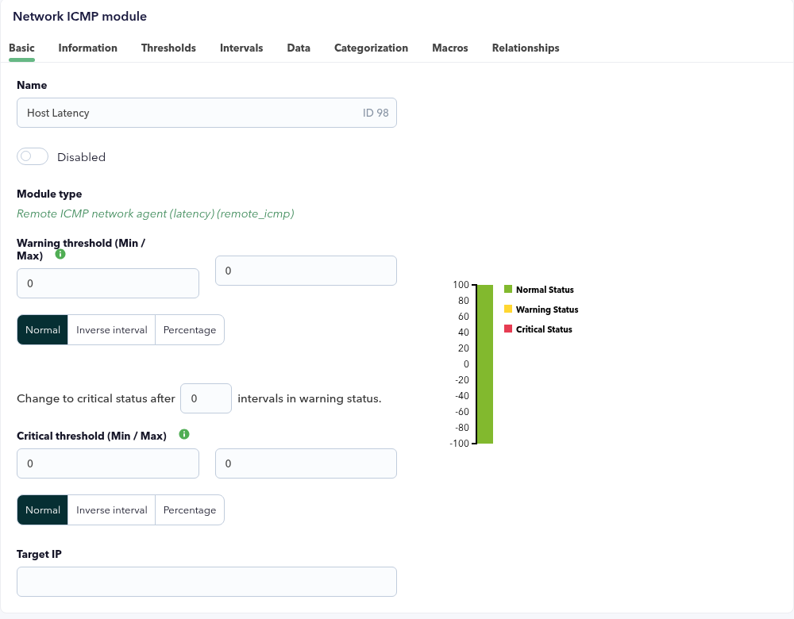
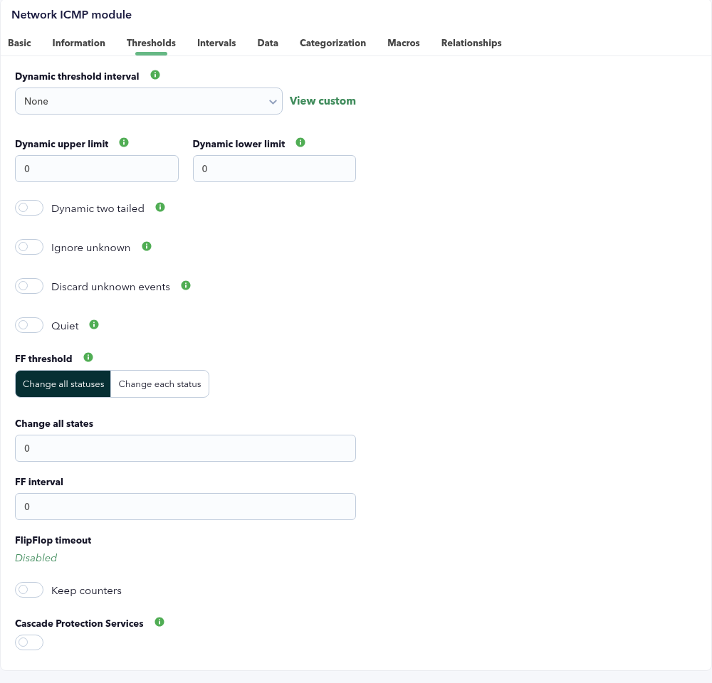
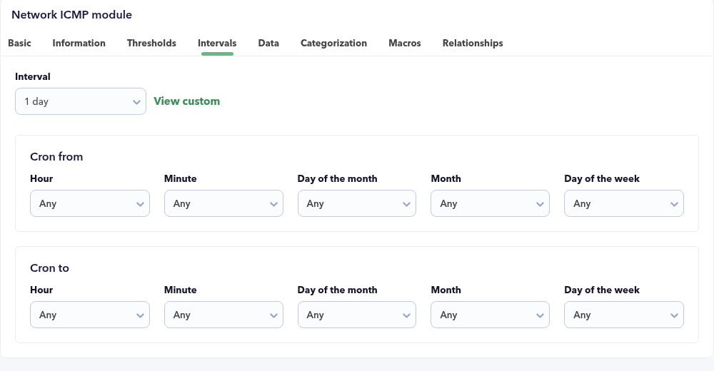
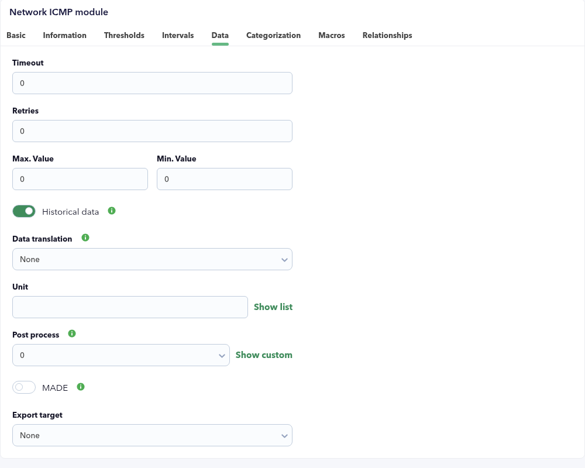
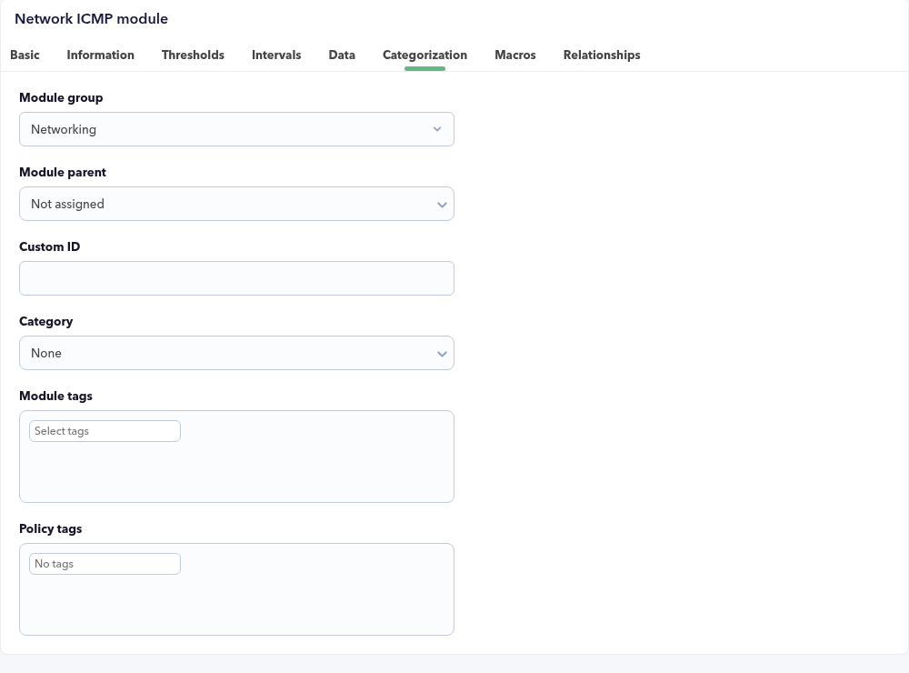

# Configuration commune des modules

Un module est une mesure concrète d'un agent : « quelle quantité de CPU il
utilise », « le port 443 répond-il », « combien de requêtes attendent dans la
file ». Ce qui change d'un module à l'autre, c'est **la façon dont la donnée est
obtenue** (une commande sur l'EndPoint, un `ping` depuis le serveur, une requête
SNMP, un appel à une API) et cela est expliqué dans le chapitre de chaque
technologie. Ce qui ne change pas, ou change peu, c'est tout le reste : à quelle
fréquence on mesure, quelles valeurs sont considérées comme normales, ce qui se
passe quand la donnée n'arrive pas, combien de temps on conserve et comment on
organise. Ce « tout le reste » est un formulaire unique, le même pour presque
tous les types, et ce chapitre l'explique une fois pour ne pas le répéter dans
les dix-neuf précédents.

L'équivalent de ce chapitre pour l'agent est [2.21, Configuration commune des agents](2.21-configuracion-comun-de-los-agentes.md). On accède au formulaire du module depuis **Gérer les agents** (*Manage agents*), avec le bouton
**Modules** de l'agent et **Créer un module**, ou en modifiant un module
existant. Une politique (voir
[2.10, Politiques de supervision](2.10-politicas-de-monitorizacion.md)) utilise
le même formulaire pour définir des modules qu'elle répartit ensuite entre les
agents.

Le formulaire se divise en huit onglets :

| Onglet | Ce qu'il contient |
|---|---|
| **Basique** (*Basic*) | Nom, type, seuils d'avertissement et critique, et les champs propres au type de module (une URL, un OID, une commande…). |
| **Information** (*Information*) | Description et instructions par état. |
| **Seuils** (*Thresholds*) | Seuils dynamiques, inconnu, mode silencieux et protection *flip-flop*. |
| **Intervalles** (*Intervals*) | Intervalle d'exécution et programmation de type cron. |
| **Données** (*Data*) | Délai d'attente, tentatives, valeurs minimale et maximale, historique, unité et post-traitement. |
| **Catégorisation** (*Categorization*) | Groupe du module, parent, identifiant, catégorie et tags. |
| **Macros** | Macros personnalisées du module. |
| **Relations** (*Relationships*) | Relations directes ou de basculement avec des modules d'autres agents. |

!!! note "Tous les champs ne s'affichent pas toujours"
    Le formulaire s'adapte au type de module. Un module d'EndPoint n'a ni délai
    d'attente ni tentatives, car le serveur ne l'exécute pas ; un module
    personnalisé API n'a pas de seuils, car son état vient de ses conditions ; et
    le champ *FlipFlop timeout* n'existe que dans les modules asynchrones. Si un
    champ de ce chapitre n'est pas dans votre formulaire, c'est que le type de
    module ne l'utilise pas.

## Données de base

| Champ | Ce qu'il fait |
|---|---|
| **Nom** (*Name*) | Nom du module, unique dans son agent. Il apparaît dans les vues, les rapports et les alertes, il vaut donc mieux qu'il se comprenne sans voir l'agent : « Utilisation du CPU », pas « mod3 ». |
| **Désactivé** (*Disabled*) | Le module cesse de s'exécuter et de recevoir des données, mais conserve sa configuration et son historique. C'est la façon de l'éteindre sans le perdre. |
| **Type de module** (*Module type*) | Le type de donnée qu'il renvoie : numérique, booléen (`proc` : 1 normal, 0 critique), alphanumérique ou incrémental, en plus des asynchrones. Le type décide quels seuils ont un sens. Les noms de chaque type et leur usage dans l'EndPoint se trouvent dans [2.1](2.1-monitorizacion-con-endpoints.md#creer-vos-propres-modules). |
| **Description** (*Description*), dans **Information** | Texte libre. C'est la première chose que voit celui qui reçoit une alerte, elle mérite donc une phrase. |

## Seuils et états

Un module peut se trouver dans l'un de quatre états : **normal**,
**avertissement** (*warning*), **critique** (*critical*) et **inconnu**. Les
trois premiers viennent de la comparaison de la donnée avec les seuils ; le
dernier, du fait que la donnée n'arrive pas.

Les seuils d'avertissement et critique sont dans l'onglet **Basique**. Chacun a
une valeur minimale et une valeur maximale, et trois modes :

| Mode | Quand l'état change |
|---|---|
| **Normal** | La valeur est **dans** la plage. Si vous ne mettez pas de maximum, toute valeur au-dessus du minimum compte ; dans les modules numériques, un maximum de `0` signifie l'infini. |
| **Intervalle inverse** (*Inverse interval*) | La valeur est **hors** de la plage. Fonctionne aussi avec les modules alphanumériques. |
| **Pourcentage** (*Percentage*) | La nouvelle valeur est comparée à la précédente et l'état change si la variation, en pourcentage, dépasse l'incrément (maximum) ou le décrément (minimum) indiqués. |

Si une valeur remplit à la fois le seuil d'avertissement et le seuil critique,
**le critique l'emporte**.

!!! example "CPU avec avertissement à partir de 70 et critique à partir de 90"
    Seuil d'avertissement avec minimum `70` et maximum `95` ; seuil critique avec
    minimum `90` et maximum `0` (sans limite supérieure). Les deux plages se
    chevauchent entre 90 et 95.

    | Valeur reçue | État | Pourquoi |
    |---|---|---|
    | `40` | Normal | Hors des deux plages. |
    | `75` | Avertissement | Dans la plage d'avertissement. |
    | `92` | Critique | Remplit les deux et le critique l'emporte. |
    | `99` | Critique | Au-dessus du minimum critique, sans limite supérieure. |

En dessous du seuil d'avertissement, **Passer à l'état critique après** *N*
**intervalles en état d'avertissement** fait passer en critique un module qui a
enchaîné *N* exécutions en avertissement. Avec `2`, la séquence avertissement →
avertissement → avertissement passe en critique. Si un module reste « en
avertissement » pour toujours parce que personne ne le regarde, ce champ évite
qu'il ne devienne un simple élément décoratif.

### Quand la donnée n'arrive pas : inconnu

Si un module passe plus de **deux intervalles** sans recevoir de données, il
entre en état inconnu. Trois réglages de l'onglet **Seuils** gouvernent ce
comportement :

| Champ | Ce qu'il fait |
|---|---|
| **Ignorer les inconnus** (*Ignore unknown*) | Le module ne passe jamais en inconnu : il conserve le dernier état connu. Utile pour des données qui arrivent par intermittence ; dangereux si vous l'activez pour « nettoyer » un écran rouge, car il cesse de vous avertir que le module est mort. |
| **Écarter les événements inconnus** (*Discard unknown events*) | Le module passe bien en inconnu, mais ne génère pas l'événement. |
| **Mode silencieux** (*Quiet*) | Le module continue de recevoir et d'enregistrer des données, mais ne génère aucun événement et ne déclenche aucune alerte. On l'utilise pendant l'essai d'un nouveau module ou lors d'une intervention. |

### Seuils dynamiques

Au lieu de fixer les valeurs à la main, le module peut calculer ses seuils à
partir de son propre historique. Cela s'active en choisissant un **Intervalle de
seuil dynamique** (*Dynamic threshold interval*) dans l'onglet **Seuils** : le
système prend les données de cette période, calcule la moyenne et l'écart type et
établit les seuils avec elles.

| Champ | Ce qu'il fait |
|---|---|
| **Limite supérieure dynamique** / **Limite inférieure dynamique** | Ajustent, en pourcentage, la limite calculée. Si la moyenne tourne autour de 60 et que le seuil critique supérieur est à 80, une limite supérieure dynamique de `10` le porte à 88. |
| **Dynamique à deux queues** (*Dynamic two tailed*) | Ajoute un seuil inférieur au seuil supérieur, de sorte que les valeurs très hautes comme les très basses changent l'état. |

### Protection *flip-flop*

Une valeur qui oscille entre le bien et le mal à chaque cycle est un problème
d'interprétation : le module change de couleur en permanence et les alertes ne
s'arrêtent pas. Le **seuil FF** (*FF threshold*) exige que le nouvel état se
répète plusieurs fois de suite avant que le changement soit validé. Avec `0` (la
valeur par défaut), le module change d'état dès qu'il reçoit une donnée hors
plage ; avec `2`, il faut deux données critiques de plus, consécutives, avant de
passer en critique.

- **Tous les changements d'état** / **Chaque changement d'état** (*All state
  changing* / *Each state changing*) : utiliser la même tolérance pour tout
  changement, ou une tolérance différente pour le passage à normal, à
  avertissement et à critique.
- **Intervalle FF** (*FF interval*) : intervalle plus court pour la vérification
  suivante lorsque la protection s'active, de sorte que la confirmation arrive
  plus tôt que d'habitude.
- **Délai d'attente FlipFlop** (*FlipFlop timeout*) : uniquement dans les modules
  asynchrones ; les données identiques qui confirment le changement doivent
  arriver dans ce délai.
- **Conserver les compteurs** (*Keep counters*) : option avancée qui compte par
  état au lieu de compter par valeur.

Les équivalents pour l'EndPoint (`module_ff_interval`, `module_min_ff_event`…)
sont dans
[2.1](2.1-monitorizacion-con-endpoints.md#post-traitement-flip-flop-et-autres-reglages-du-module).

!!! tip "C'est un outil pour les environnements instables"
    Avec le *flip-flop*, la console met plus de temps à refléter une panne
    réelle : il faut qu'elle se répète. Utilisez-le là où le bruit est le
    problème, pas de façon systématique.

## Quand il s'exécute

Dans l'onglet **Intervalles**, l'**Intervalle** (*Interval*) est la période à
laquelle le module doit renvoyer des données. Dans les modules d'EndPoint, il
s'exprime comme un multiple de l'intervalle de l'agent : la console l'affiche
comme « Intervalle de l'agent ×*N* ». Dans les modules que le serveur exécute,
c'est la période à laquelle la vérification est lancée. C'est aussi la référence
de l'état inconnu : deux intervalles sans données.

Les champs **Cron depuis** (*Cron from*) et **Cron jusqu'à** (*Cron to*)
restreignent le moment où le module s'exécute, avec cinq champs : minute, heure,
jour du mois, mois et jour de la semaine. Trois cas :

| Configuration | Quand il s'exécute |
|---|---|
| Tous les champs sur « Any » (par défaut) | Toujours, sans restriction. |
| Seulement **Cron depuis**, avec des valeurs concrètes (`15 20 * * *`) | Quand cela correspond à ces valeurs : chaque jour à 20:15. |
| **Cron depuis** et **Cron jusqu'à** (`5 * * * *` et `10 * * * *`) | Pendant l'intervalle : chaque heure, entre les minutes 5 et 10. |

L'équivalent pour l'EndPoint est `module_crontab`, expliqué dans
[2.1](2.1-monitorizacion-con-endpoints.md#supervision-planifiee).

Dans l'onglet **Données** se trouvent le **Délai d'attente** (*Timeout*) et les
**Tentatives** (*Retries*) : les secondes d'attente de la réponse d'une
vérification distante et le nombre de répétitions en cas d'échec. Ils n'ont pas
de sens dans les modules locaux d'EndPoint. Avec `0`, la valeur par défaut du
serveur s'applique.

## Données : ce qui est enregistré et comment il s'affiche

Tous dans l'onglet **Données** :

| Champ | Ce qu'il fait |
|---|---|
| **Valeur minimale** / **Valeur maximale** (*Min. Value* / *Max. Value*) | Plage que le module peut renvoyer. Le serveur **écarte** les données qui en sortent. |
| **Historique des données** (*Historical data*) | Désactivé, seul le dernier point connu est conservé : pas de graphiques, mais de l'espace gagné dans la base de données. Cela ne se justifie que lorsqu'il faut que le système aille plus vite. |
| **Unité** (*Unit*) | Texte affiché à côté de la valeur (`%`, `MB`, `ms`). |
| **Post-traitement** (*Post process*) | Multiplicateur appliqué à la donnée **avant de l'enregistrer**. Accepte les décimales. |
| **Traduction des données** (*Data translation*) | Applique une traduction ou une formule à l'affichage de la donnée ; si vous en choisissez une, le champ d'unité est désactivé. |
| **Serveur d'exportation** (*Export target*) | Serveur d'exportation vers lequel le module est envoyé, si vous en avez un configuré. |
| **MADE** | Uniquement dans les modules numériques : la donnée est traitée par le moteur MADE (s'il est actif) et génère des événements automatiquement. |

!!! example "Des octets aux mégaoctets"
    Un module renvoie des octets et l'on veut voir des mégaoctets :
    post-traitement `0.00000095367` (1 / 1 048 576) et unité `MB`. Une donnée de
    `5242880` est enregistrée comme `5`.

!!! warning "Changer le post-traitement avec des données déjà enregistrées"
    La donnée est enregistrée déjà transformée. Si vous changez le multiplicateur
    sur un module qui a de l'historique, les anciennes données et les nouvelles
    se retrouvent sur des échelles différentes et les graphiques deviennent
    incohérents. Changez l'échelle à la création du module, pas après.

## Organiser les modules

Dans l'onglet **Catégorisation** :

| Champ | Ce qu'il fait |
|---|---|
| **Groupe du module** (*Module group*) | Groupe fonctionnel du module (réseau, système, base de données…), différent du groupe de l'agent. Sert à filtrer et à regrouper les vues. |
| **Parent du module** (*Module parent*) | Module dont celui-ci dépend, pour la hiérarchie de la protection en cascade. |
| **ID personnalisé** (*Custom ID*) | Identifiant propre, par exemple celui de votre inventaire. |
| **Catégorie** (*Category*) | Sans effet dans l'interface normale ; elle est pensée pour être utilisée avec le Command Center. |
| **Tags de modules** (*Module tags*) | Tags qui se propagent aux événements du module, servent de filtre dans les rapports et les vues et peuvent restreindre l'accès d'un utilisateur à certains modules. |
| **Tags de politique** (*Policy tags*) | Tags que le module reçoit de sa politique. |

Autres réglages qui organisent ou documentent le module :

- **Protection en cascade des services** (*Cascade Protection Services*), dans
  **Seuils** : si le module fait partie d'un service, les alertes ne se
  déclenchent qu'au niveau le plus haut de l'arbre où les conditions sont
  remplies, et non à tous les niveaux à la fois.
- **Instructions de critique, d'avertissement et d'inconnu**, dans
  **Information** : ce que doit faire celui qui reçoit l'avis. C'est l'endroit du
  « redémarrez le service X et, sinon, appelez Y ».
- **Macros** : variables propres au module, aux noms du style `_nom_`, qui
  peuvent être utilisées dans les alertes. Pour obtenir la même chose au niveau de l'agent, on utilise les champs personnalisés de l'agent et la macro `_agentcustomfield_N_` (voir [2.21](2.21-configuracion-comun-de-los-agentes.md#champs-personnalises-de-lagent)).
- **Relations entre modules** (directe ou de basculement) : permettent de
  remplacer un module par un autre dans le calcul du SLA.
- **Importer depuis le magasin d'identifiants** : dans les types qui le
  permettent, remplit les champs avec un identifiant enregistré (voir
  [2.2, Gestionnaire d'identifiants](2.2-gestor-de-credenciales.md)). Il ne fait
  que copier les données dans le formulaire ; le module n'est pas lié à
  l'identifiant.

## Dans une politique et dans les opérations massives

Le formulaire est le même, mais il se comporte différemment :

- **Dans une politique**, les champs que la politique contrôle apparaissent
  verrouillés dans le module de l'agent. On les change dans la politique, pas
  agent par agent. Certains champs, comme les tags de module, ne sont pas
  disponibles dans le module d'une politique. Voir
  [2.10](2.10-politicas-de-monitorizacion.md).
- **Dans une opération massive**, chaque champ porte un verrou : seuls les
  champs dont vous ouvrez le verrou sont modifiés, le reste est respecté. Voir
  [Le verrou : ce qui change et ce qui est respecté](2.11-operaciones-masivas.md#le-verrou-ce-qui-change-et-ce-qui-est-respecte)
  dans 2.11.

## Vérifier et diagnostiquer

| Symptôme | Cause probable | Vérification |
|---|---|---|
| Le module est en inconnu. | Il passe plus de deux intervalles sans données : l'agent ou la vérification ne répond pas. | Regardez l'heure de la dernière donnée ; vérifiez l'agent ou le serveur qui exécute le module. |
| Un module avec des données anciennes apparaît normal et jamais en inconnu. | **Ignorer les inconnus** activé : il conserve le dernier état. | Revoyez l'onglet **Seuils**. |
| La donnée dépasse le seuil et l'état ne change pas. | Seuil FF supérieur à 0, ou mauvais mode de seuil (normal au lieu d'inverse). | Revoyez le seuil FF et le mode de chaque seuil. |
| Le module change d'état et il n'y a pas d'alerte. | **Mode silencieux**, ou la protection en cascade le délègue au service parent. | Revoyez **Mode silencieux** et **Protection en cascade des services**. |
| Le module a des données mais il n'y a pas de graphique. | **Historique des données** désactivé. | Revoyez l'onglet **Données**. |
| Des données qui arrivent manquent. | Hors de **Valeur minimale** et **Valeur maximale** : le serveur les écarte. | Revoyez la plage de l'onglet **Données**. |
| Les graphiques montrent un saut d'échelle. | Le post-traitement a été changé avec des données déjà enregistrées. | Revoyez l'historique du changement et réappliquez l'échelle à une date propre. |
| Le module ne s'exécute pas à l'heure prévue. | Programmation cron restrictive, ou intervalle long. | Revoyez **Cron depuis** et **Cron jusqu'à** et l'intervalle. |
