# Configuration commune des agents

Un agent est l'unité avec laquelle Pandora FMS organise ce qu'il surveille : un équipement, un dispositif réseau ou un service qui regroupe des modules, appartient à un groupe et possède un état propre. Ce qui change d'un agent à l'autre, c'est ce que l'on supervise sur lui, et cela est expliqué dans le chapitre de chaque technologie. Ce qui ne change pas, c'est la **fiche de l'agent** : la vue où l'on consulte et le formulaire où l'on configure. Ce chapitre l'explique une fois, comme [2.20, Configuration commune des modules](2.20-configuracion-comun-de-los-modulos.md) le fait avec le formulaire du module, pour que les autres chapitres renvoient ici au lieu de la répéter.

La fiche comporte deux moitiés :

- **La vue de l'agent**, avec une barre d'onglets (**Principal** (*Main*), **Alertes** (*Alerts*), **Champs personnalisés** (*Custom fields*)…) et, dans l'onglet principal, l'état de l'agent et la liste de ses modules.
- **Le formulaire d'édition**, auquel on accède par l'onglet **Gérer** (*Manage*) de la vue ou depuis **Gérer les agents** (*Manage agents*), avec trois ou quatre onglets internes : **Aperçu** (*Overview*), **Avancé** (*Advanced*), **Surveillance** (*Monitoring*) et **Champs personnalisés** (*Custom fields*).

La fiche est affichée à qui possède un droit de lecture ou d'écriture sur l'un des groupes de l'agent, qu'il soit principal ou secondaire (voir [4.1, Groupes secondaires](../parte-4/4.1-grupos-perfiles-y-tags.md#groupes-secondaires)). Pour la modifier, il faut un droit d'écriture. Dans les [opérations massives](2.11-operaciones-masivas.md), le même formulaire est réutilisé avec des verrous, et dans le Command Center, les onglets **Surveillance** et **Champs personnalisés** n'existent pas.

## Les onglets de la vue de l'agent

Dans l'en-tête de la vue, les onglets sont des icônes, et l'intitulé de chacun apparaît au survol du curseur. La barre d'onglets n'est pas la même pour tous les agents. Certains onglets sont toujours présents ; d'autres n'apparaissent que si l'agent a quelque chose à y montrer. Lorsqu'un onglet attendu manque, c'est presque toujours parce que sa condition n'est pas remplie.

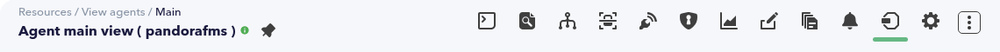

**Onglets toujours présents**

| Onglet | Ce qu'il montre |
|---|---|
| **Principal** (*Main*) | État général, contact, événements, alertes, modules et champs personnalisés. C'est l'onglet par défaut. Voir [L'onglet Principal](#longlet-principal). |
| **Alertes** (*Alerts*) | Les alertes de l'agent et leur état. |
| **Champs personnalisés** (*Custom fields*) | Les valeurs des champs personnalisés de l'agent. Voir [Champs personnalisés de l'agent](#champs-personnalises-de-lagent). |
| **Graphiques** (*Graphs*) | Graphiques des modules de l'agent. |
| **Outils externes** (*External Tools*) | Outils externes configurés pour l'agent. |
| **Vue des pièges** (*Traps view*) | Traps SNMP filtrés par cet agent. Voir [2.7](2.7-monitorizacion-de-traps-snmp.md). |

L'onglet **Alertes** ouvert, comme exemple d'un onglet de la barre :

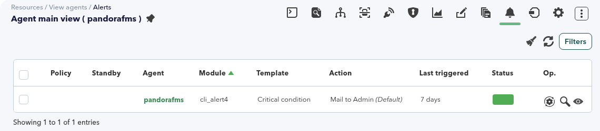

**Onglets qui dépendent d'une condition**

| Onglet | Il apparaît lorsque… |
|---|---|
| **Gérer** (*Manage*) | L'utilisateur a un droit d'écriture sur l'un des groupes de l'agent. |
| **Interfaces** | L'agent a des modules d'interface SNMP. Voir [2.6](2.6-monitorizacion-de-redes.md). |
| **Inventaire** (*Inventory*) | Il existe des données d'inventaire de l'agent. Voir [3.1](../parte-3/3.1-inventario.md#longlet-inventaire-de-lagent). |
| **Données GIS** (*GIS data*) | Le SIG est activé dans la console. Voir [5.11](../parte-5/5.11-mapas-gis.md#vue-dagent-et-donnees-gis). |
| **Incidents** (*Incidents*) | L'intégration ITSM est activée et l'agent a des tickets. Voir [5.8](../parte-5/5.8-gestion-de-incidencias-itsm.md). |
| **Adresse URL** (*Url address*) | L'agent a une adresse URL configurée (champ du même nom, dans **Avancé**). |
| **Visionneur de journaux** (*Log Viewer*) | La collecte de logs est active et l'agent a des sources. Voir [2.19](2.19-recoleccion-y-monitorizacion-de-logs.md#log-source-dans-la-vue-de-lagent). |
| **Pandora RC** | Le champ personnalisé qui contient la clé de Pandora RC est configuré et l'agent a une valeur dans ce champ. Voir [3.2](../parte-3/3.2-control-remoto-con-rc.md). |
| **Vue SAP** (*SAP view*) | L'agent est un agent SAP. |
| **Hardening de sécurité** (*Security hardening*) | L'agent a des données d'inventaire de sécurité. |
| **Vulnérabilités** (*Vulnerabilities*) | L'analyse de vulnérabilités est active (sur l'agent ou en global) et des vulnérabilités ont été trouvées. |
| **Vue RMM** (*View RMM*) | L'agent est un agent RMM. |
| **Console WUX** (*WUX Console*) | L'agent a des modules d'expérience utilisateur web. Voir [2.14](2.14-monitorizacion-de-experiencia-de-usuario-ux.md). |
| **Analyseur d'itinéraire d'URL** (*URL Route Analyzer*) | L'agent a un module d'étapes de parcours. |
| **Gestionnaire de configuration réseau** (*Network config manager*) | L'utilisateur a un droit de lecture sur NCM, la gestion de configuration est activée sur le serveur et sur l'agent, et l'agent a une adresse IP. Voir [3.6](../parte-3/3.6-gestion-de-configuracion-de-equipos-de-red-ncm.md). |
| **Politiques** (*Policies*) | Il existe des politiques. Voir [2.10](2.10-politicas-de-monitorizacion.md). |
| **Collection** | Il existe des collections. Voir [2.9](2.9-colecciones.md). |
| *Audit info view* | L'utilisateur a le droit de gestion de la plateforme. Voir [7.8](../parte-7/7.8-auditoria-interna.md). |
| Onglets d'extensions | Chaque extension installée, selon ses propres droits (par exemple, les gestionnaires VMware et RHEV). |

### Le menu à trois points

À la fin de la barre se trouve une icône à trois points. Un clic ouvre un menu avec les onglets disponibles pour l'agent, comme la barre mais avec le libellé écrit, ce qui évite de survoler chaque icône. Dans la vue de l'agent, les onglets de gestion (**Modules**, **Alertes** et **Politiques**) sont regroupés sous **Gérer** (*Manage*). La barre d'édition a le même menu.

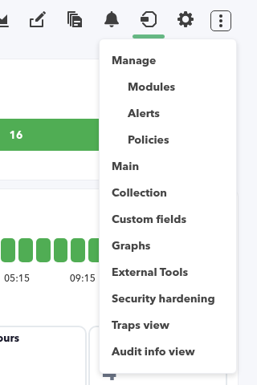

Ce qui s'affiche dépend du réglage **Menu des onglets** (*Tabs menu*), dans **Réglages → Configuration du système → Styles visuels**, onglet **Comportement** (voir [9.2](../parte-9/9.2-referencia-completa-de-configuracion-de-la-consola.md#4-styles-visuels)). C'est un réglage global de la console : il concerne tous les écrans à onglets et tous les utilisateurs.

| Valeur | Ce qu'il affiche |
|---|---|
| **Afficher les deux (onglets et menu)** | La barre d'icônes et le menu à trois points. C'est la valeur par défaut. |
| *Show only icons* | Seulement la barre d'icônes ; l'icône à trois points disparaît. |
| *Show only menu* | Seulement le menu à trois points ; de la barre, seul l'onglet actif reste. |

!!! note "Les données d'un module, depuis le module"
    La vue des données d'un module (données reçues, base principale ou historique, depuis maintenant ou par plage) n'a pas d'onglet propre. Elle s'ouvre depuis les liens du module dans la liste de **Principal**.

## L'onglet Principal

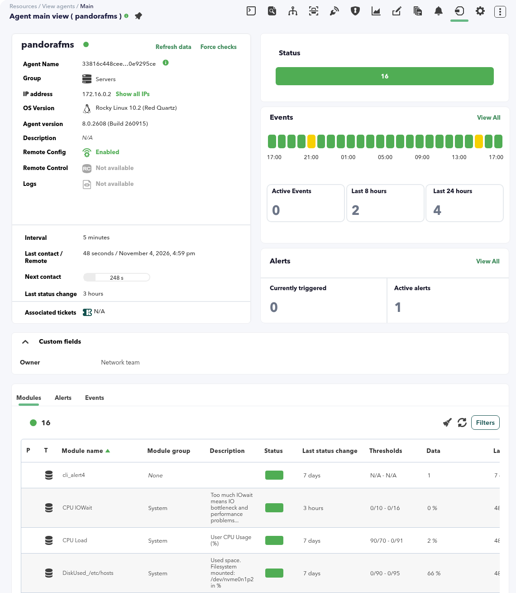

L'onglet **Principal** réunit, de haut en bas :

| Bloc | Ce qu'il contient |
|---|---|
| **Aperçu général** (*General overview*) | Nom, groupe, adresses IP, version du système d'exploitation, version de l'agent, description, et indication de l'activation de la configuration distante, du contrôle distant et des logs. |
| **Contact** | Intervalle, dernier contact (local et distant), prochain contact avec sa barre de progression et dernier changement d'état. |
| Actions | **Rafraîchir les données** (*Refresh data*) et **Forcer les vérifications** (*Force checks*), cette dernière avec le droit correspondant. |
| Barre d'état | Nombre et pourcentage de modules normaux, en avertissement, critiques, inconnus et non initialisés. |
| Événements | Événements actifs, des 8 et 24 dernières heures et dernier événement. |
| Alertes | Alertes actuellement déclenchées et alertes actives. |
| Sécurité | Résultats de la supervision de sécurité, vulnérabilités, hardening et intégrité des fichiers. Affiché uniquement s'il y a des données. |
| **Champs personnalisés** | Les champs marqués pour s'afficher dans la vue principale. |
| **Modules** | La liste des modules de l'agent, avec leur état et leurs données. Voir [La liste des modules](#la-liste-des-modules). |

Les décomptes d'événements de ce bloc ne filtrent pas selon les droits d'événements de l'utilisateur, alors que le sous-onglet des événements les exige. Si un décompte ne coïncide pas avec ce que l'utilisateur voit dans la console des événements, c'est la raison.

### État de l'agent et étiquettes

L'état de l'agent découle des états de ses modules. Il est **Non initialisé** (*Not init*) si tous les modules le sont ou s'il n'y en a aucun ; sinon, il est **Critique** si un module l'est, puis **Avertissement**, puis **Inconnu** et, à défaut, **Normal**. Un module passe en inconnu lorsque le double de l'intervalle s'écoule sans recevoir de données, sauf si l'agent ou le module a activé **Ignorer les inconnus**.

À côté du nom peuvent apparaître des étiquettes qui expliquent pourquoi l'agent ne se comporte pas comme prévu. Si plusieurs coïncident, la première de cette liste s'affiche :

1. **Désactivé** (*Disabled*), si l'agent est en mode désactivé.
2. **Mode silencieux** (*Quiet*), s'il est en mode silencieux.
3. **Protection Event Storm** (*Quiet by storm protection*), si le serveur a freiné la génération d'événements de l'agent.
4. **En arrêt planifié** (*In scheduled downtime*), si un arrêt planifié est actif (voir [3.8](../parte-3/3.8-paradas-planificadas.md)).

### La liste des modules

Sous le résumé, le sous-onglet **Modules** liste les modules de l'agent. On filtre par état (tous, critique, avec alerte déclenchée, normal, non normal, avertissement, inconnu), par nom et par **Groupe du module** (*Module group*), et il dispose d'un **Mode hiérarchie** (*Hierarchy mode*) qui affiche les modules sous forme d'arbre selon leurs relations. Les colonnes sont : politique d'origine, type, nom, groupe du module, description, état, dernier changement d'état, seuils, donnée, dernier contact, graphiques et actions. « Non initialisé » est compté dans la barre d'état, mais n'est pas un filtre. La signification de chaque réglage d'un module se trouve dans [2.20](2.20-configuracion-comun-de-los-modulos.md).

La barre comporte en outre les sous-onglets **Événements** (avec le droit de lecture des événements, voir [5.4](../parte-5/5.4-consola-de-eventos-centralizada.md)), **Alertes**, **Logs** (si la collecte est active) et **Interfaces** (s'il y a des modules d'interface).

## Les onglets de l'édition de l'agent

La vue d'édition (**Gestion → Ressources → Gérer les agents** puis l'agent) a sa propre barre d'onglets, différente de celle de la vue. Ce sont aussi des icônes dont le libellé s'affiche au survol, et leur nombre dépend du droit de l'utilisateur et de ce que possède l'agent.

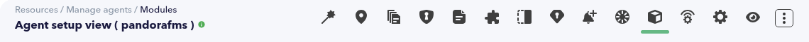

Avec le droit de désactiver les agents mais sans droit d'écriture, la barre se réduit à **Vue**, **Modules** et **Alertes**. Avec le droit d'écriture, le reste apparaît selon ces conditions :

| Onglet | Ce qu'il fait | Apparaît quand… |
|---|---|---|
| **Vue** (*View*) | Revient à la vue de l'agent. | Toujours. |
| **Réglages** (*Setup*) | Le formulaire d'édition de l'agent. Voir [Le formulaire d'édition](#le-formulaire-dedition-apercu). | Droit d'écriture. |
| **Configuration à distance** (*Remote configuration*) | Modifie le fichier de configuration à distance de l'agent. Voir [2.1](2.1-monitorizacion-con-endpoints.md#configuration-distante-depuis-la-console-web). | L'agent a une configuration à distance et le fichier est modifiable. |
| **Configuration des satellites à distance** (*Remote satellite configuration*) | Modifie la configuration à distance d'un satellite. | L'agent a une configuration à distance de satellite. |
| **Modules** | La table des modules de l'agent. Voir [La vue d'édition des modules](#la-vue-dedition-des-modules). | Toujours. |
| **Gestionnaire de configuration réseau** (*Network config manager*) | Gestion de la configuration de l'équipement réseau. Voir [3.6](../parte-3/3.6-gestion-de-configuracion-de-equipos-de-red-ncm.md). | L'utilisateur a le droit NCM, le serveur NCM est activé et l'agent a une adresse IP. |
| **Alertes** (*Alerts*) | Affecte des alertes aux modules de l'agent. Voir [5.5](../parte-5/5.5-alertas-y-notificaciones.md). | Toujours. |
| **Sécurité** (*Security*) | Réglages de surveillance de sécurité de l'agent : durcissement, analyse des vulnérabilités et intégrité des fichiers. Nécessite la configuration à distance et un agent en version 774 ou supérieure. | Droit d'écriture. |
| **Inventaire** (*Inventory*) | Les modules d'inventaire de l'agent. Voir [3.1](../parte-3/3.1-inventario.md). | Droit d'écriture. |
| **Plugins** | Les plugins de l'agent. | L'agent a une configuration à distance. |
| **Collecte de journaux de modules** (*Module log collection*) | Collecte de journaux liée aux modules. Voir [2.19](2.19-recoleccion-y-monitorizacion-de-logs.md). | L'agent a une configuration à distance. |
| **Gérer la politique** (*Manage policy*) | Les politiques appliquées à l'agent. Voir [2.10](2.10-politicas-de-monitorizacion.md). | Les politiques sont disponibles. |
| **Collection** | Les collections de fichiers de l'agent. Voir [2.9](2.9-colecciones.md). | Les collections sont disponibles. |
| **Données GIS** (*GIS data*) | La position de l'agent sur la carte. Voir [5.11](../parte-5/5.11-mapas-gis.md). | Droit d'écriture. |
| **Assistant de l'agent** (*Agent wizard*) | Ouvre trois assistants qui créent des modules à partir de ce que l'agent découvre : **Assistant du SNMP** (*SNMP Wizard*), **Assistant des interfaces SNMP** (*SNMP Interfaces wizard*) et **Assistant du WMI** (*WMI Wizard*). Voir [2.6](2.6-monitorizacion-de-redes.md). | Droit d'écriture. |
| **Incidents** | Les incidents associés à l'agent. | L'agent a des incidents. |
| Onglets d'extensions | Chaque extension qui ajoute son propre onglet à l'édition. | Selon les droits de l'extension. |

## Le formulaire d'édition : Aperçu

L'onglet **Aperçu** (*Overview*) rassemble l'identité de l'agent et sa relation avec le serveur.

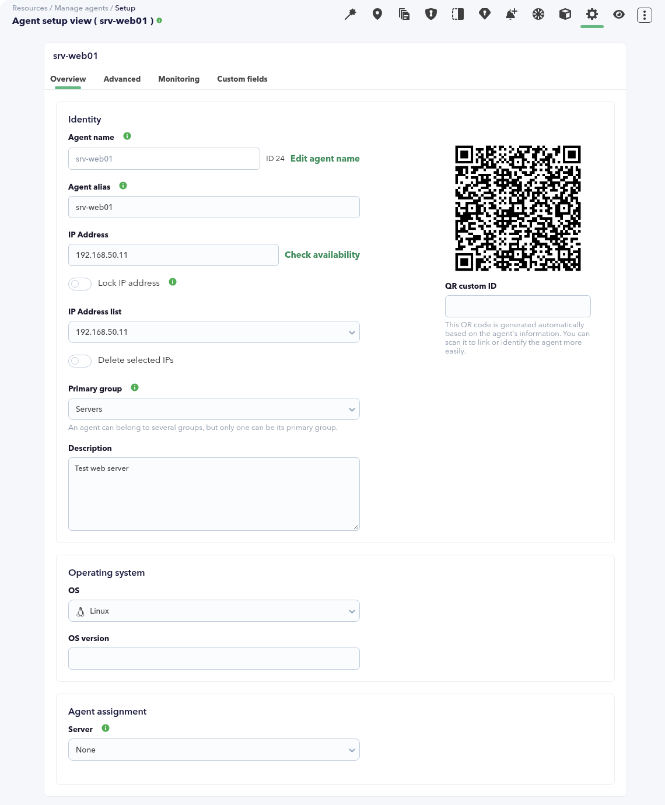

| Champ | Ce qu'il fait |
|---|---|
| **Nom de l'agent** (*Agent name*) | Identifiant interne et unique. Avec **Utiliser alias comme nom** désactivé, la console le génère. Le modifier après la création de l'agent avertit du risque de doublons : deux agents portant le même nom se confondent sur le serveur. Il n'est pas affiché dans l'interface. |
| **Alias de l'agent** (*Agent alias*) | Nom visible. Il peut être répété ; un alias en double n'est rejeté que si **Utiliser alias comme nom** est actif. |
| **Utiliser alias comme nom** (*Use alias as name*) | N'existe qu'à la création de l'agent. Par défaut, il prend la valeur du réglage global. |
| **ID personnalisé QR** (*QR custom ID*) | Identifiant propre à l'agent, disponible comme macro `_agentcustomid_`. Les caractères `/ \ | % # & $` et les balises HTML sont supprimés. |
| **Adresse IP** (*IP Address*) | IP de l'agent. Le format est validé et, si un autre agent l'utilise déjà, une confirmation est demandée avant d'enregistrer. |
| **Vérifier la disponibilité** (*Check availability*) | Vérifie si l'adresse répond. |
| **Verrouiller l'adresse IP** (*Lock IP address*) | Empêche l'IP de se mettre à jour seule lorsque l'EndPoint en signale une autre. |
| **Liste d'adresses IP** (*IP Address list*) et **Supprimer les adresses IP sélectionnées** (*Delete selected IPs*) | Gèrent les adresses supplémentaires de l'agent. |
| **Groupe primaire** (*Primary group*) | Obligatoire. Il est verrouillé si l'utilisateur n'a pas de droit sur lui ou si le groupe a atteint sa limite d'agents. |
| **Intervalle** (*Interval*) | Fréquence de contact de l'agent. C'est aussi la référence de l'état inconnu : passé le double sans données, les modules passent en inconnu. Par défaut, la valeur globale ou 300 secondes ; la console avertit en dessous de 5 minutes. |
| **Description**, **Système d'exploitation** (*OS*) et **Version du système d'exploitation** (*OS version*) | Texte libre et sélecteur. |
| **Ajouter une surveillance par défaut** (*Add default monitoring*) | N'existe qu'à la création de l'agent et est actif par défaut : ajoute les modules *Host Alive* et *Host Latency*. |
| **Serveur** (*Server*) | Serveur préféré pour les tâches distantes de l'agent : **Aucun** (*None*), **Autovalidé** (*Autobalance*) ou un serveur précis. Avec **Aucun**, les modules distants de l'agent ne s'exécutent pas. |
| **Activer la haute disponibilité automatique** (*Enable auto High Availability*) | Actif par défaut. |
| **Serveur Satellite** (*Satellite server*) | Lecture seule ; affiche le satellite assigné, s'il y en a un. |

!!! example "Deux agents avec le même alias"
    Deux succursales ont un équipement appelé « serveur-caisse ». Avec **Utiliser alias comme nom** désactivé, les deux agents peuvent porter cet alias sans conflit, car chacun reçoit un nom interne différent. Avec le réglage actif, la console rejette le second.

## Le formulaire d'édition : Avancé

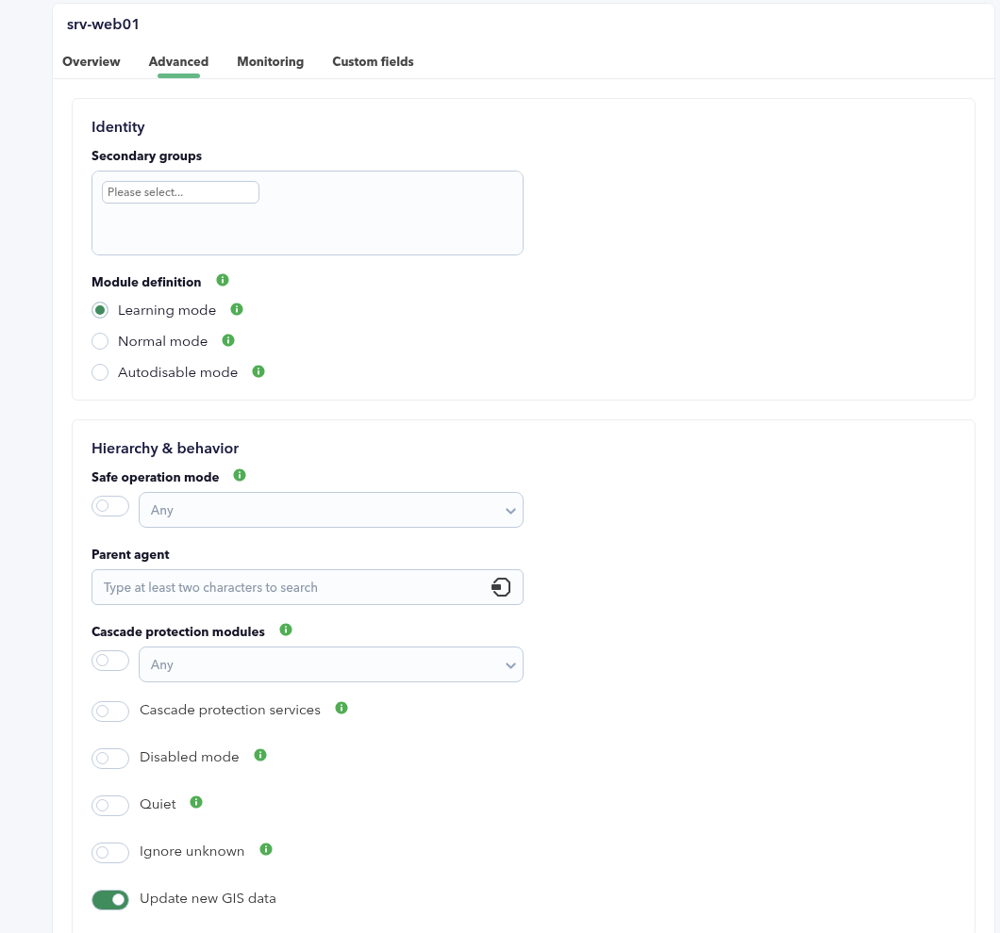

L'onglet **Avancé** (*Advanced*) décide de la façon dont le serveur traite l'agent. Il se divise en trois blocs : **Identité** (*Identity*), **Hiérarchie et comportement** (*Hierarchy & behavior*) et **Configuration et apparence** (*Configuration & appearance*). C'est celui qui a le plus d'effets de bord ; il convient donc de lire ce que fait chaque option.

### Groupes secondaires

**Groupes secondaires** (*Secondary groups*) donne accès à l'agent à des utilisateurs d'autres groupes sans le dupliquer. Le groupe primaire ne peut pas être aussi secondaire. Voir [4.1](../parte-4/4.1-grupos-perfiles-y-tags.md#groupes-secondaires).

### Définition des modules

**Définition des modules** (*Module definition*) fixe ce que fait le serveur des données qui arrivent dans le XML de l'EndPoint :

| Mode | Nouveaux modules | Données de l'agent dans le XML | Se désactive seul |
|---|---|---|---|
| **Mode d'apprentissage** (*Learning mode*, le mode par défaut) | Les crée automatiquement. | Écrase l'intervalle, l'adresse, les versions, le fuseau horaire et le parent. | Non. |
| **Mode normal** (*Normal mode*) | Ignore les modules qui ne sont pas déclarés dans la console. | N'écrase **pas** l'intervalle, la version du système d'exploitation, la version de l'EndPoint, le fuseau horaire ni l'agent parent. | Non. |
| **Mode désactivation automatique** (*Autodisable mode*) | Les crée automatiquement. | Comme le mode d'apprentissage. | L'agent se désactive seul lorsque tous ses modules sont inconnus et se réactive dès que des données arrivent. |

Le mode normal a un effet qui ne se déduit pas de son nom : en plus de ne pas créer de modules, il fige les données de l'agent. Si vous changez l'intervalle de l'EndPoint et que la console affiche toujours l'ancien, vérifiez ce champ.

### Mode d'opération sécurisé

**Mode d'opération sécurisé** (*Safe operation mode*) désactive les autres modules d'un agent lorsqu'un module précis passe en critique. La case à cocher ne fait qu'activer le sélecteur ; ce qui est enregistré, c'est le module choisi. Si le module choisi entre en critique, le serveur désactive le reste des modules de l'agent et les réactive lorsqu'il se rétablit, en rafraîchissant leurs horodatages pour qu'ils ne passent pas en inconnu. Avec la valeur **Tous** (*Any*), le serveur ne fait rien : il faut choisir un module.

### Agent parent et protection en cascade

**Agent parent** (*Parent agent*) établit la hiérarchie entre agents (par exemple, le switch dont dépend un serveur). On le cherche par nom et l'autocomplétion démarre à partir de deux caractères.

La **protection en cascade** se configure sur l'enfant et évite la tempête d'alertes lorsque le parent tombe. Lorsqu'elle est active, le serveur inhibe les alertes de l'agent enfant si le parent, ou l'un de ses ancêtres (jusqu'à 1024 niveaux), a une alerte déclenchée dont le modèle a une priorité **critique**. Deux précisions :

- Elle regarde les **alertes déclenchées**, pas l'état du module. Un module en critique dont l'alerte ne s'est pas déclenchée (à cause d'un seuil d'occurrences, par exemple) n'active pas la protection.
- **Modules de protection en cascade** (*Cascade protection modules*) la restreint : avec **Tous** (*Any*), n'importe quelle alerte critique du parent suffit ; avec un module précis, seules celles de ce module comptent.

**Services de protection en cascade** (*Cascade protection services*) est indépendant : il n'agit que si le service a activé sa propre protection en cascade. Voir [5.3](../parte-5/5.3-monitorizacion-de-negocio-y-servicios.md) et, pour l'équivalent par module, [2.20](2.20-configuracion-comun-de-los-modulos.md#organiser-les-modules). Les alertes sont expliquées dans [5.5](../parte-5/5.5-alertas-y-notificaciones.md).

### Désactivé, silencieux et ignorer les inconnus

Trois interrupteurs qui se ressemblent et ne font pas la même chose :

| Option | Données | Alertes et événements | Que se passe-t-il d'autre |
|---|---|---|---|
| **Mode désactivé** (*Disabled mode*) | Elles ne sont pas traitées. | Ils ne sont pas générés. | Il est exclu du calcul des inconnus. À l'enregistrement avec le mode actif, toutes les alertes déclenchées de l'agent sont acquittées, et l'agent reste en attente dans sa configuration distante. Dans beaucoup de listes, il n'apparaît même pas. |
| **Mode silencieux** (*Quiet*) | Elles continuent d'être traitées. | Aucune alerte n'est exécutée et aucun événement n'est généré. | L'onglet **Principal** affiche « (Quiet) » à côté du nom. |
| **Ignorer les inconnus** (*Ignore unknown*) | Elles continuent d'être traitées. | Ils fonctionnent normalement. | Le serveur ne marque pas comme inconnus les modules de l'agent faute de données : ils conservent leur dernier état. Par défaut, il prend la valeur globale. |

Si le motif est un arrêt avec une date de fin, utilisez plutôt un [arrêt planifié](../parte-3/3.8-paradas-planificadas.md) : il revient seul à son état antérieur et laisse une trace dans les rapports et le SLA.

### Autres réglages

- **Mettre à jour les nouvelles données SIG** (*Update new GIS data*) : actif à la création. Voir [5.11](../parte-5/5.11-mapas-gis.md).
- **RMM** : n'apparaît qu'avec la configuration distante et un système Linux, Windows ou Mac ; active l'agent RMM avec les valeurs par défaut du fichier de configuration de l'EndPoint. Voir [3.2](../parte-3/3.2-control-remoto-con-rc.md).
- **Icône de l'agent** (*Agent icon*) : l'icône de l'agent dans les cartes et les vues.
- **Adresse URL** (*URL Address*) : origine de l'onglet **Adresse URL** de la vue.
- **Configuration à distance** (*Remote configuration*) : si l'agent a une configuration distante, affiche son empreinte et un lien pour l'effacer. Voir [2.1](2.1-monitorizacion-con-endpoints.md#configuration-distante-depuis-la-console-web).

## Le formulaire d'édition : Surveillance

L'onglet **Surveillance** (*Monitoring*) active et désactive des fonctions de l'EndPoint en écrivant dans sa configuration distante :

| Interrupteur | Ce qu'il active |
|---|---|
| **Failles de sécurité** (*Security vulnerabilities*) | Analyse de vulnérabilités. |
| **Hardening de sécurité** (*Security hardening*) | Vérifications de durcissement. |
| **Surveillance de la sécurité** (*Security monitoring*) | Supervision de sécurité. |
| **Collecte de journaux** (*Log collection*) | Collecte de logs. Voir [2.19](2.19-recoleccion-y-monitorizacion-de-logs.md). |
| **Surveillance du matériel** (*Hardware monitoring*) | Inventaire matériel. |
| *Software monitoring* | Inventaire logiciel. |
| **Inventaire** (*Inventory*) | Modules d'inventaire. Voir [3.1](../parte-3/3.1-inventario.md). |

Pour que l'onglet apparaisse, l'agent doit avoir une configuration distante, un système d'exploitation Windows, Linux ou Mac et la version 774 ou supérieure. Il n'existe pas dans les opérations massives ni dans le Command Center.

## La vue d'édition des modules

L'édition d'un agent comporte, en plus du formulaire, une vue propre à ses modules. Elle s'ouvre depuis l'icône des modules de la barre de la vue d'édition (**Gestion → Ressources → Gérer les agents**, l'agent, puis l'icône **Modules**). Elle réunit la liste des modules de l'agent, ses filtres et les actions possibles sur ces modules. La configuration de chaque module (données de base, seuils, intervalle) est expliquée en [2.20](2.20-configuracion-comun-de-los-modulos.md).

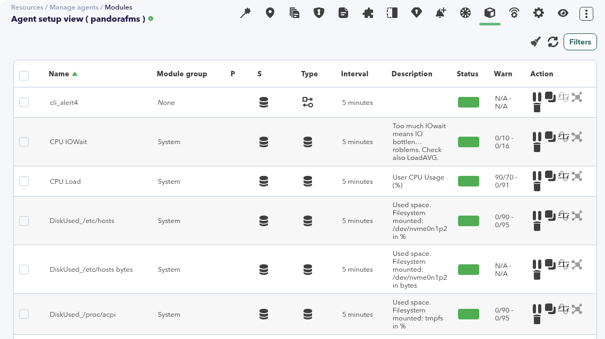

### Le tableau des modules

| Colonne | Ce qu'elle affiche |
|---|---|
| Case | Sélectionne le module pour les actions sur plusieurs modules. Uniquement avec la permission d'écriture sur l'agent. |
| **Nom** (*Name*) | Le nom du module, qui ouvre son édition. Les modules désactivés s'affichent en italique. Il peut comporter des icônes : module en mode silencieux (**Mode silencieux**, *Quiet*), module en arrêt planifié et conflit de nom entre l'agent et le satellite, lorsque le module est défini avec le même nom dans le fichier de configuration de l'agent et dans celui du satellite. |
| **Groupe de modules** (*Module group*) | Le groupe du module ou *Aucun*. |
| **P** (*Policy*) | Si le module provient d'une politique, une icône renvoie vers celle-ci et distingue les modules adoptés et les modules dissociés. Elle n'apparaît que si des politiques sont disponibles et avec la permission d'écriture. Voir [2.10](2.10-politicas-de-monitorizacion.md). |
| **S** (*Server*) | L'icône du serveur qui exécute le module. Un module sans données reçues ajoute une marque **Non démarré**. |
| **Type** (*Type*) | L'icône du type de module. |
| **Intervalle** (*Interval*) | L'intervalle du module ou, à défaut d'intervalle propre, celui de l'agent. |
| **Description** (*Description*) | La description, tronquée. |
| **État** (*Status*) | L'état actuel sous forme de bloc de couleur ; le survol affiche le détail. Avec un intervalle inférieur à 300 secondes, un avertissement rappelle que l'état inconnu exige 300 secondes ou plus. |
| **Alerte** (*Warn*) | Les seuils d'avertissement et de criticité du module. |
| **Action** (*Action*) | Les icônes d'action de la ligne (voir plus bas). |

Avec **Afficher en mode hiérarchie** (*Show in hierarchy mode*) activé, les modules enfants apparaissent en retrait sous leur module parent et le tri par colonnes est désactivé. Si la page coupe une branche, les ancêtres du module sont affichés pour ne pas perdre le contexte.

### Filtres

Le bouton **Filtres** (*Filters*) ouvre un panneau avec les critères suivants, qui se combinent :

| Filtre | Ce qu'il fait |
|---|---|
| **Rechercher** (*Search*) | Filtre par nom de module. |
| **État** (*Status*) | Tous, **Normal**, **Attention** (*Warning*), **Critique** (*Critical*), **Inconnu** (*Unknown*) ou **Non initialisé** (*Not initialised*). |
| **Groupe de modules** (*Module group*) | Tous, **Non assigné** (*Not assigned*) ou un groupe précis. |
| **Afficher en mode hiérarchie** (*Show in hierarchy mode*) | Regroupe les modules enfants sous leur parent. Non proposé lors de l'édition des modules d'une politique. |
| **Activé/Désactivé** (*Enabled/Disabled*) | Tous, uniquement les modules activés ou uniquement les modules désactivés. |

### Actions sur un module

Les icônes de la colonne **Action** dépendent de la permission et du type de module :

| Action | Ce qu'elle fait | Condition |
|---|---|---|
| **Module désactivé** / **Activer le module** (*Disable module* / *Enable module*) | Met le module en pause ou le réactive. | Toute personne qui voit la liste. |
| **Dupliquer** (*Duplicate*) | Crée une copie du module dans le même agent. | Permission d'écriture. Non proposé pour les modules d'analyse web. |
| **Normaliser** (*Normalize*) | Supprime les données enregistrées qui dépassent de 30 % la moyenne de la dernière année, afin d'éliminer les pics erronés. Opération destructive et irréversible. S'il n'y a aucune donnée à supprimer, la console l'indique. | Permission d'écriture et module de données numériques ; sinon, l'icône apparaît désactivée. |
| **Créer un composant de réseau** (*Create network component*) | Convertit le module en composant de réseau réutilisable. | Administrateur et module de réseau ; sinon, l'icône apparaît désactivée. |
| **Supprimer** (*Delete*) | Supprime le module. S'il a des modules enfants, la confirmation les énumère, car ils sont également supprimés. | Permission d'écriture. |

Une personne qui ne dispose que de la permission de désactiver les agents voit la liste et peut activer et désactiver des modules, mais pas les sélectionner, ni en créer, dupliquer, normaliser ou supprimer.

### Créer un module

Le bouton **Créer un module** (*Create module*) ouvre une boîte de dialogue pour choisir le type du nouveau module (**Sélectionner le type de module**, *Select module type*). Une fois le type choisi, le formulaire correspondant s'ouvre.

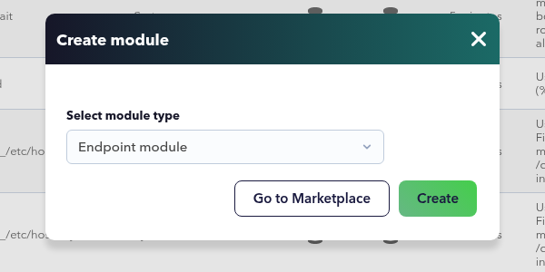

Les types disponibles dépendent des serveurs présents dans le système :

| Disponible lorsque… | Type |
|---|---|
| Toujours. | **Module de point de terminaison** (*Endpoint module*) |
| Il existe au moins un serveur réseau. | **Module réseau ICMP** (*Network ICMP module*), **Module TCP réseau** (*Network TCP module*), **Module SNMP** (*SNMP module*), **Module WMI** (*WMI module*), **Module d'exécution à distance** (*Remote execution module*), **Module Web** (*Web module*), **Module de prédiction** (*Prediction module*), **Module de récupération API** (*API retrieve module*) et **Module personnalisé API** (*API custom module*) |
| Il existe au moins un serveur de plugins. | **Module de plug-in** (*Plugin module*) |
| Il existe au moins un serveur WUX. | **Module UX** (*UX module*) |
| L'agent a une configuration à distance de satellite. Voir ci-dessous. | **Types de satellite** |

Les types de satellite sont au nombre de six. Ils sont exécutés par le satellite, pas par un serveur, et ne sont proposés que si l'agent a une configuration à distance de satellite (onglet **Configuration des satellites à distance**, dans [Les onglets de l'édition de l'agent](#les-onglets-de-ledition-de-lagent)). La configuration de chacun se trouve dans [Modules du satellite](../parte-6/6.2-servidores-satelite.md#modules-du-satellite) :

| Type | Ce qu'il vérifie | Voir |
|---|---|---|
| **Module ICMP satellite** (*Satellite ICMP module*) | La connectivité par ping. | [ICMP et TCP](../parte-6/6.2-servidores-satelite.md#icmp-et-tcp) |
| **Module TCP satellite** (*Satellite TCP module*) | Un port TCP. | [ICMP et TCP](../parte-6/6.2-servidores-satelite.md#icmp-et-tcp) |
| **Module SNMP satellite** (*Satellite SNMP module*) | Un OID par SNMP. | [SNMPv1 et SNMPv2](../parte-6/6.2-servidores-satelite.md#snmpv1-et-snmpv2), [SNMPv3](../parte-6/6.2-servidores-satelite.md#snmpv3) |
| **Module WMI satellite** (*Satellite WMI module*) | Une requête WMI. | [WMI](../parte-6/6.2-servidores-satelite.md#wmi) |
| **Module SSH satellite** (*Satellite SSH module*) | Une commande par SSH. | [SSH](../parte-6/6.2-servidores-satelite.md#ssh) |
| **Module d'exécution de satellite** (*Satellite Exec module*) | Une commande sur le satellite lui-même. | [Exécution distante](../parte-6/6.2-servidores-satelite.md#execution-distante) |

Le bouton **Aller au marché** (*Go to Marketplace*) ouvre le catalogue de modules et de plugins.

### Actions sur plusieurs modules

Lorsque des modules sont cochés, la barre inférieure propose un sélecteur d'action et le bouton **Exécuter l'action** (*Execute action*) :

| Action | Ce qu'elle fait |
|---|---|
| *Disable selected modules* | Met en pause les modules cochés. |
| *Enable selected modules* | Réactive les modules cochés. |
| *Delete selected modules* | Supprime les modules cochés et, avant chacun d'eux, ses enfants. |
| *Force to normal selected modules* | Réservé aux administrateurs. Force l'état normal de chaque module. Modifier l'état manuellement peut fausser les rapports et les SLA, et l'opération est consignée dans l'audit. |

Une fois l'opération terminée, la console indique si elle a été appliquée à tous les modules ou à combien d'entre eux (par exemple, « Appliqué à 3/5 modules »). Pour appliquer une action à de nombreux agents à la fois, voir [2.11](2.11-operaciones-masivas.md).

## Champs personnalisés de l'agent

Les champs personnalisés sont des métadonnées propres que l'on ajoute à tous les agents : le responsable, le client, l'emplacement, la référence de l'inventaire, la communauté SNMP de l'équipement. On les crée une fois, on les renseigne par agent, puis on peut les afficher, les filtrer, les rechercher et les utiliser dans des macros. Ils sont, pour l'agent, ce que les macros personnalisées sont pour le module (voir [2.20](2.20-configuracion-comun-de-los-modulos.md#organiser-les-modules)).

### Créer un champ

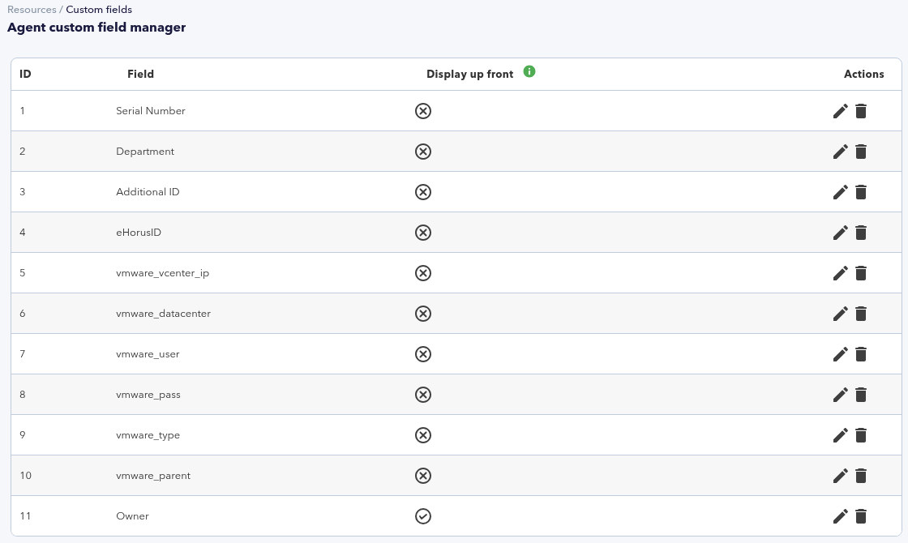

Les champs se créent dans **Gestion → Ressources → Champs personnalisés** (gestionnaire de champs personnalisés de l'agent), avec **Créer un champ** (*Create field*). Seuls les administrateurs accèdent à ce gestionnaire.

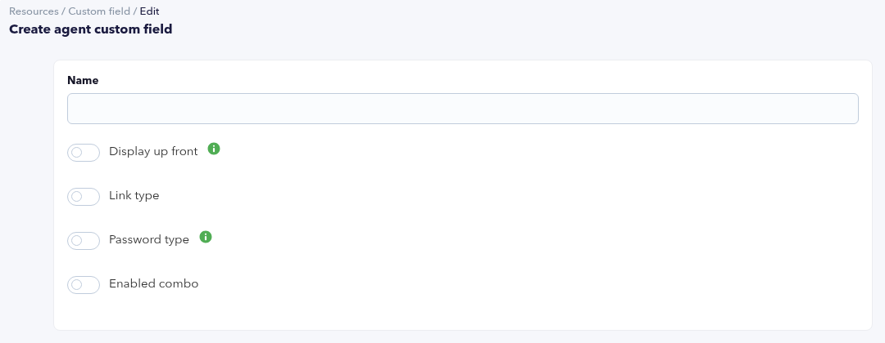

| Réglage | Ce qu'il fait |
|---|---|
| **Nom** (*Name*) | Obligatoire et unique. L'EndPoint identifie le champ par ce nom. |
| **Afficher à l'avant** (*Display on front*) | Le champ est visible dans les onglets **Principal** et **Champs personnalisés** pour les utilisateurs sans droit d'écriture sur l'agent. Sans cela, seuls ceux qui peuvent le modifier le voient. |
| **Type de mot de passe** (*Password type*) | La valeur est saisie dans un champ de mot de passe et s'affiche sous forme de points ou d'astérisques. Elle n'est enregistrée que lorsqu'elle est modifiée. |
| **Combo activé** (*Enabled combo*) et **Valeurs du combo** (*Combo values*) | La valeur se choisit dans une liste ; les valeurs sont séparées par des virgules. |
| **Type de lien** (*Link type*) | La valeur comporte un texte et une URL (**Texte du lien** et **URL du lien**). Si l'URL n'a pas de schéma, `http://` est ajouté devant. |

Les quatre types sont donc : texte, liste, mot de passe et lien. **Combo** et **mot de passe** s'excluent mutuellement : pour passer de l'un à l'autre, il faut d'abord vider les valeurs du combo. Un utilisateur qui n'est pas administrateur ne peut pas changer le type d'un champ.

La liste du gestionnaire affiche l'**ID** de chaque champ. Ce numéro est nécessaire pour les macros ; notez-le.

### Renseigner les valeurs

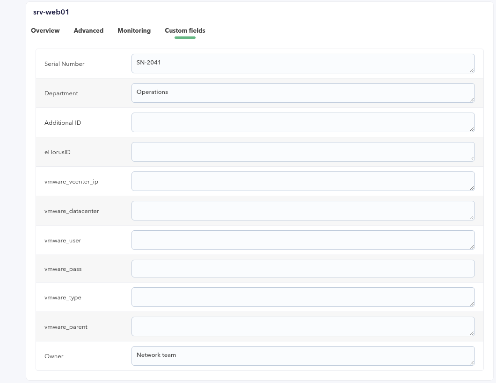

Les valeurs se renseignent par agent dans l'onglet **Champs personnalisés** du formulaire d'édition, ou pour de nombreux agents à la fois avec la [modification massive](2.11-operaciones-masivas.md#modifier-des-agents). Même si seul un administrateur crée les champs, **tout utilisateur ayant un droit d'écriture sur l'agent peut modifier leurs valeurs**.

### Comment ils s'affichent

- Dans le cadre **Champs personnalisés** de **Principal** n'apparaissent que les champs avec **Afficher à l'avant**, jamais ceux de type mot de passe, et les champs vides sont omis. Les valeurs acceptent le BBCode et les liens s'ouvrent dans un nouvel onglet.
- Dans l'onglet **Champs personnalisés**, celui qui a un droit d'écriture sur l'agent voit tous les champs ; les autres, seulement ceux marqués pour la vue principale. Les mots de passe s'affichent sous forme de points.

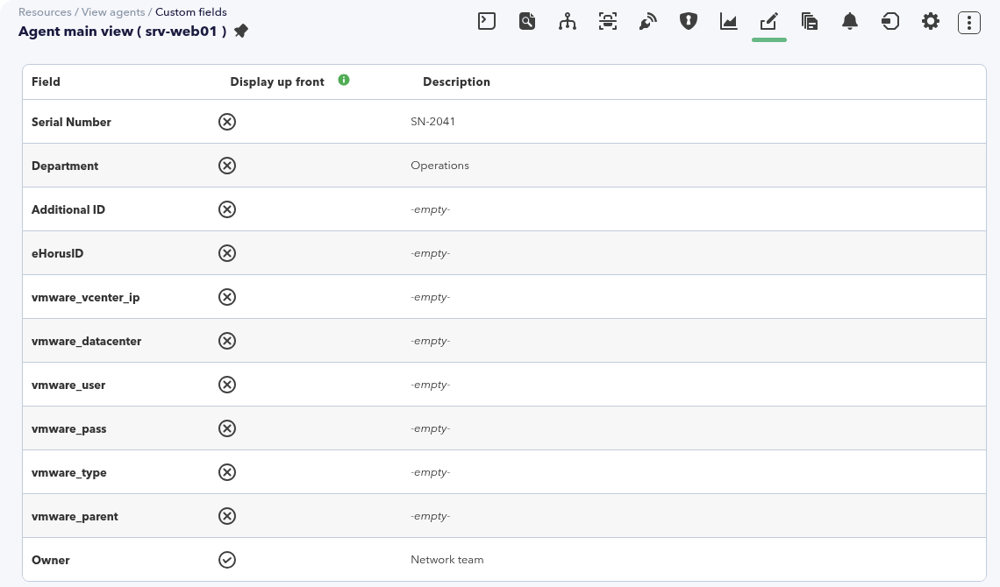

!!! warning "Les liens ne sont pas rendus comme des liens dans l'onglet"
    Dans l'onglet **Champs personnalisés**, un champ de type lien ne s'affiche pas comme un lien : on peut voir la valeur brute (texte et URL ensemble). Le lien fonctionne dans le cadre de **Principal**. Si vous avez besoin qu'il soit cliquable pour tous, marquez le champ avec **Afficher à l'avant**.

### Les déclarer depuis l'EndPoint

L'EndPoint peut envoyer les valeurs des champs dans son fichier de configuration, avec les tokens `custom_fieldN_name` et `custom_fieldN_value`, où `N` est un numéro séquentiel dans le fichier (1, 2, 3…) :

```conf
custom_field1_name Owner
custom_field1_value Équipe réseau
custom_field2_name Documentation
custom_field2_value ["Manuel du serveur","https://intranet.example.com/srv01"]
```

Le serveur cherche le champ par son nom et crée ou met à jour la valeur de l'agent, aussi bien à l'enregistrement qu'à chaque mise à jour. Trois conséquences :

- **L'EndPoint ne crée jamais de champs.** Si le nom n'existe pas dans la console, la valeur est écartée et il ne reste qu'une trace dans le journal du serveur.
- **Le type n'est pas validé.** Le serveur enregistre la valeur telle qu'elle arrive : il ne vérifie pas si le champ est de type mot de passe, liste ou lien. Une valeur de lien doit déjà voyager sous forme de paire `["texte","url"]`, comme dans l'exemple.
- **Avec la configuration distante active, la valeur se modifie aussi depuis la console.** Voir [2.1](2.1-monitorizacion-con-endpoints.md#configuration-distante-depuis-la-console-web).

Le numéro `N` du fichier n'est **pas** l'ID du champ dans le gestionnaire.

### Les utiliser dans des macros

La macro `_agentcustomfield_N_` est remplacée par la valeur du champ personnalisé de l'agent dans :

- Les actions et les modèles d'alerte (voir [5.5](../parte-5/5.5-alertas-y-notificaciones.md)).
- Les paramètres des modules réseau, SNMP, WMI, ICMP, de plugin et d'inventaire (voir [2.6](2.6-monitorizacion-de-redes.md#macros-dans-les-champs-du-module)).

Trois règles qui évitent les erreurs les plus courantes :

- **`N` est l'ID du champ dans le gestionnaire**, pas l'ordre dans le fichier de l'EndPoint. Un champ d'ID `4` s'utilise comme `_agentcustomfield_4_`.
- **La macro ne masque pas les mots de passe.** Si un champ de type mot de passe est utilisé dans une alerte ou dans une commande, sa valeur apparaît en clair dans le résultat. Celui qui peut lire le résultat peut lire le mot de passe.
- En dehors du contexte d'un module, la macro est remplacée par une chaîne vide.

!!! example "Le responsable dans l'e-mail de l'alerte"
    On crée le champ « Owner », qui reçoit l'ID `11`, et on le renseigne sur chaque agent avec l'équipe responsable. L'action d'alerte par e-mail utilise `_agentcustomfield_11_` dans le champ destinataire ou dans le corps du message : chaque alerte arrive à qui de droit sans créer une action par équipe.

### Autres usages

- Filtrer la liste des agents par champ personnalisé (ceux de type mot de passe ne sont pas proposés), et enregistrer le filtre.
- Menu **Surveillance → Champs personnalisés**, avec une vue des valeurs par agent.
- Recherche globale (sauf mots de passe), détail étendu de l'événement, rapports et widgets Top N d'agents et de modules.
- **Pandora RC** : le champ personnalisé dont la valeur est la clé de Pandora RC (voir [3.2](../parte-3/3.2-control-remoto-con-rc.md)).
- API : créer un champ et obtenir son ID. Dans l'API v1, il n'existe pas d'opération pour écrire les valeurs.
- Politiques : elles ne gèrent pas les champs personnalisés de l'agent.

## Ce qui change selon le contexte

| Contexte | Ce qui change dans la fiche |
|---|---|
| **Opérations massives** | Le formulaire est réutilisé avec un verrou par champ (seul ce qui est coché est modifié) et l'onglet **Surveillance** est masqué. Les champs personnalisés peuvent être modifiés en lot. Voir [2.11](2.11-operaciones-masivas.md). |
| **Command Center** | Sans les onglets **Surveillance** ni **Champs personnalisés**. |
| **Politique** | Les modules d'une politique sont répartis par agent (voir [2.10](2.10-politicas-de-monitorizacion.md)) ; la fiche de l'agent ne gère pas les champs personnalisés depuis les politiques. |
| **Sans configuration distante** | Pas d'onglet **Surveillance** ni d'option **RMM**. |

## Vérifier et diagnostiquer

| Symptôme | Cause probable | Vérification |
|---|---|---|
| Un onglet de la vue manque | Sa condition n'est pas remplie. | Le tableau de [Les onglets de la vue de l'agent](#les-onglets-de-la-vue-de-lagent) et les droits de l'utilisateur. |
| La console rejette l'alias | **Utiliser alias comme nom** est actif et l'alias existe déjà. | Le réglage à la création de l'agent. |
| J'ai changé l'intervalle de l'EndPoint et la console affiche l'ancien | L'agent est en **Mode normal**. | **Définition des modules** dans **Avancé**. |
| L'agent se désactive seul puis revient | **Mode désactivation automatique** : tous ses modules étaient inconnus. | **Définition des modules** et l'arrivée des données. |
| Un module avec alerte ne génère pas de notifications | Agent en **Mode silencieux**, protection en cascade du parent ou arrêt planifié. | Les étiquettes de l'onglet **Principal** et les alertes déclenchées du parent. |
| Les alertes d'un agent ont été acquittées toutes seules | Il a été enregistré avec **Mode désactivé** actif. | L'historique de l'agent. |
| Les modules d'un agent se désactivent seuls | **Mode d'opération sécurisé** : le module choisi est passé en critique. | Le module sélectionné dans **Avancé**. |
| Une valeur de l'EndPoint n'apparaît pas dans le champ | Le nom du champ n'existe pas dans la console. | **Gestion → Ressources → Champs personnalisés** et le nom dans `custom_fieldN_name`. |
| La macro `_agentcustomfield_N_` renvoie une autre valeur | `N` est l'ordre du fichier et non l'ID du champ. | L'**ID** dans le gestionnaire de champs. |
| Un champ de lien s'affiche comme du texte | L'onglet **Champs personnalisés** ne les rend pas comme des liens. | Le cadre **Champs personnalisés** de **Principal**. |
| Un mot de passe apparaît dans l'e-mail d'une alerte | La macro ne masque pas le type mot de passe. | Retirer la macro des actions ou ne pas utiliser de champ de mot de passe. |
