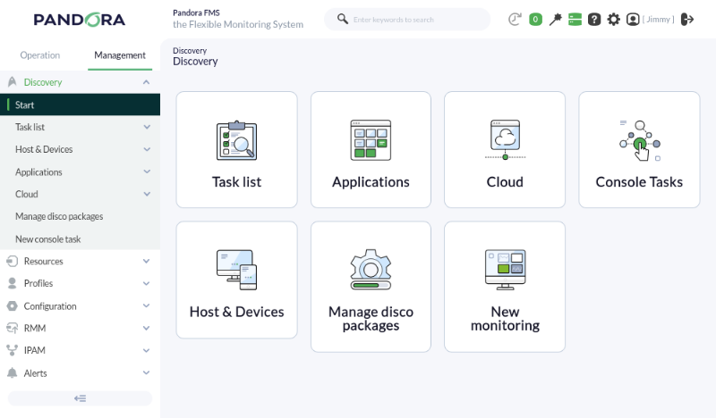
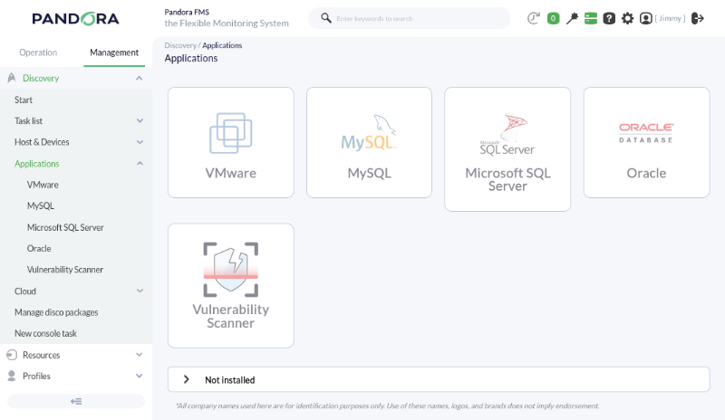
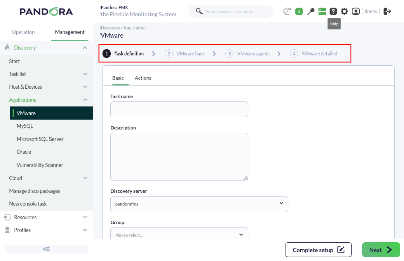
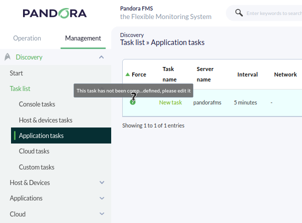
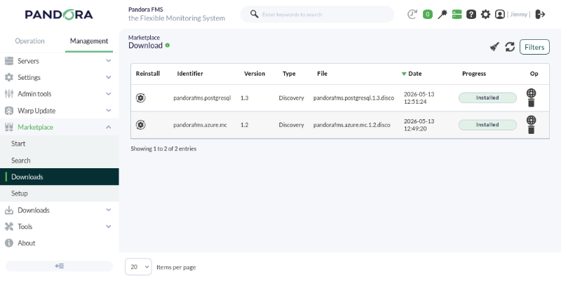
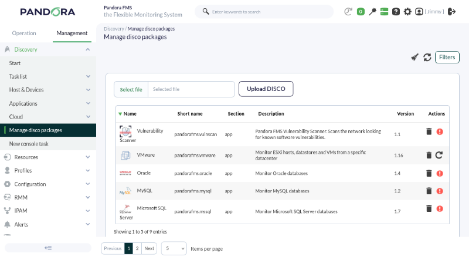
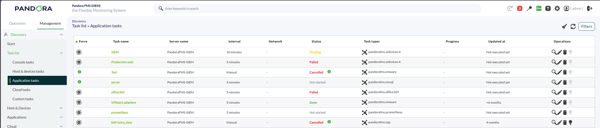
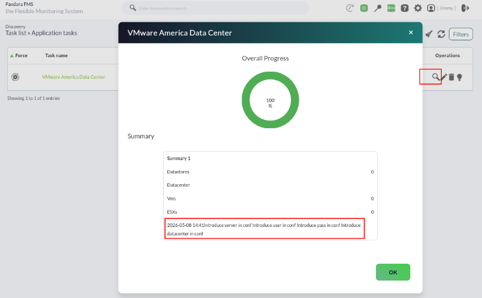
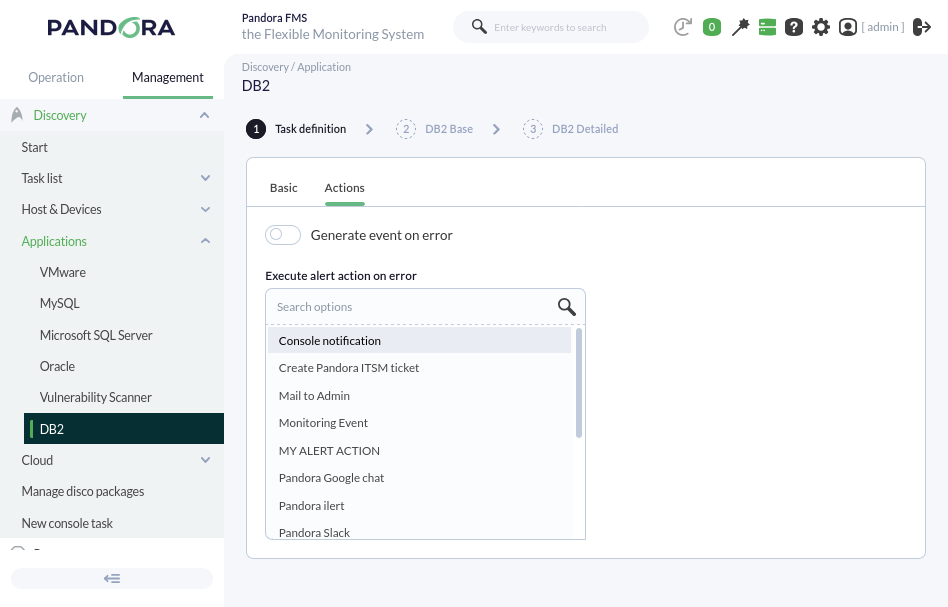

# Supervision et découverte automatique avec Discovery

Enregistrer un agent à la main — le créer, lui donner une IP, décider de quels
modules il a besoin — est raisonnable pour dix machines. Pour les cinq cents qui
se trouvent derrière un réseau d'entreprise, ou pour les instances qu'un cloud
crée et détruit tout seul, c'est une condamnation. **Discovery** est l'ensemble
des assistants de la console web de Pandora FMS qui évite cette condamnation :
au lieu de créer chaque agent un par un, il trouve ce qui existe — des
équipements sur un réseau, des instances d'un cloud, un hyperviseur, une
application — et enregistre les agents et leurs modules initiaux sans que
personne ne saisisse un enregistrement par dispositif. Et, selon le type de
tâche, soit il se retire une fois l'enregistrement fait, soit il reste en charge
de la supervision ; la différence compte, et elle est expliquée juste en dessous.

## Ce qu'est Discovery

Discovery travaille avec des **tâches**. Une tâche est un travail laissé
programmé : quoi explorer (une plage de réseau, un compte cloud, une base de
données, un hyperviseur), avec quels identifiants y entrer, dans quel groupe
laisser ce qui apparaît et à quelle fréquence répéter la recherche, ou si elle ne
se lance qu'à la main. Elle se crée avec un assistant, elle reste dans la liste
des tâches et, à partir de là, elle s'exécute seule.

Il existe deux familles de tâches, et il vaut la peine de ne pas les confondre,
car après l'enregistrement elles se comportent de façon très différente :

| | Host et appareils | Applications, Cloud et Custom |
|---|---|---|
| Ce qu'elles explorent | Des réseaux (voir [Découverte réseau avec Host et appareils](2.4-descubrimiento-de-redes-con-host-y-dispositivos.md)) : les équipements qui répondent dans une plage, ceux qui arrivent dans un CSV ou ceux qu'un script propre trouve | Un service concret : un compte AWS, un vCenter, une base de données, un cluster Kubernetes… |
| Ce qu'elles laissent | Des agents avec leurs modules et, dans l'analyse réseau, des relations entre équipements et une carte réseau | Des agents avec leurs modules |
| Qui supervise ensuite | Les serveurs habituels (réseau, WMI, plugins…) : Discovery se retire | Discovery lui-même, qui à chaque exécution interroge de nouveau le service et rapporte les données ; l'intervalle de la tâche est celui de la supervision |
| D'où elles viennent | Elles viennent avec la console | Des paquets `.disco` installés à part (voir [Étendre Discovery](#etendre-discovery-paquets-disco-et-marketplace)) |

Dans les deux cas, celui qui fait le travail est le **serveur Discovery**, un
serveur de plus parmi ceux de Pandora FMS : sans lui actif, les tâches se créent
mais personne ne les exécute. Il s'active et se dimensionne comme n'importe quel
autre, avec les jetons décrits dans [Référence complète de configuration du
serveur](../parte-9/9.3-referencia-completa-de-configuracion-del-servidor.md).

### Où se trouve-t-elle dans la console

Discovery a sa propre entrée dans le menu de gestion, **Gestion → Discovery**,
visible avec n'importe laquelle des permissions d'accès aux agents sur le groupe
All (AR, AW, RR, RW ou PM). Créer des tâches dans **Host et appareils** exige la
permission d'écriture, AW ; gérer les scripts d'analyse personnalisée, dans
**Gérer les scripts d'analyse**, exige PM ; et charger ou retirer des paquets
.disco dans **Gérer les paquets de Discovery** est réservé à un administrateur de
la console.

La page d'accueil du menu, **Start**, n'est que sa couverture : elle n'a pas de
contenu propre, seulement un accès direct à chaque section. Lorsque
**Applications** ou **Cloud** n'ont encore aucun paquet .disco installé, la
console web remplace la liste par un avis vide avec un bouton qui mène
directement à l'installer.

### Les sections de Discovery

| Section | Ce qu'elle fait | Où elle est documentée |
|---|---|---|
| Liste des tâches (Task list) | Toutes les tâches, par onglets (console, Host et appareils, applications, Cloud, personnalisées) | Ce chapitre ; les tâches de console, dans [Tâches de console](2.5-tareas-de-consola.md) |
| Host et appareils (Host & Devices) | Analyse réseau, import CSV, déploiement d'EndPoints, analyses personnalisées | [Découverte réseau avec Host et appareils](2.4-descubrimiento-de-redes-con-host-y-dispositivos.md) |
| Applications | Assistants d'applications installés comme paquet .disco | [Supervision des applications](2.12-monitorizacion-de-aplicaciones.md) (et conteneurs ou virtualisation, selon le paquet .disco) |
| Cloud | Assistants de fournisseurs cloud installés comme paquet .disco | [Supervision des environnements Cloud](2.15-monitorizacion-entornos-cloud.md) |
| Custom | Paquets .disco propres ou de tiers sans catégorie | [Création de plugins de discovery](../parte-9/9.7-creacion-de-plugins-de-discovery.md) |
| Gérer les paquets de Discovery (Manage disco packages) | Charger, mettre à jour et désinstaller des paquets .disco | Ce chapitre |

Applications, Cloud et Custom ne sont pas des listes fixes : chacune n'apparaît
dans le menu que lorsqu'il y a au moins un paquet .disco installé dans cette
section. Sans paquets .disco, la section entière disparaît du menu au lieu de
s'afficher vide. Chaque paquet .disco installé apparaît comme une tuile propre à
l'intérieur de sa section — ici, Applications avec VMware, MySQL, Microsoft SQL
Server, Oracle et l'analyseur de vulnérabilités —, et créer une tâche, c'est
entrer dans la tuile de l'assistant qui correspond :

Le formulaire de création change selon le paquet .disco — celui de VMware n'est
pas celui d'Oracle —, mais tous partagent le même cadre : nom et groupe
obligatoires et, à partir de là, autant d'étapes que l'assistant en demande, avec
un indicateur de progression en haut et le bouton **Suivant** pour avancer de
l'une à la suivante :

Comme toute tâche de Discovery, celles-ci peuvent aussi avertir lorsqu'elles
échouent, depuis leur onglet **Actions** (voir [Alertes des tâches de
Discovery](#alertes-des-taches-de-discovery)).

Enregistrer sans terminer toutes les étapes laissera la tâche créée mais
incomplète, et la liste des tâches en avertit : une tâche Applications, Cloud ou
Custom qui n'a pas passé son étape finale — le bouton **Configuration
complète** — apparaît avec une icône d'avertissement dans la colonne des
opérations au lieu du bouton habituel de forçage d'exécution, et il faut la
modifier pour finir de la définir ; le serveur ne l'exécutera pas avant cela.

## Étendre Discovery : paquets .disco et Marketplace

Ce qui transforme un assistant de Discovery en quelque chose d'installable, c'est
le paquet .disco **`.disco`** : un fichier qui empaquette la définition du
formulaire de l'assistant avec les exécutables que le serveur lance pour le mener
à bien. Sans paquet .disco, il n'y a pas d'assistant ; l'analyse réseau de Host
et appareils est l'exception, car elle est intégrée d'usine.

Le catalogue réunit près de quarante paquets .disco : clouds (AWS, Azure, Google
Cloud, Digital Ocean, OVH), virtualisation (VMware, Proxmox, XenServer),
orchestration (Kubernetes, OpenShift), bases de données (MySQL, PostgreSQL,
Oracle, DB2, Microsoft SQL Server, MongoDB) et d'autres outils, comme un
analyseur de vulnérabilités ou la supervision de l'expérience utilisateur avec
Selenium. Tous viennent du
**[Marketplace](https://marketplace.pandorafms.com/)**, que la console web
intègre dans son propre menu, **Gestion → Marketplace**. Chaque entrée du
catalogue de Discovery renvoie à sa fiche : à ce menu si la console a une
connexion au Marketplace, ou directement à la page web du Marketplace si elle ne
l'a pas.

### Installer, mettre à jour et désinstaller un paquet .disco

Il y a deux chemins, et celui qui s'applique dépend d'une seule question : la
console web a-t-elle accès à Internet ?

**Avec connexion : depuis le Marketplace de la console.** C'est le plus commode,
et la normale dans toute installation qui voit Internet :

1. Dans **Gestion → Marketplace**, chercher le paquet .disco (dans
   **Rechercher**, ou depuis le lien de son entrée dans le catalogue de
   Discovery) et ouvrir sa fiche.
2. Cliquer sur **Installer** et confirmer. La console télécharge le paquet
   .disco, l'installe et affiche la progression dans la fiche elle-même ; à la
   fin, le bouton laisse la place à **Installé**.
3. L'assistant apparaît dans sa section (Applications, Cloud ou Custom, selon ce
   que déclare le paquet .disco).

Les installations faites ainsi restent enregistrées dans **Marketplace →
Téléchargements** (visible pour les administrateurs), d'où un paquet .disco peut
être **Réinstallé** sans le rechercher de nouveau. Sans connexion à Internet, le
Marketplace de la console lui-même avertit qu'il en a besoin pour fonctionner.

**Sans connexion : installation manuelle, pour des environnements isolés.**
Lorsque la console vit sur un réseau sans sortie — le cas habituel dans les
environnements industriels, de défense ou simplement paranoïaques —, le paquet
.disco est transporté à la main :

1. Télécharger le paquet `.disco` depuis le site web du Marketplace sur une
   machine qui a bien Internet (un `.zip` du Marketplace doit d'abord être
   renommé avec cette extension) et le transporter jusqu'au réseau isolé.
2. Le charger dans **Discovery → Gérer les paquets de Discovery**. La console
   valide son contenu, l'installe et le copie sur tous les serveurs Discovery
   actifs, pour qu'ils sachent exécuter ses tâches.
3. L'assistant apparaît immédiatement dans sa section correspondante.

Par l'un ou l'autre des deux chemins, mettre à jour un paquet .disco consiste à
installer la version nouvelle par-dessus. Le désinstaller, depuis **Gérer les
paquets de Discovery**, le retire de la console et des serveurs de la même
manière ; les tâches déjà créées avec ce paquet .disco cessent de pouvoir
s'exécuter. Créer un paquet `.disco` propre, y compris les champs que son
formulaire peut demander, est traité dans [Création de plugins de
discovery](../parte-9/9.7-creacion-de-plugins-de-discovery.md) ; en gros, chaque
champ se déclare avec son étiquette, un texte d'aide et un type — texte, nombre,
sélecteur, case à cocher ou mot de passe —, et ceux de type mot de passe peuvent
être enregistrés chiffrés dans la base de données, en plus d'être toujours
affichés masqués dans le formulaire comme tout champ de ce type.

**Gérer les paquets de Discovery** liste, pour chaque paquet .disco installé, son
nom et son icône, le nom court, la section où il apparaît (Applications, Cloud ou
Custom) et la version chargée. Dans la colonne des actions, en plus de le
supprimer, il y a un bouton pour forcer la synchronisation de ses fichiers avec
les serveurs Discovery actifs — la console synchronise déjà toute seule au
chargement d'un paquet .disco, il ne faut donc le presser que si quelque chose
est resté à moitié fait. Cette synchronisation copie le dossier du paquet .disco
dans le [répertoire de configuration
distante](../parte-9/9.2-referencia-completa-de-configuracion-de-la-consola.md)
(`remote_config/discovery/`, par défaut), d'où il parvient ensuite à chaque
serveur Discovery. Si un paquet .disco manque de son dossier ou de son fichier
`.ini` dans la console, ce bouton disparaît et une icône d'erreur s'affiche à sa
place : il faut charger de nouveau son paquet `.disco` pour le réparer.

## Comment fonctionne la tâche d'un paquet .disco

Jusqu'ici, un paquet .disco est quelque chose qui s'installe. Ce qui compte,
c'est ce qu'il fait quand quelqu'un l'utilise : la **tâche d'un paquet .disco**
est l'assistant installé, rempli et programmé. Elle sert de la même façon pour
Applications, Cloud et Custom, et c'est pourquoi elle est racontée une seule
fois, ici, au lieu d'être répétée dans chaque chapitre qui en dépend. Son
résultat, ce sont des **agents et des modules** dans la console, créés par le
serveur Discovery avec ce que renvoie le plugin du paquet .disco. Ce qu'elle ne
fait pas, c'est installer quoi que ce soit sur la machine supervisée : ni EndPoint
ni fichiers. Chaque exécution répète la requête et met à jour ces agents.

### La première étape : définir la tâche

Tous les assistants de paquet .disco commencent par le même formulaire, avant que
le paquet .disco ne dise quoi que ce soit du sien :

| Champ | Ce qu'il fait |
|---|---|
| **Nom de la tâche** | Obligatoire. |
| **Description** | Texte libre. |
| **Serveur Discovery** | Serveur Discovery actif qui exécutera la tâche. Obligatoire. |
| **Groupe** | Groupe de la tâche et des agents qu'elle crée. Obligatoire. |
| **Intervalle** | *Défini* (300 secondes par défaut) ou *Manuel*. Une tâche manuelle ne s'exécute que lorsqu'on la force depuis la liste des tâches. Obligatoire. |
| **Utiliser un cron d'exécution** | Facultatif. La tâche continue d'être mise en file à chaque intervalle, mais elle ne s'exécute que si elle correspond à l'expression cron de cinq champs ; cette expression remplace le sélecteur d'intervalle dans le formulaire. |

Si le nom, le serveur, le groupe ou l'intervalle manque, le formulaire n'enregistre
pas. L'onglet **Actions** de cette même étape porte le **Délai d'attente** et les
options d'avertissement en cas d'erreur, qui ont déjà leur section plus bas :
[Alertes des tâches de Discovery](#alertes-des-taches-de-discovery).

### Les étapes que définit le paquet .disco

Ensuite, chaque paquet .disco déclare les étapes de configuration dont il a
besoin et, dans chacune, les champs à remplir. Le paquet .disco de MySQL, par
exemple, en ajoute deux : « MySQL Base » et « MySQL Detailed ». **Suivant**
enregistre l'étape et passe à la suivante ; **Configuration complète** ferme la
tâche. Jusqu'à ce qu'on appuie dessus, le serveur ne l'exécute pas, et la liste
des tâches la marque avec une icône d'avertissement. Une étape peut aussi se
construire à la volée : la console exécute un script du paquet .disco qui renvoie
le formulaire en JSON, et si ce script échoue, l'étape affiche « Le script de
découverte a échoué : » et l'erreur, à la place des champs.

Un paquet .disco peut demander ces types de champ :

| Type | Ce que voit l'utilisateur |
|---|---|
| Chaîne, nombre et zone de texte | Champ libre ; il peut être obligatoire et porter un texte d'aide et un texte indicatif. |
| Mot de passe | Champ masqué. Il n'est enregistré que s'il change, et le paquet .disco peut demander qu'il soit chiffré à l'enregistrement. |
| Case à cocher | Interrupteur oui/non ; il peut afficher ou masquer d'autres champs. |
| Sélecteur et sélecteur multiple | Liste d'options propre au paquet .disco, ou **données de Pandora** : groupes d'agents ou de modules, agents, modules, types de module, états, modèles et actions d'alerte, intervalles, tags et systèmes d'exploitation. |
| Arbre | Explorateur d'une structure, par exemple un compartiment ou une arborescence de ressources. |
| Identifiant | Sélecteur des identifiants du [Gestionnaire d'identifiants](2.2-gestor-de-credenciales.md) de type Custom, AWS, Azure, SAP, SNMP, Google ou WMI. |

Avec les identifiants, le champ n'affiche que des identifiants ; l'utilisateur et
le mot de passe ne sont pas copiés dans la définition de la tâche. À
l'exécution, le serveur cherche l'identifiant dans le Gestionnaire
d'identifiants et remet au plugin les données sous forme de JSON codé en base64.
Les noms de champ dépendent du type :

| Type d'identifiant | Données que reçoit le plugin |
|---|---|
| Custom et SAP | `user`, `password` |
| AWS | `access_key_id`, `secret_access_key` |
| Azure | `client_id`, `application_secret`, `tenant_domain`, `subscription_id` |
| WMI | `user`, `password`, `namespace` |
| Google et SNMP | Le document enregistré dans l'identifiant, tel quel |

Rien n'oblige à utiliser le sélecteur : un paquet .disco peut demander
l'utilisateur et le mot de passe dans des champs propres, comme le fait celui de
MySQL. Celui de PostgreSQL, en revanche, utilise un identifiant Custom.

### Ce qui se passe à chaque exécution

1. Le serveur Discovery assigné prend la tâche quand son tour d'intervalle
   arrive, ou quand quelqu'un la force (avec cron, seulement si l'expression
   correspond). Dans la commande du paquet .disco, il remplace les valeurs des
   champs et ajoute des données de la tâche : groupe, intervalle, chemin
   temporaire et accès à l'API de la console.
2. Il lance chaque commande que déclare le paquet .disco, avec le délai
   d'attente de la tâche **appliqué à chacune**.
3. Le plugin répond avec un **JSON** sur la sortie standard. S'il apporte des
   données de supervision, le serveur crée ou met à jour avec elles les agents et
   leurs modules. Le reste (comptages, avis, erreurs du plugin) est enregistré
   comme **résumé** de la tâche, avec une entrée par commande, et se lit avec
   l'icône de résumé de la liste des tâches.

### Quand cela échoue

- Une commande qui se termine avec un code de sortie différent de zéro laisse la
  tâche en **Failed** et déclenche les options d'erreur de l'onglet **Actions** :
  événement et actions d'alerte.
- Si une commande dépasse le délai d'attente, le résumé dit « The execution
  timed out. » et la tâche reste elle aussi en **Failed**.
- Avec un code de sortie zéro, une réponse vide ou qui n'est pas du JSON ne
  change pas l'état : la tâche finit en **Done**, et ce qui est sorti (ou ce qui
  se trouve dans l'erreur standard) reste dans le résumé. Il vaut la peine de le
  regarder : « Done » dit que le plugin ne s'est pas cassé, pas qu'il a trouvé
  quelque chose.
- Un JSON sans données de supervision ne crée pas d'agents non plus ; il est
  enregistré dans le résumé et rien de plus.
- Dans le paquet .disco de SAP, si la licence ne le permet pas, le serveur
  n'exécute pas la commande et le note dans le résumé.

## La liste des tâches

La liste des tâches, dans son onglet Host et appareils, applications, Cloud ou
personnalisées, montre le nom de la tâche, le serveur Discovery assigné,
l'intervalle, le réseau, l'état, le type de tâche, la progression et la date de la
dernière mise à jour, et elle peut se filtrer par nom de tâche, groupe, serveur
Discovery, réseau et état. Sur chaque tâche, on peut forcer son exécution
immédiate, voir sa progression, revoir les résultats en attente, la modifier, la
désactiver ou la supprimer ; voir la carte réseau qu'elle a générée n'a de sens
— et n'est disponible — que pour les tâches de découverte réseau, pas pour celles
d'applications ou de Cloud, qui ne dessinent pas de topologie.

Toute tâche, quel que soit son type, a aussi une icône de résumé qui ouvre son
sommaire d'exécution : dans celles d'Applications, Cloud et Custom, elle détaille
ce que le paquet .disco a trouvé au fil des exécutions ou les erreurs qu'il a
rencontrées en chemin, avec le détail que le paquet .disco lui-même décide de
montrer.

| État | Quand il apparaît |
|---|---|
| Not started | La tâche existe mais le serveur ne l'a pas encore exécutée. |
| Pending | En file, en attente de son tour ou de sa prochaine exécution. |
| Searching / Processing | En cours : elle cherche des appareils ou traite ce qu'elle a trouvé. |
| Review | Elle s'est terminée et il y a des résultats en attente que l'utilisateur décide lesquels convertir en agent. |
| Done | Elle s'est terminée sans erreur. |
| Failed | Elle s'est terminée avec au moins une erreur. |
| Cancelled | Le serveur a redémarré pendant que la tâche s'exécutait ; il faut la relancer. |

Les tâches de console — copies de la base de données, fonctions PHP, génération de
rapports programmés et similaires — partagent la même liste, dans leur propre
onglet, mais elles ont un chapitre à part : [Tâches de
console](2.5-tareas-de-consola.md).

## Alertes des tâches de Discovery

Une tâche de Discovery travaille seule et, pour cette raison même, elle peut
échouer seule : un identifiant expiré, une API du cloud qui change, une plage de
réseau qui n'existe plus. Sans avertissement, l'échec ne se découvre que le jour
où quelqu'un s'aperçoit qu'un agent manque. Pour ne pas dépendre de cette
coïncidence, toutes les tâches — analyse réseau, analyse personnalisée,
Applications, Cloud et Custom — peuvent avertir quand une exécution se termine en
erreur, avec deux options qui peuvent s'utiliser ensemble ou séparément :

| Option | Ce qu'elle fait |
|---|---|
| **Générer un événement en cas d'erreur** | Crée un événement critique, « [Discovery] Task error: *nom de la tâche* », dans le groupe de la tâche, visible dans la console d'événements comme n'importe quel autre. |
| **Exécuter une action d'alerte en cas d'erreur** | Lance une ou plusieurs des actions d'alerte déjà définies dans la console (un courriel, un message, une commande…). |

Où elles se configurent dépend de la famille : dans **Host et appareils**, elles
sont dans la première étape du formulaire de l'analyse réseau et de l'analyse
personnalisée ; dans **Applications**, **Cloud** et **Custom**, dans l'onglet
**Actions** de l'assistant.

Dans ces mêmes tâches d'Applications, Cloud et Custom, l'onglet **Actions** apporte
aussi le champ **Délai d'attente** (Timeout) : le temps maximum, en secondes,
qu'on laisse courir chaque exécution avant de la considérer comme en échec ;
60 secondes par défaut.

L'action d'alerte reçoit comme texte principal « Discovery task error: *nom de la
tâche* », et la macro `_discovery_task_`, avec le nom de la tâche, est disponible
pour composer des messages propres dans l'action.

Les avertissements ne se déclenchent que lorsque l'exécution échoue, c'est-à-dire
lorsque la tâche finit en état **Failed**. Une exécution correcte qui ne trouve
rien n'est pas une erreur : si le réseau est vide, Discovery ne le considère pas
comme un motif d'alarme.

## Le serveur Discovery de l'intérieur

Le serveur planifie ses tâches selon l'intervalle de chacune : les automatiques se
reprogramment seules ; les manuelles ne se lancent que lorsque quelqu'un le
demande. Chaque tâche court dans son propre fil, et le serveur ouvre en parallèle
autant de fils que le marque le plus grand de ses deux jetons de fils — l'un pensé
pour les tâches de Host et appareils et d'applications, l'autre pour l'analyse
réseau héritée —, il suffit donc de monter celui qui est en usage pour que plus de
tâches courent à la fois. Si le serveur redémarre avec une tâche manuelle à
moitié, cette tâche reste marquée comme annulée dans la liste, en attente d'être
relancée ; les tâches automatiques, en revanche, se reprogramment simplement pour
leur prochain tour.

Ce que fait le serveur à la fin de chaque tour dépend de la famille. Dans Host et
appareils, les équipements trouvés se convertissent en agents, tout de suite ou
après la révision de l'utilisateur (voir [Revoir les résultats avant de créer des
agents](2.4-descubrimiento-de-redes-con-host-y-dispositivos.md)). Dans
applications, Cloud et Custom, à chaque tour, le serveur exécute le paquet .disco,
recueille les données de supervision que celui-ci renvoie et, avec elles, crée les
agents qui manquent et met à jour les valeurs de leurs modules. Pour ces tâches,
Discovery n'est pas seulement celui qui enregistre : c'est aussi celui qui
supervise, et si la tâche est désactivée ou supprimée, ses modules cessent de
recevoir des données.

Les jetons du serveur liés à Discovery — l'interrupteur et les fils du serveur, et
les chemins qu'utilisent certains paquets .disco d'applications pour se connecter
à Java, SAP ou Microsoft SQL Server — sont décrits, avec leurs valeurs par défaut,
dans [Référence complète de configuration du
serveur](../parte-9/9.3-referencia-completa-de-configuracion-del-servidor.md).
