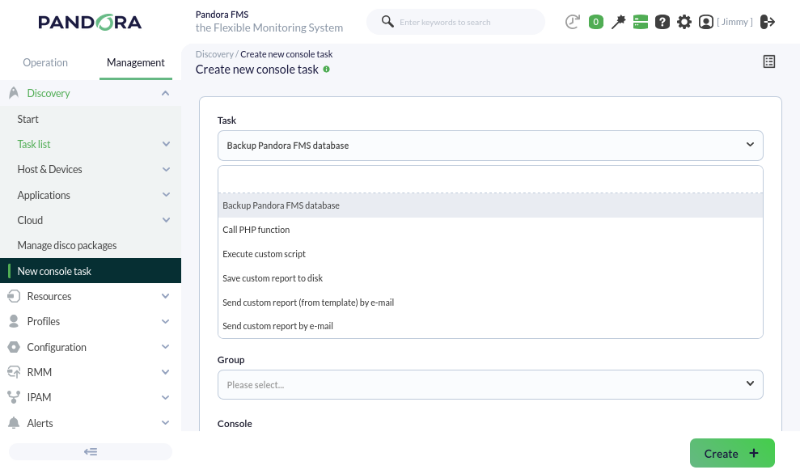
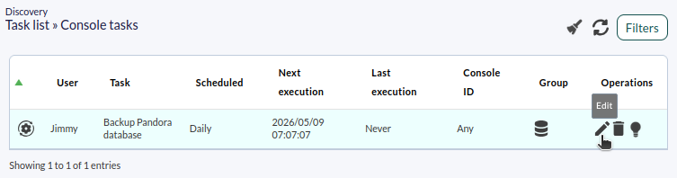

# Tâches de console

Faire une sauvegarde à la main chaque nuit, ou se connecter chaque lundi pour
envoyer le même rapport par e-mail, est le genre de tâche qu'un administrateur
oublie justement la semaine où elle est le plus nécessaire. Les **tâches de
console** remédient à cet oubli : ce sont des travaux périodiques de la console
web elle-même — sans passer par aucun serveur de supervision — qui se
programment une fois et s'exécutent seuls, avec la date et la périodicité
indiquées.

## Ce que sont les tâches de console

Elles se trouvent dans **Discovery → Liste des tâches (Task list)**, onglet
**Console tasks**. Elles partagent l'écran avec le reste des tâches de
[Discovery](2.3-monitorizacion-y-descubrimiento-automatico-con-discovery.md),
mais elles n'ont rien à voir avec elles : elles n'analysent aucun réseau et
n'inventorient rien, il vaut donc mieux ne pas les confondre sous prétexte
qu'elles sont à un onglet des autres.

## Types de tâche de console

Chaque tâche de console est, au fond, un appel à une fonction concrète, avec ses
propres paramètres. Voici ce que propose le sélecteur **Task** à la création
d'une tâche nouvelle :

| Type (sélecteur « Task ») | Ce qu'elle fait | Paramètres propres |
|---|---|---|
| Sauvegarde de la base de données Pandora FMS (Backup Pandora database) | Génère une sauvegarde complète de l'installation | Chemin où l'enregistrer ; l'activer ou la désactiver |
| Envoyer un rapport personnalisé par e-mail (Send custom report by email) | Génère un rapport personnalisé déjà enregistré et l'envoie par e-mail | Rapport, adresses e-mail, objet, message, format (PDF/CSV/JSON) |
| Envoyer un rapport personnalisé (depuis un modèle) par e-mail (Send custom report (from template) by email) | Idem, mais à partir d'un modèle de rapport (par agent ou combiné) | Modèle, agents, « Report per agent », adresses, objet, message, format |
| Enregistrer le rapport personnalisé sur le disque (Save custom report to disk) | Génère un rapport personnalisé et l'enregistre sur le disque au lieu de l'envoyer | Chemin, préfixe du fichier, format (XML/PDF/JSON/CSV) |
| Exécuter un script personnalisé (Execute custom script) | Exécute un script système sur le serveur de la console | Chemin du script |
| Call PHP function (non traduit ; apparaît en anglais) | Appelle une fonction PHP interne par son nom ; usage interne de la console elle-même — par exemple, démarrer le service de console distante GoTTY —, non prévue pour être créée à la main | Nom de la fonction |

Il n'apparaît pas dans le sélecteur de création, bien qu'il partage la même table
interne de types : **Send csv log** (envoi d'un journal d'événements en CSV,
retiré à dessein du formulaire de création). Comme « Call PHP function », il n'a
pas de traduction non plus, si bien que dans une console web en espagnol il
apparaîtrait en anglais s'il venait à s'afficher dans un listage.

Créer et concevoir le rapport ou le modèle que ces types envoient ou enregistrent
— ce qu'il contient, avec quel format — relève des
[Rapports](../parte-5/5.2-informes.md) ; ici, seul le fait de programmer son
envoi ou son enregistrement périodique est couvert. Ce que contient la sauvegarde
et comment la restaurer est expliqué dans [Sauvegarde et
restauration](../parte-6/6.8-backup-y-restore.md) ; ici, seul le fait de la
programmer est couvert.

## Créer et programmer une tâche

Depuis **Liste des tâches → Console tasks**, une tâche nouvelle demande un nom,
un type (tableau précédent), une programmation — une fois ou périodique :
horaire, quotidienne, hebdomadaire, mensuelle, annuelle ou personnalisée, avec un
calendrier de jours pour la périodicité hebdomadaire —, la date et l'heure de la
prochaine exécution, un groupe et les paramètres propres au type choisi.
Enregistrer crée la tâche, qui reste dans le listage en attente de son tour.



Programmer une sauvegarde, un script propre ou l'enregistrement d'un rapport sur
le disque exige la permission d'écriture ou d'administration (voir [Permissions
nécessaires](#permissions-necessaires) plus bas) ; sans cette permission, ces
trois types n'apparaissent même pas dans le sélecteur.

## Modifier, activer/désactiver, forcer l'exécution et supprimer

Le listage affiche l'utilisateur, la tâche (nom et type), la programmation, la
prochaine exécution, la dernière exécution, **Console ID** — voir [La colonne
« Console ID »](#la-colonne-console-id) —, le groupe et les opérations, et il
peut être filtré par tâche, programmation, console et groupe, et restreint par
date et heure de la dernière exécution. Sur chaque ligne, on peut forcer
l'exécution immédiate, modifier, activer ou désactiver et supprimer, bien que
toutes les actions ne soient pas toujours visibles : modifier et supprimer
exigent l'administration — ou, si la tâche est de l'un des trois types de
rapport, la gestion des rapports suffit aussi —, et activer/désactiver est
masqué pour la sauvegarde, le script, « Call PHP function » et l'envoi du retour
d'information interne.



## Permissions nécessaires

| Action | Permission |
|---|---|
| Consulter l'onglet « Console tasks » et forcer l'exécution d'une tâche | Lecture, écriture, gestion des rapports ou administration (l'une des quatre) |
| Créer ou modifier une tâche (formulaire) | Gestion des rapports ou administration |
| Modifier une tâche, la sienne ou celle créée par un autre utilisateur | Gestion des rapports ou administration ; l'écriture seule ne suffit pas, pas même pour qui l'a créée |
| Créer un type « sensible » (sauvegarde, script propre, enregistrement sur le disque, appel de fonction) | Écriture ou administration ; sinon, le type n'apparaît même pas dans le sélecteur |

## Comment et où elles s'exécutent réellement

Aucun serveur de Pandora FMS n'exécute les tâches de console : c'est la console
web elle-même qui le fait. Pour cela, la crontab du système d'exploitation doit
appeler chaque minute une page de la console,
`enterprise/extensions/cron/cron.php`, par HTTP ; à chaque appel, la console
laisse la trace du passage du cron, vérifie quelles tâches ont atteint leur date et
heure et les exécute. La ligne typique, avec l'URL de la console et l'utilisateur
système qui convient :

```text
* * * * * <utilisateur> wget -q -O - --no-check-certificate --load-cookies /tmp/cron-session-cookies --save-cookies /tmp/cron-session-cookies --keep-session-cookies https://<console>/pandora_console/enterprise/extensions/cron/cron.php >> /var/www/html/pandora_console/log/cron.log
```

Il n'est pas nécessaire de la copier d'ici : la console elle-même l'affiche, déjà
avec son URL et son chemin d'installation, dans l'avis décrit plus bas. Cette
même passe de cron s'occupe, au passage, d'autres maintenances internes de la
console — vérification d'état, renouvellement du jeton de licence, envoi de
rapports par d'autres voies — ; elles ne font pas partie de cet écran et ne sont
pas documentées ici.

Une tâche à périodicité « une fois » se supprime elle-même lorsqu'elle a fini de
s'exécuter ; avec une périodicité, elle reste en attente du tour suivant.

Les tâches de console existent aussi dans le [Command
Center](../parte-6/6.3-command-center.md) : le même onglet **Console tasks**,
avec les mêmes types, est disponible dans la console centralisée, et il a besoin
de sa propre ligne de crontab, sur la machine du Command Center elle-même,
pointant vers son `cron.php`. Lorsqu'une tâche doit choisir des agents comme
paramètre — par exemple, un rapport par agent —, le formulaire les regroupe par
le nœud dont ils proviennent, puisque le Command Center réunit des agents de
plusieurs consoles gérées.

### La colonne « Console ID »

Pensée pour les architectures avec plus d'une console : chaque tâche peut
s'ancrer à une console concrète pour que seule celle-là l'exécute, ou rester
ouverte (« Any ») pour que l'exécute la première console dont le cron passe. Ce
n'est pas que les différentes consoles « ne se parlent pas » entre elles, comme
pourrait le suggérer une lecture rapide : c'est que chaque tâche décide, par
configuration, si elle est exclusive à une console ou ouverte à toutes, et cette
répartition évite que la même tâche — un envoi de rapport, par exemple — ne se
déclenche en double quand plusieurs consoles ont leur propre crontab active. Dans
le listage, la colonne affiche l'identificateur de la console attribuée, « Any »
s'il n'y a pas de restriction, ou « None » si la console attribuée n'existe plus.

### Conditions pour qu'elles s'exécutent et dépannage

| Condition | Détail |
|---|---|
| Entrée de crontab du système | Une ligne qui appelle chaque minute, avec `wget`, `enterprise/extensions/cron/cron.php` de la console et enregistre la sortie dans `log/cron.log` de l'installation (voir la ligne d'exemple plus haut) |
| Accès HTTP à la console | La machine où tourne la crontab doit pouvoir ouvrir l'URL de la console ; avec des certificats propres, `--no-check-certificate` évite que `wget` s'arrête |
| Avis si le cron ne tourne pas | La console vérifie quand le cron s'est exécuté pour la dernière fois et avertit s'il passe plus de dix minutes sans le faire, ou s'il ne s'est jamais exécuté |

Si la console web détecte que ce cron passe plus de dix minutes sans s'exécuter,
ou qu'il ne s'est jamais exécuté, elle affiche un avis propre — « il ne
s'exécute pas correctement » ou « il n'est pas configuré » — avec la ligne
exacte de crontab qu'il faut ajouter, et qui renvoie à ce même écran. Cette
notification est le premier arrêt lors du débogage de la raison pour laquelle une
tâche programmée ne s'est pas exécutée à sa date.
