# Supervision des réseaux

La supervision distante est l'autre moitié du métier : tout ce qu'un
[EndPoint](2.1-monitorizacion-con-endpoints.md) ne peut pas vous raconter parce
qu'il ne vit pas dans la machine, mais qui se vérifie depuis l'extérieur — un
routeur, un switch, une imprimante, un onduleur — ou qu'il convient de vérifier
depuis l'extérieur même lorsque l'équipement dispose de son propre agent, comme
la disponibilité réelle d'un service vue depuis le réseau. Ce chapitre couvre
ICMP, TCP, SNMP, WMI, les commandes distantes et l'usage des plugins distants de
serveur : tout ce qu'un serveur Pandora FMS fait de l'autre côté du réseau, sans
rien installer à la destination. Les avis que les équipements envoient de leur
propre chef, les traps SNMP, ont leur propre chapitre : [Supervision des traps
SNMP](2.7-monitorizacion-de-traps-snmp.md).

## Supervision distante : de quoi il s'agit et quand l'utiliser

Vérifier un équipement depuis l'extérieur n'exige pas de le toucher : il suffit
qu'il réponde à une requête réseau — un ping, une connexion TCP, une requête
SNMP ou WMI, une commande par SSH — et qu'un serveur Pandora FMS ait une
visibilité réseau jusqu'à lui. C'est le seul chemin possible pour un dispositif
qui n'admet pas de logiciel propre (un routeur, un switch, une imprimante, un
onduleur) et une alternative raisonnable pour un serveur qui l'admet, quand ce
qui intéresse est ce que voit le réseau et non ce que voit le système
d'exploitation lui-même.

Pas besoin d'EndPoint pour avoir un agent. Un agent logique peut être créé
directement depuis la console web, sans fichier de configuration derrière, et
recevoir des modules réseau : c'est ce que fait par exemple
[Discovery](2.4-descubrimiento-de-redes-con-host-y-dispositivos.md) lorsqu'il
analyse un réseau. Si un module laisse vide son champ d'adresse de destination,
il utilise l'adresse IP de l'agent lui-même ; ainsi un agent sans EndPoint peut
porter tous ses modules sans répéter l'IP dans chacun.

| Vérification | Serveur qui l'exécute | Jeton qui l'active |
|---|---|---|
| ICMP (disponibilité et latence) | Serveur réseau haute performance, par lots avec `fping` | [`networkhpserver`](../parte-9/9.3-referencia-completa-de-configuracion-del-servidor.md) |
| SNMP | Serveur réseau haute performance, par lots avec `pandorafsnmp` (v1, v2c et v3) | [`networkhpserver`](../parte-9/9.3-referencia-completa-de-configuracion-del-servidor.md) |
| TCP | Serveur réseau | [`networkserver`](../parte-9/9.3-referencia-completa-de-configuracion-del-servidor.md) |
| Commandes distantes | Serveur réseau | [`networkserver`](../parte-9/9.3-referencia-completa-de-configuracion-del-servidor.md) |
| WMI | Serveur réseau, avec le client `pandorawmic` | [`networkserver`](../parte-9/9.3-referencia-completa-de-configuracion-del-servidor.md) |
| Plugins distants | Serveur Heavy | [`heavyserver`](../parte-9/9.3-referencia-completa-de-configuracion-del-servidor.md) |

Les trois sont activés d'usine et se répartissent le travail tout seuls : avec le
serveur réseau haute performance en marche, le serveur réseau laisse ICMP et SNMP
entre ses mains et garde le reste. Si celui de haute performance est désactivé,
le serveur réseau reprend ICMP (avec le `ping` du système) et SNMP (avec
`snmpget`, requête par requête). Le détail de cette répartition se trouve dans
[Performance, réglage fin et
diagnostic](#performance-reglage-fin-et-diagnostic).

Lorsque le réseau à vérifier n'est visible depuis aucun serveur central — un site
sans route directe, un réseau isolé —, un [serveur
satellite](../parte-6/6.2-servidores-satelite.md) fait exactement le même travail
depuis l'intérieur de ce réseau et livre les données comme s'il s'agissait d'un
serveur de plus.

!!! example "Un routeur sans EndPoint"
    Un agent « router-core » est créé avec l'adresse `192.168.10.1`, sans rien
    installer dessus. À partir de là, on lui ajoute des modules réseau — ICMP
    pour savoir s'il répond, SNMP pour lire ses interfaces — exactement comme à
    n'importe quel autre agent.

## Premiers pas : créer un module réseau

Un module réseau se crée depuis la fiche de l'agent, dans l'onglet **Modules**
(Modules), avec le bouton **Créer** (Create) → **Créer un module réseau**
(Create network module). Le formulaire demande d'abord le type :

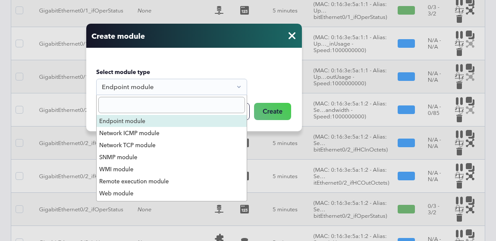{ .captura }

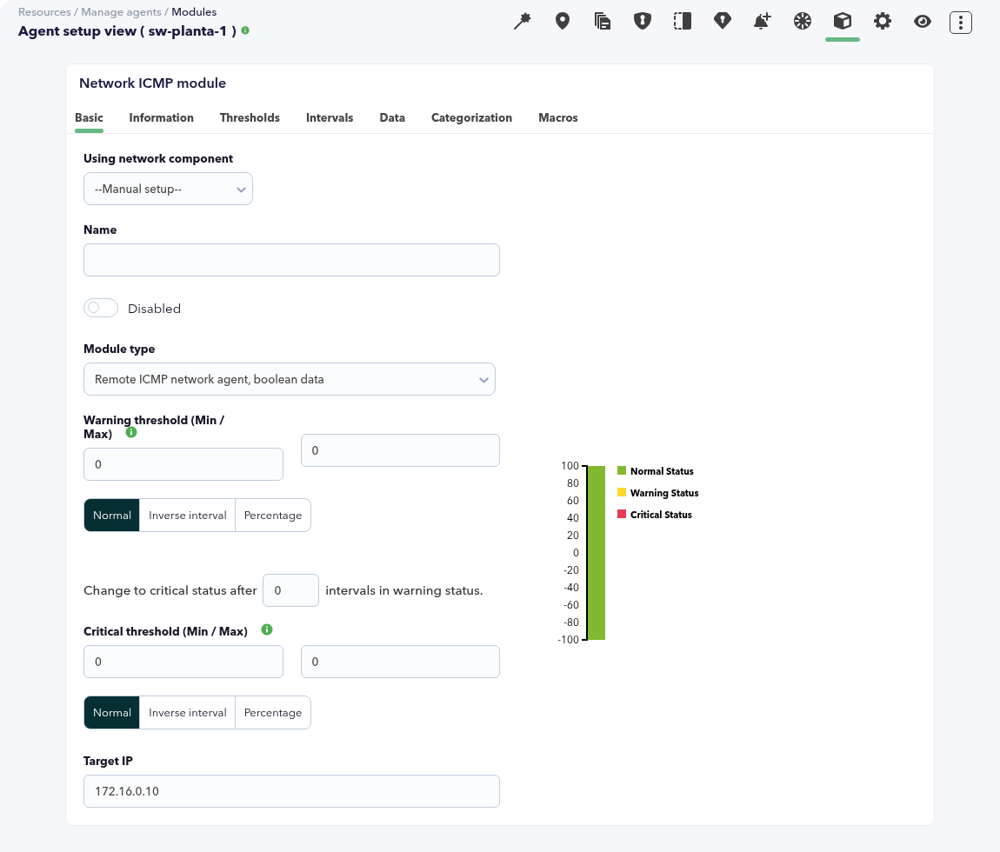{ .captura }

| Famille | À quoi elle sert | Section |
|---|---|---|
| ICMP | Disponibilité et latence du réseau | [Disponibilité et latence avec ICMP](#disponibilite-et-latence-avec-icmp) |
| TCP | Ports et services réseau | [Services avec TCP](#services-avec-tcp) |
| SNMP | Équipements avec agent SNMP (routeurs, switches, onduleurs…) | [Supervision SNMP](#supervision-snmp) |
| Commande distante | Commandes par SSH ou Windows distant | [Commandes distantes : SSH et Windows](#commandes-distantes-ssh-et-windows) |
| WMI | Équipements Windows sans EndPoint | [Windows sans agent : WMI](#windows-sans-agent-wmi) |
| Plugin | Vérifications empaquetées dans un script | [Plugins distants de serveur](#plugins-distants-de-serveur) |

Le tableau complet des types internes, avec ce que renvoie chacun et comment son
état s'interprète, se trouve dans [Référence des types de
module](#reference-des-types-de-module) ; chaque section de ce chapitre renvoie à
sa ligne.

Tous les modules réseau partagent ces champs, avec leur valeur par défaut :

| Champ | Valeur par défaut | Ce qu'il fait |
|---|---|---|
| Adresse IP cible (Target IP) | vide (`auto`) | Laissé vide, il utilise l'IP de l'agent. Il accepte les macros `_agentname_` et `_agentalias_` lorsque le nom ou l'alias de l'agent se résout en une IP valide. |
| Port | vide (`161` en SNMP, `22` dans les commandes distantes par SSH) | Port de destination, lorsque la vérification en a besoin. |
| Intervalle | 300 s | Fréquence de répétition de la vérification. |
| Seuil d'avertissement (min./max.) | 0 / 0 | Plage qui place le module en état d'avertissement. |
| Seuil critique (min./max.) | 0 / 0 | Plage qui place le module en état critique. |
| Délai d'attente | 0 (utilise celui du serveur) | Temps maximum avant de considérer la vérification comme échouée. |
| Tentatives | 0 | Essais supplémentaires avant d'écarter la donnée. |
| Seuil FF (flapping) | 0 (désactivé) | Nombre de changements d'état consécutifs à voir avant de les considérer comme réels ; voir l'exemple plus bas. |
| Instructions pour l'état inconnu | vide | Texte que voit l'opérateur lorsque le module tombe en état inconnu. |
| Minimum / maximum | 0 / 0 | Toute donnée hors de cette plage est écartée comme invalide. |

!!! example "Ping et latence vers le routeur, avec seuils"
    Sur l'agent « router-core » (`192.168.10.1`), deux modules réseau :

    - **Disponible** (`remote_icmp_proc`) : sans autre configuration que
      l'adresse IP cible, il suffit à savoir si le routeur répond.
    - **Latence** (`remote_icmp`) : même cible, avec un avertissement à partir
      de `100` ms et un critique à partir de `300` ms.

    Dès que le serveur réseau exécute le module, l'état de l'agent passe de
    « Sans données » à normal et la première valeur apparaît dans sa vue ;
    c'est le signe que le module est bien configuré.

### Propriétés avancées communes

Ces onglets de l'éditeur apparaissent dans tous les modules réseau,
indépendamment du type. Le formulaire complet, avec seuils, état inconnu,
intervalles et données, est expliqué dans
[2.20, Configuration commune des modules](2.20-configuracion-comun-de-los-modulos.md) :

- **ID personnalisé** (Custom ID, onglet *Catégorisation*) : un identifiant
  libre pour relier le module à un système externe, comme une CMDB.
- **Post-traitement** (Post process, onglet *Données*) : multiplie la donnée
  reçue par le facteur indiqué, avant de l'enregistrer. Il sert par exemple à
  convertir des octets en bits : un module qui lit des octets par seconde avec
  un post-traitement de `8` enregistre déjà la donnée en bits par seconde.
- **Exportation** (Export target, onglet *Données*) : envoie aussi la donnée
  vers un serveur d'exportation.
- **Catégorie** (Category, onglet *Catégorisation*) : regroupement utilisé par
  le Command Center.
- **Cron** (onglet *Intervalles*) : si **Cron depuis** (Cron from) est activé,
  le module cesse de s'exécuter par intervalle et ne s'exécute plus que lorsque
  la date et l'heure courantes correspondent à l'expression configurée.

!!! example "Exécuter un module seulement la nuit"
    Un module avec **Cron depuis** configuré sur `0 2 * * *` s'exécute une fois
    par jour, à deux heures du matin, au lieu de toutes les 300 secondes.

Le **seuil FF** (de *flapping*, clignotement) empêche une alerte de se
déclencher pour un changement d'état isolé : il exige de voir le même nombre de
changements d'état consécutifs avant de les considérer comme réels.

!!! example "Éviter un faux saut dû au flapping"
    Un lien WAN instable passe de normal à critique et revient à normal
    plusieurs fois en quelques minutes. Avec un seuil FF de `3`, le module ne
    change pas d'état — et ne déclenche pas d'alertes — avant d'avoir vu trois
    lectures consécutives du même signe ; le clignotement cesse de générer du
    bruit.

### Composants réseau : ne pas partir de zéro

Un **composant réseau** est un module préfabriqué : la même configuration d'un
module réseau, enregistrée comme modèle pour ne pas la remplir à chaque fois.
Dans l'éditeur d'un module nouveau, le champ **En utilisant le composant
réseau** (Using network component) permet d'en choisir un au lieu de remplir le
formulaire à la main ; l'option manuelle (`--Configuration manuelle--`) reste
disponible pour n'en utiliser aucun.

L'installation apporte des composants regroupés par fabricant et technologie :
MIB de Cisco, systèmes UNIX, Microsoft Windows, WMI, bases de données, et ainsi
de suite avec le reste des groupes inclus d'usine.

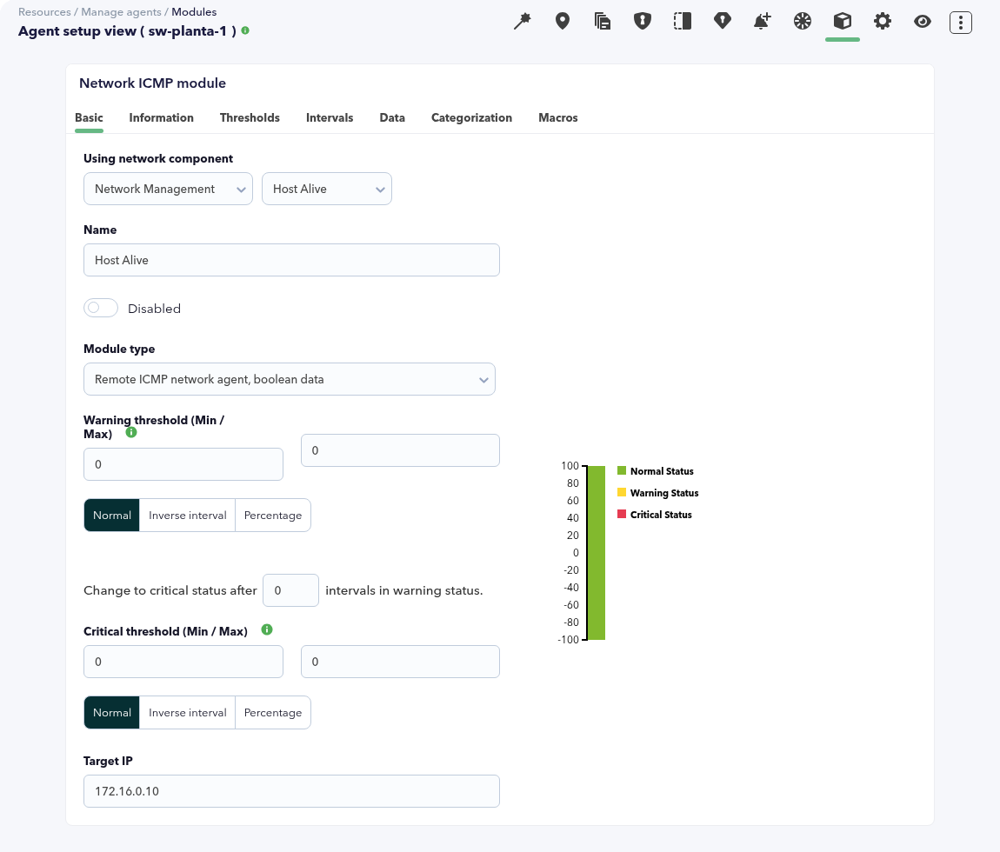{ .captura }

!!! example "Appliquer Host Alive et Host Latency depuis des composants"
    À la création d'un module nouveau, sélectionner le composant **Host Alive**
    (groupe *Network Management*) crée le même module ICMP booléen qui serait
    configuré à la main ; **Host Latency**, du même groupe, fait de même avec la
    latence. C'est la façon la plus rapide de laisser un agent sans EndPoint
    avec le minimum couvert. De fait, le formulaire de création d'agent apporte
    lui-même une case à cocher, cochée par défaut, qui crée ces deux modules
    (Host Alive et Host Latency) automatiquement dès que l'agent est créé, sans
    passer par l'éditeur de modules.

**Créer un composant propre.** Les composants se gèrent dans **Gestion → Configuration → Modèles → Composants distants** (« Gestion des composants à distance »). La liste affiche le nom, le serveur qui l'exécute, le type de module, la description et le groupe de chaque composant, et peut se filtrer par groupe et par texte.

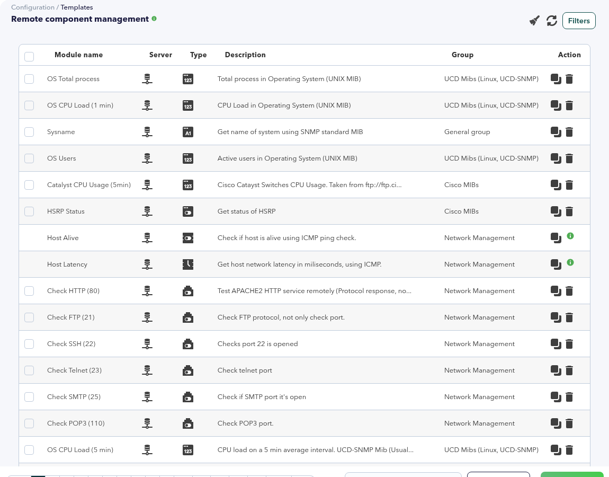{ .captura }

Il y a deux façons d'avoir le vôtre : **dupliquer** un composant existant et l'adapter, ce qui est généralement le plus rapide puisqu'il est déjà configuré, ou choisir le type de module dans le sélecteur en bas de la liste et cliquer sur **Créer**. Pour ceux fondés sur un OID, il y en a une troisième : le bouton « Créer un composant de réseau » du détail d'un OID dans le [navigateur SNMP](#navigateur-snmp).

Le formulaire est celui d'un module réseau — nom, type, seuils et les onglets d'information, de données, de catégorisation et de macros — plus un champ **Groupe**, qui décide dans quelle branche du sélecteur « Utilisation du composant réseau » apparaît le composant. Il ne porte pas d'IP cible : celle-ci se renseigne sur chaque agent au moment de l'appliquer.

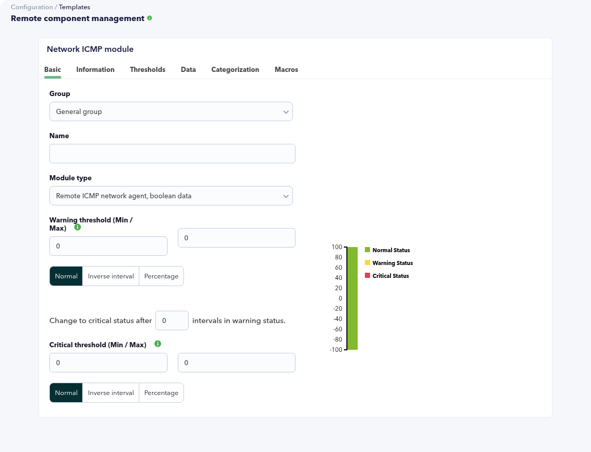{ .captura }

Les composants d'origine marqués comme internes, tels que **Host Alive** et **Host Latency**, ne peuvent être ni modifiés ni supprimés, seulement dupliqués. Une fois créé, un composant peut s'appliquer à n'importe quel agent, s'inclure dans une [politique de supervision](2.10-politicas-de-monitorizacion.md) ou laisser [Discovery](2.4-descubrimiento-de-redes-con-host-y-dispositivos.md) l'appliquer en masse pendant une analyse.

### Macros dans les champs du module

Certains champs des modules distants acceptent des macros que le serveur
remplace par des données de l'agent chaque fois qu'il exécute le module. Cela
évite d'écrire la même donnée à la main sur chaque agent, et c'est ce qui permet
qu'un composant réseau ou un module de politique serve de la même façon à des
agents aux données différentes. Le cas typique est la communauté SNMP : si
chaque équipement a la sienne, elle est enregistrée dans un champ personnalisé
de l'agent et le module utilise la macro au lieu de la communauté.

Les champs qui acceptent des macros sont ceux-ci :

| Champ | Modules |
|---|---|
| Adresse IP cible | ICMP, TCP et SNMP |
| Communauté SNMP | SNMP v1 et v2c |
| Utilisateur, mot de passe d'authentification et mot de passe de confidentialité | SNMP v3 |
| Utilisateur et mot de passe | WMI et inventaire distant par WMI |

Ces macros peuvent s'utiliser dans ces champs :

| Macro | Remplacée par | Où |
|---|---|---|
| `_agentcustomfield_N_` | Valeur du champ personnalisé de l'agent dont l'identifiant est N | Tous les champs du tableau précédent |
| `_addressn_N_` | Adresse IP numéro N de l'agent, adresses triées | Tous les champs du tableau précédent |
| `_agent_`, `_agentalias_` | Alias de l'agent | Adresse IP cible |
| `_agentname_` | Nom de l'agent | Adresse IP cible |

La macro n'est remplacée que si la valeur du champ **commence par elle** : une
valeur comme `_agentcustomfield_3_` fonctionne ;
`comunidad_agentcustomfield_3_` est envoyée telle quelle. Les champs
personnalisés se créent dans **Gestion → Ressources → Champs personnalisés**.
L'identifiant qui apparaît dans cette liste est le N de la macro. La valeur se
remplit sur chaque agent. Les types de champ, la façon dont l'EndPoint les déclare et
les précautions sur les mots de passe sont dans [2.21, Champs personnalisés de l'agent](2.21-configuracion-comun-de-los-agentes.md#champs-personnalises-de-lagent).

!!! example "Une communauté SNMP différente par équipement"
    On crée le champ personnalisé « Communauté SNMP », qui reçoit l'identifiant
    `4`, et on le remplit sur chaque agent avec sa communauté (`sw-core-ro`,
    `sw-planta2-ro`…). Un composant réseau SNMP avec **Communauté SNMP**
    `_agentcustomfield_4_` s'applique ensuite à tous les switches, directement
    ou au moyen d'une politique : chaque module interroge avec la communauté de
    son propre agent.

!!! example "Surveiller la deuxième IP d'un équipement"
    Sur un serveur avec deux interfaces créées dans l'agent, un module ICMP
    avec **Adresse IP cible** `_addressn_2_` vérifie la deuxième adresse.
    L'ordre est celui des adresses triées, pas l'ordre dans lequel elles ont été
    ajoutées.

Les plugins distants ont leur propre jeu de macros, plus large ; il est expliqué
dans [Macros des plugins](#macros-des-plugins).

## Disponibilité et latence avec ICMP

ICMP est la vérification la plus élémentaire et compte deux types :
**Disponible** (`remote_icmp_proc`), qui renvoie si l'IP répond ou non, et
**Latence** (`remote_icmp`), qui renvoie le temps de réponse en millisecondes
(voir [Référence des types de module](#reference-des-types-de-module)). Le
serveur réseau haute performance mesure avec `fping`, en regroupant dans un seul
appel toutes les destinations en attente (s'il est désactivé, c'est le serveur
réseau qui le fait avec le `ping` du système) : il lance autant de paquets par
essai et autant de tentatives que l'indiquent les jetons
[`icmp_packets`](../parte-9/9.3-referencia-completa-de-configuracion-del-servidor.md)
et
[`icmp_checks`](../parte-9/9.3-referencia-completa-de-configuracion-del-servidor.md),
avec le délai d'attente de
[`network_timeout`](../parte-9/9.3-referencia-completa-de-configuracion-del-servidor.md).
Sans réponse dans ces limites, le module de disponibilité passe en état critique
et celui de latence reste sans donnée.

!!! example "Disponibilité d'une imprimante"
    Un module **Disponible** sur `192.168.10.50` : sans autre réglage que
    l'adresse IP cible, il avertit dès que l'imprimante cesse de répondre au
    ping, sans qu'il faille rien lui installer.

!!! example "Latence d'un lien WAN"
    Un module **Latence** sur l'IP du routeur distant, avec un avertissement à
    `100` ms et un critique à `300` ms : un lien qui commence à se dégrader se
    voit venir avant de tomber complètement.

Pour quelque chose de plus fin que la latence — par exemple, le pourcentage de
paquets perdus au lieu du seul temps d'aller-retour —, il y a le plugin de perte
de paquets que l'installation apporte (voir [Plugins distants de
serveur](#plugins-distants-de-serveur)).

## Services avec TCP

TCP vérifie un service par son port, avec quatre types : **port ouvert**
(`remote_tcp_proc`, booléen), **numérique** (`remote_tcp`), **texte**
(`remote_tcp_string`) et **incrémental** (`remote_tcp_inc`) ; ce que renvoie
chacun, dans [Référence des types de module](#reference-des-types-de-module).
Deux champs font le travail :

- **Envoyer TCP** (TCP Send) : ce qui est envoyé au port. Plusieurs étapes d'une
  conversation se séparent par `|` ; la séquence `^M` est remplacée par un
  retour chariot réel.
- **Recevoir TCP** (TCP Receive) : ce qui est attendu en retour, comparé **sans
  distinguer majuscules et minuscules**. Il est obligatoire dans les types texte
  et incrémental ; dans celui de port ouvert, seulement s'il est rempli.

!!! example "Port ouvert"
    Un module de type **port ouvert** sur le port `443`, sans **Envoyer TCP** ni
    **Recevoir TCP** : il suffit que le port accepte la connexion pour marquer
    l'état normal.

!!! example "En-tête d'un serveur web"
    **Envoyer TCP** : `GET / HTTP/1.0^M^M`. **Recevoir TCP** : `200 OK`. Le
    module passe à normal dès que la réponse contient cette chaîne, que le
    serveur la renvoie en majuscules ou en minuscules.

!!! example "Conversation SMTP en trois étapes"
    **Envoyer TCP** : `HELO midominio.com^M|MAIL FROM: <a@midominio.com>^M|RCPT TO: <b@destino.com>^M`.
    **Recevoir TCP** : `250|250|250`. Chaque étape est envoyée et vérifiée avant
    de passer à la suivante.

!!! example "Bannière SSH"
    Port `22`, sans **Envoyer TCP**, et **Recevoir TCP** avec le texte `SSH-2.0`
    pour confirmer la version de protocole que le serveur annonce à la
    connexion.

Les tentatives et le délai d'attente se règlent comme dans n'importe quel module
réseau, avec les valeurs par défaut du serveur dans [`tcp_checks` et
`tcp_timeout`](../parte-9/9.3-referencia-completa-de-configuracion-del-servidor.md).

## Supervision SNMP

### SNMP en cinq minutes

Pour superviser un équipement par SNMP, il faut que son agent SNMP soit activé
et que Pandora FMS sache comment lui parler : quelle version de protocole (v1,
v2c avec communauté de lecture ; v3 avec utilisateur, authentification et
confidentialité) et quel OID lire. Un **OID** (*Object IDentifier*) est l'adresse
d'une donnée précise dans l'équipement — température, CPU, état d'une
interface — ; il peut s'écrire sous sa forme numérique (`.1.3.6.1.2.1.1.5.0`) ou,
si le serveur a chargé la **MIB** qui le décrit, sous sa forme textuelle
(`sysName.0`). Chaque OID supervisé est un module réseau distinct.

| OID | Ce qu'il est |
|---|---|
| `.1.3.6.1.2.1.1.3.0` (`sysUpTime`) | Temps depuis lequel l'équipement est allumé |
| `.1.3.6.1.2.1.1.5.0` (`sysName`) | Nom configuré de l'équipement |
| `.1.3.6.1.2.1.2.2.1.8` (`ifOperStatus`) | État opérationnel d'une interface |
| `.1.3.6.1.2.1.2.2.1.10` (`ifInOctets`) | Octets d'entrée par interface (compteur de 32 bits) |
| `.1.3.6.1.2.1.31.1.1.1.6` (`ifHCInOctets`) | Idem, dans sa version 64 bits pour les liens rapides |

Lorsque l'OID est textuel, le serveur le traduit en numérique avec les MIB qu'il
a chargées (voir [Gestionnaire de MIB](#gestionnaire-de-mib)) ; sans la MIB
adéquate, le navigateur et les modules ne peuvent travailler qu'avec le nombre.

La façon recommandée de créer des modules SNMP est l'un des deux assistants de
la fiche de l'agent : ils explorent l'équipement par SNMP et proposent les
modules déjà configurés, sans chercher un seul OID à la main. Créer les modules
SNMP un par un, plus loin dans cette section, reste réservé aux cas qu'un
assistant ne couvre pas : un OID isolé qui n'apparaît dans aucun modèle, une MIB
propre au fabricant, ou le réglage fin d'un module déjà créé.

### Assistant d'interfaces SNMP

Dans la fiche de l'agent, onglet **Assistant d'interfaces SNMP**. C'est le
raccourci pour les switches et les routeurs : au lieu de créer un module par
interface et par grandeur à la main, il parcourt la branche `IF-MIB::interfaces`
de l'équipement et propose tous les modules d'un coup.

La première étape demande la connexion SNMP — le même formulaire que celui
qu'utilise l'assistant SNMP de la section suivante — :

| Champ | Valeur par défaut | Ce qu'il fait |
|---|---|---|
| Adresse IP cible | vide | Adresse de l'équipement à explorer. C'est un champ de texte libre : **il n'accepte pas les macros d'agent** `_agentname_` ni `_agentalias_`, il faut écrire une IP réelle même si l'agent en a déjà une associée. |
| Port | `161` | Port SNMP de l'équipement. |
| Serveur pour exécuter la commande | Console locale | Quel serveur Pandora FMS fait la requête SNMP réelle. Il ne faut le changer que lorsque la console n'a pas de route directe vers l'équipement : voir [Exécuter des assistants et des tests depuis un serveur distant (Exec Server)](#executer-des-assistants-et-des-tests-depuis-un-serveur-distant-exec-server). |
| Importer depuis le magasin d'identifiants | — | S'il existe un jeu SNMP enregistré dans le [gestionnaire d'identifiants](2.2-gestor-de-credenciales.md) visible pour l'utilisateur, il apparaît ici ; en le choisissant, il remplit seul le reste des champs. |
| Version SNMP | `2c` | `1`, `2c` ou `3`. En choisissant `3`, le formulaire d'authentification ci-dessous apparaît. |
| Communauté SNMP | `public` | Communauté de lecture, pour v1 et v2c. |

Avec la version `3`, le formulaire ajoute les champs habituels de SNMPv3 : niveau
de sécurité (sans authentification ni confidentialité, avec authentification
sans confidentialité, ou avec les deux), utilisateur, méthode et mot de passe
d'authentification (MD5, SHA, SHA256 ou SHA512) et méthode et mot de passe de
confidentialité (DES, AES, AES192 ou AES256) — les mêmes que dans [Modules
SNMP](#modules-snmp).

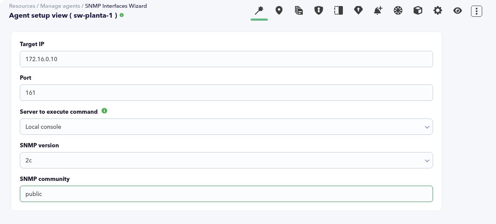{ .captura }

Une fois la requête terminée, l'assistant décide une seule fois, pour tout
l'équipement, s'il travaille avec des compteurs de trafic de 32 ou de 64 bits :
si l'équipement répond sur la branche de compteurs haute capacité (pensée pour
les liens rapides), il l'utilise pour toutes ses interfaces ; sinon, il garde les
compteurs classiques de 32 bits. Le résultat se présente sous forme de bloc
repliable par interface, avec un interrupteur qui l'inclut ou l'exclut en
entier ; seules les interfaces opérationnellement et administrativement actives
viennent déjà activées, pour ne pas remplir l'agent de modules morts à cause de
ports sans rien de connecté. Au-dessus des blocs se trouve une barre de filtre
avec recherche de texte libre par nom ou description d'interface, deux
interrupteurs pour ne garder que celles qui sont opérationnellement ou
administrativement actives, et un interrupteur pour sélectionner d'un coup toutes
les interfaces qui passent le filtre. Dans chaque bloc, un autre interrupteur
coche ou décoche tous ses modules à la fois, et chaque module peut être activé ou
désactivé séparément et arriver avec ses seuils d'avertissement et critique déjà
modifiés avant de créer quoi que ce soit. Un bloc spécial, au début de la liste,
applique le même ensemble de modules à toutes les interfaces sélectionnées d'un
coup, sans répéter la sélection interface par interface.

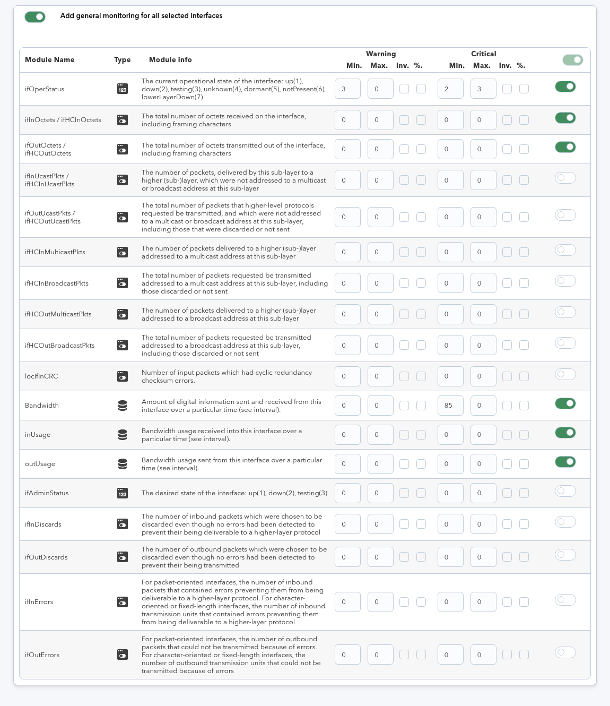{ .captura }

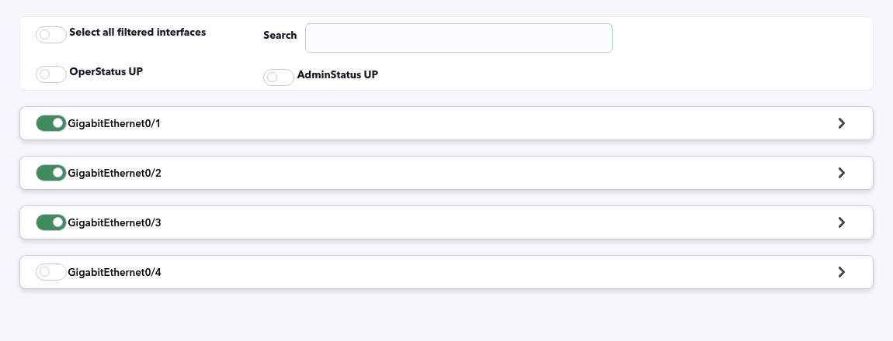{ .captura }

Pour chaque interface qui reste cochée, l'assistant propose :

| Module | Ce qu'il mesure | Seuil |
|---|---|---|
| État opérationnel | Si l'interface est active, tombée, en test… | Cela dépend de l'**état administratif** de l'interface : si elle est administrativement active, le seuil critique attend qu'elle le soit aussi opérationnellement (il avertit ou échoue sinon) ; si elle est administrativement éteinte, le seuil s'inverse pour ne pas avertir d'une chose attendue ; si elle est en test, il utilise un troisième jeu de plages. |
| Octets d'entrée / sortie | Trafic en octets par seconde | Incrémental, sans seuil par défaut |
| Paquets unicast d'entrée / sortie | Paquets par seconde | Incrémental, sans seuil par défaut |
| Paquets multicast et broadcast d'entrée / sortie (seulement avec des compteurs 64 bits) | Paquets par seconde | Incrémental, sans seuil par défaut |
| Erreurs CRC | Trames écartées pour erreur de trame | Incrémental, sans seuil par défaut |
| Bande passante, usage d'entrée, usage de sortie | Pourcentage de la capacité du lien en usage, calculé à partir du trafic et de la vitesse de l'interface | Le module agrégé de bande passante apporte un `85` % comme seuil critique par défaut ; ceux d'usage d'entrée et de sortie séparément, sans seuil |

Les trois modules de pourcentage d'usage ne lisent pas un OID directement : un
plugin interne les calcule à partir du trafic et de la vitesse nominale de
l'interface, ils comptent donc comme des modules de type plugin dans l'agent,
même si l'assistant les présente comme le reste. Sur les équipements Cisco
reconnus par leur PEN, l'assistant ajoute en plus un module d'incohérence de
duplex par interface, lorsque l'équipement expose cette donnée.

Quels modules de ce tableau viennent déjà cochés par défaut, sans rien toucher,
se décide dans **Réglages → Configuration du système → Performance**, onglet
**Assistant d'interfaces** (voir [9.2 · Référence complète de configuration de la
console](../parte-9/9.2-referencia-completa-de-configuracion-de-la-consola.md)) :
c'est un interrupteur par module, valable pour tous les agents.

Avant de créer, l'assistant passe la liste en revue et marque en gris, avec un
avertissement, les modules qui existent déjà dans l'agent (ou dans la politique,
si l'on en édite une) sous le même nom ; il n'empêche pas de continuer, mais il
avertit pour ne pas dupliquer sans s'en apercevoir. Les modules créés se
comportent ensuite comme n'importe quel module SNMP : on les édite, on change
leur seuil ou on leur ajoute une alerte comme à un module fait à la main.

**Où les retrouver ensuite.** La vue de l'agent affiche un onglet **Interfaces (SNMP)**, avec une ligne par interface : son état, l'accès à son graphique, l'IP, la MAC et le dernier contact. La console n'interroge pas de nouveau l'équipement pour le construire : elle déduit les interfaces du **nom** des modules (`<interface>_if…` ou `if…_<interface>`, c'est ainsi que cet assistant les crée) et tire l'IP et la MAC de leur description, d'où le `--` dans la colonne IP quand la description n'en contient aucune. Un module SNMP créé à la main avec le même modèle de nom apparaît aussi dans la liste.

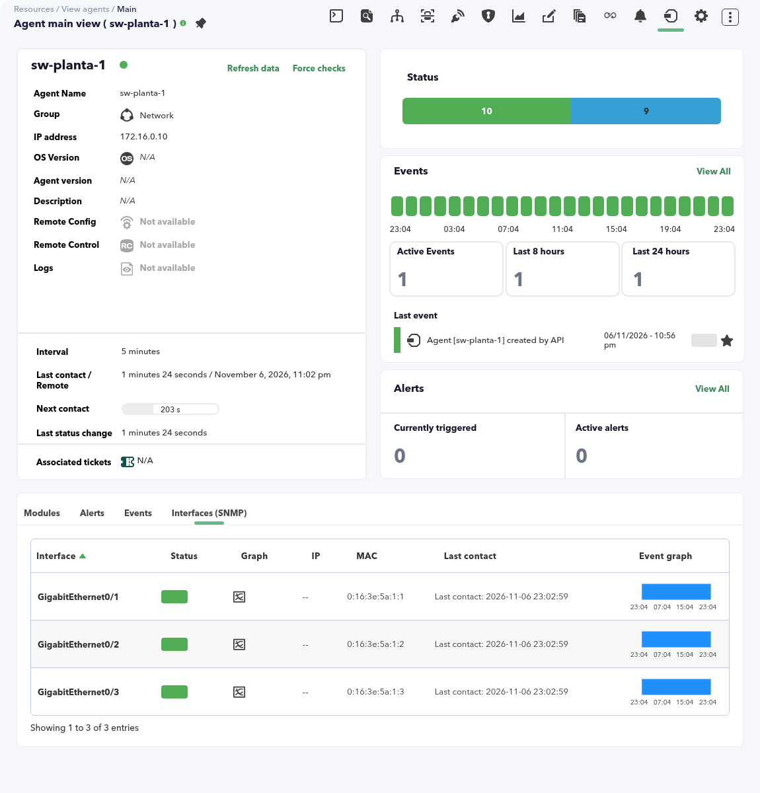{ .captura }

!!! example "Un switch de 24 ports, seulement les interfaces actives et leur trafic"
    Adresse IP cible `192.168.10.2`, version `2c`, communauté `public`. Après le
    parcours SNMP, on ne laisse cochées que les interfaces dont l'état
    opérationnel est actif (le filtre **OperStatus UP** aide à le vérifier d'un
    coup d'œil) et, parmi les modules que chacune propose, seulement **État
    opérationnel** et les octets d'entrée et de sortie : la disponibilité et le
    trafic de chaque port en usage, sans erreurs ni paquets qu'un switch
    d'accès a rarement besoin de surveiller.

!!! example "Un routeur en SNMPv3 depuis le magasin d'identifiants"
    Adresse IP cible, celle du routeur ; version `3`. Au lieu d'écrire
    utilisateur et mots de passe à la main, on choisit le jeu déjà enregistré
    dans le gestionnaire d'identifiants avec le niveau de sécurité `authPriv`,
    l'authentification `SHA` et la confidentialité `AES` : l'assistant remplit
    seul le reste du formulaire et fait l'exploration avec ces identifiants.

### Assistant SNMP

Dans la fiche de l'agent, onglet **Assistant SNMP**. Contrairement au précédent,
cet assistant supervise l'équipement dans son ensemble, pas seulement ses
interfaces, et partage le même formulaire de connexion que la section précédente
(adresse IP cible sans macros d'agent, port, serveur pour exécuter la commande,
import depuis le magasin d'identifiants, version et communauté ou identifiants
v3).

Une fois la connexion établie, l'assistant identifie le fabricant de l'équipement
par son **PEN** (*Private Enterprise Number*, l'identifiant que chaque fabricant
enregistre auprès de l'IANA dans la branche d'identification de l'équipement). Si
le PEN n'est pas enregistré dans Pandora FMS, l'assistant le dit et ne propose
rien : il faut
[l'enregistrer](../anexos/a4-ampliar-los-asistentes-snmp-y-wmi-con-componentes-propios.md)
ou, si cela n'intéresse pas, créer les modules à la main depuis [Modules
SNMP](#modules-snmp). S'il le reconnaît, il offre la bibliothèque de modules déjà
préparés pour ce fabricant — plus ceux qui valent pour tout équipement —
regroupés en blocs selon ce qu'ils mesurent : CPU, mémoire, disques, stockage, et
ainsi de suite avec le reste. Chaque bloc s'active ou se désactive d'un coup avec
son propre interrupteur, et chaque module d'un bloc peut être coché ou décoché
séparément, avec ses seuils d'avertissement et critique déjà modifiables avant de
créer quoi que ce soit ; un indicateur à côté de chaque bloc avertit du nombre de
ses modules sélectionnés.

Cet assistant crée deux classes de modules :

- **À OID fixe** : ils lisent directement un OID de la MIB du fabricant — CPU,
  mémoire, capteurs… —, comme un module SNMP créé à la main.
- **Calculés par plugin** : pour des données qui ne sortent pas d'un seul OID —
  un pourcentage de disque utilisé, de la mémoire libre exprimée en
  pourcentage… —, l'assistant s'appuie sur un plugin distant nommé
  `snmp_remote.pl`. Si ce plugin n'est pas enregistré dans l'installation (voir
  [Plugins distants de serveur](#plugins-distants-de-serveur)), ces modules
  restent désactivés dans l'assistant même si le fabricant est bien reconnu.

Comme dans l'assistant d'interfaces, avant de créer, les modules qui existent
déjà dans l'agent ou qui se répètent sous le même nom dans la sélection
elle-même sont marqués en gris, sans que cela empêche de continuer.

Le catalogue de fabricants et de composants qu'utilise cet assistant n'est pas
fermé : il peut s'étendre avec de nouveaux fabricants et avec des composants
propres, à OID fixe ou dynamique, lus directement ou calculés par un plugin —
voir [Étendre les assistants SNMP et WMI avec des composants
propres](../anexos/a4-ampliar-los-asistentes-snmp-y-wmi-con-componentes-propios.md).

!!! example "Un serveur Linux avec net-snmp"
    Sur un serveur avec l'agent `net-snmp` installé, l'assistant reconnaît le
    PEN de Net-SNMP/UCD et propose des modules de CPU, de mémoire et d'espace
    disque prêts à cocher et à créer, sans chercher un seul OID à la main.

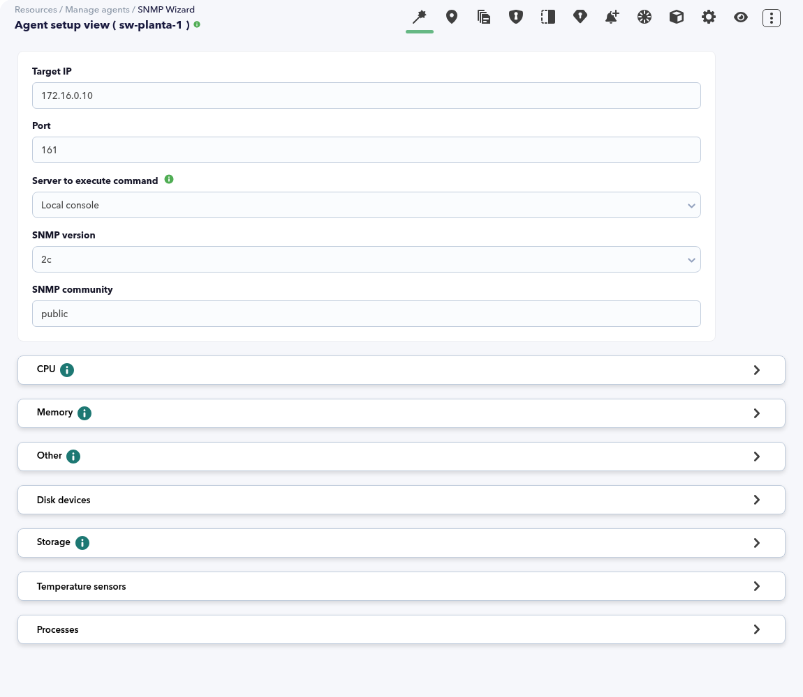{ .captura }

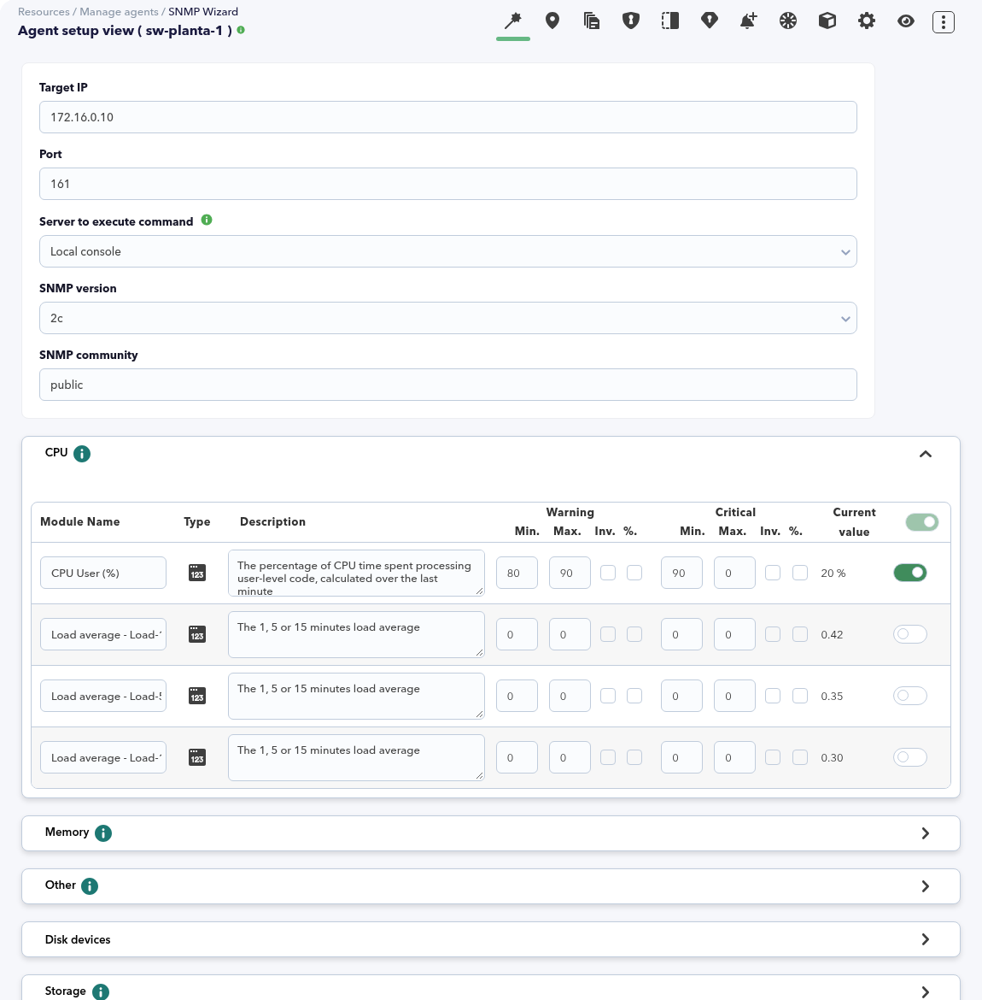{ .captura }

!!! example "Un serveur Windows avec le service SNMP"
    Sur un serveur Windows avec le service SNMP activé et une communauté de
    lecture configurée, on répète la même connexion (version `2c`, communauté de
    l'équipement) : si l'assistant reconnaît le PEN que déclare le service, il
    offre comme sous Linux les blocs de modules déjà préparés ; s'il ne le
    reconnaît pas, il avertit que le PEN n'est pas enregistré et ce qui convient
    est de documenter l'équipement avec [Modules SNMP](#modules-snmp) ou de
    l'enregistrer à la main.

### Navigateur SNMP

Pour les cas où l'on ne sait pas quel OID il faut : le **Navigateur SNMP** (SNMP
Browser) parcourt l'arbre complet de l'équipement, ou seulement une branche
précise si l'on veut raccourcir l'exploration, et permet de chercher une chaîne
de texte avec mise en évidence des correspondances. Sur tout OID trouvé, il y a
des actions directes : créer un composant réseau, un module d'agent ou un module
de politique, sans quitter le navigateur.

!!! example "Chercher la température d'un switch"
    On cherche « temperature » dans l'arbre déjà exploré du switch, on localise
    l'OID correspondant au capteur et on crée le module d'agent directement
    depuis le résultat, avec **Créer un module d'agent**.

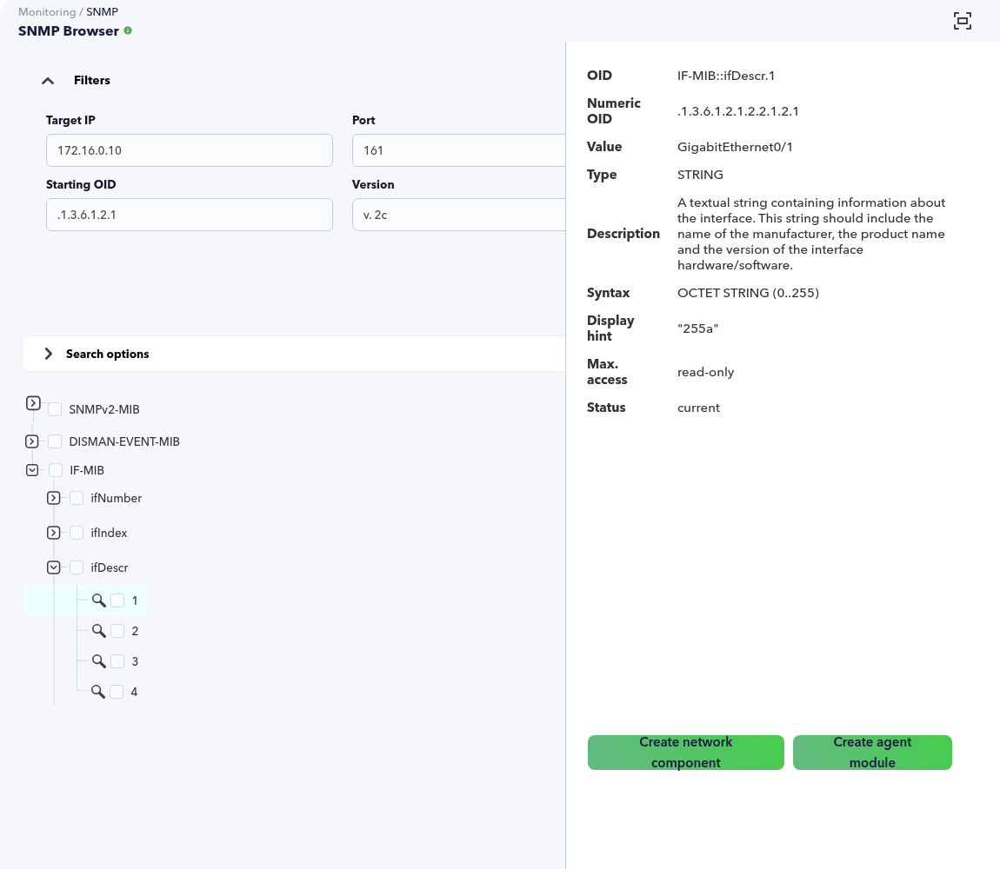{ .captura }

### Modules SNMP

Pour ce qu'aucun assistant ne couvre : un OID isolé sans modèle, une MIB propre
au fabricant ou le réglage fin d'un module déjà créé. Quatre types :
**numérique** (`remote_snmp`), **état** (`remote_snmp_proc`), **texte**
(`remote_snmp_string`) et **incrémental** (`remote_snmp_inc`, pour les
compteurs : voir [Référence des types de
module](#reference-des-types-de-module)). Champs propres, avec leur valeur par
défaut :

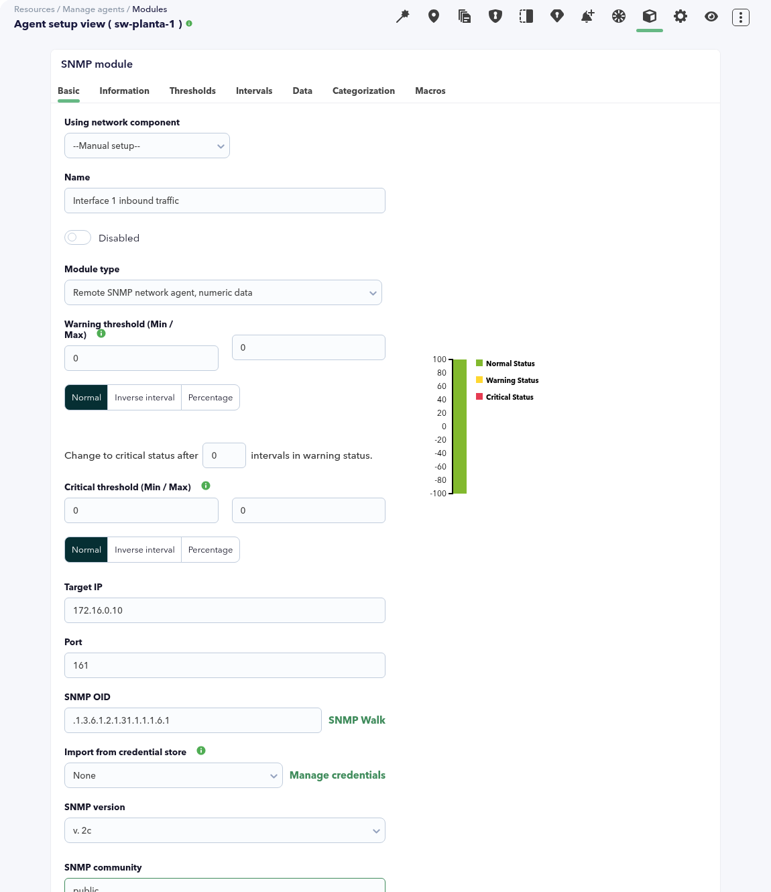{ .captura }

| Champ | Valeur par défaut |
|---|---|
| Port | `161` |
| OID | — |
| Version | `2c` |
| Communauté (v1/v2c) | vide ; `public` dans les assistants |
| Niveau de sécurité (v3) | `noAuthNoPriv` |
| Utilisateur (v3) | — |
| Méthode d'authentification (v3) | MD5, SHA, SHA256 ou SHA512 ; `MD5` par défaut (la console exige un minimum de 8 caractères dans le mot de passe) |
| Méthode de confidentialité (v3) | DES, AES, AES192 ou AES256 ; `DES` par défaut |

Le champ **Identifiants** permet de choisir un jeu enregistré dans le
[gestionnaire d'identifiants](2.2-gestor-de-credenciales.md) au lieu d'écrire
communauté ou utilisateur à la main. À côté du champ OID, le bouton **Exploration
SNMP** (SNMP browse) ouvre le même navigateur que la section précédente sans
quitter l'éditeur du module.

!!! example "Uptime par v2c"
    OID `.1.3.6.1.2.1.1.3.0`, version `2c`, communauté `public` : module
    numérique avec le temps d'activité de l'équipement, en centièmes de seconde.

!!! example "CPU d'un équipement avec un OID du fabricant"
    Un switch expose sa charge CPU dans un OID propre, hors de MIB-II (par
    exemple, `.1.3.6.1.4.1.9.9.109.1.1.1.1.7.1` sur les équipements Cisco).
    Module numérique avec cet OID, version `2c` et la communauté du dispositif.

!!! example "Module v3 authPriv avec SHA et AES"
    Version `3`, niveau de sécurité `authPriv`, utilisateur `pandora_ro`,
    authentification `SHA` avec son mot de passe, confidentialité `AES` avec le
    sien : le plus haut niveau de sécurité SNMP que propose le formulaire.

!!! example "Trafic d'une interface en incrémental"
    OID `.1.3.6.1.2.1.31.1.1.1.6.1` (`ifHCInOctets` de l'interface 1), type
    **incrémental**. Le compteur SNMP croît sans arrêt tant que l'équipement est
    allumé ; Pandora FMS enregistre la différence entre deux lectures divisée
    par le temps écoulé, c'est-à-dire un **taux** (octets par seconde), pas la
    valeur brute du compteur.

### Gestionnaire de MIB

Les MIB décrivent ce que signifie chaque OID d'un fabricant ; sans la MIB
correspondante chargée, un OID ne se voit que sous sa forme numérique. Le
**Gestionnaire de MIB** (MIB uploader) permet de téléverser celles du fabricant,
au format `.mib` ou `.zip`, et les laisse disponibles pour traduire les OID dans
le navigateur, dans les modules et dans les traps.

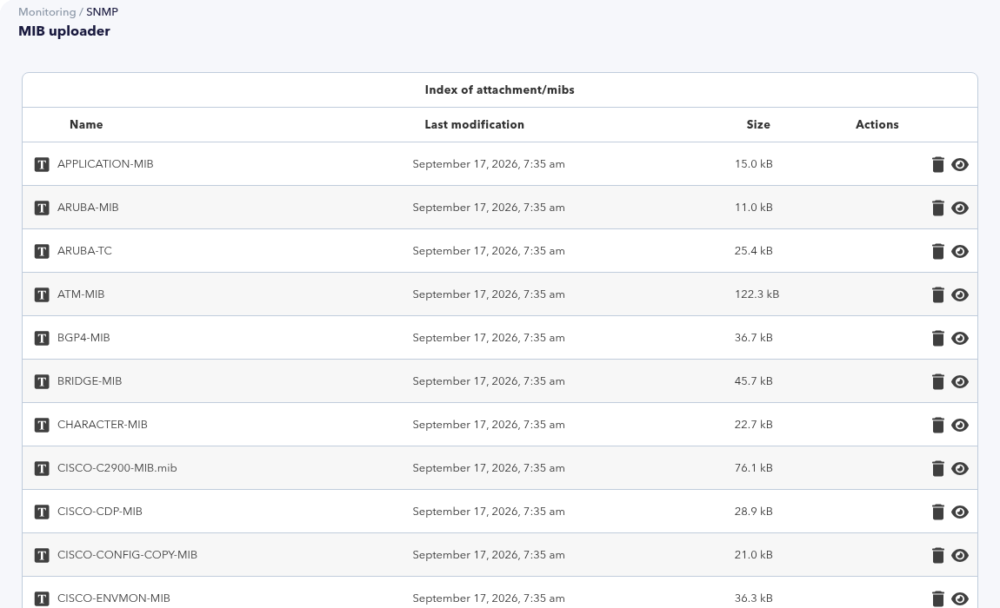{ .captura }

!!! example "Charger la MIB d'un onduleur"
    On téléverse le fichier `.mib` que fournit le fabricant de l'onduleur ; à
    partir de là, ses OID apparaissent traduits dans le navigateur et l'on peut
    utiliser les traps de ce même fabricant déjà identifiés par leur nom.

### SNMP depuis un EndPoint

Cela a du sens lorsque l'équipement SNMP n'est joignable que depuis l'intérieur
d'un réseau auquel seul un EndPoint accède, et non le serveur central. L'EndPoint
Windows dispose d'une directive native pour cela :

```
module_snmpget
module_snmp_version 2c
module_snmp_community public
module_snmp_agent 192.168.10.1
module_snmp_oid .1.3.6.1.2.1.1.3.0
```

(les identifiants SNMPv3 s'indiquent dans les options avancées du module
lui-même, sans sous-jeton dédié par champ).

Les EndPoints Go et Perl n'ont pas de directive SNMP propre : ils s'appuient sur
`module_exec` pour appeler le `snmpget` du système, comme pour toute autre
commande externe.

!!! example "Le même OID, depuis chaque EndPoint"
    Windows :
    ```
    module_snmpget
    module_snmp_version 2c
    module_snmp_community public
    module_snmp_agent 192.168.10.1
    module_snmp_oid .1.3.6.1.2.1.1.3.0
    ```
    Go ou Perl :
    ```
    module_exec snmpget -v 2c -c public 192.168.10.1 .1.3.6.1.2.1.1.3.0
    ```

Voir [2.1 · Supervision avec des EndPoints](2.1-monitorizacion-con-endpoints.md)
pour le reste des directives du fichier de configuration local.

Tout ce qui précède est du polling : Pandora FMS interroge et l'équipement
répond. Pour l'inverse — l'équipement avertit au moment où quelque chose se
passe —, il y a les traps, qui sont reçus, filtrés, traduits et convertis en
alertes comme expliqué dans [Supervision des traps
SNMP](2.7-monitorizacion-de-traps-snmp.md).

## Windows sans agent : WMI

WMI permet de lire des informations d'un équipement Windows sans lui installer
d'EndPoint, à condition que l'accès distant à WMI soit activé sur la destination.
Le module WMI s'appuie sur le client `pandorawmic`, que le serveur réseau lance
avec les identifiants indiqués — enregistrés dans le [gestionnaire
d'identifiants](2.2-gestor-de-credenciales.md) ou écrits à la main — contre
l'équipement de destination. Ses cinq types (numérique, état, texte et
incrémentaux) sont dans [Référence des types de
module](#reference-des-types-de-module).

Champs propres du module :

| Champ | Ce qu'il est |
|---|---|
| IP | Équipement Windows de destination |
| Identifiant WMI | Du gestionnaire d'identifiants, ou utilisateur et mot de passe séparés |
| Espace de noms (Namespace) | Espace WMI où vit la classe interrogée ; vide par défaut |
| Requête WMI (WMI Query) | La requête en **WQL**, le dialecte de WMI proche de SQL |
| Champ numéro (Field number) | Quelle colonne de la réponse utiliser, si la requête en renvoie plusieurs |
| Chaîne clé (Key string) | Facultatif : s'il est rempli, le module renvoie `1` ou `0` selon que la réponse contient cette chaîne, au lieu de la chaîne elle-même |

!!! example "Espace libre sur C:"
    Espace de noms `root\cimv2`, requête
    `SELECT FreeSpace FROM Win32_LogicalDisk WHERE DeviceID='C:'`, champ numéro
    `0` : renvoie l'espace libre du disque en octets.

!!! example "Service Spooler en marche"
    Requête `SELECT State FROM Win32_Service WHERE Name='Spooler'`, chaîne clé
    `Running` : le module renvoie `1` tant que le service est actif et `0` dès
    qu'il s'arrête.

!!! example "Requête WQL propre"
    N'importe quelle classe WMI de l'équipement peut s'interroger de la même
    façon, en ajustant le numéro de champ à la colonne qui intéresse dans la
    réponse — par exemple, `SELECT Name, Status FROM Win32_PnPEntity` avec le
    champ numéro `1` pour ne garder que l'état.

L'**Assistant WMI**, dans la fiche de l'agent, regroupe les requêtes les plus
courantes en modèles prêts à cocher : services (booléen, actif ou arrêté),
processus, espace disque et composants WMI enregistrés — le même mécanisme de
composants qu'en SNMP, mais pour WMI —, sans écrire une seule requête WQL à la
main. Ce catalogue de composants WMI peut aussi s'étendre avec des requêtes
propres, comme celui de l'assistant SNMP : voir [Étendre les assistants SNMP et
WMI avec des composants
propres](../anexos/a4-ampliar-los-asistentes-snmp-y-wmi-con-componentes-propios.md).

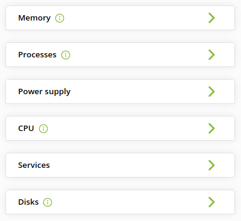

Pour que l'équipement Windows de destination réponde à WMI, il faut que son
pare-feu laisse passer les connexions entrantes correspondantes (voir
[exigences de pare-feu sous
Windows](#exigences-de-pare-feu-sous-windows-pour-la-supervision-sans-agent)).

## Commandes distantes : SSH et Windows

Un module de commande distante exécute une commande sur l'équipement de
destination et recueille sa sortie (types numérique, état, texte et incrémental :
voir [Référence des types de module](#reference-des-types-de-module)), avec trois
méthodes de connexion : **Hérité** (utilise le système d'exploitation configuré
dans l'agent lui-même), **SSH** pour Linux et **Contrôle distant de Windows**
(WinRM) pour Windows. Dans les trois cas, la commande se connecte avec un
identifiant du [gestionnaire d'identifiants](2.2-gestor-de-credenciales.md) — du
type identifiant générique — et le champ **Commande**, entre guillemets simples
quand il le faut (les guillemets doubles s'échappent avec `\"`).

L'assistant de la fiche de l'agent apporte trois modèles prêts : usage disque,
état d'un processus et état d'un service.

!!! example "Usage disque par SSH"
    Méthode SSH, identifiant de l'équipement Linux, commande :
    ```
    df -h / | tail -1 | awk '{print $5}' | tr -d '%'
    ```
    renvoie le pourcentage d'usage du disque racine comme valeur numérique.

!!! example "Processus nginx en marche"
    Méthode SSH, commande :
    ```
    pgrep -c nginx
    ```
    Un module booléen qui renvoie `0` s'il n'y a aucun processus `nginx` en
    cours, et un nombre plus grand s'il y en a.

Le **Contrôle distant de Windows** (WinRM) a besoin, comme WMI, que le pare-feu
de l'équipement de destination laisse passer les connexions entrantes
correspondantes (voir [exigences de pare-feu sous
Windows](#exigences-de-pare-feu-sous-windows-pour-la-supervision-sans-agent)
plus bas).

### Exigences de pare-feu sous Windows pour la supervision sans agent

Tant WMI que le contrôle distant de Windows ont besoin que le pare-feu de
l'équipement de destination ait activé ces règles d'entrée :

| Exigence | Détail |
|---|---|
| Partage de fichiers et d'imprimantes (SMB) | Règle **File and Printer Sharing (SMB-In)** |
| RPC (mappeur de points de terminaison) | Règle **File and Printer Sharing (Spooler Service - RPC-EPMAP)** |
| WMI | Règle **Windows Management Instrumentation (WMI-In)** |

Sans ces trois règles actives, l'équipement refuse la connexion même si les
identifiants et la requête ou la commande sont corrects.

## Plugins distants de serveur

Un **plugin distant** est un script ou un exécutable que le serveur Heavy lance
avec des paramètres et dont il recueille une unique valeur — numérique, booléenne
ou de texte — ; le type de donnée est décidé par le module (voir [Référence des
types de module](#reference-des-types-de-module)). Il en existe deux classes :
**standard**, qui ne renvoie que la valeur, et **Nagios**, qui, outre un code
d'erreur, peut renvoyer une chaîne descriptive. L'installation en apporte
plusieurs enregistrés d'usine et l'administrateur peut enregistrer ceux dont il a
besoin depuis **Gestion → Serveurs → Plugins**.

Lors de l'enregistrement d'un plugin, on indique son type, le **temps maximum**
d'exécution — 15 s au départ — et les macros de champ (`_field1_`, `_field2_`…)
que celui qui l'applique à un module utilisera, chacune avec sa description, son
texte d'aide, sa valeur par défaut et s'il faut la masquer dans le formulaire
(pour les mots de passe et les données sensibles). Le délai d'attente effectif
d'un plugin concret est le **plus court** entre celui configuré sur le serveur et
celui propre au plugin ; si aucun des deux n'est valide, on utilise 15 s en
dernier recours.

Dès qu'un plugin est utilisé par un module ou un composant, l'éditeur bloque ses
**Paramètres du plugin** et ses macros de champ : on ne peut plus en ajouter, en
retirer ni en modifier, pour ne pas casser les modules qui en dépendent déjà.
Pour changer les paramètres, il faut d'abord cesser d'utiliser le plugin dans
tous ses modules et composants.

### Macros des plugins

Les macros sont ce qui rend un plugin réutilisable : la commande est enregistrée
une seule fois avec des trous, et chaque module qui l'utilise remplit ces trous
avec ses propres valeurs. Il y a trois familles : les macros de champ, que
définit celui qui enregistre le plugin ; celles de l'agent et du module, que pose
le serveur ; et celles qui restent disponibles pour les alertes du module.

**Macros de champ.** Dans **Paramètres du plugin**, on écrit la ligne de
paramètres telle que l'attend le script, avec `_field1_`, `_field2_`… à la place
de chaque valeur. Dans **Macros des paramètres**, chacune est décrite :

| Champ | À quoi il sert |
|---|---|
| Description | Libellé du champ dans le formulaire du module |
| Valeur par défaut | Valeur avec laquelle le champ apparaît rempli à la création du module |
| Aide | Texte d'aide affiché à côté du champ |
| Masquer la valeur | Le champ s'affiche comme un mot de passe (points) et la valeur est enregistrée chiffrée |

L'**Aperçu de la commande** montre la ligne complète avec les valeurs par défaut
substituées, utile pour vérifier l'enregistrement avant de sauvegarder. À la
création d'un module de type plugin et au choix de ce plugin, le formulaire
montre un champ par macro, avec sa description, son aide et sa valeur par défaut.
Les valeurs masquées ne sont déchiffrées qu'au moment de lancer le plugin.

!!! example "Plugin propre avec utilisateur et mot de passe"
    Un script qui interroge l'état d'une application s'enregistre avec ces
    **Paramètres du plugin** :
    ```
    -H _field1_ -u _field2_ -p _field3_
    ```
    et trois macros : `_field1_` avec la description « Serveur », `_field2_`
    avec la description « Utilisateur » et la valeur par défaut `monitor`, et
    `_field3_` avec la description « Mot de passe » et **Masquer la valeur**
    coché. Dans le module, on remplit `192.168.10.20`, `monitor` et le mot de
    passe, qui s'affiche en points ; le serveur exécute le script avec
    `-H 192.168.10.20 -u monitor -p <mot de passe>`.

**Macros de l'agent et du module.** Outre celles de champ, la ligne de paramètres
admet ces macros (plus que les champs des autres modules distants, voir [Macros
dans les champs du module](#macros-dans-les-champs-du-module)), que le serveur
remplace chaque fois qu'il exécute le plugin :

| Macro | Remplacée par |
|---|---|
| `_agent_`, `_agentalias_` | Alias de l'agent |
| `_agentname_` | Nom de l'agent |
| `_agentdescription_` | Description de l'agent |
| `_agentgroup_` | Nom du groupe de l'agent |
| `_agentstatus_` | État de l'agent |
| `_address_` | Adresse IP principale de l'agent |
| `_addressn_N_` | Adresse IP numéro N de l'agent, adresses triées (`_addressn_2_` est la deuxième) |
| `_agentcustomfield_N_` | Valeur du champ personnalisé de l'agent dont l'identifiant est N |
| `_module_` | Nom du module |
| `_moduledescription_` | Description du module |
| `_modulegroup_` | Groupe du module |
| `_modulestatus_` | État du module |
| `_moduletags_`, `_name_tag_` | Tags du module |
| `_email_tag_`, `_phone_tag_` | Courriels et téléphones associés aux tags du module |
| `_interval_` | Intervalle du module, ou celui de l'agent si le module n'en a pas |
| `_target_ip_`, `_target_port_` | IP et port de destination configurés dans le module |
| `_policy_` | Nom de la politique dont provient le module, si c'est le cas |
| `_id_agent_`, `_id_module_`, `_id_group_` | Identifiants numériques de l'agent, du module et du groupe |

Le serveur remplace d'abord les macros de champ, puis celles-ci, si bien que la
valeur d'une macro de champ peut être à son tour l'une d'elles. C'est la façon
qu'a un même module de servir pour beaucoup d'agents : avec `_address_` comme
valeur, chaque agent vérifie sa propre IP.

!!! example "Un module de plugin pour tous les agents d'une politique"
    Dans le plugin **DNS Plugin**, le champ **DNS Server to check** se remplit
    avec `_address_` au lieu d'une IP fixe. Appliqué au moyen d'une [politique de
    supervision](2.10-politicas-de-monitorizacion.md) aux agents de tous les
    serveurs DNS de l'entreprise, chaque module interroge l'IP de son propre
    agent, sans toucher un seul module à la main.

!!! example "Champ personnalisé comme paramètre"
    Si les agents ont un champ personnalisé avec le port d'administration de
    chaque équipement (identifiant `3`), le paramètre `-p _agentcustomfield_3_`
    passe au plugin le port de chaque agent.

**Macros pour les alertes.** Dans les alertes d'un module de plugin restent
disponibles `_plugin_param1_`, `_plugin_param2_`… avec la valeur de chaque macro
de champ, et `_plugin_param1_desc_`, `_plugin_param2_desc_`… avec sa description.
Elles servent à ce que l'avis dise contre quoi la vérification a été exécutée
sans répéter les données dans le texte de l'alerte. Une macro avec **Masquer la
valeur** est aussi remplacée ici, et en clair : il ne convient pas d'utiliser
dans le texte d'une alerte la macro d'un mot de passe.

!!! example "Alerte qui dit quel serveur a échoué"
    Avec le plugin du premier exemple, le texte de l'alerte
    `Échec sur _plugin_param1_desc_ _plugin_param1_ (_module_)` arrive comme
    « Échec sur Serveur 192.168.10.20 (État application) ».

### Plugins d'usine

| Plugin d'usine | À quoi il sert |
|---|---|
| DNS Plugin | Résout un nom de domaine contre un serveur DNS indiqué |
| UDP port check | Vérifie si un port UDP répond |
| SMTP Check | Vérifie un serveur de messagerie sortant |
| MySQL Plugin | Exécute une requête contre un serveur MySQL |
| Packet Loss | Pourcentage de paquets perdus vers une destination |
| Check certificate validity | Validité et expiration d'un certificat |
| SSL Verification | Vérification de connexion SSL/TLS |
| IPMI Plugin | Lecture de capteurs IPMI (voir [9.12 · Découverte automatique avancée : IPMI et tâches de reconnaissance personnalisées](../parte-9/9.12-descubrimiento-automatico-avanzado-ipmi-y-reconocimiento.md)) |
| SNMP distant | Utilisé en interne par l'[assistant SNMP](#assistant-snmp) pour les modules calculés |

!!! example "Résolution DNS contre 8.8.8.8"
    Plugin **DNS Plugin** avec ses champs remplis ainsi : **Target IP**
    `192.168.10.30` (l'IP que le domaine doit renvoyer), **Domain to check**
    `midominio.com` et **DNS Server to check** `8.8.8.8`. Le module vérifie que
    `midominio.com` se résout en cette IP lorsqu'on interroge ce serveur DNS.

!!! example "Vérifier un serveur SMTP"
    Plugin **SMTP Check** pointant sur le port 25 du serveur de messagerie :
    module booléen qui échoue si le serveur cesse d'accepter les connexions
    SMTP.

!!! example "Port UDP ouvert"
    Plugin **UDP port check** avec l'IP et le port UDP du service à vérifier
    (par exemple, un serveur NTP sur le `123/udp`).

Créer un plugin propre, au lieu d'utiliser ceux d'usine, est expliqué dans
[9.9 · Création de plugins
distants](../parte-9/9.9-creacion-de-plugins-remotos.md).

## Supervision des routes

L'analyseur de routes trace le chemin réseau jusqu'à une destination et avertit
s'il change, ce que ni ICMP ni TCP ne font par eux-mêmes : il ne suffit pas de
savoir que la destination répond, mais par où passe le trafic pour l'atteindre.
Il s'appuie sur le plugin `route_parser` de l'EndPoint d'origine, qui combine
ping et traceroute :

```
route_parser -t <adresse_destination>
```

Il exige un EndPoint au point d'origine de la route et une atteinte par ICMP
jusqu'à la destination. Il se crée depuis l'onglet de plugins de la fiche de
l'agent, comme n'importe quel autre plugin local, et une fois activé il génère
une visualisation avec chaque saut de la route et le temps jusqu'à lui.

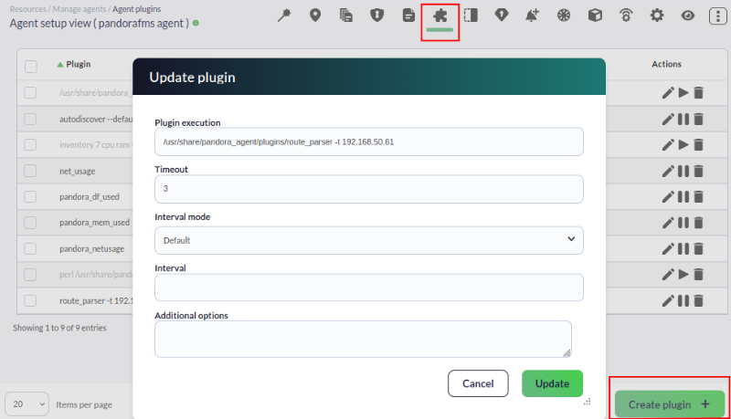

!!! example "Route vers un site distant"
    Sur l'EndPoint du siège central, `route_parser -t 172.16.0.2` (l'IP d'un
    équipement du site distant) laisse voir, saut par saut, par quels routeurs
    passe le trafic entre les deux sites et avertit si cette route change.

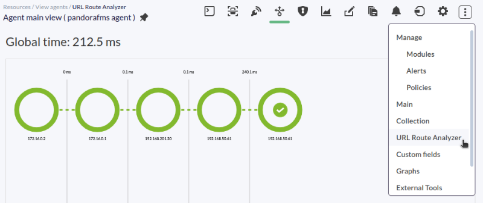

## Exécuter des assistants et des tests depuis un serveur distant (Exec Server)

Lorsque la console n'a pas de route directe vers un réseau, parce qu'il est
derrière un pare-feu ou sur un autre segment, les assistants SNMP et le
navigateur SNMP peuvent s'exécuter depuis un autre serveur qui l'atteint, par
exemple le [serveur satellite](../parte-6/6.2-servidores-satelite.md) d'un site
distant. Il se choisit dans le champ **Serveur pour exécuter la commande** de
l'assistant. Comment préparer ce serveur et quelles exigences il a est expliqué
dans [Serveurs satellite](../parte-6/6.2-servidores-satelite.md).

## Référence des types de module

| Type interne | Famille | Renvoie | À quoi il sert |
|---|---|---|---|
| `remote_icmp_proc` | ICMP | Booléen | Disponibilité par ping |
| `remote_icmp` | ICMP | Numérique | Latence en millisecondes |
| `remote_tcp` | TCP | Numérique | Temps de connexion au port |
| `remote_tcp_proc` | TCP | Booléen | Port ouvert ou fermé |
| `remote_tcp_string` | TCP | Texte | Réponse textuelle d'un service |
| `remote_tcp_inc` | TCP | Incrémental | Compteur lu par TCP |
| `remote_snmp` | SNMP | Numérique | Valeur d'un OID |
| `remote_snmp_inc` | SNMP | Incrémental | Compteur SNMP (trafic, paquets…) |
| `remote_snmp_string` | SNMP | Texte | OID de type chaîne |
| `remote_snmp_proc` | SNMP | Booléen | État dérivé d'un OID |
| `remote_cmd` | Commande distante | Numérique | Sortie numérique d'une commande |
| `remote_cmd_proc` | Commande distante | Booléen | Succès ou échec d'une commande |
| `remote_cmd_string` | Commande distante | Texte | Sortie textuelle d'une commande |
| `remote_cmd_inc` | Commande distante | Incrémental | Compteur lu par commande |
| `wmi_generic_data` | WMI | Numérique | Valeur numérique d'une requête WQL |
| `wmi_generic_proc` | WMI | Booléen | Résultat booléen d'une requête WQL |
| `wmi_generic_data_string` | WMI | Texte | Chaîne renvoyée par une requête WQL |
| `wmi_generic_data_inc` | WMI | Incrémental | Compteur lu par WMI |
| `wmi_generic_data_inc_abs` | WMI | Incrémental absolu | Différence entre deux lectures d'un compteur WMI |
| `generic_data` | Plugin | Numérique | Valeur numérique renvoyée par le plugin |
| `generic_proc` | Plugin | Booléen | Résultat correct ou en échec du plugin |
| `generic_data_string` | Plugin | Texte | Chaîne renvoyée par le plugin |
| `generic_data_inc` | Plugin | Incrémental | Compteur renvoyé par le plugin, comme taux |
| `generic_data_inc_abs` | Plugin | Incrémental absolu | Compteur renvoyé par le plugin, comme différence |

Un module de **plugin** n'a pas de famille de types propre : il utilise les types
génériques du tableau et c'est celui qui crée le module qui choisit celui qui
correspond à ce que renvoie le plugin.

Les types **booléens** (suffixe `_proc`) s'interprètent avec la même règle dans
tous les cas : `1` est un état correct (normal) et `0` un état critique. Les
**incrémentaux** enregistrent un **taux par seconde** : la différence entre deux
lectures divisée par le temps écoulé entre elles, pas la valeur brute du
compteur. Les **incrémentaux absolus** (suffixe `_inc_abs`) enregistrent la
différence entre deux lectures, sans diviser par le temps. Dans les deux cas, la
première lecture ne sert que de référence : le serveur l'écarte et le module
n'affiche aucune donnée avant la deuxième.

## Performance, réglage fin et diagnostic

La supervision distante est répartie entre trois serveurs, activés d'usine : le
**serveur réseau haute performance** (ICMP et SNMP par lots), le **serveur
réseau** (TCP, commandes distantes et WMI, et les modules SNMP qui échouent de
façon répétée) et le **serveur Heavy** (plugins distants). Ce que fait chacun et
comment ils se répartissent le travail est expliqué dans [Compatibilité et
migration vers la nouvelle architecture de
serveurs](../anexos/a3-compatibilidad-y-migracion-a-la-nueva-arquitectura-de-servidores.md).
Chacun a son propre nombre de threads, qui est la première chose à augmenter
lorsqu'un type de vérification commence à arriver en retard. Les threads, les
tentatives, les délais d'attente et les chemins des binaires sont dans [9.3 ·
Référence complète de configuration du
serveur](../parte-9/9.3-referencia-completa-de-configuracion-del-servidor.md).

Ports qu'il faut avoir ouverts depuis le serveur Pandora FMS jusqu'aux
équipements supervisés :

| Vérification | Port / protocole |
|---|---|
| ICMP | Protocole ICMP (sans port) |
| SNMP get | `161/udp` |
| WMI | Ceux qu'utilise le WMI distant lui-même sur l'équipement Windows de destination |
| SSH (commandes distantes) | `22/tcp`, sauf si un autre est configuré |

Les traps SNMP vont dans le sens inverse, de l'équipement vers le serveur, par le
`162/udp` (voir [Supervision des traps
SNMP](2.7-monitorizacion-de-traps-snmp.md)).

Lorsqu'un module distant reste en inconnu, la première chose à faire est de
répéter la même vérification à la main depuis le serveur Pandora FMS, pas depuis
le poste de l'administrateur, avec les mêmes identifiants :

```
snmpget -v 2c -c public 192.168.10.1 .1.3.6.1.2.1.1.3.0
```

Le diagnostic complet (logs, vérifications par type de module et causes
habituelles) se trouve dans [9.13 · Dépannage avec
Pandora](../parte-9/9.13-troubleshooting-con-pandora.md). Le dimensionnement des
threads et des serveurs pour de gros volumes est dans [9.14 · Analyse de
volumétrie et conceptions pour une haute
capacité](../parte-9/9.14-analisis-de-volumetria-y-disenos-para-alta-capacidad.md).
