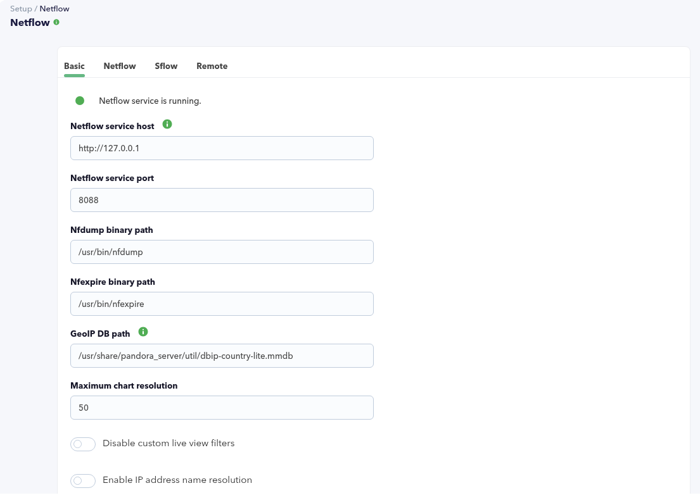
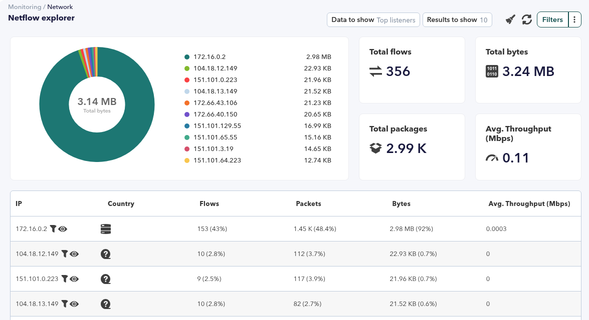
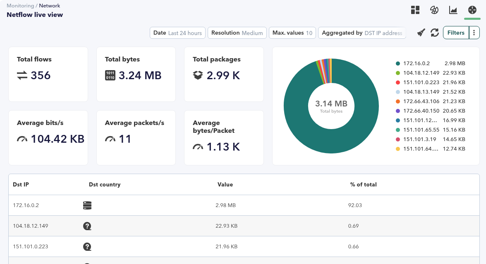
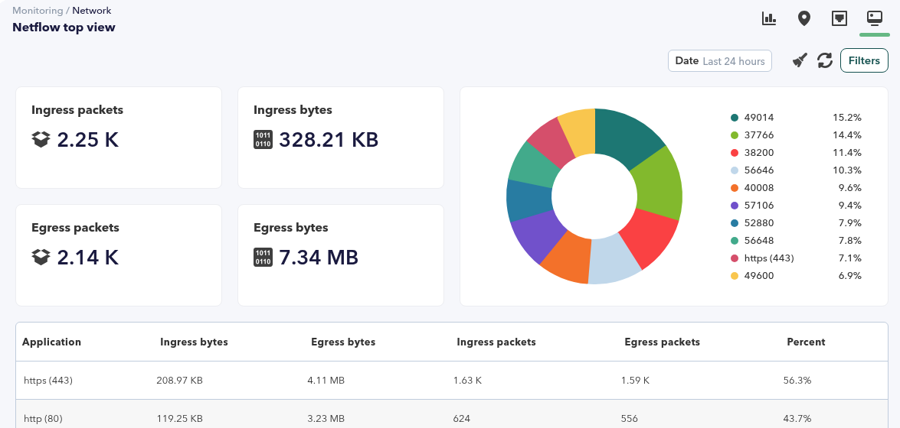
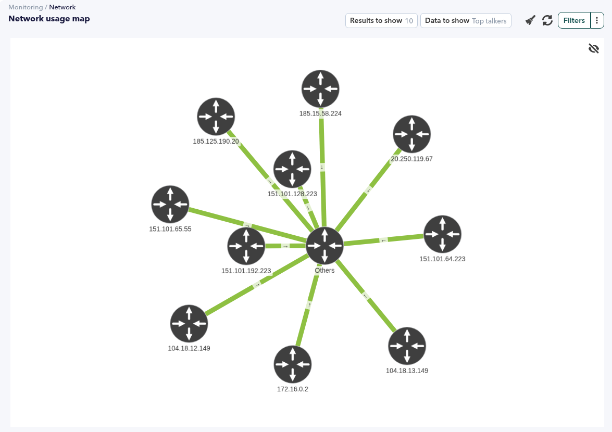
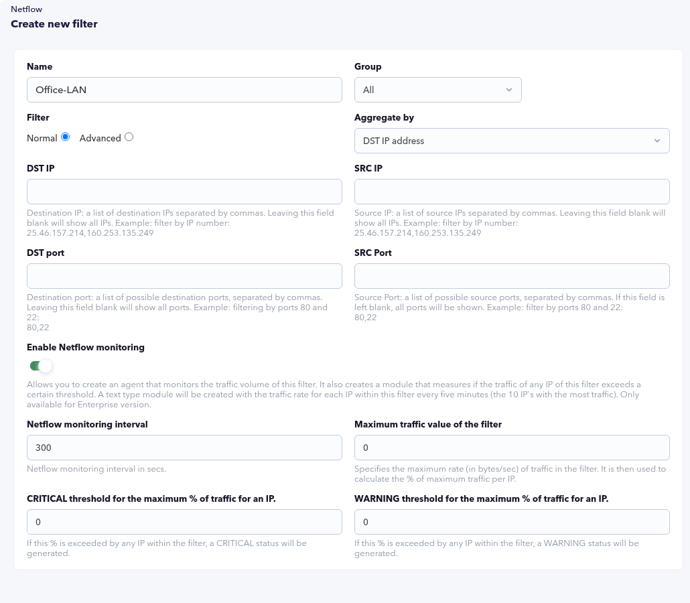

# Supervision du trafic avec NetFlow

Tout ce qui a été vu dans [Supervision des réseaux](2.6-monitorizacion-de-redes.md)
répond à une question : combien de trafic passe par une interface ? Netflow
répond à la suivante, celle qui compte vraiment quand la liaison sature : à qui
appartient ce trafic ? L'interrogation SNMP d'une interface donne un nombre qui
monte et descend ; l'analyse de flux dit quelle IP, quel port et quel protocole
le génèrent, sans rien installer sur l'équipement qui parle. Ce chapitre couvre
comment le trafic arrive dans Pandora FMS, comment il s'active et se configure,
comment il s'explore et se visualise, comment le convertir en modules avec
alertes, et comment il apparaît dans les rapports, les tableaux de bord et le
Command Center. Netflow et sFlow — deux formats d'exportation différents, l'un
de Cisco et l'autre né pour les réseaux à haut débit — s'activent séparément
mais se consultent et s'affichent ensemble sur tous les écrans.

## Concepts : flux, exportateur, sonde et collecteur

Un **flux** est un ensemble de paquets qui partagent les mêmes sept données :
IP et port source, IP et port de destination, protocole, interface d'entrée et
type de service (ToS). Tant que ces sept données ne changent pas, tous les
paquets qui traversent le routeur comptent comme le même flux, et ce qui est
enregistré n'est pas chaque paquet mais le flux agrégé : combien d'octets et
combien de paquets il a déplacés, entre quels instants.

Qui génère cette information est l'**exportateur** : normalement le routeur ou
le switch lui-même, s'il parle déjà NetFlow (versions 5, 9 ou le plus récent
IPFIX), sFlow, ou l'un des formats compatibles comme jFlow ou NetStream d'autres
fabricants. Quand l'équipement réseau ne sait pas exporter de flux — un switch
d'entrée de gamme, par exemple — l'alternative est une **sonde** : un équipement
qui écoute le trafic par un port miroir (*port mirroring*) et génère les flux
par logiciel, avec un outil comme `fprobe` ou `pmacct`.

À l'autre extrémité se trouve le **collecteur** : le processus qui reçoit ces
flux par UDP et les écrit sur disque. Dans Pandora FMS, ce sont `nfcapd`, pour
NetFlow, et `sfcapd`, pour sFlow, et ils vivent sur le serveur Pandora FMS
lui-même.

!!! example "Un switch sans NetFlow propre"
    Un switch d'accès qui n'exporte pas de flux se connecte à un port miroir
    d'une sonde `fprobe`, et c'est cette sonde — et non le switch — qui envoie
    les flux NetFlow au serveur Pandora FMS.

## Comment cela fonctionne dans Pandora FMS

La chaîne, dans la version 805, comporte cinq étapes. L'exportateur envoie les
flux par UDP au collecteur correspondant : `nfcapd` pour NetFlow, à l'écoute
par défaut sur le port `9995`, ou `sfcapd` pour sFlow, sur le `6343`. Les
collecteurs les écrivent chacun dans son propre chemin, à l'intérieur du
répertoire général de réseau configuré dans la console, dans des fichiers qui
tournent selon l'intervalle configuré (`netflow_interval`/`sflow_interval`).
Passé le nombre de jours de durée de vie maximale configuré, `nfexpire` purge
les fichiers les plus anciens.

Jusqu'ici, rien de très différent des versions précédentes. Ce qui change en
805, c'est la manière dont ces données sont consultées : ce n'est plus la
console elle-même qui exécute `nfdump` à la main, mais un **service de requêtes
Netflow** (`pandora_netflow_server`, un binaire propre écrit en Go) qui écoute
en HTTP sur `127.0.0.1:8088` et qui lance réellement `nfdump` — en local ou, si
cela est configuré, par SSH contre une autre machine — et renvoie à la console
le résultat déjà digéré. Les données de flux ne sont pas stockées dans la base
de données de Pandora FMS : les vues consultent les fichiers de capture à la
demande, même si toutes n'admettent pas les mêmes filtres. La supervision de
filtres suit une autre voie : le serveur Netflow exécute `nfdump` directement
pour calculer ses modules, sans passer par le service de requêtes.

Le serveur Pandora FMS est celui qui gère tout ce cycle de vie, mais pas de la
même façon pour les deux pièces. Les collecteurs `nfcapd` et `sfcapd` démarrent
une seule fois, au démarrage du serveur lui-même — si Netflow ou sFlow sont
activés à ce moment — et s'arrêtent quand on l'arrête ; activer ou désactiver
l'un des deux protocoles, ou changer son intervalle de rotation, n'a pas d'effet
réel avant le redémarrage suivant du serveur. Le service de requêtes, en
revanche, est vérifié toutes les cinq secondes : c'est le serveur qui le
démarre, le reconfigure ou l'arrête à la volée, sans se redémarrer lui-même —
nous le verrons en détail dans la section suivante —. Outre la consultation, il
existe une seconde voie pour tirer parti de ces données : la supervision de
filtres, qui convertit le trafic d'un filtre donné en modules normaux, avec
leurs alertes habituelles (voir [Superviser et alerter sur un
filtre](#superviser-et-alerter-sur-un-filtre)).

| Pièce | Ce qu'elle fait | Qui la démarre |
|---|---|---|
| `nfcapd` / `sfcapd` | Reçoivent les flux par UDP et les écrivent sur disque | Le serveur Pandora FMS |
| `pandora_netflow_server` | Consulte ces fichiers avec `nfdump` et sert les données en HTTP à la console | Le serveur Pandora FMS (comme service système) |
| `nfexpire` | Purge les fichiers de capture plus anciens que la durée de vie maximale configurée | Le serveur Pandora FMS, dans ses tâches de maintenance |

## Exigences et installation

| Exigence | Détail |
|---|---|
| `nfdump` 1.6.8 ou supérieur | Inclut les binaires `nfcapd`, `sfcapd` et `nfexpire` ; il s'installe séparément du paquet de Pandora FMS |
| Service `pandora_netflow_server` | Livré avec le serveur Pandora FMS, avec sa propre unité systemd ; c'est le serveur lui-même qui le démarre et le contrôle |
| Ports UDP des collecteurs ouverts | `9995/udp` pour NetFlow, `6343/udp` pour sFlow (ou ceux qui sont configurés), joignables depuis les exportateurs |
| Disque avec une bonne bande passante d'écriture | Les fichiers de capture grossissent vite dans les réseaux à fort trafic |
| Base de données GeoIP (facultatif) | Fichier `.mmdb` pour les fonctions qui consultent le pays d'une IP ; la carte d'utilisation du réseau ne représente pas les pays |
| Système Linux | Le serveur Pandora FMS qui exécute Netflow n'est pas pris en charge sous Windows |

Une fois les collecteurs en marche, le plus rapide pour vérifier que tout
fonctionne est de regarder si des fichiers de capture arrivent au chemin
configuré ; si rien n'arrive, le problème se situe avant Pandora FMS, dans
l'exportateur ou dans le pare-feu.

!!! example "Vérification rapide après l'installation"
    Avec `9995/udp` ouvert dans le pare-feu du serveur et un exportateur déjà
    pointé vers lui, vérifier dans le chemin de données de Netflow que de
    nouveaux fichiers `nfcapd.*` apparaissent à chaque intervalle configuré est
    le signe que la réception fonctionne, avant même de toucher à quoi que ce
    soit dans la console.

## Envoyer des flux à Pandora FMS

Un routeur ou un switch qui parle déjà NetFlow a seulement besoin qu'on lui
indique l'IP du serveur Pandora FMS et le port du collecteur : NetFlow v9 vers
le port `9995`, sFlow vers le `6343`. Cette configuration vit sur l'équipement
réseau lui-même et reste en dehors de Pandora FMS ; chaque fabricant a sa propre
syntaxe pour activer l'exportation.

Quand l'équipement ne sait pas exporter de flux, la sonde fait ce travail à sa
place. `fprobe` est l'option habituelle sous Linux pour générer du NetFlow à
partir d'une interface en mode promiscuité ou d'un port miroir ; `pmacct`
couvre le même cas, même si, dans un déploiement avec Pandora FMS, il est
considéré comme expérimental. Une fois en marche, `nfdump -R <chemin>` sur les
fichiers de capture confirme que les flux arrivent, sans passer par la console.

!!! example "Sonde fprobe sous Ubuntu"
    Sur une machine Ubuntu ayant la visibilité du trafic du réseau
    `192.168.10.0/24` (par exemple, raccordée à un port miroir du switch de ce
    réseau), `fprobe` exporte vers le serveur Pandora FMS :
    ```
    fprobe -i eth0 192.168.10.5:9995
    ```
    À partir de là, le collecteur `nfcapd` du serveur reçoit les flux de ce
    réseau exactement comme s'ils venaient d'un routeur avec NetFlow natif.

## Activer et configurer Netflow et sFlow dans la console

Netflow et sFlow s'activent séparément, chacun avec son interrupteur, dans
**Réglages → Configuration du système → Configuration générale**, onglet
**Fonctionnalités** : « Activer Netflow » et « Activer Sflow » — la console
n'utilise pas le même verbe pour les deux, mais ce sont le même type
d'interrupteur —. Sur la même page, onglet **Répertoires**, « Chemin réseau
général » fixe le répertoire de base où vivent les sous-répertoires de données
des deux protocoles.

Avec Netflow ou sFlow activés, une page de configuration propre apparaît,
**Réglages → Configuration du système → Netflow & Sflow** (« Netflow & Sflow »
dans le menu), organisée en onglets :

- **Basique.** Hôte et port du service de requêtes, chemins des binaires
  `nfdump` et `nfexpire`, chemin de la base GeoIP, résolution maximale des
  graphiques, un interrupteur pour désactiver les filtres personnalisés de la
  vue en direct et un autre pour activer la résolution de noms par IP — avec un
  avertissement explicite qu'elle peut être lente, car elle implique une requête
  DNS pour chaque IP qui apparaît dans le résultat —. Sous ces champs, un
  indicateur avec un point de couleur dit si le service de requêtes répond ou
  non.
- **Netflow** (visible uniquement avec Netflow activé). Sous-répertoire de
  données, chemin du démon `nfcapd`, port d'écoute, intervalle de rotation —
  `10`, `30` ou `60` minutes, avec l'avertissement que le changer exige de
  redémarrer le serveur — et durée de vie maximale des fichiers.
- **Sflow** (visible uniquement avec sFlow activé). Les mêmes champs que
  Netflow, avec le démon `sfcapd` et son propre port, avec une différence :
  l'intervalle de rotation n'est pas un sélecteur mais un champ de texte libre,
  en secondes (`3600` par défaut), et il ne porte pas l'avertissement de
  redémarrage.
- **Distant.** Activer la requête distante par SSH, hôte, port et utilisateur
  distants ; cela est expliqué en détail dans [Données Netflow sur une autre
  machine : nfdump distant](#donnees-netflow-sur-une-autre-machine-nfdump-distant).
  Avec la requête distante activée, le même indicateur d'état de l'onglet
  Basique ajoute une seconde ligne indiquant si cette connexion distante est
  joignable.



Lors de l'enregistrement d'un changement quelconque sur la page de configuration
de Netflow, c'est le serveur Pandora FMS lui-même qui constate que la
configuration a changé — il la vérifie toutes les cinq secondes — et régénère le
fichier de configuration du service de requêtes, en le redémarrant pour qu'il
prenne les nouvelles valeurs. Si ni Netflow ni sFlow ne sont activés, le serveur
arrête directement ce service de requêtes — les collecteurs, en revanche,
s'arrêtent seulement à l'arrêt du serveur lui-même, comme expliqué dans
[Comment cela fonctionne dans Pandora
FMS](#comment-cela-fonctionne-dans-pandora-fms) —.

| Option | Valeur par défaut |
|---|---|
| Hôte du service de requêtes | `http://127.0.0.1` |
| Port du service de requêtes | `8088` |
| Binaire `nfdump` | `/usr/bin/nfdump` |
| Binaire `nfexpire` | `/usr/bin/nfexpire` |
| Binaire collecteur Netflow (`nfcapd`) | `/usr/bin/nfcapd` |
| Binaire collecteur sFlow (`sfcapd`) | `/usr/bin/sfcapd` |
| Sous-répertoire de données de Netflow | `netflow` (sous le chemin réseau général) |
| Sous-répertoire de données de sFlow | `sflow` (sous le chemin réseau général) |
| Port du collecteur Netflow (`nfcapd`) | `9995` |
| Port du collecteur sFlow (`sfcapd`) | `6343` |
| Intervalle de Netflow | `30` minutes |
| Intervalle de sFlow | `60` minutes |
| Durée de vie maximale de Netflow | `5` jours |
| Durée de vie maximale de sFlow | `5` jours |
| Résolution maximale des graphiques | `50` |
| Base GeoIP | `/usr/share/pandora_server/util/dbip-country-lite.mmdb` |

Le chemin de données que les collecteurs et le service de requêtes utilisent
réellement provient de la réunion du « Chemin réseau général » (par exemple,
`/var/spool/pandora/data_in/`) avec le sous-répertoire de chaque protocole :
avec les valeurs d'usine, `/var/spool/pandora/data_in/netflow` pour Netflow et
`/var/spool/pandora/data_in/sflow` pour sFlow.

Le détail complet de chaque jeton, tant ceux de la console que ceux que lit le
serveur, se trouve dans [9.2 · Référence complète de configuration de la
console](../parte-9/9.2-referencia-completa-de-configuracion-de-la-consola.md)
et dans [9.3 · Référence complète de configuration du
serveur](../parte-9/9.3-referencia-completa-de-configuracion-del-servidor.md).

!!! example "Activer sFlow à côté de Netflow avec une semaine de rétention"
    Avec « Activer Netflow » et « Activer Sflow » cochés et « Chemin réseau
    général » dans `/var/spool/pandora/data_in`, on laisse dans l'onglet Sflow
    l'intervalle d'usine et on fixe la durée de vie maximale à `7` jours :
    passée une semaine, les fichiers de capture de sFlow se purgent seuls et
    les nouveaux continuent d'arriver.

## Filtres Netflow

Un **filtre Netflow** délimite le trafic consulté ou supervisé. L'Explorateur
et la Vue en direct admettent des filtres propres et des filtres enregistrés ;
la Vue supérieure n'offre pas de filtre de trafic. La Carte d'utilisation du
réseau emploie ses propres filtres, indépendants des filtres Netflow
enregistrés. Ces derniers se gèrent dans **Gestion → Ressources → Filtres
Netflow**, avec le droit d'écriture des agents.

Chaque filtre a un mode **normal**, avec IP et port de destination, IP et port
source (listes séparées par des virgules, vide signifie « tous ») et une
**agrégation** — par IP ou port source ou de destination —, ou un mode
**avancé**, avec la syntaxe de filtre propre à `nfdump` (semblable à celle de
`tcpdump`), pour ce que le mode normal ne couvre pas. Le filtre est affecté à un
groupe, comme toute autre ressource de Pandora FMS. Depuis les vues d'opération
qui les admettent (Explorateur et Vue en direct), les filtres enregistrés
peuvent être chargés sans les réécrire.

!!! example "Filtre de base d'un serveur"
    Mode normal, « Dst Ip » `192.168.10.20`, sans autre critère : il affiche
    tout le trafic qui a ce serveur comme destination, d'où qu'il vienne.

!!! example "Filtre avancé d'un sous-réseau sans DNS"
    Mode avancé, avec l'expression :
    ```
    src net 192.168.10.0/24 and not port 53
    ```
    Tout le trafic qui sort du réseau `192.168.10.0/24`, à l'exclusion du
    trafic DNS.

Le même filtre possède en outre les champs de **supervision** expliqués dans
[Superviser et alerter sur un filtre](#superviser-et-alerter-sur-un-filtre) :
l'activer n'est pas un écran à part, mais un interrupteur de plus à l'intérieur
du filtre lui-même.

Un filtre peut aussi être créé sans passer par la console, avec l'option
`--create_netflow_filter` du script de gestion en ligne de commande ou avec
l'opération `create_netflow_filter` de l'API, pour automatiser la création de
filtres répétitifs depuis l'extérieur de l'interface.

## Explorateur Netflow

**Opération → Supervision → Réseau → Explorateur Netflow.** C'est la vue pour
enquêter sur une période donnée : « Données à afficher » n'a que deux options,
**Top listeners** (qui reçoit le plus de trafic) et **Top talkers** (qui envoie
le plus de trafic), et « Résultats à afficher » se choisit parmi `5`, `10`,
`15`, `20`, `25`, `50`, `100` ou `250` (`10` d'usine). Le reste est la plage de
dates et les mêmes onglets de filtre basique et avancé que le reste des vues,
avec la possibilité d'enregistrer le filtre utilisé ou de charger un filtre déjà
enregistré. Le résultat peut être exporté en CSV, et chaque IP du tableau porte
un lien direct vers une requête whois, sans quitter l'explorateur.



!!! example "Les plus gros émetteurs du dernier jour"
    « Données à afficher » sur **Top talkers**, « Résultats à afficher » sur
    `10`, plage de dates les dernières 24 heures, filtre avancé
    `src net 192.168.10.0/24` : le tableau obtenu est celui des 10 équipements
    de ce réseau qui ont généré le plus de trafic dans la journée.

## Vue en direct

**Opération → Supervision → Réseau → Netflow en temps réel.** C'est la vue
conçue pour suivre le trafic presque en temps réel plutôt que pour enquêter sur
un historique : période (prédéfinie, personnalisée ou relative, comme « cette
semaine » ou « ce mois-ci »), filtre basique ou avancé, agrégation, nombre
maximal d'agrégats à afficher et résolution du graphique. Les types de graphique
disponibles ici ne sont que quatre — **résumé**, **graphique en aires**,
**maillage circulaire** et **trafic détaillé par hôte** — ; les autres types de
graphique qui existaient dans les versions précédentes de cette vue (tableau de
données, Top-N des connexions, sources, applications et protocoles) ont été
déplacés vers la [Vue supérieure](#vue-superieure). Le filtre utilisé peut être
enregistré ou mis à jour sans quitter la vue.



L'onglet avancé de cette vue inclut en outre « Adresse IP source de Netflow »,
un champ qui n'est pas disponible lors de la modification d'un filtre
enregistré depuis Gestion. Il permet de limiter les flux par l'IP de
l'exportateur (routeur ou switch, et non l'IP source du trafic), mais il ne
s'applique que si l'expression du filtre avancé est laissée vide et que les
critères normaux sont utilisés. Avec une expression avancée, le champ de
l'exportateur ne restreint pas la requête.

!!! example "Trafic par port de destination dans la dernière heure"
    Filtre avancé `src net 192.168.10.0/24`, agrégation par port de
    destination, période la dernière heure, type de graphique graphique en
    aires : on voit d'un coup d'œil quels ports concentrent le trafic sortant
    de ce réseau en temps quasi réel.

!!! example "Seulement les flux d'un routeur donné"
    Avec plusieurs exportateurs envoyant des flux au même serveur, « Adresse IP
    source de Netflow » à `192.168.10.1` limite la vue aux flux que ce routeur a
    exportés, même si le filtre ne touche ni la source ni la destination du
    trafic. Laisser vide l'expression du filtre avancé pour que le champ de
    l'exportateur s'applique.

## Vue supérieure

**Opération → Supervision → Réseau → Vue supérieure de Netflow.** Quatre
répartitions sur la même période : **Applications**, **Protocoles réseau**,
**Sources de flux Netflow** (quel routeur et quelle interface ont exporté le
plus de flux, avec la dernière fois que chaque IP a été vue) et **Connexions**
(le Top-N des connexions qui, dans les versions précédentes, se trouvait dans la
vue en direct). Les pourcentages d'un Top-N ne doivent pas forcément totaliser
100. La période peut être choisie, mais cet écran ne permet pas d'appliquer un
filtre d'IP, de port ou d'expression avancée.



!!! example "Quelle application consomme le plus de bande passante cette semaine"
    Répartition « Applications » et période la dernière semaine : le tableau
    trie les applications détectées par volume de trafic, du plus grand au plus
    petit, sans restreindre le résultat à un réseau comme `192.168.10.0/24`.

## Carte d'utilisation du réseau

**Opération → Supervision → Réseau → Carte d'utilisation du réseau.** Elle
représente le trafic comme une carte de connexions entre nœuds, au lieu d'un
tableau ou d'un graphique : chaque ligne entre deux points représente le trafic
observé selon la période et le filtre avancé appliqué. Ici, on peut choisir les
émetteurs ou les récepteurs, le nombre de résultats et enregistrer des filtres
propres à la carte. Elle n'affiche pas de pays et ne géolocalise pas les nœuds,
même si une base GeoIP est configurée.



!!! example "Voir d'un coup d'œil les connexions sortantes d'un réseau"
    Avec « Données à afficher » sur **Top talkers**, `10` résultats et un
    filtre avancé `src net 192.168.10.0/24`, la carte montre les connexions
    entre les nœuds de ce trafic ; elle ne situe pas les destinations sur une
    carte géographique.

## Superviser et alerter sur un filtre

La supervision d'un filtre convertit son trafic en modules d'agent. Elle
s'active depuis l'éditeur du filtre lui-même, avec « Activer la supervision de
Netflow ». Avec le serveur Netflow activé (`netflowserver 1`) et la création
automatique d'agents activée, l'agent `Netflow_<nom du filtre>` est créé et
trois modules y sont ajoutés ; si l'agent existe déjà, il est réutilisé :



| Module | Ce qu'il mesure |
|---|---|
| Débit (`<filtre>_throughput`) | Trafic total du filtre (module avec l'étiquette `bps`) |
| État du débit (`<filtre>_throughput_status`) | Normal, avertissement ou critique, selon les seuils configurés |
| Top 10 (`<filtre>_throughput_data`) | Les 10 IP ayant le plus de trafic dans le filtre, avec leur débit et un rapport au maximum configuré, en texte |

L'intervalle de cette supervision se fixe par filtre — cinq minutes au départ
—. Le module d'état distingue normal (`0`), avertissement (`1`) et critique
(`2`) en comparant le trafic des IP aux seuils configurés. Le formulaire
étiquette le trafic maximal en octets par seconde et présente les seuils en
pourcentages, mais le calcul de l'état n'applique pas une conversion cohérente
entre les unités du débit et celles de ce maximum. On ne peut pas déduire de ces
étiquettes une valeur de seuil garantissant le résultat attendu ; il convient de
vérifier l'état avec un trafic connu avant d'associer une alerte. Ces modules
admettent des alertes comme tout autre module ; leur configuration est expliquée
dans [Alertes et notifications](../parte-5/5.5-alertas-y-notificaciones.md).

!!! example "Vérifier la supervision avant d'associer une alerte"
    Dans un filtre sur le réseau `192.168.10.0/24`, fixer l'intervalle à `300`
    secondes et vérifier que l'agent `Netflow_<nom du filtre>` reçoit le module
    de débit, l'état et le Top 10. Comparer la valeur de l'état avec un trafic
    mesuré avant de l'utiliser comme condition d'alerte ; le formulaire à lui
    seul ne garantit pas l'équivalence entre octets/s et bits/s.

## Rapports et tableaux de bord

Quatre types de graphique — **graphique en aires**, **résumé**, **tableau de
données** et **Top-N des connexions** — sont disponibles comme éléments de
rapport, chacun avec son propre filtre, période, résolution et nombre maximal de
valeurs ; voir [5.2 · Rapports](../parte-5/5.2-informes.md) pour le reste des
éléments de rapport et la manière de les combiner. Le widget Netflow des
tableaux de bord va plus loin : il offre les neuf types de graphique de Netflow
— les quatre précédents plus le maillage circulaire, le trafic détaillé par
hôte, les sources, les applications et les protocoles — et en outre une carte
d'utilisation du réseau, avec sa propre période, son agrégation, ses « Données à
afficher » (Top listeners/Top talkers) et son nombre maximal de valeurs ; voir
[5.1 · Tableaux de bord](../parte-5/5.1-dashboards.md).

!!! example "Rapport hebdomadaire du Top-N des connexions"
    Élément de rapport Top-N des connexions, filtre sur le réseau
    `192.168.10.0/24`, période hebdomadaire, maximum `10` valeurs : chaque
    semaine, le rapport consigne quelles connexions ont concentré le plus de
    trafic.

## Données Netflow sur une autre machine : nfdump distant

Quand le volume de trafic est élevé et qu'il convient de stocker les fichiers de
capture sur un disque dédié, sur une autre machine, le service de requêtes peut
exécuter `nfdump` par SSH contre cet équipement distant au lieu de le faire en
local. Cela s'active dans l'onglet **Distant** de la configuration de Netflow,
avec l'hôte, le port et l'utilisateur de connexion. Le service de requêtes
tourne comme un service système sous l'utilisateur `root`, donc la clé SSH qu'il
faut autoriser au préalable dans le `authorized_keys` de l'utilisateur distant
est celle de `root` de la machine où tourne ce service, sans mot de passe : le
service n'a aucun moyen de le saisir de manière interactive. La vérification de
connectivité qui alimente l'indicateur d'état utilise en outre le mode par lots
(sans rien demander à l'écran) et un délai d'attente court, de quelques secondes,
avant de la considérer comme tombée. Avec la requête distante activée,
l'indicateur d'état de l'onglet Basique ajoute une seconde ligne qui dit si cette
connexion SSH est joignable à ce moment.

Dans ce montage, les collecteurs et `nfexpire` continuent de tourner là où il
convient : si les fichiers de capture vivent sur l'équipement distant, la purge
par ancienneté doit également y être programmée, par exemple avec une tâche
`cron` qui appelle `nfexpire` avec la même durée de vie maximale configurée dans
la console.

!!! example "Stocker la capture sur un serveur de stockage dédié"
    La clé publique de `root` du serveur Pandora FMS ayant déjà été ajoutée au
    `authorized_keys` d'un utilisateur sur `192.168.10.50`, on active « Enable
    Remote Nfdump » avec l'hôte `192.168.10.50`, le port `22` et ce même
    utilisateur : les vues d'opération continuent de fonctionner de la même
    façon, mais chaque requête est résolue par `nfdump` sur cette machine
    distante, et non sur le serveur Pandora FMS lui-même.

## Netflow dans le Command Center

Dans une architecture avec [Command Center](../parte-6/6.3-command-center.md),
chaque nœud continue d'avoir son propre service de requêtes Netflow, avec ses
propres collecteurs et sa propre configuration. Le Command Center ne centralise
pas les données de flux — les nœuds ne le font pas non plus, car ils les
consultent à la demande — : lorsque des données Netflow sont demandées depuis la
console du Command Center, celle-ci appelle l'API distante de chaque nœud
concerné et réunit les réponses, sans que le trafic lui-même passe par le
Command Center.

## Permissions

Les permissions ne sont pas identiques sur tous les écrans. L'Explorateur et la
Carte d'utilisation du réseau vérifient la lecture des agents (AR) ; la Vue en
direct et la Vue supérieure admettent la lecture (AR) **ou** l'écriture (AW).
Gérer la liste des filtres Netflow exige AW, tandis que le formulaire de création
et de modification vérifie l'écriture sur les ressources (RW) et, pour un filtre
existant, son groupe. Enregistrer ou modifier les filtres propres à la carte
exige AW. Un filtre de la carte n'équivaut pas à un filtre Netflow affecté à un
groupe.

| Exigence | Détail |
|---|---|
| Explorateur et Carte d'utilisation du réseau | Lecture des agents (AR) |
| Vue en direct et Vue supérieure | Lecture des agents (AR) ou écriture des agents (AW) |
| Gérer la liste des filtres Netflow | Écriture des agents (AW), avec une liste limitée aux groupes accessibles |
| Créer ou modifier un filtre Netflow | Écriture sur les ressources (RW) ; pour modifier un filtre existant, également l'accès à son groupe |
| Enregistrer ou modifier les filtres de la carte | Écriture des agents (AW) |
