# Inventaire

Il y a une question qui apparaît tôt ou tard dans tout service informatique,
presque toujours au mauvais moment : « et nous, qu'est-ce que nous avons ? ». Pas
ce qui est au vert ni quelle alerte s'est déclenchée ce matin, mais quelles
machines existent, avec quel processeur, quel logiciel elles ont installé, qui y
possède un compte et quels services elles lancent au démarrage. Y répondre à la
main relève de l'archéologie : on ouvre une session ici, on regarde un `uname`
là-bas et on prie pour que personne n'ait installé quelque chose qu'il ne fallait
pas. L'**inventaire** de Pandora FMS existe pour ne pas avoir à faire cette
archéologie : il collecte ces données tout seul, sur chaque équipement supervisé,
et les laisse consultables et exportables.

## Ce qu'est l'inventaire

L'inventaire est la partie de Pandora FMS qui répond à « qu'est-ce qu'il y a »,
et non à « comment ça va ». C'est une distinction qu'il faut poser clairement dès
le départ : un module de supervision a des seuils, des états et des alertes ; une
donnée d'inventaire n'en a pas. Personne ne recevra un avis parce qu'un
équipement a la version 1.2 d'une bibliothèque installée. L'inventaire est une
photographie, et sa valeur tient à la possibilité de comparer des photographies :
ce qui a changé depuis hier, quel logiciel est apparu, quel utilisateur a été
créé sans que personne le sache.

C'est pourquoi l'inventaire est **indépendant de la supervision**. Il est
collecté à part, stocké à part et consulté à part, même s'il vit dans la même
console et alimente les mêmes rapports. Un équipement peut être parfaitement
supervisé et ne pas avoir une seule donnée d'inventaire, et l'inverse est vrai
aussi.

Les données peuvent être collectées par deux chemins :

- **De façon locale**, avec l'EndPoint installé sur la machine. L'EndPoint exécute
  les *plugins* d'inventaire et envoie le résultat.
- **De façon distante**, avec les **modules d'inventaire** que le serveur de
  Pandora FMS exécute contre une machine du réseau : *queries* WMI, commandes par
  SSH ou n'importe quel *script* qui renvoie le format attendu.

L'inventaire alimente des listes et des rapports : depuis une liste de logiciels
installés sur toute la flotte jusqu'à un rapport de changements de configuration
d'un équipement réseau. Cela est traité plus bas.

## Modules d'inventaire : le catalogue

Tout commence par un **module d'inventaire**. C'est la pièce qui définit *ce qui*
est collecté, et elle a trois données qui comptent : un **nom**, le **système
d'exploitation** auquel il s'applique et une liste de **champs** séparés par des
points-virgules. Quand le module collecte des données, chaque ligne du résultat
est découpée selon ces champs et affichée sous forme de tableau. Si le format dit
`Model;Size`, la console saura que la première colonne est le modèle et la
seconde la taille.

Pandora FMS fournit un catalogue de modules par défaut assez large, réparti par
système d'exploitation. Voici les principaux :

| Système d'exploitation | Ce qui peut être inventorié |
|---|---|
| **Linux** | Processeur, mémoire, cartes vidéo et réseau, disques, CD-ROM, logiciels installés, services de démarrage, systèmes de fichiers, processus, utilisateurs, adresses IP et routes |
| **Windows** | Tout ce qui précède, plus les moniteurs, la carte mère, les correctifs installés, les imprimantes, les services installés, les produits et clés Microsoft (MS-Products, product_ID, product_key) |
| **Solaris** | Processeur, mémoire, cartes réseau et logiciels |
| **Cisco** | Configuration de l'équipement, interfaces (par *script* local ou par SSH) et informations générales |
| **Android** | Logiciels installés |

Le catalogue est ce que la console propose ; ce que l'EndPoint collecte de
lui-même et ce qui est demandé à distance est décrit dans les deux sections
suivantes.

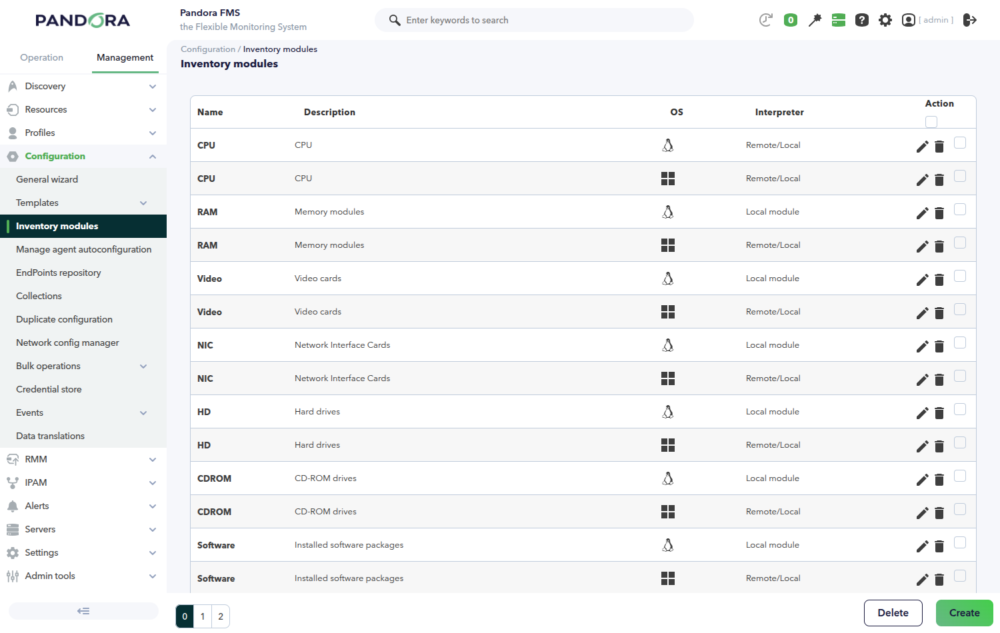

Il y a un détail qui coûte plus d'une heure perdue et qu'il vaut la peine de dire
à voix haute : **le système d'exploitation du module doit correspondre à celui de
l'EndPoint**. Si un module est marqué Windows et que vous essayez de l'assigner à
un EndPoint Linux, il n'apparaîtra pas dans la liste. Ce n'est pas une erreur de
la console : le module est pensé pour un autre système.

Où tout cela se gère : **Gestion → Configuration → Modules d'inventaire**.

## Inventaire local avec les EndPoints

Le chemin local est le plus commode quand l'EndPoint est déjà installé : la
machine se regarde elle-même et envoie le résultat. Il n'y a pas de port à ouvrir
ni d'identifiants de qui que ce soit à stocker.

### Linux

Sous Linux, l'EndPoint embarque un *plugin* appelé `inventory`. Il s'active avec
une ligne dans le fichier de configuration `pandora_agent.conf` :

```text
module_plugin inventory 1 cpu ram video nic hd cdrom software init_services filesystem users route
```

La ligne se lit en trois parties. D'abord l'activation du module. Ensuite un
nombre qui est **tous les combien de jours** il s'exécute : si l'on met `0`,
l'inventaire est envoyé **à chaque exécution de l'EndPoint**. Et à la fin, la
liste des objets à collecter. Si l'on ne laisse que le nombre, tout ce qui est
disponible est collecté :

```text
module_plugin inventory 1
```

Les objets que le *plugin* comprend sont : `cpu`, `ram`, `video`, `nic`, `hd`,
`cdrom`, `software`, `init_services`, `filesystem`, `process`, `users`, `ip`,
`route` et `kernel`.

| Exigence | Détail |
|---|---|
| `lshw` ou `hwinfo` installé | Le *plugin* les utilise pour le matériel. Sans l'un des deux, seuls les logiciels, les services de démarrage, les systèmes de fichiers, les processus et les routes sont collectés |
| Permissions root | Certains objets (par exemple, la liste des utilisateurs ou le matériel) demandent des privilèges élevés |

Le *plugin* note sur la machine elle-même quand il s'est exécuté pour la dernière
fois, de sorte que l'intervalle en jours est respecté même si l'EndPoint démarre
plusieurs fois par jour.

### Windows

Sous Windows, l'inventaire local ne s'active pas avec une seule ligne, comme sous
Linux. Ici, **chaque objet d'inventaire est un module à part**, et chaque module
appelle son propre *script*. L'EndPoint fournit l'exemple dans le fichier de
configuration (en commentaire) ; vous décommentez ce que vous voulez utiliser et
vous redémarrez l'EndPoint. Chaque module a cette forme :

```text
module_begin
module_plugin cscript.exe //B //t:20 "%PROGRAMFILES%\Pandora_Agent\util\cpuinfo.vbs"
module_end
```

Les *scripts* fournis par l'EndPoint Windows couvrent, chacun, un objet :

| Objet | *Script* de l'EndPoint |
|---|---|
| Processeur | `cpuinfo.vbs` |
| Mémoire | `raminfo.vbs` |
| Disques | `diskdrives.vbs` |
| CD-ROM | `cdromdrives.vbs` |
| Carte vidéo | `videocardinfo.vbs` |
| Cartes réseau | `ifaces.vbs` |
| Moniteurs | `monitors.vbs` |
| Imprimantes | `printers.vbs` |
| Logiciels installés | `software_installed.vbs` |
| Produits et KB Microsoft | `ms_products.exe` |
| Utilisateurs | `userslogged.vbs` |
| Clé et ID de produit | `productkey.vbs`, `productID.vbs` |

Un détail à regarder avant de laisser les choses en l'état : l'exemple d'usine
ajoute `module_absoluteinterval 7d` à chaque module, ce qui fait que l'inventaire
s'exécute **une fois tous les sept jours**, indépendamment de l'intervalle de
l'EndPoint. Si vous voulez que l'inventaire suive la fréquence normale de
l'EndPoint, vous supprimez cette ligne. Un inventaire hebdomadaire devient vite
obsolète.

### Les modules locaux apparaissent seuls

Voici la différence pratique avec l'inventaire distant, et elle mérite d'être
soulignée parce qu'elle épargne pas mal de travail : **les modules locaux ne
s'assignent pas à la main dans la console**. Il suffit que le module existe dans
le catalogue avec le bon système d'exploitation et que l'exécution soit définie
dans le fichier de l'EndPoint. Quand la première donnée arrive, la console crée
le module dans la fiche de l'agent et le laisse visible dans son onglet
**Inventaire**.

### Créer ses propres modules locaux

En plus de ceux qui viennent de série, vous pouvez créer vos propres modules
d'inventaire pour Linux et Windows. La procédure est la même que pour le distant,
avec deux exceptions : les champs **Interpréteur** et **Code** ne sont pas
remplis, et il faut un *script* qui renvoie un XML de cette structure :

```xml
<inventory>
  <inventory_module>
    <name>NOMBRE_DEL_MODULO</name>
    <type>generic_data_string</type>
    <datalist>
      <data>DATO1;DATO2;DATO3</data>
    </datalist>
  </inventory_module>
</inventory>
```

Le nom doit être exactement celui qui a été donné au module dans la console, et
chaque `<data>` est une ligne avec les champs séparés par `;` tels qu'ils ont été
déclarés dans le **Format**.

Le *script* se déclare dans `pandora_agent.conf` comme un *plugin* de plus :
l'EndPoint exécute la commande et insère sa sortie telle quelle dans le XML qu'il
envoie au serveur, si bien que le *script* doit seulement imprimer le bloc
`<inventory>` sur la sortie standard. Sous Linux, un *script* shell et la ligne
qui le lance se présentent ainsi :

```sh
#!/bin/sh
# /etc/pandora/plugins/mi_inventario.sh

echo "<inventory>"
echo "  <inventory_module>"
echo "    <name>MiInventario</name>"
echo "    <type>generic_data_string</type>"
echo "    <datalist>"
echo "      <data>uno;dos</data>"
echo "      <data>tres;cuatro</data>"
echo "    </datalist>"
echo "  </inventory_module>"
echo "</inventory>"
```

```text
# pandora_agent.conf
module_plugin /etc/pandora/plugins/mi_inventario.sh
```

Le répertoire de *plugins* de l'EndPoint (`/etc/pandora/plugins`) est dans le
`PATH`, donc le *script* peut aussi être appelé par son nom
(`module_plugin mi_inventario.sh`). Sous Windows, la ligne suit le même schéma
que les modules de série, avec `module_begin` et `module_end`, et le *script*
imprime le même XML :

```text
# pandora_agent.conf
module_begin
module_plugin cscript.exe //B //t:20 "%PROGRAMFILES%\Pandora_Agent\util\mi_inventario.vbs"
module_end
```

Et l'avertissement d'ordre : **il faut créer le module dans la console avant de
redémarrer l'EndPoint**, sinon la donnée arrivera et il n'y aura nulle part où la
garder.

## Inventaire distant : créer le module et l'assigner

Le chemin distant est celui que l'on utilise quand il n'y a pas d'EndPoint sur la
machine : un équipement réseau, un serveur sur lequel on ne veut rien installer
ou un équipement accessible uniquement par SSH. Ici, c'est le **serveur** de
Pandora FMS qui travaille : il exécute le *script* du module contre la cible et
garde le résultat.

### Créer le module

Cela se fait dans **Gestion → Configuration → Modules d'inventaire**, avec le
bouton **Créer**. Les champs du formulaire sont ceux-ci :

| Champ | Détail |
|---|---|
| **Nom** | Obligatoire ; l'identifiant du module |
| **Description** | Texte libre |
| **SE** | Obligatoire ; doit correspondre à celui de la cible |
| **Interpréteur** | L'interpréteur avec lequel le *script* est exécuté (Shell, Perl…). **Il reste vide uniquement pour les modules locaux** |
| **Format** | Obligatoire ; les champs que le module renvoie, séparés par `;` |
| **Mode bloc** | Interrupteur ; le résultat du module est traité comme un bloc unique (voir plus bas) |
| **Mode script** | Choix entre **Mode script** (on indique un **Chemin du script**) et **Utiliser du code en ligne** (on écrit le **Code** directement) |

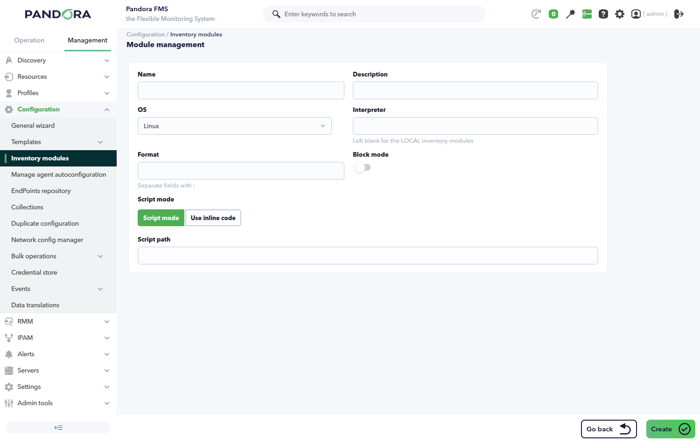

L'avertissement classique, et il tient toujours : **si le Format reste vide, le
module n'est pas enregistré et ce qui a été écrit est perdu**. C'est le champ que
l'on oublie le plus et celui qui gêne le plus quand on l'oublie.

### Ce que le script doit renvoyer

Voici la différence avec l'inventaire local, et il vaut mieux l'avoir claire
parce que c'est elle qui fait échouer les premiers essais : le *script* distant
**ne renvoie pas un XML**. Le XML avec `<inventory>` est l'affaire de l'EndPoint ;
le module distant renvoie du **texte brut**, avec **un enregistrement par ligne**
et les champs séparés par `;`, dans le même ordre que le **Format** du module. Le
serveur garde cette sortie telle quelle et la console la peint comme un tableau,
en utilisant le Format comme en-tête.

Le *script* reçoit comme arguments la **cible** (la valeur du champ *Cible*) puis,
soit les **champs personnalisés** dans l'ordre où ils ont été créés, soit
l'**utilisateur et le mot de passe**. Avec cela, il interroge la machine distante
et sort une ligne par élément.

Un exemple minimal : un module avec **Format** `Campo1;Campo2`, **Interpréteur**
`/bin/sh` et ce **Code** :

```sh
#!/bin/sh
# $1 est la cible ; ensuite viennent les champs personnalisés ou l'utilisateur et le mot de passe
destino="$1"

# ... ici on interroge $destino ...

echo "uno;dos"
echo "tres;cuatro"
```

Cela laisse deux enregistrements, un par ligne, avec deux champs chacun. Un
module réel fait exactement la même chose, sauf qu'il remplit chaque ligne avec
ce que renvoie l'interrogation : le module de CPU Windows fourni par Pandora
imprime une ligne par processeur avec `nombre;velocidad;descripción`, et celui de
Cisco sort une seule ligne avec `IP;hardware;número de serie;IOS`.

Si le module est en **Mode bloc**, la sortie n'est pas découpée en
enregistrements : elle est stockée entière comme un bloc de texte unique, et
c'est ce qui est ensuite comparé dans la vue des différences.

### L'assigner à l'EndPoint

L'assignation se fait dans la fiche de l'agent, dans l'onglet **Inventaire**
(Gestion → Ressources → Gérer les agents → agent → Inventaire). Le formulaire de
création demande :

| Champ | Détail |
|---|---|
| **Module** | Le module d'inventaire à ajouter ; seuls apparaissent ceux qui correspondent au SE de l'EndPoint |
| **Intervalle** | Tous les combien il s'exécute (par défaut, une heure) |
| **Cible** | IP ou nom de la machine dont l'inventaire est extrait |
| **Utiliser des champs personnalisés** | Remplace l'utilisateur et le mot de passe par des champs propres, avec un nom |
| **Utilisateur** et **Mot de passe** | Identifiants de la cible ; ils admettent les macros de champ personnalisé de l'EndPoint |

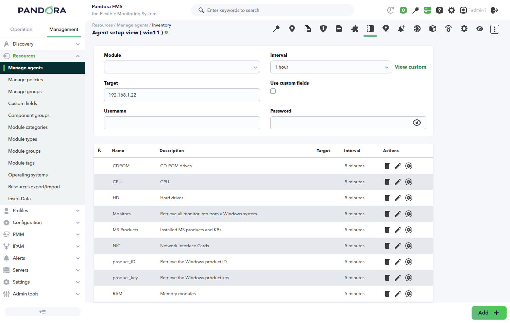

Avec **Utiliser des champs personnalisés**, on crée des champs avec un nom, on
leur donne une valeur et on coche **C'est un mot de passe** sur ceux qui doivent
être stockés de façon obfusquée. Ces champs sont passés au *script* dans le même
ordre qu'à leur création. Une fois le module assigné, le tableau de l'onglet
permet de **Forcer** une exécution immédiate (utile pour ne pas attendre
l'intervalle), de le modifier ou de le supprimer.

En dessous, le serveur construit la commande avec l'interpréteur, le chemin du
*script* ou le code en ligne, la cible et les identifiants (ou les champs
personnalisés), et l'exécute avec un **délai d'attente** configurable. Si la
commande échoue, l'inventaire de ce cycle n'est simplement pas mis à jour.

## Consulter les données d'inventaire

Il y a deux façons de regarder l'inventaire, et chacune sert à une chose.

### L'onglet Inventaire de l'agent

Dans la vue d'un agent (les autres onglets sont dans [2.21](../parte-2/2.21-configuracion-comun-de-los-agentes.md#les-onglets-de-la-vue-de-lagent)), l'onglet **Inventaire** montre tous ses modules, l'un sous
l'autre. En haut, il y a un sélecteur de **Module**, un sélecteur de **Date** (par
défaut, *Maintenant*) et un champ de recherche. Chaque module est peint comme un
tableau, avec le **Format** comme en-tête et un **Total** d'enregistrements en
pied. C'est la vue pour regarder une machine précise tranquillement.

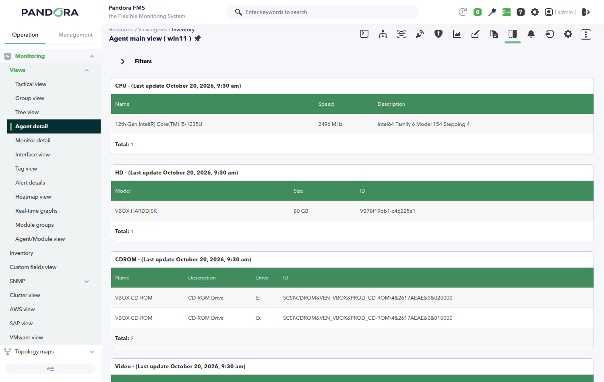

Le sélecteur de dates demande une explication, parce qu'il déroute la première
fois. **Une date n'apparaît que lorsqu'il y a eu des changements.** Pandora FMS
ne stocke de l'inventaire que lorsque la donnée change par rapport à la dernière
fois, donc si un équipement est identique depuis une semaine, le sélecteur
n'aura pas une entrée par jour. C'est une décision de conception, pas un défaut :
stocker la même photo toutes les heures serait du bruit.

### La vue globale

Dans **Opération → Supervision → Inventaire**, vous voyez l'inventaire de toute
la flotte d'un coup. Les filtres sont le groupe (avec l'option d'inclure les
sous-groupes), l'agent, le module, la recherche libre, le tri par agent, la date
et l'état de l'agent.

Par défaut, la vue est en mode **Informations de base**, qui montre une ligne par
agent avec ses données générales : alias, IP, groupe, système d'exploitation,
version, intervalle, dernier contact, champs personnalisés… Quand vous choisissez
un module précis, le tableau change et montre les données de ce module, avec une
colonne d'**horodatage** et une colonne d'**agent** pour savoir à qui appartient
chaque ligne.

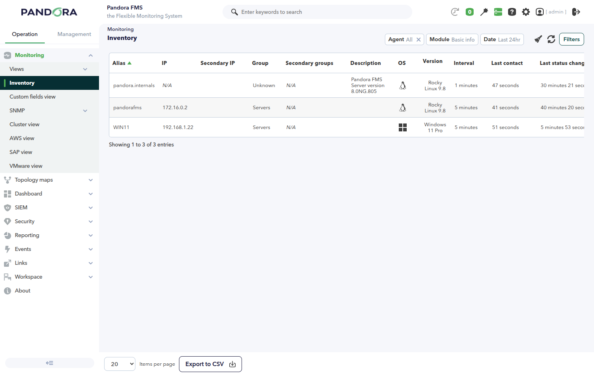

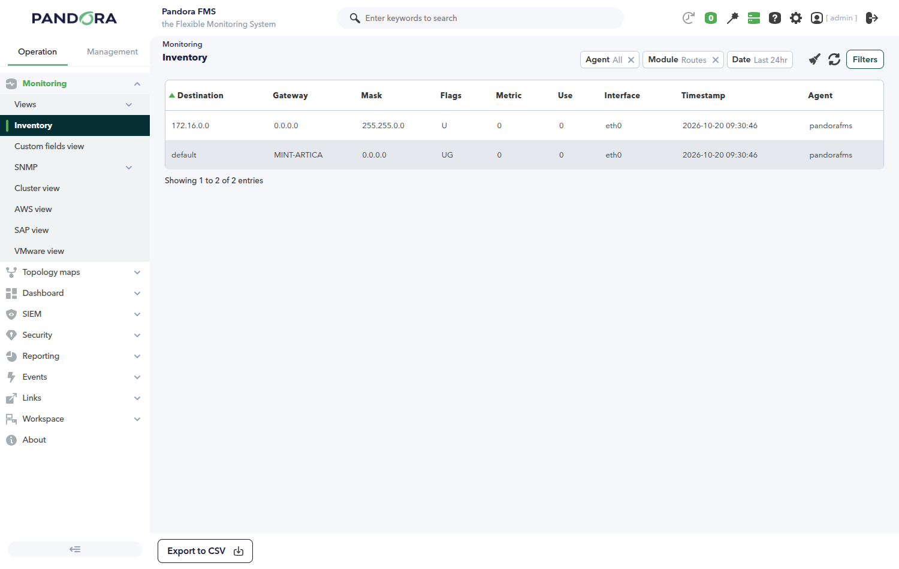

Le bouton **Exporter en CSV** télécharge ce qui est filtré à ce moment-là, avec
le séparateur CSV configuré dans la console.

### Les changements génèrent des événements

Chaque fois que l'inventaire d'un module change, le serveur génère un **événement
de configuration** avec les ajouts et les suppressions : quel enregistrement est
apparu et lequel a disparu. C'est la matière première des rapports de changements,
et aussi la raison pour laquelle un module très remuant (la liste des processus,
par exemple) peut inonder la console d'événements. C'est à cela que sert la liste
noire expliquée dans la section
[maintenance de l'inventaire](#maintenance-de-linventaire).

## Différences entre versions d'inventaire

Il y a des modules dont le résultat n'a aucun sens découpé en lignes. La
configuration d'un équipement réseau, par exemple : c'est un bloc de texte et ce
qui intéresse est de le comparer avec celui de l'exécution précédente, pas de le
lire ligne à ligne comme un tableau.

C'est à cela que sert le **Mode bloc**. En l'activant sur un module, son résultat
est stocké entier comme un bloc de texte, et dans la vue de l'agent un bouton de
**vue des différences** apparaît à côté du nom du module :

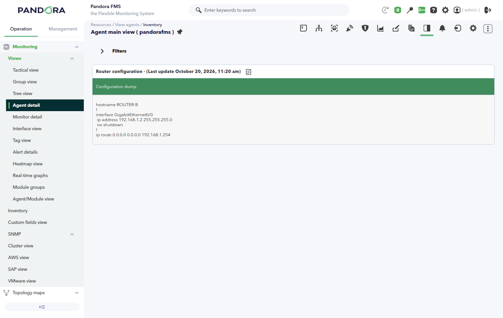

Cette vue place les deux versions en deux colonnes et met en évidence ce qui a
changé. C'est l'outil pour répondre à « quelqu'un a-t-il touché ce *routeur*
depuis la semaine dernière ? ».

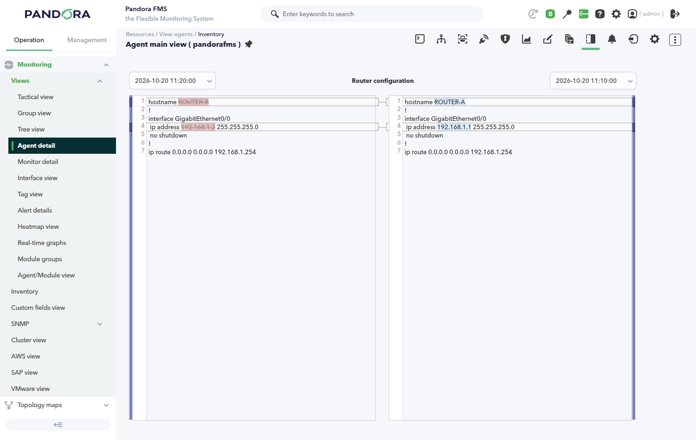

## Alertes d'inventaire

L'inventaire sert aussi à surveiller ce qui *ne devrait pas* être là. C'est à cela
que servent les **alertes d'inventaire**, qui se configurent dans
**Gestion → Alertes → Alertes d'inventaire**.

L'idée est la même que celle du reste des
[Alertes et notifications](../parte-5/5.5-alertas-y-notificaciones.md), avec une
différence de fond : elles ne se déclenchent pas sur un module de supervision,
mais sur le contenu de l'inventaire d'un groupe d'agents. Elles sont donc
globales : elles s'appliquent à un groupe, pas agent par agent.

Le formulaire a ces champs :

| Champ | Détail |
|---|---|
| **Nom** et **Description** | Identification de l'alerte |
| **ACL de groupe** | Visibilité de l'alerte |
| **Modules d'inventaire** | Le module dont le contenu est surveillé |
| **Condition** | Comment on décide si elle se déclenche : **Correspondance**, **Liste noire** ou **Liste blanche** |
| **Seuil de temps** | Temps minimum entre deux déclenchements |
| **Action** | Ce qui s'exécute quand elle se déclenche |
| **Groupes d'alertes** | Les groupes d'agents sur lesquels elle est évaluée (la condition réelle) |
| **Désactiver l'événement** | Si activé, l'alerte ne génère pas en plus un événement |

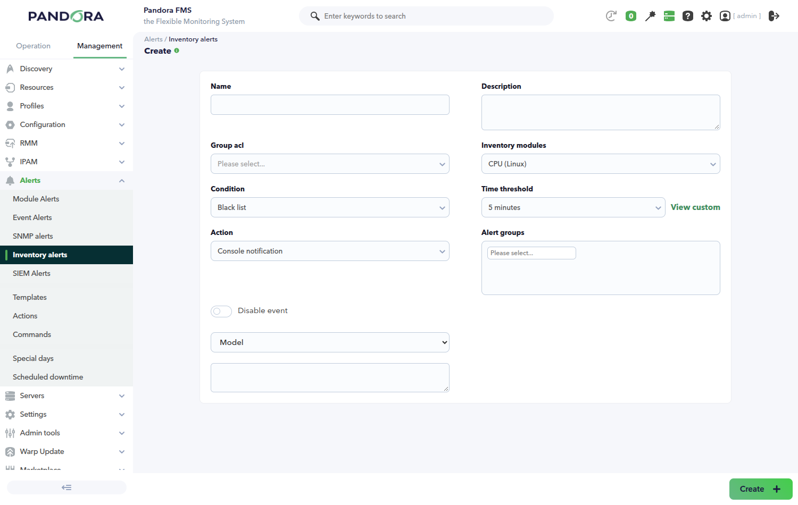

Il faut bien distinguer **ACL de groupe** de **Groupes d'alertes**, parce que les
deux parlent de groupes et ne veulent pas dire la même chose : le premier est qui
peut voir l'alerte, le second est à quels agents elle s'applique. Une confusion
ici laisse l'alerte sans effet ou la fait se déclencher là où il ne faut pas.

Les trois conditions fonctionnent ainsi :

- **Correspondance** (*Match*). On remplit les champs du module (par exemple, le
  nom et la version d'un logiciel) et elle se déclenche quand une ligne de
  l'inventaire correspond à tous. Les champs admettent des expressions
  régulières, et un champ vide équivaut à « n'importe quelle valeur » (`.*`).
  C'est la condition pour « prévenez-moi si cette version précise de ce programme
  apparaît ».
- **Liste noire** (*Black list*). On choisit un champ du module et on écrit une
  liste de valeurs, une par ligne. Si l'inventaire en contient une, elle se
  déclenche. C'est la condition pour « ceci ne devrait pas être installé ».
- **Liste blanche** (*White list*). Pareil, mais à l'envers : la valeur de
  l'inventaire **doit être** dans la liste, et si elle n'y est pas, elle se
  déclenche. C'est la condition pour « seuls ceux-là sont autorisés ».

Et **Désactiver l'événement** a son intérêt quand l'inventaire déclenche beaucoup
d'alertes d'un coup : cela évite que chacune génère en plus un événement et
laisse la console d'événements comme un sapin de Noël. L'alerte continue de se
déclencher et d'exécuter son action ; ce que l'on épargne, c'est l'événement.

Ces alertes sont le moyen de détecter des versions vulnérables d'un programme,
des logiciels non autorisés ou des comptes d'utilisateur que personne ne devrait
avoir.

## Inventaire dans les rapports et les politiques

L'inventaire ne vit pas isolé : il alimente les rapports et il peut être déployé
par des politiques.

Dans les **rapports**, il y a quatre éléments qui tirent de l'inventaire :

- **Inventaire d'agents**, la liste des agents avec leurs données générales.
- **Inventaire de modules**, la liste des modules avec leurs données.
- **Inventaire**, l'inventaire complet avec des filtres.
- **Inventaire de changements**, les ajouts et suppressions enregistrés.

La mécanique des modèles et des rapports est décrite dans
[Rapports](../parte-5/5.2-informes.md).

Et dans les **politiques**, les modules d'inventaire peuvent s'appliquer à des
groupes d'agents comme s'applique un module de supervision, avec son intervalle.
Dans l'onglet Inventaire de l'agent, les modules qui viennent d'une politique sont
marqués d'une icône. Les politiques sont expliquées dans
[Politiques de supervision](../parte-2/2.10-politicas-de-monitorizacion.md).

## Maintenance de l'inventaire

Deux réglages qu'il vaut la peine de connaître pour que l'inventaire ne devienne
pas un problème d'espace ou de bruit.

Le premier est la **suppression par ancienneté**. Dans **Gestion → Réglages →
Configuration du système → Performance** se trouve le champ **Nombre maximal de
jours avant la suppression des données d'inventaire**, qui vaut **21 jours** par
défaut. Passé ce délai, le serveur supprime progressivement l'historique
d'inventaire le plus ancien. S'il faut le garder plus longtemps pour des audits,
on augmente ; si l'on veut alléger la base de données, on diminue.

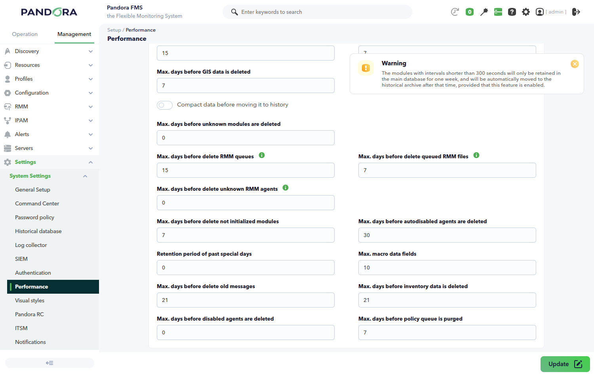

Le second est la **liste noire des changements**. Il y a des modules dont le
contenu change à chaque exécution (la liste des processus est l'exemple d'école)
et qui, par conséquent, généreraient un événement de configuration chaque fois.
Pour l'éviter, ces modules sont marqués dans une liste et leurs changements
cessent de générer un événement.

La liste se trouve dans **Gestion → Réglages → Configuration du système →
Configuration générale**, dans l'onglet **Comportement**, à l'intérieur de la
section **Événements**. C'est un sélecteur double : à gauche restent les modules
qui sont **hors de la liste noire** et à droite ceux qui sont **dans la liste
noire**, et on les fait passer d'un côté à l'autre avec les flèches.

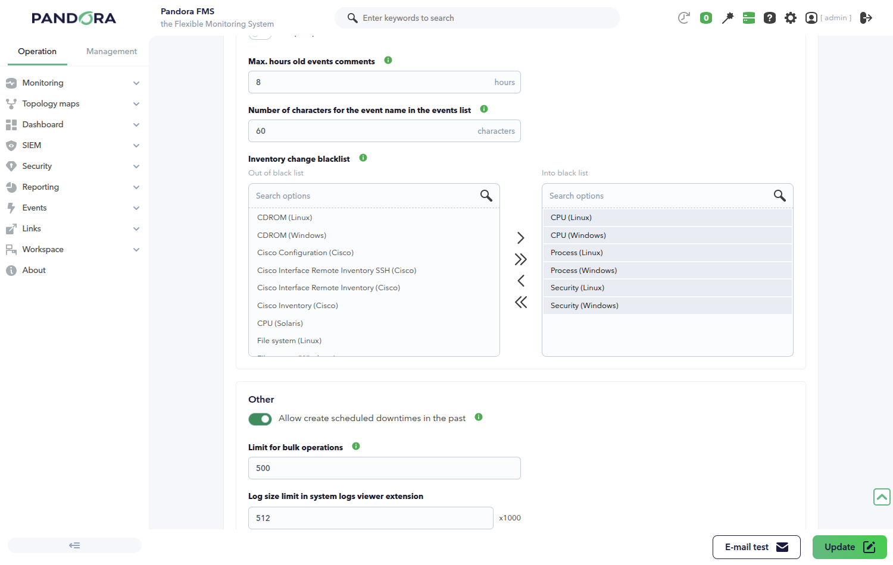

D'usine, le processeur, les processus et le module de sécurité viennent déjà
exclus, dans leurs versions Linux et Windows.

Avec cela, l'inventaire est complet : il se collecte seul, se consulte d'un coup
d'œil, avertit quand quelque chose ne colle pas et ne remplit pas la base de
données plus que nécessaire. Ce qui est exactement ce que l'on demande à un outil
qui répond à la question « qu'est-ce que nous avons ? ».
