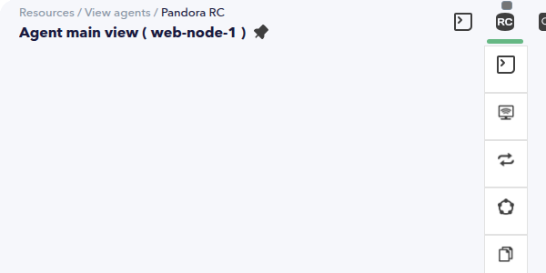

# Contrôle à distance avec RC

Superviser une machine n'est pas la même chose que pouvoir y entrer. Pandora RC couvre cette seconde partie : prendre le contrôle d'une machine Windows, Linux ou macOS depuis le navigateur, sans dépendre de son adresse IP ni ouvrir de ports sur le réseau distant. L'intégration avec Pandora FMS amène ce contrôle directement dans la fiche de l'agent, de sorte que l'opérateur n'a pas à changer de portail ni à copier des identifiants.

## Ce que c'est et quand l'utiliser

Pandora RC, anciennement eHorus, est un système de gestion à distance. La machine cible exécute un agent RC qui maintient une connexion sortante vers le service Pandora RC. Depuis la console Pandora FMS, le client web RC s'ouvre et donne accès à cette machine comme si vous étiez devant elle.

L'intégration apporte trois choses : l'identifiant de la machine est associé à l'agent Pandora FMS, l'onglet **Pandora RC** apparaît dans sa fiche et le client se lance depuis là. Elle ne remplace ni la supervision ni les modules : c'est une voie d'accès pour résoudre ce que la supervision détecte.

Ne confondez pas ce chapitre avec ses voisins. La distribution de logiciels (3.3) installe ou met à jour des programmes ; l'exécution à distance de scripts et de commandes (3.4) lance des commandes ; le contrôle à distance avec RC ouvre une session graphique ou shell pour intervenir sur la machine. Pandora RC est en outre un produit doté de sa propre licence : le RC en mode SaaS est inclus avec la licence Pandora RMM et le RC on-premise est acheté séparément (voir [1.5](../parte-1/1.5-licenciamiento.md#pandora-rc)).

## Exigences

| Exigence | Détail |
|---|---|
| Agent RC | Installé et provisionné sur la machine cible, avec une connexion au service Pandora RC. |
| Utilisateur RC | Un compte Pandora RC ayant accès à cet agent. Si l'utilisateur ne le voit pas, la session ne peut pas s'ouvrir. |
| Intégration activée | La section **Pandora RC** de la configuration de la console doit être active et contenir des identifiants valides (voir [9.2](../parte-9/9.2-referencia-completa-de-configuracion-de-la-consola.md#7-pandora-rc), section 7). |
| Clé RC | Le champ personnalisé configuré pour la clé RC, `eHorusID` par défaut, doit contenir l'identifiant de l'agent RC. |
| Permissions | `AW` sur le groupe de l'agent ou administrateur. Si la configuration par utilisateur est active, l'utilisateur a aussi besoin de ses identifiants RC activés. |
| Console | Accès HTTPS au service Pandora RC. Si la console s'exécute sous Windows, le magasin de certificats CA doit être configuré dans PHP. |
| Licence | RC SaaS inclus avec Pandora RMM ; RC on-premise séparément (voir [1.5](../parte-1/1.5-licenciamiento.md#pandora-rc)). |

## L'onglet Pandora RC dans l'agent

L'onglet apparaît dans la barre supérieure de la fiche de l'agent, à côté des autres onglets. Il s'affiche lorsque l'intégration est active et que le champ personnalisé de la clé RC existe et contient une valeur. L'icône est celle de Pandora RC.

Lorsque le curseur passe sur l'onglet, un sous-menu s'ouvre avec cinq actions : **Terminal**, **Display**, **Processes**, **Services** et **Files**. Chacune ouvre le client Pandora RC dans la section correspondante. Les autres onglets de la fiche de l'agent sont expliqués dans [2.21](../parte-2/2.21-configuracion-comun-de-los-agentes.md#les-onglets-de-la-vue-de-lagent).

Si l'onglet n'apparaît pas, le problème se situe généralement avant l'intégration : le champ personnalisé manque, l'agent n'a pas de valeur ou la clé n'a pas été générée. S'il apparaît mais que le sous-menu ne s'ouvre pas, vérifiez l'intégration et les permissions.

## Actions disponibles

Les cinq actions suivent le même flux : on en choisit une, on clique sur **Launch** et la session s'ouvre. Si l'agent RC possède un mot de passe local, il est demandé lors de la connexion.

| Action | Ce qu'elle permet |
|---|---|
| **Terminal** | Ouvre un shell interactif sur la machine distante, avec les permissions de l'agent RC. |
| **Display** | Affiche le bureau distant et permet d'interagir avec lui. |
| **Processes** | Liste les processus de la machine et permet de les gérer. |
| **Services** | Liste et contrôle les services du système. |
| **Files** | Explore le système de fichiers et transfère des fichiers. |

La barre flottante de **Display** permet de réduire la barre, de faire une capture d'écran, d'utiliser le presse-papiers distant, d'envoyer des combinaisons de touches comme `Ctrl+Alt+Del` et de passer en plein écran. Dans **Terminal**, redoublez de prudence : vous travaillez avec le même compte que celui qui exécute l'agent RC.

Pandora RC autorise une session active par machine. Si un autre utilisateur est connecté, l'agent apparaît occupé et la session ne s'ouvre pas tant qu'elle n'est pas libérée. La session se ferme également après inactivité selon le temps configuré dans l'agent RC, 300 secondes par défaut.

## Obtenir la clé RC

La clé RC est l'identifiant unique de l'agent Pandora RC. Elle est stockée dans un champ personnalisé de l'agent Pandora FMS. Le nom du champ est configuré dans l'intégration ; la valeur par défaut est `eHorusID`.

L'EndPoint peut le remplir automatiquement. Dans l'EndPoint Go et celui de Windows, le chemin du fichier de configuration de l'agent RC est indiqué avec le token `prc_conf` ou son alias `pandorarc_conf`. Si le fichier existe et contient la clé, l'EndPoint ajoute le champ personnalisé avec cette valeur. L'EndPoint Perl d'Unix lit `ehorus_conf`, conservé comme alias hérité.

Si aucun chemin n'est indiqué, l'EndPoint Go essaie les emplacements standard `/etc/pandorarc/pandorarc_agent.conf` et `/etc/ehorus/ehorus_agent.conf`. Sous Windows, le chemin est fixé par l'installateur. La référence complète de ces tokens et de leur compatibilité par EndPoint se trouve dans [9.1](../parte-9/9.1-referencia-completa-de-configuracion-del-endpoint.md).

Vous pouvez aussi saisir la clé manuellement dans le champ personnalisé de l'agent. C'est utile lorsque l'agent RC se trouve sur une machine sans EndPoint propre ou lorsque la clé est obtenue par un autre moyen. Dans les deux cas, vérifiez que la valeur correspond à l'agent RC : sinon, l'onglet peut apparaître, mais la session n'atteindra pas la bonne machine.

## Sécurité et limites

- **Mot de passe local de l'agent RC.** Il est facultatif et se configure dans l'agent RC, pas dans Pandora FMS. Il n'est pas stocké sur les serveurs centraux de RC ; il est demandé de manière interactive lors de la connexion. Utilisez-le si la machine est sensible.
- **Identifiants de l'API.** L'utilisateur et le mot de passe Pandora RC sont stockés chiffrés dans la base de données de la console (voir [9.5](../parte-9/9.5-cifrado-de-la-base-de-datos.md)). Si la configuration par utilisateur est active, chacun utilise les siens.
- **HTTPS et certificats.** Le client se connecte en HTTPS. Si la console s'exécute sous Windows et ne reconnaît pas l'autorité de certification du service RC, configurez `curl.cainfo` dans `php.ini` avec un magasin de certificats valide.
- **Une session par machine.** RC n'autorise pas deux sessions simultanées sur le même agent. Planifiez l'accès ou attendez qu'elle soit libérée.
- **Expiration par inactivité.** La session se ferme d'elle-même après le temps configuré dans l'agent RC. Si elle reste ouverte sans être utilisée, la machine reste bloquée jusqu'à sa fermeture.
- **Licence et mode.** RC SaaS et RC on-premise ne sont pas identiques. Le premier est fourni avec Pandora RMM ; le second est acheté séparément et nécessite son propre déploiement. Voir [1.5](../parte-1/1.5-licenciamiento.md#pandora-rc).

## Problèmes courants

- **L'onglet n'apparaît pas.** Le champ personnalisé manque, l'agent n'a pas de valeur ou l'intégration n'est pas configurée. Vérifiez le champ `eHorusID` et la section **Pandora RC** de la configuration.
- **Erreur d'authentification.** L'utilisateur RC n'a pas accès à cet agent ou les identifiants de l'API ne sont pas valides. Testez la connexion depuis la configuration globale ([9.2](../parte-9/9.2-referencia-completa-de-configuracion-de-la-consola.md#7-pandora-rc), section 7).
- **Erreur de connexion.** Vérifiez le nom d'hôte et le port de l'API, l'accès HTTPS de la console et, sous Windows, le certificat CA.
- **L'agent apparaît occupé.** Un autre utilisateur a une session active. Attendez qu'elle soit libérée.
- **L'EndPoint ne génère pas `eHorusID`.** Vérifiez le chemin du token `prc_conf`/`pandorarc_conf` (ou `ehorus_conf` en Perl) et que le fichier est lisible par l'utilisateur de l'agent.
- **La session s'ouvre mais il n'y a ni image ni terminal.** L'agent RC n'est pas connecté au service RC, ou un proxy ou un pare-feu s'interpose. Le diagnostic de cette partie relève de la documentation de Pandora RC.

## Relation avec les autres chapitres

- **[2.21](../parte-2/2.21-configuracion-comun-de-los-agentes.md#les-onglets-de-la-vue-de-lagent)** explique les autres onglets de la fiche de l'agent.
- **[9.1](../parte-9/9.1-referencia-completa-de-configuracion-del-endpoint.md)** documente `prc_conf`, `pandorarc_conf` et `ehorus_conf` avec leur compatibilité par EndPoint.
- **[9.2](../parte-9/9.2-referencia-completa-de-configuracion-de-la-consola.md#7-pandora-rc)**, section 7, couvre la configuration globale de Pandora RC.
- **[9.5](../parte-9/9.5-cifrado-de-la-base-de-datos.md)** explique le chiffrement des identifiants de l'API.
- **[1.5](../parte-1/1.5-licenciamiento.md#pandora-rc)** précise la licence de RC SaaS et de RC on-premise.
- **[3.4](3.4-ejecucion-remota-de-scripts-y-comandos.md)** couvre l'exécution à distance de scripts et de commandes, qui est une autre voie d'accès.
