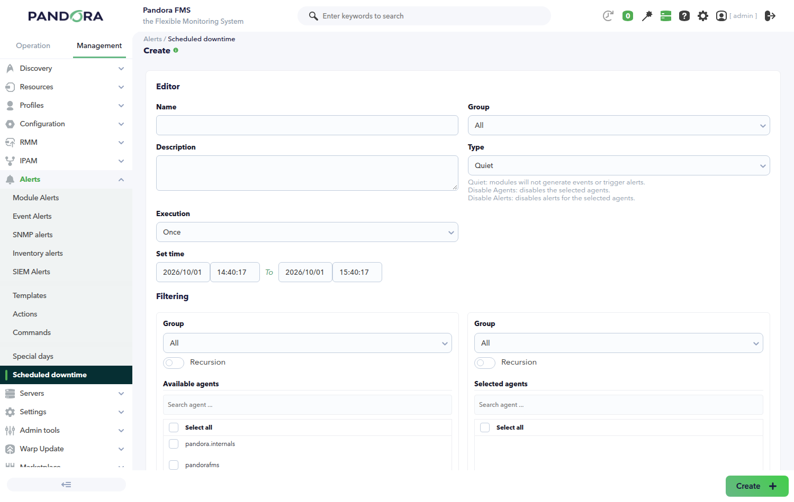
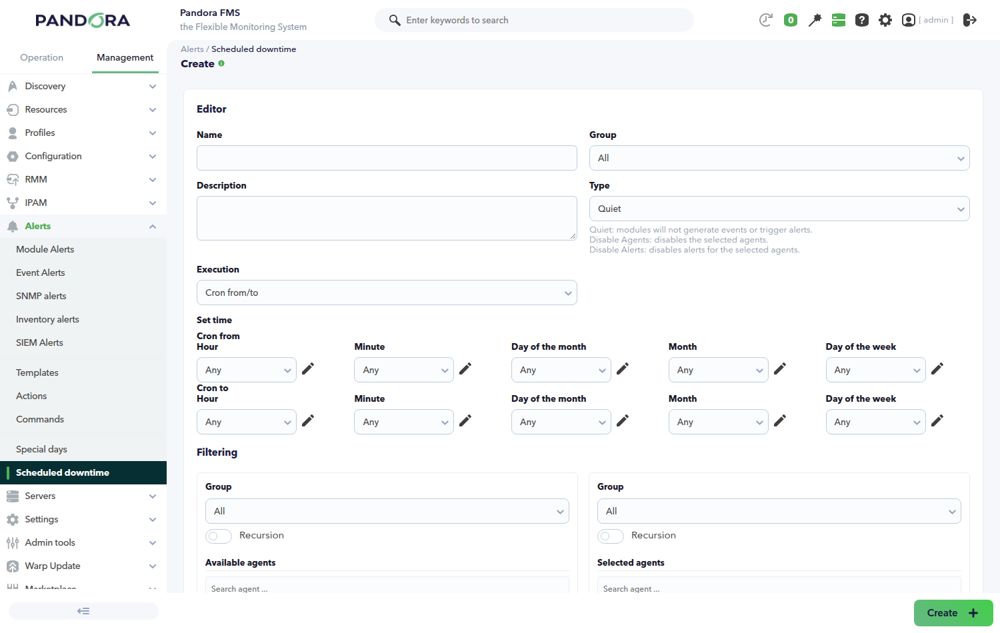
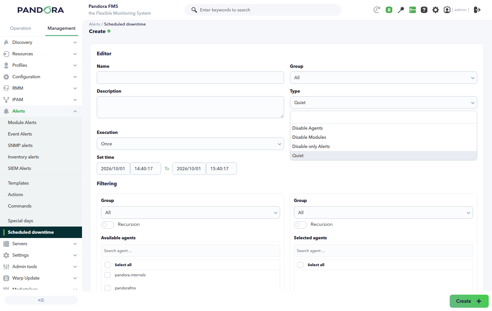
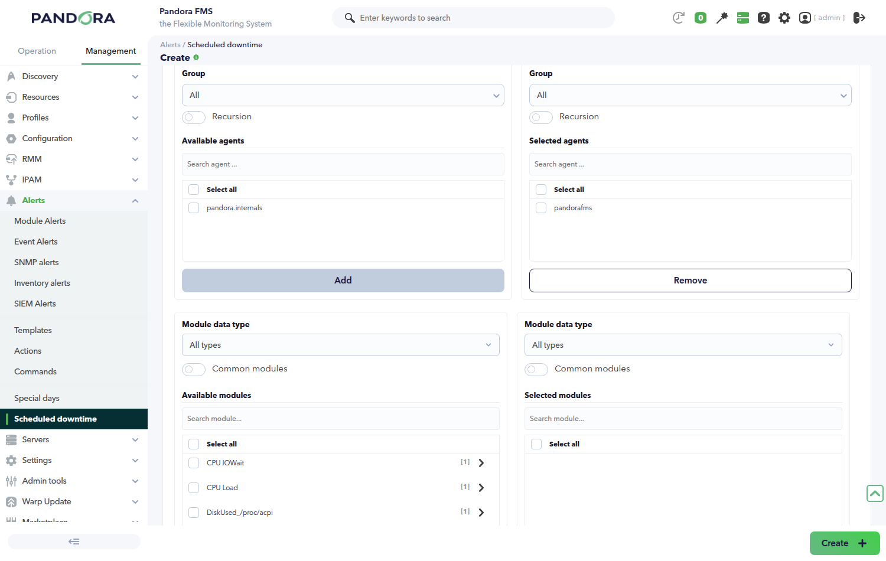
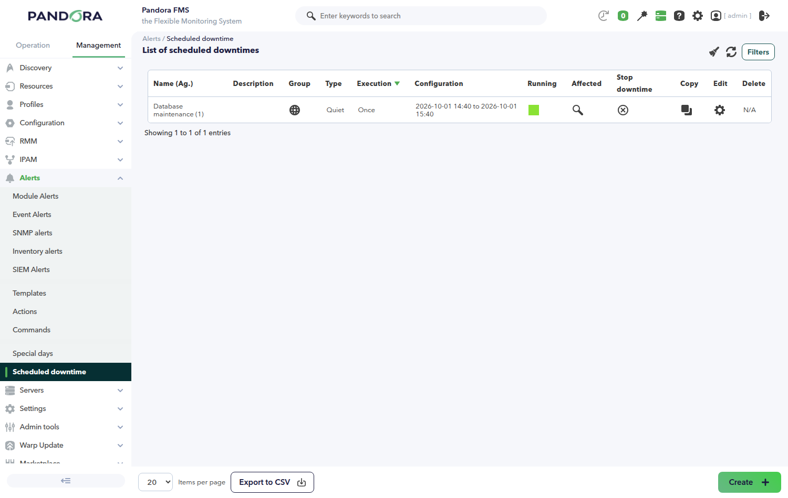

# Arrêts planifiés

Un correctif de système d'exploitation, une sauvegarde qui démarre à deux heures
du matin ou un redémarrage programmé de l'hyperviseur sont des fenêtres dans
lesquelles l'infrastructure se comporte bizarrement exprès. La supervision, qui
ne le sait pas, déclenche des alertes par dizaines. Un **arrêt planifié** est la
façon de dire à la console web, à l'avance, quelle plage de temps elle ne doit pas
prendre au sérieux.

## Ce qu'est un arrêt planifié

La console web permet de créer des arrêts planifiés depuis **Gestion → Alertes →
Arrêt planifié**. L'idée est simple : on définit une fenêtre de temps et ce qui
s'y fait, et le serveur de Pandora FMS applique cet état tant que la fenêtre est
ouverte.

Selon le **Type** choisi, l'arrêt fait l'une de ces quatre choses : désactiver les
EndPoints sélectionnés, désactiver leurs modules, désactiver seulement les alertes
de ces modules ou les marquer comme silencieux. Dans les quatre cas, au début et à
la fin de l'arrêt, le serveur génère un événement système informatif, l'un de ceux
qui apparaissent en bleu dans la console d'événements. Cette trace est la
différence pratique avec la désactivation manuelle d'un EndPoint : l'arrêt est
temporaire, programmé et réversible, et l'événement laisse la preuve qu'il s'est
exécuté et quand.

Il convient de ne pas confondre les deux gestes. Désactiver un EndPoint à la main
et oublier de le réactiver est un classique du métier, et dans les rapports cela
reste un trou sans explication. Un arrêt planifié, en revanche, s'éteint tout seul
quand il le faut, et les périodes qu'il couvre sont marquées comme valides dans
les rapports de disponibilité et de SLA, comme expliqué plus bas.

## Créer un arrêt planifié

Le formulaire de création demande peu de données et apporte déjà les valeurs les
plus commodes :

| Champ | Valeur par défaut | Détail |
|---|---|---|
| **Nom** | vide | Obligatoire et unique ; deux arrêts ne peuvent pas porter le même nom |
| **Groupe** | **Tous** | Groupe auquel appartiendra l'arrêt |
| **Description** | vide | Texte libre pour documenter la fenêtre |
| **Type** | **Mode silencieux** | Les quatre options sont détaillées dans leur section |
| **Exécution** | **Une fois** | Avec une plage initiale de l'heure actuelle à l'heure actuelle plus une heure |

Avant d'enregistrer, la console vérifie que les dates sont cohérentes : le début
avant la fin, l'heure de début avant celle de fin et la plage de jours correcte
dans les périodicités qui en utilisent une. Un nom répété ou une plage inversée ne
passent pas le filtre.

Il y a une option qui change le sens de « créer dans le passé ». C'est
**Autoriser la création d'arrêts planifiés avec une date antérieure à l'actuelle**
et elle vit dans la configuration générale, dans la section de comportement. Elle
est activée par défaut. Quand elle
est active, on peut enregistrer un arrêt dont la fenêtre est déjà passée : l'arrêt
**ne s'exécute pas**, parce que le serveur ne le voit pas démarrer, mais son
existence **se reflète bien** dans les rapports de disponibilité et dans les
calculs de SLA. C'est utile pour documenter une maintenance qui a été faite sans
avoir créé l'arrêt à temps. Qui lit cet arrêt dans la liste ne doit pas s'attendre
à le voir passer à « En cours ».

## Modes d'exécution : une fois, périodique et cron

Le champ **Exécution** admet trois modes, et chacun cache un formulaire
différent.

**Une fois**. Le plus direct : date et heure de début et date et heure de fin.
L'arrêt démarre quand le début arrive, s'applique pendant la plage et se termine à
la date de fin. C'est l'option avec laquelle on résout une maintenance ponctuelle.

**Périodiquement**. Il répète la fenêtre dans le temps. Le **Type de périodicité**
peut être **Hebdomadaire** ou **Mensuel**. Dans l'hebdomadaire, on choisit les
jours de la semaine ; dans le mensuel, une plage de jours du mois (par exemple, du
jour 20 au jour 10 du mois suivant). Dans les deux cas, on fixe une plage horaire
avec **De l'heure** et **À l'heure**, et la plage peut franchir minuit. Ici
apparaît en plus la **Date d'expiration**, avec un interrupteur **Jamais** : s'il
est désactivé, l'arrêt cesse de s'exécuter passé cette date. C'est le seul mode
qui offre une expiration ; **Une fois** et **Cron de/à** ne l'affichent pas.

**Cron de/à**. Le mode le plus souple et le moins aimable. On définit deux
conditions, une de démarrage (**Cron de**) et une d'arrêt (**Cron à**), et chacune
se compose de cinq champs : **Heure**, **Minute**, **Jour du mois**, **Mois** et
**Jour de la semaine**. Chaque champ se configure comme **N'importe lequel** ou
**Personnalisé**. Attention à l'ordre : dans le formulaire, les champs vont
**Heure, Minute, Jour du mois, Mois, Jour de la semaine**, mais l'expression que la
console enregistre (et que vous verrez dans la colonne **Configuration** de la
liste) commence par la minute
(`minute heure jour-du-mois mois jour-de-la-semaine`). Le serveur vérifie chaque
minute si l'expression correspond à la minute actuelle : il exige une
correspondance exacte, pas approximative.

Deux exemples pour fixer le format :

- `0 2 * * 1` démarre le lundi à 02:00.
- `*/15 9-17 * * 1-5` démarre toutes les quinze minutes entre 09:00 et 17:00, du
  lundi au vendredi.

L'expression est enregistrée telle quelle et le serveur l'évalue à chaque cycle.
Il vaut la peine de revoir la condition après l'avoir créée, parce que c'est la
pièce qui décide quand l'arrêt démarre et quand il s'arrête.

## Les quatre types d'arrêt

La liste déroulante **Type** offre exactement quatre options. Il vaut mieux les
lire posément, parce que deux d'entre elles se ressemblent par le nom et font des
choses différentes.

| Type | Ce qu'il fait | À la fin |
|---|---|---|
| **Agents désactivés** | Désactive les EndPoints sélectionnés et, avec eux, tous leurs modules | Réactive seulement ceux qui n'étaient pas déjà désactivés à la main |
| **Désactiver les modules** | Désactive les modules sélectionnés, y compris ceux qui étaient déjà désactivés avant l'arrêt | Réactive les modules que l'arrêt couvrait |
| **Désactiver uniquement les alertes** | Désactive les alertes des modules sélectionnés, sans désactiver le module | Réactive les alertes |
| **Mode silencieux** | Marque comme silencieux l'EndPoint ou les modules : ils continuent de collecter des données, mais ne génèrent pas d'événements et ne déclenchent pas d'alertes | S'il a mis l'EndPoint en silencieux, celui-ci revient à l'état silencieux qu'il avait avant ; s'il a mis des modules en silencieux, ils sont réactivés même s'ils l'étaient déjà |

La première ligne mérite une nuance. **Agents désactivés** agit sur les EndPoints
et entraîne tous leurs modules. Les trois autres agissent sur les modules, pas sur
l'EndPoint entier. Et **Désactiver uniquement les alertes** ne désactive aucun
module : ce qu'elle éteint, ce sont les alertes de ces modules.

Le détail qui soulève le plus de questions est celui de la préservation de l'état
manuel. Si un EndPoint était déjà désactivé (ou en silencieux) à la main avant que
l'arrêt démarre, à la fin la fin automatique **le respecte** : il reste comme il
était. Avec les modules, il y a une nuance qu'il vaut mieux avoir claire : la fin
automatique du serveur **réactive tout ce que l'arrêt couvrait**, y compris ce qui
était déjà éteint à la main. La différence tient à qui y met fin : si vous
**l'arrêtez à la main** depuis la console, seul est annulé ce que l'arrêt lui-même
a éteint, tant pour les agents que pour les modules.

## Ajouter des agents et des modules

Le formulaire de création inclut déjà le sélecteur d'éléments : les EndPoints et
les modules concernés se choisissent à la même étape de la création, sans avoir
besoin de créer un arrêt vide et de les ajouter ensuite. Le sélecteur est un
panneau double : à gauche les **Agents disponibles**, à droite les **Agents
sélectionnés**, avec les boutons **Ajouter** et **Supprimer** pour les faire passer
d'un côté à l'autre. S'il n'y a pas encore d'agents sélectionnés, les modules ne se
remplissent pas et la console vous avertit avec un **Sélectionnez d'abord les
agents**.

Les filtres du panneau font le gros du travail :

- **Groupe** limite la liste des agents disponibles au groupe choisi.
- **Récursivité** décide si les agents des sous-groupes sont inclus aussi : **la
  récursivité est respectée**. Le groupe « All » se résout en les groupes de
  l'utilisateur et n'ajoute des sous-groupes que lorsque la récursivité est
  activée.
- **Type de données du module** filtre les modules par leur type de donnée, avec
  **Tous les types** par défaut.
- **Modules communs** ne laisse à la vue que les modules présents dans **tous** les
  agents sélectionnés. C'est la façon rapide d'appliquer l'arrêt à un module
  partagé sans parcourir agent par agent.

Une règle pratique qui épargne des ennuis : en **Mode silencieux**, si aucun module
précis n'est sélectionné, c'est l'**EndPoint entier** qui est mis en silencieux ;
en **Agents désactivés** et en **Désactiver uniquement les alertes**, laisser la
liste de modules vide applique l'arrêt à l'ensemble de l'agent. En **Désactiver
les modules**, en revanche, il faut choisir au moins un module : sans module
sélectionné, l'arrêt démarre mais **ne fait rien**. Et dans ce type, le sélecteur
ne filtre pas par état : les modules désactivés apparaissent aussi.

Les éléments s'enregistrent au moment de les ajouter et peuvent être retirés un à
un depuis le même écran.

## Gérer la liste : filtrer, arrêter, copier, supprimer et exporter

La liste des arrêts montre une ligne par arrêt avec ces colonnes : **Nom (nb
ag.)** (le nom et, entre parenthèses, combien d'agents sont concernés),
**Description**, **Groupe**, **Type**, **Exécution**, **Configuration**, **En
cours**, **Affecté**, **Arrêter l'arrêt planifié**, **Copier**, **Modifier** et
**Supprimer**. En haut se trouvent les filtres **Rechercher**, **Groupe**, **Entre
les dates**, **Type d'exécution**, **Agent**, **Module** et la case **Ne pas
afficher les arrêts antérieurs ou arrêtés**, plus le bouton **Exporter en CSV**.

Le filtre **Entre les dates** n'a de sens qu'avec les arrêts de type **Une fois** ;
les périodiques et ceux de cron ne se cherchent pas par plage. Et l'ordre de la
liste n'est pas celui de la date de création : elle est triée par type d'exécution
et par date de début, si bien que la date de création est une donnée de la fiche,
pas le critère du tableau.

La colonne **Configuration** résume la fenêtre dans le format qui correspond :

| Mode | Comment il s'affiche |
|---|---|
| **Une fois** | `2026-10-01 13:57 to 2026-10-01 14:57` |
| **Périodiquement**, hebdomadaire | `Weekly: Thu (00:00:00-23:59:59)` |
| **Périodiquement**, mensuel | `Monthly: From day 20 to day 10 (08:00:00-09:00:00)` |
| **Cron de/à** | `Start condition: * * * * * - Stop condition: * * * * *` |

On peut agir sur chaque ligne. Tant qu'un arrêt est **En cours**, il ne peut pas
être modifié et le bouton **Supprimer** apparaît comme **N/A** ; ce qui est
disponible, c'est **Arrêter l'arrêt planifié**, qui coupe l'exécution sur-le-champ
et répond par un « Downtime has been stopped successfully ». **Copier** duplique
l'arrêt pour réutiliser sa configuration, et **Exporter en CSV** déverse la liste
avec les filtres appliqués.

Reste un avertissement qui apparaît quand la console détecte des arrêts créés avec
des formats anciens et mal formés : « AVERTISSEMENT : il y a des arrêts planifiés
mal formés » et la question « Voulez-vous migrer automatiquement les éléments mal
formés ? ». Si vous acceptez, la console coupe chaque arrêt malformé en deux
moitiés, étiquetées `[1/2]` et `[2/2]`, pour que la fenêtre qui passait d'une
période à l'autre soit exprimée de façon valide.

## Comment cela s'exécute en interne

L'exécution n'est pas faite par la console : elle est faite par le serveur de
Pandora FMS. Dans une installation avec plusieurs serveurs, seul le maître
applique les arrêts, pour qu'ils ne se marchent pas dessus.

Toutes les 60 secondes, le serveur parcourt les arrêts et vérifie s'il faut en
démarrer ou en arrêter un. La vérification dépend du type d'exécution : un arrêt
**Une fois** compare l'heure actuelle avec sa plage ; un **Périodiquement** regarde
le jour et l'heure ; un **Cron de/à** évalue ses deux expressions contre la minute
actuelle. Quand un arrêt démarre, le serveur applique l'état et écrit l'événement
système « Server \<server\> started planned downtime: \<name\> » ; quand il se
termine, il écrit le « stopped » correspondant.

| Exigence | Détail |
|---|---|
| Serveur de Pandora FMS en marche | Sans serveur, il n'y a pas d'arrêts ; la console ne fait que les définir |
| Serveur maître | Dans les installations avec plusieurs serveurs, seul le maître applique les arrêts |
| Un cycle toutes les 60 secondes | Le serveur vérifie chaque minute s'il faut en démarrer ou en arrêter un |
| Horloge du serveur | Les conditions de cron sont comparées à la minute avec l'heure du serveur |
| Arrêt pas entièrement passé | Un arrêt dont la fenêtre est déjà passée ne démarre pas ; la permission de le créer dans le passé est lue par la console, pas par le serveur |

## Ce qui change dans les rapports et le SLA

Voici la raison d'être de tout ce qui précède. Les périodes couvertes par un
arrêt planifié sont considérées comme **valides** : elles ne pénalisent pas le SLA
et n'entachent pas la disponibilité, parce que le système sait que
l'infrastructure était arrêtée exprès. Sans cette marque, une maintenance d'une
heure se lirait comme une chute d'une heure.

Les rapports résument une période avec plusieurs états selon le **mode de
priorité**, qui décide si c'est l'état **OK** ou l'**inconnu** qui l'emporte quand
ils coïncident. Ce réglage n'est pas de cet écran et il est expliqué en détail
dans [Rapports](../parte-5/5.2-informes.md) ; ici il suffit de savoir qu'un arrêt
bien créé protège le calcul.

Si l'option du passé est active, l'arrêt est recalculé **vers l'arrière** dans le
temps, de sorte qu'une fenêtre déjà fermée continue de compter dans les rapports
qui la couvrent. Dans les rapports de service, un arrêt qui touche un élément
quelconque du service est considéré comme touchant **tout** le service, et les
arrêts malformés restent hors du calcul. Le détail des services est dans
[Supervision métier et services](../parte-5/5.3-monitorizacion-de-negocio-y-servicios.md).

## Le widget de tableau de bord « Scheduled Downtime »

Les arrêts planifiés ont aussi leur place dans les tableaux de bord. Le widget
s'appelle **« Scheduled Downtime »** dans le catalogue et montre le nom de chaque
arrêt, sa configuration, s'il est en cours d'exécution et les éléments concernés.
Il admet un filtre par groupe, la pagination et l'export en CSV et JSON.

Comment on ajoute un widget à un tableau de bord, quelles tailles il accepte et
comment il se place est expliqué dans
[Tableaux de bord](../parte-5/5.1-dashboards.md) ; ici on note seulement qu'il
existe et ce qu'il montre.

## Hors de la console : API et CLI

La console est la voie commode, mais pas la seule. L'API permet de créer, de
modifier et de supprimer des arrêts, en plus d'ajouter des agents, d'ajouter des
modules et de retirer des agents d'un arrêt déjà existant, avec des opérations
comme `planned_downtimes_edit`, `planned_downtimes_deleted`,
`planned_downtimes_add_agents` et `planned_downtimes_delete_agents`.

Depuis la ligne de commande du serveur, l'annexe des commandes offre
`--create_downtime` pour la créer, `--add_item_downtime` pour ajouter des
éléments, `--get_all_planned_downtimes` et `--get_planned_downtimes_items` pour
lister, `--stop_downtime` pour l'arrêter et `--set_planned_downtimes_deleted` pour
la supprimer. Il y a une nuance qu'il vaut mieux garder en tête : **arrêter un
arrêt périodique en exécution fonctionne bien depuis la console web, mais le CLI
le refuse**. La commande répond par un « [ERROR] … cannot be stopped » et un
« [INFO] Periodical and running planned downtime cannot be stopped ». S'il faut
couper un arrêt périodique qui tourne, il faut le faire depuis l'interface, pas
depuis le CLI.

Reste une alternative à gros sabots pour qui ne veut pas créer un arrêt par cas :
le CLI permet d'activer ou de désactiver des groupes entiers d'EndPoints avec
`--enable_group` et `--disable_group`. Cela sert à une désactivation rapide et
globale, mais ne programme pas le retour et ne laisse pas la marque d'arrêt dans
les rapports. C'est pour cela qu'existe l'arrêt planifié.
