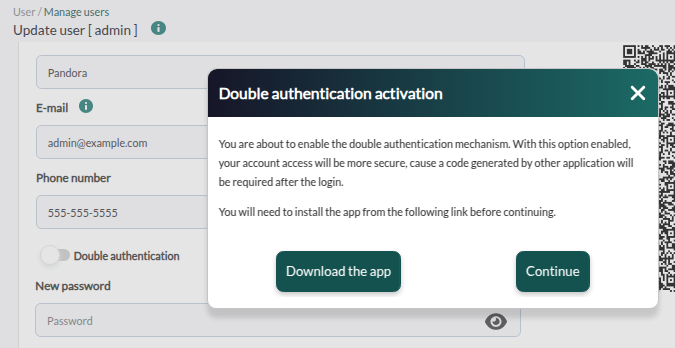
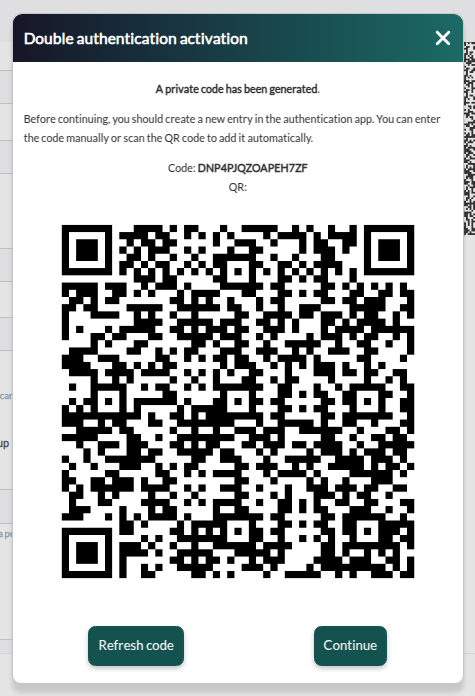
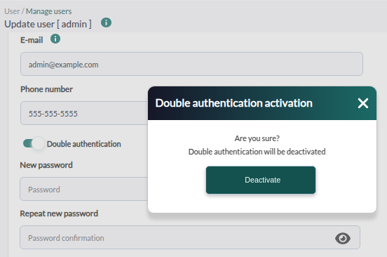
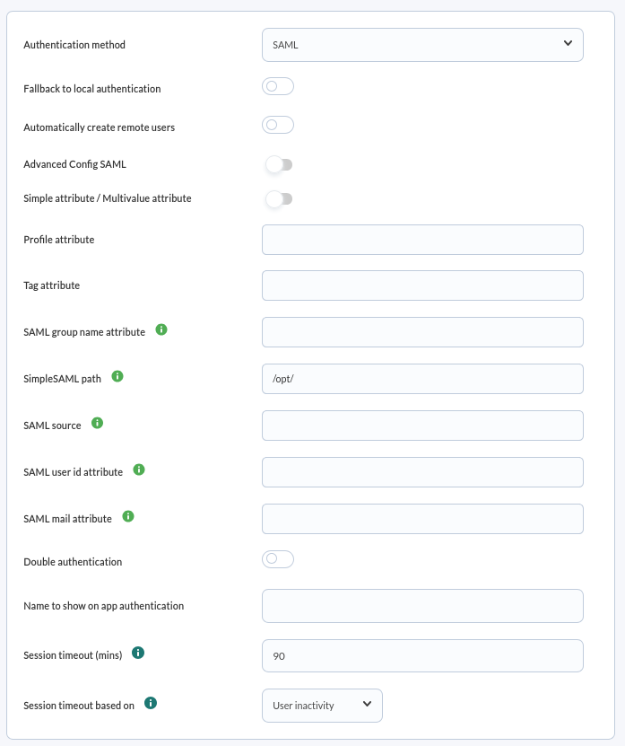

# Authentification externe et centralisation des accès

Pandora FMS embarque sa propre authentification, mais presque personne ne
l'utilise en production : le normal est de la déléguer à l'annuaire de
l'entreprise. Ce chapitre présente les méthodes disponibles, **champ par
champ**, et ce qui change quand un Command Center se trouve au-dessus.

Tout se configure dans **Gestion → Réglages → Configuration du système →
Authentification** (*Management → Settings → System Settings → Authentication*).
Il y a quatre méthodes, et une règle qui se répète dans toutes : **les
administrateurs (*superadmin*) s'authentifient toujours contre la base de
données locale**. C'est l'assurance qui évite de rester dehors si l'annuaire
tombe.

## Authentification locale et externe

La **méthode d'authentification** (*Authentication method*) se choisit dans une
liste déroulante :

| Méthode | Ce qu'elle est |
|---|---|
| **Local Pandora FMS** | L'authentification par défaut, contre la base de données interne |
| **LDAP** | Déléguée à un serveur LDAP |
| **Répertoire actif** (*Active directory*) | Déléguée à Active Directory. Enterprise |
| **SAML** | Déléguée à un fournisseur d'identités SAML. Enterprise |

Deux champs valent pour presque toutes les méthodes externes :

- **Alternative en cas d'échec de l'authentification** (*Fallback to local
  authentication*). S'il est activé, quand le système externe ne valide pas
  l'utilisateur, l'authentification locale est tentée. Les administrateurs
  l'ont toujours actif, qu'ils le veuillent ou non.
- **Créer les utilisateurs distants automatiquement** (*Autocreate remote
  users*). S'il est activé, Pandora FMS enregistre l'utilisateur la première
  fois qu'il se connecte contre l'annuaire, sans le créer à la main.

## Authentification locale

C'est celle d'usine : utilisateur et mot de passe contre la base de données
interne de Pandora FMS. Il n'y a rien à configurer sinon la choisir comme
méthode. C'est celle qu'utilisent les administrateurs et celle qui sert de
recours quand l'annuaire ne répond pas.

## LDAP

Avant tout, la dépendance : il faut les utilitaires **OpenLDAP** sur le serveur,
qui s'installent avec le paquet de la distribution (`ldap-utils` sous
Debian/Ubuntu, `openldap*` sous RHEL).

Les champs de la connexion :

| Champ | À quoi il sert |
|---|---|
| **Serveur LDAP** et **Serveur LDAP secondaire** | Adresse du serveur, directe (`x.x.x.x`) ou par URL (`ldap://…`, `ldaps://…`) |
| **Port LDAP** | Port du serveur (389 par défaut) |
| **Version LDAP** | Version du protocole |
| **Start TLS** | Chiffre la communication entre client et serveur |
| **DN de base** | Point de départ des recherches |
| **Attribut de connexion** (*Login attribute*) | Attribut par lequel l'utilisateur est identifié. **Il distingue les majuscules des minuscules** |
| **Connexion d'administrateur LDAP** et **Mot de passe d'administrateur LDAP** | Identifiants d'un compte ayant la permission d'interroger l'annuaire |
| **Délai d'attente de recherche LDAP (secondes)** | Combien de temps la recherche attend avant d'abandonner |
| **Activer le LDAP secondaire** | Active un second serveur, avec ses propres serveur, port, version, Start TLS, DN de base, attribut de connexion et identifiants d'administrateur |

Deux décisions qui changent le comportement :

- **Fonction LDAP** (*LDAP function*). Choisit comment se font les recherches :
  *Local command*, qui utilise la commande `ldapsearch` du système, ou *PHP
  function*, le moteur propre à la console. Pour les annuaires avec beaucoup
  d'éléments, la console recommande la commande locale.
- **Identifier l'attribut de l'utilisateur** (*Login user attribute*). Quel
  attribut de l'annuaire est pris comme identifiant de l'utilisateur (par
  exemple, le courriel).

Et pour la création automatique d'utilisateurs :

- **Enregistrer le mot de passe** (*Save Password*). Enregistre le mot de passe
  de l'annuaire dans la base locale. Si le *fallback* local était activé, ceci
  est activé aussi.
- **Forcer la création automatique du profil d'utilisateur** et, en dessous,
  **Auto-création de profil**, **de groupe** et **de tags**, pour décider avec
  quelles permissions naît l'utilisateur tout juste créé, et **Aucune hiérarchie
  assignée automatiquement** (*Automatically assigned no hierarchy*).
- **Créer une liste noire automatiquement** (*Autocreate blacklist*). Une liste
  d'utilisateurs séparés par des virgules qui **ne seront pas** créés tout seuls.
- **Recherche récursive de groupes** (*Recursive group search*).

Si **Configuration avancée LDAP** (*Advanced Config LDAP*) est activée,
apparaissent les **Permissions avancées LDAP**, où l'on ajoute des règles avec
profil, groupes et tags liées à un filtre d'attributs. Les attributs s'écrivent
au format `Nom_attribut = Valeur_attribut` : si l'utilisateur en remplit un, il
est créé avec ce profil.

## Active Directory

C'est la variante LDAP pour Active Directory, et elle est **Enterprise**. Elle
partage le concept, mais avec ses champs propres :

- **Serveur Active Directory**, **Port Active Directory** (389 par défaut),
  **Start TLS** et **Domaine** (*Domain*). Si vous utilisez la configuration
  avancée, dans le domaine il faut mettre le chemin LDAP complet, du style
  `ldap://addc.mondomaine`.
- **Activer l'Active Directory secondaire**, avec son serveur, port, Start TLS,
  domaine et **Délai d'attente de recherche AD (secondes)** (5 par défaut).
- **Enregistrer le mot de passe**, **Configuration avancée AD** et **Permissions
  avancées AD**, avec la même idée de règles par attributs que dans LDAP.
- **Activer automatiquement l'accès au nœud** (*Auto enable node access*) :
  « les utilisateurs nouveaux pourront se connecter sur les nœuds ».
- **Recherche récursive de groupes** et **Créer une liste noire
  automatiquement**.

Un détail qui n'est pas de Pandora FMS, mais qui explique beaucoup d'appels :
Windows permet d'utiliser l'ancien mot de passe pendant **60 minutes** après un
changement dans Active Directory. Cela, c'est Windows qui le contrôle, pas la
console.

## Double authentification (2FA)

La double authentification ajoute un second facteur en plus du mot de passe.
Dans la configuration globale d'authentification il y a trois réglages :

- **Double authentification** (*Double authentication*). Active l'option pour
  que les utilisateurs puissent l'activer.
- **Forcer la 2FA pour tous les utilisateurs** (*Force 2FA for all users is
  enabled*). L'impose à tout le monde.
- **Nom à afficher dans l'authentification de l'application**. Le nom que
  l'utilisateur verra dans son application de codes, pour ne pas confondre
  Pandora FMS avec d'autres services. Cela vaut la peine de le renseigner.

Chaque utilisateur l'active dans **Opération → Espace de travail → Modifier mon
utilisateur**.



Il faut une **application génératrice de codes** (Google Authenticator et
similaires) sur son propre mobile, et que le serveur et le mobile aient **l'heure
synchronisée** ; sans cela, les codes ne concordent pas.



Pour la désactiver à un utilisateur concret sans passer par la console, il y a
le CLI :

```bash
/usr/share/pandora_server/util/pandora_manage.pl /etc/pandora/pandora_server.conf \
    --disable_double_auth '<utilisateur>'
```



## SAML

**SAML** est un standard ouvert d'authentification basé sur XML : Pandora FMS
agit comme fournisseur de services et délègue à un fournisseur d'identités. Ici
aussi **les administrateurs s'authentifient toujours contre la base locale**.

Pour l'utiliser il faut trois pièces : un serveur SAML opérationnel
(SimpleSAMLphp), la configuration de Pandora FMS et, si le fournisseur est Azure,
la configuration du côté d'Azure. L'annexe technique de SimpleSAMLphp couvre
l'installation pas à pas ; ici vont les champs de la partie Pandora.

| Champ | À quoi il sert |
|---|---|
| **Chemin de SimpleSAML** (*SimpleSAML path*) | Répertoire où `simplesamlphp` est installé |
| **Source SAML** (*SAML source*) | Nom de l'*authsource* configuré |
| **Attribut d'ID d'utilisateur SAML** | Attribut pris comme identifiant. **L'ID ne peut pas contenir** les caractères `> < " \` & / * ( ) º °` ni d'espaces |
| **Attribut de courriel SAML** | Attribut avec l'adresse de courriel (pour la création automatique) |
| **Attribut de nom de groupe SAML** | Attribut avec le groupe (pour la création automatique) |
| **Attribut simple / attribut multivalué** | Si les attributs arrivent en valeur unique ou en liste |
| **Attribut de profil** et **Attribut de tag** | D'où le profil et le tag de l'utilisateur sont tirés |
| **Préfixe de profils et de tags SAML** | Préfixe pour faire correspondre la valeur de l'attribut au profil ou au tag |



Avec **Configuration avancée SAML** (*Advanced Config SAML*) apparaissent les
**Permissions avancées SAML**, avec la même mécanique de règles par attributs
que LDAP et AD.

## Sessions et jetons d'API

Deux réglages gouvernent le moment où une session se ferme :

- **Fin de session (minutes)** (*Session timeout (mins)*). Combien de temps dure
  la session.
- **Session expirée** (*Session timeout based on*). Sur quoi le temps est
  compté : **la dernière connexion** (elle repart à chaque connexion) ou
  **l'inactivité de l'utilisateur** (elle repart à chaque action). Un écran
  ouvert avec auto-rafraîchissement ne compte pas comme inactivité.

En dehors de la session, chaque utilisateur a son **jeton d'API**, qui se
génère et s'utilise comme *bearer token* dans l'en-tête HTTP pour appeler l'API
sans utilisateur ni mot de passe.

## Authentification dans un Command Center

Quand il y a un **Command Center**, l'administration des utilisateurs se mène de
façon centralisée, et cela affecte la connexion. Un utilisateur dont
l'authentification n'est pas locale (AD, LDAP ou SAML) a besoin, pour entrer
dans les nœuds, soit que **son mot de passe soit enregistré** (*Save Password*),
soit que le nœud ait **Activer automatiquement l'accès au nœud** activé. Sinon,
l'utilisateur existe dans le nœud mais ne peut pas entrer.

La première fois qu'un utilisateur centralisé accède à un nœud, la console
avertit qu'il faut attendre que le Command Center synchronise et se reconnecter
avec les mêmes identifiants. C'est le comportement normal, pas une erreur.
