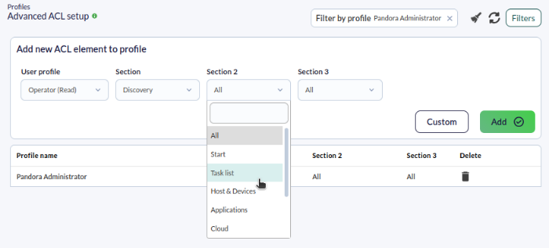
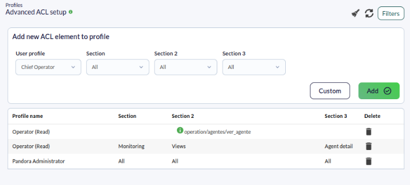
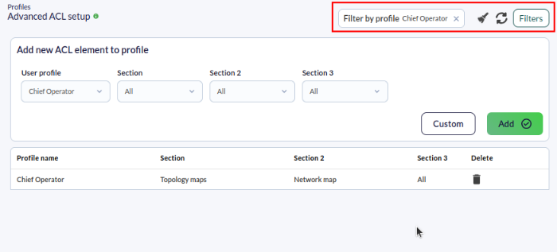

# Sécurité et visibilité avancées (ACL avancée)

Les groupes et les profils du chapitre précédent décident de **ce qu'un
utilisateur peut faire**. Mais il est une question à laquelle ils ne répondent
pas : **quelles pages il voit**. Un profil d'administrateur donne accès à tout, et
bien souvent vous ne le voulez pas ; vous voulez que quelqu'un puisse agir sur une
partie de la console et pas sur le reste. C'est le rôle du système d'**ACL
avancée** (anciennement appelé ACL Enterprise), qui définit, profil par profil, à
quelles pages chaque utilisateur a accès.

Deux règles à connaître avant de toucher à quoi que ce soit. La première : **les
*superadmins* sont exemptés** du système, et tous les autres y sont soumis, même
s'ils ont le profil *Pandora Administrator*. La seconde : l'ACL avancée et l'ACL
classique (groupes et profils) sont **parallèles et compatibles**, mais la
classique est évaluée **en premier**. Si l'ACL classique n'autorise pas quelque
chose, l'avancée ne l'ouvre pas.

## Ce que le système d'ACL avancée apporte

Le modèle classique est de type Unix : *rôle, action, groupe, utilisateur*.
L'avancé va un pas plus loin et permet de **restreindre l'administration page par
page** : quelles sections et quels écrans précis chaque profil peut ouvrir. C'est
l'outil pour accorder des permissions de bas niveau très précises sans tout
ouvrir.

## Activer le système

Le système est **désactivé** par défaut. Voici comment l'activer :

- **Sur un nœud** : **Gestion → Réglages → Configuration du système →
  Configuration générale → Caractéristiques → Utiliser le système ACL Enterprise**
  (*Use Advanced ACL System*), activez-le et cliquez sur **Actualiser**.
- **Dans un Command Center** : **Configuration → Metasetup → Utiliser le système
  ACL Enterprise**.

Dans un Command Center, le système se configure de façon **indépendante** dans le
Command Center lui-même et sur chaque nœud.

!!! warning "Vous pouvez perdre l'accès à la console"
    Quand vous activez l'ACL avancée, **toutes** les pages sont restreintes pour
    **tous** les groupes, y compris celui des administrateurs, et seules les pages
    que vous avez définies restent autorisées. Si un profil d'administrateur n'a
    aucune page incluse, **il ne verra rien**. Avant de l'activer, laissez
    définies les règles du profil avec lequel vous allez vous connecter.

Si par inadvertance vous vous retrouvez dehors, il n'y a pas à réinstaller :
depuis le serveur, le système se coupe en CLI.

```bash
pandora_manage /etc/pandora/pandora_server.conf --disable_eacl
```

Et pour le rallumer, `--enable_eacl`.

## Comment les règles sont définies

Elles se configurent dans **Gestion → Profils → Éditeur avancé d'ACL**
(*Management → Profiles → Advanced ACL Setup*) ; dans un Command Center, dans
**Gestion centralisée → Gestion → Éditeur avancé d'ACL**. Il y a deux façons
d'ajouter des pages, et un bouton à côté de **Ajouter** permet de passer de l'une
à l'autre : **Assistant** (*Wizard*) et **Personnalisé** (*Custom*).

**L'assistant** fonctionne avec des listes déroulantes : vous choisissez le
**profil de l'utilisateur**, la **Section**, la **Section 2** et, si besoin, la
**Section 3**. Si vous choisissez **Tout** (*All*) dans la section, ce profil
verra toute la section ; avec **Tout** partout, il verra tout, comme si le système
n'était pas actif. Trois choses qui surprennent la première fois :

- La liste déroulante n'énumère que les pages **accessibles depuis le menu**. Pour
  une page atteinte autrement, il faut utiliser l'éditeur personnalisé.
- Elle affiche **toutes** les options de menu, que le profil y ait accès ou non.
  En ajouter une que le profil ne peut pas utiliser ne la fait pas apparaître.
- Le profil par défaut de la liste est **Chief Operator**. Changez-le avant
  d'ajouter quoi que ce soit, sinon vous donnerez des permissions à quelqu'un
  d'autre.



**L'éditeur personnalisé** sert aux pages qui ne figurent pas dans le menu : on y
colle à la main le paramètre `sec2` de la page. Par exemple, pour donner accès à
la vue principale d'un agent, ouvrez la vue de n'importe quel agent, copiez le
`sec2` de l'URL (`operation/agentes/ver_agente`) et placez-le dans la case
**Section 2**.



Un détail qui explique les menus qui « n'apparaissent pas » : pour qu'une section
apparaisse dans le menu, l'utilisateur a besoin d'un accès **au moins à sa première
page**. Et pour consulter à tout moment les pages autorisées d'un profil, il y a
**Filtrer par profil** (*Filter by profile*).



## Sécurité

Le système n'est pas décoratif. Une page limitée **n'apparaît pas dans le menu et
ne peut pas être utilisée**, même en tapant l'URL à la main. De plus, une page que
l'ACL classique n'autorise pas ne sera pas autorisée non plus par l'avancée.

Il existe un contrôle supplémentaire qui vérifie qu'une page appartient bien à sa
section, ce qui renforce la sécurité face aux URLs retouchées. Ce contrôle
contourne les pages ajoutées avec l'éditeur personnalisé et les sections entières
autorisées, pour ne pas pénaliser le chargement.

## Permissions de visibilité sur les éléments partagés

Certains éléments ne sont ni des agents ni des modules et se comportent
différemment : **les rapports**, **les consoles visuelles**, **les cartes réseau**
et ***les tableaux de bord*** agissent comme des **conteneurs**. Un utilisateur qui
voit toutes les données crée un rapport et l'assigne à un groupe général. À partir
de là, quiconque a accès à ce groupe verra le rapport et **tout son contenu**, même
sans permission sur les éléments individuels qui le composent. C'est pratique, et
c'est pourquoi il vaut mieux le savoir avant de partager un rapport.

Il y a des exceptions à garder en tête :

- Certains *widgets* du *dashboard*, comme le *treeview* ou le contrôle
  d'événements, parce qu'ils permettent d'interagir avec les données.
- Des éléments d'une console visuelle, qui peuvent être restreints à un groupe
  précis.

Et une règle de coexistence pour qui dispose de la lecture **et** de l'écriture :
en éditant un conteneur, il pourra seulement **ajouter** les éléments auxquels il a
accès et pourra **supprimer** des éléments auxquels il n'a pas accès, mais pas les
rajouter ensuite.

Les autres éléments partagés sont régis par leur menu et leur permission :

- **Serveurs** : *Gérer les serveurs*, *Gérer les consoles* et *Gérer la base de
  données HA*.
- **Stockage des identifiants** : chaque identifiant se voit selon le groupe qui
  lui est assigné.
- **Arrêts planifiés**, **journal d'audit** et ***logs*** du serveur local.
- **Gestion de la base de données** depuis la console et **outils externes**.
- **Registre des plugins**, **Insert data**, **registre des ressources** et
  **exportation et importation de ressources**.
- **Traducteur de chaînes**, **espace de travail** et **dépôt d'EndPoints**.

## Personnalisation et exemples

L'ACL avancée ne fait pas que fermer des portes ; elle ouvre aussi les bonnes.
Trois exemples qui apparaissent toujours quand on l'active :

- Pour qu'un utilisateur puisse **modifier ses propres données**, il faut lui
  donner accès à **Workspace → Edit my user → Tout**.
- Pour qu'il puisse **générer ses propres jetons**, **Workspace → Edit my Tokens →
  Tout**.
- Pour qu'il puisse **lire ses notifications**, **Workspace → Messages → Tout** ;
  et s'il doit en plus **répondre** à un message, on ajoute dans l'éditeur
  personnalisé le `sec2` `operation/messages/message_edit`.

La même mécanique vaut pour toute page isolée : on cherche son `sec2` et on
l'ajoute à la main. C'est la façon d'ajuster la console à ce dont chaque rôle a
besoin, sans ouvrir des sections entières.

## ACL stricte

La fiche de l'utilisateur comporte une case **ACL stricte** (*Strict ACL*). Ce
n'est pas l'option par défaut et la console elle-même prévient qu'elle **n'est pas
recommandée**, car elle affecte les performances. Ce qu'elle fait, en bref : un
utilisateur en ACL stricte **ne voit aucun tag**, c'est-à-dire que le système de
permissions par tags cesse de lui montrer des modules. Ne l'activez que si vous
savez pourquoi vous en avez besoin.

Pour l'usage et les bonnes pratiques de tags et de noms, voir le chapitre suivant
de la Partie 04.
