# Cartes SIG

## Introduction

Une **carte GIS** est une représentation visuelle de l'emplacement géographique
de chaque agent de l'installation. Sur une carte de fond (rues, image satellite
ou plan personnel), les agents apparaissent sous forme de marqueurs à leur
dernière position connue, avec la couleur de leur état. D'un coup d'œil, vous
voyez où se trouve chaque machine et dans quel état elle est. Les agents qui ne
transmettent pas leurs propres coordonnées ne restent pas à l'écart : ils sont
dessinés à la **position par défaut pour les agents sans information GIS** de la
carte, un point fixé lors de la création de la connexion ou de la carte.

C'est la vue géographique de la partie 5. Le chapitre
[5.7 Cartes topologiques du réseau](5.7-mapas-topologicos-de-red.md) dessine des
relations : qui dépend de qui, comment les machines se connectent. Une carte GIS
dessine des lieux. Ils ne sont pas en concurrence : l'une répond à « qu'est-ce
qui tombe avec quoi » et l'autre à « où se trouve ce qui tombe ».

Pour qu'une carte GIS affiche quelque chose, trois pièces doivent s'accorder.
L'EndPoint fournit la position, le serveur Pandora FMS la traite et
l'enregistre, et la console web définit les connexions de carte et les cartes. Le
chapitre parcourt les trois dans cet ordre et se termine par la référence des
paramètres concernés.

## Exigences et activation

| Exigence | Détail |
|---|---|
| Serveur avec le GIS activé | Jeton `activate_gis` à `1` dans `pandora_server.conf`. Par défaut, il vaut `0` et, avec cette valeur, le serveur écarte toute information de position qu'il reçoit |
| Console avec la fonctionnalité activée | Interrupteur **Activer les fonctionnalités GIS** dans la configuration générale de la console web |
| Une carte par défaut | Il doit exister une carte marquée comme prédéfinie ; c'est celle que la vue d'agent utilise pour situer l'agent |
| Accès à Internet | Les connexions OpenStreetMap et Google Maps chargent les tuiles de la carte de fond depuis le navigateur de l'utilisateur |
| Clé d'API de Google Maps | Une clé valide ; son activation complète peut prendre quelques minutes |
| Géolocalisation inverse | Internet (Google ou OpenStreetMap) ou un fichier local MaxMind GeoLiteCity |

L'interrupteur de la console web se trouve dans **Gestion → Réglages →
Configuration du système → Configuration générale**, dans l'onglet
**Caractéristiques** : « Activer les fonctionnalités GIS » → **Mettre à jour**.

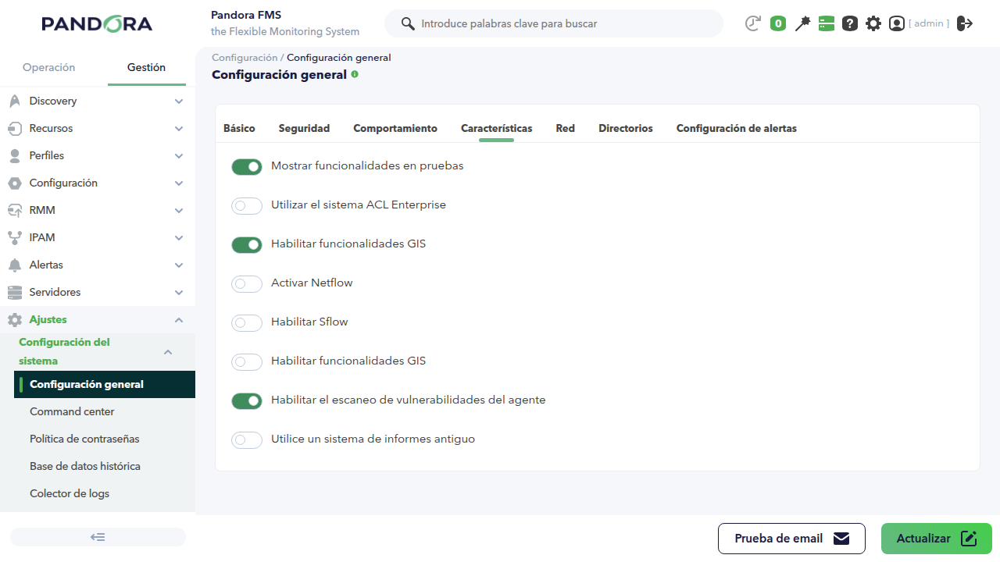

Souvenez-vous qu'il s'agit de deux interrupteurs distincts : celui de la console
décide quelles parties de l'interface s'affichent ; celui du serveur décide si
l'information de position est traitée et enregistrée. La console peut afficher
les cartes pendant que le serveur ignore ce qu'il reçoit.

## Configurer la position des EndPoints

Le fichier de configuration de l'EndPoint, `pandora_agent.conf`, accepte des
paramètres de position fixe. Ils situent l'agent sans dépendre de rien d'autre :

```ini
latitude 40.37346827
longitude -3.6418548
altitude 637
position_description Madrid, Vallecas
```

| Exigence | Détail |
|---|---|
| `latitude` | Latitude en degrés décimaux |
| `longitude` | Longitude en degrés décimaux |
| `altitude` | Altitude en mètres ; facultatif |
| `position_description` | Description lisible du lieu (par exemple, « Madrid, Vallecas ») ; facultative |
| `gis_exec` | Chemin d'un **script** qui renvoie les coordonnées |

`gis_exec` pointe vers un script qui, à l'exécution, imprime une seule ligne avec
les coordonnées séparées par des virgules : `latitude,longitude,altitude`.
L'altitude est facultative. Un exemple de sortie valide serait
`41.377,-5.105,2.365`. Le script doit exister sur le système ; si le chemin ne
correspond à aucun fichier réel, l'EndPoint ignore `gis_exec` et utilise les
valeurs manuelles. Quand `gis_exec` est défini et exécutable, il prime sur
`latitude` et `longitude`.

!!! warning "La sortie de `gis_exec` ne se lit pas de la même façon partout"
    L'**EndPoint** lit la chaîne comme `latitude,longitude,altitude` ; le
    **serveur satellite**, en revanche, la lit comme `longitude,latitude,altitude`.
    Si un même script doit alimenter les deux, gardez à l'esprit l'ordre attendu
    par chacun : le même `41.377,-5.105` désigne des coordonnées différentes
    selon qui le lit.

## Géolocalisation inverse et Discovery

Le serveur Discovery peut calculer la position des agents qu'il découvre sans
que ceux-ci transmettent quoi que ce soit : il géolocalise leur adresse IP et les
place sur la carte. Pour cela, il utilise un algorithme de géolocalisation
inverse et une base de données qui associe des adresses IP à des positions. Le
jeton `recon_reverse_geolocation_file` désigne le fichier contenant cette
information, au format MaxMind GeoLiteCity (`GeoLiteCity.dat`). Si le fichier
n'existe pas ou ne peut pas être lu, le serveur avertit et l'écarte.

Comme la position déduite d'une IP est approximative, le jeton
`recon_location_scatter_radius` disperse les agents au hasard autour du point
calculé, selon un rayon en mètres, pour qu'ils ne s'empilent pas tous au même
endroit. Une valeur de `0` les laisse exactement au point déduit.

Outre le fichier local, le serveur peut résoudre l'adresse en ligne :

- `google_maps_description`, à `1`, active la géolocalisation inverse avec
  l'API publique de Google Maps.
- `openstreetmaps_description`, à `1`, l'active avec l'API publique
  d'OpenStreetMap.

!!! warning "La géolocalisation inverse en ligne coûte des performances"
    Les deux options précédentes **diminuent les performances** du serveur et
    **exigent un accès à Internet** : il faut résoudre l'adresse de chaque
    position reçue. Elles dépendent en outre de la disponibilité du fournisseur
    du service.

Le dernier jeton du traitement est `location_error`, un rayon en mètres. Deux
positions séparées par moins que cette distance sont considérées comme
identiques. Il sert à ce qu'un agent immobile ne semble pas se déplacer à cause
du bruit du récepteur GPS : si le saut ne dépasse pas le seuil, le serveur met à
jour la position actuelle mais ne l'archive pas comme un déplacement. Quand
l'agent se déplace effectivement au-delà du seuil, le serveur enregistre la
position précédente dans l'historique et fixe la nouvelle. La position actuelle
et l'historique des positions sont stockés dans la base de données ; leur schéma
se trouve dans [10.1](../parte-10/10.1-esquema-de-la-base-de-datos.md) et
[10.2](../parte-10/10.2-referencia-de-tablas.md).

## Connexions de carte

Une **connexion de carte** définit l'origine des cartes de fond : le serveur de
tuiles, la clé Google, l'image statique ou le service WMS. Elles se créent depuis
la console web dans **Gestion → Réglages → Configuration du système → Connexion
de carte GIS**. La liste montre les connexions existantes et le bouton **Créer**
ouvre le formulaire de création.

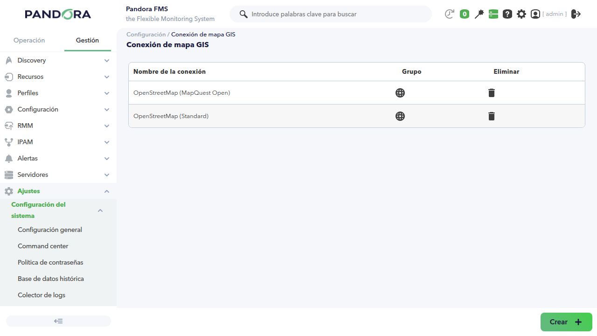

Toute connexion partage quelques champs de base avant le choix du type :

| Exigence | Détail |
|---|---|
| Nom de la connexion | Nom qui l'identifie et sert à la sélectionner ensuite lors de la composition d'une carte |
| Groupe | Groupe auquel appartient la connexion |
| Nombre de niveaux de zoom | Niveaux d'agrandissement disponibles sur la carte |
| Niveau de zoom par défaut | Niveau avec lequel la carte s'ouvre, sauf si la carte elle-même le redéfinit |

Une fois le type choisi, ses champs propres apparaissent. Les quatre types
possibles sont **OpenStreetMaps**, **Google Maps**, **Image statique** et
**Serveur WMS**.

**OpenStreetMaps.** Il ne demande que l'URL du serveur de tuiles, avec les
marqueurs `${z}`, `${x}` et `${y}` à leur place :

```text
http://tiles.example.com/${z}/${x}/${y}.png
```

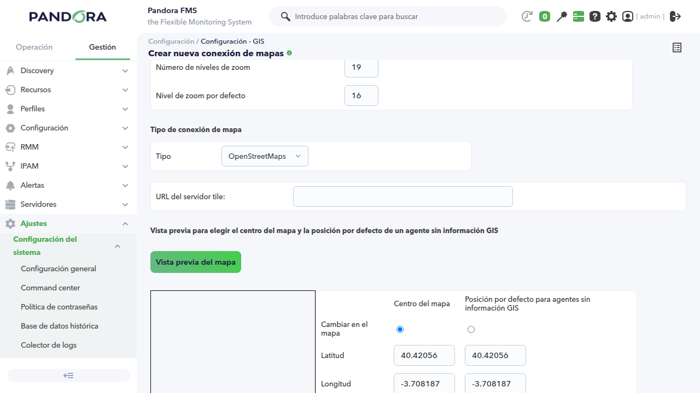

L'installation fournit deux connexions OpenStreetMap prêtes à l'essai,
« OpenStreetMap (MapQuest Open) » et « OpenStreetMap (Standard) ».

**Google Maps.** Il demande le type de carte de fond (Google Hybrid, Google
Physical ou Google Satellite) et la clé d'API de Google Maps.

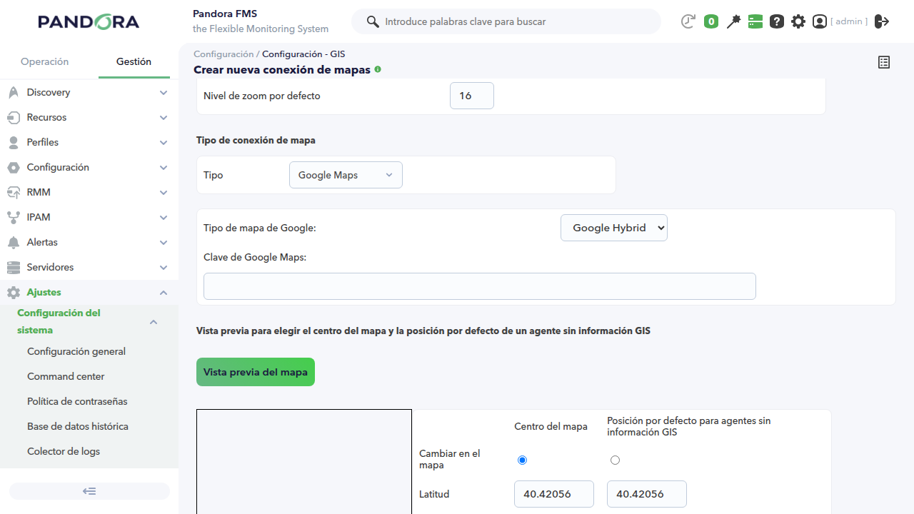

**Image statique.** Utilise une image personnelle comme carte de fond. L'image
doit être dans la projection EPSG:4326 (WGS84). On indique son URL, ses coins
(gauche, inférieur, droit et supérieur) et sa taille en pixels (largeur et
hauteur).

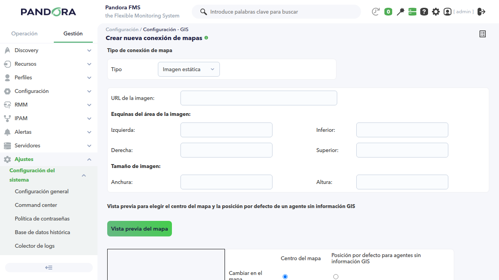

**Serveur WMS.** On indique l'URL du service et la liste des couches que l'on
veut en obtenir. C'est la voie pour un serveur de cartes propre (par exemple,
GeoServer) quand il n'est pas possible de recourir à un service en ligne.

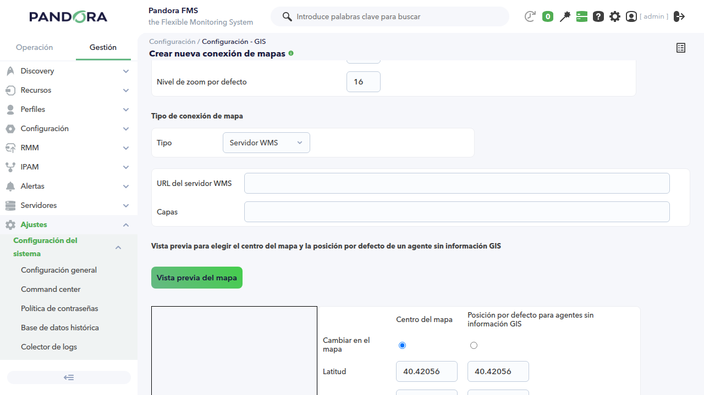

Une fois le type fixé, restent le **centre de la carte** et la **position par
défaut pour les agents sans information GIS** : le point où la carte s'ouvre et
le point où sont placés les agents qui ne transmettent pas de coordonnées. La
console offre deux façons de les fixer. On prévisualise la carte avec **Aperçu
de la carte** et on clique dessus, après avoir choisi avec le sélecteur
**Modifier sur la carte** lequel des deux points est déplacé ; ou on saisit les
valeurs à la main dans leurs cellules, avec le point comme séparateur décimal.

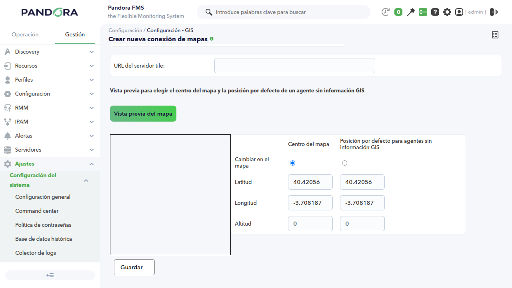

La connexion s'enregistre avec **Enregistrer**.

## Créer et définir une carte GIS

Les cartes GIS se gèrent dans **Opération → Cartes topologiques → Cartes GIS →
Liste des cartes GIS**. La liste permet de créer, modifier, consulter et
supprimer des cartes, et de marquer laquelle est la **carte par défaut** avec le
bouton radio de la colonne « Par défaut ».

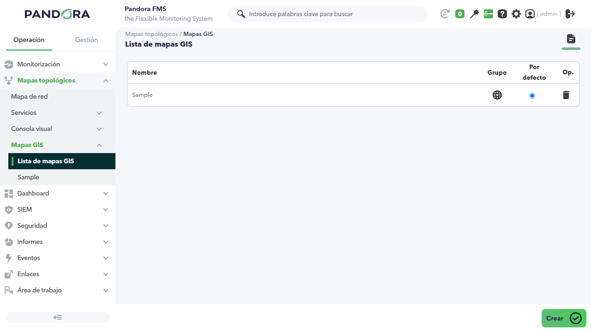

!!! warning "Une carte par défaut est nécessaire"
    La vue d'agent place l'agent sur la carte par défaut. Sans carte marquée
    comme telle, cette vue avertit qu'il n'y a pas de carte par défaut et
    n'affiche aucune position.

Le bouton **Créer** ouvre le créateur de cartes. Les premiers champs sont le
**Nom de la carte**, le groupe, le **Zoom par défaut** et les coordonnées du
centre et de la position par défaut. On ajoute ensuite une ou plusieurs
**connexions de carte**, qui serviront de couches de fond : elles se sélectionnent
dans **Ajouter une connexion à la carte** et s'ajoutent à la liste. Une seule
d'entre elles peut être active comme couche de fond à la fois.

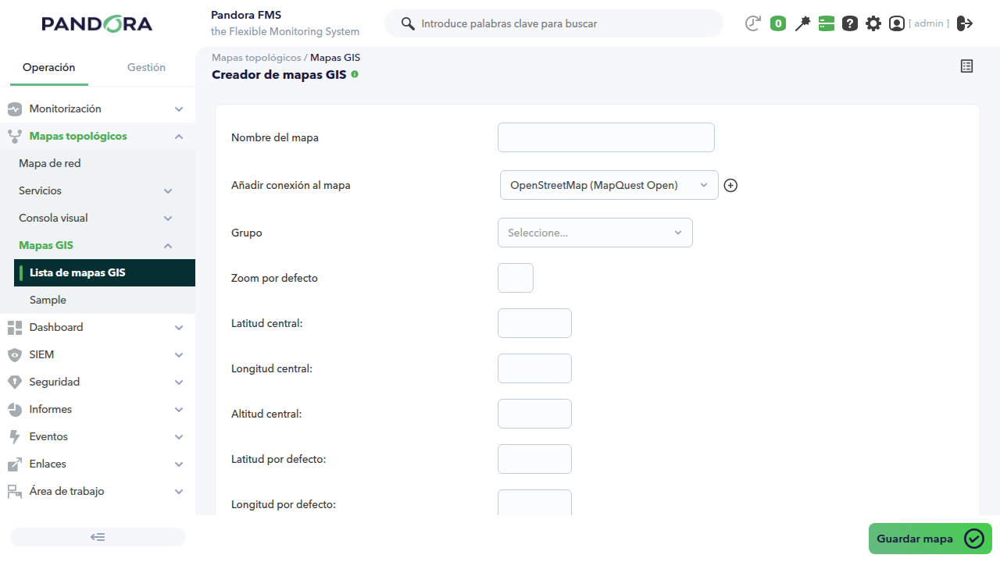

Quand on marque une connexion comme celle par défaut de la carte, ou qu'on la
change, la console demande si l'on veut utiliser ses données par défaut. Si l'on
accepte, elle remplit les coordonnées du centre, la position par défaut et le
zoom avec les valeurs de la connexion ; si l'on refuse, elle ne touche à rien et
ajoute seulement la connexion.

**Couches.** Une couche décide quels agents sont dessinés sur la carte. Chaque
couche peut afficher les agents d'un groupe, une liste précise d'agents ou un
groupe avec un agent représentant. Elles se créent depuis **Nouvelle couche**,
où l'on fixe son nom, sa visibilité, le groupe dont elle prend les agents et la
liste d'agents, et elles s'ajoutent à la liste des couches de la carte. Les
couches peuvent être ordonnées, modifiées et supprimées, et toutes sont
enregistrées avec le reste de la carte.

!!! warning "Un groupe avec représentant ne se répète pas"
    Une fois qu'une couche a un groupe avec son agent représentant, on ne peut
    pas créer une autre couche avec ce même groupe et un autre représentant.

La carte s'enregistre avec **Enregistrer la carte**. Si la carte doit être la
carte par défaut, il n'est pas nécessaire de définir des couches : elle sert à
situer l'agent dans sa vue.

## Exploiter la carte

Le visualiseur de la carte montre la carte avec ses couches et ses contrôles. Le
titre affiche le nom de la carte et, dans la barre supérieure, les contrôles
d'exploitation.

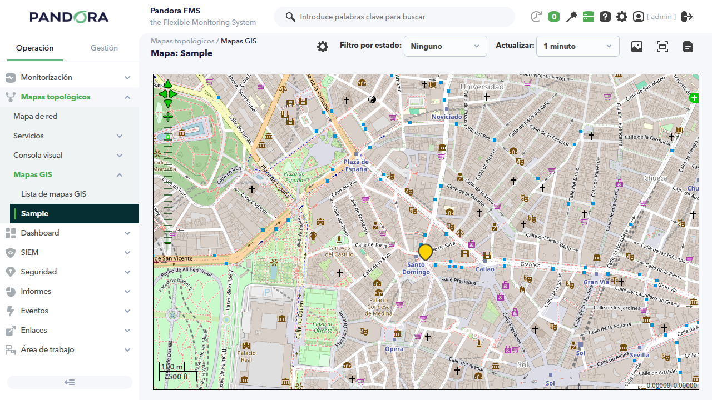

**Navigation.** Les flèches du coin supérieur gauche déplacent la carte dans
chaque direction ; les icônes **+** et **-** et la barre de zoom changent le
niveau d'agrandissement. La carte peut aussi être déplacée à la souris.

**Couches.** Le contrôle de couches permet de choisir la couche de fond (quand la
carte a plus d'une connexion) et de marquer quelles couches sont visibles et
lesquelles ne le sont pas. Parmi elles figure la couche système **Hiérarchie des
agents**, qui trace des lignes pointillées entre un agent et son parent quand les
deux sont visibles.

**Filtres par état.** Le sélecteur **Filtre par état** réduit les agents affichés
à ceux qui sont dans un état précis : **Aucun** (tous), **Critique**,
**Avertissement**, **Ok** ou **Autres**.

**Actualisation.** Le sélecteur **Actualiser** fixe la fréquence de
rafraîchissement de la carte (de 5 secondes à 2 heures, 1 minute par défaut). Le
rafraîchissement se fait en AJAX, sans recharger la page.

Un clic sur un agent déploie son information, et le nom de l'agent renvoie à sa
vue d'agent. Si l'utilisateur a le profil de gestion, la barre comprend en plus le
bouton d'engrenage pour modifier la carte et le lien vers la carte publique, qui
ouvre le visualiseur sans qu'il faille se connecter.

## Vue d'agent et données GIS

Dans la vue d'agent (voir [2.21](../parte-2/2.21-configuracion-comun-de-los-agentes.md#les-onglets-de-la-vue-de-lagent)), l'onglet **Données GIS** montre la carte par défaut et la
position de l'agent. Avec le GIS activé dans la console, la barre d'onglets
comprend cette section, qui, outre la position en latitude, longitude et altitude,
présente une table avec l'information transmise par l'agent sur la période
choisie (y compris la description du lieu, résolue par géolocalisation inverse)
et l'historique des positions.

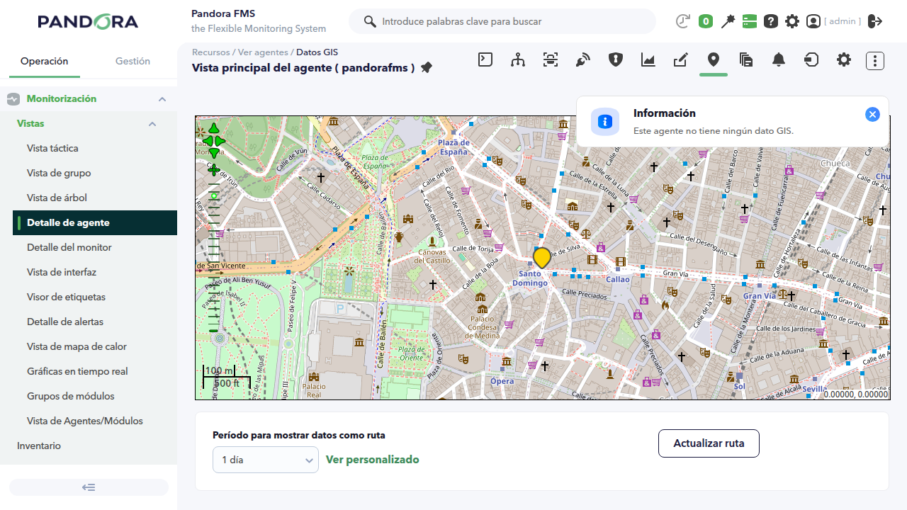

Dans l'administration de l'agent, l'onglet **Données GIS** sert à fixer la
position à la main : on clique sur la carte ou on remplit les champs de latitude,
longitude et altitude du formulaire inférieur. Quand la position est modifiée
manuellement, la console active d'elle-même l'option **Ignorer les nouvelles
données GIS**, pour que le paquet de données suivant ne réajuste pas ce qui vient
d'être fixé. Si ce n'est pas le comportement voulu, il faut la désactiver avant
de cliquer sur **Mettre à jour**.

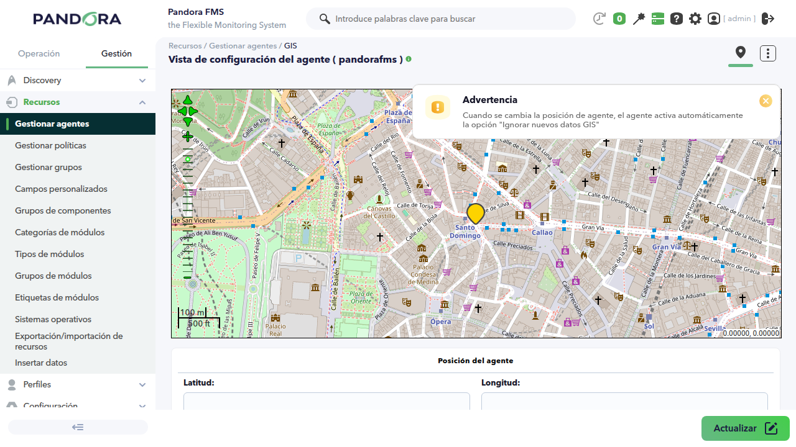

L'autre extrémité de ce réglage se trouve dans la gestion de l'agent, dans
l'option **Mettre à jour les nouvelles données GIS**. Quand elle est activée, le
serveur applique l'information de position qu'il reçoit ; quand elle est
désactivée, il conserve la dernière position valide. C'est l'option utile quand
un agent transmet une position erronée ou quand il faut le laisser à une position
fixe. Si l'on fixe la position à la main dans l'onglet **Données GIS**, il
convient de revoir ensuite cette option : c'est le même réglage vu de l'autre
côté.

!!! note "L'onglet Données GIS s'affiche même si le GIS global est désactivé"
    L'administration de l'agent force l'interrupteur global pour monter l'onglet
    **Données GIS**, de sorte que cette interface apparaît même si « Activer les
    fonctionnalités GIS » est désactivé. Le bouton de la vue GIS de l'agent, en
    revanche, dépend bien de l'interrupteur global et ne s'affiche pas s'il est
    désactivé.

## Référence des paramètres

Le détail complet de chaque jeton, avec son contexte, se trouve dans [9.3
Référence de configuration du
serveur](../parte-9/9.3-referencia-completa-de-configuracion-del-servidor.md) et
dans [9.1 Référence de configuration de
l'EndPoint](../parte-9/9.1-referencia-completa-de-configuracion-del-endpoint.md).

**Serveur (`pandora_server.conf`)**

| Paramètre | Valeur par défaut | Ce qu'il fait |
|---|---|---|
| `activate_gis` | `0` | Active (`1`) ou désactive (`0`) le traitement de l'information GIS dans le serveur |
| `location_error` | `50` | Rayon en mètres en dessous duquel deux positions sont considérées comme identiques |
| `recon_reverse_geolocation_file` | vide | Fichier MaxMind GeoLiteCity pour la géolocalisation inverse des agents découverts |
| `recon_location_scatter_radius` | `50` | Rayon en mètres du cercle dans lequel les agents découverts sont dispersés au hasard |
| `google_maps_description` | `0` | Active (`1`) la géolocalisation inverse avec l'API de Google Maps |
| `openstreetmaps_description` | `0` | Active (`1`) la géolocalisation inverse avec l'API d'OpenStreetMap |

**EndPoint (`pandora_agent.conf`)**

| Paramètre | Format | Ce qu'il fait |
|---|---|---|
| `latitude` | Degrés décimaux | Latitude fixe de l'appareil |
| `longitude` | Degrés décimaux | Longitude fixe de l'appareil |
| `altitude` | Mètres (facultatif) | Altitude de l'appareil |
| `position_description` | Texte libre | Description lisible du lieu |
| `gis_exec` | Chemin d'un script | Script qui renvoie `latitude,longitude,altitude` sur une ligne |

## Références croisées

- **[5.7 Cartes topologiques du réseau](5.7-mapas-topologicos-de-red.md)** :
  l'autre façon de voir le réseau depuis la console : le GIS dessine la
  géographie, la topologie dessine les relations.
- **[9.3 Référence de configuration du serveur](../parte-9/9.3-referencia-completa-de-configuracion-del-servidor.md)** :
  les jetons GIS du serveur, dans leur contexte complet.
- **[9.1 Référence de configuration de l'EndPoint](../parte-9/9.1-referencia-completa-de-configuracion-del-endpoint.md)** :
  les paramètres de position de l'EndPoint, avec le reste de sa configuration.
- **[10.1 Schéma de la base de données](../parte-10/10.1-esquema-de-la-base-de-datos.md)**
  et **[10.2 Référence des tables](../parte-10/10.2-referencia-de-tablas.md)** :
  le schéma des tables qui enregistrent positions, connexions, cartes et couches.
- **[2.9 Collections](../parte-2/2.9-colecciones.md)** : comment distribuer le
  script de position depuis le serveur, si l'on utilise `gis_exec`.
