# Application mobile

L'application mobile Pandora FMS est la console de poche : l'état de la
supervision, les événements, les alertes et les services sans ouvrir de
navigateur. Elle s'appelle **Pandora FMS Console** et elle existe pour Android,
pour iOS et sous forme de build web publié par la console elle-même.
L'application réunit les vues de supervision et le chat de Pandora AI, qui peut
exécuter des actions dans la console.

## Ce qu'elle est et comment elle s'intègre

L'application est un client de l'**API v2** de la console : elle se connecte à
`<console>/api/v2` avec le compte de l'utilisateur et affiche les informations
que cet utilisateur est autorisé à voir. Il n'y a ni serveur intermédiaire ni
base de données propre ; si la console ne répond pas, l'application n'a rien à
montrer.

Trois plateformes, une seule application :

- **Android** : application installée.
- **iOS** : application installée.
- **Web** : le même client compilé pour le navigateur, servi par la console à
  l'adresse `<console>/mobile/`.

L'application couvre les vues de supervision : agents, modules, événements,
alertes, groupes, serveurs, services et notifications. L'assistant peut exécuter
des actions dans la console, avec les permissions du compte connecté. Les vues
servent à atteindre rapidement le détail ; les opérations manuelles se font
toujours dans la console web.

La version 1.0.0 nécessite une console **806 ou ultérieure**. L'application le
rappelle sur l'écran de configuration initiale et, sur une console plus ancienne,
certains écrans peuvent rester vides parce que les endpoints utilisés n'existent
pas.

Dans la partie 5, l'application est une façon de plus de regarder ce que les
chapitres de supervision documentent déjà : elle ne remplace pas le tableau de
bord de la console web et n'ajoute pas de fonctions. Elle les rapproche
simplement de l'écran du téléphone.

Les libellés de l'interface sont cités en anglais, langue des captures ; les
écrans sont traduits en 15 langues, avec prise en charge RTL.

## Accès et installation

| Prérequis | Détail |
|---|---|
| Console | Pandora FMS 806 ou ultérieure, accessible depuis l'appareil |
| Compte | Utilisateur de la console avec des permissions de lecture sur les groupes à consulter |
| Accès à l'API | L'IP du client doit être autorisée dans la console (voir plus bas) |
| Réseau | Connexion à l'hôte de la console ; en production, HTTPS avec une chaîne de certificats valide |
| Navigateur (build web) | La console sert l'application à `<console>/mobile/` ; elle doit être ouverte depuis le même domaine que la console |

Sur **Android** et **iOS**, l'application s'installe comme n'importe quelle autre
application. Au premier lancement, elle affiche un **onboarding de quatre
écrans** qui présente le tableau de bord, les listes, les détails et le menu. Il
peut être ignoré avec **Skip** ; il ne réapparaît pas.

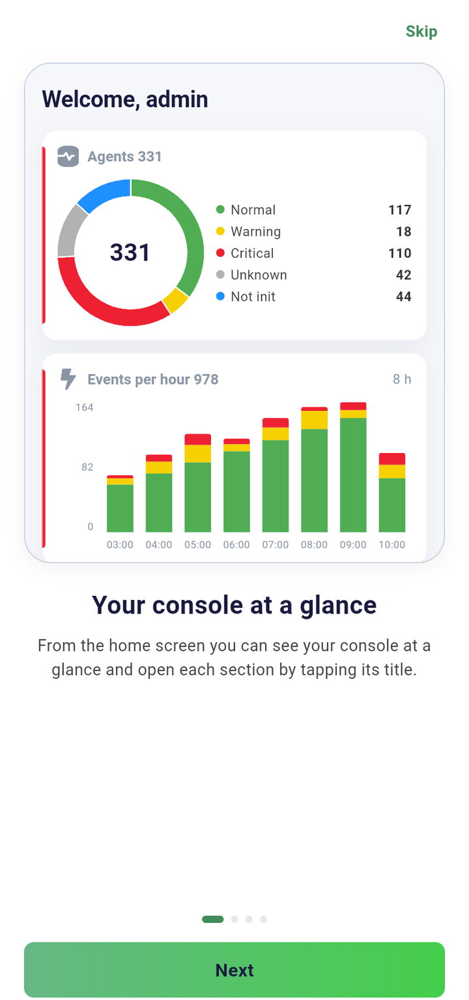{ width="282" }

Le **build web** ne s'installe pas : il s'ouvre dans le navigateur. L'adresse est
celle de la console suivie de `/mobile/` :

```text
https://<console>/mobile/
```

L'application web parle à l'API depuis la même origine que la console ; c'est
pourquoi elle ne peut pas être servie depuis un autre domaine ni depuis
`file://`. Si la console utilise HTTPS, l'application aussi.

Lorsque la console est ouverte dans le navigateur d'un téléphone, certaines
pages proposent un pont vers l'application installée : **Open in app** ouvre
l'écran équivalent et **Continue in browser** reste dans la console. Le pont
n'apparaît que sur les pages qui ont un écran équivalent dans l'application et
uniquement lors de navigations normales, pas dans les formulaires ni les
téléchargements. Les écrans que l'application sait ouvrir sont le tableau de
bord, les agents, les modules, les groupes, les événements, les alertes, les
serveurs, les services et les notifications, y compris leurs pages de détail.

## Connexion à la console

La première fois que l'application est ouverte, il faut lui indiquer à quelle
console elle se connecte. L'écran ne demande qu'une chose : l'**Console URL**,
schéma compris.

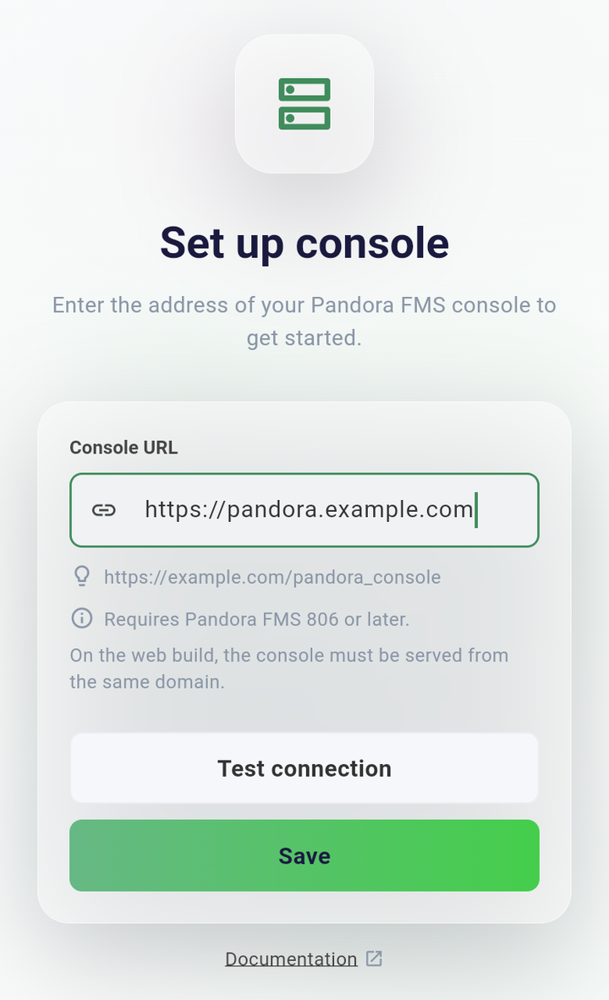{ width="365" }

Le champ accepte une URL complète, avec ou sans barre oblique finale :

```text
https://pandora.example.com/pandora_console
```

En appuyant sur **Test connection**, l'application vérifie que l'URL répond comme
une console Pandora FMS. Si la vérification réussit, **Save** enregistre la
console et mène à la connexion. Les consoles utilisées restent dans une liste de
suggestions qui apparaît lorsqu'on touche le champ ; chacune peut être supprimée
avec la croix de droite. Sur le build web, l'application rappelle que la console
doit être servie depuis le même domaine ; la liste de suggestions ne change pas
cette règle.

Voici les erreurs que la vérification peut renvoyer :

| Message | Signification |
|---|---|
| That URL is not valid. Use http:// or https://. | Le schéma manque ou l'URL est mal formée |
| Cannot reach that console. | L'hôte ne répond pas, le port est fermé ou le réseau n'atteint pas la console |
| The console security certificate is not valid or is incomplete. Contact the administrator. | Le serveur ne présente pas une chaîne de certificats acceptée par l'appareil |
| The URL responds, but it does not look like a Pandora FMS console. | L'URL répond, mais ce n'est pas l'API d'une console |

Si l'URL est en `http://`, l'application avertit que la connexion n'est pas
chiffrée et demande confirmation avant de continuer. L'avertissement est
informatif ; il n'empêche pas de poursuivre.

### La console doit autoriser l'IP du client

L'API de la console ne répond qu'aux adresses incluses dans la **IP list with API
access**. Elle se configure dans **General setup → Security** et accepte des
adresses isolées, des plages avec joker (`192.168.20.*`) ou `*` pour les
autoriser toutes. Si la liste est vide ou n'inclut pas l'IP d'où vient le client,
l'application ne peut pas s'authentifier même avec des identifiants corrects.

### Le navigateur se connecte et l'application non : la chaîne du certificat

C'est la panne la plus fréquente lors de la mise en production de
l'application. La console s'ouvre sans problème dans le navigateur du téléphone,
mais l'application refuse la connexion avec le message du certificat. Ce n'est
ni un problème d'identifiants ni de réseau : c'est la chaîne de certificats.

Les navigateurs complètent la chaîne d'eux-mêmes : si le serveur n'envoie pas un
maillon, ils le téléchargent grâce aux informations du certificat ou le
récupèrent dans leur cache. Les bibliothèques HTTP utilisées par les
applications ne font pas ce téléchargement et valident exactement ce qu'elles
reçoivent. S'il manque un certificat intermédiaire ou la racine croisée,
l'appareil ne peut pas tracer le chemin jusqu'à une autorité de confiance et
coupe la connexion.

Le serveur doit envoyer **trois certificats**, dans cet ordre :

1. Le certificat de la console (feuille).
2. Le certificat intermédiaire de l'autorité de certification.
3. La racine **croisée**, pas celle autosignée. Pour Sectigo, la R46 émise par
   USERTrust RSA ou par AAA Certificate Services.

Apache propose deux façons de le configurer. La première est un fichier unique
avec les trois certificats concaténés :

```apache
SSLCertificateFile    /chemin/console-fullchain.pem
SSLCertificateKeyFile /chemin/console.key
```

La seconde répartit la chaîne entre plusieurs directives :

```apache
SSLCertificateFile      /chemin/console.crt
SSLCertificateChainFile /chemin/intermediate.pem
SSLCACertificateFile    /chemin/cross-signed-root.pem
SSLCertificateKeyFile   /chemin/console.key
```

Si le fournisseur livre un `fullchain`, utilisez-le tel quel. Sinon, il faut
réunir la racine croisée à la main. Avec Sectigo, le paquet `.p7c` contient
plusieurs versions de la même racine ; la bonne est celle dont l'émetteur est
USERTrust RSA ou AAA Certificate Services :

```bash
curl -O http://crt.sectigo.com/SectigoPublicServerAuthenticationRootR46.p7c
openssl pkcs7 -inform DER -in SectigoPublicServerAuthenticationRootR46.p7c \
  -print_certs -out r46-chain.pem
```

Dans ce fichier, choisissez la variante croisée et écartez celle autosignée. Il
ne faut pas non plus traîner des racines en double ni plusieurs variantes :
l'appareil peut rejeter toute la chaîne.

Ensuite, validez la configuration, rechargez le serveur web et vérifiez depuis un
réseau sans inspection TLS :

```bash
apachectl configtest
systemctl reload apache2   # ou le service de votre serveur web
openssl s_client -connect <host>:443 -servername <host> -showcerts
```

La sortie doit afficher **trois certificats** et se terminer par :

```text
Verify return code: 0 (ok)
```

!!! warning "Ne pas désactiver la validation dans l'application"
    Accepter des certificats non valides ouvrirait la porte à l'interception
    des identifiants et des données. Si la chaîne ne peut pas être complétée, on
    corrige le serveur ; on ne relâche pas l'application.

## Se connecter et permissions

Une fois la console configurée, l'application affiche l'écran de connexion :
utilisateur, mot de passe et bouton **Log in**. L'icône de l'œil affiche ou
masque le mot de passe, et l'engrenage en haut à droite permet de changer l'URL
de la console.

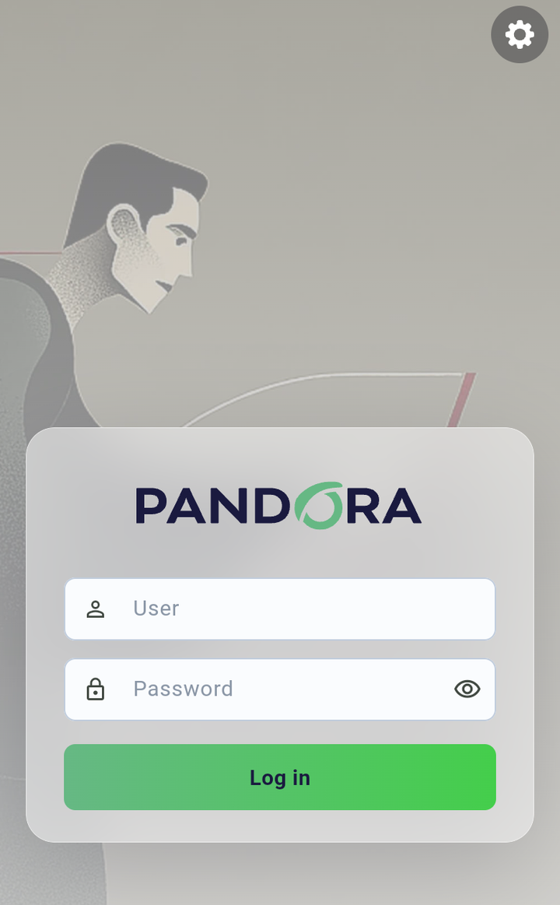{ width="371" }

Si le compte a la **vérification en deux étapes**, après le mot de passe
l'application demande le code à six chiffres de l'application d'authentification.
Le code expire et il est possible de revenir à la connexion avec **Back to
login**. Les erreurs sont distinguées : identifiants incorrects, console
injoignable, trop de tentatives et utilisateur sans profil attribué.

L'application ne décide pas de ce que l'utilisateur peut voir : c'est la console
qui le décide. Au démarrage, elle interroge l'API pour savoir quelles sections
sont autorisées et **masque** celles qui répondent par une erreur de permission.
Si cette requête échoue pour une raison temporaire, l'application ne masque rien
et laisse chaque écran afficher sa propre erreur. En pratique : si un
utilisateur n'a pas accès aux alertes, la section des alertes n'apparaît pas.

!!! tip "Un compte avec les permissions justes"
    Il ne faut pas distribuer un compte d'administration entre les téléphones.
    Créez un utilisateur avec le profil qui convient et donnez-lui accès
    uniquement aux groupes qu'il doit consulter. Si Pandora AI doit être utilisé,
    vérifiez aussi quelles actions il peut exécuter : l'assistant agit avec les
    permissions de ce compte.

La déconnexion se trouve dans le menu, en fin de liste. Elle demande
confirmation et révoque la session dans la console ; au lancement suivant, il
faut s'authentifier de nouveau.

## Comment travailler dans l'application

Tous les écrans de données partagent les mêmes motifs. Les apprendre une fois
économise la moitié de ce chapitre.

**Navigation.** La barre inférieure propose cinq destinations : **Home**,
**Events**, **Alerts**, **AI** et **Menu**. Le menu ouvre le reste des sections :
agents, modules, groupes, serveurs, services, notifications et About. Les
flèches de l'en-tête reviennent en arrière ; en revenant à une liste, ses
filtres et son tri sont restaurés.

**Listes.** Chaque liste charge **20 éléments par requête** et demande la page
suivante en fin de liste, sans bouton « charger plus ». La recherche, les
filtres et le tri sont appliqués **dans la console**, pas sur le téléphone : si
un filtre n'existe pas dans l'API, l'application ne le simule pas.

**Filtres.** L'entonnoir de l'en-tête ouvre une feuille avec les filtres de
l'écran. Les champs se remplissent et s'appliquent avec **Apply**, qui ferme la
feuille ; **Reset** revient aux valeurs initiales et ferme aussi. Les filtres
appliqués restent sous forme de **chips** au-dessus de la liste, et chaque chip
se retire avec sa croix. L'application mémorise la dernière combinaison par
console et par écran.

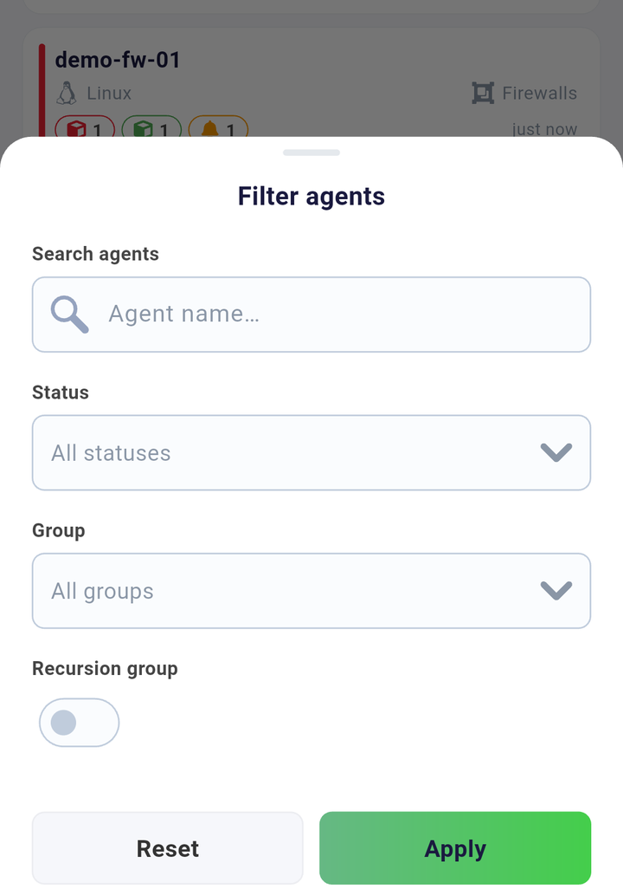{ width="418" }

**Tri.** L'icône des flèches ouvre la feuille de tri : on choisit le champ et le
sens (croissant ou décroissant). Comme les filtres, le tri part vers l'API.

**Détails.** Les pages de détail organisent l'information en onglets que l'on
peut toucher ou faire glisser : résumé, modules, événements, alertes, actions,
historique. Les valeurs longues sont tronquées avec des points de suspension et
s'ouvrent en entier lorsqu'on les touche.

**Chargement et erreurs.** Pendant l'arrivée de la réponse, on voit un squelette
ayant la forme du contenu, pas un spinner. Si la requête échoue, l'écran affiche
l'erreur et un bouton **Retry** ; s'il n'y a pas de résultats, un état vide avec
la raison.

**Dates et heures.** Elles s'affichent dans le fuseau horaire de l'utilisateur de
la console. Si le profil n'en a pas, celui de la console est utilisé et, en
dernier recours, UTC. Les données sont stockées et demandées en UTC ; le fuseau
ne change que leur affichage.

**Actualisation.** Les listes se rafraîchissent en tirant vers le bas. Le tableau
de bord se rafraîchit de la même façon et conserve la dernière réponse jusqu'au
prochain rafraîchissement.

## Les écrans

Chaque section de l'application est une vue de la supervision. Voici ce que
montre chacune, ce qui peut être filtré et ce qui s'ouvre depuis elle. Les
détails de configuration des agents, modules, alertes et services se trouvent
dans leurs chapitres des parties 2 et 5 ; ici, seule la vue est expliquée.

### Accueil

Le tableau de bord résume l'état de la console en deux blocs. Le premier, de
supervision, montre le nombre d'agents avec un anneau par état, les modules avec
une barre par état, les événements par heure des huit dernières heures, le total
d'événements avec sa répartition par sévérité, les alertes déclenchées et non
déclenchées, et l'état des événements en attente et en cours.

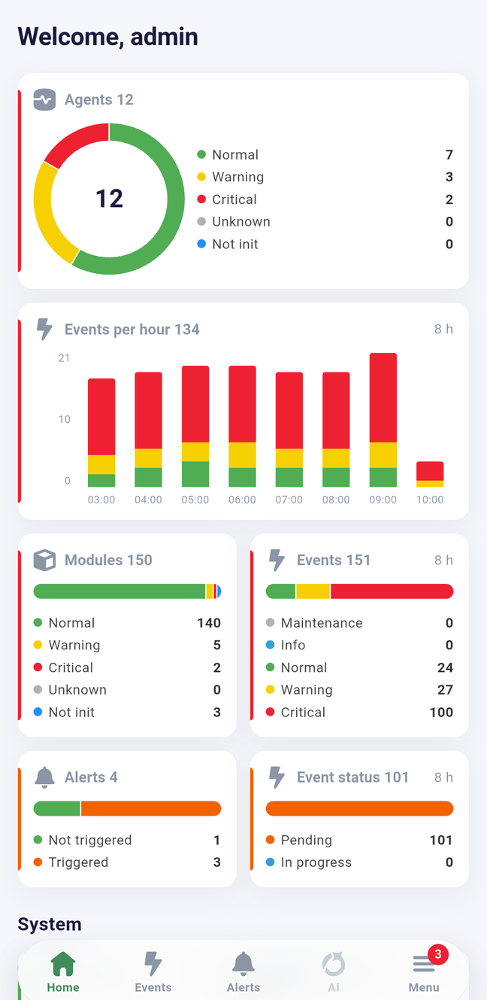{ width="293" }

Le second bloc, **System**, ajoute le CPU, la mémoire et les lectures/écritures
de la base de données des huit dernières heures, l'état des serveurs et un résumé
de la base de données : active ou inactive, taille, événements des dernières 24
heures et nombre d'enregistrements.

Les cartes ne sont pas décoratives : en les touchant, on ouvre la section
correspondante (agents, modules, événements, alertes ou serveurs). Dans l'anneau
des agents, chaque portion de la légende peut être touchée pour isoler cet état.

### Agents

La liste des agents montre, pour chacun, son état, son système d'exploitation,
son groupe, les compteurs de modules (critiques, en avertissement et normaux),
les alertes et le dernier contact. La barre de couleur à gauche résume l'état de
l'agent.

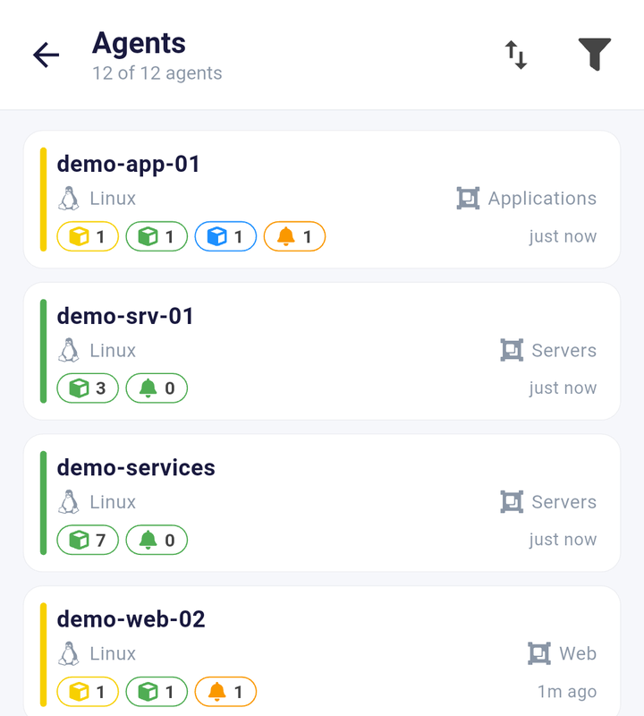{ width="540" }

On peut rechercher par nom, filtrer par état, par groupe (avec l'option
d'inclure les sous-groupes) et par système d'exploitation, et trier par alias,
nom, adresse, groupe, modules critiques, modules en avertissement, modules
totaux ou dernier contact. Par défaut, le plus récent en premier.

La fiche de l'agent a quatre onglets : **Summary**, **Modules**, **Events** et
**Alerts**. Le résumé montre la barre de modules, l'activité d'événements des
dernières 24 heures, les alertes déclenchées et actives, et les informations de
l'agent : nom, alias, identifiant, groupe, IP, système d'exploitation et version,
version de l'agent, description, configuration distante, intervalle, dernier et
prochain contact, dernier contact distant, dernier changement d'état et serveur
attribué.

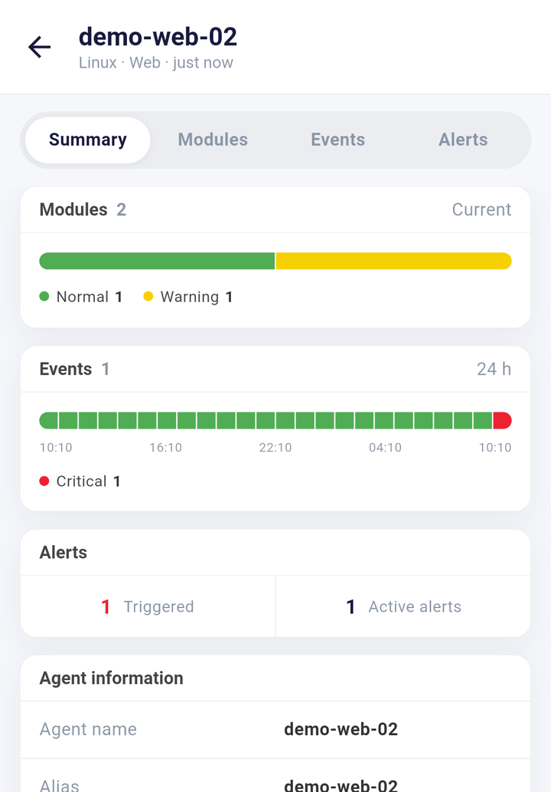{ width="418" }

L'application avertit lorsque l'agent est désactivé, n'a pas de serveur attribué,
n'a jamais contacté, est resté trop longtemps sans contact ou dépasse 200
modules, un seuil à partir duquel la console elle-même avertit que les
performances peuvent en souffrir.

L'onglet **Modules** liste les modules de l'agent avec leur valeur actuelle,
l'heure de la dernière donnée et une mini-courbe. En toucher un ouvre sa fiche.

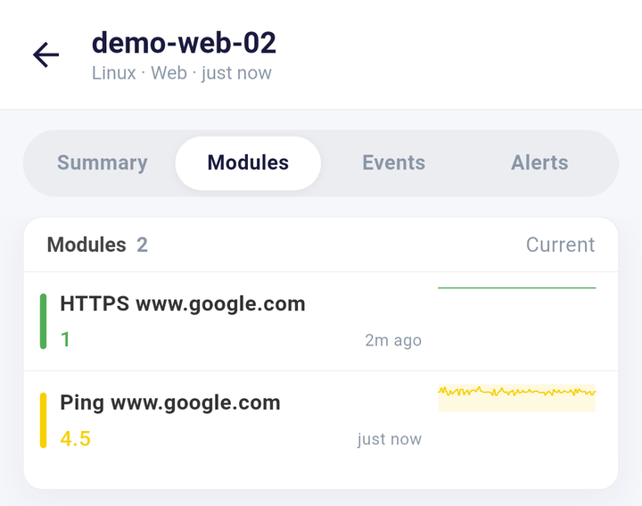

### Modules

L'entrée **Modules** du menu est la liste globale : tous les modules de tous les
agents, avec leur nom, agent, valeur actuelle, heure et mini-courbe. On recherche
par nom, on filtre par agent, par état et par groupe de modules, et on trie par nom
ou par groupe. Les
modules qui ne produisent pas de graphique l'indiquent dans la ligne.

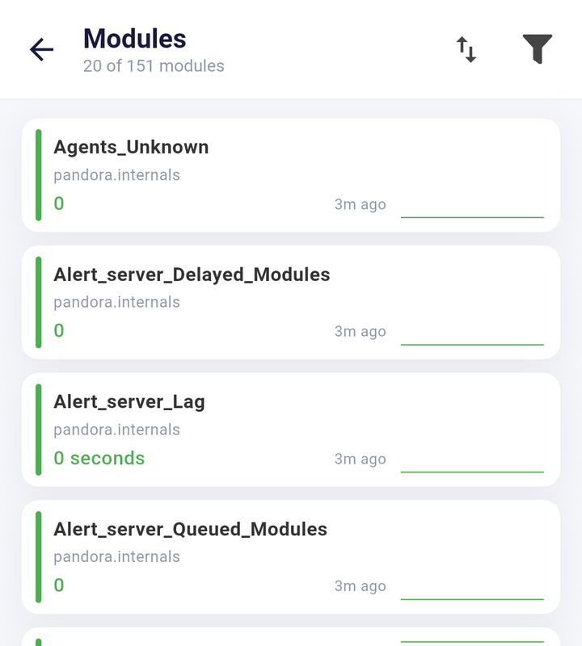{ width="540" }

La fiche du module a quatre onglets : **Summary**, **History**, **Events** et
**Alerts**. Le résumé trace le graphique de la période avec le maximum et la
moyenne, l'histogramme des états du module et ses informations : état, agent,
type, groupe, unité, seuils d'avertissement et critique, module parent et
identifiant. Si le module stocke une image au lieu d'un nombre, il le dit et
n'invente pas de graphique.

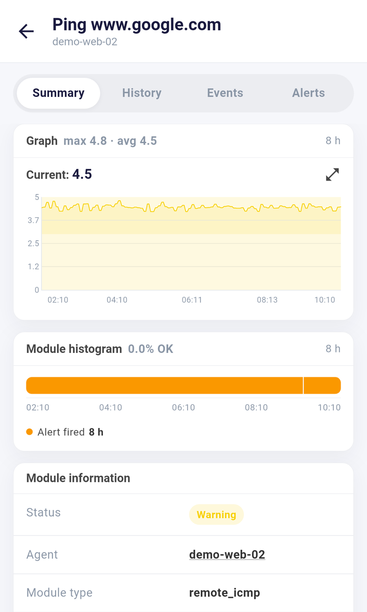{ width="360" }

Le graphique peut être ouvert en plein écran. L'onglet **History** montre
l'historique des valeurs groupé par jour ; **Events** et **Alerts**, ce qui s'est
passé dans les dernières 24 heures.

### Événements

La liste des événements montre les plus récents en premier, avec leur sévérité,
type, agent et module, et le temps écoulé. On filtre par plage de dates (de 15
minutes à tout l'historique, ou une plage personnalisée), par état, par
criticité, par type d'événement, par groupe —avec sous-groupes—, par agent, par
alertes uniquement et par texte. On trie par date, événement, type, état,
criticité ou source.

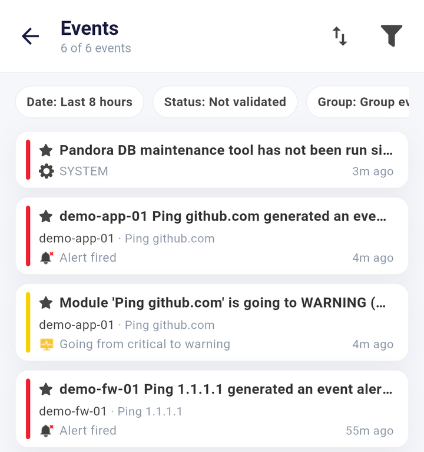{ width="563" }

La fiche de l'événement a jusqu'à cinq onglets : **General**, **Details**,
**Comments**, **Agent fields** et **Custom data**, selon ce que porte
l'événement. General réunit le nom, l'identifiant, l'état, la sévérité, le type,
l'agent, le module, le groupe, le propriétaire, qui l'a reconnu, la date et la
source. Details ajoute les champs propres à l'événement, avec les instructions
critique, avertissement ou inconnu lorsqu'elles existent. Comments montre les
commentaires ; Agent fields, les champs personnalisés de l'agent ; et Custom
data, les données personnalisées de l'événement.

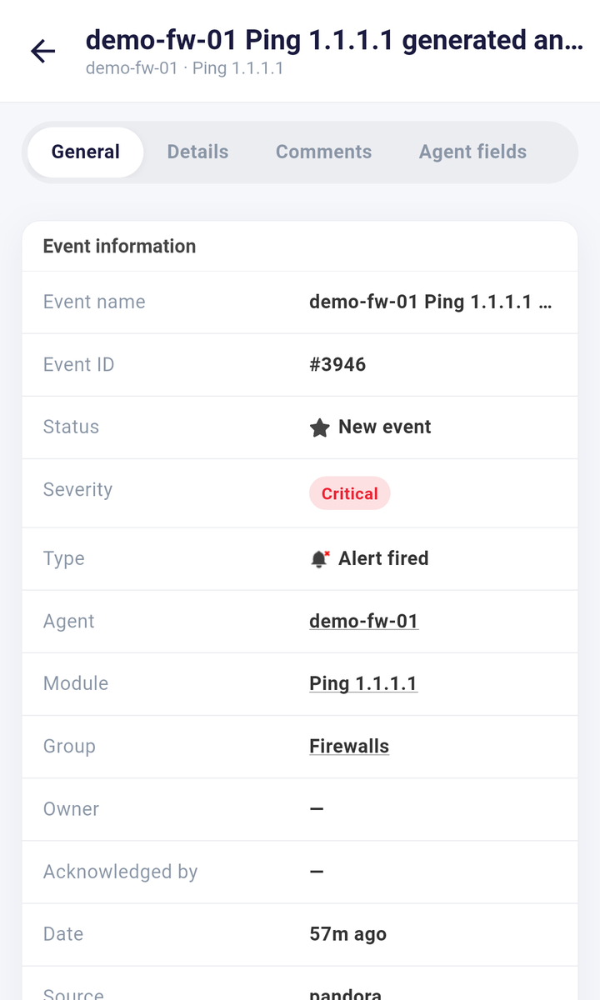{ width="360" }

Le changement d'état de l'événement se fait dans la console web.

### Alertes

La liste des alertes montre l'agent, le module, le modèle, le nombre de
déclenchements et la dernière fois qu'elle s'est déclenchée. On recherche par
agent ou module, on filtre par état, par standby et par criticité, et on trie par
date du dernier déclenchement ou par nombre de déclenchements.

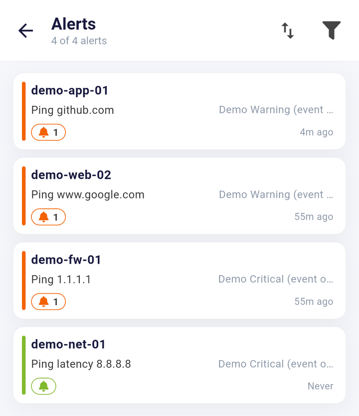{ width="519" }

La fiche a trois onglets : **General**, **Actions** et **Triggered**. General
montre l'agent, le module, le modèle, l'état et le nombre de déclenchements, la
dernière fois qu'elle s'est déclenchée, le standby, si elle est désactivée et la
politique associée. Actions liste les actions configurées avec leur seuil et leur
dernière exécution. Triggered rassemble les déclenchements avec la date, la
récupération, la validation manuelle et les actions exécutées.

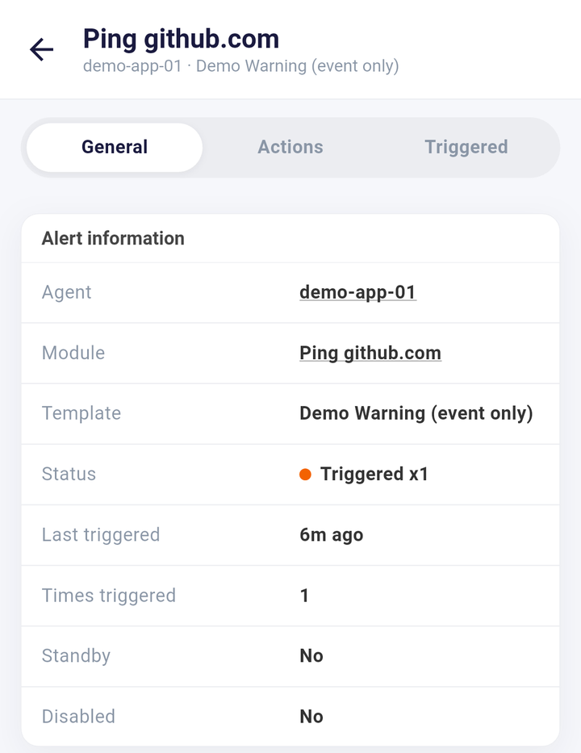{ width="463" }

La reconnaissance et le déclenchement forcé d'une alerte se font dans la console
web.

### Groupes

La liste des groupes montre, pour chaque groupe, ses agents et ses modules
regroupés par état, ainsi que les alertes lorsqu'il en a. On recherche par nom et
on trie par nom ou par identifiant.

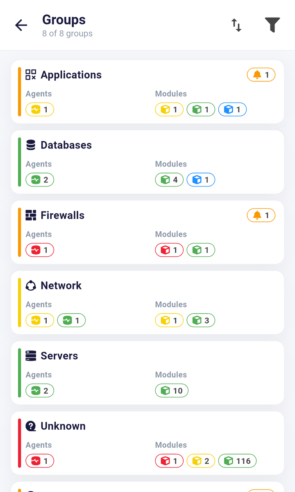{ width="360" }

La fiche du groupe a trois onglets : **Summary**, **Agents** et **Modules**. Le
résumé montre les compteurs et les informations du groupe : identifiant, groupe
parent, description, contact, limite d'agents et si les alertes sont activées.

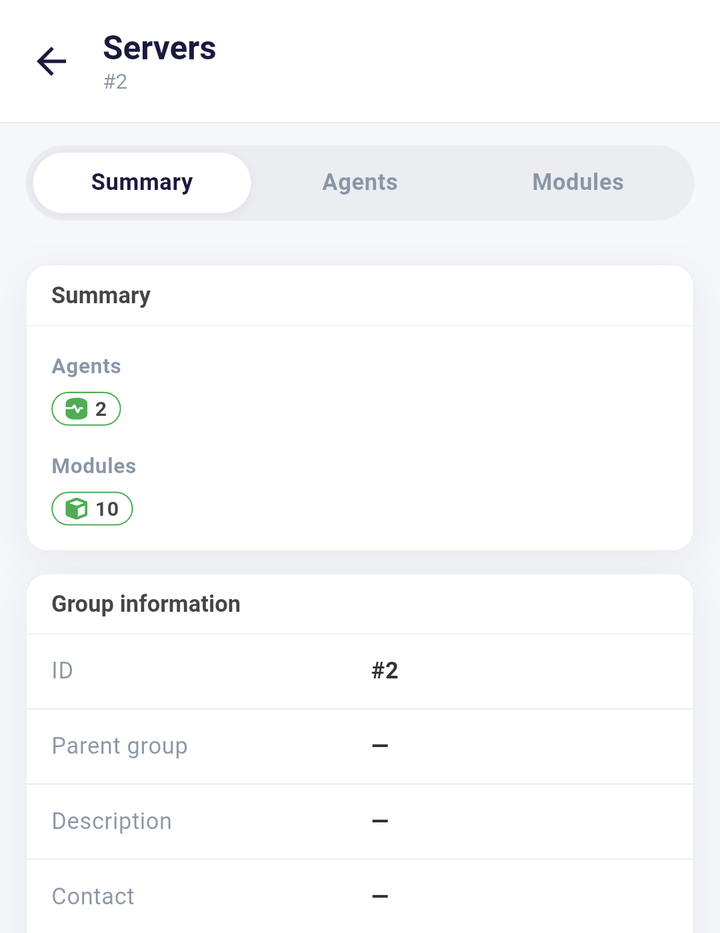{ width="463" }

### Serveurs

La liste des serveurs montre chaque serveur avec son état, son type, s'il est
maître, les modules en cours d'exécution sur le total, le retard, la file de
threads et la dernière mise à jour. On recherche par nom ou version, on filtre par
état, par type et par maître, et on trie par nom, état, type, maître ou mise à jour.

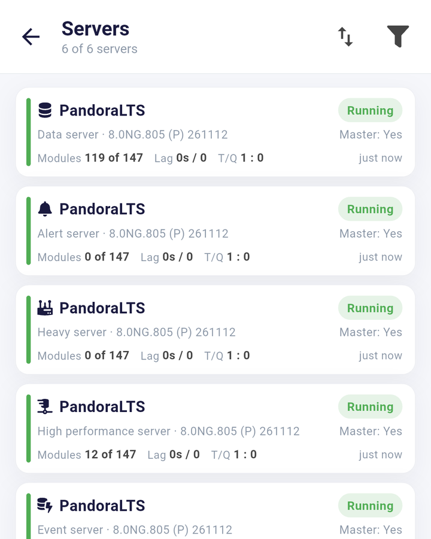{ width="480" }

Chaque ligne est un serveur de la console —de données, de réseau, d'alertes,
d'événements— et permet de voir d'un coup d'œil s'il est à jour. Il n'y a pas de
fiche de détail : l'information tient dans la ligne.

### Services

La liste des services montre l'état, la description, le groupe, le mode (manuel
ou intelligent), la valeur, le SLA et la dernière mise à jour. On recherche par
nom ou description, on filtre par état, par groupe, par mode et par favoris, et on
trie par nom, description ou état.

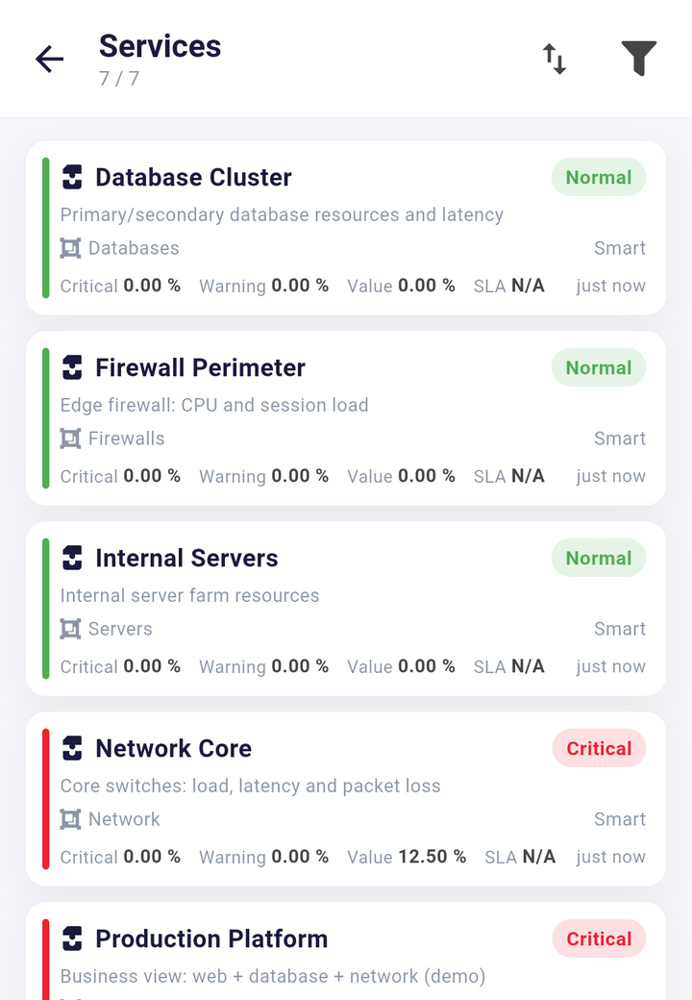{ width="415" }

La fiche du service a deux onglets : **Summary** et **Elements**. Le résumé
réunit la description, le groupe, le mode, les pourcentages critique,
avertissement et valeur, l'état, le SLA et la dernière mise à jour. Elements
liste les éléments qui composent le service : agents, modules et autres
services, avec leur poids et leur état.

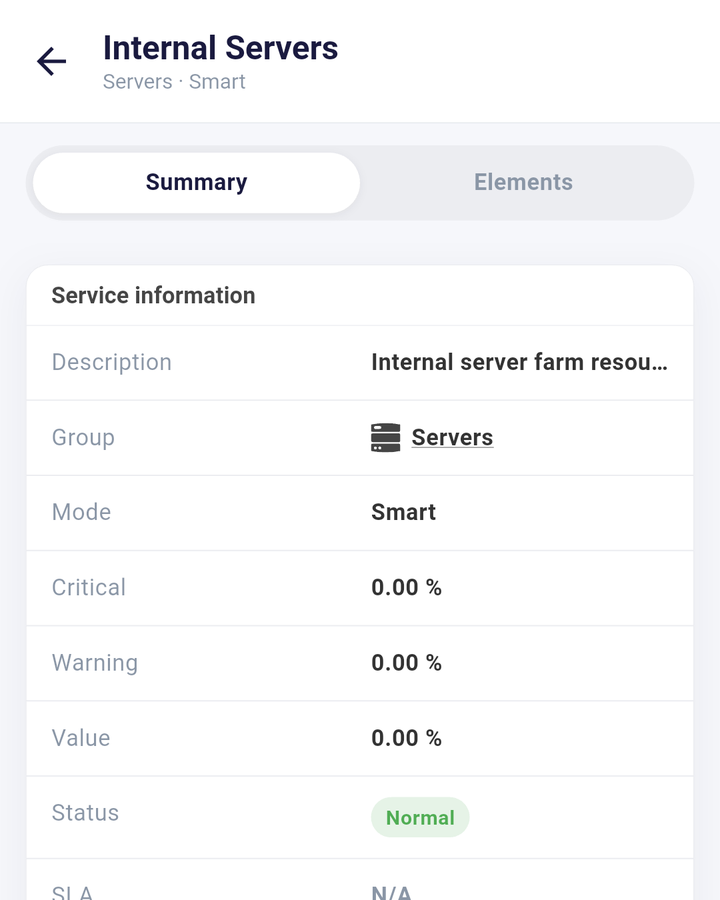{ width="480" }

### Notifications

La boîte de notifications recueille les avis que la console envoie à
l'utilisateur. Chaque ligne montre le sujet, le début du texte, la date et si
elle est lue ou non. Le nombre de non lues apparaît comme compteur sur l'icône du
menu et, dans le menu, à côté de **Notifications**.

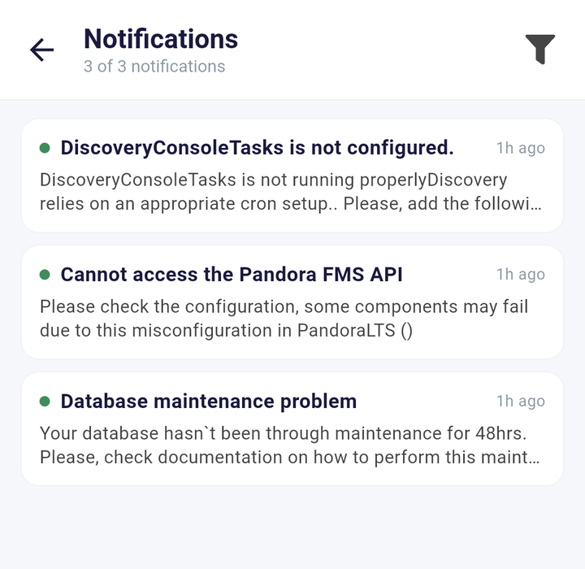{ width="617" }

En ouvrant une notification, on voit le texte complet et la date de réception.
La notification s'affiche telle qu'elle est arrivée ; l'ouvrir ne change pas son
état.

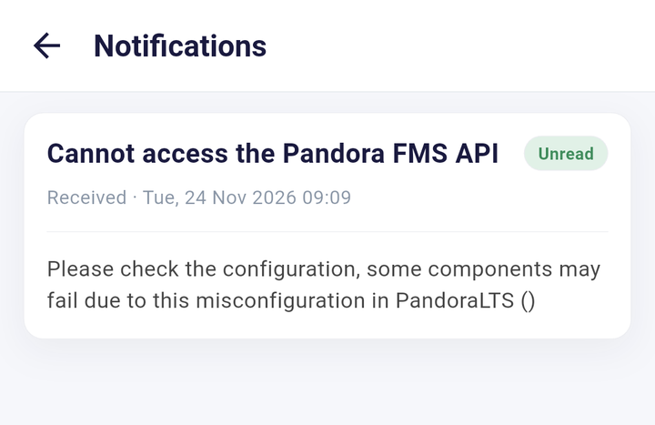

### Pandora AI

Le chat de Pandora AI s'ouvre depuis l'onglet **AI** de la barre inférieure.
L'écran contient le fil de la conversation, le champ de saisie et un bouton
d'envoi ; en haut, l'accès aux **Sessions** et aux modèles disponibles. Les
sessions peuvent être créées, reprises et détruites, et l'assistant peut demander
des données avec un formulaire avant de répondre. Il peut aussi exécuter des
actions dans la console, par exemple créer un agent, avec les permissions du
compte.

Pendant qu'il réfléchit, l'icône **AI** de la barre inférieure s'anime ; si le
chat est réduit, l'indicateur reste là et la conversation n'est pas perdue.
Fermer le chat demande confirmation et conserve la session pour la reprendre
plus tard.

L'onglet n'est disponible que lorsque la console a Pandora AI activé et que
l'utilisateur a la permission de l'utiliser. Si aucun modèle n'est configuré non
plus, le chat l'indique et ne laisse pas démarrer une conversation.

## Menu et informations de l'application

Le menu latéral réunit toutes les sections et le compte avec lequel la session
a été ouverte, et se termine par **Log out**. La version de l'application
apparaît en pied.

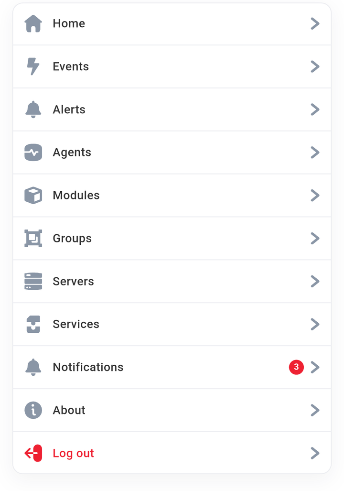{ width="421" }

**About** montre la version de l'application, les données de la console
(version, paquet, MR et build) et les liens vers la documentation, le support,
la politique de confidentialité, l'historique des changements, le guide rapide
et les licences open source.

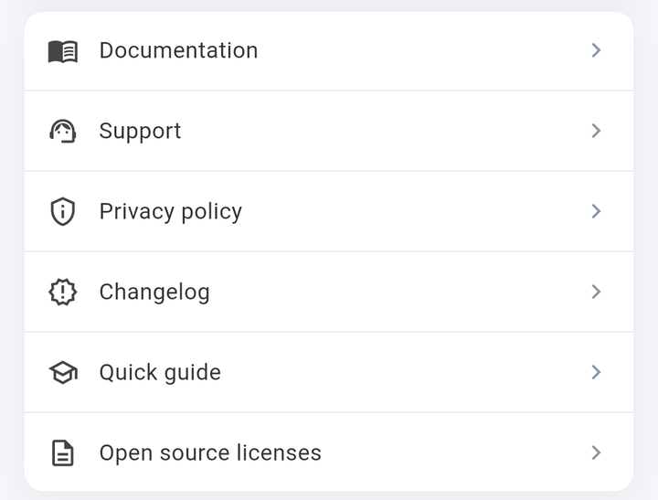

L'**historique des changements** liste les nouveautés de chaque version publiée.
Une nouvelle installation affiche l'onboarding ; lors d'une mise à jour,
l'application peut montrer une fois les nouveautés des versions sautées. Si la
version n'apporte pas de points forts, elle n'interrompt pas.

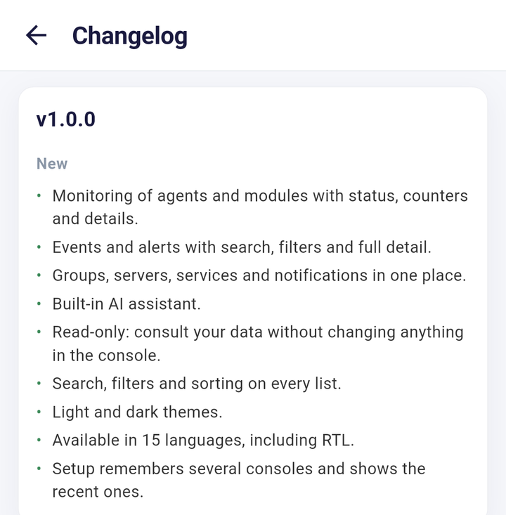{ width="589" }

La **langue** de l'application vient du profil de la console. Le **thème**
aussi : clair, sombre ou celui du système, selon ce que l'utilisateur a configuré
dans la console. Il n'y a pas de sélecteur de langue ni de thème dans
l'application.

## Sécurité et session

L'application ne conserve pas le mot de passe. À la connexion, la console
renvoie un jeton d'accès que l'application garde **en mémoire** et un jeton de
rafraîchissement stocké dans le magasin sécurisé de l'appareil. Lorsque le jeton
d'accès expire, l'application le renouvelle avec le jeton de rafraîchissement
sans redemander le mot de passe ; si la session n'est plus valide, elle revient à
l'écran de connexion.

La déconnexion révoque la session complète dans la console, pas seulement le
jeton du téléphone. Sur le build web, le rafraîchissement s'appuie sur le cookie
du navigateur, qui voyage vers le même domaine que la console.

L'application exige **HTTPS** avec une chaîne valide. Elle n'autorise pas
l'acceptation d'un certificat invalide, même pour tester : si le serveur ne
présente pas la chaîne complète, la connexion est coupée et le message renvoie à
l'administrateur. C'est gênant la première fois, mais cela évite que les
identifiants circulent sans garanties.

Les sections sont masquées selon les permissions de l'utilisateur, et le compte
doit avoir uniquement les permissions nécessaires. L'assistant exécute des
actions avec les permissions de ce compte ; le jeton est donc traité comme un
identifiant, renouvelé et révoqué comme tel.

Ce qui peut être exécuté depuis le téléphone passe par l'assistant ; le reste se
fait dans la console web.
