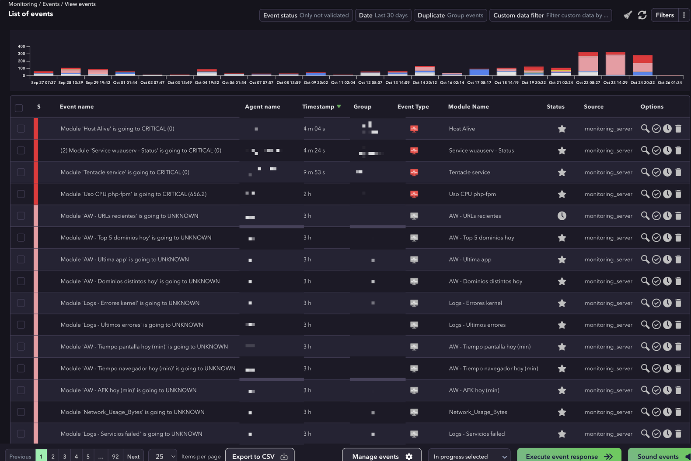
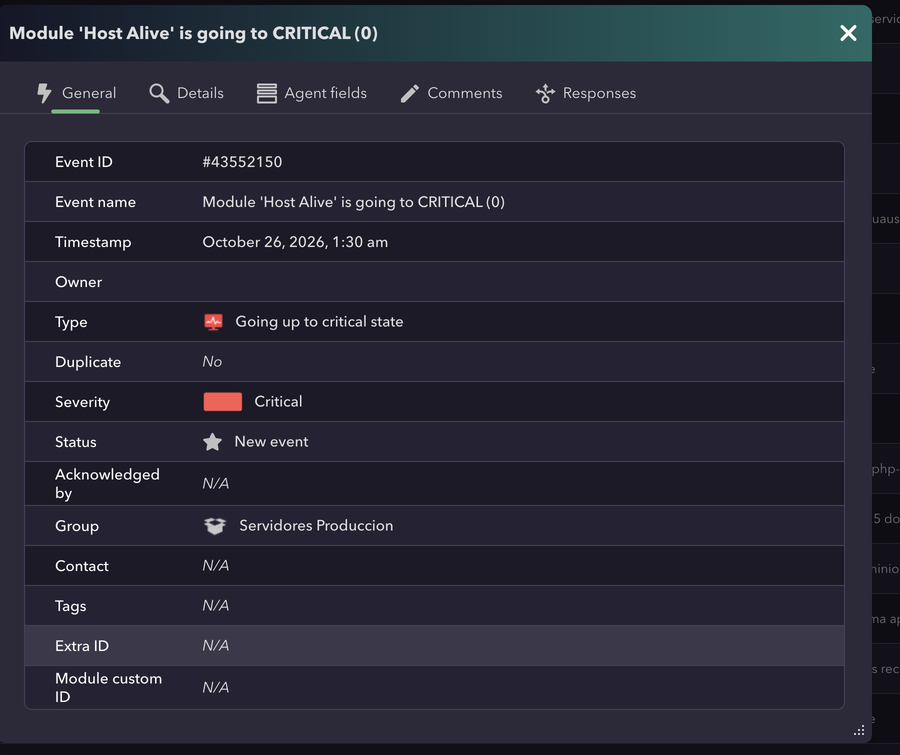
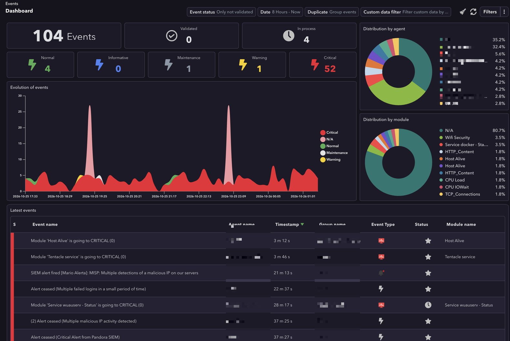
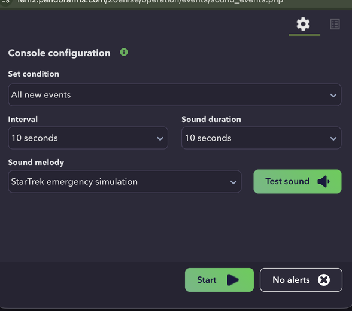
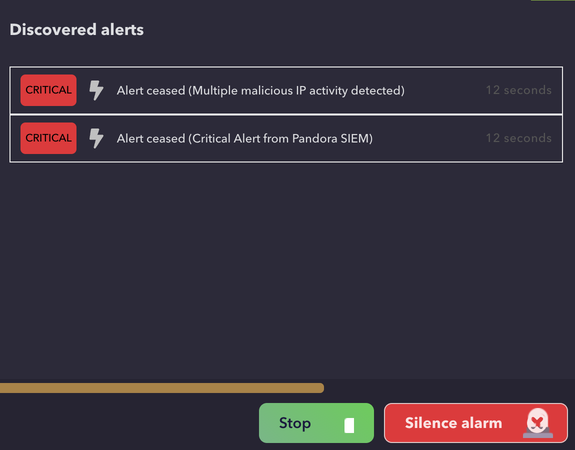
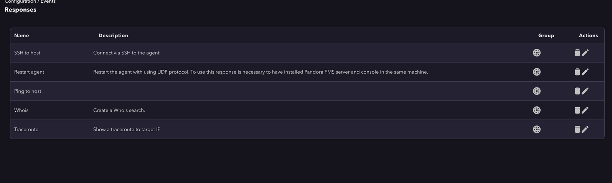
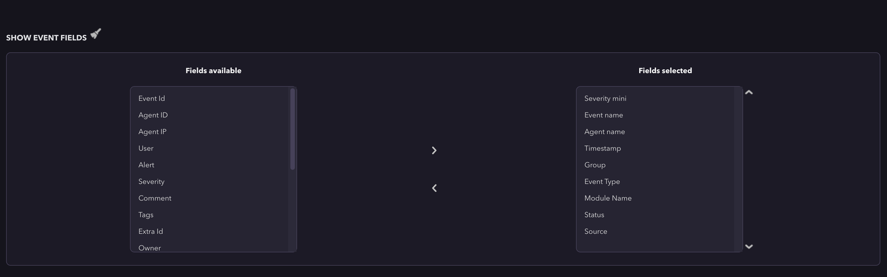

# Console d'événements centralisée

Les événements sont le journal de ce qui se passe sur la plateforme. Chaque fois
qu'un module change d'état, qu'une alerte se déclenche ou qu'une limite est
franchie, un événement reste. Et comme le journal grossit vite, ce qui compte
vraiment n'est pas de tout garder, mais de **trouver ce qui compte quand cela
compte**. C'est l'objet de ce chapitre : la console d'événements, ses états, ses
filtres, son tableau de bord et tout ce qui l'entoure.

## Introduction : qu'est-ce qu'un événement

Un **événement** est l'enregistrement d'un fait survenu sur les systèmes
supervisés. La vue des événements affiche par défaut un **instantané** de ce qui se
passe à cet instant ; l'historique est autre chose et se consulte à part.

Les événements se classent par **sévérité** :

| Valeur | Sévérité | Couleur |
|---|---|---|
| 0 | **Maintenance** | Blanc/gris |
| 1 | **Informatif** | Bleu |
| 2 | **Normal** | Vert |
| 3 | **Avertissement** | Jaune |
| 4 | **Critique** | Rouge |
| 5 | **Mineur** | Rose |
| 6 | **Majeur** | Marron |

Sur un événement on peut **changer son état** (validé ou en cours), **changer le
propriétaire**, **le supprimer**, voir ses **informations complémentaires**,
**ajouter un commentaire** (texte libre qui sert ensuite à filtrer ; il accepte des
liens au format Markdown, y compris dans le champ **Event Custom ID**), exécuter
des **réponses personnalisées** et ajouter ou retirer des **tags personnalisés**.

## La vue des événements

L'écran se trouve dans **Opération → Événements → Voir les événements** (*View
events*). Chaque ligne résume un événement. Le détail s'ouvre en cliquant sur le
**nom de l'événement**, si cette colonne est visible, ou sur la **loupe** de la
colonne d'options, qui reste disponible même si la colonne du nom est masquée. Les
colonnes peuvent être triées, et le détail affiche des données associées comme le
module qui a généré l'événement, son groupe ou les tags du module.

Deux règles de visibilité à garder en tête :

- Un utilisateur ne voit **que les groupes auxquels il appartient**, sauf s'il est
  dans le groupe **All** (*Tous*).
- S'il existe des agents avec des **groupes secondaires**, l'utilisateur ne les
  verra que s'il active **Rechercher dans les groupes secondaires** (*Search in
  secondary groups*). Cette option a un coût pour le serveur.

La recherche par défaut est une photographie très précise : **8 dernières heures**,
événements **non validés** et **groupés** pour éviter les doublons. Elle peut être
changée, et d'ailleurs presque tout le chapitre porte sur la façon de le faire.

Pandora FMS utilise aussi les événements pour signaler ses propres limites : par
exemple, quand le nombre maximal d'agents configuré pour un groupe est atteint.

La vue peut en outre afficher un **graphique d'évolution** des événements de la
période filtrée : il se charge au-dessus de la liste et permet de voir d'un coup
d'œil si le bruit monte ou descend.



## États et cycle de vie de l'événement

Un événement peut être dans quatre états : **Nouveau**, **Validé**, **En cours** et
**Non validé**.

La pièce qui fait gagner le plus de travail est l'**auto-validation**. Quand un
module passe en *critique* ou en *avertissement*, un événement est généré ; quand
il revient à la normale, un autre est généré. L'auto-validation marque le premier
comme validé dès que la récupération arrive. Ainsi, la vue par défaut (qui filtre
sur « non validé ») cesse de montrer des problèmes déjà résolus sans que personne
ait à cliquer.

La **validation manuelle** existe aussi : on valide l'événement, le système
enregistre **la date et l'utilisateur** qui l'a validé et permet de laisser un
commentaire. Ensuite, l'événement disparaît de la vue par défaut.

L'état **En cours** se marque depuis l'onglet des réponses et sert à dire « je m'en
occupe ». Son effet pratique : **l'événement ne s'auto-valide pas** et reste en
attente jusqu'à ce que quelqu'un le clôture.

Tout cela peut se faire **un par un ou par lots** : valider, marquer en cours ou
supprimer une sélection. Une limite à connaître : les **réponses personnalisées**
ne s'appliquent qu'à **dix événements** au maximum par opération ; la limite se
règle dans **Performance** avec **Events response max. execution**.

{ .captura }

## Filtrage des événements

Le filtre est l'outil principal de la console, et il comporte plus de pièces qu'il
n'y paraît.

**Filtres enregistrés.** Un filtre peut être enregistré et rechargé plus tard.
C'est la façon de ne pas reconstruire chaque matin la même recherche.

**Ancienneté.** **Heures d'ancienneté max.** (*Max. hours old*) limite la fenêtre
temporelle. Par défaut, ce sont 8 heures.

**Doublons.** Le sélecteur **Répété** (*Repeated*) décide comment les événements
répétés sont regroupés :

| Mode | Ce qu'il regroupe |
|---|---|
| **Tous les événements** (*All events*) | Aucun : tous sont affichés, un par un |
| **Événements groupés** (*Group events*) | Par nom d'événement, agent et module |
| **Groupes d'agents** (*Group agents*) | Par agent |
| **ID supplémentaire de groupe** (*Group extra id*) | Seulement par l'*Extra ID*, trié par date |

**Groupe et hiérarchie.** On peut filtrer par groupe ; avec **Récursion de
groupes** (*Group recursion*) on inclut aussi les sous-groupes, et avec
**Rechercher dans les groupes secondaires** on inclut les agents dotés de groupes
secondaires. Les deux dernières ont un coût pour le serveur.

**Dates.** **From** et **To** permettent de demander un intervalle précis.

**Recherche libre.** Le champ **Free search** accepte une **expression
régulière** : par exemple, `(Connections|Network)` cherche les deux mots. Elle
s'applique au nom de l'agent, au nom de l'événement, à l'*Extra ID*, à la source,
aux *custom data* et aux commentaires.

**Custom data.** On peut filtrer par **nom du champ** ou par **valeur du champ**
(*Filter custom data by field name* / *by field value*). Les champs choisis
s'affichent en colonnes.

**Les autres filtres** : source, *Extra ID*, commentaire, serveur, module,
propriétaire, utilisateur ayant validé, **événements d'alerte uniquement**, et tags
**avec** ou **sans** certains tags.

Et pour les filtres utilisés au quotidien il y a les **filtres épinglés** : on
charge un filtre enregistré et on l'épingle avec l'icône de **punaise** dans
**Opération → Épinglés** (*Pinned*). On le retire avec la même icône.

## Le tableau de bord des événements

Depuis la version 805 il existe un panneau spécifique : **Opération → Événements →
Dashboard**. Il partage le filtrage de la vue des événements, mais il est pensé
comme un poste de commande : on y enregistre des filtres et on les consulte sans se
battre avec la table complète.

La différence pratique : **Voir les événements** sert à travailler un événement
précis (voir le détail, valider, commenter) ; le **Dashboard** sert à regarder
l'ensemble. Si ce que vous voulez c'est « comment se passe la journée », commencez
par le tableau de bord.



## Suppression, rétention et historique

Les événements peuvent être supprimés **à la main**, un par un, et aussi **tout
seuls**. La rétention se contrôle dans **Gestion → Réglages → Configuration →
Performance** avec le réglage **« Nombre max. de jours avant suppression des
événements »** (`event_purge`), qui vaut **7 jours** par défaut.

Si l'**historique des événements** est en plus activé dans la base de données
historique, les événements sont conservés pour les rapports ; la suppression des
événements de l'historique est fixée à **180 jours** par défaut. Le détail de cette
base figure dans la Partie 06 · Base de données d'historique.

## Export CSV et RSS

Les événements filtrés peuvent être **exportés en CSV** depuis **Opération →
Événements → Voir les événements → Export to CSV File**. C'est la voie pour
emporter la liste dans un tableur ou dans un autre système.

Le **flux RSS** des événements se trouve dans **Opération → Événements → RSS**.
Deux choses sont nécessaires pour l'utiliser : que l'IP depuis laquelle on le lit
figure dans la **liste d'IP ayant accès à l'API** (`IP list with API access`) et un
lecteur RSS. Dans un Command Center, le RSS a ses propres limitations ; s'il ne
charge pas, commencez par là.

## Console acoustique

La **console acoustique** avertit par un son quand quelque chose se passe. Elle
s'ouvre dans **Opération → Événements → Console acoustique** et affiche une fenêtre
surgissante qui interroge toutes les **10 secondes**.

Par défaut, ces éléments sonnent :

- Le déclenchement de n'importe quelle **alerte**.
- Le passage d'un module en **warning**.
- Le passage en **critical**.
- Le passage en **unknown**.

Trois avertissements qui expliquent presque tous les « ça ne sonne pas » :

- Le navigateur doit **autoriser les fenêtres surgissantes**.
- **Ne réduisez pas** la fenêtre : réduite, elle ne fonctionne pas comme prévu.
- Seuls sonnent les événements survenus **depuis que la fenêtre est ouverte** et
  correspondant à ceux qui sont sélectionnés.



Pour ajouter vos propres mélodies, copiez des fichiers **WAV** dans
`/var/www/pandora_console/include/sounds/` et déclarez-les dans **Outils
d'administration → Acoustic console setup → Create**.



## Réponses aux événements

Les **réponses aux événements** (*Event responses*) sont des actions lancées
lorsqu'un événement survient. Elles se configurent dans **Gestion → Configuration →
Événements → Réponses** et utilisent des **macros** remplacées par les données de
l'événement. Les macros sont encadrées par des caractères de soulignement
(`_agent_address_`) et sont les mêmes que celles utilisées ailleurs dans la
plateforme.



| Macro | Ce qu'elle renvoie |
|---|---|
| `_agent_address_` | Adresse de l'agent |
| `_agent_alias_` | Alias de l'agent |
| `_agent_id_` | Identifiant de l'agent |
| `_agent_name_` | Nom de l'agent |
| `_alert_id_` | Identifiant de l'alerte associée |
| `_command_timeout_` | Temps de réponse de la commande |
| `_current_user_` | Utilisateur qui exécute la réponse |
| `_current_username_` | Nom complet de cet utilisateur |
| `_customdata_json_` | *Custom data* en JSON |
| `_customdata_text_` | *Custom data* en texte, avec sauts de ligne |
| `_customdata_X_` | Un champ précis de *custom data* |
| `_event_date_` | Date de l'événement |
| `_event_extra_id_` | *Extra ID* |
| `_event_id_` | Identifiant de l'événement |
| `_event_instruction_` | Instructions de l'événement |
| `_event_severity_id_` | Identifiant de la sévérité |
| `_event_severity_text_` | Sévérité traduite |
| `_event_source_` | Source de l'événement |
| `_event_status_` | État de l'événement |
| `_event_tags_` | Tags de l'événement, séparés par des virgules |
| `_event_text_` | Texte complet de l'événement |
| `_event_type_` | Type d'événement |
| `_event_utimestamp_` | Date au format *utimestamp* |
| `_group_id_` | Identifiant du groupe |
| `_group_name_` | Nom du groupe |
| `_group_contact_` | Contact du groupe |
| `_module_address_` | Adresse du module |
| `_module_id_` | Identifiant du module |
| `_module_name_` | Nom du module |
| `_node_id_` | Identifiant du nœud (Command Center et nœud) |
| `_node_name_` | Nom du nœud |
| `_owner_user_` | Utilisateur propriétaire de l'événement |
| `_owner_username_` | Nom complet du propriétaire |
| `_user_id_` | Identifiant de l'utilisateur |

La macro `_event_type_` ne renvoie pas l'identifiant, mais le texte traduit du type.
Voici les valeurs que la console reconnaît :

| Type (`event_type`) | Ce que renvoie `_event_type_` |
|---|---|
| `unknown` | Inconnu |
| `going_unknown` | Passage à l'état inconnu |
| `going_up_warning` | Passage de critique à avertissement |
| `going_down_warning` | Passage de normal à avertissement |
| `going_up_critical`, `going_down_critical` | Entrée dans l'état critique |
| `going_up_normal`, `going_down_normal` | Montée vers l'état normal |
| `alert_fired` | Alerte déclenchée |
| `alert_recovered` | Alerte rétablie |
| `alert_ceased` | Alerte terminée |
| `alert_manual_validation` | Alerte validée manuellement |
| `new_agent` | Nouvel agent créé |
| `recon_host_detected` | Le serveur Discovery a détecté un nouvel hôte |
| `system` | SYSTÈME |
| `error` | Erreur |
| `configuration_change` | Changement de configuration |
| Tout autre | `Type inconnu : <type>` |

## Tags d'événements

Il existe deux types de tags et il ne faut pas les mélanger :

- **Tags système** : posés à la création de l'événement par CLI ou API.
- **Tags personnalisés** : ajoutés et retirés **à la main depuis la console**, et
  seul un *superadmin* peut le faire. Ils se gèrent dans **Gestion → Configuration
  → Événements → Tags d'événements**.

Un comportement qui surprend la première fois :

- Si un événement porte **plusieurs tags personnalisés**, la vue n'en montre que
  **le premier** ; les autres sont derrière l'icône d'aide.
- L'ordre est **alphabétique**. Si vous voulez un ordre strict, commencez le nom
  par un chiffre.
- La colonne des tags personnalisés **ne peut pas être triée**, alors que les
  autres colonnes le peuvent.

## Alertes et corrélation d'événements

Les événements et les alertes sont liés : il existe des **alertes d'événements** et
des mécanismes de corrélation pour qu'un même problème ne génère pas cent
notifications. Le détail des alertes, des modèles et des actions figure dans
[Alertes et notifications](5.5-alertas-y-notificaciones.md#alertes-sur-les-evenements) ;
ici seule la relation est présentée.

!!! warning "Dans un Command Center, les règles ne sont pas centralisées"
    Les règles d'alerte d'événements **ne sont pas centralisées**. Chaque nœud doit
    avoir les siennes pour déclencher ses propres événements ; les règles
    configurées dans le Command Center ne se déclenchent que pour les événements du
    Command Center lui-même.

## Événements depuis la CLI et l'API

Pour créer et valider des événements depuis l'extérieur de la console, il existe
trois voies :

- **`pandora_revent.pl`**, dans `/usr/share/pandora_server/util/`, crée et valide
  des événements via l'API. Exécutez-le sans paramètres pour voir la syntaxe.
- **`pandora_revent_create.pl`** fait la même chose, mais **crée seulement** : utile
  quand, pour des raisons de sécurité, vous ne voulez pas donner la capacité de
  valider.
- **La CLI** `pandora_manage.pl` avec `--create_event` permet de créer des
  événements et de passer des **custom data** en JSON :
  ```bash
  pandora_manage /etc/pandora/pandora_server.conf \
    --create_event 'Evento de ejemplo' system Firewalls 'localhost' \
    'module' 0 4 '' 'admin' '' '' '' '' \
    '{"Location": "Office", "Priority": 42}'
  ```

Et pour consulter le **résumé SLA** d'un événement il y a **`get_event_lifetime`**,
qui calcule le temps de réponse et de résolution selon les minutes que vous lui
passez.

## Configuration et personnalisation de la vue

Dans **Gestion → Configuration → Événements** se configurent les quatre pièces que
nous avons vues : **colonnes personnalisées**, **filtres**, **réponses** et **tags
d'événements**.

Les **colonnes personnalisées** décident de ce qui se voit dans la table. Il y a 28
champs disponibles, entre autres : identifiant et nom de l'événement, identifiant
et nom de l'agent, IP, utilisateur, groupe, état, date, type d'événement, module,
alerte, sévérité, commentaire, tags, tags de l'événement, source, *Extra ID*,
propriétaire, date de validation, instructions, serveur, données, état du module,
sévérité mini, ID personnalisé du module, *custom data* et **Event Custom ID**. Par
défaut, cinq sont sélectionnés : sévérité mini, événement, état, agent et date.



Deux règles : **au moins une colonne** doit rester sélectionnée (sinon la console
ajoute la date), et on peut revenir au **dernier état enregistré** avec le bouton
de réinitialisation.

Le **nombre de caractères du nom de l'événement** affiché dans la liste se règle
à part, dans **Réglages → Configuration du système → Configuration générale →
Comportement → Événements**. La valeur par défaut est `60` ; avec `0`, le nom
complet s'affiche, sans troncature. Le Command Center dispose du même réglage dans
sa configuration générale.

## Command Center : événements centralisés

Quand il y a un **Command Center** au-dessus de plusieurs nœuds, la console
d'événements devient la vue centralisée : on voit les événements des nœuds et on
peut travailler dessus, avec la **réplication d'événements** et l'historique
derrière.

Ce qui change, et qu'il vaut mieux savoir avant de promettre quoi que ce soit :

- La **vue** et la gestion sont centralisées, mais les **règles d'alerte
  d'événements** ne le sont pas : chaque nœud a besoin des siennes.
- Certaines **opérations massives** et le **RSS** ont leurs propres limitations
  dans l'environnement centralisé.

Le détail de l'architecture et de la réplication figure dans la Partie 06 ·
Command Center.
