# Alertes et notifications

Un système de supervision qui sait que le disque est plein à 99 % et le garde
pour lui est un notaire très compétent et très peu utile. La supervision
collecte des données ; les **alertes** transforment ces données en une personne
qui se lève de sa chaise avant que le serveur ne tombe. C'est l'objet de ce
chapitre : comment se construit une alerte, **pourquoi elle se déclenche** (et,
surtout, pourquoi elle ne se déclenche parfois pas) et comment l'ajuster pour
qu'elle prévienne de ce qui compte sans transformer la boîte aux lettres en
décharge.

Le chapitre compte **deux blocs** sur une seule page :

- Le **bloc 1** explique l'alerte de module, la plus courante, et tous les
  mécanismes que les autres partagent : commandes, actions, modèles, compteurs,
  récupération, escalade, macros et notifications.
- Le **bloc 2** couvre les alertes qui naissent d'autres origines : **événements**,
  **logs**, **traps SNMP**, **SIEM** et **inventaire**. Chacune renvoie au bloc 1
  pour ce qui est commun et n'explique que ce qui change.

Qui configure des alertes pour la première fois devrait lire le bloc 1 dans
l'ordre : il est conçu pour se construire avec un unique cas pratique qui grandit
au fil de la lecture.

!!! info "Le cas pratique du chapitre"
    Nous allons prévenir par e-mail quand le **disque racine** du serveur
    `srv-web01` passe à l'état critique. Au début, ce sera un simple avertissement ;
    plus tard, on le fera se rétablir tout seul, monter en SMS si le problème
    n'est pas réglé et laisser une trace dans la console d'événements.

## Bloc 1 · L'alerte de module et ses mécanismes

### Qu'est-ce qu'une alerte

Une **alerte** est la réaction de Pandora FMS à une valeur incorrecte d'un
**module**. Cette réaction est configurable et peut être tout ce que le système
d'exploitation du serveur Pandora FMS sait exécuter : envoyer un e-mail, écrire
dans un fichier, lancer un script, créer un événement, ouvrir un ticket ou
envoyer un message sur un canal de discussion.

Il existe plusieurs types d'alertes, selon ce qui les déclenche :

| Type | Déclenchée par | Où c'est expliqué |
|---|---|---|
| **Alerte de module** | L'état ou la valeur d'un module | Bloc 1 |
| **Alerte d'événement** | Un ou plusieurs événements qui respectent des règles | [Alertes sur les événements](#alertes-sur-les-evenements) |
| **Alerte de log** | Une ou plusieurs lignes de log qui respectent des règles | [Alertes sur les logs](#alertes-sur-les-logs) |
| **Alerte de trap SNMP** | Un trap SNMP reçu | [Alertes sur les traps SNMP](#alertes-sur-les-traps-snmp) |
| **Alerte SIEM** | Un événement SIEM qui respecte un filtre | [Alertes SIEM](#alertes-siem) |
| **Alerte d'inventaire** | Un changement dans l'inventaire d'un agent | [Alertes d'inventaire](#alertes-dinventaire) |

Pandora FMS dispose en outre d'un système d'**arrêts planifiés** qui désactive
les alertes pendant une fenêtre de maintenance. Il est expliqué dans le chapitre
[Arrêts planifiés](../parte-3/3.8-paradas-planificadas.md).

### Anatomie d'une alerte : commande, action et modèle

Le point qui déroute le plus au début, et qui prend le plus de sens une fois
compris, c'est qu'une alerte **n'est pas un objet** : c'est l'union de trois.

| Élément | Répond à | Ce qu'il définit |
|---|---|---|
| **Commande** | *Qu'est-ce qui s'exécute ?* | L'ordre que lance le serveur : envoyer un e-mail, écrire dans un log, appeler une API. |
| **Action** | *Comment cela s'exécute-t-il ?* | Une commande dont les arguments sont renseignés : à qui l'on écrit, avec quel objet, avec quel texte. |
| **Modèle** | *Quand cela s'exécute-t-il ?* | Les conditions de déclenchement : quelle valeur, à quelles heures, combien de fois, à quelle fréquence. |

L'alerte proprement dite naît quand on **affecte un modèle à un module** et
qu'on indique quelle action ou quelles actions lancer.

Cette séparation offre un avantage énorme : avec une poignée de commandes, une
poignée d'actions et une poignée de modèles génériques, on couvre presque tous
les scénarios, et quand l'e-mail de l'administrateur change, on modifie **une**
action au lieu de cent alertes.

#### Le flux des champs

Le modèle, l'action et la commande partagent une série de **champs génériques**
(`Field1`, `Field2`, … `Field20`) qui transportent l'information d'une étape à la
suivante jusqu'à devenir les arguments de la commande. Dans la commande d'e-mail,
par exemple, le champ 1 est le destinataire, le 2 l'objet et le 3 le texte.

La règle de précédence est simple : **le plus proche de l'exécution l'emporte**.
Si le modèle et l'action définissent le même champ, **celui de l'action
prévaut** ; si l'action le laisse vide, on utilise celui du modèle.

!!! warning "Les alertes de traps SNMP fonctionnent à l'envers"
    Dans les alertes de traps SNMP, la précédence est inversée : c'est le champ de
    l'**alerte SNMP elle-même** qui prévaut, et ceux de l'action ne servent que
    si celui-ci est vide. Le détail est dans [Alertes sur les traps
    SNMP](#alertes-sur-les-traps-snmp).

!!! note "Vingt champs, pas dix"
    Les modèles, les actions et les champs de récupération admettent jusqu'à
    **vingt** champs. En pratique, une commande utilise ceux qu'elle déclare ; les
    autres restent vides et ne gênent pas.

### Commandes d'alerte

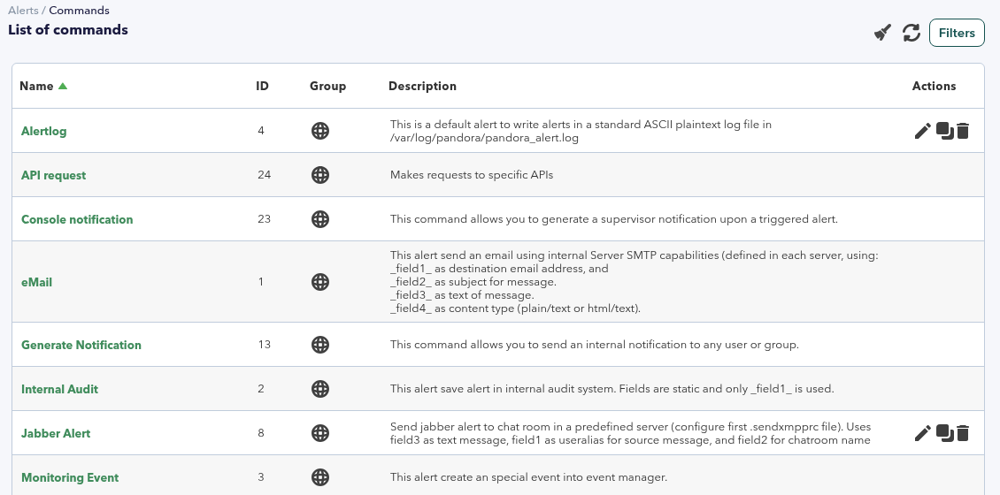{ .captura }

Une **commande** est ce que le serveur exécute réellement. Elle se gère dans
**Gestion → Alertes → Commandes** (*Management → Alerts → Commands*) et exige la
permission de gestion des alertes (**LM**).

Pandora FMS fournit une belle collection de commandes déjà prêtes, si bien qu'on
n'en crée normalement **aucune**. On n'en a besoin d'une propre que pour exécuter
quelque chose qui ne figure pas dans la liste : un script maison, un outil en
ligne de commande, un envoi vers un système interne.

#### Commandes prédéfinies

| Commande | Ce qu'elle fait |
|---|---|
| **eMail** | Envoie un e-mail (en HTML) depuis le serveur Pandora FMS. Champs : destinataire, objet, texte et type de contenu. |
| **Internal Audit** | Inscrit l'alerte dans le système d'audit interne. |
| **Monitoring Event** | Crée un événement personnalisé dans la console d'événements. Champs : nom, type, origine, agent, sévérité, ID supplémentaire, étiquettes et commentaires. |
| **Alertlog** | Écrit l'alerte, en texte brut, dans `/var/log/pandora/pandora_alert.log`. |
| **SNMP Trap** | Envoie un trap SNMP avec les arguments indiqués. C'est un exemple à adapter, il ne fonctionne pas tel quel. |
| **Syslog** | Envoie l'alerte au journal système avec `logger`. |
| **Sound Alert** | Joue un son sur le serveur. |
| **Jabber Alert** | Envoie un message à un salon Jabber (exige de configurer d'abord `.sendxmpprc`). |
| **SMS** | Envoie un SMS avec `sendsms` (smstools). Le numéro doit porter l'indicatif international. |
| **Validate Event** | Valide les événements d'un module, à partir du nom de l'agent et du module. |
| **Remote agent control** | Envoie un ordre à un EndPoint dont le serveur UDP est actif, par exemple pour le forcer à exécuter et à envoyer des données. |
| **Generate Notification** | Envoie une notification interne à un utilisateur ou à un groupe. |
| **Send report by e-mail** | Envoie un rapport par e-mail en PDF, JSON ou CSV. |
| **Send report by e-mail (from template)** | Idem, mais à partir d'un modèle de rapport et d'un filtre d'agents par expression régulière. |
| **Pandora ITSM Ticket** | Ouvre un ticket dans Pandora ITSM. |
| **Pandora Google chat**, **Pandora Slack**, **Pandora Telegram**, **Pandora ilert**, **Pandora Vonage**, **Pandora MS Teams** | Envoient la notification au service correspondant. |
| **RMM Script** | Exécute un script du RMM sur l'EndPoint. |
| **Console notification** | Envoie une notification à la console web des utilisateurs choisis. |
| **API request** | Fait une requête à une API : URL, méthode, en-têtes, données et SSL. |

Les commandes **eMail**, **Internal Audit**, **Monitoring Event**, **Validate
Event**, **Generate Notification**, les deux commandes de rapports par e-mail,
**Pandora ITSM Ticket**, **Pandora Telegram**, **RMM Script**, **Console
notification** et **API request** sont **internes** et **ne peuvent pas être
modifiées**. Les autres, si.

!!! warning "Slack, ilert, Vonage et les autres doivent être configurées jusqu'au bout"
    Les commandes de messagerie qui ne sont pas internes contiennent des
    marqueurs comme `TOKEN`, `API_KEY` ou `SECRET` dans la ligne de commande.
    Tant qu'on n'a pas **modifié la commande** pour les remplacer par les valeurs
    réelles, l'avertissement n'arrivera nulle part. **Pandora Telegram** fait
    exception : elle lit le *token* dans la configuration générale (**Gestion →
    Réglages → Configuration du système → Configuration générale → Configuration
    des alertes**) et s'utilise avec la macro `_telegramtoken_`.

#### Créer une commande personnalisée

1. On ouvre **Gestion → Alertes → Commandes** et on clique sur **Créer**
   (*Create*).
2. On renseigne :
    - **Nom** (*Name*) et **Description** (*Description*).
    - **Commande** (*Command*) : l'ordre que le serveur exécutera. Elle admet des
      [macros](#macros-dalerte), et en particulier `_field1_` … `_field20_`, qui
      sont remplacées par les champs de l'action.
    - **Groupe** (*Group*) : à quel groupe d'alertes elle pourra être associée.
      Seuls les groupes de l'utilisateur qui la crée sont proposés, sauf s'il
      appartient à **Tous**.
    - **Description du champ** (*Field N description*) et **valeurs du champ**
      (*Field N values*) pour chaque champ qu'utilise la commande.
3. On enregistre avec **Créer**.

Chaque champ peut être une zone de texte libre ou une **liste déroulante**. Pour
en faire une liste, on renseigne son *Field N values* avec des paires
`valeur,libellé` séparées par des points-virgules :

```text
valor1,etiqueta1;valor2,etiqueta2;valor3,etiqueta3
```

Le libellé est ce que voit l'utilisateur en configurant l'action ; la valeur est
ce qui est envoyé à la commande. En outre, **Cacher** (*Hide*) masque le contenu
du champ avec des astérisques, prévu pour les mots de passe.

Si la valeur d'un champ est le *token* spécial `_html_editor_`, ce champ s'affiche
avec un éditeur HTML lors de la configuration de l'action. C'est ce qu'utilise la
commande d'e-mail pour le corps du message.

!!! tip "L'essayer d'abord en ligne de commande"
    Le serveur exécute la commande telle quelle, en remplaçant les macros. Il
    vaut mieux vérifier d'abord, depuis un terminal, que l'ordre fonctionne et
    produit le résultat attendu (l'e-mail arrive, le fichier s'écrit…). Déboguer
    un ordre via une alerte est la façon la plus lente de découvrir qu'il manque
    un guillemet.

!!! danger "La commande s'exécute avec les privilèges du serveur"
    Les commandes externes sont exécutées par le serveur Pandora FMS **avec les
    mêmes privilèges que l'utilisateur sous lequel tourne le serveur**. Il faut
    être attentif aux personnes à qui l'on donne la permission de créer des
    commandes. En outre, le serveur interrompt l'exécution si elle dépasse la
    durée indiquée dans `global_alert_timeout` (15 secondes par défaut).

#### Permissions

Pour accéder à la gestion des commandes, il faut la permission **LM** (gestion des
alertes) et, pour **modifier une commande non interne**, en plus la permission
**PM** sur le groupe de la commande.

### Actions d'alerte

Une **action** est une commande dont les champs sont renseignés. Elle se gère dans
**Gestion → Alertes → Actions** (*Management → Alerts → Actions*). C'est l'élément
qu'on réutilise : une action « Prévenir l'équipe système par e-mail » sert pour
mille alertes.

#### Actions prédéfinies

Voici celles qui sont fournies de série :

| Action | Commande utilisée | À quoi elle sert |
|---|---|---|
| **Mail to Admin** | eMail | Envoyer un e-mail. Il faut changer l'adresse d'exemple (`yourmail@domain.es`). |
| **Monitoring Event** | Monitoring Event | Créer un événement au déclenchement et un autre à la récupération. |
| **Restart agent** | Remote agent control | Demander à un EndPoint de se rafraîchir (`REFRESH AGENT *`). |
| **Send Report by e-mail** et **Send Report by e-mail (from template)** | Celles des rapports | Envoyer des rapports par e-mail. |
| **Create Pandora ITSM ticket** | Pandora ITSM Ticket | Ouvrir un ticket dans Pandora ITSM. |
| **Pandora Google chat**, **Pandora Slack**, **Pandora Telegram**, **Pandora ilert**, **Pandora Vonage**, **Pandora MS Teams** | Celles de messagerie | Notifier dans le service correspondant. |
| **Console notification** | Console notification | Prévenir dans la console web les utilisateurs choisis. |

!!! tip "Copier la prédéfinie plutôt que partir de zéro"
    Pour créer une action fondée sur l'une des commandes prédéfinies, le plus
    commode est de **copier** l'action prédéfinie équivalente et de la modifier.
    Elle comporte déjà des champs raisonnablement renseignés, macros du texte
    comprises.

#### Créer une action

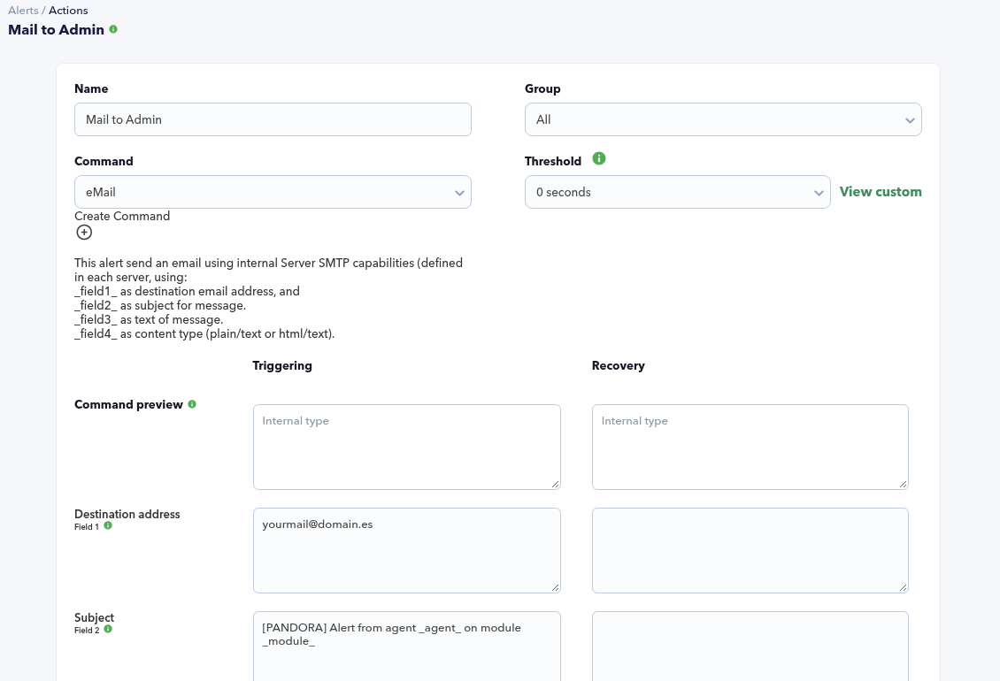{ .captura }

1. On ouvre **Gestion → Alertes → Actions** et on clique sur **Créer**.
2. On renseigne :
    - **Nom** (*Name*).
    - **Groupe** (*Group*). Si la commande associée a un groupe différent de
      *Tous*, l'action ne peut appartenir qu'à ce groupe ou à *Tous*. Si, pour une
      raison quelconque, ils diffèrent, un avertissement s'affiche pour qu'une
      personne disposant des permissions le corrige.
    - **Commande** (*Command*) : celle qui sera utilisée.
    - **Seuil** (*Threshold*) : l'action s'exécute **une seule fois** dans cet
      intervalle, même si l'alerte s'active plusieurs fois.
    - **Aperçu de commandes** (*Command preview*) : champ en lecture seule qui
      montre l'ordre résultant avec les macros non remplacées.
3. Dans la section **Déclenchement** (*Triggering*), on renseigne les champs que la
   commande utilisera quand l'alerte **se déclenchera**.
4. Dans la section **Récupération** (*Recovery*), on renseigne les champs pour le
   moment où l'alerte **se rétablira**. Si on ne met rien, ceux du déclenchement
   sont réutilisés (voir [Récupération des alertes](#recuperation-des-alertes)).
5. On enregistre.

Pour modifier une action, on clique sur son nom dans la liste. Pour la supprimer,
on utilise l'icône de corbeille de sa ligne.

!!! warning "Attention en renommant une action"
    Certaines actions sont repérées par leur nom. La console elle-même avertit
    qu'une action *peut cesser de fonctionner si son nom est modifié*. Pour les
    prédéfinies, mieux vaut n'y pas toucher.

!!! info "Pandora ITSM : unité de travail à la récupération"
    Quand la commande est **Pandora ITSM Ticket**, l'option **Créer une unité de
    travail sur la récupération** (*Create workunit on recovery*) apparaît : si
    l'état de clôture s'applique à la récupération de l'alerte, au lieu de fermer
    le ticket, on ajoute une unité de travail au ticket dans Pandora ITSM.

#### Quel seuil l'emporte

Un détail fin qui évite bien des déconvenues : le seuil peut se définir **à trois
endroits** et, quand il y en a plusieurs, **le plus spécifique l'emporte** :

1. Celui de la **commande** (le plus général).
2. Celui de l'**action**, qui remplace celui de la commande s'il est supérieur à
   zéro.
3. Celui de l'**action dans l'alerte** (le *Threshold* indiqué lors de
   l'affectation du modèle au module), qui remplace les précédents s'il est
   supérieur à zéro.

L'action ne s'exécute que si ce délai s'est écoulé depuis sa dernière exécution.
Quand l'alerte **se rétablit**, l'action de récupération s'exécute tout de même
une fois, même si le seuil n'est pas écoulé.

### Modèles d'alerte

Le **modèle** répond à la question la plus importante : **quand ?** Il définit
les conditions de déclenchement et s'associe aux modules. Il se gère dans
**Gestion → Alertes → Modèles** (*Management → Alerts → Templates*), qui exige la
permission **LM**.

Sa conception permet de créer un petit groupe de modèles génériques (« le module
est critique », « la valeur dépasse 90 », « le texte contient ERROR ») et de les
réutiliser sur tout le parc. Il faut résister à la tentation de créer un modèle
par module : dans six mois, plus personne ne saura lequel est lequel.

#### Modèles prédéfinis

| Modèle | Condition | Remarques |
|---|---|---|
| **Critical condition** | État critique | Action par défaut : e-mail à l'administrateur. Récupération activée. |
| **Warning condition** | État d'avertissement | Même action. Récupération activée. |
| **Unknown condition** | État inconnu | Même action. Récupération activée. |
| **Manual alert** | Jamais remplie | Pour déclencher des alertes **à la main** (voir plus bas). |
| **Default critical condition** | État critique | Copie en lecture seule de *Critical condition*, système. Elle est incluse en raison de l'importance de l'état critique. |

Les quatre modèles de condition ont un **seuil de temps de 24 heures** (86400 s),
un maximum d'**une** alerte par intervalle et la récupération activée. Les trois
premiers peuvent être personnalisés ; *Default critical condition*, non.

Le modèle **Manual alert** mérite une explication : sa condition est une plage
impossible, donc elle **n'est jamais remplie** et ne se déclenche jamais seule. Il
sert à y accrocher des actions qu'on veut lancer à la main, comme redémarrer un
EndPoint depuis la console ou exécuter une commande sur le serveur.

#### Créer un modèle : l'assistant en trois étapes

On clique sur **Créer** dans **Gestion → Alertes → Modèles**. L'assistant compte
trois étapes : **Général**, **Conditions** et **Champs avancés**.

##### Étape 1 · Général

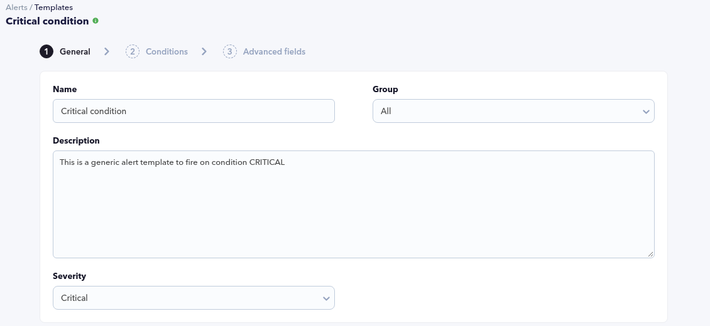{ .captura }

| Champ | À quoi il sert |
|---|---|
| **Nom** | Comment le modèle apparaîtra dans les listes. Il doit être unique. |
| **Groupe** | Le groupe du modèle. Seuls ceux de l'utilisateur sont proposés, sauf s'il appartient à *Tous*. |
| **Description** (*Description*) | Texte libre. |
| **Sévérité** (*Severity*) | Informative : l'événement généré par l'alerte **hérite** de cette sévérité, ce qui est utile pour filtrer. C'est aussi celle qu'utilise la [protection en cascade](#protection-en-cascade). |

##### Étape 2 · Conditions

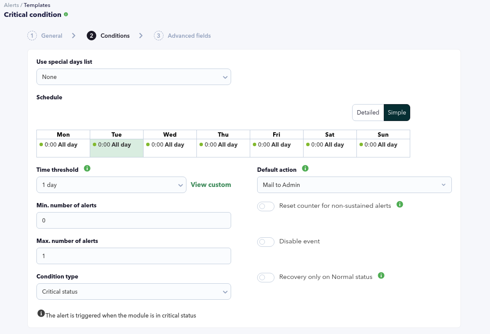{ .captura }

C'est ici qu'on décide **quand** l'alerte se déclenche. Voici les champs :

| Champ | Ce qu'il fait |
|---|---|
| **Utiliser la liste de jours spéciaux** (*Use special days list*) | Applique un [calendrier de jours spéciaux](#jours-speciaux) au modèle. |
| **Type de condition** (*Condition type*) | La condition proprement dite. Elle est expliquée juste en dessous. |
| **Seuil de temps** (*Time threshold*) | L'intervalle pendant lequel on compte les alertes. Voir [Quand une alerte se déclenche](#quand-une-alerte-se-declenche-compteurs-seuil-et-flip-flop). |
| **Nombre minimum d'alertes** (*Min. number of alerts*) | Combien de fois la condition doit être remplie **avant** le déclenchement. |
| **Nombre maximum d'alertes** (*Max. number of alerts*) | Combien de fois, au maximum, elle peut se déclencher dans le seuil de temps. |
| **Remettre le compteur à zéro pour les alertes non-prolongées** | Impose que les répétitions soient consécutives. |
| **Action par défaut** (*Default action*) | L'action qui sera affectée automatiquement lors de l'application du modèle à un module. Il ne peut y en avoir qu'une (ou aucune). |
| **Planifier** (*Schedule*) | Quels jours et à quelles heures elle peut se déclencher. |
| **Désactiver l'événement** (*Disable event*) | Si on la coche, l'événement « alerte déclenchée » n'est pas créé dans la console d'événements. |
| **Récupération seulement en état Normal** (*Recovery only on Normal status*) | Apparaît avec les conditions critique, avertissement et inconnu. Voir [Récupération des alertes](#recuperation-des-alertes). |

**Types de condition.** Voici la liste, avec une phrase et un exemple pour chacun :

| Type | Se déclenche quand… | Exemple |
|---|---|---|
| **Expression régulière** (*Regular expression*) | La valeur du module correspond à une expression régulière (sans distinguer majuscules et minuscules). | Un module de texte qui renvoie `ERROR: disk failure` : valeur `error\|fail`. |
| **Max et min** (*Max and min*) | La valeur est **hors** de la plage (ou **dans** la plage, selon la case). | Température hors de 10–35 °C. |
| **Max.** (*Max.*) | La valeur dépasse le maximum. | CPU au-dessus de 90. |
| **Min.** (*Min.*) | La valeur est sous le minimum. | Espace libre sous 10. |
| **Égal à** (*Equal to*) | La valeur numérique est exactement celle indiquée. | Un module d'état qui renvoie `0`. |
| **Pas égal à** (*Not equal to*) | La valeur numérique est différente de celle indiquée. | Un compteur de réplicas qui n'est pas `3`. |
| **État d'alerte** (*Warning status*) | Le module est en avertissement. | |
| **État critique** (*Critical status*) | Le module est en critique. | Le cas le plus courant. |
| **État inconnu** (*Unknown status*) | Le module est en inconnu. | Un EndPoint qui a cessé de remonter ses données. |
| **État pas normal** (*Not normal status*) | Le module est dans **n'importe quel** état autre que normal. | Prévenir sans distinguer avertissement et critique. |
| **Changement en cours** (*On Change*) | La valeur **change** par rapport à la précédente (ou, selon la case, ne change pas). | Un module qui renvoie le hash d'un fichier. |
| **Toujours** (*Always*) | Chaque fois qu'une donnée arrive. | Tests et journalisation. |
| **Alerte complexe** (*Complex alert*) | Une condition portant sur l'**historique** du module est remplie. | Voir plus bas. |

!!! warning "Égal et différent comparent des nombres"
    **Égal à** et **Pas égal à** comparent **numériquement**. Avec des modules de
    texte, ils ne conviennent pas (`1.2.3` et `1.2.4` se lisent tous deux comme
    `1.2`) : pour du texte, on utilise **Expression régulière**.

!!! note "La case « Déclenché lorsqu'il concorde avec la valeur »"
    À côté de la condition apparaît, selon le type, la case **Déclenché lorsqu'il
    concorde avec la valeur** (*Trigger when matches the value*). Elle inverse le
    sens de la condition, et l'écran affiche lui-même en dessous une phrase (« L'alerte
    se déclencherait quand… ») qui confirme le résultat :

    | Type | Case cochée | Case décochée |
    |---|---|---|
    | **Expression régulière** | Se déclenche quand la valeur **correspond** | Se déclenche quand elle ne correspond **pas** |
    | **Max et min** | Se déclenche quand la valeur est **dans** la plage | Se déclenche quand elle est **hors** de la plage |
    | **Changement en cours** | Se déclenche quand la valeur **change** | Se déclenche quand elle ne change **pas** |

**Alertes complexes.** Elles comparent la donnée à un calcul sur l'historique du
module. Elles se configurent avec trois champs :

- **Fonction mathématique** (*Math function*) : moyenne, somme, maximum ou minimum.
- **Condition** : inférieur, supérieur ou égal.
- **Fenêtre de temps** (*Time window*) : les 30 derniers jours, ce mois-ci, les 7
  derniers jours, cette semaine, le dernier jour ou aujourd'hui.

Avec la **moyenne**, le serveur compare la donnée qui vient d'arriver à la
moyenne de la période : « la valeur actuelle est **supérieure** à la moyenne des 7
derniers jours ». Avec les autres fonctions, il compare le résultat de la période
à la **valeur** du modèle : « la **somme** des 30 derniers jours est **égale** à
2 ».

**Planifier.** Par défaut, il s'affiche en mode **Simple** : une grille par jours
de la semaine où l'on voit d'un coup d'œil quand l'alerte sera active. En mode
**Détaillé**, on peut définir plusieurs plages par jour, à la seconde près. Si une
plage a la même heure de début et de fin, cela signifie **toute la journée**.

!!! info "Si le modèle est ancien"
    Les modèles créés avec des versions antérieures utilisent des jours de la
    semaine et une heure de début et de fin. Ils continuent de fonctionner, mais
    dès qu'un modèle possède le nouvel horaire, **celui-ci prévaut** sur
    l'ancien.

##### Étape 3 · Champs avancés

- **Récupération d'alertes** (*Alert recovery*) : active ou désactive la
  récupération. Si elle est active, quand le module cesse de remplir la condition,
  l'action s'exécute avec les champs de récupération.
- **Champs de déclenchement** (*Firing fields*) : les champs `Field1` … `Field20`
  qui seront transmis à l'action quand l'alerte se déclenchera.
- **Champs de récupération** (*Recovery fields*) : ceux de la récupération.

Dans tous ces champs, on peut utiliser des [macros](#macros-dalerte). L'assistant
se termine avec **Terminer** (*Finish*).

!!! tip "Où mettre le texte : dans l'action ou dans le modèle"
    Si le même message convient pour tout ce qui utilise cette action, mettez-le
    dans l'**action** (il changera ainsi à un seul endroit). S'il varie selon le
    type de problème, mettez-le dans le **modèle** et laissez vide le champ de
    l'action : c'est alors le modèle qui parle.

### Quand une alerte se déclenche : compteurs, seuil et flip-flop

C'est la section qui épargne le plus de questions au support. Une alerte qui « ne
se déclenche pas » se déclenche presque toujours exactement quand elle le doit,
mais selon des règles que personne n'avait lues. Lisons-les.

#### Les quatre réglages

| Réglage | Où il se trouve | Ce qu'il fait |
|---|---|---|
| **Nombre minimum d'alertes** | Modèle | Combien de fois la condition doit être remplie **avant** le déclenchement. Avec `0` (par défaut), l'alerte se déclenche dès la première fois. C'est un filtre contre les faux positifs. |
| **Nombre maximum d'alertes** | Modèle | Plafond de déclenchements **dans le seuil de temps**. Quand il est atteint, l'alerte se tait jusqu'à la remise à zéro du compteur. |
| **Seuil de temps** | Modèle | La durée de la « fenêtre » de comptage. Passé ce délai, le compteur de déclenchements revient à zéro. |
| **Remettre le compteur à zéro pour les alertes non-prolongées** | Modèle | Fait que le comptage du **minimum** exige des répétitions **consécutives**. |

Il y a un cinquième élément qui n'est pas dans le modèle mais qui influe : le
**flip-flop** du module. Pandora FMS ne change pas l'état d'un module dès la
première mauvaise donnée : il attend qu'elle se répète autant de fois que
l'indique le **seuil de flip-flop** du module. L'alerte, dès qu'elle voit l'état
déjà changé, commence son propre comptage ; les deux filtres **s'additionnent**. La protection
flip-flop se configure dans le module et s'explique dans
[Protection flip-flop](../parte-2/2.20-configuracion-comun-de-los-modulos.md#protection-flip-flop).

#### Un cas chiffré

Soit un modèle avec un **seuil de temps d'1 heure**, un **minimum de 0** et un
**maximum de 3**, sur un module d'intervalle 5 minutes qui reste en critique :

```text
 t (min)   0    5    10   15   20  ...  60   65
 évalue    ✔    ✔    ✔    ✔    ✔        ✔    ✔
 action    ▶    ▶    ▶    ·    ·   ...  ·    ▶
 compteur  1    2    3    3    3        3    1 (nouveau cycle)
```

Elle se déclenche lors des trois premières évaluations (le maximum est 3), se tait
le reste de l'heure et, à la première évaluation après le seuil, le compteur
revient à zéro et l'alerte peut de nouveau se déclencher.

Avec un **minimum de 2**, les deux premières mauvaises données ne font qu'ajouter
au compteur et c'est la **troisième** qui déclenche. Et c'est ici qu'entre en jeu
le quatrième réglage :

| Séquence d'états du module | Remise à zéro du compteur **cochée** | **Non cochée** |
|---|---|---|
| normal → critique → critique → critique | Se déclenche au 3e critique | Se déclenche au 3e critique |
| normal → critique → normal → critique → normal → critique | **Ne se déclenche pas** (chaque normal remet le comptage à zéro) | Se déclenche au 3e critique |

En bref : **avec la remise à zéro cochée, seules comptent les séries consécutives**.
C'est ce qu'il faut quand « trois fois en peu de temps » ne suffit pas et qu'on
veut « trois d'affilée ».

#### Tableau de décision

| Si l'on veut… | Configurer |
|---|---|
| Prévenir dès la première fois et une seule fois par problème | Minimum `0`, maximum `1`, seuil long (p. ex. 24 h) et récupération activée. |
| Ignorer les pics ponctuels | Minimum `2` ou `3` et remise à zéro **cochée**. |
| Que les avertissements continuent d'arriver tant que le problème dure | Maximum élevé (p. ex. `10`) et seuil raisonnable (p. ex. 30 min). |
| Ne pas saturer le destinataire même si le module est instable | Seuil de l'**action** long (voir [Quel seuil l'emporte](#quel-seuil-lemporte)). |

!!! info "Comment c'est évalué, pas à pas"
    Quand une donnée arrive, le serveur vérifie **dans cet ordre** : si
    l'alerte peut se déclencher aujourd'hui (jour de la semaine et [jours
    spéciaux](#jours-speciaux)), si l'on est dans l'horaire, si le seuil de temps
    a expiré, si la donnée remplit la condition et, enfin, les limites de
    minimum et de maximum. Dès que l'une échoue, le processus s'arrête.

!!! warning "Les modules à l'état inconnu"
    Un module à l'état inconnu ne reçoit pas de données, donc il n'est pas évalué
    à chaque cycle. Pour que les alertes de type **État inconnu** soient vérifiées
    périodiquement, il faut activer `unknown_updates` dans la configuration du
    serveur Pandora FMS (voir [Paramètres du serveur et de la console
    associés](#parametres-du-serveur-et-de-la-console-associes)).

### Récupération des alertes

Une alerte qui signale que quelque chose ne va pas et ne signale jamais que tout
va mieux oblige quelqu'un à aller voir. La **récupération** boucle le cycle :
quand la condition cesse d'être remplie, l'action s'exécute avec les **champs de
récupération**.

#### Ce qui s'exécute

À la récupération, les actions de l'alerte s'exécutent avec leurs **champs de
récupération**. Le champ utilisé est choisi selon cet ordre de préférence :

1. Le champ de récupération **de l'action**.
2. Le champ de récupération **du modèle**.
3. Si aucun n'est défini, le champ de **déclenchement** avec le préfixe
   `[RECOVER]`. Le champ 1 fait exception et ne porte pas de préfixe (c'est
   généralement un destinataire).

C'est pourquoi un champ de récupération vide ne ressort pas vide : il ressort
comme celui du déclenchement avec le préfixe `[RECOVER]` (par exemple, un objet
`[RECOVER] [PANDORA] Alert from agent …`). Ce n'est pas une erreur, c'est la
valeur par défaut.

#### Quand elle se rétablit

| Type d'alerte | Se rétablit… |
|---|---|
| **De module** | À la **première évaluation** où la condition cesse d'être remplie. |
| **D'événement, de log ou SIEM** | Quand le **seuil de temps** de l'alerte **expire** (il n'y a pas de « bonne donnée » pour la provoquer). |

!!! note "Pas de macros d'agent ou de module dans la récupération des événements et des logs"
    La récupération d'une alerte d'événement ou de log se produisant à
    l'expiration du seuil, il n'y a pas d'événement de récupération d'où tirer
    l'agent ou le module. Les macros liées aux modules et aux agents **ne sont
    pas disponibles** dans les champs de récupération de ces types.

#### Récupération seulement à l'état Normal

Avec les conditions critique, avertissement et inconnu apparaît l'option
**Récupération seulement en état Normal** (*Recovery only on Normal status*).

Soit un module qui passe de *critique* à *avertissement*. Pour l'alerte
d'« état critique », c'est déjà une amélioration et elle **se rétablit**, même si
le problème n'est qu'à moitié résolu. Si l'on préfère que la récupération ne soit
signalée que lorsque le module est vraiment **normal**, on coche cette option :
l'alerte ne se rétablira que lorsque le dernier état sera *normal*.

#### Quels événements elle génère

Sauf si l'alerte a **Désactiver l'événement** coché, ou si le module ou l'agent
est en mode silencieux, Pandora FMS écrit dans la console d'événements :

- **Alerte déclenchée** lors du déclenchement (sauf si une action *Monitoring
  Event* en a déjà généré un).
- **Alerte récupérée** lors de la récupération.
- **Alerte terminée** quand l'alerte se termine à l'expiration du seuil sans
  récupération.

La **priorité** du modèle est celle dont héritent les événements de déclenchement ;
l'événement de rétablissement a la sévérité *Normal*.

##### Données personnalisées de l'événement : quelle action l'a produit

Les événements d'alerte déclenchée et rétablie portent dans leur champ **Données
personnalisées** (*Custom data*) trois clés qui identifient **quelle action a eu
lieu**, pour savoir d'un coup d'œil comment l'événement a été généré sans retourner
à l'alerte :

| Clé | Valeur | Ce qu'elle indique |
|---|---|---|
| `actions` | Liste de noms | Les actions exécutées lors de ce déclenchement ou rétablissement. |
| `forced` | `1` ou `0` | `1` si un **Force check** (exécution forcée) l'a originé, `0` pour une exécution normale. |
| `recovered` | `1` ou `0` | `1` s'il s'agit de l'exécution de **rétablissement**, `0` pour celle de déclenchement. |

Par exemple, un déclenchement normal avec l'action *Mail to Admin* donne :

```json
{"actions": ["Mail to Admin"], "forced": 0, "recovered": 0}
```

Et l'exécution manuelle par *Force check* d'une alerte qui envoie un e-mail et une
notification :

```json
{"actions": ["Mail to Admin", "Console notification"], "forced": 1, "recovered": 0}
```

Elles servent à **filtrer** dans la console d'événements (le filtre de données
personnalisées cherche par clé ou par valeur) et à distinguer, parmi les événements
d'alerte, ceux issus d'un test manuel de ceux issus d'une vraie panne. Elles sont
ajoutées aux alertes de module, d'événement et de log ; l'alerte SIEM ne les porte pas.

### Affecter une alerte à un module

Avec la commande, l'action et le modèle prêts, il reste le plus important :
**dire à quel module elle s'applique**. Il y a trois chemins, selon qu'on part des
alertes, de l'agent ou d'une politique.

#### Depuis le menu des alertes

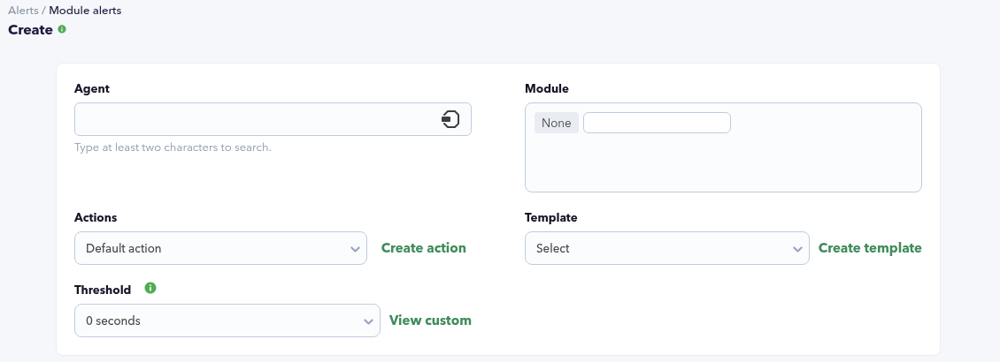{ .captura }

1. On ouvre **Gestion → Alertes → Alertes des modules** (*Module Alerts*) et on
   clique sur le bouton **Create** (*Créer*) en bas à droite.
2. On choisit :
    - **Agent** (*Agent*) : avec saisie semi-automatique.
    - **Module** (*Module*) : ceux de l'agent choisi.
    - **Modèle** (*Template*) : celui qui définit les conditions.
    - **Actions** (*Actions*) : celle qui sera exécutée. Si le modèle a déjà une
      action par défaut, on peut laisser **Par défaut** (*Default*).
    - **Seuil** (*Threshold*) : une action ne s'exécutera pas plus d'une fois dans
      cet intervalle. **Il est prioritaire sur le seuil de l'action.**
3. S'il manque une action ou un modèle, les boutons **Créer une action** et
   **Créer un modèle** mènent à leur création ; une fois terminé, on revient au
   constructeur.
4. On clique sur **Ajouter alertes** (*Add alert*).

!!! tip "Définir d'abord les seuils du module"
    Une alerte d'« état critique » n'a de sens que si le module a défini ses
    **seuils d'avertissement et de critique**. Sans eux, le module ne passe jamais
    en critique et l'alerte, malgré toute son élégance, ne se déclenche jamais.

#### Depuis l'agent

Dans la configuration de l'agent, il existe un onglet **Alertes** avec le même
constructeur et, en plus, la liste des alertes déjà affectées. Depuis cette liste,
on peut :

- Voir le détail d'une alerte (colonne **Modèle**, icône de la loupe).
- Modifier ou supprimer chacune de ses actions (colonne **Actions**).
- Dans la colonne des opérations : **désactiver** ou activer l'alerte, la mettre
  en **veille**, **ajouter une action** ou la **supprimer complètement**.

!!! warning "La suppression ne demande pas de confirmation"
    L'icône de corbeille de la liste des alertes de l'agent **supprime l'alerte
    immédiatement, sans message de confirmation**.

#### Depuis une politique

Les alertes peuvent aussi être définies dans une **politique de supervision** pour
être appliquées à tous les agents qui l'utilisent. C'est expliqué dans le chapitre
[Politiques de supervision](../parte-2/2.10-politicas-de-monitorizacion.md).

#### Modifier une alerte existante

Une fois l'alerte créée, **on ne change ni son modèle ni son module** : on ne peut
qu'ajouter, retirer ou ajuster des **actions**. On peut supprimer l'action
sélectionnée à la création avec l'icône de corbeille grise, ou en ajouter
d'autres avec le bouton **+**. S'il faut un autre modèle, on crée de nouveau
l'alerte.

!!! info "L'action par défaut se masque s'il y en a d'autres"
    L'action par défaut du modèle ne s'affiche que si elle est la **seule** de
    l'alerte. Dès qu'on en ajoute une autre, elle cesse de s'afficher (mais reste
    une action de plus dans la liste).

#### Cas pratique : la première version

Avec tout ce qui précède, l'alerte de `srv-web01` se présente ainsi :

| Élément | Valeur |
|---|---|
| Commande | **eMail** (prédéfinie) |
| Action | **Mail to Admin**, avec le destinataire changé en `sistemas@miempresa.com` |
| Modèle | **Critical condition** (prédéfini) : état critique, maximum 1, seuil 24 h, récupération activée |
| Module | `Disco /` de `srv-web01`, avec seuil critique défini dans le module |

Quand le module passera en critique, un e-mail arrivera ; quand il se
rétablira, un autre, de récupération, arrivera. C'est une alerte qui fonctionne
avec **quelques clics et une adresse e-mail**.

### Escalade des alertes

L'**escalade** consiste en des actions supplémentaires qui s'exécutent **si l'alerte
se répète** un certain nombre de fois de suite. C'est la façon civilisée de dire
« prévenez l'équipe ; si à la troisième personne n'a bougé le petit doigt,
prévenez son responsable ; à la dixième, que le téléphone d'astreinte sonne ».

#### Comment la configurer

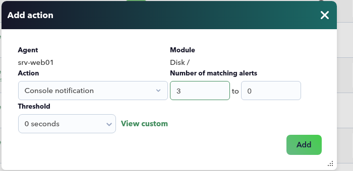{ .captura }

Quand on affecte une alerte à un module (ou qu'on la modifie dans la liste des
alertes), chaque action porte une plage, **Number of matching alerts** (la console ne la
traduit pas), avec une case « de » et une case « à ». Elle se lit « de la répétition *N* à
la répétition *M* ».

| De | À | Signification |
|---|---|---|
| `0` | `0` | Toujours, à chaque déclenchement. C'est la valeur par défaut. |
| `1` | `1` | Seulement au premier déclenchement. |
| `3` | `3` | Seulement au troisième. |
| `3` | `0` (ou inférieur au « de ») | Du troisième en avant, sans limite. |

En outre, chaque action peut porter son propre **seuil** comme second paramètre :
avec lui, cette action n'est pas lancée plus d'une fois par intervalle.

#### Un détail qui n'a rien d'évident

!!! warning "Au déclenchement, l'escalade ne s'accumule pas"
    Quand l'alerte **se déclenche**, seule s'exécute l'action dont la plage contient
    le numéro de répétition courant. Si l'on configure un e-mail pour la répétition
    1 et un SMS pour la 3, à la troisième **seul le SMS part**, pas l'e-mail et le
    SMS. Pour que les deux partent, l'e-mail doit couvrir une plage qui inclut la 3
    (par exemple, de `0` à `0`, qui signifie « toujours »).

    La **récupération** est différente : quand l'alerte se rétablit, **toutes** les
    actions qui avaient déjà été lancées s'exécutent de nouveau, pas seulement celle
    qui correspondrait à la répétition courante.

Si, lors d'un déclenchement, **aucune** action ne couvre le compteur, on utilise
l'**action par défaut** du modèle. Et l'**exécution forcée** ignore les plages.

#### Cas pratique : ajouter un SMS

Poursuivons avec `srv-web01`. On veut maintenant l'e-mail habituel et, si le
disque reste en critique, un SMS à la troisième répétition :

1. Dans le modèle, on met **Nombre maximum d'alertes** = `10` et **Seuil de
   temps** = `30 minutes`, pour qu'elle puisse se répéter.
2. Dans l'alerte du module, l'action **Mail to Admin** reçoit la plage `0` à `0`
   (toujours).
3. On ajoute l'action **SMS** avec la plage `3` à `0` (du troisième déclenchement
   en avant).

Résultat : l'e-mail part à chaque déclenchement et, à partir du troisième, le SMS
part aussi.

### États d'une alerte : active, désactivée et en veille

Une alerte peut se trouver dans trois états, et la différence entre les deux
états « éteints » est ce qu'on confond le plus.

| État | Évaluée | Exécute des actions | Génère des événements | Apparaît dans la vue des alertes |
|---|---|---|---|---|
| **Active** | Oui | Oui | Oui | Oui |
| **En veille** (*standby*) | Oui | **Non** | **Non** | Oui, et indique si elle est déclenchée |
| **Désactivée** | Non | Non | Non | **Non** |

Une alerte **désactivée** est comme si elle n'existait pas. Une alerte **en
veille** ne travaille qu'au niveau de l'affichage : on voit si elle est ou non
déclenchée, mais elle ne fait rien. C'est très utile pendant une maintenance ou
une mise en service : on continue de voir ce qui *aurait* sauté sans déranger
personne.

Les deux états se changent depuis la liste des alertes (colonne des opérations)
et aussi par lots avec les [opérations
massives](#operations-massives-sur-les-alertes).

### Éviter les tempêtes d'alertes

Une panne réseau au mauvais endroit peut laisser cent équipements « tombés » en
même temps, et avec eux cent e-mails en attente de partir. Pandora FMS dispose de
plusieurs mécanismes pour que cela n'arrive pas.

#### Protection en cascade

La **protection en cascade** évite le bombardement quand un groupe d'agents
devient inaccessible à cause d'un équipement intermédiaire (un routeur, un
commutateur). Les contrôles réseau échoueraient sur tous les équipements situés
derrière, et Pandora FMS considérerait comme tombés des équipements qui, en
réalité, vont très bien.

Pour que cela fonctionne :

1. L'agent **enfant** doit avoir correctement configuré son **agent parent**
   (*Parent*, dans **Options avancées** de l'agent).
2. Dans ces mêmes options de l'enfant, on active **Modules de protection en
   cascade** (*Cascade protection modules*) et/ou **Services de protection en
   cascade** (*Cascade protection services*).

##### Cascade basée sur les modules

Tant que le parent a **une alerte de module déclenchée dont le modèle a une
sévérité critique**, l'agent enfant **ne génère aucune alerte de module**. Si l'on
indique en plus un **module précis** du parent (dans le cadre **Hiérarchie et
comportement**), seul l'état de ce module compte. La vérification remonte toute la
chaîne des parents.

!!! warning "C'est tout ou rien, et cela dépend de la priorité du modèle"
    L'agent enfant perd **toutes** ses alertes de module tant que dure l'alerte du
    parent, pas seulement celles d'état critique. Et il n'est inhibé que si
    l'alerte déclenchée du parent utilise un modèle de sévérité **critique** : si
    le parent utilise un modèle de sévérité inférieure, l'enfant n'en sait rien. Il
    faut revoir la sévérité des modèles des équipements dont d'autres dépendent.

##### Cascade basée sur les services

La protection basée sur les [services](5.3-monitorizacion-de-negocio-y-servicios.md)
évite que les éléments d'un service déclenchent leurs alertes si l'alerte du
service auquel ils appartiennent s'est déjà déclenchée. Il faut activer
**Services de protection en cascade** sur les agents qui doivent se comporter ainsi
et **Protection en cascade activée** dans la configuration du service lui-même.

Quand l'alerte du service saute, la macro `_rca_` permet d'inclure dans le message
quels éléments sont en critique : c'est la chaîne d'analyse de cause racine.

#### Mode d'opération sécurisé

Le **mode d'opération sécurisé** (*Safe operation mode*) s'active dans les options
avancées de l'agent et s'associe à un module précis. Si ce module passe en
**critique**, les autres modules de l'agent sont **désactivés** jusqu'à ce que le
module surveillé revienne à *normal* ou *avertissement* ; ils sont alors
réactivés tout seuls. C'est utile, par exemple, pour cesser de lancer des contrôles
distants quand la connectivité est perdue.

#### Arrêts planifiés

Pendant un arrêt planifié, les alertes des modules concernés sont désactivées et
réactivées à la fin. C'est expliqué dans
[Arrêts planifiés](../parte-3/3.8-paradas-planificadas.md).

#### Protection contre les tempêtes d'événements et événements en cours

Il y a trois soupapes de plus :

- **Protection Event Storm** : c'est un **interrupteur manuel**, qu'on active et
  désactive à la main. Le serveur **ne détecte pas** de tempêtes de lui-même : tant
  que l'interrupteur est actif, il cesse de générer des événements et des alertes de
  module, et une fois éteint tout redevient normal. Elle est pensée pour une urgence,
  par exemple une panne réseau qui a mis la moitié de l'installation en critique.
  Détails dans la section suivante.
- **Alertes désactivées dans un groupe** : la même idée, mais **limitée à un groupe**.
  Dans **Gérer les groupes** (voir [Groupes d'agents](../parte-4/4.1-grupos-perfiles-y-tags.md#groupes-dagents)), en éditant le groupe, l'interrupteur **Alertes**
  (« Activer l'utilisation des alertes dans ce groupe ») le laisse sans alertes de
  module tant qu'il est éteint. Les autres groupes ne sont pas touchés, et les agents,
  les données et les événements de changement d'état continuent comme d'habitude. Le
  serveur regarde **le groupe principal de l'agent** et celui-là seulement : le
  réglage ne descend pas dans la hiérarchie des groupes vers les enfants, et il
  n'affecte pas non plus les alertes d'événement, de log ni de traps SNMP. C'est la
  vanne adaptée pour faire taire tout un environnement, par exemple « Préproduction »
  ou un client en migration, sans toucher au reste.
- `event_inhibit_alerts` : si on l'active (`1`), une alerte **ne se déclenche pas
  tant que le dernier événement de cette alerte est « En cours »**. C'est la façon
  de dire « je suis dessus, n'insistez pas ». La récupération est envoyée malgré
  tout.

##### La protection Event Storm, pas à pas

**Où l'activer.** Dans **Gestion → Configuration → Configuration du système →
Configuration générale**, dans le bloc **Événements**, avec l'interrupteur
**Protection Event Storm**. Aussi en ligne de commande, avec
`pandora_manage.pl <fichier_de_configuration> --set_event_storm_protection 1` (et `0`
pour l'éteindre).

**Ce que fait le serveur quand elle est active.** Il vérifie l'interrupteur, dans la
base de données, chaque fois qu'il s'apprête à générer un événement ou une alerte, et
s'il est actif il saute :

| Ce qui est sauté | Détail |
|---|---|
| Les **alertes de module** | Elles ne sont ni évaluées ni déclenchées, que ce soit par donnée normale, par état inconnu ou pour les services. |
| Les **événements de changement d'état** | Qu'un module passe en critique ou revienne à normal ne génère pas d'événement. |
| Les **événements d'état inconnu** | Ils ne sont pas générés non plus. |

Ce qui n'est **pas** interrompu : les **données** continuent d'arriver et d'être
enregistrées, et l'état des modules continue d'être calculé, de sorte que graphiques
et feux tricolores restent vivants. Les alertes d'événement et de log et les alertes
de traps SNMP ne passent pas par cette vanne.

**Comment ça se voit.** La console affiche une notification système (« Event storm
protection is enabled ») qui avertit que certains événements peuvent se perdre tant que
le mode est actif et recommande de redémarrer le serveur après avoir changé le réglage.
Chaque agent porte la marque **Protection Event Storm** (*Quiet by storm protection*)
dans son en-tête, sauf s'il est déjà désactivé, en mode silencieux ou rendu silencieux
par la configuration du groupe.

**Quand l'utiliser.** Quand une grosse panne va générer des milliers d'événements et
d'alertes qui n'apportent rien de nouveau et qui saturent en plus le serveur de
messagerie et la console. On l'active, on corrige la cause et on l'éteint.

!!! warning "Ce qui ne se rattrape pas"
    Les événements sautés **ne sont pas générés après coup** : si un module est passé
    en critique pendant la protection, l'événement de ce changement n'existera jamais.
    Les alertes, en revanche, sont évaluées à chaque nouvelle donnée ; en éteignant la
    protection, un module encore en critique réévalue donc son alerte avec la donnée
    suivante et peut se déclencher alors. Éteignez-la dès que l'urgence est passée :
    tant qu'elle est active, **rien n'est notifié** pour les modules.

### Macros d'alerte

Les **macros** sont des marqueurs du type `_agent_` ou `_data_` que le serveur
remplace par la valeur réelle au moment d'exécuter l'alerte. Ce sont elles qui
transforment un message générique en « le disque de `srv-web01` est à 98 % ».

On peut les utiliser dans les champs du **modèle**, de l'**action** et de la
**commande**, ainsi que dans ceux de récupération.

Quelques exemples réels :

```text
Objet :  [PANDORA] Alerte _alert_name_ sur _agent_ / _module_
Texte :  _agent_ (_address_) signale _data_ _dataunit_ sur le module _module_
         à _timestamp_. État : _modulestatus_. Déclenchements : _alert_times_fired_.
```

#### Macros d'agent

| Macro | Description |
|---|---|
| `_agent_` | Alias de l'agent ; à défaut, son nom. |
| `_agentalias_` | Alias de l'agent. |
| `_agentname_` | Nom de l'agent. |
| `_agentdescription_` | Description de l'agent. |
| `_agentgroup_` | Nom du groupe de l'agent. |
| `_agentstatus_` | État actuel de l'agent. |
| `_agentos_` | Système d'exploitation de l'agent. |
| `_agentcustomid_` | Identifiant personnalisé de l'agent. |
| `_agentcustomfield_N_` | Champ personnalisé numéro *N* de l'agent, par exemple `_agentcustomfield_9_`. |
| `_address_` | Adresse IP de l'agent. |
| `_addressn_N_` | Adresse IP de l'agent à la position *N* (`_addressn_1_`, `_addressn_2_`…). |
| `_all_address_` | Toutes les adresses de l'agent. |
| `_secondarygroups_` | Groupes secondaires de l'agent (uniquement dans les macros de commande et d'action). |
| `_id_agent_` | Identifiant de l'agent ; sert à construire une URL vers la console. |
| `_server_ip_`, `_server_name_` | Adresse IP et nom du serveur auquel l'agent est affecté. |

#### Macros de module et de données

| Macro | Description |
|---|---|
| `_module_` | Nom du module. |
| `_modulecustomid_` | Identifiant personnalisé du module. |
| `_moduledescription_` | Description du module. |
| `_modulegroup_` | Nom du groupe du module. |
| `_modulestatus_` | État du module. |
| `_moduletags_` | URL associées aux étiquettes du module. |
| `_name_tag_`, `_email_tag_`, `_phone_tag_` | Nom, e-mails et téléphones associés aux étiquettes du module. |
| `_id_module_` | Identifiant du module. |
| `_interval_` | Intervalle d'exécution du module. |
| `_data_` | La donnée qui a provoqué l'alerte. Si le module utilise la traduction de données, elle renvoie la valeur **traduite**. |
| `_dataunit_` | L'unité indiquée dans le champ **Unité** des options avancées du module. |
| `_prevdata_` | La donnée précédant celle qui a déclenché l'alerte. |
| `_moduledata_X_` | Dernière donnée du module *X* **du même agent**, avec les décimales de la console et son unité. Si *X* contient des espaces, on les écrit sous forme d'entité HTML : `&#x20;`. |
| `_lastdatatimestamp_` | Date et heure de la dernière donnée reçue (utile dans les alertes de passage à inconnu). |
| `_lastdatatime_` | Idem, au format Unix time. |
| `_modulelaststatuschange_`, `_modulelaststatustime_` | Horodatage et date du dernier changement d'état du module (uniquement dans les macros de commande). |
| `_warning_threshold_min_`, `_warning_threshold_max_` | Seuils minimum et maximum d'avertissement. |
| `_critical_threshold_min_`, `_critical_threshold_max_` | Seuils minimum et maximum de critique. |
| `_policy_` | Nom de la politique à laquelle appartient le module, le cas échéant. |
| `_plugin_parameters_` | Paramètres du plugin du module, au format JSON. Utilisable dans l'objet et dans le corps de l'e-mail. |
| `_target_ip_`, `_target_port_` | Adresse IP et port de la cible du module. |
| `_discovery_task_` | Nom de la tâche Discovery qui a échoué. |

#### Macros de l'alerte

| Macro | Description |
|---|---|
| `_alert_name_` | Nom de l'alerte. |
| `_alert_description_` | Description de l'alerte. |
| `_alert_threshold_` | Seuil de l'alerte. |
| `_alert_times_fired_` | Nombre de fois où elle s'est déclenchée. |
| `_alert_priority_` | Priorité numérique. |
| `_alert_text_severity_` | Priorité en texte (Maintenance, Informatif, Normal, Mineur, Avertissement, Majeur, Critique). |
| `_alert_critical_instructions_`, `_alert_warning_instructions_`, `_alert_unknown_instructions_` | Instructions du module pour chaque état. |
| `_id_alert_` | Identifiant de l'alerte ; sert à la corréler dans des outils tiers. |
| `_fieldN_` | Champ *N* défini par l'utilisateur. |
| `_timestamp_` | Date et heure du déclenchement. |
| `_timezone_` | Fuseau horaire de `_timestamp_`. |
| `_tztimestamp_±HHMM_`, `_tztimezone_±HHMM_` | `_timestamp_` et fuseau horaire convertis à un décalage précis, par exemple `_tztimestamp_+0200_`. |
| `_time_down_seconds_`, `_time_down_human_` | **Uniquement dans les alertes de récupération** : durée de la panne, en secondes ou au format long (« 1day 10h 35m 40s »). |

#### Macros de groupe, d'URL et de services

| Macro | Description |
|---|---|
| `_groupcontact_` | Informations de contact du groupe, celles saisies à sa création. Dans les alertes de log et SIEM, la macro s'appelle `_group_contact_`. |
| `_groupother_` | Autres informations du groupe. |
| `_groupcustomid_` | Identifiant personnalisé du groupe. |
| `_id_group_` | Identifiant du groupe de l'agent. |
| `_homeurl_` | L'URL publique de la console, celle configurée dans les options générales de la console. |
| `_rca_` | Chaîne d'analyse de cause racine (uniquement pour les services). |
| `_telegramtoken_` | Le *token* Telegram de la configuration des alertes. |

#### Macros pour l'e-mail

| Macro | Description |
|---|---|
| `_modulegraph_Nh_` | Graphique du module des *N* dernières heures, sous forme d'image. |
| `_modulegraphth_Nh_` | Idem, avec les seuils d'avertissement et de critique s'ils sont définis. |
| `_modulegraph_NomDuModule_Nh_` | Graphique d'**un autre module** du même agent. |
| `_statusimage_`, `_statusimagetag_` | Indicateur visuel de l'état au moment de l'envoi ; la seconde génère un élément HTML d'image. |

!!! warning "Les graphiques exigent que le serveur joigne la console"
    Pour dessiner un graphique, le serveur demande l'image à l'API de **sa propre
    console**. C'est un appel interne : il s'identifie avec l'identifiant unique du
    serveur, pas avec un utilisateur, donc aucun compte n'est nécessaire. Normalement,
    **rien n'est à configurer** : au démarrage, le serveur prend l'adresse de la console
    dans son URL publique (ou, si elle est vide, utilise
    `http://127.0.0.1/pandora_console/include/api.php`) et le mot de passe de l'API dans
    la configuration de la console. Ce n'est que si la console ne répond pas à cette
    adresse (autre port, HTTPS, autre machine) qu'on fixe `console_api_url` dans le
    fichier de configuration du serveur. Si le graphique n'arrive pas dans l'e-mail, il
    faut d'abord vérifier que le serveur atteint cette URL.

#### Macros réservées aux alertes d'événement, de log et SIEM

Nous les expliquons avec chaque type dans le bloc 2 :
[événements](#alertes-sur-les-evenements), [logs](#alertes-sur-les-logs) et
[SIEM](#alertes-siem). Celles des traps SNMP, dans
[Alertes sur les traps SNMP](#alertes-sur-les-traps-snmp).

#### Macros personnalisées de module

En plus de celles du système, chaque module peut définir les siennes :

- Elles se définissent dans le module lui-même, en développant la section des
  macros.
- Elles peuvent porter n'importe quel nom, par exemple `_maMacro_`.
- Elles sont enregistrées dans la base de données et n'apparaissent **pas** dans
  le fichier de configuration local de l'EndPoint.
- **Elles ne s'utilisent que dans les alertes.**
- On ne peut pas les définir au niveau d'un composant, mais on peut dans les
  [politiques de supervision](../parte-2/2.10-politicas-de-monitorizacion.md).
- On peut les utiliser dans les champs des commandes, des actions et des modèles.

!!! tip "Une astuce avec `_moduledata_X_`"
    `_moduledata_X_` permet d'insérer dans le message la valeur d'**un autre**
    module du même agent. Dans l'alerte de disque, `_moduledata_CPU&#x20;load_`
    ajoute la charge CPU à ce même instant : deux données, un e-mail.

#### Champs personnalisés de l'agent dans les alertes

Les macros personnalisées sont **de module** : elles valent pour ce module (ou ceux
d'une politique). Pour obtenir le même comportement **au niveau de l'agent**, c'est-à-dire
une donnée propre qui voyage dans toutes les alertes de tous les modules de cet agent, on
utilise les **champs personnalisés de l'agent** :

- Ils se créent une seule fois dans **Gestion → Ressources → Champs personnalisés** (par
  exemple « Responsable », « Client » ou « Téléphone d'astreinte »). L'**identifiant**
  affiché dans cette liste est le numéro *N* de la macro. Leur configuration complète
  (types, valeurs, ce qui s'affiche dans la vue) se trouve dans
  [Champs personnalisés de l'agent](../parte-2/2.21-configuracion-comun-de-los-agentes.md#champs-personnalises-de-lagent).
- Ils se remplissent dans la fiche de chaque agent, et chaque agent garde sa propre
  valeur. L'EndPoint lui-même peut les déclarer dans son fichier de configuration (voir
  [Configuration distante depuis la console web](../parte-2/2.1-monitorizacion-con-endpoints.md#configuration-distante-depuis-la-console-web),
  qui explique aussi leurs types).
- Ils s'utilisent dans n'importe quel champ de commande, d'action ou de modèle avec la
  macro `_agentcustomfield_N_`, que le serveur remplace par la valeur qu'a **cet** agent.
  Si l'agent ne l'a pas renseigné, la macro reste vide. Voir
  [Les utiliser dans des macros](../parte-2/2.21-configuracion-comun-de-los-agentes.md#les-utiliser-dans-des-macros).

La différence pratique : une macro de module doit être définie module par module, alors
qu'un champ personnalisé s'écrit une fois sur l'agent et toutes ses alertes en héritent,
sans toucher aux modèles ni aux actions. La même action sert tous les agents et chaque
e-mail porte la donnée du sien.

### Envoyer des alertes par e-mail, de bout en bout

L'e-mail est le canal le plus utilisé et, de ce fait, celui qui est le plus
souvent mal configuré. Il y a **trois éléments** qui doivent être corrects, et on
les vérifie dans cet ordre :

1. **Pandora FMS sait envoyer des e-mails.** Cela se configure une seule fois dans
   la console, dans **Gestion → Configuration → Configuration du système →
   Configuration générale → Configuration des alertes**, bloc **Configuration du
   courriel** : serveur et port SMTP, chiffrement, utilisateur et mot de passe, type
   d'authentification, expéditeur (nom et adresse) et délai d'attente. Pour Microsoft
   ou Google, on peut utiliser **OAuth2** à la place de l'utilisateur et du mot de
   passe. Le serveur lit ces valeurs dans la console, donc aucun fichier à toucher.
   Sans cela, aucune alerte par e-mail ne partira, même parfaitement configurée.
   Le mécanisme d'authentification compte : le serveur utilise le premier annoncé
   par le fournisseur et n'essaie pas les autres ; si celui-ci annonce
   `DIGEST-MD5` et le refuse, il faut choisir `LOGIN`.
2. **L'action a un destinataire.** Dans **Gestion → Alertes → Actions**, on ouvre
   **Mail to Admin** et on remplace l'adresse d'exemple par les adresses réelles,
   séparées par des virgules. On enregistre avec **Mise à jour**.
3. **L'alerte utilise cette action.** Dans **Gestion → Alertes → Alertes des
   modules**, on choisit l'agent, le module et le modèle, et dans **Actions** on
   sélectionne **Mail to Admin**. On termine avec **Ajouter alertes**.

!!! note "Alternative locale : le fichier du serveur"
    Si le fichier de configuration du serveur définit `mta_address`, cette
    configuration locale **l'emporte sur celle de la console** (avec `mta_port`,
    `mta_user`, `mta_pass`, `mta_auth`, `mta_from` et `mta_encryption`). C'est une
    méthode secondaire, utile en secours ou pour qu'un serveur donné utilise un autre
    serveur de messagerie. Si elle n'est pas définie, le serveur utilise la
    configuration de la console. OAuth2 ne se configure que dans la console.

!!! note "Les liens de l'e-mail dépendent de l'URL publique"
    Si l'**URL publique** a été configurée dans la console, les e-mails incluront
    ce lien (macro `_homeurl_`). Sinon, les liens pointeront vers ce que la console
    croit être son adresse. Et les images de l'e-mail ne s'afficheront que si le
    destinataire peut joindre la console.

#### Cas pratique : un e-mail avec le graphique

Pour que l'avertissement du disque contienne le graphique des dernières 24 heures,
il suffit de mettre la macro dans le texte de l'action (le champ 3 de la commande
eMail, celui qui dispose de l'éditeur HTML) :

```text
<p>_agent_ est passé à <strong>_modulestatus_</strong> : _data_ _dataunit_.</p>
<p></p>
<p>Responsable : _agentcustomfield_3_</p>
<p>Voir dans la console : <a href="_homeurl_">_homeurl_</a></p>
```

La ligne `Responsable` vient d'un **champ personnalisé de l'agent** : on a créé ici le
champ « Responsable », d'identifiant 3 dans cet exemple, et on l'a rempli sur `srv-web01`
avec le nom de la personne qui s'occupe de ce serveur. La même action, sans rien changer,
prévient avec le bon responsable pour chaque agent.

### Autres notifications

L'e-mail n'est pas le seul chemin. Toutes les notifications suivantes se montent
comme celle de l'e-mail : **une commande, une action et un modèle** (ou l'action
prédéfinie, qui a déjà des champs sensés).

| Pour… | Action prédéfinie | Ce qu'il faut préparer |
|---|---|---|
| Prévenir dans la console elle-même | **Console notification** | Choisir les utilisateurs qui recevront la notification. La notification apparaît au déclenchement de l'alerte et disparaît à la récupération. Les destinataires ont besoin de la permission de lecture sur ce qui est alerté. Les messages sont supprimés selon *Max. days before delete old messages*. |
| Écrire un événement | **Monitoring Event** | Choisir le type, la sévérité et les étiquettes de l'événement de déclenchement et de celui de récupération. |
| Envoyer un message à Slack | **Pandora Slack** | Modifier la commande et y mettre le *token* réel ; indiquer le canal, le titre et la description. |
| Envoyer un message à Teams | **Pandora MS Teams** | Mettre l'URL du webhook (champ 2). |
| Envoyer un message à Google chat | **Pandora Google chat** | Mettre l'URL du webhook du salon. |
| Envoyer un message à Telegram | **Pandora Telegram** | Enregistrer le *token* du bot dans la configuration des alertes de la console ; indiquer l'ID du chat. |
| Prévenir par SMS | **Pandora Vonage** | Modifier la commande avec les identifiants Vonage ; indiquer le téléphone et le message. |
| Prévenir un service d'astreinte | **Pandora ilert** | Modifier la commande avec la clé d'API ilert. |
| Ouvrir un ticket | **Create Pandora ITSM ticket** | Avoir activé l'intégration avec Pandora ITSM. |
| Exécuter un script du RMM | Une action avec la commande **RMM Script** | Choisir le script et ses entrées. |
| Appeler une API | Une action avec la commande **API request** | URL, méthode, en-têtes, données et SSL. |
| Envoyer un rapport | **Send Report by e-mail** | Destinataires, rapport et format (PDF, JSON ou CSV). |
| Rafraîchir un EndPoint | **Restart agent** | L'EndPoint doit avoir le serveur UDP activé. |

#### Un exemple avec la commande de requête API

La commande **API request** demande, dans cet ordre, l'URL, la méthode (`GET`,
`POST`, `PUT`, `PATCH` ou `DELETE`), les en-têtes, les données et SSL. Pour
prévenir un système maison avec un `POST` :

```text
En-têtes :  Authorization: Bearer abc123token
            Content-Type: application/json
            X-Request-ID: 123456
Données :   {"title": "_agent_: _module_", "body": "_data_ _dataunit_"}
```

### Jours spéciaux

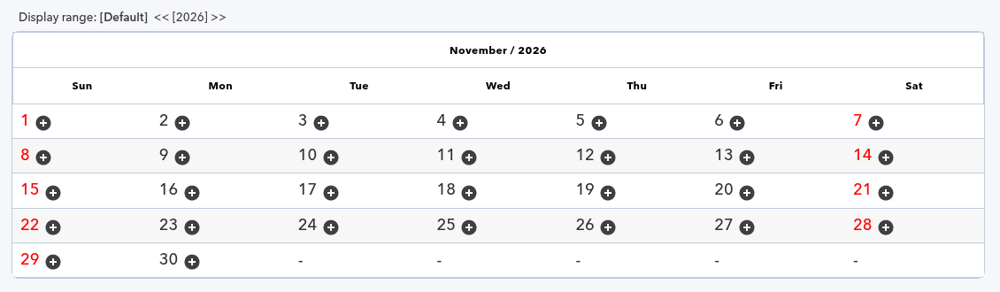{ .captura }

Le 1er janvier, un serveur ne se comporte pas comme un mardi ordinaire, et
l'alerte non plus. Les **jours spéciaux** permettent de dire « ce jour-là,
traite l'alerte comme si c'était un autre jour de la semaine ».

Ils se gèrent dans **Gestion → Alertes → Jours Spéciaux** (*Management → Alerts →
Special days*) et exigent la permission **LM**. Ils fonctionnent avec des
**calendriers** : chaque calendrier est une liste de dates, puis chaque modèle (ou
alerte d'événement, de log ou SIEM) choisit quel calendrier utiliser avec
**Utiliser la liste de jours spéciaux**.

#### Créer un jour spécial

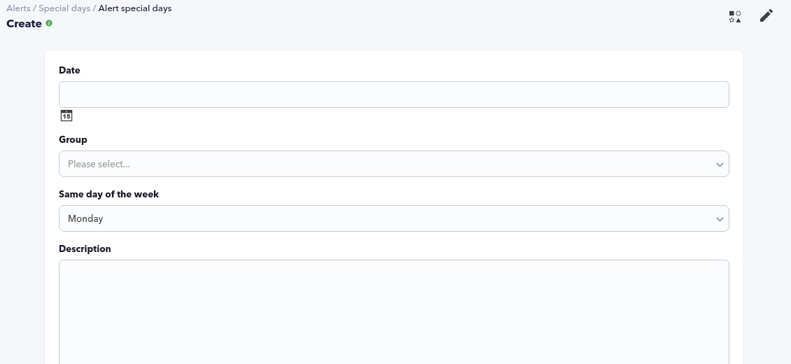{ .captura }

1. On ouvre **Gestion → Alertes → Jours Spéciaux**, on crée ou on choisit un
   calendrier et on ajoute un jour.
2. On renseigne :
    - **Date** (*Date*).
    - **Groupe** (*Group*) : à quel groupe il s'applique. *Tous* l'applique à
      n'importe quel groupe.
    - **Même jour de la semaine** (*Same day of the week*) : avec quel jour on
      l'assimile. De lundi à dimanche, ou **Vacances** (*Holidays*) pour lui donner
      un traitement propre.
    - **Description** (*Description*).

Dans le calendrier, les jours valables pour **toutes les années** sont marqués par
un indicateur et une infobulle (« valable tous les ans »), ce qui évite de recréer
chaque Noël. Si, pour le même groupe, il existe un jour précis, celui-ci est
prioritaire sur celui de toutes les années.

#### Importer un calendrier

S'il existe déjà un calendrier de jours fériés, inutile de le saisir : on peut
charger un fichier **iCalendar** (`.ics`) en indiquant le jour de la semaine auquel
on les assimile, le groupe et s'il faut **écraser** les jours déjà existants. La
console signale les dates qu'elle a omises. Il n'existe pas d'export.

#### Comment c'est appliqué

- Dans une **alerte de module** : si la date est spéciale, le modèle est évalué
  comme s'il s'agissait du jour de la semaine indiqué, il **doit donc être activé**
  ce jour-là dans le modèle. S'il ne l'est pas, l'alerte ne se déclenche pas ce
  jour-là.
- Dans une alerte d'**événement, de log ou SIEM** : on utilise l'horaire
  (*Schedule*) de l'alerte pour ce jour de la semaine, ou la partie vacances s'il
  en a une.

!!! example "Ne pas déranger l'astreinte le soir du Nouvel An"
    Calendrier « Jours fériés » avec le 31/12 et le 01/01 en **Même jour de la
    semaine : Dimanche**, et un modèle dont l'horaire du dimanche est désactivé.
    Ces deux jours-là, l'alerte ne part pas.

### Opérations massives sur les alertes

Quand il faut ajouter la même alerte à deux cents modules, ou retirer une action de
toutes les alertes d'un groupe, le faire à la main est une manière coûteuse
d'apprendre la patience. Les **opérations massives** permettent de le faire en une
fois : ajouter, modifier et supprimer des alertes, ajouter et supprimer des
actions, et activer, désactiver ou mettre en veille. Elles sont expliquées dans le
chapitre [Opérations massives](../parte-2/2.11-operaciones-masivas.md#operations-sur-les-alertes).

### Voir et passer en revue les alertes

#### Le détail des alertes

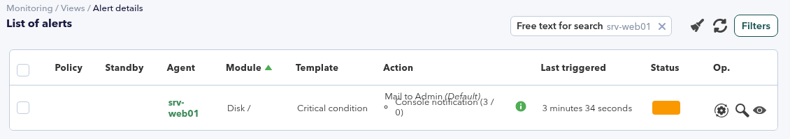{ .captura }

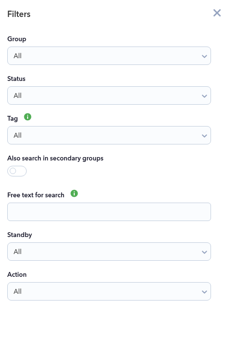{ .captura }

Pour savoir **ce qui se passe maintenant**, il y a **Opération → Surveillance →
Vues → Détail des alertes** (*Operation → Monitoring → Views → Alert detail*), qui
apparaît aussi comme onglet dans la vue de l'agent.

On peut filtrer par **Groupe**, **État** (Toutes activées, Toutes, Déclenchées, Non
déclenchées, Désactivées), **Étiquette**, **Rechercher aussi dans les groupes
secondaires**, texte libre, **Mode veille** et **Action**. Chaque ligne montre
l'agent, le module, le modèle, les actions, le dernier déclenchement et l'état :
*alerte déclenchée N fois*, *alerte désactivée* ou *alerte non déclenchée*.

Depuis cette vue, on peut faire plusieurs choses, chacune avec sa permission :

| Opération | Ce qu'elle fait | Permission |
|---|---|---|
| **Forcer la vérification** (*Force check*) | Icône de chaque alerte. Le serveur exécute **toutes ses actions** à son prochain cycle, **sans évaluer la condition**. | **LF** sur le groupe |
| **Valider** | Remet à zéro les compteurs des alertes sélectionnées et laisse un événement de validation manuelle. | **AW** sur le groupe |
| **Ajouter / mettre à jour une action** | Opérations par lots sur les actions des alertes sélectionnées. | **LM** |
| **Créer une alerte** | Ouvre le constructeur. | **LW** |

!!! warning "Forcer la vérification ne vérifie rien : elle exécute"
    Malgré son nom, **Forcer la vérification** ne réévalue pas la condition. Quand
    le serveur traite la demande, il exécute **toutes les actions de l'alerte
    immédiatement**, avec la donnée `N/A`, même si le module va parfaitement bien,
    **même si l'alerte est désactivée** et sans respecter les plages d'escalade. Si
    l'action est un e-mail, l'e-mail part ; si c'est un script, le script tourne.
    Après avoir cliqué, l'icône devient **Rafraîchir** (*Refresh*) jusqu'à ce que le
    serveur la traite. Une alerte **en veille** n'exécute toujours rien.

    C'est la bonne façon de **tester une action** sans attendre que le module
    tombe en panne : il suffit d'affecter au module le modèle **Manual alert** (qui
    ne se déclenche jamais seul) et l'action à tester, puis de la forcer. C'est aussi
    le mécanisme prévu pour les actions lancées « à la main », comme redémarrer un
    EndPoint.

!!! info "Ce que fait Valider"
    **Valider** remet à zéro les compteurs de déclenchement de l'alerte (elle peut
    se déclencher de nouveau dès que la condition est remplie), clôt
    l'enregistrement du déclenchement et crée un événement de **validation manuelle
    de l'alerte**. Si l'utilisateur n'a pas la permission **AW** sur le groupe,
    l'alerte est ignorée sans avertissement.

#### Liste des alertes de module

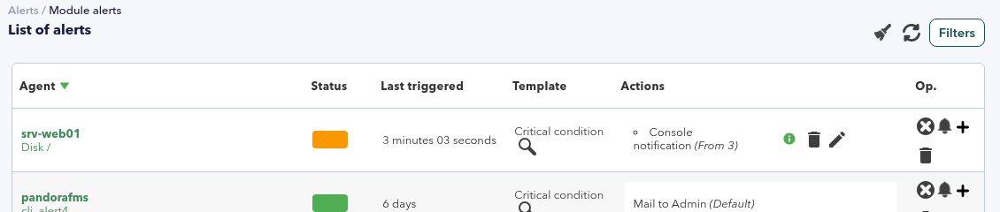{ .captura }

**Gestion → Alertes → Alertes des modules** est la vue de **gestion**. Elle filtre
par agents, module, actions, contenu des champs, priorité, état, veille et groupe.
Chaque ligne permet d'activer et de désactiver l'alerte, de la mettre en veille,
d'ajouter, de mettre à jour et de supprimer des actions, ou de la supprimer. Pour
chaque action, elle affiche sa plage d'escalade : *Toujours*, *À N*, *Jusqu'à N*
ou *De N à M*, et son seuil.

!!! info "Ce qu'est l'« action par défaut » dans cette liste"
    Les actions marquées *(Par défaut)* s'exécutent chaque fois que l'alerte se
    déclenche et qu'**aucune autre action** ne le fait.

#### Détail d'une alerte

La loupe de la colonne **Modèle** ouvre le détail : l'agent, le module, le modèle,
le dernier déclenchement, l'état, la sévérité, la veille et la politique ; les
**conditions de déclenchement** rédigées en prose (« l'alerte se déclencherait
quand la valeur est inférieure à … ») ; les actions avec leurs seuils et un
aperçu des champs de déclenchement et de récupération. C'est la façon la plus
rapide de vérifier ce que fait une alerte qu'on n'a pas configurée soi-même.

#### Alertes et événements

Chaque fois qu'une alerte se déclenche, se rétablit ou se termine, elle laisse un
événement dans la console d'événements (sauf si on l'a désactivé). Pour voir tout
ce qu'une alerte a fait, on filtre par ce type d'événement dans
[la console d'événements](5.4-consola-de-eventos-centralizada.md).

La façon dont s'affichent les informations du dernier déclenchement (horodatage,
comparaison d'heures ou mode compact) se choisit dans la configuration des
**Styles visuels** de la console (*Visual styles*), option *Timestamp, time
comparison, or compact mode*.

### Le serveur d'alertes et les environnements distribués

Évaluer une alerte et l'exécuter sont deux tâches différentes. **Évaluer** est peu
coûteux : comparer la donnée au modèle, regarder compteurs et seuils. **Exécuter**
peut être lent et dépend de ce qui se trouve à l'extérieur : un serveur de messagerie
qui tarde à répondre, un SMS qui passe par une passerelle, un script qui appelle une
API. Le **serveur d'alertes** (*Alert Server*) sert à séparer les deux tâches.

#### Son comportement

Sans serveur d'alertes, le serveur qui évalue l'alerte l'exécute aussi sur-le-champ,
et tant que l'action n'est pas terminée il ne passe pas à la suite. Avec lui, le
travail se répartit ainsi :

1. Le serveur qui évalue (de données, d'événements ou de logs) décide que l'alerte se
   déclenche ou se rétablit et, au lieu d'exécuter les actions, **dépose un ordre dans
   une file** partagée via la base de données. Chaque ordre contient tout le nécessaire :
   la donnée, l'agent, le module, l'alerte et les macros supplémentaires.
2. Un serveur d'alertes **récupère les ordres**, exécute les actions de l'alerte
   (e-mail, commandes, notifications) et supprime l'ordre de la file.
3. Si un ordre met plus de `alertserver_warn` secondes (180 par défaut) à s'exécuter
   depuis sa mise en file, le serveur génère un événement d'avertissement avec le
   texte « Alert execution delay has exceeded N seconds », au plus un par heure.

Les alertes de module, d'événement et de log passent par la file, au déclenchement
comme au rétablissement. **N'y passent pas** : les exécutions de « Force check » et
les alertes de traps SNMP, qui s'exécutent immédiatement sur le serveur qui les traite.

#### Que configurer

Deux paramètres de `pandora_server.conf` déterminent le rôle de chaque serveur :

| Paramètre | Rôle donné au serveur |
|---|---|
| `alertserver_queue 1` | **Met en file.** Ses alertes ne s'exécutent pas sur lui : elles vont dans la file. Il n'exécute rien de la file. |
| `alertserver 1` | **Exécute.** Démarre le serveur d'alertes, avec `alertserver_threads` threads en parallèle. De plus, une fois activé, les alertes du serveur lui-même passent aussi toujours par la file. |

Avec les deux à `0` (valeur par défaut), il n'y a pas de file et tout s'exécute en ligne.

#### Beaucoup qui mettent en file, peu qui exécutent

C'est là que réside la puissance. Les deux rôles sont indépendants, on peut donc les
répartir à volonté :

- **Un nombre quelconque de serveurs qui mettent en file.** Les serveurs de données,
  d'événements et de logs de chaque site se contentent d'évaluer et de déposer l'ordre
  dans la file. Ils peuvent se trouver sur des réseaux sans sortie vers Internet, sans
  accès au serveur de messagerie ni à la passerelle SMS.
- **Un seul serveur, ou un petit groupe, qui exécutent.** Ce sont les seuls connectés
  aux services de notification : SMTP, passerelles SMS, Microsoft Teams, un système
  de tickets, des API externes. L'accès s'ouvre depuis ces serveurs, et eux seuls.

Les droits réseau et les identifiants de notification vivent ainsi dans un endroit
contrôlé, et le reste de l'environnement n'a pas besoin de savoir qu'ils existent. On
peut aussi dédier à l'exécution des alertes un serveur sans autre charge, pour qu'une
passerelle lente ne freine jamais la collecte des données.

Quand **plusieurs serveurs d'alertes sont actifs**, ils se partagent la file d'eux-mêmes :
chaque ordre appartient à l'un d'eux selon son numéro d'identifiant et la position du
serveur dans la liste des serveurs d'alertes actifs triée par nom. Ajouter un exécuteur
répartit la charge sans rien toucher d'autre.

!!! warning "Ce qu'il faut surveiller"
    - **Les scripts des commandes d'alerte s'exécutent sur le serveur d'alertes**, pas
      sur celui qui a évalué. Une commande personnalisée doit exister, avec ses
      dépendances et ses droits, sur **tous** les serveurs qui exécutent.
    - S'il ne reste **aucun** serveur d'alertes actif, la file grossit et les
      notifications ne partent pas. L'événement « Alert execution delay… » en est le
      signal. L'état du serveur se vérifie dans la console, dans la liste des serveurs.
    - Si un serveur d'alertes tombe, tant qu'il compte comme actif, personne ne
      traite sa part de la file.

Pour la répartition générale des serveurs dans une grande installation, voir
[Grands environnements](../parte-12/12.8-entornos-grandes.md).

### Paramètres du serveur et de la console associés

#### Serveur (`pandora_server.conf`)

| Paramètre | Valeur par défaut | À quoi il sert |
|---|---|---|
| `event_window` | `3600` s | Fenêtre d'événements que le serveur prend en compte pour les alertes d'événement. Les événements hors de la fenêtre ne sont pas traités. |
| `log_window` | `3600` s | Idem pour les alertes de log. |
| `event_inhibit_alerts` | `0` | Si `1`, une alerte ne se déclenche pas tant que son dernier événement est « En cours ». |
| `global_alert_timeout` | `15` s | Durée maximale d'exécution d'une commande externe d'alerte. |
| `unknown_updates` | `0` | Si `1`, met à jour périodiquement les modules à l'état inconnu (peut affecter les performances du serveur), nécessaire pour que leurs alertes se répètent. |
| `eventserver` | `0` | Doit être à `1` pour les alertes d'événement. |
| `logserver` | `0` | Doit être à `1` pour les alertes de log. |
| `mta_address`, `mta_port`, `mta_user`, `mta_pass`, `mta_auth`, `mta_from`, `mta_encryption` | non défini | Serveur de messagerie sortant **local** : si `mta_address` est défini, il l'emporte sur la configuration de courriel de la console. C'est une méthode secondaire ; la principale est dans la console. |
| `console_api_url`, `console_api_pass` | vide (repris de la console) | Où et avec quel mot de passe le serveur appelle l'API de la console pour les macros de graphique dans l'e-mail. À fixer seulement si la console ne répond pas à l'adresse par défaut. |
| `alertserver` | `0` | Active le serveur d'alertes dédié. |
| `alertserver_threads` | `1` (`4` dans le fichier d'exemple) | Threads du serveur d'alertes : ordres qu'il exécute en même temps. |
| `alertserver_queue` | `0` | Si `1`, les alertes sont mises en file pour le serveur d'alertes (avec `alertserver` actif, elles sont toujours mises en file). |
| `alertserver_warn` | `180` s | Génère un événement d'avertissement toutes les heures si l'exécution des alertes prend plus de ces secondes de retard. |

Les paramètres du serveur sont expliqués en détail dans la
[référence de configuration du serveur](../parte-9/9.3-referencia-completa-de-configuracion-del-servidor.md).

#### Console

| Où | Quoi |
|---|---|
| **Gestion → Réglages → Configuration du système → Configuration générale → Configuration des alertes** | La configuration de l'e-mail sortant de la console et le *token* Telegram (macro `_telegramtoken_`). |
| **Configuration générale → Réseau → URL publique** | Base des liens des notifications (macro `_homeurl_`). |
| **Performance → Max. jours avant de supprimer les anciens messages** | Quand les notifications de la console sont supprimées. |
| **Performance → Nombre maximum de champs macro de données** | Combien de champs s'affichent dans les formulaires d'alertes. |

## Bloc 2 · Alertes par origine

Jusqu'ici, l'alerte naissait d'un module : une mauvaise donnée, un état qui change.
Mais tout ce qui mérite un avertissement n'est pas un module. Parfois, le problème
se trouve dans **ce que disent les événements** (trois échecs de connexion de
suite), dans **ce qu'écrit un log** (un `kernel panic`), dans **ce qu'annonce un
équipement** (un trap SNMP) ou dans **ce que détecte le SIEM**.

Les quatre types qui suivent réutilisent tout ce qui figure dans le
[bloc 1](#bloc-1-lalerte-de-module-et-ses-mecanismes) : [**actions**](#actions-dalerte),
[**commandes**](#commandes-dalerte), [**macros**](#macros-dalerte),
[**seuils**](#quand-une-alerte-se-declenche-compteurs-seuil-et-flip-flop) et
[**champs**](#le-flux-des-champs). Deux choses
changent : *ce qui les déclenche* (des règles au lieu d'un modèle de module) et
*l'endroit où ils se configurent*. C'est pourquoi chaque section n'explique que ce
qui est nouveau.

| Type | Évalué sur | Menu | Permission |
|---|---|---|---|
| [Événements](#alertes-sur-les-evenements) | Les événements qui arrivent | Gestion → Alertes → Alertes d'événements | LM |
| [Logs](#alertes-sur-les-logs) | Les lignes de log qui arrivent | Gestion → Alertes → Alertes des journaux | LM |
| [Traps SNMP](#alertes-sur-les-traps-snmp) | Les traps reçus | Gestion → Alertes → Alertes SNMP | LW |
| [SIEM](#alertes-siem) | Les événements SIEM | Gestion → Alertes → Alertes SIEM | LW, LM ou AD |
| [Inventaire](#alertes-dinventaire) | L'inventaire des agents | Gestion → Alertes → Alertes d'inventaire | LM |

### Alertes sur les événements

Une **alerte d'événement** se déclenche quand les événements qui arrivent
respectent un ensemble de **règles**. Elle ne dépend pas d'un module précis : un
même événement peut avoir été généré par n'importe quel module de n'importe quel
agent. Elle sert à ce qu'aucun module ne voit à lui seul : « trois événements
critiques du même agent en dix minutes », « tout événement dont la description
contient `timeout` ».

!!! warning "Indispensable : Event Server et fenêtre d'événements"
    - L'**Event Server** doit être actif (`eventserver 1` dans le fichier de
      configuration du serveur, ou depuis l'administration distante du serveur dans
      la console).
    - Le serveur ne travaille que sur une **fenêtre d'événements**, le paramètre
      `event_window` (par défaut **3600 secondes**) : les événements plus anciens ne
      sont pas traités.
    - Dans un **Command Center**, ces alertes **ne sont pas centralisées** : chaque
      nœud doit avoir les siennes, et les règles du Command Center ne se
      déclenchent qu'avec les événements du Command Center lui-même.

#### Comment une alerte d'événement est évaluée

C'est la partie qu'il vaut mieux comprendre avant de toucher à quoi que ce soit :

1. Chaque fois qu'un événement arrive, le serveur parcourt les alertes d'événement
   **dans l'ordre**.
2. Le **nouvel** événement doit respecter au moins une règle de l'alerte.
3. Le serveur passe alors en revue les événements de la fenêtre (`event_window`) et
   compte combien respectent chaque règle, en tenant compte du **regroupement** et
   des modificateurs de chaque règle.
4. Une règle est **satisfaite** quand son décompte atteint le minimum exigé.
5. Les règles satisfaites se combinent **de gauche à droite** avec leurs
   connecteurs (`AND`, `OR`, …). **Il n'y a pas de précédence entre eux.**
6. Si le résultat est vrai et que les limites du modèle (minimum, maximum, seuil)
   sont respectées, l'alerte se déclenche.

#### Créer une alerte d'événement : l'assistant en cinq étapes

On ouvre **Gestion → Alertes → Alertes d'événements** et on clique sur **Créer**.
Il y a cinq étapes : **Configurer**, **Conditions**, **Règles**, **Champs** et
**Activation**.

##### Étape 1 · Configurer

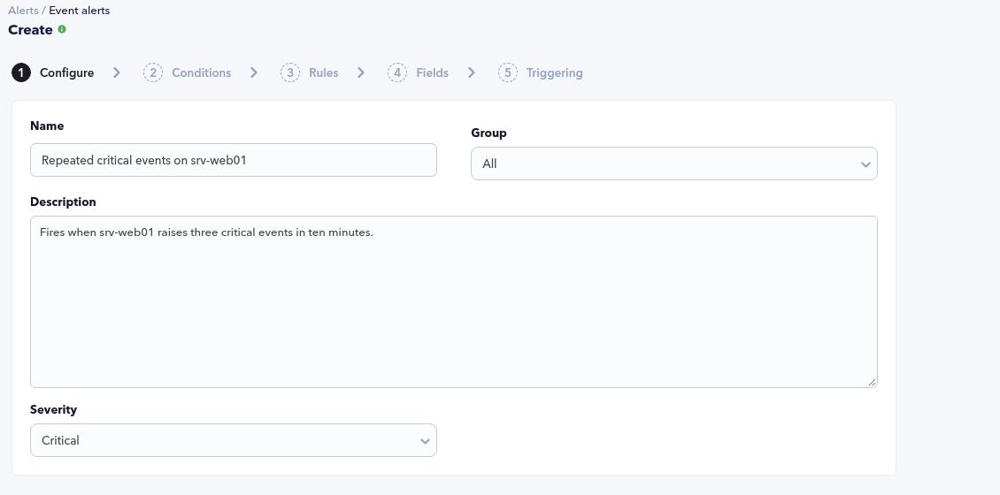{ .captura }

| Champ | Ce que c'est |
|---|---|
| **Nom** | Obligatoire et unique. |
| **Groupe** | Le groupe de l'alerte. |
| **Description** | Libre. |
| **Sévérité** (*Severity*) | La sévérité dont hérite l'événement généré par l'alerte. |

##### Étape 2 · Conditions

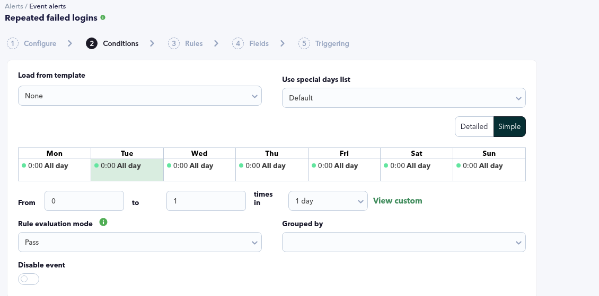{ .captura }

Contrairement aux alertes de module, il n'y a **pas de modèle** ici pour décider
quand l'alerte se déclenche : les **conditions de déclenchement** (horaire, seuil
de temps, nombre minimum et maximum de déclenchements) se définissent à cette
étape et vivent dans l'alerte elle-même. Si un modèle contient déjà les
conditions voulues, on peut les **copier** depuis celui-ci avec *Télécharger depuis
le modèle*, la première ligne du tableau.

| Champ | Ce que c'est |
|---|---|
| **Télécharger depuis le modèle** (*Load from template*) | Copie les conditions d'un modèle d'alerte déjà créé. C'est une **copie**, pas un lien : si l'on modifie ensuite le modèle, l'alerte ne le sait pas. |
| **Utiliser la liste de jours spéciaux** | Le [calendrier](#jours-speciaux) qui s'applique. |
| **Planifier** | L'horaire pendant lequel l'alerte peut se déclencher (le même éditeur que dans les modèles). |
| **Exécuter l'alerte de … à … fois dans … de seuil** | Minimum et maximum de déclenchements, et seuil de temps. Les valeurs initiales sont `0`, `1` et 1 jour. |
| **Mode d'évaluation de règles** (*Rule evaluation mode*) | **Passer** ou **Lâcher**. Voir plus bas. |
| **Groupé par** (*Grouped by*) | Agent, module, alerte de module ou groupe. Voir plus bas. |
| **Désactiver l'événement** | Ne génère pas l'événement d'alerte déclenchée. |

**Mode d'évaluation de règles.** Quand il y a plusieurs alertes d'événement, elles
sont évaluées une à une **dans l'ordre où elles apparaissent dans la liste** (on
peut les réordonner par glisser-déposer). Le mode décide de ce qui se passe quand
l'une se déclenche :

- **Passer** (*Pass*) : on continue d'évaluer les alertes suivantes. C'est le
  comportement par défaut.
- **Lâcher** (*Drop*) : quand une alerte **arrive à se déclencher**, on cesse
  d'évaluer les suivantes.

!!! warning "Lâcher ne coupe que si l'alerte se déclenche vraiment"
    Qu'un événement respecte les règles ne suffit pas : si l'alerte ne se
    déclenche pas parce qu'elle n'a pas encore atteint son **minimum** de
    répétitions, ou parce qu'elle a déjà atteint son **maximum**, elle **ne coupe
    pas** et l'on passe à la suivante.

**Groupé par.** Fait que les règles ne comptent que les événements du même agent,
groupe, module ou alerte de module. Si la règle est « deux événements critiques »
et qu'on regroupe par **agent**, il doit s'agir de deux événements critiques **d'un
même agent**, pas d'un de chacun de deux agents.

##### Étape 3 · Règles

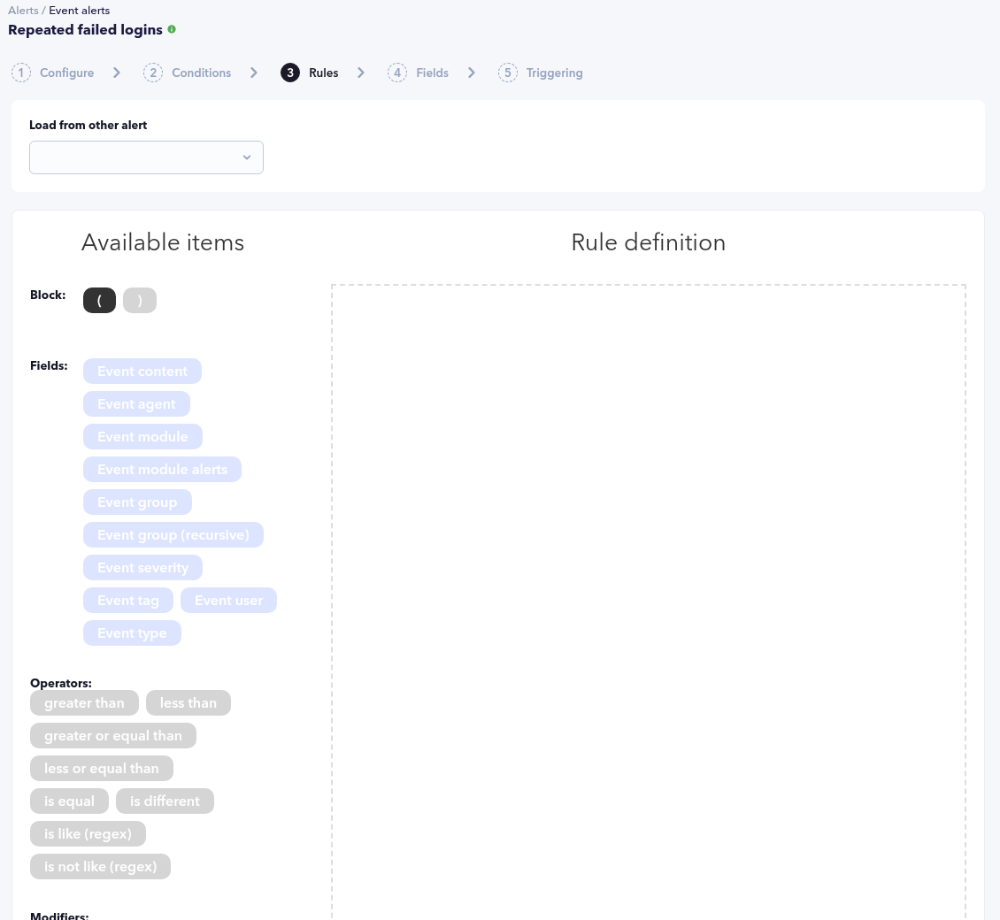{ .captura }

Le cœur de l'alerte. À gauche se trouvent les **éléments disponibles** (*Available
items*) et à droite la **définition de règles** (*Rule definition*) : on
**glisse** les éléments de l'un à l'autre pour construire chaque règle.

Les éléments sont :

| Type | Éléments |
|---|---|
| **Champs de l'événement** | Contenu de l'événement, agent, module, alerte de module, groupe, groupe (récursif), priorité, étiquette, utilisateur et type d'événement. |
| **Opérateurs de comparaison** | `>`, `<`, `>=`, `<=`, est égal, est différent, **est comme (regex)** et **n'est pas comme (regex)**. Pour les champs non numériques, seuls sont proposés égal, différent et les deux d'expression régulière. |
| **Modificateurs** | **dans un intervalle (secondes)** (la fenêtre dans laquelle ils doivent se produire) et **a au moins** (combien de fois). |
| **Connecteurs** | `AND`, `NAND`, `OR`, `NOR`, `XOR`, `NXOR`. |
| **Bloc** | Les parenthèses `(` et `)`. |

La grammaire, simplifiée :

```text
S -> R | R CONECTOR R
R -> CAMPO OPERADOR VALOR | CAMPO OPERADOR VALOR MODIFICADOR
```

Deux idées clés, qui font la différence entre réussir et deviner :

- **À l'intérieur d'un bloc `( … )`**, les conditions doivent être remplies **en même
  temps sur le même événement**. `(agent est srv-web01 AND priorité est critique)`
  exige **un** événement qui soit de `srv-web01` **et** critique.
- **Entre les règles** (avec un connecteur), les conditions sont remplies **dans la
  fenêtre** : `A AND B` exige qu'il existe des événements qui respectent `A` et des
  événements qui respectent `B` parmi les `event_window` dernières secondes, même
  s'il s'agit d'**événements différents**.

Et deux avertissements :

- `est égal` et `est différent` comparent **le texte littéralement**. Pour quelque
  chose de plus souple, utilisez **est comme (regex)**.
- Les modifications de l'étape ne sont enregistrées que lorsqu'on clique sur
  **Suivant**.

Il existe aussi **Charger depuis une autre alerte**, qui copie les règles d'une
autre alerte d'événement, et les boutons **Supprimer la règle**, **Supprimer
l'élément**, **Effacer** et **Réinitialiser**. À l'ouverture de cette étape,
l'éditeur affiche un avertissement sur la complexité de la logique de corrélation (fenêtres
de temps, conditions multiples, logique booléenne) : mieux vaut le lire.

##### Étape 4 · Champs

On place ici les champs `Field1` … `Field10` que recevra l'action (avec les mêmes
[règles de précédence que dans le bloc 1](#le-flux-des-champs)), et la **récupération** :

- **Télécharger depuis le modèle** pour les copier.
- **Récupération d'alertes** : désactivée ou activée. Quand elle est activée, les
  **champs de récupération** apparaissent.

!!! note "Pas de macros d'agent ni de module dans la récupération"
    La récupération s'exécute à l'expiration du seuil et n'a pas d'événement d'où
    tirer l'agent ou le module. Ces macros ne sont pas disponibles ici.

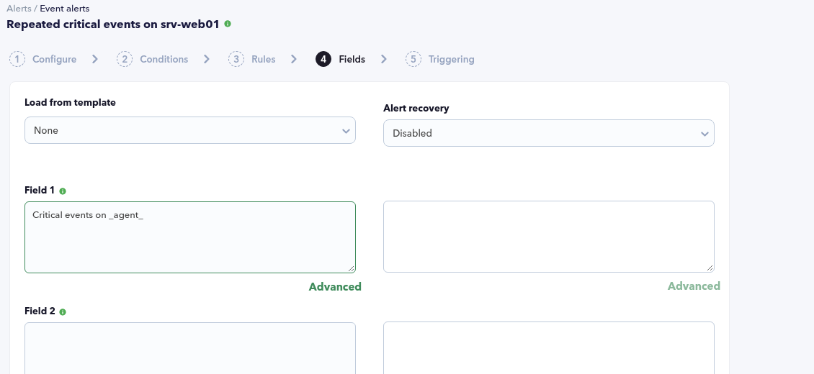{ .captura }

##### Étape 5 · Activation

Les conditions de déclenchement ont déjà été fixées à l'étape 2 ; le panneau
**Condition de déclenchement** en haut de page les résume. Il ne reste ici qu'à
associer les actions.

On associe les **actions** qui seront exécutées : on choisit l'**action**, la plage
de répétitions (*Number of matching alerts*, comme dans
l'[escalade](#escalade-des-alertes)) et le **seuil** de l'action. Avec **Ajouter**,
on l'ajoute à la liste, qui montre pour chaque action quand elle est lancée
(*Toujours*, *À N*, *Jusqu'à N*, *De N à M*). Un sélecteur permet de prévisualiser
les champs de **déclenchement** ou de **récupération** de chacune.

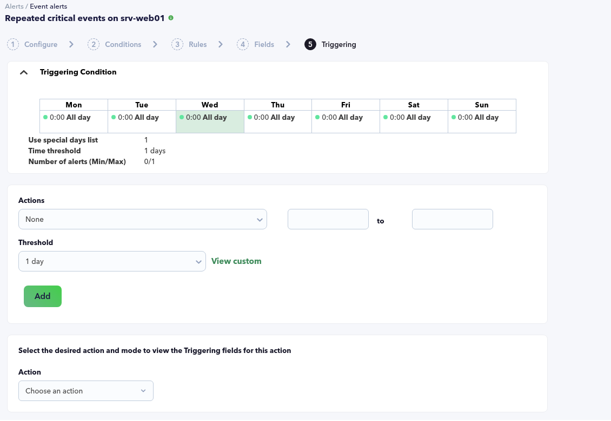{ .captura }

#### La liste des alertes d'événement

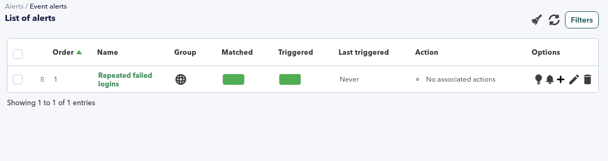{ .captura }

Chaque ligne montre l'**ordre** (déplaçable), le nom, le groupe, combien de fois
elle a concordé, combien de fois elle s'est déclenchée, la dernière activation et
les actions. De là, on peut **activer ou désactiver**, mettre en **veille**,
**ajouter des actions**, modifier, supprimer ou **valider** par lots.

!!! tip "Le glisser-déposer ne fonctionne qu'avec la liste triée"
    Pour réordonner les alertes, la liste doit être triée par ordre croissant sur
    **Ordre**.

#### Macros spécifiques des alertes d'événement

En plus de celles du [bloc 1](#macros-dalerte) :

| Macro | Description |
|---|---|
| `_event_id_` | Identifiant de l'événement qui a déclenché l'alerte. |
| `_event_description_` | Description de l'événement. |
| `_event_text_severity_` | Priorité de l'événement, en texte. |
| `_event_extra_id_` | Identifiant supplémentaire de l'événement. |
| `_eventTimestamp_` | Horodatage de création de l'événement. |
| `_event_cf_text_` | Toutes les données personnalisées de l'événement, en texte avec sauts de ligne. |
| `_event_cf_json_` | Les mêmes données au format JSON. |
| `_event_cfX_` | Valeur du champ personnalisé dont la clé est *X* : avec une clé `IPAM`, la macro est `_event_cfIPAM_`. |
| `_event_correlation_` | Identifiants et descriptions des événements qui ont déclenché l'alerte corrélée, au format `id - description`, un par ligne. Elle n'existe que dans les alertes d'événement et rassemble tous les événements qui ont satisfait les règles, pas seulement celui qui a déclenché l'alerte. |

#### Cas pratique : trois échecs de connexion en dix minutes

On veut un avertissement quand un même agent génère **trois événements critiques en
dix minutes** :

1. **Configurer** : nom « Échecs de connexion répétés », groupe *Serveurs*,
   sévérité *Critique*.
2. **Conditions** : horaire sans restriction ; **Groupé par : Agent** ; mode
   **Passer** ; minimum `0`, maximum `1`, seuil `1 h`.
3. **Règles** : une seule règle : *priorité est Critique* **et** *contenu de
   l'événement est comme (regex) `login failed`*, à l'intérieur d'un bloc ;
   modificateurs **dans un intervalle** `600` et **a au moins** `3`.
4. **Champs** : l'objet de l'e-mail avec `_agent_`, `_event_description_` et
   `_event_correlation_` pour voir les trois événements.
5. **Activation** : action **Mail to Admin**.

### Alertes sur les logs

Une **alerte de log** est la cousine de celle d'événement, mais sur les lignes de
log que collecte Pandora FMS. Elle se déclenche quand les logs qui arrivent
respectent des règles, et ne dépend pas d'un module : le même texte peut provenir
de plusieurs agents.

!!! warning "Prérequis"
    | Prérequis | Détail |
    |---|---|
    | Log Server | `logserver 1` dans le fichier de configuration du serveur (de préférence depuis l'administration distante). |
    | Collecteur de logs | Activé dans **Gestion → Réglages → Configuration du système → Collecteur de journaux → Activer le collecteur de logs**. |
    | Fenêtre de logs | `log_window` (par défaut 3600 s) : les logs hors de la fenêtre ne sont pas traités. |
    | Menu | **Alertes des journaux** n'apparaît que lorsque le collecteur est activé. |

La collecte et la consultation des logs sont expliquées dans le chapitre
[Collecte et supervision des logs](../parte-2/2.19-recoleccion-y-monitorizacion-de-logs.md).

#### Créer une alerte de log

L'assistant est [**identique à celui des événements**](#creer-une-alerte-devenement-lassistant-en-cinq-etapes) (Configurer, Conditions,
Règles, Champs, Activation), avec les mêmes connecteurs, le mode **Passer** /
**Lâcher**, les modificateurs et la [liste](#la-liste-des-alertes-devenement). Les différences sont les suivantes :

| Quoi | Événements | Logs |
|---|---|---|
| **Champs de la règle** | Ceux de l'événement (agent, module, groupe, priorité…) | **Contenu du log**, **origine du log** et **agent du log** |
| **Opérateurs** | Comparaison numérique, égalité et regex | Seulement **égalité et regex** |
| **Groupé par** | Agent, module, alerte de module ou groupe | **Aucun ou Agent** |
| **Fenêtre** | `event_window` | `log_window` |

!!! danger "Avec les logs, regroupez uniquement par agent"
    Dans les alertes à règles de log, **seul fonctionne** le regroupement par
    **agent**. Si l'on choisit un autre regroupement, l'alerte **ne sera jamais
    remplie**.

Les règles avec `est égal` / `est différent` comparent du texte littéral ; pour
quelque chose de souple, utilisez **est comme (regex)**.

#### Règles prédéfinies

Pandora FMS fournit neuf alertes de log d'exemple, toutes en mode **Passer** :

| Alerte | Règle (résumée) |
|---|---|
| **Kernel Panic** | Le contenu est comme `kernel: panic` |
| **Device not ready** | Contient `I/O error, device not ready` |
| **Out of memory** | `Out of memory` ou `Paging file too small` |
| **Failed to start** | Quatre règles reliées par `OR` |
| **CPU soft lockup detected** | Priorité informative |
| **Disk or swap space problem** | Quatre règles reliées par `OR` |
| **Fatal error**, **Bugcheck**, **Kernel-Power** | Erreurs critiques courantes de Linux et de Windows |

Elles constituent un bon point de départ : on les copie et on les ajuste.

#### Macros spécifiques des alertes de log

| Macro | Description |
|---|---|
| `_log_id_` | Identifiant du log qui a déclenché l'alerte. |
| `_logTimestamp_` | Horodatage de création du log. |
| `_logSource_` | Origine du log. |
| `_group_contact_` | Informations de contact du groupe. |

La récupération s'exécute à l'expiration du seuil et n'a pas de macros d'agent ni
de module, comme pour celles d'événement.

#### Cas pratique : kernel panic

1. On part de la règle prédéfinie **Kernel Panic** : *contenu du log est comme
   (regex) `kernel: panic`*.
2. On copie l'alerte, on lui met notre groupe et on **regroupe par agent**.
3. Comme action, **Mail to Admin** avec `_agent_` et `_logSource_` dans l'objet.

### Alertes sur les traps SNMP

Les traps SNMP sont des avertissements qu'un équipement envoie de son propre chef :
« un port est tombé », « une authentification a échoué ». La **console SNMP** les
reçoit et les **alertes de traps** décident lesquels méritent une réaction. La
façon dont les traps sont reçus, filtrés et traduits est expliquée dans
[Supervision des traps SNMP](../parte-2/2.7-monitorizacion-de-traps-snmp.md).

Elles se gèrent dans **Gestion → Alertes → Alertes SNMP** (*SNMP alerts*) et
exigent la permission **LW**.

!!! warning "Deux différences avec les alertes de module"
    - La **précédence des champs est inversée** : c'est le champ de l'**alerte
      SNMP** qui prévaut et, s'il est vide, celui de l'action.
    - Elles **n'ont pas de récupération** : quand elles se déclenchent, il n'y a pas
      de second avertissement du type « c'est passé ». Un trap est un fait
      ponctuel.

#### La liste des alertes SNMP

Elle affiche : case de sélection, état, **Position**, description, **Valeur/OID
personnalisée**, **Chaîne Enterprise**, agent SNMP, **Nombre de fois déclenchée**,
**Dernière activation**, **Action de l'alerte** et les opérations (dupliquer,
modifier, ajouter et supprimer des actions, supprimer). Elle est triée par position
et filtrée par recherche libre (description, OID, valeur, IP, variables), type de
trap et sévérité. **Supprimer les alertes sélectionnées** supprime par lots.

#### Créer une alerte SNMP : trois onglets

##### Onglet Élémentaire

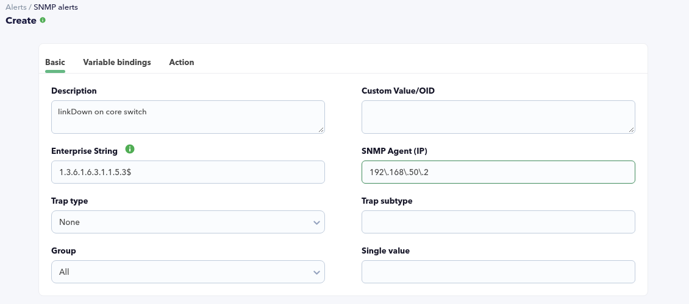{ .captura }

Les champs servent à trouver des correspondances avec les traps reçus. On peut
combiner ceux qu'on veut : plus on en renseigne, plus l'alerte est spécifique, et
**tous doivent être respectés** en même temps.

| Champ | Comment il correspond |
|---|---|
| **Description** | Libre. |
| **Valeur/OID personnalisée** (*Custom Value/OID*) | **Expression régulière** sur la chaîne complète des données du trap (l'OID, le type et la valeur de chaque variable). Comme elle est ancrée, il faut couvrir aussi le début : pour trouver le texte `Testing TRAP 225`, on utilise `.*Testing.*TRAP.*`. |
| **Chaîne Enterprise** (*Enterprise String*) | L'OID principal du trap. Par défaut, elle cherche la chaîne **comme sous-chaîne** (`1.21.34.2.3` trouve n'importe quel OID qui la contient ; les jokers sont inutiles). Pour une correspondance **exacte**, on termine par `$`. **Ce n'est pas une expression régulière.** |
| **Agent SNMP (IP)** | IP de l'émetteur du trap, comme expression régulière complète : pour un réseau entier, `192\.168\.1\..*`. |
| **Type de déroutement** (*Trap type*) | Cold start, Warm start, Link down, Link up, Authentication failure ou Other. Presque tous les traps sont *Other* ; sans précision, n'importe lequel convient. |
| **Sous-type de déroutements** | Expression régulière sur le sous-type, indépendante du type. |
| **Valeur unique** (*Single value*) | Expression régulière sur la valeur de l'OID **principal**, pas des secondaires. |
| **Groupe** | Le groupe de l'alerte. |

!!! info "Les expressions régulières sont ancrées"
    Dans les champs d'expression régulière, le motif doit correspondre à **tout**
    le champ (pas à un morceau) et ne distingue pas majuscules et minuscules.
    `Testing` ne trouve pas `Testing TRAP 225` ; `Testing.*` oui (et `.*TRAP.*`,
    aussi). Le champ de la chaîne Enterprise est l'exception : il cherche une
    sous-chaîne.

##### Onglet Liaisons variables

Un trap porte, en plus de l'OID principal, une liste de données : les **variables
liées** (*variable bindings*). Il y a ici jusqu'à **vingt** lignes d'**expressions
régulières**, une par variable, et chacune a un **ordre** (le numéro de la variable
à laquelle elle s'applique). Si elle est renseignée, cette variable doit
correspondre ; les lignes vides ne sont pas prises en compte.

Une expression de ces lignes **n'est pas ancrée** : elle trouve une sous-chaîne,
contrairement à celles des autres champs.

##### Onglet Action

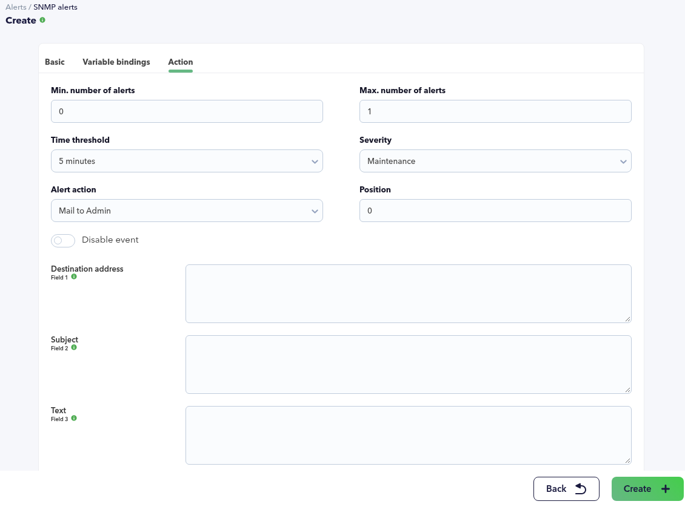{ .captura }

| Champ | Ce qu'il fait |
|---|---|
| **Nombre minimum d'alertes** | Combien de traps correspondants sont nécessaires avant la première action. Par défaut `0`. |
| **Nombre maximum d'alertes** | Combien d'actions sont lancées, au maximum, par intervalle. Par défaut `1`. |
| **Seuil de temps** | De 5 minutes à une semaine, ou une valeur propre en secondes. Par défaut 5 minutes. |
| **Sévérité** | La sévérité de l'événement généré. Elle n'a aucun rapport avec la priorité du trap lui-même. |
| **Action de l'alerte** | L'action qui est exécutée. |
| **Position** | L'ordre d'évaluation. Par défaut `0`. |
| **Désactiver l'événement** | Ne crée pas l'événement « SNMP alert fired ». |
| **Champ 1 … N** | Les champs que recevra l'action. Ici, cette alerte prévaut sur l'action. |

Les **actions supplémentaires** s'ajoutent depuis la liste avec **Ajouter une
action**. Toutes s'exécutent **à chaque déclenchement** : elles n'ont ni plage de
répétitions ni seuil propre. Autrement dit, **les alertes SNMP n'ont pas
d'escalade**.

#### Comment c'est évalué : la position

Chaque trap qui arrive est comparé à toutes les alertes SNMP, **triées par
position** (de la plus petite à la plus grande). Une alerte ne se déclenche que si
**tous** ses filtres correspondent.

La **position** joue le rôle de priorité entre les alertes, et sa règle n'a rien
d'évident : **quand une alerte se déclenche à une position, les autres alertes de
cette même position sont évaluées, mais on s'arrête en arrivant à une position
différente**. Autrement dit :

- Les alertes à la **même position** sont toutes évaluées.
- Quand l'une se déclenche, celles des **positions supérieures** ne sont plus
  évaluées pour ce trap.

On construit ainsi une cascade du type « le spécifique d'abord, le général
ensuite » : une alerte précise de `linkDown` d'un commutateur à la position `0`, et
une alerte générique de `linkDown` à la position `1` qui n'agit que si la
spécifique ne s'est pas déclenchée.

!!! info "Ce n'est ni la priorité du trap ni celle de l'événement"
    La position de l'alerte n'a rien à voir avec la sévérité du trap SNMP ni avec
    celle des événements de Pandora FMS.

#### Le seuil des alertes SNMP

Si le seuil de temps s'est déjà écoulé depuis le dernier déclenchement, les
compteurs sont remis à zéro. L'alerte se déclenche si elle compte au moins
*minimum* correspondances et moins de *maximum* déclenchements. En dessous du
minimum, le temps du seuil est rafraîchi à chaque correspondance (la fenêtre
« glisse ») ; au-dessus du maximum, les correspondances sont comptées et ignorées
en silence.

#### L'événement que génère une alerte SNMP

Après l'action, le serveur crée l'événement **« SNMP alert fired »**, avec la
sévérité de l'alerte. **Il ne le fait que si l'action n'est pas *Monitoring
Event*** et que l'alerte n'a pas **Désactiver l'événement**. Autrement dit : si
l'action crée déjà son propre événement, le générique est supprimé.

#### Macros des alertes SNMP

| Macro | Description |
|---|---|
| `_snmp_oid_` | OID du trap. |
| `_snmp_value_` | Valeur de l'OID du trap. |
| `_snmp_fN_` | Valeur de la variable liée numéro *N* (jusqu'à la 20e) : ce qui suit `= TYPE:`, sans les guillemets extérieurs. |
| `_safesnmp_fN_` | Idem, **échappée pour le shell**. À utiliser chaque fois que la valeur va dans une commande externe. |
| `_snmp_argc_`, `_snmp_argv_` | Nombre de variables et chaîne complète des variables. |
| `_trap_id_` | Identifiant du trap dans la base de données. |
| `_data_`, `_agent_`, `_address_`, `_timestamp_` | Le trap complet, le nom de l'agent, son IP et la date du trap. |

!!! danger "Utiliser `_safesnmp_fN_` avec les commandes"
    N'importe qui peut envoyer un trap. Si l'on met `_snmp_f2_` directement dans une
    ligne de commande, ce que l'émetteur écrira s'exécutera dans le shell du
    serveur. `_safesnmp_f2_` échappe les caractères dangereux. Dans les commandes
    externes, il ne faut jamais utiliser l'autre.

#### Cas pratique : `linkDown` d'un commutateur

1. **Chaîne Enterprise** : `1.3.6.1.6.3.1.1.5.3$` (correspondance exacte de
   `linkDown`).
2. **Agent SNMP (IP)** : celle du commutateur.
3. **Position** : `0`.
4. **Action** : **Mail to Admin**, avec dans l'objet `Interface _snmp_f2_ tombée sur
   _address_` (l'index de l'interface se trouve dans la deuxième variable liée).
5. Dans une seconde alerte, position `1`, le même OID sans IP : elle récupère les
   `linkDown` de tout autre équipement avec un avertissement générique.

#### Le gestionnaire externe de traps

La console SNMP traite chaque trap comme un fait isolé. Parfois, la seule
supervision possible d'un équipement est celle de ses traps, et la donnée qui
intéresse est répartie sur plusieurs d'entre eux ou numérique. Dans ces cas, on
peut **post-traiter le trap avec un script externe** :

1. Créer une [commande d'alerte](#commandes-dalerte) qui exécute le script, en lui
   passant les macros `_safesnmp_fN_` dont il a besoin.
2. Créer une action avec cette commande et l'associer à l'alerte SNMP.
3. Le script peut, par exemple, générer un XML de données pour un module de l'agent
   et alimenter des graphiques.

Les données générées par ce XML doivent être de type **asynchrone**.

!!! tip "Une autre technique : utiliser l'alerte pour activer un module"
    Une autre solution est que l'alerte SNMP écrive dans un fichier de log lu par un
    module d'un agent, de sorte que le module saute quand le trap voulu arrive et
    qu'on puisse corréler à partir de là.

#### Paramètres du serveur

La console SNMP du serveur se contrôle avec `snmpconsole`, `snmp_pdu_address`,
`snmp_ignore_authfailure`, `snmp_storm_protection`, `snmp_storm_timeout`,
`snmp_storm_silence_period` et `snmp_forward_trap`, entre autres ; la référence
complète se trouve dans la
[configuration du serveur](../parte-9/9.3-referencia-completa-de-configuracion-del-servidor.md).
Les alertes SNMP peuvent aussi se gérer par lots avec les
[opérations massives](../parte-2/2.11-operaciones-masivas.md#operations-sur-les-alertes-snmp).

### Alertes SIEM

Les **alertes SIEM** réagissent aux événements de sécurité que génère le serveur
SIEM. Elles sont évaluées au moment où le serveur génère chaque événement SIEM, et
reposent sur le **même système de filtres** que les vues SIEM : tout événement que
la vue afficherait avec ces filtres déclenche l'alerte. La partie sécurité du SIEM
(décodeurs, règles, vues) est expliquée dans le chapitre [SIEM](../parte-7/7.2-siem.md).

!!! warning "Prérequis"
    | Prérequis | Détail |
    |---|---|
    | SIEM activé | L'interrupteur *SIEM* de la configuration du SIEM. Sans lui, la page signale que les fonctions SIEM sont désactivées. |
    | Fonctions expérimentales | L'élément **Alertes SIEM** du menu n'apparaît qu'avec les fonctions expérimentales activées. |
    | Permissions | **LW**, **LM** ou **AD** pour la page ; **LM** pour créer des actions ; **LM** pour la vue d'opération. |

#### Gestion : Gestion → Alertes → Alertes SIEM

C'est ici qu'on les crée, modifie et supprime. L'assistant compte cinq étapes :

| Étape | Ce qui se configure |
|---|---|
| **Configurer** | **Nom de l'alerte** (unique), **groupe**, **description** et **sévérité**. |
| **Conditions** | **Télécharger depuis le modèle**, **liste de jours spéciaux**, **de** et **à** (minimum et maximum de déclenchements), **seuil**, **Désactiver l'événement** et l'horaire. |
| **Filtres** | Quels événements SIEM déclenchent l'alerte. Voir ci-dessous. |
| **Champs** | `Field1` … `Field10`, en mode basique ou avancé. |
| **Activation** | Les actions, avec leur plage de répétitions et leur seuil, comme pour celles d'événement. |

**Filtres disponibles :**

| Groupe | Filtres |
|---|---|
| **Recherche libre** | **Recherche libre** (description, alias de l'agent, décodeur et type), **Récursion de groupes** et **Groupe**. |
| **Correspondance** | **Groupe SIEM**, **Description de l'événement**, **Sévérité** (informatif, normal, avertissement, critique), **Niveau**, **ID de règle**, **Type**, **Mitre** et **Décodeur** (avec les champs propres à chaque décodeur). |
| **Exclusions** | **Agent**, **Agents exclus** et **Exclure des règles**. |

#### Comment c'est évalué

- Elles sont évaluées au traitement de chaque événement SIEM, pas par un
  minuteur.
- L'horaire s'applique **tous les jours** : dans les alertes SIEM, tous les jours de
  la semaine sont forcés. Les jours spéciaux sont bien pris en compte.
- Le minimum, le maximum et le seuil fonctionnent comme ailleurs, et les compteurs
  sont remis à zéro à l'expiration du seuil.
- Elles **n'ont pas de récupération** propre.

#### Macros spécifiques du SIEM

| Macro | Description |
|---|---|
| `_siem_event_level_` | Niveau de l'événement SIEM. |
| `_event_description_` | Description de l'événement. |
| `_event_text_severity_` | Sévérité de l'événement, en texte. |
| `_eventTimestamp_` | Horodatage de l'événement. |
| `_logSource_`, `_logTimestamp_` | Origine et horodatage du log source. |
| `_group_contact_` | Contact du groupe. |

#### Opération : Opération → SIEM → Alertes

Pour qui **surveille** (et ne configure pas) : elle liste les alertes SIEM avec des
filtres par nom et description, groupe, **état** (toutes, activées, désactivées) et
**déclenchées** (oui, non). Elle affiche le nom, la description, le groupe, les
correspondances, si elle s'est déclenchée, l'action et les opérations : activer,
désactiver et mettre en **veille**. Elle exige la permission **LM**.

### Alertes d'inventaire

Une **alerte d'inventaire** se déclenche quand les données d'inventaire d'un agent
respectent (ou ne respectent pas) une condition. Elle se gère dans **Gestion →
Alertes → Alertes d'inventaire** (permission **LM**) et son fonctionnement est
celui des autres : elle définit des conditions et une action.

| Champ | Ce que c'est |
|---|---|
| **Nom**, **Description** | Libres. |
| **ACL de groupe** (*Group acl*) | Le groupe de l'alerte. |
| **Modules d'inventaire** | Quels modules de l'inventaire sont surveillés. |
| **Condition** | *White list*, *Black list* ou **Correspondance**. |
| **Seuil de temps** | Comme pour les autres. |
| **Action** | Celle qui est exécutée. |
| **Groupes d'alertes** | À quels agents elle s'applique ; par défaut, tous. |
| **Désactiver l'événement** | Pas d'événement d'alerte déclenchée. |

Le serveur examine chaque ligne d'inventaire reçue, séparée par `;` :

- **Liste blanche / liste noire** : une expression régulière sur **une** colonne.
  Avec la liste blanche, on est prévenu de ce qui n'**est pas** dans la liste ;
  avec la noire, de ce qui y est.
- **Correspondance** : une expression régulière **par colonne**, et toutes doivent
  être respectées.

L'inventaire en tant que tel est expliqué dans le chapitre
[Inventaire](../parte-3/3.1-inventario.md).

## Clôture

### Bonnes pratiques et problèmes fréquents

#### Bien concevoir

- **Peu de modèles, bien pensés.** Une poignée de modèles génériques (« critique »,
  « avertissement », « valeur supérieure à X ») couvre presque tout.
- **Des actions réutilisables.** Une action par destinataire ou canal. Quand l'e-mail
  de l'administrateur change, on le change une seule fois.
- **Des seuils sensés.** Pour les avertissements par e-mail, un maximum de 1 et un
  seuil long ; si l'on veut un suivi, un maximum plus élevé et un seuil court, et
  on laisse l'[escalade](#escalade-des-alertes) faire le reste.
- **Récupération activée.** Un avertissement qui ne se clôt pas oblige à aller voir.
- **Sévérité de modèle cohérente.** Elle conditionne la [cascade](#protection-en-cascade)
  et la sévérité des événements.

#### « Mon alerte ne se déclenche pas »

Il convient de parcourir la liste dans cet ordre ; la cause se trouve presque
toujours dans les premiers points :

1. Le **module** arrive-t-il à l'état critique/avertissement ? L'alerte d'état
   critique exige que le module ait des **seuils définis**.
2. L'alerte est-elle **activée** et **pas en veille** ?
3. Sommes-nous dans l'**horaire** et le **jour** du modèle ? Aujourd'hui est-il un
   [jour spécial](#jours-speciaux) avec le modèle désactivé ce jour-là ?
4. A-t-on atteint le **maximum** dans le seuil de temps ? Voir
   [Quand une alerte se déclenche](#quand-une-alerte-se-declenche-compteurs-seuil-et-flip-flop).
5. Le **minimum** de répétitions est-il supérieur à 0, avec la remise à zéro du
   compteur cochée, sur un module qui va et vient ?
6. Une [protection en cascade](#protection-en-cascade) est-elle active à cause d'un
   parent dont une alerte critique est déclenchée ?
7. L'**action** a-t-elle un seuil qui la fait taire ? Et celle de l'alerte ?
8. Y a-t-il un **arrêt planifié** ou l'agent est-il en mode silencieux ?
9. S'il s'agit d'une alerte d'événement ou de log : l'Event Server ou le Log Server
   sont-ils actifs, et l'événement ou le log tombe-t-il dans la fenêtre ?
10. La **commande fonctionne-t-elle** à la main ? Si elle échoue, on l'exécute dans
    un terminal avec les mêmes valeurs.

Et si c'est la **notification** qui n'arrive pas : il faut vérifier la configuration
de courriel de la console (ou `mta_*` si l'on utilise la locale), que l'action a un destinataire et la configuration des
*tokens* du service de messagerie instantanée.

#### « J'en reçois trop »

- Augmenter le **minimum** et cocher la **remise à zéro du compteur** pour ignorer
  les pics.
- Baisser le **maximum** et allonger le **seuil de temps**.
- Ajouter un **seuil** à l'action pour qu'elle ne se répète pas même si l'alerte le
  fait.
- Utiliser la [protection en cascade](#protection-en-cascade) dans les réseaux à
  point de défaillance unique.
- Mettre les alertes en **veille** pendant qu'on les ajuste, pour voir ce qui
  *aurait* sauté.

### Command Center : alertes

Dans un Command Center, les alertes de module, de log et SIEM se gèrent sur chaque
nœud, et les **alertes d'événement ne sont pas centralisées** : les règles
configurées dans le Command Center ne se déclenchent qu'avec les événements du
Command Center lui-même. Le traitement des alertes dans un environnement avec
Command Center a sa propre section dans le chapitre
[Command Center](../parte-6/6.3-command-center.md).
