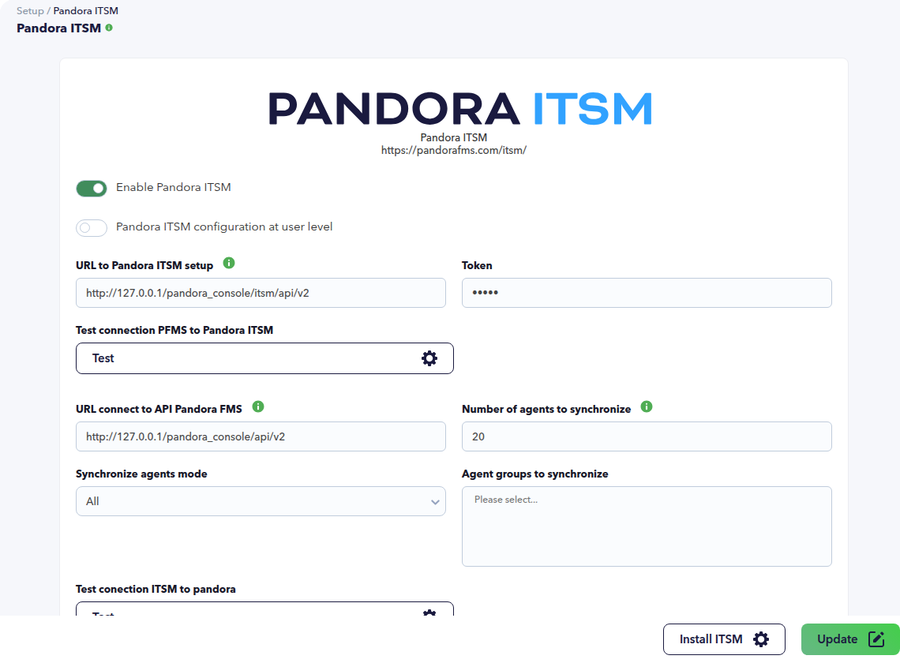
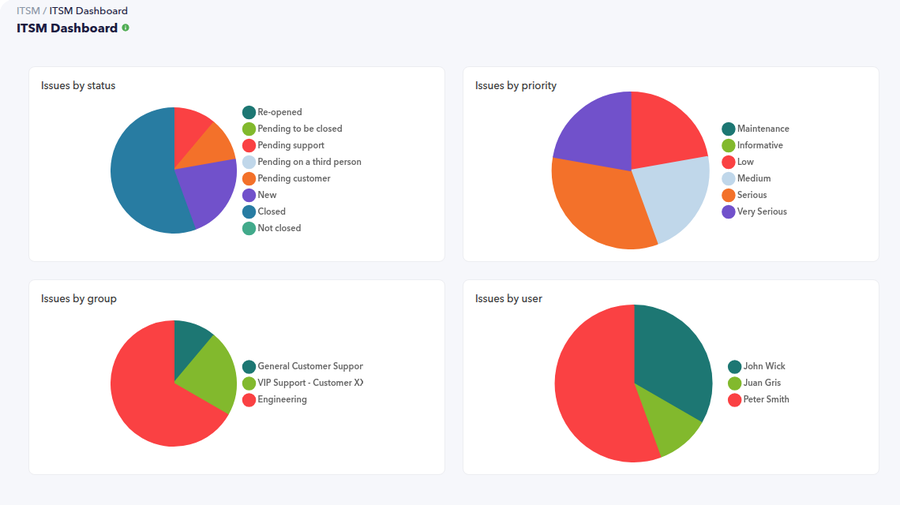
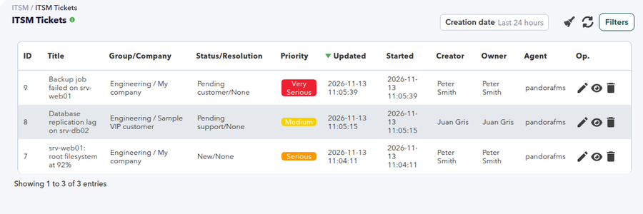
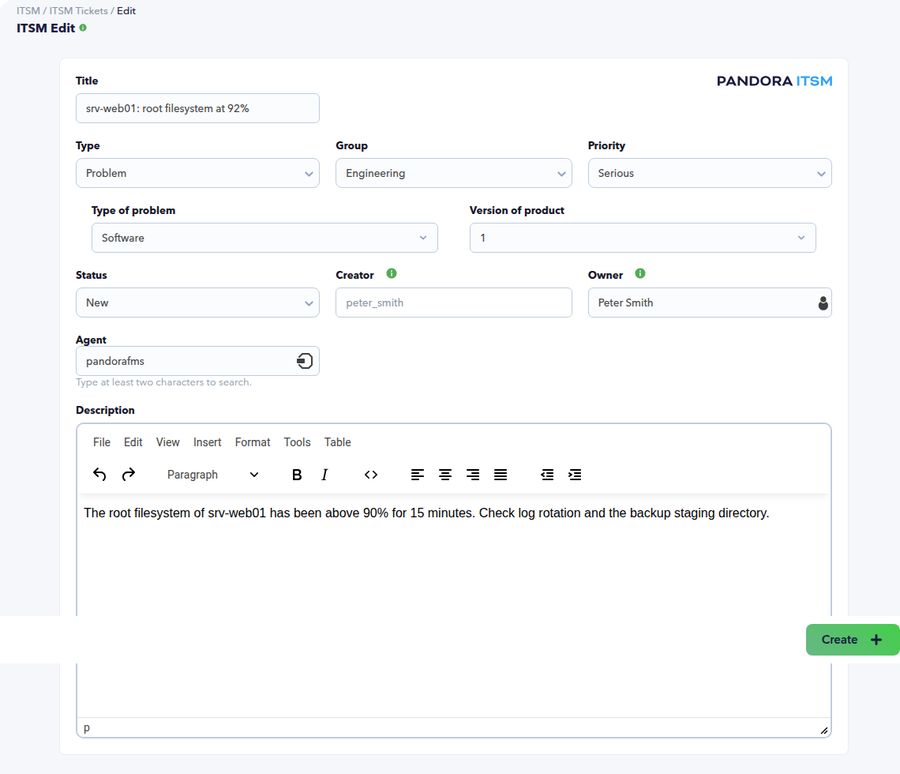
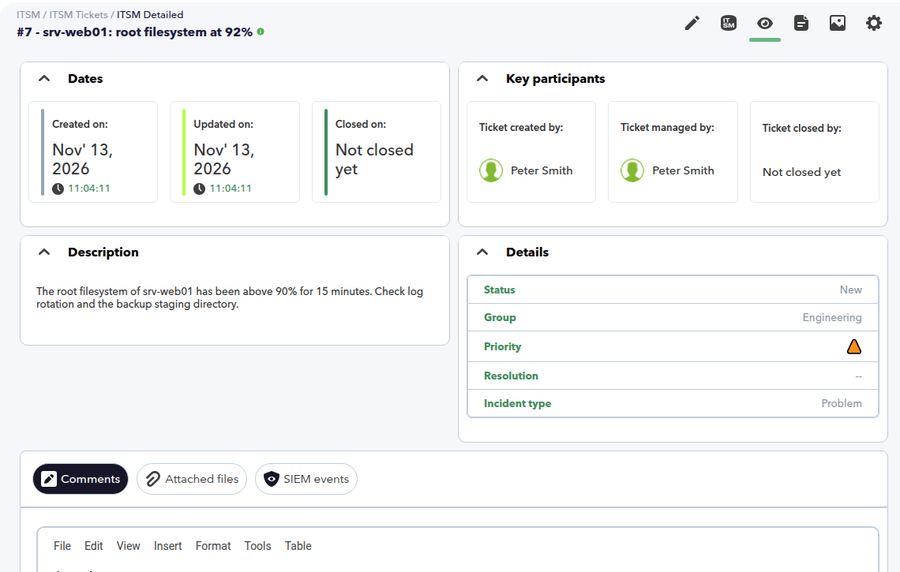
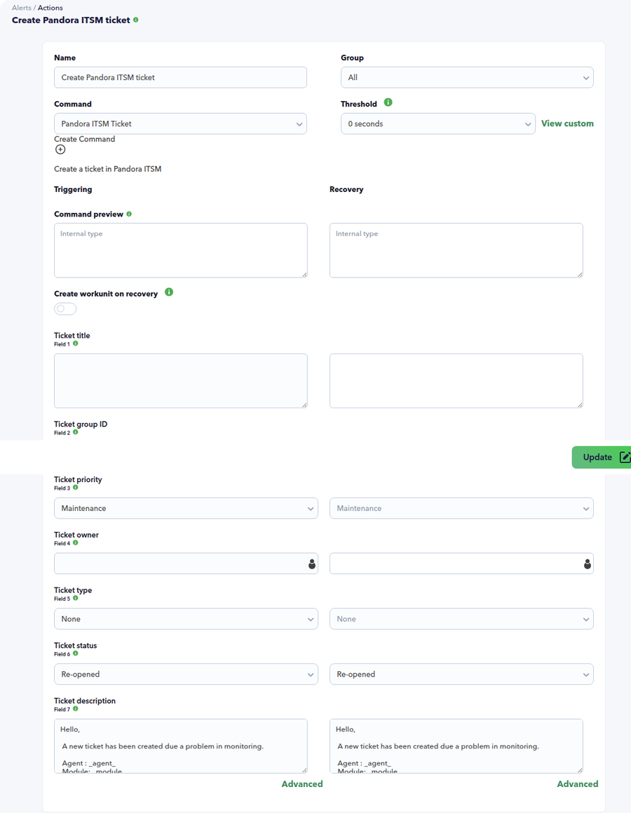
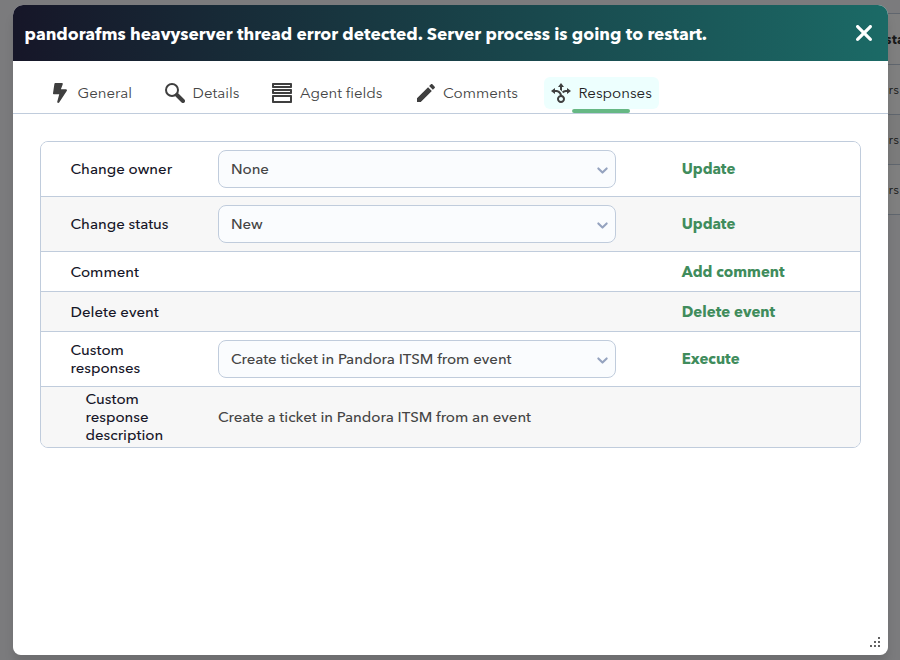
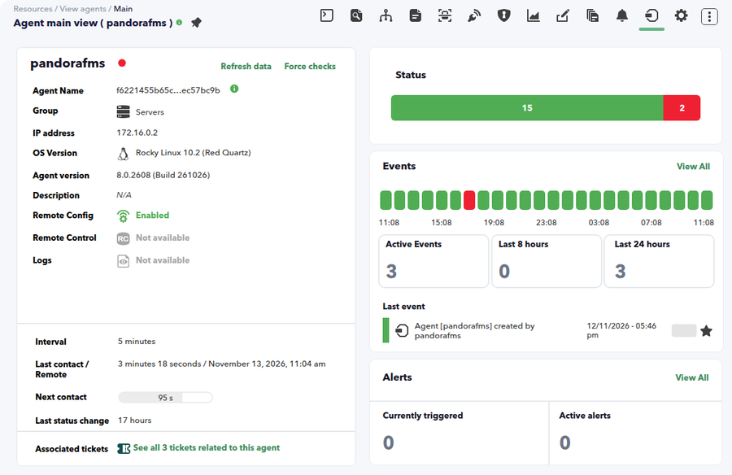

# Gestion des incidents / ITSM

Un système de supervision qui détecte le problème et le garde pour lui est un
gardien très compétent et très peu utile. La supervision collecte des données ;
la **gestion des incidents** les transforme en un ticket avec un propriétaire, un
statut et un historique, afin que quelqu'un puisse le clore et qu'il reste une
trace de qui l'a fait. C'est ce qu'apporte l'intégration avec **Pandora ITSM** :
la supervision cesse d'être un tableau que l'on regarde et alimente une vraie
file de travail.

Pandora ITSM est un produit distinct, avec sa propre licence (voir
[Licences](../parte-1/1.5-licenciamiento.md)). Ce chapitre documente
l'intégration **depuis Pandora FMS** : l'onglet de configuration, le menu
**Opération → ITSM**, la création et la modification de tickets, et les points où
la supervision les génère seule. L'exploitation interne de Pandora ITSM (SLA,
flux de travail, équipes de support, base de connaissances, CRM, projets et
courrier entrant) reste dans son manuel. Ici, on explique ce qu'il faut faire
dans Pandora FMS pour que cette mécanique reçoive du travail.

Il y a deux consoles, et il vaut la peine de savoir laquelle fait foi :

- **Pandora FMS** supervise, détecte et décide quand il y a un problème. Ce n'est
  pas lui qui possède le ticket.
- **Pandora ITSM** stocke le ticket, son statut, son propriétaire, ses unités de
  travail et son historique. C'est la source de vérité du ticket.
- La console Pandora FMS affiche un résumé et permet d'agir sur Pandora ITSM via
  son **API v2**. Si l'API ne répond pas, la section ITSM reste à regarder le
  plafond.

L'intégration dispose de trois canaux d'entrée :

1. **Création manuelle** depuis la liste des tickets.
2. **Tickets automatiques** depuis les alertes, les réponses à des événements et
   les événements SIEM.
3. **Synchronisation des agents** en tant qu'objets d'inventaire de Pandora ITSM.

Ce n'est pas un helpdesk complet et cela ne prétend pas l'être. Si vous avez
besoin de files d'attente, d'équipes, de rotations, de SLA ou d'une base de
connaissances, cela vit dans Pandora ITSM. Ici, on construit l'entrée depuis la
supervision.

## Mise en service

### Prérequis et licence

La licence de Pandora ITSM est distincte de la licence de supervision.
L'installation conjointe décrite ci-dessous est une instance **de test** ; pour
la production, déployez Pandora ITSM séparément, avec sa propre base de données et
son propre utilisateur. Les prérequis de Pandora ITSM sont ceux de son manuel :

| Prérequis | Détail |
|---|---|
| Disque | 10 Go minimum, 20 Go recommandés |
| Processeur | 2,4 GHz, double cœur |
| RAM | 1 Go minimum, 4 Go recommandés |
| Système de base | EL 8 (RHEL 8, Rocky Linux 8, AlmaLinux 8) ou Ubuntu Server 22.04 |
| Base de données | MySQL 8 ou ultérieur |
| PHP | 8.2 ou ultérieur |
| Navigateur | Chrome, Edge, Firefox ou Safari avec HTML5 ; résolution minimale 1280 × 720 |
| Réseau | Pandora FMS doit joindre l'API de Pandora ITSM ; Pandora ITSM doit joindre l'API publique de Pandora FMS |
| Versions | Maintenez les deux applications à jour : l'intégration utilise l'API v2 et les écarts de version se paient par des erreurs difficiles à diagnostiquer |

L'installation conjointe s'exécute sur le serveur Pandora FMS et ajoute ses
propres prérequis : accès à internet pour télécharger le paquet, droits d'écriture
dans le répertoire de la console et droits de l'utilisateur de base de données
pour créer ou utiliser la base `itsm`.

### Installation conjointe depuis la console

Depuis la version 783, la console Pandora FMS peut installer une instance de
Pandora ITSM **à des fins de test**. Le chemin est
**Réglages → Configuration du système → Pandora ITSM** et le bouton
**Install ITSM**. Ce n'est pas la voie recommandée pour la production, mais cela
sert à tester l'intégration sans monter d'abord un serveur séparé.

Avant d'installer, l'assistant vérifie trois choses :

- Que la base `itsm` peut être créée ou réutilisée.
- Que l'utilisateur de base de données de Pandora FMS dispose de droits
  suffisants.
- Que le répertoire `itsm/` de la console peut être créé ou écrasé.

L'accès à internet n'est pas vérifié à cette étape : c'est un prérequis, car
l'étape 2 télécharge le paquet depuis `packages.pandorafms.com`.

Si le répertoire existe déjà, l'avertissement est explicite : **il sera supprimé
et recréé**. Ce n'est pas une installation à faire à la légère sur un serveur qui
fait déjà tourner une instance de Pandora ITSM.

Le processus s'affiche sous la forme d'une barre de progression en neuf étapes :

| Étape | Ce qu'elle fait |
|---|---|
| 1 | Vérifie et prépare le répertoire `itsm/` |
| 2 | Télécharge le paquet Pandora ITSM |
| 3 | Extrait le paquet et range les fichiers |
| 4 | Crée la base `itsm` ou réutilise celle qui existe |
| 5 | Se connecte à la base avec les identifiants de Pandora FMS |
| 6 | Importe le schéma (`integria_db.sql`) et les données initiales (`integria_dbdata.sql`), uniquement si la base n'existait pas |
| 7 | Génère `itsm/include/config.php` et désactive `install.php` |
| 8 | Crée le jeton d'intégration et configure dans Pandora ITSM l'authentification auprès de Pandora FMS |
| 9 | Affiche le lien vers la console Pandora ITSM |

L'étape 6 ne s'exécute que si l'étape 4 a dû créer la base. Si `itsm` existait
déjà, rien n'est importé et le contenu actuel est conservé.

Si la base n'existe pas et que l'utilisateur de Pandora FMS ne peut pas la créer,
l'étape 4 échoue. Dans ce cas, l'administrateur de la base doit accorder les
droits avant de réessayer. Un exemple, avec l'utilisateur `pandora` :

```sql
GRANT ALL PRIVILEGES ON `itsm`.* TO 'pandora'@'localhost';
```

À la fin, l'assistant laisse la connexion pointée vers `127.0.0.1` et active
`ITSM_enabled`. Si Pandora ITSM est publié sous un autre nom, derrière un proxy
ou sur un autre port, ajustez l'URL de connexion dans le même onglet. Le premier
accès à la console Pandora ITSM se fait avec l'utilisateur `admin` et le mot de
passe `integria` ; changez-le avant de laisser le système entre les mains de qui
que ce soit.

!!! warning "L'installation conjointe n'est pas une installation de production"
    L'installation conjointe partage le serveur et les identifiants de base de
    données de Pandora FMS, et elle est prévue pour les tests. Pour la production,
    installez Pandora ITSM séparément et connectez-le à Pandora FMS avec l'URL et
    le jeton qui conviennent. Ainsi, vous pouvez mettre à jour, sauvegarder et
    dimensionner chaque produit de son côté.

### Connexion bidirectionnelle

L'intégration a besoin de deux directions, et les deux se configurent dans
l'onglet **Pandora ITSM** :

- **Pandora FMS → Pandora ITSM** : la console a besoin de l'URL de l'API de
  Pandora ITSM et d'un jeton. L'URL a la forme `http://host/XXX/api/v2` ; le jeton
  est l'identifiant de l'API. Le bouton **Test** vérifie le `ping` de l'API avec
  cette URL et ce jeton.
- **Pandora ITSM → Pandora FMS** : Pandora ITSM a besoin de l'URL publique de
  l'API de Pandora FMS pour lire l'inventaire des agents. Par défaut, il prend la
  **Public URL** de la console ou, si elle n'est pas définie, celle de
  `config.php`. Le bouton **Test** vérifie cette adresse depuis Pandora ITSM.

{ .captura }

Le mode par défaut est **global** : tous les utilisateurs partagent le jeton de
l'onglet. Si vous activez **Pandora ITSM configuration at user level**, le jeton
global est masqué et chaque utilisateur doit mettre le sien dans son profil.
C'est la différence entre « l'intégration parle avec un utilisateur de service »
et « chaque personne parle avec son propre utilisateur Pandora ITSM ».

!!! tip "L'URL publique n'est pas un ornement"
    L'adresse que vous saisissez dans **URL connect to API Pandora FMS** est
    utilisée par Pandora ITSM depuis son serveur, pas par votre navigateur. Si
    Pandora FMS est derrière un proxy, un VPN ou un pare-feu, l'URL doit être
    joignable depuis le serveur Pandora ITSM. Il ne sert à rien que votre
    navigateur y arrive si le serveur d'à côté n'y arrive pas.

### Configuration au niveau de l'utilisateur

Avec la configuration au niveau de l'utilisateur active, chaque personne a besoin
de son propre jeton Pandora ITSM dans son profil utilisateur
(`integria_user_level_pass`). La console le stocke comme un identifiant et ne
l'affiche pas en clair. Si le champ est vide, les appels à l'API se font sans
utilisateur valide et la liste des tickets peut apparaître vide ou renvoyer une
erreur d'autorisation.

Ce mode a deux usages clairs :

- **Traçabilité** : chaque opération dans Pandora ITSM est associée à la personne
  qui l'a effectuée, pas à un utilisateur de service partagé.
- **Visibilité** : chaque utilisateur voit les tickets que son utilisateur
  Pandora ITSM peut voir. La permission **RR** de Pandora FMS ouvre la section ;
  le jeton décide de ce qu'il y a à l'intérieur.

Le jeton est un identifiant. Ne le partagez pas dans une messagerie, ne le collez
pas dans un ticket et ne le stockez pas dans le dépôt.

### Modèles de ticket : alertes et réponses à des événements

L'onglet de configuration contient deux blocs de valeurs par défaut faciles à
confondre :

| Bloc | Quand il est utilisé | Champs |
|---|---|---|
| **Alert settings** (`incident_*`) | Tickets créés par l'action d'alerte **Create Pandora ITSM ticket** | Titre, corps, groupe, propriétaire, statut, priorité et type |
| **Custom response settings** (`cr_*`) | Formulaire de création ouvert par la réponse à événement **Create ticket in Pandora ITSM from event** | Titre, corps, groupe, propriétaire, statut, priorité et type |

Ce ne sont pas « le modèle de la console » et « le modèle de l'agent ». Ce sont
deux chemins différents : l'alerte qui s'exécute sur le serveur et la réponse
qu'un utilisateur exécute depuis la console d'événements. La création manuelle
n'utilise ni l'un ni l'autre : elle démarre avec la priorité `LOW`, le statut
`NEW` et des champs vides.

Les valeurs de l'action d'alerte peuvent écraser celles de **Alert settings**. Si
vous voulez un comportement uniforme, laissez les champs de l'action vides et
configurez le modèle une seule fois ; si vous avez besoin de tickets différents
par alerte, remplissez les champs de l'action.

### Synchronisation des agents avec l'inventaire

La synchronisation transforme les agents Pandora FMS en objets d'inventaire de
Pandora ITSM. Les contrôles se trouvent dans le même onglet :

| Contrôle | Ce qu'il fait | Valeur par défaut |
|---|---|---|
| **Number of agents to synchronize** | Combien d'agents sont traités en parallèle | 20 (minimum 10, maximum 1 000) |
| **Synchronize agents mode** | `All`, `Enable` ou `Disable` ; les groupes ne s'appliquent que s'il y a un filtre | `All` |
| **Agent groups to synchronize** | Groupes synchronisés lorsque le mode est par groupe | Vide (tous) |
| **URL connect to API Pandora FMS** | URL publique que Pandora ITSM utilise pour lire les agents | **Public URL** ou `config.php` |
| **Test** (ITSM → Pandora) | Vérifie la connexion de Pandora ITSM vers Pandora FMS | Action |
| Barre de progression | Progression des agents traités ou erreur du nœud | Lecture seule |

À l'enregistrement, la console déclare le nœud dans Pandora ITSM
(`/pandorafms/nodes`) avec l'authentification du serveur, le mot de passe de
l'API, le nombre d'agents, les groupes, le mode, l'URL publique, le libellé du
serveur et l'identifiant du nœud. Pandora ITSM reprend ces données et
synchronise les agents de son côté. La console interroge l'état
(`/pandorafms/node/{serverAuth}`) et affiche la progression (agents traités sur le
total) ou, s'il y en a une, l'erreur du nœud. Elle n'affiche ni le temps depuis le
début ni la prochaine exécution, et ne permet pas de supprimer ni de redémarrer le
nœud : ces opérations se font depuis Pandora ITSM.

Dans Pandora ITSM, l'onglet **Pandora FMS Inventory** (dans
**Setup → Setup**) affiche les nœuds connectés, le chemin de connexion, la
progression, le temps depuis le début, la prochaine exécution et l'état, avec des
opérations de suppression et de redémarrage. Si le nœud n'apparaît pas, la
synchronisation n'a pas commencé ou la connexion de Pandora ITSM vers Pandora FMS
ne fonctionne pas.

!!! info "Deux inventaires qui ne sont pas la même chose"
    La synchronisation depuis la console déclare le nœud et fait lire les agents
    par Pandora ITSM via l'API. L'**inventaire distant par EndPoints** est autre
    chose : chaque EndPoint envoie un fichier XML au serveur Pandora ITSM et
    celui-ci crée les objets d'inventaire. Ce second mécanisme, avec les types
    d'objet et les champs du modèle CMDB, est documenté dans
    [Intégration des actifs avec ITSM](../parte-3/3.9-integracion-de-activos-con-itsm.md).

## La section Opération → ITSM

Le menu **Opération → ITSM** n'apparaît que si l'intégration est activée. Il
contient deux entrées :

- **Liste des billets** (*Tickets list*) : la liste des tickets.
- **Dashboard** : les statistiques.

La page de la liste s'intitule **Tickets ITSM**, la page d'édition **Modifier
ITSM** et la page de détail **ITSM détaillé**.

### Dashboard

Le **Dashboard** est la page par défaut à l'entrée dans **ITSM**. Il affiche
quatre graphiques circulaires :

- Incidents par statut.
- Incidents par priorité.
- Incidents par groupe.
- Incidents par utilisateur.

{ .captura }

Il n'a ni filtres ni plage de dates : il montre ce que le jeton Pandora ITSM peut
voir. S'il n'y a pas de tickets, la page l'indique avec **Not found incidences**.
Pour les autres tableaux de bord de la console, voir
[Dashboards](5.1-dashboards.md).

### Liste des tickets

La liste est le centre de travail. Le tableau affiche les colonnes suivantes :

| Colonne | Ce qu'elle contient |
|---|---|
| **ID** | Identifiant du ticket dans Pandora ITSM |
| **Titre** | Titre ; renvoie au détail |
| **Groupe/Société** | Groupe du ticket et société du créateur |
| **État/Résolution** | Statut et résolution |
| **Priorité** | Priorité, avec couleur |
| **Mis à jour** | Dernière mise à jour |
| **Démarré** | Date de création |
| **Créateur** | Utilisateur créateur |
| **Propriétaire** | Propriétaire |
| **Agent** | Agent Pandora FMS associé, s'il existe |
| **Op.** | Modifier, voir le détail et supprimer |

{ .captura }

Par défaut, la liste est triée par **Mis à jour** (*Updated*) décroissant et
paginée avec la taille de bloc de la console. Vous pouvez trier le tableau par
les colonnes qui ont un sens ; les colonnes groupe/statut et les actions ne sont
pas triables.

Le bouton **Créer** (*Create*) ouvre le formulaire de création. Les actions de
ligne sont le crayon (modifier), l'œil (détail) et la corbeille (supprimer avec
confirmation). Il n'y a pas de sous-menu « Edit » : la modification se fait
depuis la ligne.

Les filtres sont :

| Filtre | Ce qu'il recherche |
|---|---|
| **Recherche libre** (*Free search*) | Texte libre dans l'identifiant, le titre et la description |
| **Agent** | Tickets associés à un agent Pandora FMS |
| **État** (*Status*) | Statut Pandora ITSM, plus le pseudo-statut **Not closed** |
| **Priorités** (*Priorities*) | Priorité du ticket |
| **Groupe** (*Group*) | Groupe Pandora ITSM ; le groupe 1 n'apparaît pas dans le sélecteur |
| **Date de création** (*Creation date*) | Ancienneté de création |

Trois détails valent la peine d'être connus avant de faire confiance au filtre :

- **La liste démarre avec le préréglage « Last 24 hours ».** Si vous n'avez pas
  choisi de dates, le filtre **Date de création** applique les dernières 24 heures ;
  les tickets plus anciens n'apparaissent pas tant que vous n'élargissez pas la
  plage. Ils n'ont pas disparu : ils sont hors du filtre.
- **Le statut « Not closed » est un ajout de la console**, pas un statut de
  l'API. Il sert à demander les tickets qui ne sont pas clos.
- **Le filtre de date n'envoie que la borne inférieure.** La console convertit la
  plage en ancienneté en jours (`fromDate`) et n'envoie pas la borne supérieure.
  Si vous choisissez « depuis le 1er mai », elle cherche depuis cette date ; le
  « jusqu'au » ne voyage pas jusqu'à l'API.

La liste n'a pas de sélecteur de recherches personnalisées de Pandora ITSM. Ce
sélecteur existe dans le widget de tableau de bord, qui peut appliquer une
recherche enregistrée.

La permission **RR** ouvre la section. Ce que vous voyez à l'intérieur dépend du
jeton : avec le jeton global, tous les utilisateurs voient ce que voit cet
utilisateur de service ; avec la configuration par utilisateur, chacun voit ce que
son jeton Pandora ITSM autorise.

### Créer et modifier un ticket

Le bouton **Créer** (*Create*) de la liste ouvre le formulaire de création. Le
crayon d'une ligne ouvre le même formulaire avec les données du ticket. Les
champs sont :

| Champ | Ce qu'il est | Remarques |
|---|---|---|
| **Titre** | Titre du ticket | Obligatoire |
| **Type** | Type d'incident Pandora ITSM | Son changement charge ses champs personnalisés |
| **Groupe** | Groupe Pandora ITSM | Liste obtenue depuis l'API |
| **Priorité** | Priorité | Liste obtenue depuis l'API |
| **État** | Statut | Liste obtenue depuis l'API |
| **Créateur** | Créateur du ticket | Lecture seule et toujours vide ; le créateur est déterminé par l'utilisateur Pandora ITSM du jeton |
| **Propriétaire** | Propriétaire | Autocomplétion des utilisateurs Pandora ITSM |
| **Agent** | Agent Pandora FMS | Autocomplétion ; enregistre l'inventaire et associe le ticket |
| **Résolution** | Résolution | Affiché uniquement lorsque le statut est `CLOSED` |
| **Description** | Description | Éditeur de texte enrichi |
| **Champs personnalisés** | Champs du type de ticket | COMBO, TEXT, CHECKBOX, DATE, NUMERIC ou TEXTAREA ; ils peuvent être obligatoires |

{ .captura }

Le champ **Créateur** (*Creator*) n'est ni une liste déroulante ni un champ
éditable : il est en lecture seule et s'affiche toujours vide, y compris lors de la
modification d'un ticket. L'aide le relie à l'utilisateur Pandora ITSM configuré ;
le créateur réel est déterminé par l'utilisateur associé au jeton (le jeton global
ou celui de l'utilisateur, selon la configuration) et apparaît dans **Key
participants** du détail. **Propriétaire** (*Owner*) est bien une autocomplétion
d'utilisateurs Pandora ITSM. Si le type de ticket a des champs personnalisés, ils
apparaissent en dessous lorsque vous sélectionnez le type ; les champs obligatoires
sont validés avant l'enregistrement.

Lorsque vous enregistrez un ticket avec un **Agent** sélectionné, la console
envoie l'inventaire de l'agent à Pandora ITSM (`/pandorafms/agents`) et associe
le ticket à l'objet d'inventaire
(`/incidence/{id}/inventory/{idInventory}`). Si cette association échoue, le
ticket peut avoir été créé quand même et la console affiche l'erreur. Si l'agent
n'existe pas comme objet d'inventaire, Pandora ITSM le crée ou le met à jour
selon le cas.

La création manuelle démarre avec la priorité `LOW`, le statut `NEW`, sans groupe,
sans type et sans propriétaire. Le créateur ne se choisit pas dans le formulaire :
il est déterminé par l'utilisateur Pandora ITSM du jeton. **Elle n'hérite pas des
modèles d'alerte ni de réponse à événement.** Si vous voulez des valeurs par
défaut, remplissez-les à la main ou créez le ticket depuis une alerte ou une
réponse.

Les pièces jointes et les commentaires ne sont pas dans ce formulaire. Ils se
gèrent dans le détail, après la création du ticket.

### Détail du ticket

Le détail s'ouvre avec l'œil de la ligne ou avec le titre. L'en-tête affiche
`#ID - Titre` et le corps s'organise en blocs :

- **Dates** : création, mise à jour et clôture (ou **Not closed yet**).
- **Participants clés** : créateur, propriétaire et utilisateur qui l'a clos.
- **Description** : la description du ticket.
- **Détails** : statut, groupe, priorité, résolution et type.
- **Commentaires** : les unités de travail du ticket ; on peut en ajouter, mais
  pas les modifier ni les supprimer depuis ici.
- **Fichiers joints** (*Attached files*) : envoi avec description,
  téléchargement et suppression.
- **Événements SIEM** (*SIEM events*) : événements SIEM liés au ticket par
  `id_incidence`.

{ .captura }

Le détail **n'affiche pas l'inventaire associé**. Si vous avez besoin de voir
l'objet d'inventaire, consultez-le dans Pandora ITSM ; le modèle d'actifs est
documenté dans
[Intégration des actifs avec ITSM](../parte-3/3.9-integracion-de-activos-con-itsm.md).
L'onglet **Événements SIEM** (*SIEM events*) est expliqué dans
[SIEM](../parte-7/7.2-siem.md).

## Tickets automatiques

### Tickets depuis les alertes

Les alertes sont la voie la plus courante pour créer des tickets sans
intervention. La commande interne **Pandora ITSM Ticket** est fournie d'usine et
ne peut pas être supprimée ni modifiée : c'est un objet système. L'action
**Create Pandora ITSM ticket** est également fournie d'usine, mais elle peut être
copiée et ajustée ; il est d'ailleurs recommandé de la copier pour ne pas toucher
à l'originale.

L'action utilise sept champs et treize champs personnalisés :

| Champ | Contenu |
|---|---|
| 1 | Titre du ticket |
| 2 | Groupe (ID) |
| 3 | Priorité |
| 4 | Propriétaire (`_ITSM_users_`) |
| 5 | Type (`_ITSM_types_`) |
| 6 | Statut (`_ITSM_status_`) |
| 7 | Description |
| 8–20 | Champs personnalisés du type de ticket |

{ .captura }

Les valeurs non renseignées sont prises dans **Alert settings**. Les champs de
l'action peuvent les écraser. La commande accepte les macros d'alerte de
[Alertes et notifications](5.5-alertas-y-notificaciones.md) ; la description et
le titre sont généralement les endroits où elles servent le plus.

L'option **Create workunit on recovery** modifie le comportement de la
récupération : si le statut de clôture est appliqué lors de la récupération de
l'alerte, une unité de travail est ajoutée au lieu de clore le ticket. C'est utile
lorsque le ticket a besoin d'une confirmation humaine avant d'être clos ; si
votre flux attend une clôture automatique, laissez-la désactivée.

Lorsque l'alerte s'exécute, le serveur envoie à Pandora ITSM le ticket, les champs
personnalisés de l'agent et de l'inventaire, l'agent, le module, le nœud, le mode
d'alerte et l'option d'unité de travail. Pandora ITSM décide :

- Si l'agent existe comme objet d'inventaire, il le met à jour ; sinon, il le
  crée.
- S'il existe un ticket ouvert, il le met à jour et ajoute une unité de travail ;
  sinon, il en crée un nouveau.
- Si le ticket est verrouillé dans Pandora ITSM, il ne le met pas à jour : il en
  crée un nouveau.
- Lors de la récupération, il met à jour le statut et, si l'option est activée,
  ajoute l'unité de travail.

L'action est disponible dans les alertes de module, d'événement, de log, de trap
SNMP et de SIEM. La mécanique complète des commandes, actions, modèles et macros
est dans [Alertes et notifications](5.5-alertas-y-notificaciones.md).

### Tickets depuis les réponses à des événements

La réponse **Create ticket in Pandora ITSM from event** apparaît dans le détail
d'un événement lorsque l'intégration est active. C'est une réponse de type URL :
elle ouvre une nouvelle fenêtre avec le formulaire de création de ticket et
applique les valeurs de **Custom response settings**.

Le flux est le suivant :

1. Ouvrez le détail de l'événement.
2. Sélectionnez la réponse **Create ticket in Pandora ITSM from event**.
3. Cliquez sur **Exécuter** (*Execute*).
4. Le formulaire de création s'ouvre dans une nouvelle fenêtre, avec les valeurs
   par défaut de **Custom response settings**.
5. Complétez l'agent, le titre et ce qui manque, puis cliquez sur **Créer** (*Create*).

{ .captura }

Un avertissement qui évite une discussion : **le formulaire n'hérite pas du texte
de l'événement**. Le `from_event` de l'URL sert seulement à indiquer à la console
qu'elle doit appliquer les valeurs de la réponse personnalisée ; il ne remplit ni
l'agent, ni le titre, ni la description avec les données de l'événement. Si vous
voulez que le ticket raconte ce qui s'est passé, copiez-le à la main ou utilisez
une alerte, qui reçoit bien les macros du module et de l'agent.

Pour exécuter la réponse, il faut **EW** ; pour ouvrir le formulaire ITSM, **RR**.
Le sélecteur de réponses personnalisées s'affiche aussi avec **EM**, mais
l'exécution exige **EW** : avec **EM** seul, la réponse apparaît dans la liste mais
ne peut pas être exécutée. La mécanique des réponses et de leurs macros est dans
[Console d'événements centralisée](5.4-consola-de-eventos-centralizada.md).

### Tickets depuis le SIEM

Dans le détail d'un événement SIEM, l'action **Create a ticket in Pandora ITSM**
crée un ticket et enregistre son identifiant dans le champ `id_incidence` de
l'événement. Le ticket apparaît lié dans l'onglet **Événements SIEM**
(*SIEM events*) du détail et la liste des tickets de l'événement est alimentée par
`getListTicketsSiem`.

La création depuis le SIEM ne suit pas le même chemin que la création manuelle :
elle crée le ticket et enregistre son identifiant dans l'événement, mais
n'enregistre pas l'inventaire de l'agent et n'associe pas le ticket à son objet
d'inventaire, même si l'événement a un agent. Si vous avez besoin de cette
association, utilisez la création manuelle ou une alerte. Le SIEM comme système,
ses règles et ses événements sont documentés dans [SIEM](../parte-7/7.2-siem.md).

## Tickets dans la vue de l'agent

La fiche de l'agent a deux points d'entrée :

- **Tickets associés** (*Associated tickets*), dans la vue générale : compte les
  tickets **non verrouillés** et renvoie à la liste filtrée par cet agent (« See
  all N tickets related to this agent »).
- **Incidents**, un onglet qui n'apparaît que si l'agent a au moins un ticket. Il
  les affiche tous, verrouillés ou non, avec des filtres de statut (par défaut
  `NEW`), de priorité, de groupe et de date de création.

{ .captura }

L'onglet exige la permission **AW**. La vue générale peut afficher le bloc avec
des permissions de lecture de l'agent, mais c'est l'onglet qui permet la gestion.

Le lien entre l'agent et le ticket est stocké dans l'`externalId` du ticket :
`nœud-agent-module` lorsqu'il est créé par une alerte et `nœud-agent` lorsqu'il
est créé ou modifié à la main. Le filtre par agent recherche cet identifiant,
ainsi un ticket créé par alerte et un ticket créé à la main apparaissent ensemble
dans la fiche de l'agent. Les détails de la fiche de l'agent sont dans
[Configuration commune des agents](../parte-2/2.21-configuracion-comun-de-los-agentes.md).

## Widget de tickets dans les tableaux de bord

Le widget **Pandora ITSM tickets** (`ITSMIncidences`) apporte la liste des tickets
à un tableau de bord. Il se configure avec :

- **Limite** (*Limit*) : nombre de tickets, de 0 à 100.
- **Recherche personnalisée** (*Custom search*) : une recherche enregistrée de
  Pandora ITSM.
- **Champs à afficher** (*Fields to show*) : ID, Titre, Groupe/Société,
  État/Résolution, Priorité, Mis à jour, Démarré, Créateur et Propriétaire.

Les champs par défaut sont ID, Titre, Priorité et Créateur. Le widget n'est
disponible que si l'intégration est active et affiche ce que le jeton peut voir.
Ce n'est pas un éditeur de tickets : c'est une fenêtre de consultation. Pour les
autres widgets, voir [Dashboards](5.1-dashboards.md).

## Autorisations, bonnes pratiques et diagnostic

Le tableau des autorisations est le suivant :

| Action | Autorisation |
|---|---|
| Voir la section et la liste des tickets | **RR** |
| Créer, modifier ou supprimer des tickets | **RR** et les autorisations du jeton Pandora ITSM |
| Voir l'onglet **Incidents** de l'agent | **AW** |
| Exécuter des réponses à des événements | **EW** |
| Configurer les commandes et actions d'alerte | **LM** ou **PM** |
| Configurer l'intégration | **PM** ou administrateur |
| Définir le jeton utilisateur | **UM** ou modification de son propre profil |

La permission Pandora FMS ouvre la porte ; l'utilisateur Pandora ITSM associé au
jeton décide quels tickets sont visibles et ce que l'on peut en faire. Ce ne sont
pas deux systèmes d'autorisations indépendants : ce sont deux couches qui
s'additionnent.

Les bonnes pratiques qui évitent la plupart des frayeurs :

- **Un jeton dédié pour l'intégration globale.** N'utilisez pas le jeton d'une
  personne pour toute l'équipe ; si cette personne part, l'intégration part avec
  elle.
- **Jeton par utilisateur si vous avez besoin de traçabilité.** C'est le moyen de
  savoir qui a créé, modifié ou clos chaque ticket.
- **Alignez groupes, statuts, priorités et types avec Pandora ITSM.** La console
  affiche ce que l'API lui donne ; si les noms ne signifient pas la même chose des
  deux côtés, l'équipe se trompe de classification.
- **Des modèles courts et avec des macros.** Un titre avec l'agent et le module,
  et un corps avec la donnée et le lien, valent mieux qu'un paragraphe générique.
- **L'unité de travail de récupération, avec discernement.** Si votre flux clôt
  les tickets automatiquement, ne l'activez pas ; s'il a besoin d'une validation
  humaine, activez-la.
- **Ne modifiez pas la commande interne.** C'est un objet système et la console le
  protège.
- **Testez les deux directions après chaque changement.** La connexion de Pandora
  FMS vers Pandora ITSM et celle de Pandora ITSM vers Pandora FMS.
- **Utilisez HTTPS et une URL publique joignable.** L'URL que voit votre
  navigateur n'est pas forcément celle que voit le serveur Pandora ITSM.
- **Réservez l'installation conjointe aux tests.** Pour la production, Pandora
  ITSM séparément, avec sa base et son utilisateur.
- **Sauvegardez avant d'installer.** L'installation conjointe supprime et recrée
  le répertoire `itsm/` s'il existe déjà.

Lorsque quelque chose échoue, voici les indices qui pointent le plus souvent vers
le problème :

| Symptôme | Cause probable | Que faire |
|---|---|---|
| **ITSM API is not reachable** | URL, jeton ou réseau | Vérifiez l'URL (`.../api/v2`), le jeton et le pare-feu ; confirmez que Pandora ITSM répond |
| **Connection failed** dans **Test** | L'adresse n'est pas joignable ou l'identifiant n'est pas valide | Testez les deux directions ; vérifiez l'URL publique et le jeton |
| La liste apparaît vide ou ne montre pas les anciens tickets | Le jeton ne voit pas de tickets, le jeton utilisateur est vide, le filtre de date est encore sur **Last 24 hours** ou les filtres ne renvoient rien | Vérifiez l'utilisateur Pandora ITSM, le jeton, la plage de dates et les filtres |
| Erreur d'autorisation | Jeton expiré ou sans permissions | Régénérez le jeton et vérifiez l'utilisateur |
| **Invalid response** | L'URL pointe vers une page HTML ou un chemin qui n'est pas l'API | Utilisez le chemin `/api/v2` ; vérifiez le proxy inverse |
| **Incidence not found** | Le ticket a été supprimé ou le jeton ne le voit pas | Vérifiez-le dans Pandora ITSM |
| L'installation échoue sur la base de données | L'utilisateur Pandora FMS ne peut pas créer ou utiliser `itsm` | Accordez les droits et réessayez |
| L'installation échoue au téléchargement | Pas d'accès sortant à `packages.pandorafms.com` | Vérifiez la connectivité et le proxy |
| **No write permissions in the directory** | L'utilisateur de la console ne peut pas écrire dans le répertoire | Corrigez les droits ou installez Pandora ITSM séparément |
| L'onglet **Incidents** n'apparaît pas | Pas de tickets, intégration désactivée ou **AW** manquant | Vérifiez l'intégration et les autorisations |
| La réponse à événement n'apparaît pas ou ne peut pas être exécutée | **EW** manquant (avec **EM** seul, elle apparaît mais ne peut pas être exécutée) ou réponse dans un groupe que vous ne voyez pas | Vérifiez l'autorisation et le groupe de la réponse |
| Le ticket a été créé mais l'inventaire n'a pas été associé | Échec de la synchronisation de l'inventaire lors de la création manuelle ou depuis une alerte | Vérifiez Pandora ITSM et le modèle d'actifs (3.9) ; le ticket peut exister quand même |

Pour le ticketing générique avec d'autres outils, voir
[Rapports, logs et courrier](../parte-12/12.7-informes-logs-y-correo.md). Pour la
référence de toutes les options de l'onglet, voir la section 8 de
[Référence complète de configuration de la console](../parte-9/9.2-referencia-completa-de-configuracion-de-la-consola.md).

## Conclusion et périmètre

L'intégration avec Pandora ITSM résout un problème concret : que l'alerte de
supervision ne meure pas dans un courrier. Le ticket naît, est assigné, mis à jour
et clos dans Pandora ITSM, et depuis Pandora FMS on le consulte et on agit dessus
sans changer d'outil. Ce qui se passe ensuite (SLA, rotations, équipes, base de
connaissances, CRM, projets) est le travail de Pandora ITSM et est documenté dans
son manuel.

Si vous cherchez le modèle d'actifs et l'inventaire distant par EndPoints, il est
dans [Intégration des actifs avec ITSM](../parte-3/3.9-integracion-de-activos-con-itsm.md).
Si vous cherchez la mécanique des alertes, voir
[Alertes et notifications](5.5-alertas-y-notificaciones.md). Si vous cherchez les
réponses à des événements, voir
[Console d'événements centralisée](5.4-consola-de-eventos-centralizada.md). Et si
vous cherchez le SIEM, voir [SIEM](../parte-7/7.2-siem.md).
