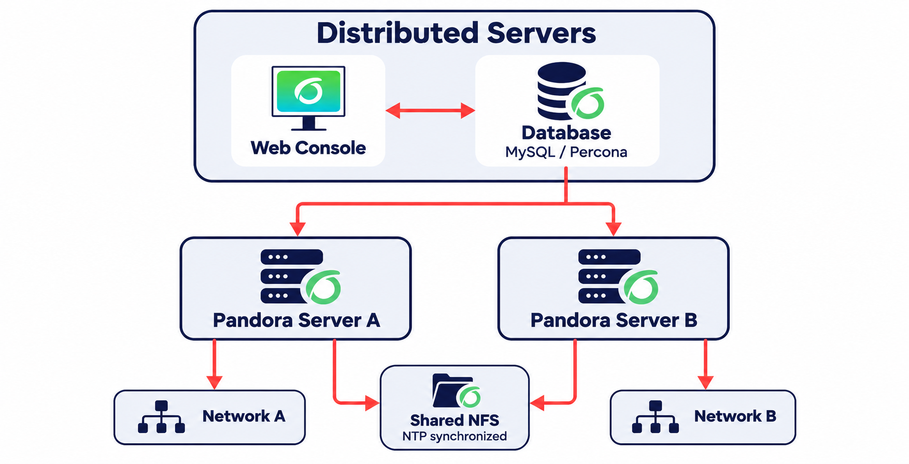
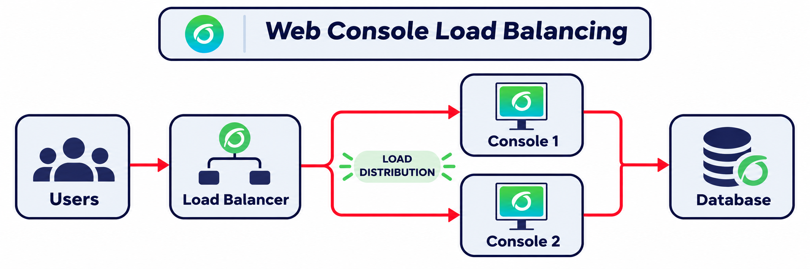
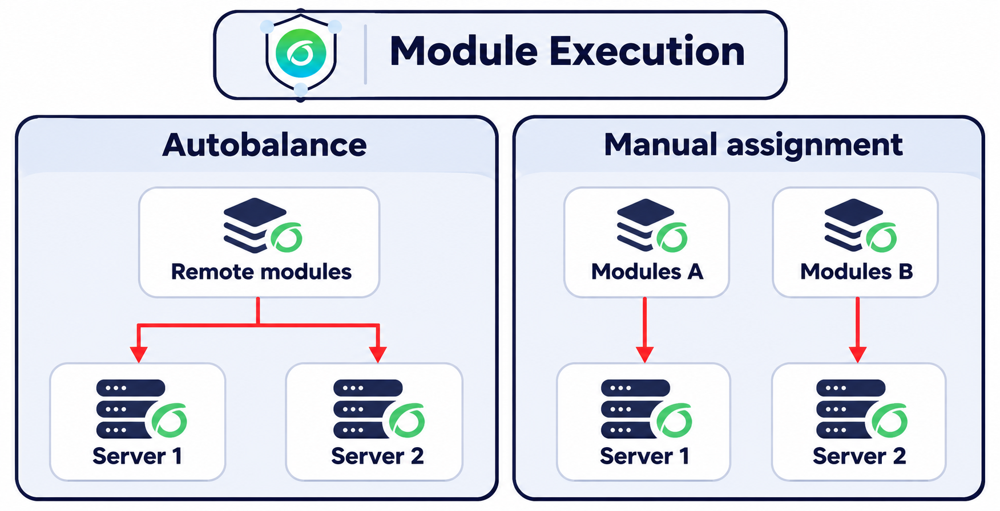
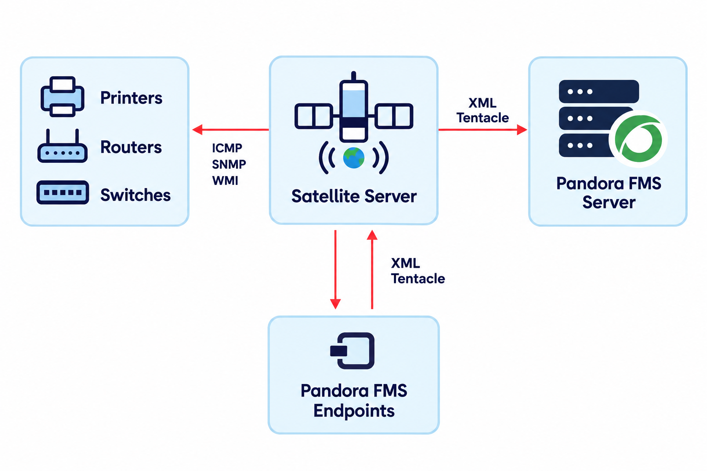
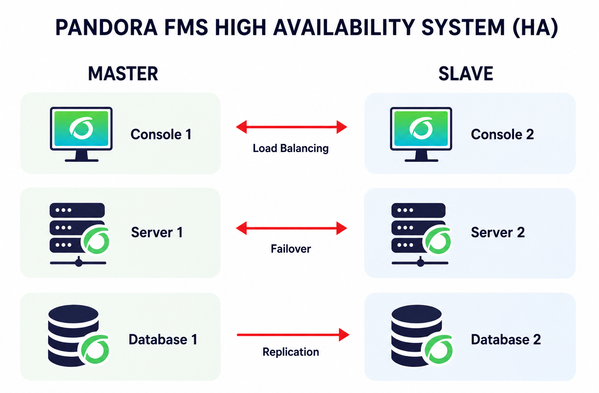
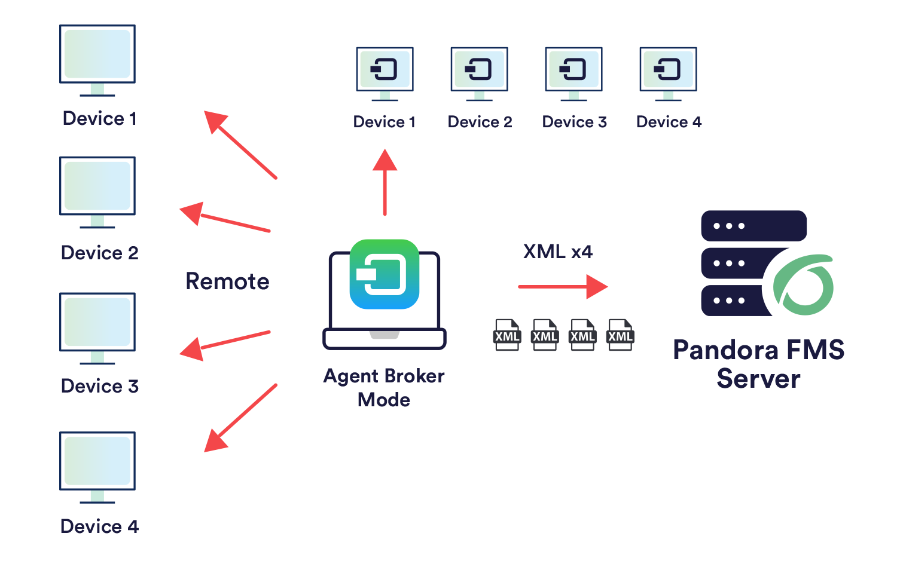

# Architectures distribuées

Un serveur, une console et une base de données sur la même machine résolvent la
majorité des installations de Pandora FMS. C'est le monolithe classique et cela
reste un point de départ raisonnable. Le problème apparaît lorsque cette machine
ne peut pas atteindre ce qu'elle doit superviser, ou lorsque ce qu'elle doit
superviser est si abondant que cela ne passe pas par une seule porte. Là, la
question cesse d'être « quel produit acheter ? » pour devenir « comment
répartir cela ? ».

Ce chapitre répond à cette seconde question : quel patron s'applique à chaque
symptôme, quelle pièce est nécessaire et vers quel chapitre aller pour le
détail. La carte des topologies et la description de chaque composant se
trouvent dans [Introduction et architecture](../parte-1/1.2-introduccion-y-arquitectura.md) ;
l'installation de chaque pièce, dans [Installation](../parte-1/1.1-instalacion.md).
Elles ne sont pas répétées ici : on décide quoi monter et on renvoie vers celui
qui le développe.

## Introduction : quand faut-il distribuer

Distribuer, dans Pandora FMS, ne signifie pas acheter plus de produit. Cela
signifie répartir entre plusieurs machines les pièces qui existent déjà
(serveur, console, base de données, collecte) pour résoudre l'un de ces deux
problèmes de fond :

- **La visibilité.** Il n'y a pas de chemin direct depuis le serveur jusqu'aux
  réseaux qu'il faut superviser. Il peut s'agir d'un pare-feu, d'un site sans
  route, du réseau d'un tiers. La donnée n'est pas là où le serveur la cherche.
- **Le volume.** Le nombre d'équipements, de modules ou d'événements oblige à
  déléguer la collecte, l'exécution et la visualisation. Une machine va jusqu'où
  elle va, et à partir de là ce qui tombe n'est pas la donnée isolée : c'est
  l'ensemble.

Les deux raisons se mélangent plus souvent qu'il n'y paraît. Un déploiement qui
commence sur une seule machine cesse de suffire le jour où apparaît un site sans
route directe, ou le jour où la console met huit secondes à afficher une liste
parce qu'il y a trois mille agents derrière. Et elles ne se résolvent pas
toujours de la même manière : le site sans route demande une pièce proche du
réseau ; le volume de la console demande de répartir la couche web ou
l'exécution.

Il convient de séparer trois choses qui se répartissent de manière différente,
parce que le produit a un mécanisme pour chacune :

- **La collecte.** Placer des serveurs ou des satellites près du réseau pour que
  la donnée soit recueillie là où elle naît.
- **L'exécution.** Assigner des modules à des serveurs différents, ou laisser
  n'importe lequel des serveurs disponibles les exécuter.
- **La présentation.** Monter plusieurs consoles, répartir leurs tâches ou
  toutes les coordonner avec un Command Center.

Un même déploiement peut répartir les trois à la fois, et chacune se résout avec
une pièce différente. Les confondre est la manière la plus rapide de monter
quelque chose qui fonctionne à moitié.

Une mise en garde avant de continuer : **la décision d'architecture n'est pas
prise par le produit, c'est votre infrastructure qui la prend**. Pandora FMS
admet presque n'importe quelle répartition, mais il ne va pas vous dire laquelle
convient. Cela découle de la façon dont le réseau arrive à chaque site et du
poids de chaque donnée. Si ce schéma n'est pas clair, n'importe quel schéma que
vous copiez d'un manuel ne tiendra jusqu'au premier changement de pare-feu.

Exemple de manuel : une installation avec un unique serveur en `192.168.0.10`,
`1.200` agents et un nouveau site en `192.168.10.0/24` sans route vers le
principal. Le monolithe ne se rompt pas par le nombre d'agents, il se rompt
parce que ce réseau concret est invisible. La solution n'est pas un serveur plus
grand : c'est d'amener une pièce sur le site.

## Le critère de conception

Ce chapitre contient un tableau qui vaut plus que le reste. Dans la première
colonne se trouve le symptôme (ce qui fait mal) ; dans la deuxième, le patron
qui le résout ; dans la troisième, le chapitre où il est développé. Si votre cas
s'y trouve, vous avez déjà terminé la lecture de cette section.

| Symptôme | Patron | Chapitre |
|---|---|---|
| Le serveur n'atteint pas le réseau et je ne peux rien installer sur les équipements supervisés | Machine dédiée sur ce réseau : serveur satellite, EndPoint en mode *broker* ou serveur distribué | [1.2](../parte-1/1.2-introduccion-y-arquitectura.md) / [6.2](6.2-servidores-satelite.md) / [6.1](#serveurs-distribues) |
| Les EndPoint n'atteignent pas le serveur | EndPoint en mode *proxy* ou serveur satellite | [2.1](../parte-2/2.1-monitorizacion-con-endpoints.md) / [6.2](6.2-servidores-satelite.md) |
| J'ai besoin de plusieurs installations avec une vision unique | Command Center | [6.3](6.3-command-center.md) |
| Je veux répartir la charge entre plusieurs serveurs | Serveurs distribués ou équilibrage de charge | [6.1](#patrons-darchitecture-distribuee) |
| Je ne peux pas permettre une interruption du service | Haute disponibilité | [6.9](6.9-alta-disponibilidad-ha.md) |
| La console ne suffit plus face à la concurrence | Équilibrage de charge des consoles web | [6.1](#equilibrage-de-charge) |

Deux mises en garde sur la façon de la lire :

- **Plusieurs lignes peuvent coexister.** Un même déploiement admet un site sans
  route (ligne 1), un Command Center qui le présente avec le reste (ligne 3) et
  une haute disponibilité pour qu'il ne tombe pas (ligne 5). Ce ne sont pas des
  alternatives exclusives ; ce sont des couches.
- **C'est un point de départ, pas un dogme.** Le symptôme est décrit du côté de
  celui qui souffre du problème, et parfois le problème réel se trouve une
  couche plus haut. Si vous doutez entre deux lignes, choisissez celle que vous
  pouvez vérifier avec un `traceroute` et un coup d'œil à la charge de la
  machine.

Exemple de deux lignes à la fois : le site sans route de `192.168.10.0/24` se
résout avec un serveur satellite local, et en même temps la console centrale,
qui dessert déjà cinq sites, se répartit entre deux consoles Apache derrière un
répartiteur de charge. Ce sont des problèmes différents et ils se résolvent
avec des pièces différentes.

!!! tip "Vous arrivez avec un problème précis ?"
    Le tableau de [Diagnostic et dimensionnement](#diagnostic-et-dimensionnement),
    à la fin du chapitre, réunit vingt cas pratiques avec la solution qui leur
    correspond.

## Patrons d'architecture distribuée

Les patrons qui suivent sont ordonnés du moins de changement de topologie au
plus. Les deux premiers (serveurs distribués et équilibrage de charge) sont
développés ici parce qu'ils n'ont pas de chapitre propre. Les autres sont
résumés et renvoient vers leur chapitre propriétaire.

### Serveurs distribués

Plusieurs serveurs Pandora FMS connectés à la **même base de données** MySQL ou
Percona et avec une seule console web (ou plusieurs pointant vers la même base).
Il n'y a pas de hiérarchie entre eux : tous opèrent comme principaux. Lors de la
création de la supervision, on choisit depuis quel serveur s'exécute chaque
module, et c'est là toute la répartition.

{ .diagrama .diagrama-ancho }

À quoi cela sert :

- **Segmentation des réseaux.** Chaque serveur atteint les réseaux qui le
  concernent ; le serveur du site n'a pas besoin de voir le réseau de l'autre
  site.
- **Contourner les pare-feu.** Un serveur de chaque côté d'une coupure de réseau
  évite d'ouvrir des chemins que personne ne veut ouvrir.
- **Répartir le sondage.** Le travail se divise entre des machines sans dupliquer
  l'installation ni la console.

Des exigences qui ne se négocient pas :

| Exigence | Détail |
|---|---|
| Horloges synchronisées par NTP | Un décalage temporel fait passer les modules en `unknown` et corrompt les graphiques. Ce n'est pas un avertissement de style : c'est une panne de données. |
| Volume NFS commun | Pour les collections et la configuration distante. On ne partage que les sous-répertoires, pas le répertoire parent. Voir [Exigences transversales](#exigences-transversales). |
| Accès direct à MySQL | Tous les serveurs parlent avec la même base. La communication peut être chiffrée avec TLS. |

L'accès à la base de données est le point délicat. Par défaut, la connexion
circule sans chiffrement ; si le trafic entre serveurs et base traverse un réseau
que vous ne contrôlez pas, il convient d'activer TLS avec ses certificats. La
configuration se trouve dans
[Référence complète de la configuration du serveur](../parte-9/9.3-referencia-completa-de-configuracion-del-servidor.md) ;
le chiffrement du contenu de la base de données (une autre chose, distincte) se
trouve dans [Chiffrement de la base de données](../parte-9/9.5-cifrado-de-la-base-de-datos.md).

Exemple : deux serveurs, `192.168.10.11` (site A) et `192.168.20.11` (site B),
contre `192.168.0.10:3306` avec le chiffrement activé, et les modules de chaque
site assignés à leur serveur. La console vit sur une troisième machine et pointe
vers la même base.
Pour la résilience de ce montage, voir
[Haute disponibilité (HA)](6.9-alta-disponibilidad-ha.md).

### Équilibrage de charge

L'équilibrage répartit le travail entre plusieurs pièces identiques. À ne pas
confondre avec la haute disponibilité : la HA maintient le service lorsque
quelque chose tombe ; l'équilibrage optimise les ressources lorsque tout
fonctionne. Ils sont complémentaires, mais ce n'est pas la même chose.
Il y a ici quatre fronts distincts, chacun avec son mécanisme.

#### Consoles web

Un répartiteur de charge externe (HAProxy, Keepalived) devant plusieurs consoles
Apache pointant vers la même base de données. Le système de sessions fonctionne
par *cookies*, qui restent dans le navigateur. C'est la réponse lorsque la
console ne suffit plus face à la concurrence et que le goulot d'étranglement est
la couche web, pas la base. La HA de console est traitée dans
[Haute disponibilité (HA)](6.9-alta-disponibilidad-ha.md) et les ports de
console, dans [Installation](../parte-1/1.1-instalacion.md).

{ .diagrama .diagrama-ancho }

Exemple : deux consoles en `192.168.0.20` et `192.168.0.21`, un répartiteur de
charge avec terminaison TLS en `192.168.0.19` et le certificat sur le
répartiteur. Les utilisateurs entrent par le `443` du répartiteur et répartissent
leur session entre les deux consoles.

#### Exécution des modules

L'agent a un mode **« Autobalance »** : n'importe quel serveur de réseau
disponible exécute ses modules distants. Il se configure dans la fiche de
l'agent, dans le champ **« Serveur »** : si l'on laisse un serveur concret, seul
celui-ci exécute les modules distants de l'agent ; si l'on choisit
**« Autobalance »**, n'importe lequel des serveurs de réseau disponibles les
exécute. Il n'est pas activé d'origine.

{ .diagrama .diagrama-ancho }

À ne pas confondre l'autobalance avec la répartition manuelle à **50 %**. La
répartition manuelle consiste à assigner la moitié des modules à chacun de deux
serveurs et à marquer les deux comme principaux ; l'autobalance laisse n'importe
quel serveur disponible exécuter les modules d'un agent. Ce sont des mécanismes
différents et ils se configurent à des endroits différents. La HA des serveurs de
réseau et le comportement du principal se trouvent dans
[Haute disponibilité (HA)](6.9-alta-disponibilidad-ha.md) ; les types de module,
dans [Supervision des réseaux](../parte-2/2.6-monitorizacion-de-redes.md).

Exemple : un agent avec `Autobalance` dont les modules distants peuvent être
exécutés indifféremment par `192.168.10.11` ou `192.168.20.11`, sans assignation
fixe. Si l'un des deux tombe, l'autre continue de les exécuter.

Exemple de l'autre mécanisme : les mêmes deux serveurs, tous deux marqués comme
principaux, avec la moitié des modules assignée à chacun depuis le formulaire de
l'agent. C'est cela la répartition manuelle à 50 %, pas l'autobalance, et cela ne
change pas seulement parce qu'un serveur tombe : la répartition reste là où vous
l'avez laissée.

Lorsque l'agent est assigné à un serveur concret, la fiche comporte activée par
défaut l'option **« Enable auto High Availability »** (« Activer la haute
disponibilité automatique »). Cela signifie que, si ce serveur cesse d'être
disponible, le serveur maître du nœud assume l'exécution des modules de l'agent
pendant la durée de la panne ; lorsque le serveur revient, la répartition
retourne à sa place. Si l'on désactive l'option, les modules ne sont pas
réassignés : ils attendent le retour de leur serveur.

Exemple : un agent assigné au serveur du site A continue de s'exécuter sur le
maître si le site A tombe, sans que personne ait besoin de le réassigner ; au
rétablissement, il s'exécute de nouveau là-bas.

#### Tâches de console

Les tâches de console sont des travaux périodiques de la console elle-même —
rapports, sauvegardes, scripts — que son cron exécute, et non un serveur de
supervision. On peut les assigner à une console concrète ou laisser n'importe
laquelle les exécuter ; ainsi elles se répartissent entre plusieurs consoles.
Elles ne scannent pas de réseaux. Le détail se trouve dans
[Tâches de console](../parte-2/2.5-tareas-de-consola.md).

Exemple : deux consoles enregistrées ; les rapports de la moitié est de
l'entreprise sont programmés dans l'une et ceux de l'ouest dans l'autre.

#### Tâches de Discovery

Les tâches de Discovery sont des scans et des découvertes : réseau
(**Host & Devices**), **applications** (MySQL, Oracle, DB2, SAP, SQL Server,
VMware) et **cloud** (AWS EC2/RDS/S3, Azure Compute, GCP Compute Engine). La
console les définit, les programme et peut les forcer, mais **c'est le serveur de
Discovery qui les exécute** : lui récupère dans la base de données les tâches qui
lui sont assignées, lance le scan et crée les agents. Ce serveur peut se trouver
sur une autre machine et possède ses propres threads. Le détail se trouve dans
[Supervision et découverte automatique avec Discovery](../parte-2/2.3-monitorizacion-y-descubrimiento-automatico-con-discovery.md)
et dans la
[Référence complète de la configuration du serveur](../parte-9/9.3-referencia-completa-de-configuracion-del-servidor.md).

À ne pas confondre les deux onglets de **Discovery → Task list** : *Console
tasks* programme des travaux de la console ; *Discovery tasks* définit des scans
que le serveur de Discovery exécute.

Exemple : un serveur de Discovery accumule des tâches de découverte
d'applications — par exemple, MSSQL, Oracle ou Playwright — et n'a pas le temps
de les terminer. La solution consiste à ajouter un autre serveur de Discovery et
à répartir les tâches entre les deux ; si le goulot d'étranglement est dans les
threads et non dans la machine, on ajuste les threads du serveur.

### Serveur satellite

Résumé et lien : c'est un serveur autonome qui s'installe près du réseau distant
et qui **n'a pas besoin de la base de données**. Il sonde par ICMP, TCP, SNMP
(v1, v2c et v3), WMI, SSH, exécution distante et plugins ; il emballe les
résultats en XML et les envoie par Tentacle. Il peut exécuter jusqu'à 500
vérifications par seconde et **exécute des tâches de découverte** (Recon Task)
pour créer les agents. En outre, **il transmet au serveur les XML des EndPoint**
(il fait office de proxy Tentacle) et, depuis la console, on peut lui lancer les
**assistants (Wizards)** et le **navigateur SNMP** par l'intermédiaire de
l'Exec Server. C'est lui qui initie la connexion, de sorte qu'il n'est pas
nécessaire d'exposer aucun port sur le réseau distant.

Quand l'utiliser : lorsque le serveur n'atteint pas le réseau et qu'on ne peut
pas non plus installer un EndPoint sur les équipements. Où il s'insère dans la
carte générale se trouve dans
[Introduction et architecture](../parte-1/1.2-introduccion-y-arquitectura.md) ;
son développement complet, dans
[Serveurs satellites](6.2-servidores-satelite.md).

{ .diagrama .diagrama-ancho }

Exemple : un réseau `192.168.10.0/24` sans route depuis le serveur, sondé par un
satellite en `192.168.10.5` qui rend compte par `41121/TCP`.

### Command Center

Résumé et lien : c'est la couche qui coordonne plusieurs **nœuds** (instances),
chacun avec son propre serveur et sa propre base de données, et qui les présente
comme une seule installation. Elle apporte l'extensibilité horizontale et un
service multi-entreprise depuis un unique point d'accès. La synchronisation va
dans deux directions : active (le Command Center interroge la base ou l'API de
chaque nœud pour administrer agents, modules, alertes et politiques) et passive
(réplication de ce qui se génère continuellement, comme les événements).

Exigences propres : communication bidirectionnelle entre les nœuds et le Command
Center, horloges synchronisées par NTP et **même version et niveau de MR** de la
base de données. Où il s'insère, dans
[Introduction et architecture](../parte-1/1.2-introduccion-y-arquitectura.md) ;
son développement, dans [Command Center](6.3-command-center.md).

{ .diagrama .diagrama-ancho }

Exemple : trois nœuds sur trois sites, chacun avec sa base de données, et un
Command Center qui les présente ensemble et permet de chercher un agent dans les
trois à la fois.

### Haute disponibilité

Résumé et lien : la HA garantit la continuité du service face aux pannes de
matériel ou de logiciel, et elle agit sur quatre fronts. Le Data Server se
répartit entre plusieurs machines avec des répertoires partagés par NFS. Les
serveurs de réseau se supervisent mutuellement (*heartbeat*) et réassignent les
modules du tombé. La console se réplique. Et la base de données se monte en
actif/passif avec `pandora_ha` sur Percona, avec récupération automatique face
au *Split-Brain*.

{ .diagrama .diagrama-ancho }

La différence avec l'équilibrage mérite d'être fixée : la HA maintient le
service lorsque quelque chose tombe ; l'équilibrage répartit la charge lorsque
tout va bien. Le développement complet se trouve dans
[Haute disponibilité (HA)](6.9-alta-disponibilidad-ha.md).

Les agents assignés à un serveur concret ajoutent la haute disponibilité
automatique de leur fiche (voir [Équilibrage de charge](#equilibrage-de-charge)).

Exemple : deux nœuds de base de données en actif/passif, avec la récupération
automatique face au *Split-Brain* activée.

### EndPoint en mode broker et proxy

Résumé et lien : l'EndPoint a deux modes pour résoudre des réseaux difficiles.
En mode **broker**, un EndPoint avec accès aux deux côtés sonde à distance un
réseau que le serveur n'atteint pas et rend compte d'un agent par équipement. En
mode **proxy**, il transmet au serveur les XML d'autres EndPoint qui n'ont pas de
chemin direct. Le serveur satellite fait aussi office de *proxy*.

{ .diagrama .diagrama-ancho }

Les diagrammes et les topologies se trouvent dans
[Introduction et architecture](../parte-1/1.2-introduccion-y-arquitectura.md) ;
le mode broker et le mode proxy, avec leur configuration, dans
[Supervision avec des EndPoints](../parte-2/2.1-monitorizacion-con-endpoints.md).
Le satellite comme *proxy*, dans
[Serveurs satellites](6.2-servidores-satelite.md).

Exemple : un EndPoint en mode broker installé sur un équipement avec accès au
réseau d'entreprise et à `192.168.10.0/24`, sondant ce dernier sans que le
serveur ait une route vers lui.

## Quels composants peuvent vivre séparément

Tout ce qui se sépare n'est pas du réseau. Certains composants se séparent pour
la charge ou pour la sécurité sans changer de topologie : on les éteint sur le
serveur principal et on les allume sur un autre. Ce tableau recense ceux que le
produit admet, avec ce que fait chacun, pourquoi il peut être intéressant de le
monter à part et son chapitre propriétaire.

| Composant | Ce qu'il fait | Pourquoi le monter à part | Chapitre propriétaire |
|---|---|---|---|
| Alert Server | Exécute les alertes de supervision. Désactivé par défaut. | Pour qu'une alerte lente (une commande, un script, une notification) ne retarde pas les vérifications du serveur ; on le sépare lorsque les alertes commencent à rivaliser avec la supervision. | [5.5](../parte-5/5.5-alertas-y-notificaciones.md) / [9.3](../parte-9/9.3-referencia-completa-de-configuracion-del-servidor.md) |
| Event Server | Met en relation les événements et déclenche les alertes associées. Désactivé par défaut. | Pour décharger le traitement des événements lorsque le volume est élevé, sans toucher les serveurs qui font la supervision. | [9.3](../parte-9/9.3-referencia-completa-de-configuracion-del-servidor.md) / [1.2](../parte-1/1.2-introduccion-y-arquitectura.md) |
| Log Server | Permet de générer des alertes à partir des logs. Désactivé par défaut. | Pour séparer la corrélation des logs du reste ; c'est intéressant lorsque le volume de logs est élevé ou lorsque leurs alertes ne doivent pas rivaliser avec celles de supervision. | [9.3](../parte-9/9.3-referencia-completa-de-configuracion-del-servidor.md) / [1.2](../parte-1/1.2-introduccion-y-arquitectura.md) |
| Syslog Server | Analyse le syslog de la machine où il s'installe et le stocke dans OpenSearch. Désactivé par défaut. | Parce que le syslog et OpenSearch consomment du disque et du CPU ; les isoler évite que la croissance des logs pénalise le serveur de supervision. | [9.3](../parte-9/9.3-referencia-completa-de-configuracion-del-servidor.md) / [1.2](../parte-1/1.2-introduccion-y-arquitectura.md) |
| Console dédiée aux rapports | Génère, enregistre et envoie des rapports à partir des données des bases principale et historique. | Pour que la génération de rapports ne rivalise pas avec la console d'exploitation ; seuls les administrateurs y entrent et le menu est limité. L'interface l'étiquette « Reporting ». | [9.2](../parte-9/9.2-referencia-completa-de-configuracion-de-la-consola.md) / [6.3](6.3-command-center.md) |
| SIEM / OpenSearch | Stocke et met en corrélation les logs et les événements de sécurité. | Parce qu'OpenSearch évolue avec des nœuds et du disque ; l'isoler maintient les performances de la supervision et permet au cluster de croître à part. | [1.2](../parte-1/1.2-introduccion-y-arquitectura.md) / [9.2](../parte-9/9.2-referencia-completa-de-configuracion-de-la-consola.md) |

Exemple : activer l'Alert Server sur une machine à part pour qu'une alerte lente
ne retarde pas les vérifications du serveur principal.

## Exigences transversales

Il y a des conditions qui valent pour presque tous les patrons de ce chapitre.
Elles ne sont pas optionnelles et ne dépendent pas de la conception concrète :
si elles échouent, c'est l'ensemble qui échoue.

| Exigence | Détail |
|---|---|
| NTP | Horloges synchronisées sur tous les nœuds. Un décalage conduit les modules à `unknown` et corrompt les graphiques. Sous Rocky Linux 8, le service est `chronyd`. |
| NFS | Volume commun pour les collections et la configuration distante. On ne partage que les sous-répertoires, pas le répertoire parent. |
| TLS | Chiffrement de la connexion avec la base de données et des transferts Tentacle. |
| Même version et MR | Obligatoire entre le Command Center et ses nœuds. Voir [Mises à jour](../parte-1/1.4-actualizaciones.md). |
| Licence | Le Command Center utilise une metalicence ; le reste des nœuds, leur licence correspondante. Voir [Gestion des licences](../parte-1/1.5-licenciamiento.md) et [Command Center](6.3-command-center.md). |

Concernant NFS, on partage les sous-répertoires de données (configuration
distante, collections, métadonnées, netflow, pièces jointes et découverte), pas
le répertoire parent : le partager entier affecte les performances.

Concernant TLS vers la base de données, la connexion circule sans chiffrement
par défaut ; la vérification du certificat du serveur MySQL se configure lors de
son activation. La référence se trouve dans
[Référence complète de la configuration du serveur](../parte-9/9.3-referencia-completa-de-configuracion-del-servidor.md)
et le chiffrement du contenu de la base, dans
[Chiffrement de la base de données](../parte-9/9.5-cifrado-de-la-base-de-datos.md).

### Matrice des ports et de la connectivité

Le tableau canonique complet se trouve dans
[Installation](../parte-1/1.1-instalacion.md). Les ports qui concernent les
patrons de ce chapitre :

| Origine | Destination | Port | Chiffrement |
|---|---|---|---|
| Navigateur et clients d'API | Console web | `80/TCP` et `443/TCP` | TLS sur `443`, dans Apache ou sur le répartiteur de charge |
| Console et serveur | Base de données MySQL/Percona | `3306/TCP` | Facultatif, avec TLS |
| Command Center | Nœuds (console et API) | `80/TCP` et `443/TCP` | Selon le nœud |
| EndPoint et serveur satellite | Serveur (Tentacle) | `41121/TCP` | TLS de Tentacle facultatif |
| Administration et tunnel SSH inverse | Serveur (SSH) | `22/TCP` | SSH |
| Équipement réseau | Serveur | `162/UDP` (traps SNMP) | SNMPv3 |
| Équipement distant | Serveur (réception de syslog) | `514/UDP` et `514/TCP` | Selon rsyslog |

Exemple : pour les serveurs distribués, il faut ouvrir `3306/TCP` (idéalement
avec TLS) entre chaque serveur et la base de données ; pour les EndPoint et les
satellites, `41121/TCP` vers le serveur qui reçoit leurs données.

### Chemins partagés par NFS

Lorsqu'il y a plusieurs serveurs ou consoles, certains chemins doivent être les
mêmes pour tous : si chacun écrit sur son disque local, la configuration
distante, les collections ou les données de NetFlow se voient différentes selon
qui les lit. On partage les sous-répertoires, jamais `/var/spool/pandora/data_in`
entier, parce que partager le parent pénalise les performances. Les chemins de
`/var/spool/pandora` appartiennent au serveur ; ceux de
`/var/www/html/pandora_console`, à la console.

| Fonctionnalité | Chemin du système |
|---|---|
| Configuration distante des EndPoint | `/var/spool/pandora/data_in/conf` |
| Collections de serveur (satellite et EndPoint) | `/var/spool/pandora/data_in/collections` |
| Sommes de contrôle de la configuration distante | `/var/spool/pandora/data_in/md5` |
| Données de NetFlow | `/var/spool/pandora/data_in/netflow` |
| Données de sFlow | `/var/spool/pandora/data_in/sflow` |
| Tâches et résultats de découverte | `/var/spool/pandora/data_in/discovery` |
| Commandes distantes (RMM) | `/var/spool/pandora/data_in/commands` |
| Pièces jointes de la console (rapports, images, fichiers) | `/var/www/html/pandora_console/attachment` |
| Collections de console | `/var/www/html/pandora_console/attachment/collection` |
| Paquets de Discovery (`.disco`) | `/var/www/html/pandora_console/attachment/discovery` |
| MIB SNMP | `/var/www/html/pandora_console/attachment/mibs` |
| Sauvegardes de la console | `/var/www/html/pandora_console/attachment/backups` |
| Dépôt de fichiers | `/var/www/html/pandora_console/attachment/files_repo` |

Les indispensables pour que plusieurs serveurs partagent configuration et
collections sont `data_in/conf`, `data_in/collections`, `data_in/md5`,
`data_in/netflow`, `data_in/discovery` et le répertoire `attachment` de la
console ; le reste sont des sous-répertoires qu'il convient de passer en revue si
l'on utilise ces fonctions.

Exemple : deux serveurs de données contre la même base partagent par NFS
`data_in/conf`, `data_in/collections` et `data_in/md5` ; s'ils utilisent en plus
NetFlow, ils partagent aussi `data_in/netflow`. La console partage son répertoire
`attachment` pour que les rapports et les images soient disponibles sur toutes
les consoles.

## Diagnostic et dimensionnement

Cette section n'est pas un tutoriel : c'est un index de problèmes réels et de la
solution qui leur correspond dans ce chapitre.

| Problème | Solution |
|---|---|
| Les alertes s'accumulent et les vérifications prennent du retard | Monter un **Alert Server** sur une autre machine pour que l'exécution des alertes ne rivalise pas avec la supervision ([5.5](../parte-5/5.5-alertas-y-notificaciones.md), [9.3](../parte-9/9.3-referencia-completa-de-configuracion-del-servidor.md)). |
| J'ai une DMZ que je veux superviser mais qui n'a pas de connexion avec Pandora | Déployer un **serveur satellite** dans la DMZ ; c'est lui qui initie la connexion et envoie les données par Tentacle ([6.2](6.2-servidores-satelite.md)). |
| Le serveur n'atteint pas un réseau et je ne peux rien installer sur les équipements supervisés | Monter une **machine dédiée** sur ce réseau : **serveur satellite**, **EndPoint en mode broker** ou **serveur distribué**, selon la connectivité et le volume ([1.2](../parte-1/1.2-introduccion-y-arquitectura.md), [6.2](6.2-servidores-satelite.md), [Serveurs distribués](#serveurs-distribues)). |
| Les EndPoint d'un réseau n'atteignent pas le serveur | **EndPoint en mode proxy** ou un **serveur satellite** qui fasse office de proxy ([2.1](../parte-2/2.1-monitorizacion-con-endpoints.md), [6.2](6.2-servidores-satelite.md)). |
| La console ne suffit plus face à la concurrence | **Équilibrage de charge des consoles web** avec HAProxy ou Keepalived devant plusieurs consoles ([Équilibrage de charge](#equilibrage-de-charge), [6.9](6.9-alta-disponibilidad-ha.md)). |
| Je veux répartir l'exécution des modules entre plusieurs serveurs | **Autobalance** dans la fiche de l'agent ou **assignation manuelle** à 50 % entre deux serveurs ([Exécution des modules](#execution-des-modules)). |
| Un serveur de réseau accumule des modules en file d'attente et n'y arrive pas | Répartir les modules entre plusieurs serveurs avec **Autobalance** ou **assignation manuelle**, ou ajouter un autre **serveur de réseau** ([Exécution des modules](#execution-des-modules), [Serveurs distribués](#serveurs-distribues)). |
| Un agent assigné à un serveur concret cesse de s'exécuter lorsque ce serveur tombe | Laisser activée l'option **« Enable auto High Availability »** dans la fiche de l'agent ; le maître assume ses modules ([Exécution des modules](#execution-des-modules)). |
| J'ai besoin de répartir les tâches de console (rapports, sauvegardes, scripts) entre plusieurs consoles | Assigner chaque **tâche de console** à une console concrète ([Tâches de console](#taches-de-console), [2.5](../parte-2/2.5-tareas-de-consola.md)). |
| J'ai besoin de répartir les scans de Discovery entre plusieurs serveurs | Assigner chaque **tâche de Discovery** à un serveur de Discovery ([Tâches de Discovery](#taches-de-discovery), [9.3](../parte-9/9.3-referencia-completa-de-configuracion-del-servidor.md)). |
| Le serveur de Discovery accumule des tâches en file d'attente (MSSQL, Oracle ou Playwright…) et le temps manque | Ajouter un autre **serveur de Discovery** et répartir les tâches entre les deux ; si le goulot est dans les threads, les ajuster ([Tâches de Discovery](#taches-de-discovery), [9.3](../parte-9/9.3-referencia-completa-de-configuracion-del-servidor.md)). |
| Les changements de configuration de la console n'arrivent pas à tous les serveurs | Partager par **NFS** les sous-répertoires de configuration, collections et métadonnées ([Chemins partagés par NFS](#chemins-partages-par-nfs)). |
| Les modules passent en `unknown` d'un coup sur un serveur distribué | Vérifier **NTP**, la connexion avec la base de données et les logs, dans cet ordre ([Dépannage avec Pandora](../parte-9/9.13-troubleshooting-con-pandora.md)). |
| La génération de rapports ralentit la console | Monter une **console dédiée aux rapports** sur une autre machine ([Quels composants peuvent vivre séparément](#quels-composants-peuvent-vivre-separement)). |
| Le volume de logs est élevé et OpenSearch consomme du disque et du CPU | Déplacer le **Syslog Server** et OpenSearch vers une autre machine ([Quels composants peuvent vivre séparément](#quels-composants-peuvent-vivre-separement)). |
| J'ai besoin de mettre en corrélation des événements et de déclencher des alertes | Activer l'**Event Server** ([Quels composants peuvent vivre séparément](#quels-composants-peuvent-vivre-separement)). |
| J'ai besoin de générer des alertes à partir des logs | Activer le **Log Server** ([Quels composants peuvent vivre séparément](#quels-composants-peuvent-vivre-separement)). |
| J'ai besoin d'une vision unique de plusieurs installations | Monter un **Command Center** avec ses nœuds ([6.3](6.3-command-center.md)). |
| J'ai besoin de passer à l'échelle pour des centaines de milliers d'équipements | **Command Center** avec plusieurs nœuds, chacun avec sa base de données ([6.3](6.3-command-center.md)). |
| Je ne peux pas permettre une interruption du service | Monter une **haute disponibilité** ([6.9](6.9-alta-disponibilidad-ha.md)). |
| Je ne sais pas si le problème vient du réseau, de la base de données ou de l'horloge | Commencer par **NTP**, continuer par les **ports** et finir dans les **logs** ([Exigences transversales](#exigences-transversales), [9.13](../parte-9/9.13-troubleshooting-con-pandora.md)). |
| Je ne sais pas ce que l'installation supporte | Consulter l'**analyse de volumétrie** ([9.14](../parte-9/9.14-analisis-de-volumetria-y-disenos-para-alta-capacidad.md)). |
| Un nœud du Command Center ne démarre pas, les événements n'arrivent pas ou l'historique ne s'affiche pas | Vérifier les scénarios des **grands environnements** ([12.8](../parte-12/12.8-entornos-grandes.md)). |

Exemple : si les modules de `192.168.20.11` passent en `unknown` d'un coup,
l'ordre raisonnable est de vérifier l'horloge de cette machine, puis sa connexion
avec la base de données et, seulement ensuite, les modules un par un. Dans cet
ordre, 90 % des cas se résolvent à la première étape.
