# Serveurs satellites

Il y a des réseaux que le serveur Pandora FMS ne voit pas et sur lesquels rien
ne peut être installé non plus. Un bâtiment distant, une usine, le réseau d'un
client de l'autre côté de la liaison : des sites où il n'y a pas de route depuis
le serveur et où poser un EndPoint est impossible parce que l'équipement est un
switch, un routeur, un automate ou un Windows verrouillé de partout. Un **serveur
satellite** est la pièce que Pandora FMS place à cette frontière pour découvrir
ce qui s'y trouve, le vérifier et renvoyer les données. Il n'a pas besoin de base
de données, il n'a pas d'interface web et il parle au serveur avec le même XML
que n'importe quelle autre source de données.

## Introduction : de quoi il s'agit et quand l'utiliser

Le serveur satellite sert à découvrir et à superviser des réseaux et des
équipements distants. Trois profils d'équipement, trois protocoles : les éléments
de réseau (routeurs, switches, pare-feu) par SNMP ou ICMP ; les serveurs Windows
par WMI ; les serveurs Linux par SNMP. Le choix du protocole pour chaque cas
n'est pas un caprice, c'est ce que chaque équipement expose.

On y recourt lorsque deux conditions sont réunies en même temps : il n'y a pas de
connectivité directe depuis le serveur Pandora FMS vers le réseau cible, et il
n'est pas possible de déployer un EndPoint sur les équipements à superviser. Si
vous avez une route mais que vous ne voulez pas installer de logiciel, la
supervision distante générique du serveur résout déjà une bonne partie du travail
(voir [Supervision des réseaux](../parte-2/2.6-monitorizacion-de-redes.md)).
Le satellite entre en jeu lorsque cette route n'existe pas.

!!! example "Un cas d'usage concret"
    Une entreprise dispose d'un réseau d'agence, `192.168.10.0/24`, accessible
    uniquement par une liaison que le serveur central ne peut pas franchir. Sur
    ce réseau, il y a deux switches, chacun avec son adresse (`192.168.10.1` et
    `192.168.10.2`), et un serveur Windows (`192.168.10.30`). Le serveur
    satellite est installé dans l'agence, découvre les switches par SNMP, le
    Windows par WMI, et envoie les données au serveur central par Tentacle. Sans
    satellite, ces trois équipements seraient invisibles.

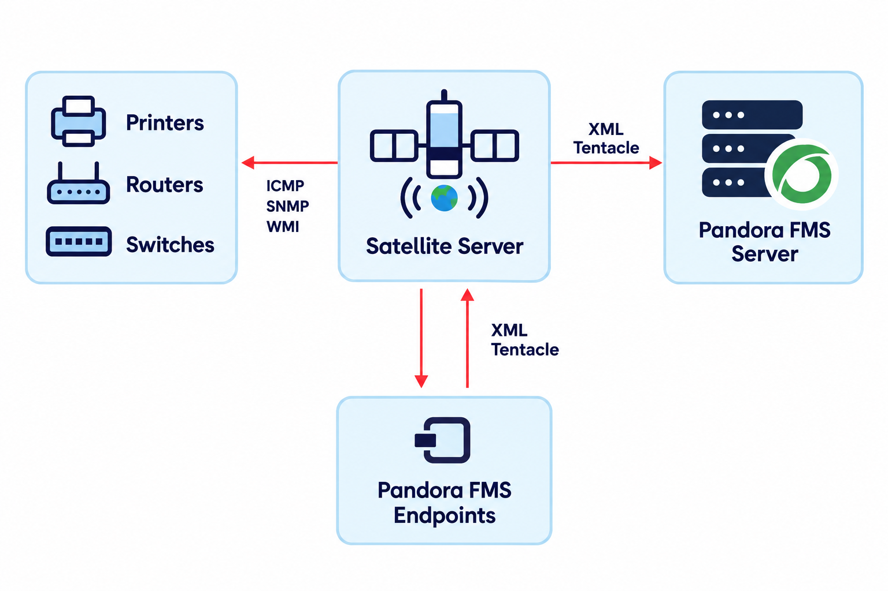

Le satellite possède une poignée de traits qui le distinguent d'un EndPoint et
d'un serveur Pandora FMS ordinaire :

- **Interrogation à haut débit.** Il peut exécuter des tests réseau (ICMP, latence
  et SNMP v1 et v2c) jusqu'à 500 vérifications par seconde. SNMPv3 est plus lent
  parce qu'il chiffre le trafic ; le coût de la sécurité se paie en vitesse.
- **Envoi par intervalles, interrogation par cycles courts.** Les vérifications
  peuvent tourner toutes les quelques secondes, mais le satellite n'envoie des
  données au serveur que toutes les `agent_interval` secondes (300 par défaut).
  Lorsque la valeur change par rapport à la précédente, il l'envoie à ce
  moment-là ; si elle ne change pas, il attend l'intervalle.
- **Serveur autonome.** Il ne touche pas à la base de données de Pandora FMS. Il
  génère du XML et le livre comme un EndPoint en mode *broker* ou un Export
  Server, il suffit donc que le port Tentacle soit ouvert.
- **Auto-découverte.** Avec une tâche de reconnaissance, il crée les agents des
  équipements qu'il trouve (identifiés par adresse IP), détecte les éléments
  dynamiques (interfaces réseau, stockage) et les supervise seul. Sous Windows,
  il détecte en outre les disques, le CPU et la mémoire.
- **Les modules générés sont des modules normaux.** Ils se modifient depuis la
  console web comme ceux de n'importe quel agent.
- **IPv6.** Le serveur satellite comme le serveur de réseau le prennent en charge
  dans toutes leurs fonctions avancées.

!!! warning "Version 785 : pas de compatibilité descendante"
    Le serveur satellite 785 n'est pas compatible avec les versions antérieures
    de Pandora FMS. Installez-le à côté d'un environnement 785 ou supérieur. Si
    vous connectez un satellite plus ancien à un environnement 785, les
    nouvelles fonctions (le tunnel SSH, la configuration distante à deux
    fichiers, les modules de type Satellite) apparaîtront dans la console mais
    ne fonctionneront pas.

Le chapitre [1.2 (Introduction et architecture)](../parte-1/1.2-introduccion-y-arquitectura.md)
situe le satellite dans l'ensemble et parcourt les topologies que l'on monte avec
lui : réseaux d'accès difficile, réseaux inaccessibles et grands environnements.
Le chapitre [2.6 (Supervision des réseaux)](../parte-2/2.6-monitorizacion-de-redes.md)
explique quand la supervision distante remplace l'EndPoint et quel serveur
exécute chaque type de vérification. Ici, c'est le satellite lui-même qui est
documenté : comment il se configure, comment il crée des agents, quels modules il
admet et comment il se connecte à la console.

## Fonctionnement interne

Comprendre le cycle du satellite, c'est ce qui permet de l'exploiter avec
discernement au lieu de le redémarrer sans arrêt. Le cycle comporte quatre
phases.

**1. Découvrir.** Le satellite détermine ce qui se trouve sur le réseau par trois
voies qui peuvent coexister : une tâche de reconnaissance (Recon Task) qui
explore une ou plusieurs plages par ICMP, SNMP ou WMI ; un fichier d'hôtes avec
des adresses connues ; et l'enregistrement manuel, en écrivant à la main le
fichier de configuration d'un agent. Toute découverte produit un fichier de
configuration par agent, stocké dans le répertoire `agent_conf_dir`
(`/etc/pandora/conf` par défaut).

**2. Interroger.** Chaque protocole a sa propre famille de threads, d'intervalles,
de tentatives et de délais d'attente. Le satellite lance des threads de ping, de
latence, de TCP, de SNMP v1, v2c et v3, de WMI, de SSH, d'exécution et de
plugins. Chaque famille fait son travail à son rythme : les vérifications
booléennes changent d'état seules, et les numériques (latence, trafic, CPU,
disque) changent lorsqu'elles franchissent le seuil que vous avez défini dans le
module.

**3. Décider quand signaler.** Le satellite maintient les vérifications à
intervalle court, mais n'emballe et n'envoie que lorsqu'il y a quelque chose à
raconter. Si une valeur change par rapport à la précédente, un XML sort à ce
moment-là ; si tout reste identique, le XML attend l'`agent_interval` de l'agent.
C'est la différence entre la fréquence de l'interrogation et la fréquence de
l'envoi, et il vaut la peine de l'avoir claire : abaisser l'intervalle de ping à
une minute ne signifie pas envoyer des données chaque minute.

**4. Envoyer.** Le satellite emballe un XML par agent et le livre par Tentacle au
port 41121 du serveur, ou le copie dans un répertoire local si le mode de
transfert est `local`. Il existe un tampon facultatif (`xml_buffer`) pour
réessayer les envois échoués, avec un contrôle d'espace temporaire
(`temporal_min_size`) qui évite de remplir le disque si le serveur disparaît
pendant des heures.

À tout cela s'ajoute la **configuration distante**. Le satellite lui-même et ses
agents peuvent être reconfigurés depuis la console web : la console publie les
fichiers et leur MD5 dans le chemin de configuration distante, et le satellite
les récupère dans son cycle de révision de la configuration distante lorsqu'il
détecte que le MD5 a changé. La gestion se fait depuis les onglets de la fiche du
serveur : **Modifier**, **Configuration distante**, **Éditeur avancé**,
**Gérer les agents**, **Collections** et **tunnel SSH**.

Quant au format des données, le satellite écrit du XML avec la même structure
qu'un agent, le serveur le reçoit donc comme n'importe quelle autre source. Dans
la console web, en revanche, ces agents se distinguent bien des autres : chacun
porte le satellite dont il dépend et se voit assigner le système d'exploitation
**Satellite**, avec sa propre icône. C'est pourquoi la console peut les lister et
les filtrer à part (seulement ceux d'un satellite, ou l'inverse) et pourquoi
leurs modules sont les types propres au satellite (ICMP, TCP, SNMP, WMI, SSH et
exécution), que la console n'offre qu'à ces agents. Ils ne partagent pas non plus
la configuration d'un EndPoint : leur fichier est publié et récupéré par la
gestion du satellite. Ce n'est pas un agent ordinaire avec des modules réseau :
il a son propre marqueur, sa propre icône et son propre jeu de modules.

!!! example "Le cycle, en chiffres"
    Un switch sur `192.168.10.1` est interrogé par SNMP toutes les 60 secondes
    (`snmp_interval 60`, `snmp_threads 10`) et sa latence toutes les 60 secondes
    (`latency_interval 60`). Si l'état opérationnel d'une interface change, un
    XML sort à ce moment-là ; si tout reste identique, le XML avec les valeurs
    accumulées est envoyé toutes les 300 secondes (`agent_interval 300`).

## Installation et mise en service

L'installation du satellite (prérequis, installation en ligne sous Linux,
installation hors ligne et installateur Windows, avec tous leurs paramètres) est
traitée dans [Installation du satellite](../parte-1/1.1-instalacion.md#installation-du-satellite).
Ici n'est repris que ce que cette section ne traite pas côté exploitation :
comment il démarre, où se trouve le journal et quel détail de Windows il convient
de garder en tête.

| Exigence | Détail |
|---|---|
| Installation | Voir [Installation du satellite](../parte-1/1.1-instalacion.md#installation-du-satellite) |
| Service (Linux) | `satellite_serverd`, géré avec `systemctl` |
| Fichier de configuration | `/etc/pandora/satellite_server.conf` |
| Journal | `/var/log/satellite_server.log` |
| Utilisateur du service (Linux) | `root` |

Démarrage et arrêt sous Linux :

```bash
systemctl start satellite_serverd
systemctl stop satellite_serverd
```

Sous Windows, le service se démarre et s'arrête depuis le menu **Démarrer**, avec
l'entrée du serveur satellite que laisse l'installateur.

La configuration initiale minimale tient en une ligne : le jeton `server_ip` dans
`/etc/pandora/satellite_server.conf` doit pointer vers l'adresse IP ou le nom DNS
du serveur Pandora FMS auquel le satellite se connectera. Après avoir enregistré
la modification, démarrez le service. Les données circulent par Tentacle, la
communication vers le serveur sur `41121/tcp` doit donc être autorisée.

Si quelque chose ne fonctionne pas, le premier endroit à consulter est
`/var/log/satellite_server.log`. Le détail de ce qu'il écrit est contrôlé par le
jeton `verbosity`, au niveau 3 par défaut et 10 au maximum.

!!! warning "WMI sous Windows : le service, en tant qu'Administrateur"
    En raison de la politique de sécurité de Windows, certaines versions
    limitent le compte avec lequel des requêtes WMI distantes peuvent être
    faites. Lorsque les requêtes WMI ne passent pas, la solution consiste à
    exécuter le service du serveur satellite avec le compte **Administrateur** :
    ouvrez **Services**, entrez dans les propriétés du service et, dans l'onglet
    **Ouvrir une session**, sélectionnez un compte disposant de permissions
    d'administrateur. Redémarrez le service pour appliquer la modification.

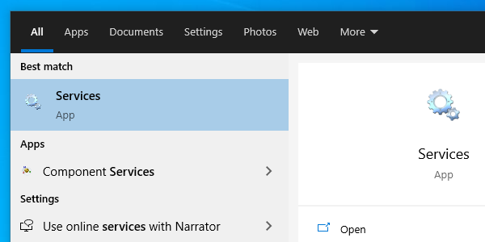

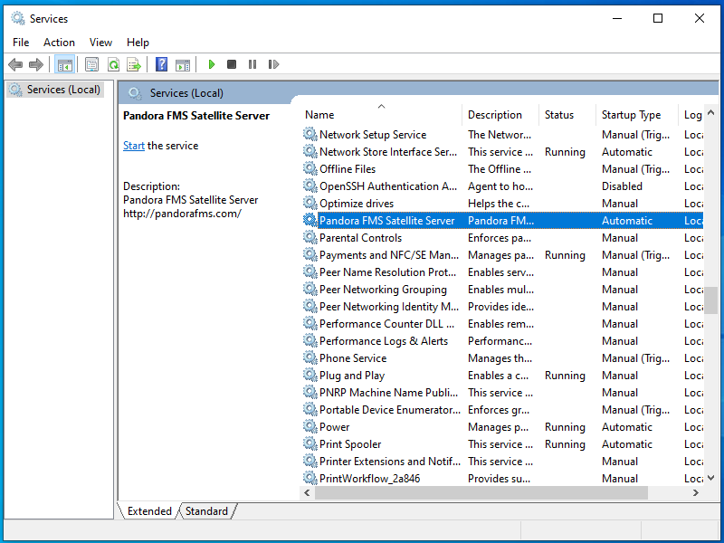

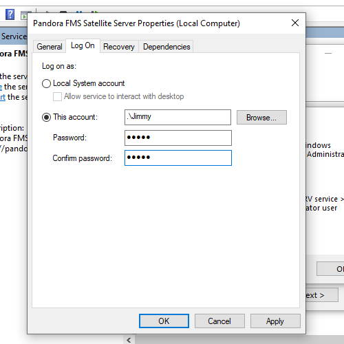

En ce qui concerne ARM, l'installateur en ligne prend en charge `aarch64` (ARM64)
en plus de `x86_64` : EL 8, 9 et 10, Ubuntu 22.04 et Raspberry Pi OS / Debian 12
et 13 en 64 bits. Le paquet ARM est autonome et embarque son propre interpréteur
Perl compilé pour `aarch64`. `armv7l` (ARM 32 bits) n'est pas pris en charge : si
le système est en 32 bits, l'installateur s'arrête. Sur les cartes disposant de
peu de mémoire, la vérification des ressources peut être omise avec
`SKIP_RESOURCE_CHECKS=1`. Les détails complets, avec les variables de
l'installateur, sont dans
[Installation du satellite](../parte-1/1.1-instalacion.md#installation-du-satellite).

## Configuration du serveur satellite

### Le fichier de configuration et la configuration distante

La configuration du satellite réside dans `/etc/pandora/satellite_server.conf`,
au format `jeton valeur`, une ligne par jeton. Sauf les directives qui admettent
plusieurs lignes (les listes d'hôtes et les boîtes d'identifiants, comme on le
verra plus loin), chaque jeton n'apparaît qu'une seule fois. Tous les paramètres
qui sont des temps ou des échéances s'expriment en secondes : la valeur par
défaut générique, quand rien d'autre n'est indiqué, est de 300 secondes.

Le fichier peut être modifié à la main sur la machine du satellite, mais
l'habitude est de le faire depuis la console web. Dans **Gestion → Serveurs →
Gérer les serveurs**, l'icône de **Configuration distante** ouvre la configuration
du satellite :

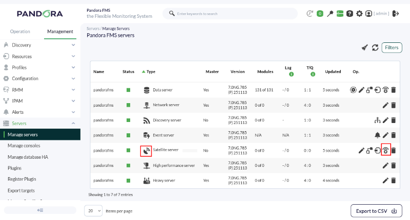

La configuration distante offre deux éditeurs. L'**Éditeur avancé** affiche le
texte complet du fichier, prêt pour modifier les jetons à la main et enregistrer
avec le bouton **Mettre à jour** :

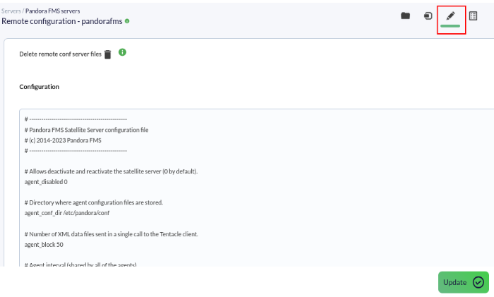

L'**Éditeur standard**, dans l'onglet de gauche, présente les jetons de façon
guidée et avec une recherche dynamique : vous saisissez une ou plusieurs lettres
et il filtre les jetons qui les contiennent.

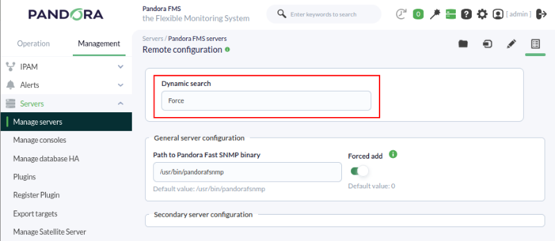

Certains jetons n'admettent que deux valeurs, ON ou OFF. Dans l'éditeur standard,
le premier bouton change cette valeur ; le second active ou désactive le jeton, et
le désactiver fait prendre au satellite la valeur par défaut qui lui est assignée
(1 ou 0), quel que soit l'état affiché par le premier bouton.

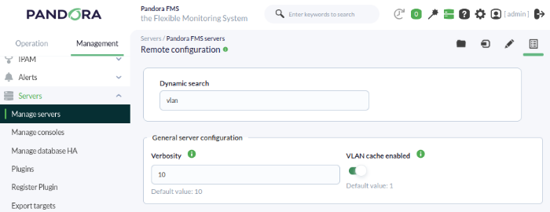

!!! note "Les changements ne sont pas instantanés"
    La synchronisation et le chargement des nouveaux jetons prennent un peu de
    temps. Il faut attendre quelques instants qu'ils se propagent ; le satellite
    récupère la configuration dans son cycle habituel.

Ce sont **deux** jetons qui décident quand la configuration distante est relue, et
il convient de bien les distinguer :

| Jeton | Valeur par défaut | Ce qu'il contrôle |
|---|---|---|
| `server_threshold` | 5 | Cadence des tâches communes du satellite : il vérifie **sa propre** configuration distante (si elle a changé, il redémarre pour l'appliquer) et regarde s'il y a de nouvelles collections. C'est lui qui fixe le délai de prise en compte d'un changement de ses jetons |
| `conf_interval` | 300 | Tous les combien de secondes il vérifie la configuration distante de **chaque agent** qu'il a découvert |

`keepalive`, en revanche, n'a rien à voir avec le rechargement de la
configuration : c'est le battement avec lequel le satellite informe le serveur de
son état (version, groupe, s'il est désactivé). Il est expliqué dans la référence
des paramètres, plus bas.

Un exemple typique : vous voulez que le satellite envoie des données chaque minute
et qu'il vérifie la configuration distante de ses agents toutes les quinze
secondes. Dans l'Éditeur avancé, vous passez `agent_interval` à `60` et
`conf_interval` à `15` :

```ini
agent_interval 60
conf_interval 15
```

Vous enregistrez avec **Mettre à jour** et vous attendez que le cycle reprenne les
valeurs. L'envoi du XML de données se fait alors chaque minute et la vérification
des configurations des agents, toutes les quinze secondes. Pour que le satellite
applique plus tôt un changement de **ses propres** jetons, c'est
`server_threshold` qui existe, pas `keepalive`.

### Référence des paramètres

Voici l'inventaire complet de `satellite_server.conf`. Le chapitre 9.3 (Référence
de configuration du serveur) exclut les jetons propres au satellite et renvoie
ici, c'est donc la référence dont dépendent tous les autres chapitres.

**Les valeurs par défaut publiées sont celles du programme**, pas celles du
modèle d'exemple qui est installé. Lorsque le modèle apporte une autre valeur,
elle est indiquée entre parenthèses pour qu'elle ne surprenne pas lors de la
comparaison avec le fichier fraîchement installé : l'installation laisse le
modèle en place et ses valeurs sont celles qui restent actives tant qu'elles ne
sont pas modifiées.

**Général et serveur principal**

| Paramètre | Valeur par défaut | Ce qu'il fait |
|---|---|---|
| `server_ip` | `127.0.0.1` | Adresse IP ou nom DNS du serveur Pandora FMS auquel envoyer les données. La communication passe par Tentacle, port `41121/tcp` |
| `server_port` | `41121` | Port du serveur Tentacle |
| `server_name` | nom de l'équipement (vide : le *hostname* est utilisé) | Nom du serveur satellite |
| `server_path` | `/var/spool/pandora/data_in` | Répertoire où les XML sont copiés lorsque `transfer_mode` vaut `local` |
| `server_opts` | vide | Paramètres passés au client Tentacle, par exemple `-x password` |
| `transfer_mode` | `tentacle` | Mode de transfert : `tentacle` ou `local` |
| `daemon` | `1` | Avec la valeur `1`, exécute le service en arrière-plan |
| `keepalive` | `30` | Tous les combien de secondes le satellite informe le serveur de son état (le XML du satellite lui-même). Il ne vérifie pas la configuration distante |
| `verbosity` | `3` | Niveau de détail du journal, de 0 (le moins) à 10 (le plus) |
| `server_threshold` | `5` | Cadence des tâches communes : il vérifie sa propre configuration distante (si elle change, il redémarre) et cherche les nouvelles collections |
| `conf_interval` | `300` | Tous les combien de secondes il vérifie la configuration distante de chaque agent découvert |
| `log_file` | `/var/log/satellite_server.log` | Fichier de journal du satellite |
| `agent_disabled` | `0` | Désactive (`1`) ou réactive (`0`) le satellite |
| `remote_config` | `0` (le modèle apporte `1`) | Active la configuration distante du satellite lui-même et de ses agents |

**Serveur secondaire**

| Paramètre | Valeur par défaut | Ce qu'il fait |
|---|---|---|
| `secondary_mode` | `never` | Mode du serveur secondaire : `on_error` envoie au secondaire seulement si le primaire échoue ; `always` envoie toujours ; `never` le désactive |
| `secondary_server_ip` | `localhost` | Adresse du serveur secondaire |
| `secondary_server_path` | `/var/spool/pandora/data_in` | Répertoire local du serveur secondaire, si le mode de transfert est `local` |
| `secondary_server_port` | `41121` | Port Tentacle du serveur secondaire |
| `secondary_transfer_mode` | `tentacle` | Mode de transfert vers le serveur secondaire |
| `secondary_server_opts` | vide | Paramètres supplémentaires du client Tentacle pour le secondaire |

**Découverte**

| Paramètre | Valeur par défaut | Ce qu'il fait |
|---|---|---|
| `recon_enabled` | `0` (le modèle apporte `1`) | Active (`1`) ou désactive (`0`) l'auto-découverte des équipements |
| `recon_mode` | `icmp,snmp` (le modèle apporte `icmp`) | Protocoles de la découverte, séparés par des virgules : `icmp`, `snmp`, `wmi` |
| `recon_task` | vide | Réseaux ou adresses à explorer, séparés par des virgules et en notation avec barre oblique, par exemple `192.168.10.0/24,10.0.1.0/22` |
| `recon_community` | `public` | Communautés SNMP qui seront essayées lors de la découverte, séparées par des virgules |
| `recon_interval` | `604800` | Temps entre deux explorations du réseau, en secondes (sept jours) |
| `recon_timing_template` | `2` (le modèle apporte `3`) | Agressivité de l'exploration du réseau et de `nmap` : de 1 (plus lent et fiable) à 5 (plus rapide et moins fiable) |
| `ipam_task` | vide | Réseaux à explorer par IPAM, précédés de l'identifiant de la tâche IPAM, par exemple `1,192.168.0.0/24` |
| `ipam_interval` | `300` (le modèle apporte `604800`) | Temps entre deux explorations IPAM, en secondes |
| `host_file` | vide | Fichier alternatif contenant les hôtes à superviser, une adresse par ligne |
| `forced_add` | `0` (le modèle apporte `1`) | Avec `1`, les hôtes ajoutés à la main (par `add_host` ou par `host_file`) sont toujours créés, même s'ils ne répondent pas au ping, avec un fichier sans modules |
| `dynamic_inc` | `0` | Avec `1`, déplace les modules dynamiques découverts (SNMP, WMI…) vers des fichiers séparés pour qu'ils n'interfèrent pas avec la configuration distante |
| `vlan_cache_enabled` | `1` | Active ou désactive le cache VLAN des hôtes auto-découverts |
| `general_gis_exec` | vide | Script qui fournit le positionnement GIS à tous les agents détectés ; il doit être exécutable et afficher `<longitude>,<latitude>[,<altitude>]` |
| `agents_blacklist_icmp` | vide | Sous-réseaux exclus des vérifications ICMP, en notation CIDR et séparés par des virgules |
| `agents_blacklist_snmp` | vide | Sous-réseaux exclus des vérifications SNMP |
| `agents_blacklist_wmi` | vide | Sous-réseaux exclus des vérifications WMI |
| `fping` | `/usr/sbin/fping` | Chemin du binaire Fping |
| `fsnmp` | `/usr/bin/pandorafsnmp` | Chemin du binaire Pandora Fast SNMP |
| `nmap` | `/usr/bin/nmap` | Chemin du binaire Nmap |

Les directives `add_host`, `ignore_host` et `delete_host` ne sont pas des jetons à
valeur unique : ce sont des listes qui peuvent occuper plusieurs lignes.
`add_host <IP> [nom]` enregistre un hôte supervisé ; `ignore_host <agent>` le
retire de la liste même si une tâche de reconnaissance le trouve ; et
`delete_host <agent>` le supprime de façon permanente, en effaçant son fichier de
configuration.

**Interrogation : ping et latence**

| Paramètre | Valeur par défaut | Ce qu'il fait |
|---|---|---|
| `ping_block` | `400` | Nombre d'hôtes traités en un seul appel à `nmap` pour le ping ; 500 au maximum |
| `ping_interval` | `60` (le modèle apporte `120`) | Temps entre deux vérifications de ping, en secondes |
| `ping_packets` | `1` | Nombre de paquets ICMP envoyés par ping |
| `ping_retries` | `2` | Tentatives des modules de ping |
| `ping_threads` | `10` (le modèle apporte `4`) | Threads dédiés aux vérifications de ping |
| `ping_timeout` | `1` | Délai d'attente des vérifications de ping, en secondes |
| `latency_block` | `400` | Nombre d'hôtes traités en un seul appel à `nmap` pour la latence ; 500 au maximum |
| `latency_interval` | `60` (le modèle apporte `180`) | Temps entre deux vérifications de latence, en secondes |
| `latency_packets` | `1` | Nombre de paquets ICMP par requête de latence |
| `latency_retries` | `2` | Tentatives des modules de latence |
| `latency_threads` | `10` (le modèle apporte `4`) | Threads dédiés aux vérifications de latence |
| `latency_timeout` | `1` | Délai d'attente des vérifications de latence, en secondes |

**Interrogation : TCP, SSH, WMI, exécution et plugins**

| Paramètre | Valeur par défaut | Ce qu'il fait |
|---|---|---|
| `tcp_interval` | `300` | Temps entre deux vérifications TCP, en secondes |
| `tcp_threads` | `4` (le modèle apporte `5`) | Threads dédiés aux vérifications TCP |
| `tcp_timeout` | `1` | Délai d'attente des vérifications TCP, en secondes |
| `ssh_interval` | `300` | Temps entre deux vérifications SSH, en secondes |
| `ssh_threads` | `1` (le modèle apporte `5`) | Threads dédiés aux modules SSH |
| `ssh_timeout` | `2` | Délai d'attente des vérifications SSH, en secondes |
| `wmi_interval` | `300` | Temps entre deux vérifications WMI, en secondes |
| `wmi_threads` | `5` | Threads dédiés à l'interrogation WMI |
| `wmi_client` | `/usr/bin/wmic` (le modèle apporte `/usr/bin/pandorawmic`) | Chemin complet du client WMI ; en production, PandoraWMIC est utilisé |
| `wmi_auth` | `Administrator%password` | Paires `utilisateur%mot de passe` pour l'authentification WMI, séparées par des virgules |
| `wmi_ntlmv2` | `0` | Active (`1`) ou désactive (`0`) l'authentification NTLMv2 pour WMI |
| `exec_interval` | `300` | Temps entre deux vérifications d'exécution, en secondes |
| `exec_threads` | `5` | Threads dédiés aux modules d'exécution ; au-delà de 20, les performances peuvent se dégrader |
| `plugin_interval` | `300` | Temps entre deux vérifications des plugins, en secondes |
| `plugin_threads` | `4` (le modèle apporte `2`) | Threads dédiés aux plugins |
| `plugin_timeout` | `30` (le modèle apporte `10`) | Délai d'attente des plugins, en secondes |

**Interrogation : SNMP**

| Paramètre | Valeur par défaut | Ce qu'il fait |
|---|---|---|
| `snmp_version` | `1` | Version SNMP par défaut (`1` ou `2c`) ; les modules SNMPv3 déclarent la leur. La changer peut casser des modules existants |
| `snmp_block` | `70` (le modèle apporte `50`) | Hôtes traités en un seul appel à `pandorafsnmp` (SNMPv1) |
| `snmp_interval` | `60` (le modèle apporte `180`) | Temps entre deux vérifications SNMPv1, en secondes |
| `snmp_retries` | `2` | Tentatives des modules SNMPv1 |
| `snmp_threads` | `10` (le modèle apporte `8`) | Threads dédiés à SNMPv1 |
| `snmp_timeout` | `4` (le modèle apporte `5`) | Délai d'attente SNMPv1, en secondes |
| `snmp_verify` | `0` | Vérifie les modules SNMPv1 qui font échouer `pandorafsnmp` |
| `snmp2_block` | `70` (le modèle apporte `50`) | Hôtes traités en un appel à `pandorafsnmp` (SNMPv2c) |
| `snmp2_interval` | `60` (le modèle apporte `180`) | Temps entre deux vérifications SNMPv2c, en secondes |
| `snmp2_retries` | `2` | Tentatives des modules SNMPv2c |
| `snmp2_threads` | `10` (le modèle apporte `8`) | Threads dédiés à SNMPv2c |
| `snmp2_timeout` | `4` (le modèle apporte `5`) | Délai d'attente SNMPv2c, en secondes |
| `snmp2_verify` | `0` | Vérifie les modules SNMPv2c problématiques |
| `snmp3_block` | `70` (le modèle apporte `50`) | Hôtes traités en un appel à `pandorafsnmp` (SNMPv3) |
| `snmp3_interval` | `60` (le modèle apporte `180`) | Temps entre deux vérifications SNMPv3, en secondes |
| `snmp3_retries` | `2` | Tentatives des modules SNMPv3 |
| `snmp3_threads` | `10` (le modèle apporte `4`) | Threads dédiés à SNMPv3 |
| `snmp3_timeout` | `4` (le modèle apporte `5`) | Délai d'attente SNMPv3, en secondes |
| `snmp3_verify` | `0` | Vérifie les modules SNMPv3 problématiques |

**Identifiants et chiffrement**

| Paramètre | Valeur par défaut | Ce qu'il fait |
|---|---|---|
| `credential_pass` | nom de l'équipement | Mot de passe avec lequel sont chiffrés les mots de passe des boîtes d'identifiants ; il doit correspondre à celui défini dans la console web |
| `snmp3_seclevel` | `authpriv` | Niveau de sécurité SNMPv3 : `noauth`, `authnopriv` ou `authpriv` |
| `snmp3_secname` | vide | Nom de sécurité SNMPv3 |
| `snmp3_authproto` | `sha` | Protocole d'authentification SNMPv3 : `md5` ou `sha` |
| `snmp3_authpass` | vide | Mot de passe d'authentification SNMPv3 |
| `snmp3_privproto` | `des` | Protocole de confidentialité SNMPv3 : `des` ou `aes` |
| `snmp3_privpass` | vide | Mot de passe de confidentialité SNMPv3 |
| `wmi_credential_encrypt` | `0` | Chiffre les mots de passe des modules WMI et du jeton `wmi_auth` ; sans `credential_pass`, le nom du satellite est utilisé |
| `snmp3_credential_encrypt` | `0` | Chiffre les mots de passe des modules SNMPv3 et des jetons `snmp3_authpass` et `snmp3_privpass` |

Les boîtes d'identifiants (`credential_box`, `ssh_credential_box`,
`wmi_credential_box` et `snmp3_credential_box`) sont elles aussi des directives de
liste et admettent plusieurs lignes ; elles sont détaillées dans
[Boîtes d'identifiants](#boites-didentifiants).

**Transfert et stockage**

| Paramètre | Valeur par défaut | Ce qu'il fait |
|---|---|---|
| `agent_interval` | `300` | Tous les combien de secondes les données sont envoyées au serveur, indépendamment de la fréquence d'interrogation |
| `agent_threads` | `1` (le modèle apporte `4`) | Threads utilisés pour envoyer les XML de données |
| `agent_block` | `50` | Nombre de XML envoyés en un seul appel au client Tentacle |
| `connection_interval` | `300` | Tous les combien de secondes le XML de connexions est envoyé au serveur (la carte des liens entre agents), s'il y a des changements |
| `agent_conf_dir` | `/etc/pandora/conf` (`./conf` dans la valeur interne) | Répertoire où sont créés et stockés les fichiers de configuration de chaque agent |
| `group` | `Servers` (vide dans la valeur interne) | Groupe par défaut des agents créés par le satellite ; il doit exister dans la console web |
| `xml_buffer` | `0` | Avec `1`, conserve les XML qui n'ont pas pu être envoyés pour les réessayer plus tard |
| `temporal` | `/tmp` | Répertoire temporaire où sont créés les XML |
| `temporal_min_size` | `1` (le modèle apporte `1024`) | Espace libre minimal, en mégaoctets, de la partition temporaire ; en dessous de cette valeur, il cesse de générer des paquets |
| `startup_delay` | `30` (le modèle apporte `60`) | Attente, en secondes, avant le premier envoi de données |
| `tentacle_client` | `/usr/bin/tentacle_client` | Chemin complet du client Tentacle |
| `timeout_bin` | vide | S'il est défini, fait précéder les appels au client Tentacle du programme `timeout` (normalement `/usr/bin/timeout`) |
| `timeout_seconds` | `10` | Délai d'expiration, en secondes, du programme `timeout` ; nécessite `timeout_bin` |

**Proxy**

| Paramètre | Valeur par défaut | Ce qu'il fait |
|---|---|---|
| `proxy_traps_to` | vide | Redirige les traps SNMP reçus vers `IP[:port]` ; port `162` par défaut |
| `proxy_traps_from` | `0.0.0.0:162` | Adresse et port locaux sur lesquels les traps SNMP sont reçus |
| `proxy_tentacle_from` | `0.0.0.0:41121` | Redirige les données reçues par le serveur Tentacle local depuis `IP[:port]` |
| `proxy_tentacle_to` | vide | Redirige les requêtes des clients Tentacle reçues vers `IP[:port]` ; port `41121` par défaut |

**Tunnel SSH inverse et collections**

| Paramètre | Valeur par défaut | Ce qu'il fait |
|---|---|---|
| `reverse_ssh_config` | `/etc/pandora/reverse_ssh_config` | Répertoire où le satellite stocke la configuration et les clés du tunnel SSH inverse |
| `reverse_ssh_interval` | `15` | Tous les combien de secondes le satellite vérifie l'état du tunnel inverse |
| `collection_dir` | dérivé de `agent_conf_dir` | Répertoire où le satellite décompresse les collections que la console web lui assigne |

Outre ces jetons, le programme gère une poignée de valeurs internes qui, en
pratique, ne se modifient pas à la main : le nom automatique des agents
découverts, les délais internes d'envoi, le mode de décompression des collections,
le chemin du binaire `unzip` et la licence du produit. Elles se gèrent depuis
l'installation et depuis la console web ; elles ne font pas partie de la
configuration qu'il convient de modifier dans le fichier.

!!! note "Le proxy ne touche pas à la configuration des agents"
    `proxy_tentacle_to` est un renvoi : le satellite écoute les connexions
    Tentacle qui lui arrivent et les passe à l'adresse de destination. Il ne lit
    ni n'écrit la configuration d'aucun agent, il n'entre donc pas en conflit
    avec la configuration distante : celle de l'agent du satellite vit dans le
    satellite et celle de l'EndPoint, dans l'EndPoint.

    Attention au nom, en revanche. Le serveur identifie l'agent par son nom
    lorsqu'il traite le XML qu'il reçoit : si l'équipement a déjà un agent du
    satellite et que vous créez par-dessus un EndPoint du même nom, deux agents
    n'apparaissent pas : c'est **un seul**, qui reçoit des données des deux côtés
    et mélange ses modules. Dans sa fiche, vous verrez les deux configurations
    séparément — la configuration distante de l'EndPoint et la configuration
    distante de satellites —, mais l'agent est le même.

## Création d'agents sur le serveur satellite

Un agent du satellite est un fichier de configuration dans le répertoire
`agent_conf_dir`. Il y a quatre chemins pour y arriver, et bien choisir le chemin
évite des ennuis par la suite, surtout au moment de supprimer :

- **Depuis la console web.** Le satellite crée l'agent pour vous. C'est le plus
  commode lorsque le satellite est déjà en marche.
- **Recon Task.** Le satellite explore un réseau et enregistre ce qu'il trouve.
- **Fichier d'hôtes.** Une liste d'adresses que vous fournissez.
- **Enregistrement manuel.** Écrire le fichier `.conf` à la main.

!!! warning "Un agent sans modules est ignoré"
    Si le fichier de configuration d'un agent ne contient aucun module, le
    satellite l'ignore (sauf avec `forced_add` à `1`, comme expliqué plus bas) :
    un agent sans rien à vérifier ne génère pas de XML et n'apparaît pas comme
    supervisé.

!!! note "Ajout forcé (`forced_add`)"
    Le jeton `forced_add` décide comment les hôtes sont enregistrés. Avec `1`,
    ceux qui arrivent par la console (`add_host`) ou par le fichier d'hôtes sont
    toujours créés, même s'ils ne répondent pas au ping, et les agents sans
    modules sont conservés. Avec `0`, il faut répondre au ping pour qu'ils soient
    créés et un agent sans modules est ignoré. Dans les installations neuves, il
    arrive généralement activé ; lors d'une mise à jour, il peut arriver
    désactivé, il convient donc de le vérifier. Il n'intervient pas dans la
    découverte par Recon Task : là, c'est ce que trouve le balayage qui commande.
    Il se trouve dans la [référence des paramètres](#reference-des-parametres).

### Depuis la console web

Avec la configuration distante activée, la console web crée l'agent pour vous :
il n'y a aucun fichier à toucher. On peut le faire depuis la vue de gestion des
agents ou depuis la vue du satellite lui-même.

Quelle que soit celle des trois voies, le mécanisme sous-jacent est le même : la
console ne crée pas directement le fichier de l'agent. Elle ajoute à la
configuration du satellite une ligne `add_host <ip> <nom>`, et c'est le satellite
qui, à son cycle suivant, crée le fichier `.conf` de l'agent dans
`/etc/pandora/conf` du satellite.

#### Gestion des agents

Le chemin direct est **Gestion → Ressources → Gérer les agents**. Dans cette vue,
le bouton **Créer un agent satellite** ouvre le formulaire **Ajouter un agent au
satellite**, qui demande quatre données : l'**adresse de l'agent**, son **nom**,
le **groupe** et le **serveur satellite** auquel il est assigné.

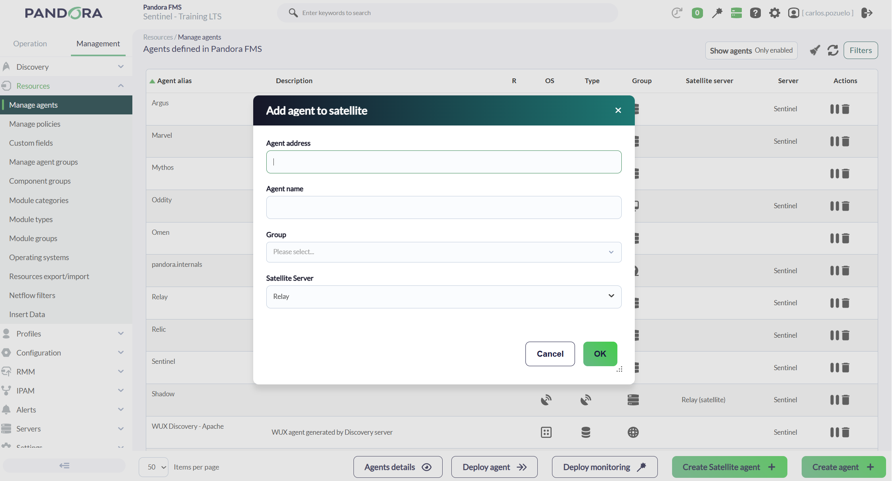

À l'enregistrement, le satellite crée l'agent à son cycle suivant et commence à
envoyer des données.

#### Gestion des satellites

Le menu **Gestion → Serveurs → Gérer les serveurs satellite** liste les satellites
et donne accès, pour chacun, à ses collections, sa configuration distante et la
gestion des agents :

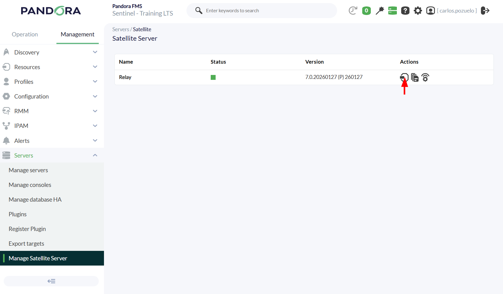

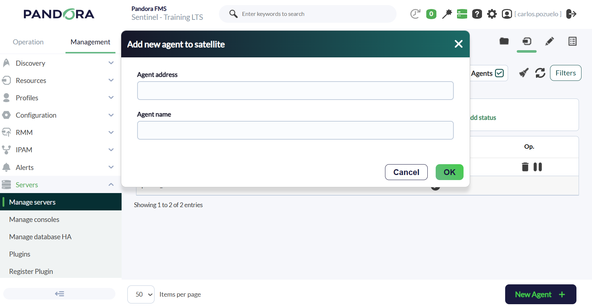

L'écran de gestion des agents permet de créer des agents, de consulter leurs
informations, de les supprimer et de les désactiver :

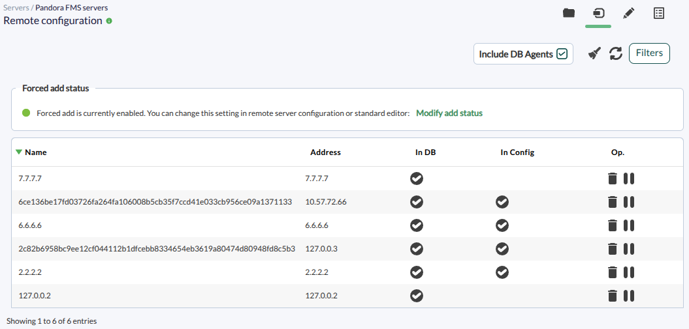

!!! tip "Les noms sont affichés, pas les alias"
    La liste des agents du satellite utilise le nom de l'agent, pas son alias.

Si un agent appartient à un satellite et a la configuration distante activée, une
nouvelle section apparaît dans la gestion de l'agent pour modifier ou supprimer
son fichier de configuration :

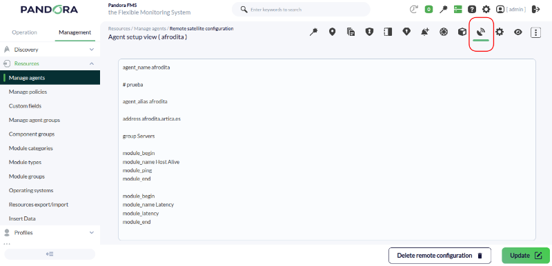

#### Depuis un agent existant

On peut aussi générer un agent de satellite à partir d'un agent Pandora FMS déjà
existant, distant ou local, pour bifurquer la supervision et exécuter des modules
depuis deux points différents. Dans l'édition de cet agent, s'il n'a pas déjà un
agent satellite assigné, le bouton pour créer sa configuration apparaît :

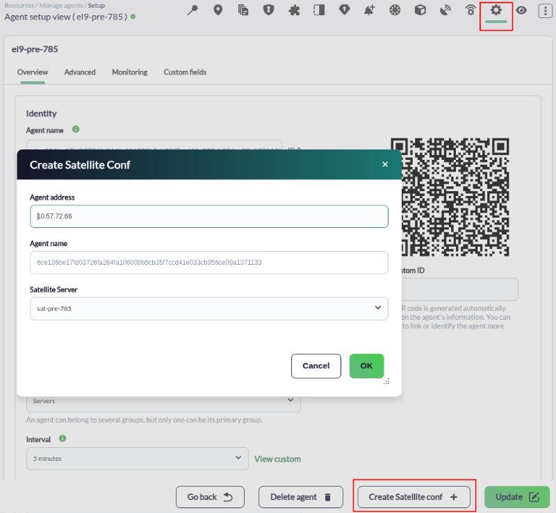

La console remplit les données de l'agent et permet de choisir le serveur satellite
auquel l'ajouter et l'adresse IP que ce satellite utilisera. Le processus crée le
fichier de configuration du satellite et ajoute un hôte à sa configuration ; les
données sont rapportées à l'agent depuis lequel il a été créé.

### Recon Task

C'est la méthode la plus utilisée : on indique au satellite quelles plages
explorer et avec quels protocoles, et il découvre les équipements et crée les
agents. Les paramètres impliqués sont :

- `recon_enabled` : à `1` pour activer la découverte.
- `recon_mode` : protocoles séparés par des virgules (`icmp`, `snmp`, `wmi`).
- `recon_task` : réseaux à explorer, séparés par des virgules et en notation avec
  barre oblique.
- `recon_community` : communautés SNMP à essayer, séparées par des virgules.
- `recon_interval` : tous les combien de temps l'exploration est répétée, en
  secondes.
- `recon_timing_template` : agressivité de `nmap`, de 1 à 5.

En mode `icmp`, le satellite vérifie si l'hôte répond et mesure la latence. En
`snmp` (v1 et v2c seulement), il cherche les interfaces réseau, en extrait le
trafic et l'état opérationnel, et obtient le nom et l'emplacement de l'équipement
en essayant la liste de communautés. En `wmi`, il fait de même avec la charge
CPU, la mémoire et tous les disques disponibles. Pour SNMPv3, la reconnaissance
n'est pas utilisée, car elle n'apporte rien : les identifiants se configurent à
part, comme expliqué dans [SNMPv3](#snmpv3).

Exemple de tâche de reconnaissance sur le réseau de l'exemple :

```ini
recon_community public
recon_enabled 1
recon_interval 604800
recon_mode icmp,snmp,wmi
recon_task 192.168.10.0/24
recon_timing_template 3
```

Après l'enregistrement, le satellite est démarré ou redémarré et l'exploration
commence. Les agents qu'il trouve apparaissent dans la vue des agents dès qu'ils
envoient leur premier XML.

### Fichier d'hôtes

C'est le complément de la découverte ou son alternative lorsque vous savez déjà
exactement quelles adresses vous voulez. On décommente la ligne `host_file` et on
pointe vers le fichier :

```ini
host_file /etc/pandora/satellite_hosts.txt
```

Le fichier contient une adresse par ligne ; éventuellement, derrière l'adresse et
séparé par un espace, le nom avec lequel créer l'agent. Si un nom est indiqué,
l'agent est créé avec ce nom et utilise l'adresse pour ses modules :

```text
192.168.10.5 Server5
192.168.10.6 Server6
192.168.10.7 Server7
```

À moins que `forced_add` ne soit à `1`, les adresses doivent répondre à `fping`
pour que l'agent soit créé. La lecture du fichier se fait toutes les
`recon_interval` secondes.

!!! note "Chemins sous Windows"
    Sous Windows, le chemin du fichier d'hôtes s'écrit **sans** guillemets.

### Enregistrement manuel

C'est le chemin direct : créer à la main le fichier `.conf` de l'agent dans le
répertoire des configurations, `/etc/pandora/conf` par défaut. Les champs de base
sont :

- `agent_name` : nom de l'agent.
- `agent_alias` : alias de l'agent.
- `address` : adresse IP de l'élément à superviser.
- `group` : groupe auquel assigner l'agent.
- `gis_exec` : script de positionnement, facultatif ; s'il est utilisé, il
  remplace l'emplacement fourni par `general_gis_exec` sur le satellite.

Ensuite, on ajoute les modules. Un exemple de fichier :

```ini
agent_name Example
agent_alias This is an example
address 192.168.10.20
group Servers

module_begin
module_name Ping
module_ping 192.168.10.20
module_end

module_begin
module_name Latency
module_latency 192.168.10.20
module_end
```

## Suppression d'agents

Un agent du satellite existe à deux endroits à la fois : comme fichier de
configuration sur le serveur satellite et comme agent dans la base de données de
Pandora FMS. Pour le supprimer complètement, il faut le retirer des deux. Si vous
en laissez un, l'agent survit par l'autre côté : avec le fichier, le satellite
continue d'interroger l'équipement et d'envoyer des données ; sans le fichier mais
avec l'agent dans la base de données, il reste un agent orphelin dans la console,
sans nouvelles données. L'ordre est toujours le même : d'abord le satellite,
ensuite la console.

!!! warning "Sauvegarde avant de supprimer"
    Avant de toucher à quoi que ce soit, sauvegardez les dossiers et leurs
    fichiers. La suppression d'un agent ne se défait pas depuis la console web.

### Depuis la console web

C'est le chemin recommandé. Dans **Gestion → Serveurs → Gérer les serveurs
satellite**, entrez dans la gestion des agents de ce satellite et cliquez sur le
bouton corbeille de l'agent :

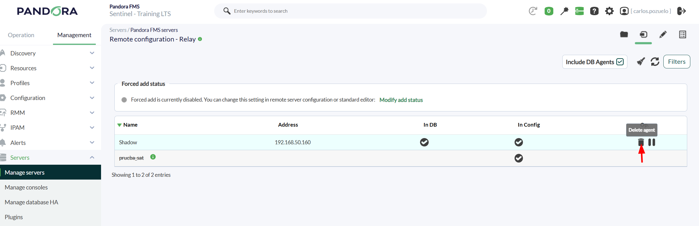

La console ajoute à la configuration du satellite la directive `delete_host
<agent>`, et à l'intervalle suivant le satellite efface le fichier de
configuration de cet agent et cesse de l'envoyer. Une fois cela fait, l'agent peut
être supprimé depuis **Gestion → Ressources → Gérer les agents**.

Depuis la console web elle-même, la suppression massive d'agents d'un satellite a
sa procédure dans
[Opérations massives](../parte-12/12.10-operaciones-masivas.md).

### Manuel

Effacez le fichier `.conf` de l'agent dans `/etc/pandora/conf` du satellite, puis
supprimez l'agent dans la console web.

### Fichier d'hôtes

Retirez du fichier `satellite_hosts.txt` les lignes des adresses à supprimer,
effacez leurs `.conf` dans `/etc/pandora/conf` du satellite et supprimez l'agent
dans la console web.

### Recon Task

Désconfigurez la tâche de reconnaissance dans le fichier du satellite, effacez les
`.conf` créés dans `/etc/pandora/conf` du satellite et supprimez l'agent dans la
console web. Si ce que vous voulez est de continuer à utiliser la Recon Task mais
que cet équipement ne soit plus enregistré, ajoutez son adresse à
`agents_blacklist_icmp` (la notation CIDR et plusieurs entrées séparées par des
virgules sont acceptées) : la reconnaissance cesse de lui ajouter les modules ICMP
et, s'il ne lui reste aucun autre module, le satellite l'ignore.

!!! example "Supprimer un agent découvert dans 192.168.10.0/24"
    Le switch `192.168.10.2` a été découvert par une tâche de reconnaissance sur
    `192.168.10.0/24`. Depuis **Gestion → Serveurs → Gérer les serveurs
    satellite**, dans la gestion des agents du satellite, vous cliquez sur la
    corbeille de `192.168.10.2` : la console ajoute `delete_host 192.168.10.2` à
    la configuration, et à l'intervalle suivant le satellite efface son `.conf`
    et cesse de l'envoyer. Ensuite, vous le supprimez dans **Gestion → Ressources
    → Gérer les agents**. Si vous ne voulez pas non plus qu'il réapparaisse,
    ajoutez son adresse à `agents_blacklist_icmp`.

## Modules du satellite

Outre les modules que le satellite génère seul lorsqu'il découvre un équipement,
on peut lui ajouter à la main n'importe quelle vérification ICMP, TCP, SNMP, WMI,
SSH, d'exécution ou de plugin. La syntaxe du fichier de configuration de l'agent
est pratiquement la même que celle des modules locaux d'un EndPoint : quiconque a
déjà écrit un `module_*` se sent tout de suite chez lui.

La console web propose des types de module spécifiques lorsque l'agent appartient
à un satellite avec configuration distante : **Satellite ICMP module**,
**Satellite SNMP module**, **Satellite WMI module**, **Satellite SSH module**,
**Satellite Exec module** et **Satellite TCP module**.

!!! note "Identifiants"
    À moins que l'authentification ne se fasse par clé publique et privée, les
    modules SSH, WMI et SNMPv3 ont besoin d'un utilisateur et d'un mot de passe.
    Ils s'enregistrent dans des boîtes d'identifiants, chiffrées. Elles sont
    expliquées plus bas, dans
    [Boîtes d'identifiants](#boites-didentifiants).

### Création de modules satellite

Il y a deux façons d'ajouter un module à un agent du satellite : depuis la console
web, qui l'écrit pour vous, ou directement dans le fichier de configuration de
l'agent, en écrivant le bloc à la main.

#### Modules de type Satellite depuis la console

Depuis la console, il n'est pas nécessaire de connaître la syntaxe : on choisit le
type de module et on remplit le formulaire. Chaque type demande des données
différentes ; celui de SNMP, par exemple, demande l'adresse de destination, le
port, l'OID, la version et la communauté (ou les identifiants SNMPv3), tandis que
celui de TCP se contente de l'adresse et du port.

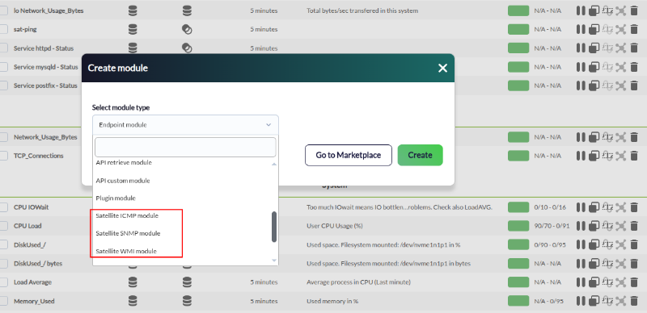

Ce que fait la console en dessous, c'est écrire dans la configuration de l'agent
du satellite le bloc correspondant. Vous pouvez le voir avant d'enregistrer avec
le bouton **Afficher les données de configuration** du formulaire lui-même, qui
déploie le bloc tel qu'il va être écrit.

Un exemple : un module SNMP qui vérifie l'état d'une interface sur
`192.168.10.1`, avec l'OID `.1.3.6.1.2.1.2.2.1.8.3` et la communauté `public`. À
l'enregistrement, la console l'écrit dans la configuration de l'agent et le
satellite l'exécute à son cycle suivant.

#### Depuis le fichier de configuration

L'autre voie consiste à écrire le bloc du module directement dans le fichier de
configuration de l'agent, sur le satellite, comme un module local. C'est le chemin
à prendre lorsque vous préférez tout avoir dans le fichier ou lorsque le module ne
rentre pas dans le formulaire de la console. Les sections qui suivent montrent
comment s'écrit chaque type : ICMP et TCP, WMI, SNMPv1 et SNMPv2, SNMPv3, SSH,
exécution et plugins, avec les boîtes d'identifiants à la fin.

### ICMP et TCP

La connectivité se vérifie avec `module_ping` et la latence avec `module_latency`.
Le port TCP se vérifie avec `module_tcp` et `module_port` :

```ini
module_begin
module_name Ping
module_type generic_data
module_ping 192.168.10.20
module_end

module_begin
module_name Port 80
module_type generic_proc
module_tcp 192.168.10.20
module_port 80
module_end
```

### WMI

Pour Windows, il y a trois modules d'usage direct : `module_wmicpu` pour le
pourcentage de CPU, `module_wmimem` pour la mémoire libre et `module_wmi` avec
`module_wmiquery` pour une requête générique :

```ini
module_begin
module_name CPU
module_type generic_data
module_wmicpu 192.168.10.30
module_wmiauth <utilisateur>%<mot de passe>
module_end

module_begin
module_name FreeMemory
module_type generic_data
module_wmimem 192.168.10.30
module_wmiauth <utilisateur>%<mot de passe>
module_end

module_begin
module_name GenericWMI
module_type generic_data_string
module_wmi 192.168.10.30
module_wmiquery SELECT Name FROM Win32_ComputerSystem
module_wmiauth <utilisateur>%<mot de passe>
module_end
```

Les identifiants du module peuvent être remplacés par une boîte d'identifiants WMI
(`wmi_credential_box`). Et pour que les requêtes WMI distantes fonctionnent sous
Windows, rappelez-vous ce qui a été dit dans
[Installation et mise en service](#installation-et-mise-en-service) : le service
du satellite doit s'exécuter avec un compte administrateur.

### SNMPv1 et SNMPv2

!!! warning "Les OID commencent par un point"
    Assurez-vous que l'OID commence par un point (`.1.3.6.1...`). Sinon, le
    module SNMP ne fonctionnera pas.

Un module SNMP utilise `module_snmp` pour l'adresse, `module_oid` pour
l'identifiant et `module_community` pour la communauté. Le satellite détecte seul
chaque interface réseau, et le nom réel descriptif apparaît dans le nom du
module :

```ini
module_begin
module_name if eth1 OperStatus
module_type generic_data_string
module_snmp 192.168.10.1
module_oid .1.3.6.1.2.1.2.2.1.8.3
module_community public
module_end
```

Pour forcer SNMPv2c ou SNMPv1, on ajoute la ligne correspondante :

```ini
module_version 2c
```

```ini
module_version 1
```

Par exemple, le trafic sortant d'une interface, que le satellite extrait
automatiquement avec le nom réel de l'interface :

```ini
module_begin
module_name if eth0 OutOctets
module_type generic_data_inc
module_snmp 192.168.10.1
module_oid .1.3.6.1.2.1.2.2.1.16.2
module_community public
module_end
```

### SNMPv3

Pour un module SNMPv3, on met `module_version 3` et on spécifie les données de
sécurité propres au module :

- `module_seclevel` : niveau de sécurité (`noauth`, `authnopriv` ou `authpriv`).
- `module_secname` : nom de sécurité.
- `module_authproto` : protocole d'authentification (`md5` ou `sha`).
- `module_authpass` : clé d'authentification.
- `module_privproto` : protocole de confidentialité (`des` ou `aes`).
- `module_privpass` : clé de confidentialité, lorsque le niveau l'exige.

Les trois niveaux, du moins au plus :

```ini
module_begin
module_name snmp_noauth
module_type generic_data_string
module_snmp 192.168.10.1
module_version 3
module_oid .1.3.6.1.2.1.1.1.0
module_seclevel noauth
module_secname snmpuser
module_end
```

```ini
module_begin
module_name snmp_authnopriv
module_type generic_data_string
module_snmp 192.168.10.1
module_version 3
module_oid .1.3.6.1.2.1.1.2.0
module_seclevel authnopriv
module_secname snmpuser
module_authproto md5
module_authpass <mot de passe>
module_end
```

```ini
module_begin
module_name snmp_authpriv
module_type generic_data_string
module_snmp 192.168.10.1
module_version 3
module_oid .1.3.6.1.2.1.1.2.0
module_seclevel authpriv
module_secname snmpuser
module_authproto sha
module_authpass <mot de passe>
module_privproto aes
module_privpass <mot de passe>
module_end
```

Si plusieurs modules partagent la même configuration SNMPv3, on peut la sortir de
la déclaration du module, vers l'agent lui-même ou même vers le fichier du
satellite si plusieurs agents la partagent :

```ini
agent_name snmp
address 192.168.10.1

seclevel authpriv
secname snmpuser
authproto md5
authpass <mot de passe>
privproto des
privpass <mot de passe>

module_begin
module_name snmp_authpriv_1
module_type generic_data_string
module_snmp
module_version 3
module_oid .1.3.6.1.2.1.1.1.0
module_end
```

À l'échelle globale, les jetons `snmp3_seclevel`, `snmp3_secname`,
`snmp3_authproto`, `snmp3_authpass`, `snmp3_privproto` et `snmp3_privpass` du
fichier du satellite remplissent la même fonction pour tous les agents.
Lorsqu'un module SNMPv3 ne porte pas d'identifiants propres et que son adresse IP
correspond à un réseau d'une boîte `snmp3_credential_box`, la boîte est utilisée ;
sinon, les jetons globaux sont utilisés.

### SSH

Le satellite se connecte par SSH à l'équipement distant et y exécute la commande.
L'adresse de destination va dans `module_ssh` et la commande dans
`module_command` :

```ini
module_begin
module_name GenericSSH
module_type generic_data
module_ssh 192.168.10.40
module_command ls /tmp | wc -l
module_end
```

!!! warning "SSH sur les satellites Windows"
    Les requêtes SSH sur les serveurs satellite installés sous Windows sont
    encore en cours d'implémentation.

### Exécution distante

Ici, la commande ou le script s'exécute **sur la machine du satellite elle-même**,
pas sur l'équipement distant. Il se déclare avec `module_exec` ; le script doit
être déployé et accessible sur le satellite, et s'il a besoin d'atteindre
l'équipement distant, il s'y connecte par ses propres moyens. Abuser de
`module_exec` fait chuter les performances du satellite.

```ini
module_begin
module_name Sample_Remote_Exec
module_type generic_data
module_exec /usr/share/test/test.sh 192.168.10.50
module_min_warning 90
module_min_critical 95
module_end
```

!!! tip "Le script peut arriver dans une collection"
    Il n'est pas nécessaire de le copier à la main sur chaque satellite : il peut
    être distribué depuis le serveur Pandora FMS avec les **collections de
    serveur satellite**. Le satellite les télécharge, les décompresse et ajoute
    leur dossier au `PATH`, le script est donc disponible par son nom. Voir
    [Collections sur le serveur satellite](../parte-2/2.9-colecciones.md).

### Plugins

Un plugin se déclare avec `module_plugin` et, comme le module d'exécution, il
s'exécute **sur la machine du satellite** : c'est le plugin qui doit se connecter
à l'équipement distant. En échange, il est bien plus souple qu'une commande
isolée.

```ini
module_plugin /usr/share/pandora/remote_advanced_checks.sh 192.168.10.1
```

!!! tip "Le plugin peut arriver dans une collection"
    Comme le script d'exécution, le plugin peut être distribué depuis le serveur
    Pandora FMS avec les **collections de serveur satellite** : le satellite les
    décompresse et ajoute leur dossier au `PATH`, il est donc disponible par son
    nom. Voir
    [Collections sur le serveur satellite](../parte-2/2.9-colecciones.md).

### Boîtes d'identifiants

Les modules SSH, WMI et SNMPv3 ont besoin d'un utilisateur et d'un mot de passe
(sauf si l'authentification se fait par clé publique et privée). Ils s'enregistrent
dans le fichier du satellite au moyen de boîtes d'identifiants, avec ces
formats :

```text
réseau/masque,utilisateur,mot de passe
réseau/masque,utilisateur,[[mot de passe chiffré]]
```

Par exemple :

```ini
credential_box 192.168.10.10/32,<utilisateur>,<mot de passe 1>
credential_box 192.168.10.0/24,<utilisateur>,<mot de passe 2>
```

La recherche dans les boîtes va du masque le plus restrictif au moins restrictif,
la première qui correspond gagne donc. Les mots de passe peuvent être chiffrés
avec Blowfish en mode ECB ; pour cela, `credential_pass` doit être défini, sinon
c'est le nom de l'équipement qui sert de mot de passe de chiffrement. La
représentation hexadécimale du texte chiffré est entourée de doubles crochets :

```ini
credential_box 192.168.10.0/24,<utilisateur>,[[80b51b60786b3de2]]
```

Il y a une boîte par type de module : `credential_box` (ou `ssh_credential_box`,
qui est son équivalent avec un nom propre), `wmi_credential_box` et
`snmp3_credential_box`. La console web les gère dans l'écran **Boîtes
d'identifiants** du satellite, et le chiffrement est fait par la console
elle-même ; c'est pourquoi `credential_pass` doit correspondre des deux côtés.

!!! warning "La boîte du satellite est à lui"
    Ne confondez pas le gestionnaire d'identifiants général de Pandora FMS avec
    les boîtes du serveur satellite. Celles du satellite sont propres et vivent
    dans son fichier de configuration. Le gestionnaire général est dans
    [Identifiants](../parte-2/2.2-gestor-de-credenciales.md).

### Les modules dynamiques dans la console

Si la configuration du satellite est correcte, la console web affiche une vue
d'agents avec ceux que le satellite a découverts ou créés. Les modules dynamiques
(ceux que le satellite génère en détectant des interfaces, des disques ou le CPU)
apparaissent dans l'agent comme n'importe quel autre module, et peuvent être
filtrés et modifiés comme ceux d'un agent normal.

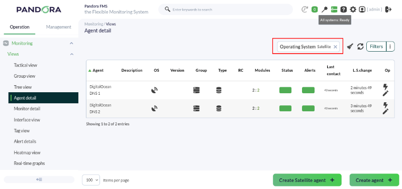

!!! example "Un module dynamique dans la vue"
    Le satellite découvre le switch `192.168.10.1`, crée son agent et lui ajoute
    un module par interface détectée, avec le nom réel de l'interface. Dans la
    vue des agents, cet agent apparaît avec ses modules dynamiques, modifiables
    comme n'importe quel autre.

## Exec Server et tunnel SSH inverse

### Qu'est-ce que l'Exec Server

L'**Exec Server** sert à exécuter des processus de la console web depuis un
serveur distant, au lieu de la console elle-même. Le cas typique : vous voulez
lancer un balayage avec l'assistant SNMP sur un réseau isolé auquel seul le
serveur satellite accède. La console n'a pas de route vers ce réseau, mais le
satellite oui ; avec l'Exec Server, l'assistant s'exécute au point qui voit le
réseau. Les assistants d'agent (SNMP et WMI) et le **navigateur SNMP** en
profitent : leurs requêtes sont lancées depuis le serveur que vous choisissez, pas
depuis la console.

On peut le configurer sur un serveur de réseau Pandora FMS et sur un serveur
satellite. La fonctionnalité utilise le tunnel SSH que Pandora FMS monte
automatiquement ; une fois le tunnel configuré, le serveur devient disponible
comme Exec Server depuis la console web.

### L'activer et l'utiliser

**Activation sur un serveur de réseau.** Dans la fiche du serveur
(**Gestion → Serveurs → Gérer les serveurs**) apparaissent le commutateur **Exec
Server** et un champ **Port**. Si le port est laissé vide, le port SSH par défaut
(22) est utilisé. Avec l'Exec Server activé, un indicateur **Vérifier l'exécution
du serveur** apparaît en plus pour vérifier qu'il répond.

**Activation sur un satellite.** Les satellites ne marquent pas `exec_proxy` : ils
apparaissent comme Exec Server dès que leur tunnel SSH inverse est prêt,
c'est-à-dire lorsque la colonne `reverse_ssh_ready` est active. C'est pourquoi les
deux choses vont de pair.

La console se connecte à l'Exec Server avec l'utilisateur
**`pandora_exec_proxy`**, qui est celui qu'elle s'attend à trouver de l'autre
côté ; si le compte ne correspond pas, la vérification échoue avec un
avertissement indiquant que l'utilisateur doit être `pandora_exec_proxy`.

Partout où l'Exec Server est utilisé, le formulaire inclut un sélecteur pour le
choisir : dans les assistants, il s'appelle **Serveur pour exécuter la commande**
et dans le navigateur SNMP, **Serveur à exécuter**. Dans les deux cas, les options
sont les mêmes :

- **Console locale** : le processus s'exécute sur le serveur de la console
  lui-même.
- **Serveurs standard et satellite** : chacun avec son étiquette, `(Standard)` ou
  `(Satellite)`, pour envoyer l'exécution à ce serveur.

Exemple : sur le réseau isolé `192.168.10.0/24`, accessible uniquement par le
satellite, vous lancez l'assistant SNMP depuis la console web en choisissant ce
satellite comme serveur d'exécution. La console passe par le tunnel SSH, exécute
le balayage depuis la machine du satellite, qui atteint bien le réseau, et renvoie
les résultats à l'assistant. Sans Exec Server ni tunnel, ce balayage n'aurait
aucune sortie. Le navigateur SNMP fonctionne de la même façon : vous choisissez le
satellite dans **Serveur à exécuter** et ses requêtes sont lancées depuis là.

### Assistants d'agent

Les assistants d'agent (l'assistant SNMP, l'assistant SNMP d'interfaces et
l'assistant WMI) peuvent être lancés depuis le serveur satellite avec ses propres
agents, pour déployer de la supervision depuis le point où il y a une route. Pour
cela, il faut avoir activé l'Exec Server dans la configuration du satellite.

### Le tunnel SSH inverse

Le problème est une question de sens : le serveur satellite vit sur un réseau
auquel la console ne peut pas se connecter, il n'y a donc aucun moyen pour la
console d'« entrer » dans le satellite. La solution consiste à inverser le sens.
Le satellite ouvre lui-même une connexion SSH vers la console et crée un tunnel
inverse ; à partir de là, la console peut utiliser l'Exec Server comme si le
satellite était à côté d'elle.

!!! info "Sous Linux uniquement"
    Le tunnel SSH inverse n'est compatible qu'avec les serveurs satellite sous
    Linux.

Cette fonction existe à partir de la version 785. Si le satellite est configuré
avec la configuration distante activée, une nouvelle icône apparaît dans la
console web pour le configurer :

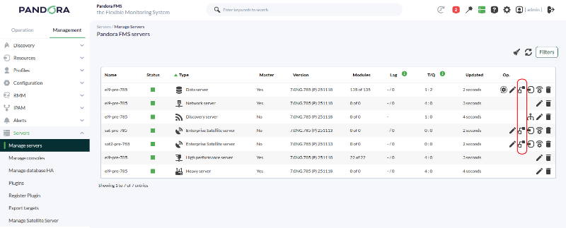

À l'ouverture, les champs du tunnel sont activés et configurés :

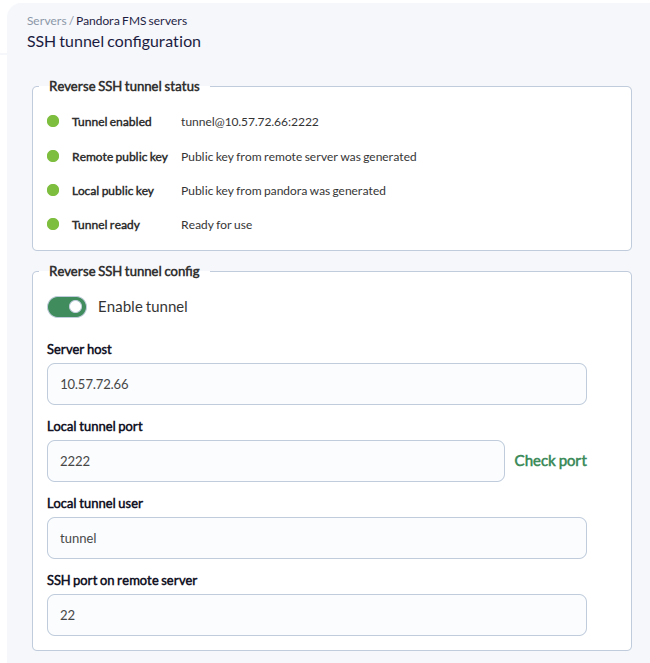

| Champ | Ce qu'il indique |
|---|---|
| **Server host** | Serveur auquel le satellite se connecte pour créer le tunnel distant ; c'est la console web du serveur Pandora FMS |
| **Local tunnel port** | Port qui sera utilisé pour construire le tunnel ; le trafic de ce port est redirigé vers le port SSH du satellite |
| **Local tunnel user** | Utilisateur qui construit le tunnel et celui que la console web utilise pour se connecter au satellite avec l'Exec Server |
| **SSH port on remote server** | Port SSH du satellite avec lequel le tunnel est construit |

En outre, il existe un réglage général dans la console web pour le port de
connexion SSH que les satellites utilisent pour construire le tunnel : **Port du
serveur SSH pour les tunnels SSH inverses**. Il est documenté dans
[Configuration de la console](../parte-9/9.2-referencia-completa-de-configuracion-de-la-consola.md).

!!! example "Un tunnel sur 192.168.10.0/24"
    La console web est sur `192.168.10.10`. **Server host** est configuré avec
    cette adresse, **Local tunnel port** avec `2222` et **SSH port on remote
    server** avec `22`. La console génère la clé, le satellite l'échange par
    Tentacle et ouvre le tunnel. À partir de là, la console se connecte par
    `localhost:2222` et atteint le SSH du satellite, qui est bien celui qui voit
    le réseau `192.168.10.0/24`.

**Processus de création du tunnel.** La distribution des clés et l'ouverture du
tunnel suivent ces étapes :

1. La configuration se fait depuis la section des serveurs, sur le satellite
   correspondant.
2. La console web génère une clé SSH pour l'utilisateur avec lequel elle
   s'exécute, `apache` par défaut.
3. Le satellite obtient la clé publique avec la configuration définie du serveur
   Pandora FMS, par Tentacle.
4. Le satellite lit cette configuration et crée localement les clés SSH pour
   l'utilisateur défini.
5. Le satellite envoie sa clé publique par Tentacle au serveur Pandora FMS.
6. Le satellite se connecte par SSH au serveur en faisant une redirection de port
   distante : il ouvre le port défini dans la configuration sur le serveur
   Pandora FMS et le redirige vers le port SSH du satellite.
7. La console web utilise ce tunnel et la clé publique qu'a envoyée le satellite
   pour exécuter des actions comme l'assistant SNMP ou le navigateur SNMP, en
   faisant les connexions depuis le satellite.
8. Le *cron* de la console web vérifie l'état du tunnel configuré.

Pendant ces phases, l'écran d'état du tunnel montre les indicateurs **Tunnel
activé**, **Clé publique distante**, **Clé publique locale** et **Tunnel prêt** ;
le dernier passe à « Prêt à l'emploi » lorsque le tunnel est opérationnel. Dans la
table du serveur, `reverse_ssh_ready` reflète si le tunnel est disponible : c'est
le signal qui fait du satellite un candidat à Exec Server.

!!! note "Si la vérification de port avertit"
    Si le port configuré dans « Port du serveur SSH pour les tunnels SSH
    inverses » n'est pas utilisé, la console avertit qu'il n'y a peut-être aucun
    service SSH à l'écoute et renvoie à la configuration générale. Vérifiez-le
    avant de considérer le tunnel comme bon.

## Performance, limites et diagnostic

Les performances du satellite dépendent de trois leviers : combien de
vérifications vous faites, avec combien de threads vous les faites et à quelle
fréquence vous les envoyez. Le débit d'interrogation d'ICMP, de la latence et de
SNMP v1/v2 atteint jusqu'à 500 vérifications par seconde ; SNMPv3 va plus
lentement parce qu'il chiffre. Le coût n'est pas gratuit : augmenter les threads
accélère le processus et charge davantage la machine, et au-delà d'un certain
point le résultat empire.

| Levier | Paramètres | Remarque |
|---|---|---|
| Threads par protocole | `ping_threads`, `latency_threads`, `tcp_threads`, `snmp_threads`, `snmp2_threads`, `snmp3_threads`, `wmi_threads`, `ssh_threads`, `exec_threads`, `plugin_threads` | Plus de threads, plus de charge. `exec_threads` au-delà de 20 peut dégrader les performances selon le système |
| Blocs d'interrogation | `ping_block`, `latency_block`, `snmp_block`, `snmp2_block`, `snmp3_block` | Plus d'hôtes par appel, plus de capacité, mais plus de latence ; le maximum pratique est 500 |
| Envoi | `agent_threads`, `agent_block`, `agent_interval` | Combien de XML sont envoyés et à quelle fréquence |
| Modules d'exécution | `exec_threads`, `exec_interval` | Un `module_exec` s'exécute sur la machine du satellite et consomme ses ressources |

!!! example "Dimensionner pour 192.168.10.0/24"
    Dans un petit réseau comme `192.168.10.0/24` (environ 254 adresses, dont
    seules quelques-unes répondent), les valeurs par défaut sont largement
    suffisantes. Le réglage devient nécessaire lorsque le même satellite couvre
    plusieurs grandes plages : c'est là qu'il faut augmenter les blocs
    (`ping_block`, `snmp_block`) et revoir les threads, en surveillant la
    consommation CPU du satellite lui-même.

### Liste d'exclusion SNMP

Dans les grands réseaux, un module SNMP qui renvoie des données invalides peut
dégrader les performances du satellite et entraîner d'autres modules vers l'état
Inconnu. Pour l'éviter, le satellite peut lire une liste d'exclusion de modules
SNMP qui sont écartés au démarrage, avant de s'exécuter.

Le jeton `snmp_blacklist` pointe vers le fichier de la liste,
`/etc/pandora/satellite_server.blacklist` par défaut. Le format est une ligne par
paire agent ou OID :

```text
192.168.10.1:.1.3.6.1.4.1.9.9.27
192.168.10.2:.1.3.6.1.4.1.9.9.27
```

Pour que le satellite lise cette liste, il faut l'exécuter en mode de génération
avec `-v` et le fichier de configuration :

```bash
satellite_server -v /etc/pandora/satellite_server.conf
```

Ensuite, redémarrez le serveur satellite. La liste peut être régénérée autant de
fois que nécessaire.

Pour le quotidien, les vérifications de base sont peu nombreuses et peu coûteuses :
regarder le journal (`/var/log/satellite_server.log`), monter `verbosity` quand il
faut plus de détail et revoir `snmp_verify` si vous soupçonnez qu'un module SNMP
fait tomber l'interrogation. Le diagnostic des problèmes, la volumétrie et la
configuration complète du serveur Pandora FMS sont dans leurs chapitres
respectifs : [Dépannage](../parte-9/9.13-troubleshooting-con-pandora.md),
[Analyse volumétrique](../parte-9/9.14-analisis-de-volumetria-y-disenos-para-alta-capacidad.md) et
[Configuration du serveur](../parte-9/9.3-referencia-completa-de-configuracion-del-servidor.md).
