# Command Center

## Introduction : qu'est-ce que le Command Center et quand l'utiliser

Un seul serveur Pandora FMS va jusqu'où il va. [1.1 ·
Installation](../parte-1/1.1-instalacion.md) situe le plafond d'un nœud autour
de 80 000 métriques : au-delà, il ne s'agit pas d'acheter une machine plus
puissante, mais de répartir le travail entre plusieurs. Le Command Center est
la pièce qui permet de le faire sans renoncer à une vision unique.

Le Command Center est une interface web qui présente et opère **comme une
seule** plusieurs installations de Pandora FMS, appelées **nœuds** ou
instances. Il ne les remplace pas : chaque nœud conserve son serveur et sa base
de données, et continue de fonctionner par ses propres moyens. Le Command
Center ajoute sa propre console web et sa propre base de données, et c'est
depuis là qu'il les coordonne.

{ .diagrama .diagrama-ancho }

Grâce à cette couche, on supervise des centaines de milliers d'équipements sans
avoir à examiner nœud par nœud. La montée en charge est **horizontale** : quand
l'environnement devient insuffisant, on ajoute un nœud, on n'agrandit pas celui
qui existe déjà. Et comme le point d'accès est unique, le Command Center sert
aussi à offrir un service **multi-entreprise** depuis une seule console : une
entreprise entre par là et voit ce qui lui appartient, sans que
l'infrastructure soit dupliquée.

Quand est-il opportun de le mettre en place ? Il y a trois signaux clairs :

- **Un seul nœud devient insuffisant.** C'est le cas des installations qui
  dépassent l'ordre de grandeur que supporte une console isolée.
- **Il y a plusieurs installations et on veut les voir ensemble.** Le Command
  Center les présente comme une seule et permet d'opérer sur toutes.
- **On offre un service multi-entreprise.** Un point d'accès unique sert à
  plusieurs entreprises et, à l'intérieur de chacune, à plusieurs utilisateurs.

!!! info "La synchronisation est automatique"
    La synchronisation entre le Command Center et les nœuds s'effectue de façon
    automatique grâce à la **Merging tool**, dont nous parlerons plus loin.

Où cette pièce s'insère dans le reste de l'architecture est expliqué dans
[1.2 · Introduction et architecture](../parte-1/1.2-introduccion-y-arquitectura.md).
La licence, qui s'ajoute à celle des nœuds et se compte par nœud actif, est
expliquée dans [1.5 · Licenciation](../parte-1/1.5-licenciamiento.md).

## Architecture et synchronisation

### Architecture : nœuds et nœud central

Un **nœud** (ou instance) est une installation normale de Pandora FMS : une
console web comme couche de présentation, un serveur comme couche d'accès aux
données et sa propre base de données. Le **Command Center** est une autre
installation, avec son serveur et sa base de données, mais il ne supervise rien
lui-même : il coordonne. L'architecture comporte deux types de pièces :

- un **nœud central**, le Command Center, avec son propre serveur ;
- autant de **nœuds serveurs** que nécessaire.

Il existe deux services qui n'existent que lorsqu'un Command Center est
présent au-dessus, et que présente déjà
[1.2 · Introduction et architecture](../parte-1/1.2-introduccion-y-arquitectura.md) :

- **Migration Server** : déplace des agents d'un nœud à un autre en prenant les
  tâches dans une file priorisée.
- **Autoprovision Server** : accueille les agents qui arrivent sans destination
  et décide dans quel nœud ils sont enregistrés. Son fonctionnement est
  développé dans
  [6.6 · Mécanismes d'autoprovisionnement](../parte-6/6.6-mecanismos-de-autoprovision.md).

De la relation entre le Command Center et chaque nœud découlent trois
conditions qu'il convient d'avoir résolues avant de monter quoi que ce soit :

| Condition | Détail |
|---|---|
| Communication bidirectionnelle | Le Command Center doit pouvoir joindre chaque nœud, et chaque nœud le Command Center. |
| Nœuds indépendants entre eux | Les nœuds **n'ont pas** besoin de communiquer entre eux à aucun moment ; seulement avec le nœud central. |
| Horloge synchronisée | L'heure du Command Center et celle des nœuds doit être la même. Plus les horloges sont bien synchronisées, plus les données vues d'en haut sont exactes. |

Les conditions réseau et les ports concernés sont détaillés dans
[1.1 · Installation](../parte-1/1.1-instalacion.md#exigences-de-securite-et-de-reseau).

### Où vit chaque donnée ?

Avant de chercher quelque chose au mauvais endroit, il convient de savoir
clairement ce qui vit de chaque côté. Voici le tableau qui évite d'y perdre une
après-midi :

| Où cela vit | Quoi |
|---|---|
| **Seulement dans le nœud** | Agents, modules et leur historique, alertes et politiques en cours d'exécution. |
| **Seulement dans le Command Center** | La configuration du Command Center lui-même, les composants, les modèles de rapports, les cartes réseau, les cartes visuelles et les filtres NetFlow. |
| **Aux deux endroits, répliqué** | Utilisateurs et profils, groupes, modèles, actions et commandes d'alerte, étiquettes et catégories. |

Les utilisateurs, groupes, modèles et étiquettes se trouvent des deux côtés
parce qu'ils doivent être là où on les utilise. Les tables propres au Command
Center (`tmetaconsole_*`) et leur synchronisation sont décrites dans
[10.1 · Schéma de la base de données](../parte-10/10.1-esquema-de-la-base-de-datos.md).

### Comment obtenir et modifier les informations

Le Command Center obtient et modifie les informations des nœuds de deux
manières distinctes, et savoir laquelle s'applique à chaque donnée décide où se
fait le diagnostic quand quelque chose échoue :

- **Mode actif.** Le Command Center entre de lui-même dans la base de données
  ou dans l'API du nœud et administre ce qui lui correspond : agents, modules,
  alertes et politiques.

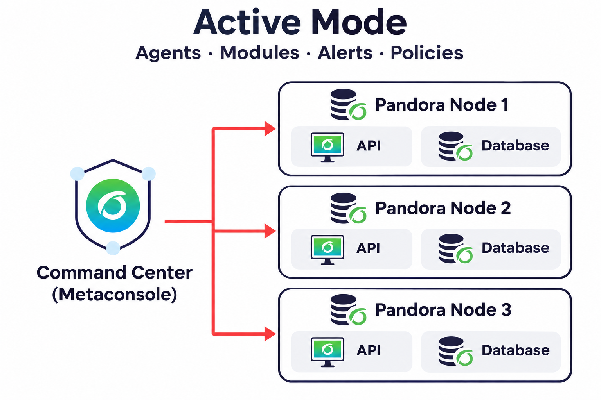{ .diagrama .diagrama-ancho }

- **Mode passif.** Le nœud écrit vers la base de données du Command Center ce
  qui est généré de façon continue. Le cas typique est celui des événements : le
  nœud les réplique et, à partir de là, leur gestion se fait d'en haut.

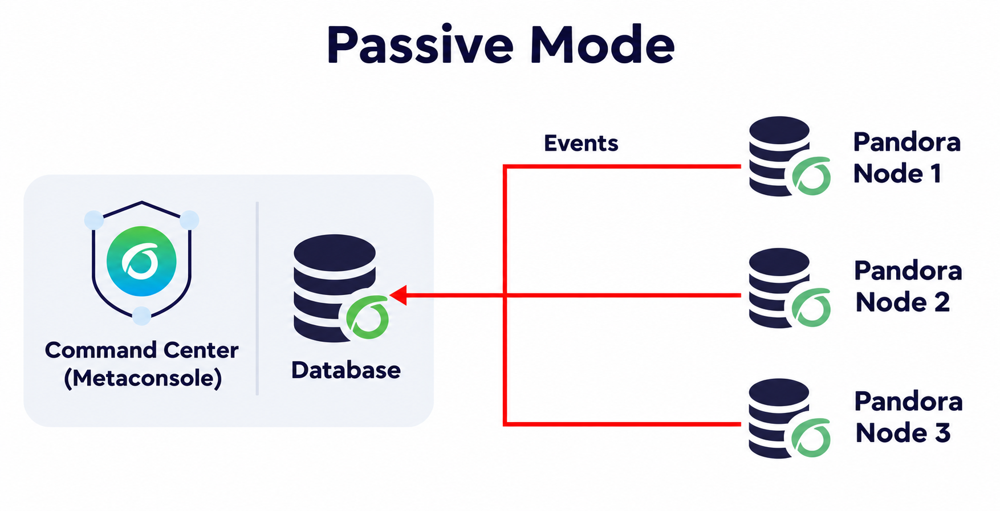{ .diagrama .diagrama-ancho }

Selon le mode dont dépend une donnée, le problème se cherche à un endroit ou à
un autre. Si les événements n'arrivent pas, la cause se trouve généralement dans
la configuration de réplication du nœud ; si
un agent n'est pas administré depuis le haut, la cause se trouve dans la
connexion du Command Center avec ce nœud. Les symptômes concrets et par où
commencer se trouvent dans
[12.8 · Grands environnements](../parte-12/12.8-entornos-grandes.md).

## Installation et mise en service

### Exigences et particularités

Le Command Center n'est pas un produit à part : on installe le même logiciel
que pour n'importe quelle installation de Pandora FMS —console web, serveur et
base de données— et il devient Command Center en activant une **licence de
Command Center** (le détail, dans
[« Activation de la licence »](#activation-de-la-licence)). Il n'y a rien de
plus à installer.

Les nœuds normaux sont ajoutés ensuite, depuis **Management → Settings → System
Settings → Command Center** (voir
[« Déclaration et enregistrement des nœuds »](#declaration-et-enregistrement-des-nuds)).

Face à un nœud, il y a trois particularités : sa propre licence, son serveur en
marche, et le fait qu'une installation ne peut pas être à la fois nœud et
Command Center. La procédure générique d'installation de la console est celle
de [1.1 · Installation](../parte-1/1.1-instalacion.md) ; ici ne figure que ce
qui est spécifique.

| Exigence | Détail |
|---|---|
| Édition | **Pandora ONE**, **Pandora NMS** ou **Pandora RMM**, plus une **licence de Command Center** supplémentaire (voir [« Activation de la licence »](#activation-de-la-licence) et [1.5 · Licenciation](../parte-1/1.5-licenciamiento.md)). |
| Installation | Le même logiciel qu'un nœud (console web, serveur et base de données). Il n'y a pas de paquet propre : c'est la licence qui change le rôle de l'installation. La procédure générale se trouve dans [1.1 · Installation](../parte-1/1.1-instalacion.md). |
| Serveur Pandora FMS | Le serveur de l'installation elle-même doit être en marche : de lui dépendent la migration des agents, l'approvisionnement et la file des politiques. |
| Communication | Bidirectionnelle entre le Command Center et chaque nœud (voir [« Architecture : nœuds et nœud central »](#architecture-nuds-et-nud-central)). |
| Horloge | L'heure du Command Center et celle des nœuds doit être synchronisée. |
| Ports | 80, 443 et 3306 entre le Command Center et les nœuds. Le tableau complet se trouve dans [1.1 · Installation](../parte-1/1.1-instalacion.md#exigences-de-securite-et-de-reseau). |
| Système d'exploitation | RHEL, Rocky Linux et AlmaLinux 9 ou 10, ou Ubuntu Server 22.04 ou 24.04. Pour le Command Center, **RHEL**, **Rocky Linux** et **AlmaLinux** sont recommandés. |

!!! warning "Un serveur, un rôle"
    On ne peut pas utiliser en même temps la console web de Pandora FMS et le
    Command Center. Si l'installation est activée comme Command Center, cette
    console cesse d'être un nœud.

### Activation de la licence

La licence s'active depuis la console web elle-même, comme pour n'importe
quelle installation. On accède à l'URL de la console :

```text
http://<dir_IP_o_URL>/pandora_console/
```

et l'écran de bienvenue apparaît, où l'on accepte la licence.

La différence avec un nœud est la licence qu'on introduit. Pour lever le Command
Center, **il faut une licence de Command Center** ; si on active une licence de
nœud, ce qui apparaît est la console normale, pas le Command Center. En
introduisant une licence de Command Center dans une installation qui était
nœud, la console avertit qu'elle va changer de rôle et, à la confirmation,
l'installation devient Command Center sans rien réinstaller. L'écran de licence
affiche ensuite le type contractué —console ou Command Center— avec le reste
des limites. Le modèle de licence et la signification de chaque champ se
trouvent dans [1.5 · Licenciation](../parte-1/1.5-licenciamiento.md).

### Metalicence

La **metalicence** est la licence unique de l'environnement. Elle se place dans
le Command Center et couvre tous les nœuds : on peut créer autant de nœuds qu'on
veut sans avoir à licencier chacun, tant qu'on ne dépasse pas le total d'agents
contracté. Les réplicas de haute disponibilité ne comptent pas. Pour les nœuds
qui doivent rester déconnectés du Command Center pendant de longues périodes,
il faut s'adresser à l'équipe commerciale de Pandora FMS.

**La licence passe avant tout.** Sans elle, l'installation ne fonctionne pas
comme Command Center et il n'y a nulle part où enregistrer les nœuds. À partir
de là, l'ordre est le suivant :

1. **Activer la licence du Command Center.** Cela se fait dans l'installation,
   quand elle est encore un nœud : dans **Management → Settings → License**.
   C'est le même écran que celui de n'importe quel nœud ; ce qui change est la
   licence qu'on introduit (voir
   [« Activation de la licence »](#activation-de-la-licence)).
2. **Enregistrer chaque nœud** dans **Setup → Metasetup → Consoles setup**, avec
   **sa propre clé de licence générée et validée** dans la console du nœud (voir
   [« Déclaration et enregistrement des nœuds »](#declaration-et-enregistrement-des-nuds)).
3. **Laisser les états en vert.** Si l'un d'eux ne l'est pas, le bouton
   **Synchronize all** de **Consoles setup** parcourt les nœuds enregistrés et
   force leur synchronisation.
   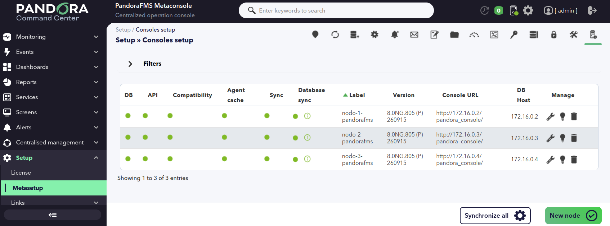{ .diagrama .diagrama-ancho }

4. **Répartir la metalicence.** Les nœuds étant en ordre, on retourne dans
   **Setup → License** —c'est maintenant le menu du Command Center— et on
   appuie sur **Validate** : il enregistre la licence du Command Center et la
   propage à tous les nœuds.

Un nœud qui ne valide pas (indicateur **Sync** en rouge) a une clé qui ne
correspond pas à celle du Command Center ou n'est pas marqué comme nœud
(`node_metaconsole`). Le bouton de synchronisation le résout. Une fois
propagée, la licence du Command Center active les nœuds automatiquement, sans
avoir à les activer un par un.

La licence agrégée additionne la consommation de tous les nœuds actifs ; les
réplicas n'entrent pas dans le compte. Les détails du modèle se trouvent dans
[1.5 · Licenciation](../parte-1/1.5-licenciamiento.md).

### Déclaration et enregistrement des nœuds

Voici la procédure qui laisse au Command Center des nœuds à gérer.
Cela se fait dans **Setup → Metasetup → Consoles setup**{ .icono-en-linea }, avec le bouton
**New node**.

{ .diagrama .diagrama-ancho }

Pour enregistrer un nœud, il faut connaître une série de données de cette
installation. Les champs sont les suivants :

| Champ | Qu'est-ce que c'est | Valeur par défaut |
|---|---|---|
| **Label** | Étiquette avec laquelle le nœud est identifié dans le Command Center. | Sans valeur |
| **Console URL** | Chemin complet vers la console du nœud, sans `index.php` ; il convient de le terminer par une barre oblique. | Sans valeur |
| **API password** | Mot de passe de l'API du nœud. | Sans valeur |
| **Console user** | Utilisateur de console du nœud, pour l'accès délégué. | Sans valeur |
| **Console password** | Mot de passe de cet utilisateur. | Sans valeur |
| **DB host** | Adresse de la base de données du nœud. | Sans valeur |
| **DB name** | Nom de la base de données. | Sans valeur |
| **DB user** | Utilisateur de la base de données. | Sans valeur |
| **DB password** | Mot de passe de la base de données. | Sans valeur |
| **DB port** | Port de la base de données. | `3306` |

Les identifiants d'API et de console (mot de passe de l'API, utilisateur et mot
de passe de console) sont enregistrés ensemble comme jeton d'authentification
du nœud. L'URL de la console doit se terminer par une barre oblique : le
Command Center l'utilise telle quelle pour construire les appels.

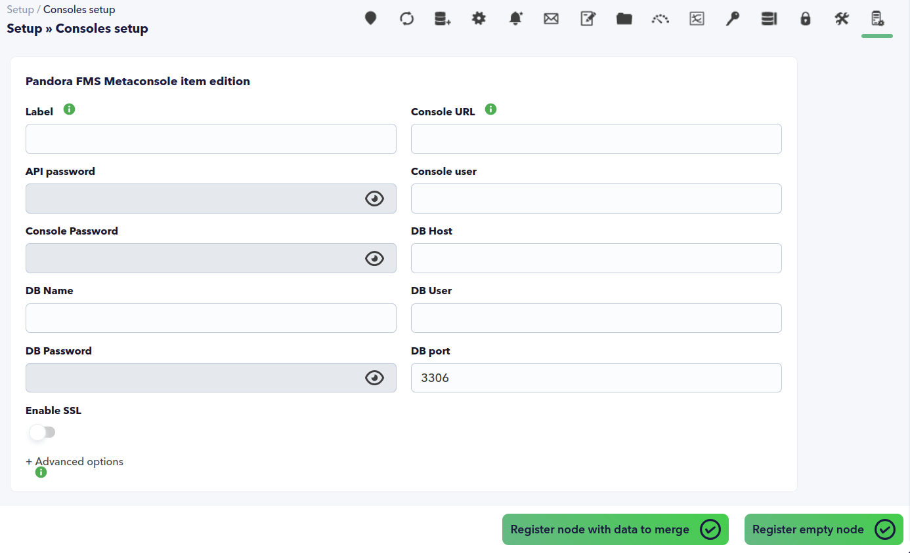{ .diagrama .diagrama-ancho }

La connexion à la base de données du nœud accepte SSL. En activant
**Enable SSL** apparaissent les champs de la clé et du certificat du serveur,
du certificat et du chemin de la CA, et de la vérification du certificat du
serveur :

| Champ | Qu'est-ce que c'est |
|---|---|
| **SSL server key** | Fichier PEM avec la clé SSL du serveur MySQL. |
| **SSL server cert** | Fichier PEM avec le certificat de cette clé. |
| **SSL CA cert** | Fichier PEM avec la liste des certificats émis par une autorité de certification. |
| **SSL CA path** | Répertoire avec des certificats d'une autorité de certification, au format PEM. |
| **SSL verify server cert** | S'il est activé, vérifie le certificat lors de la connexion (CN) ; s'il ne correspond pas, il ne se connecte pas. |

**Champs avancés.** Le bloc d'options avancées définit la connexion dans le
sens inverse : celle que le **nœud** établira vers la base de données du
Command Center. On y indique l'hôte, le nom, l'utilisateur, le mot de passe et
le port de la base de données du Command Center lui-même, ainsi que son SSL.
S'ils ne sont pas remplis, les valeurs de la propre configuration du Command
Center sont prises.

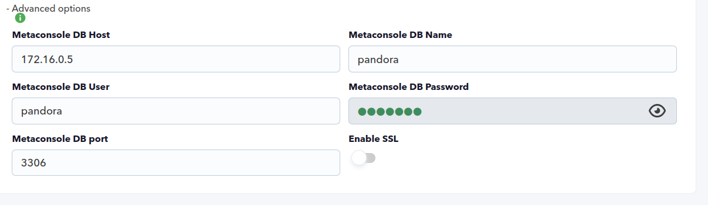{ .diagrama .diagrama-ancho }

**Les deux boutons d'enregistrement.** À l'enregistrement, le bouton choisi
décide de ce qu'il advient des données déjà présentes dans le nœud :

{ .diagrama .diagrama-ancho }

- **Register empty node** : les données du nœud sont effacées et remplacées par
  celles du Command Center. On l'utilise quand le nœud n'a rien à conserver.
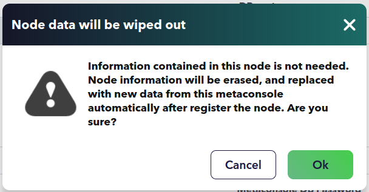{ .diagrama }

- **Register node with data to merge** : le nœud est enregistré mais reste
  désactivé, dans l'attente du lancement d'une fusion qui combinera ce qui
  existe dans l'environnement avec ce que le nœud apporte. On l'utilise quand le
  nœud a bien des données qui présentent de l'intérêt.
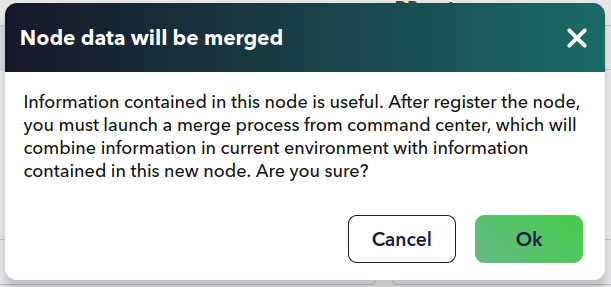{ .diagrama }

!!! info "Quand ces boutons apparaissent"
    Les deux boutons d'enregistrement apparaissent lorsque la **gestion
    centralisée** est active. Si elle ne l'est pas, l'enregistrement se fait
    avec un unique bouton **Add**.

**Indicateurs de vérification.** Dans la liste des nœuds configurés figurent
plusieurs indicateurs qui vérifient la connexion et l'état de chaque nœud. Les
contrôles se lancent au chargement de la vue et peuvent aussi être répétés un à
un en cliquant dessus :

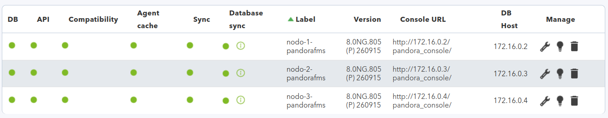{ .diagrama .diagrama-ancho }

| Indicateur | Ce qu'il vérifie |
|---|---|
| **DB** | La connexion à la base de données du nœud avec les identifiants indiqués. En rouge, il signale le problème : identifiants manquants, hôte injoignable ou base de données inexistante. |
| **API** | Un test contre l'API du nœud avec le mot de passe d'API et les identifiants de console. Il distingue erreur d'authentification, erreur de connexion et hôte non résoluble. |
| **Compatibility** | Il se connecte à la base de données du nœud et compare son *maintenance release* (`MR`) à celle du Command Center. S'ils ne correspondent pas, le nœud n'est pas compatible. |
| **Agent cache** | Que les derniers états des agents et modules du nœud soient correctement enregistrés dans la base de données du Command Center. |
| **Sync** | Que la licence du nœud corresponde à celle du Command Center et que le nœud soit marqué comme tel (`node_metaconsole`). |
| **Database sync** | Seulement avec la gestion centralisée active : il consulte la file de synchronisation et avertit s'il y a des requêtes en attente d'application. |

Les trois premiers (DB, API et Compatibility) doivent être en vert pour que le
nœud soit bien lié et que ses données commencent à se voir. Les autres
informent de leur domaine. La colonne **Version** affiche la version du serveur
du nœud.

!!! warning "La même phrase de chiffrement partout"
    Si le chiffrement de la base de données est activé, **tous les nœuds et le
    Command Center doivent utiliser la même** `encryption_passphrase`. Les
    données de connexion de chaque nœud sont enregistrées chiffrées avec cette
    phrase ; si elle ne correspond pas, le Command Center ne peut pas les
    déchiffrer. Voir
    [9.5 · Chiffrement de la base de données](../parte-9/9.5-cifrado-de-la-base-de-datos.md).

**Exemple.** Pour enregistrer un nœud en `192.168.80.37` avec la base de
données en SSL :

1. Dans **Consoles setup**, appuyer sur **New node**.
2. Remplir **Label** avec `nodo-37`, **Console URL** avec
   `https://192.168.80.37/pandora_console/` (avec la barre oblique finale), les
   identifiants d'API et de console, et les données de la base de données :
   hôte `192.168.80.37`, nom `pandora`, utilisateur `pandora`, port `3306`.
3. Activer **Enable SSL**, indiquer la clé et le certificat du serveur MySQL et
   le certificat de la CA, et activer **SSL verify server cert**.
4. Enregistrer avec **Register empty node** si le nœud est d'installation
   récente, ou avec **Register node with data to merge** s'il avait déjà des
   données.
5. Revenir à la liste et vérifier que **DB**, **API** et **Compatibility** sont
   en vert. Si l'un d'eux reste en rouge, cliquer dessus pour voir la raison.

La référence des champs, avec leur valeur par défaut, se trouve dans la section
22.2 de
[9.2 · Référence complète de configuration de la console](../parte-9/9.2-referencia-completa-de-configuracion-de-la-consola.md) ;
ici se trouve la procédure.

### Tâches de la console du Command Center

Il y a trois choses qu'il convient de laisser en place pour que le reste du
chapitre fonctionne : la programmation des rapports, l'accès à l'API et
l'auto-authentification vers les nœuds.

**Programmation des rapports.** Pour lancer la maintenance de la base de
données (`pandora_db`), il faut les paquets du serveur installés sur la machine
du Command Center, et ce processus programmé dans le **cron** chaque heure. Si
de plus on utilise les rapports à la demande (envoyés par courriel), il faut
programmer l'extension de cron comme dans une console normale, en ajoutant une
ligne à la crontab qui appelle `cron.php` :

```text
* * * * * <usuario> wget -q -O - http://x.x.x.x/pandora_console/enterprise/extensions/cron/cron.php >> /var/www/pandora_console/log/console.log
```

Les tâches de console et leur programmation sont expliquées en détail dans
[2.5 · Tâches de console](../parte-2/2.5-tareas-de-consola.md).

**API.** Pour que le Command Center puisse parler à l'API de chaque nœud, il
faut :

- un **utilisateur et un mot de passe valides** dans le nœud ;
- le **mot de passe de l'API** configuré dans le nœud ;
- la **liste des adresses IP avec accès à l'API** dans le nœud, où l'astérisque
  (`*`) est admis comme joker pour donner accès à toutes les adresses ou à un
  sous-réseau.

**Auto-authentification.** Le Command Center saute vers la console web d'un
nœud à plusieurs endroits ; par exemple, en cliquant sur l'agent associé à un
événement, la vue de cet agent s'ouvre dans la console du nœud auquel il
appartient. Pour que ce saut ne redemande pas les identifiants, on utilise
l'**auto-authentification** : l'option **Auto login in node**, dans
**Metasetup → General setup**, qui correspond au jeton `JWT_signature` et est
activée par défaut.

## Merging tool : unifier les bases de données

Unifier n'est pas copier. Quand il y a plusieurs nœuds, il est normal que le
même groupe, la même étiquette ou le même modèle existent dans plus d'un avec
des réglages différents. La **Merging tool** décide, pour chaque élément,
quelle version est conservée, et laisse l'environnement prêt à être géré depuis
le Command Center. C'est pourquoi elle se lance avec les serveurs arrêtés et
avec copie de sauvegarde, pas un vendredi à six heures du soir.

### Qu'est-ce que c'est et quand est-elle nécessaire

La Merging tool parcourt les bases de données de tous les nœuds et du Command
Center et unifie les éléments qui sont gérés de façon centralisée. Un
environnement déjà centralisé avec le système de synchronisation précédent doit
passer par ici une fois.

N'entrent dans la fusion que les nœuds configurés dans le Command Center qui ne
sont **pas** désactivés. Le processus établit un **ordre de priorité** entre le
Command Center lui-même et les nœuds : ceux d'en haut commandent sur ceux d'en
bas. Cet ordre est celui qui résout les conflits quand un même élément existe à
plusieurs endroits avec une configuration différente.

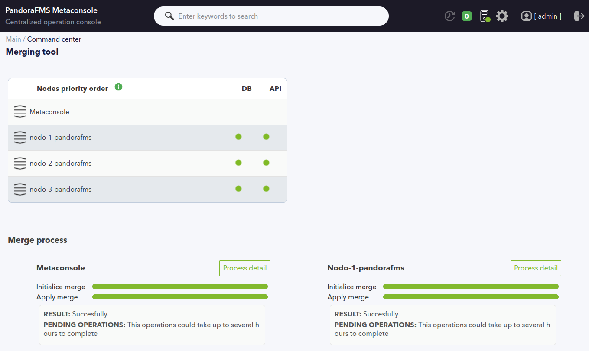{ .diagrama .diagrama-ancho }

En haut de la liste se trouve le Command Center lui-même et, en dessous, chaque
nœud enregistré, avec les colonnes **DB** et **API** vérifiant la connexion
avec chacun. L'ordre se modifie en glissant les lignes par la poignée latérale
et s'enregistre au relâchement.

!!! info "Comment on décide quelle configuration gagne"
    Si deux éléments ou plus ont le même champ unique, on prend la configuration
    de celui qui se trouve dans le nœud de **priorité la plus élevée**. Si le
    même élément apparaît répété à l'intérieur du nœud de priorité la plus
    élevée, gagne celui de **l'ID le plus bas**.

Les politiques de supervision sont un cas à part : leurs modules, alertes,
collections et autres éléments sont considérés comme des éléments indépendants
de la politique et fusionnent de leur propre chef.

Quand faut-il la lancer ?

- En passant à un Command Center un environnement qui existait déjà avec
  plusieurs nœuds.
- En incorporant à un environnement centralisé un nœud qui a déjà des données.
- En mettant à jour un environnement centralisé avec l'ancien système de
  synchronisation.

### Ce qu'elle centralise

La Merging tool emporte vers le Command Center les éléments qui ensuite se
gèrent depuis lui. Pour chacun, deux versions sont considérées comme « le même
élément » quand elles coïncident sur une **clé d'identité**. Presque tout
s'identifie par le nom ; les utilisateurs sont l'exception, et quelques éléments
portent deux champs dans la clé.

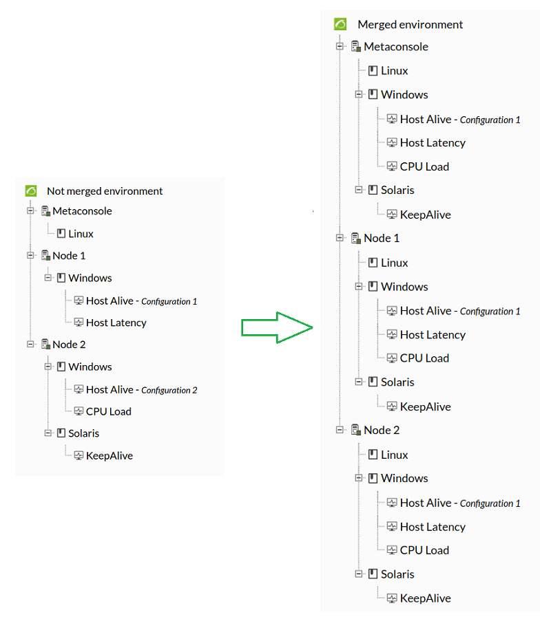{ .diagrama .diagrama-ancho }

| Élément | Clé d'identité |
|---|---|
| Utilisateurs | ID d'utilisateur (`id_user`) |
| Profils d'utilisateur | Nom |
| Groupes d'agents | Nom |
| Collections de fichiers | Nom court (`short_name`) |
| Modèles d'alerte | Nom |
| Commandes d'alerte | Nom |
| Actions d'alerte | Nom |
| Plugins de serveur | Nom et exécution |
| Systèmes d'exploitation | Nom |
| Étiquettes de modules | Nom |
| Catégories de modules | Nom |
| Groupes de modules | Nom |
| Groupes de composants | Nom |
| Composants réseau | Nom |
| Composants locaux | Nom et système d'exploitation |
| Modules d'inventaire | Nom et système d'exploitation |
| Politiques de supervision | Nom |
| Modules de politiques | Nom à l'intérieur d'une politique du même nom |
| Modules d'inventaire de politiques | Nom et système d'exploitation à l'intérieur d'une politique du même nom |
| Plugins de politiques | Exécution à l'intérieur d'une politique du même nom |
| Collections de politiques | Nom court à l'intérieur d'une politique du même nom |
| Alertes et alertes externes de politiques | Modèle sur le même module à l'intérieur d'une politique du même nom |
| Actions d'alertes et alertes externes de politiques | Nom sur le même modèle et le même module à l'intérieur d'une politique du même nom |
| Agents à l'intérieur des politiques | Appartenance à des politiques du même nom ; les enregistrements du Command Center sont écartés |
| Agents | Gestion dans le nœud ; suppression dans le Command Center |

Une fois la fusion faite, les sections où ces éléments se gèrent **ne peuvent
être gérées que depuis le Command Center**. Si on y accède depuis un nœud, on ne
peut que les lister : les options d'édition et de création disparaissent et un
avertissement indique que l'environnement est en mode centralisé, avec un lien
vers la section correspondante du Command Center.

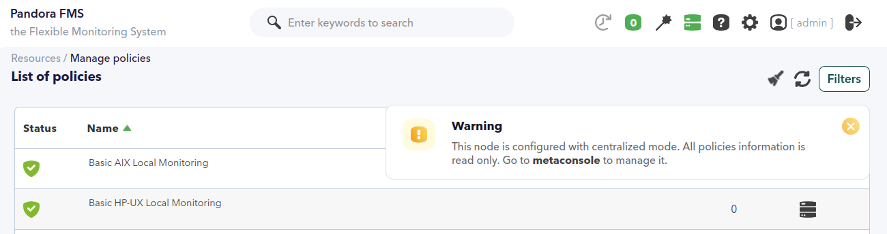{ .diagrama .diagrama-ancho }

!!! warning "Vérifiez `autocreate_group` après la fusion"
    Le paramètre `autocreate_group` de `pandora_server.conf` pointe vers un ID
    de groupe. Si ce groupe change d'ID pendant la fusion, les agents nouveaux
    finiront dans un groupe erroné ou inexistant. Vérifiez-le dans tous les
    nœuds après la fusion.

Le détail de la fusion des politiques se trouve dans
[2.10 · Politiques de supervision](../parte-2/2.10-politicas-de-monitorizacion.md).

### Conditions préalables

Avant d'appuyer sur **Unify databases**, le processus vérifie une liste
d'exigences. Si l'une d'elles échoue, la fusion ne démarre pas et l'erreur
indique ce qui reste en attente.

| Exigence | Détail |
|---|---|
| Connexion du Command Center aux nœuds | Le Command Center doit atteindre la base de données et l'API de **tous** les nœuds. Dans la configuration des consoles, les indicateurs doivent être en vert. |
| Connexion des nœuds au Command Center | Les consoles des nœuds doivent atteindre la base de données du Command Center. Ce n'est un problème que si consoles et serveurs vivent sur des machines différentes. |
| Configuration Enterprise dans le nœud | Dans **Management → Settings → System Settings → Command Center** du nœud, les données du Command Center (URL de base, hôte, nom, port, utilisateur et mot de passe de sa base de données) doivent être correctes. |
| API du Command Center | Les serveurs de tous les nœuds doivent atteindre l'API du Command Center. Il est recommandé de configurer la **Public URL** dans le Command Center. |
| API du nœud | Les serveurs de chaque nœud ont besoin de leur configuration d'API correcte : `console_api_url` et `console_api_pass` dans `pandora_server.conf`, ou la **Public URL** dans la configuration de la console. Si ce n'est pas configuré, le serveur doit être sur la même machine que sa console. |
| Historique de chaque nœud | Chaque nœud doit pouvoir se connecter à sa propre base de données d'historique. |
| Version | Tous les nœuds et le Command Center dans la **même version**. |
| Maintenance release | Tous dans le **même MR**. |
| Taille des collections | Tous avec la **même taille maximale de collection** configurée. |
| Mémoire de PHP | `memory_limit` à `-1` (sans limite) partout, seulement pendant la fusion. |
| Téléversement de fichiers | `post_max_size` de chaque nœud **supérieur ou égal** à celui du Command Center et, à son tour, **supérieur ou égal** à `upload_max_filesize` et à la collection la plus lourde. |
| `upload_max_filesize` | Dans chaque nœud, **supérieur ou égal** à celui du Command Center et à la collection la plus lourde. |
| Espace disque | Suffisant dans le répertoire `attachment` de tous, pour les sauvegardes de bases de données et de collections. |
| Date et heure | Correctement configurées partout (NTP recommandé). |
| Tâche cron de la console | Chaque nœud doit avoir sa tâche cron de console créée ; si on n'a jamais accédé à sa console, le processus demande d'ouvrir une session dans le nœud auparavant. |
| Extension ZIP | L'extension `zip` de PHP doit être chargée. |

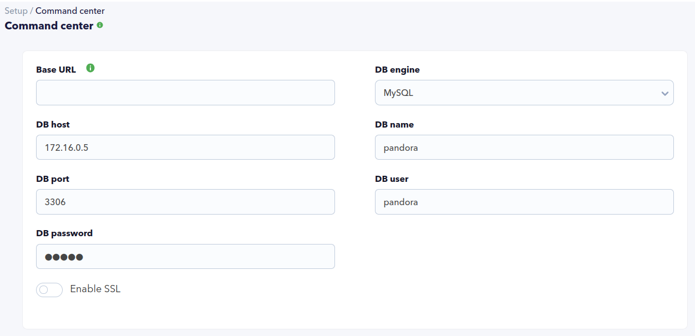{ .diagrama }


!!! warning "Remettez `php.ini` en place"
    La fusion terminée, restaurez les valeurs de `php.ini`, surtout
    `memory_limit`. Chaque fois qu'on touche à `php.ini`, il faut **redémarrer
    Apache (`httpd`) et PHP-FPM** pour que les changements prennent effet.

### Recommandations avant le lancement

Ce ne sont pas des exigences, mais elles épargnent des déconvenues :

- **Arrêtez les serveurs** de tous les nœuds et du Command Center pendant la
  durée du processus. On va changer des éléments fondamentaux (par exemple, les
  ID des groupes) et il ne convient pas que le serveur génère de nouvelles
  références à mi-chemin. Dans la plupart des cas ce ne serait pas un problème,
  mais il n'y a aucune raison de le vérifier.
- **Arrêtez temporairement `pandora_db`** du cron, pour la même raison.

!!! info "Mode maintenance pendant la fusion"
    Au démarrage de la fusion, les nœuds comme le Command Center entrent en mode
    maintenance pour les utilisateurs standard, pas pour les administrateurs.
    L'idée est la même que celle d'arrêter les serveurs : que personne ne
    modifie un élément à mi-processus et ne le désorganise.

!!! warning "Le processus écrit et supprime"
    La fusion **modifie et supprime des données** dans les nœuds. Il n'y a pas
    de retour en arrière au-delà des sauvegardes que le processus génère
    lui-même, et ces sauvegardes peuvent ne pas pouvoir être récupérées si
    l'échec empêche de les lire. Faites une copie de sauvegarde de **toutes**
    les bases de données avant de commencer.

### Exécution du processus

La fusion se lance depuis **Centralised
management → Merging tool**, avec le bouton **Unify
databases**. Elle comporte **deux phases**, et chacune se divise à son tour en
deux barres de progression.

**Phase 1 : synchronisation de l'environnement.** Elle parcourt les éléments
des bases de données des nœuds qui se gèrent depuis le Command Center. Elle se
divise en :

- **Initialize** : vérifie les exigences, génère les sauvegardes et calcule en
  mémoire le résultat de la fusion. Si cela échoue ici, les bases de données
  n'ont pas encore été touchées et il n'y a rien à restaurer. Les sauvegardes
  restent dans `attachment/merge_backups` de chaque nœud et du Command Center,
  avec un sous-dossier `backup_<id_nodo>` par nœud.
- **Apply** : applique la fusion, de façon séquentielle et dans l'ordre de
  priorité. Quand elle en termine avec un nœud, elle commence avec le suivant.

Si quelque chose échoue pendant l'application, le processus tente de restaurer
les sauvegardes de lui-même ; apparaît alors une troisième barre rouge de
**Restore**.

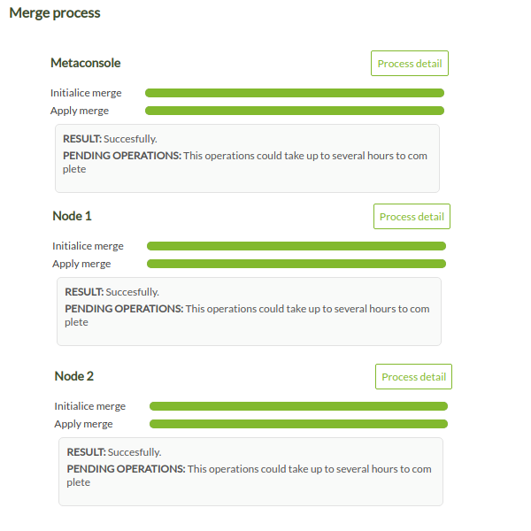{ .diagrama }

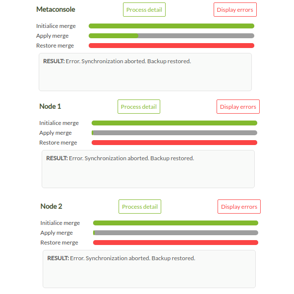{ .diagrama }

!!! warning "Si la sauvegarde ne peut pas être restaurée"
    Si l'échec empêche de récupérer les sauvegardes, la restauration doit se
    faire à la main. Certaines erreurs (une perte momentanée de connexion, un
    disque plein qui empêche de créer la sauvegarde) donnent un message
    générique ; si ce n'est pas résolu, il faut contacter le support de Pandora
    FMS.

**Phase 2 : mise à jour des événements.** Elle met à jour les références des
événements vers les éléments qui viennent d'être synchronisés (par exemple,
vers des groupes). Elle n'affecte que les événements antérieurs à la fusion ;
les nouveaux naissent déjà avec les références correctes. Elle se divise en
deux :

- **Events** : ceux de la base de données principale. Elle se met à jour en
  parallèle du fonctionnement normal : à ce stade, on peut déjà redémarrer le
  serveur et `pandora_db`, et les utilisateurs standard peuvent déjà entrer. Ils
  verront la barre de progression dans la vue d'événements et, pour les
  événements anciens, il peut encore y avoir des incohérences dans les filtres.
  Elle est lancée par chaque nœud au moyen d'une tâche du **cron** de sa
  console, et elle peut prendre beaucoup de temps.
- **Events History** : la même chose sur la base de données d'historique.

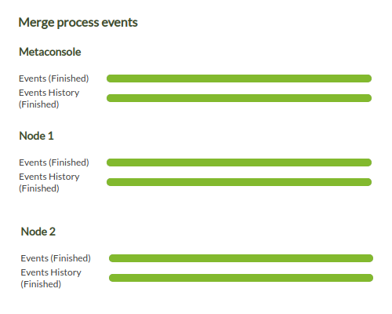{ .diagrama }

Les erreurs de la fusion sont enregistrées et peuvent être consultées depuis la
Merging tool elle-même (**Display errors**). Si quelque chose reste à moitié
fait, le processus peut être retenté.

### Environnement déjà centralisé

La phase 1 terminée, l'environnement est considéré comme centralisé et tout peut
être géré depuis le Command Center. La synchronisation des éléments change
elle aussi de système : quand une modification est faite dans le Command Center
(créer un utilisateur, par exemple), les requêtes nécessaires (`INSERT`,
`UPDATE`, etc.) sont mises en file pour chaque nœud dans la table `tsync_queue`.
Le `pandora_ha` de chaque nœud les lit dans la base de données du Command
Center dans l'ordre et les applique au fur et à mesure. Si un serveur est
arrêté un certain temps, quand il revient, il se met à jour.

Les requêtes en attente se voient depuis le Command Center dans **Setup → Metasetup → Consoles
setup**, dans l'indicateur **Database
sync**. Si une requête échoue, le nœud ne
continue pas avec les suivantes et l'erreur reste visible dans ce même écran ;
le plus normal est de la résoudre en relançant la fusion depuis la Merging
tool.

**Incorporer un nœud nouveau.** Il s'enregistre dans **Setup → Metasetup → Consoles
setup → New node**, comme il a été expliqué dans
[« Déclaration et enregistrement des nœuds »](#declaration-et-enregistrement-des-nuds).
À l'enregistrement :

- **Register empty node** si le nœud n'a rien à
  conserver : ses données sont effacées et remplacées par celles du Command
  Center.
- **Register node with data to
  merge** si le nœud a déjà des données : le nœud reste désactivé dans
  l'attente du lancement de la fusion.

## Gestion centralisée

### Ce qui change avec l'activation de la gestion centralisée

Avec la gestion centralisée active, le Command Center devient la **source de
configuration** des nœuds pour une série de sections, et ces sections cessent
d'accepter des changements locaux : dans le nœud, on ne peut que lister. Ce
n'est pas un interrupteur qu'on peut allumer à la légère, parce que ce qui
existait dans chaque nœud peut se trouver écrasé.

Où s'active-t-elle ? La marque est posée par la **Merging tool** elle-même en
unifiant l'environnement : elle laisse le jeton `centralized_management` à `1`
dans le Command Center et dans tous les nœuds enregistrés. Il n'y a pas
d'interrupteur dans la configuration générale du Command Center, si bien que le
chemin pour l'activer est de fusionner l'environnement.

!!! warning "Activez-la avec la maison en ordre"
    Si l'environnement fonctionnait depuis longtemps de façon séparée, il est
    normal que chaque nœud ait des choses différentes (groupes, étiquettes,
    politiques, utilisateurs). En centralisant, le Command Center commande et ce
    qui appartient aux nœuds peut se trouver écrasé ou désorganisé. Faites
    l'inventaire de ce qui existe dans chaque nœud, décidez quelle version est
    la bonne et faites-le dans une fenêtre de maintenance, avec copie de
    sauvegarde de toutes les bases de données. Dans
    [12.8 · Grands environnements](../parte-12/12.8-entornos-grandes.md) se
    trouve l'avertissement avec plus de détail.

Les éléments concernés sont les mêmes que ceux que centralise la Merging tool
(voir « Ce qu'elle centralise »). Le reste de la console se comporte comme dans
un nœud.

### Agents et approvisionnement

**Déplacer des agents.** L'option **Agent management**{ .icono-en-linea } replace des agents d'un nœud vers un autre. On
les localise avec les filtres de groupe ou de nom (avec récursion de groupe si
nécessaire), on les passe à la liste des sélectionnés et on choisit nœud
d'origine et nœud de destination.
La case **Discard history data** efface
l'historique de l'agent en le déplaçant, pour ne pas traîner des données dont on
n'a pas besoin ; le déplacement se confirme avec **Move**.

!!! tip "Registre des déplacements"
    Au pied de l'écran reste un registre avec la **dernière action complétée de
    chaque agent et les actions en attente postérieures**. Les agents avec des
    modules synthétiques sont omis du déplacement, parce qu'ils peuvent dépendre
    de modules d'autres agents.

**Approvisionnement.** L'option **Provisioning management**{ .icono-en-linea } décide dans quel nœud sont enregistrés
les agents nouveaux qui arrivent sans destination. Il y a trois stratégies :

- **Round robin** : répartit les agents nouveaux en ordre circulaire
  entre les serveurs.
- **Less loaded** : assigne chaque agent nouveau au serveur avec
  le moins de charge.
- **Custom** : applique des règles propres basées sur l'information
  que l'agent rapporte (son alias et sa plage d'IP), avec les opérateurs `AND`
  et `OR`.

Pour que l'approvisionnement reconnaisse les nœuds, chaque nœud doit avoir
configurée **sa propre adresse IP** dans le Data server :

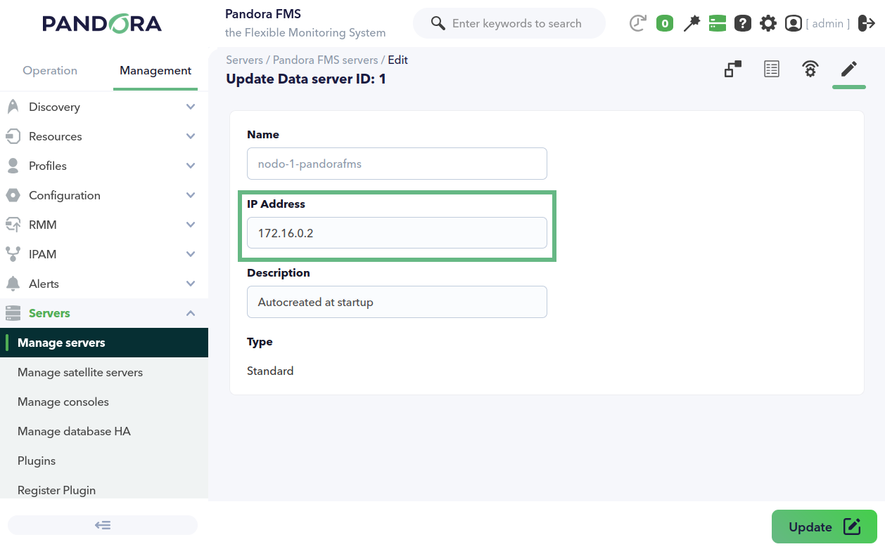{ .diagrama .diagrama-ancho }

Le détail de l'autoprovisionnement se trouve dans
[6.6 · Mécanismes d'autoprovisionnement](../parte-6/6.6-mecanismos-de-autoprovision.md).

**Autoconfiguration des agents.** L'option **Agent autoconfiguration**{ .icono-en-linea } ajoute et édite des règles de
configuration automatique pour les agents nouveaux, comme l'appartenance à des
groupes ou les alertes. Elle est expliquée dans
[6.6 · Mécanismes d'autoprovisionnement](../parte-6/6.6-mecanismos-de-autoprovision.md).

**Groupes.** **Group management**{ .icono-en-linea } et
**Tree group**{ .icono-en-linea } éditent ou suppriment des groupes d'agents dans tous les
nœuds ; la seconde est la même opération avec l'interface sous forme d'arbre.

!!! warning "Éditer des groupes touche la synchronisation"
    L'édition ou la suppression de groupes peut causer des problèmes avec la
    synchronisation. Faites-le quand l'environnement est tranquille.

### Modules et composants

Les composants, plugins et modules d'inventaire s'administrent de façon
centralisée depuis le Command Center :

- **Component groups**{ .icono-en-linea } : créer, éditer et supprimer des groupes de
  composants dans les nœuds.
- **Local components**{ .icono-en-linea } : créer, éditer et éliminer des composants
  locaux de façon centralisée.
- **Network components**{ .icono-en-linea } : ajouter, modifier ou supprimer des
  composants réseau dans les nœuds.
- **Plugin management**{ .icono-en-linea } : créer, éditer et supprimer des plugins pour
  les nœuds.
- **Inventory modules**{ .icono-en-linea } : créer, modifier ou supprimer des modules
  d'inventaire dans les nœuds.
- **Plugin registration**{ .icono-en-linea } : ajouter des plugins de serveur.
- **Tags management**{ .icono-en-linea } : liste des étiquettes utilisées dans les
  modules et leur décompte dans tous les nœuds. Elles s'éditent ou se
  suppriment depuis la colonne d'actions et se créent avec **Create tag**.
- **Module groups management**{ .icono-en-linea } : administration des groupes
  de modules. On édite un groupe en cliquant sur son nom, on le supprime avec
  l'icône de corbeille et on en crée avec **Create module group**.
- **OS Management**{ .icono-en-linea } : liste des systèmes d'exploitation assignables
  aux agents. Certains sont du système et ne peuvent pas être supprimés, mais on
  peut les éditer en cliquant sur leur nom ; les autres s'ajoutent avec
  **Create OS**.

Les composants réseau et locaux sont présentés dans
[2.6 · Supervision de réseaux](../parte-2/2.6-monitorizacion-de-redes.md) ; les
modules d'inventaire, dans
[3.1 · Inventaire](../parte-3/3.1-inventario.md) ; la création de plugins, dans
[9.8 · Création de plugins locaux](../parte-9/9.8-creacion-de-plugins-locales.md)
et [9.9 · Création de plugins
distants](../parte-9/9.9-creacion-de-plugins-remotos.md) ; et les étiquettes,
dans [4.1 · Groupes, profils et tags](../parte-4/4.1-grupos-perfiles-y-tags.md).

### Alertes

Les alertes se gèrent depuis le Command Center avec ces options :

- **Templates**{ .icono-en-linea } : créer, copier et supprimer des modèles d'alerte.
  Avec **Show options**, on les filtre par type ou par nom.
- **Actions**{ .icono-en-linea } : créer, copier, éditer et supprimer des actions d'alerte
  pour les nœuds. Elles se filtrent par nom, groupe d'agents ou commande
  d'alerte.
- **Commands**{ .icono-en-linea } : ajouter, copier et supprimer des commandes d'alerte de
  façon centralisée. Les commandes du système ne peuvent être ni copiées ni
  supprimées.
- **Calendar**{ .icono-en-linea } : les calendaires marquent des jours spéciaux et des
  cycles dans les modèles. On édite le calendrier par défaut avec l'icône de
  configuration, on ajoute des jours avec l'icône de somme et on crée des
  calendaires propres avec **Create**.
- **Builder alert**{ .icono-en-linea } : créer des alertes dans chaque agent des instances, de façon
  centralisée.

Le fonctionnement des alertes se trouve dans
[5.5 · Alertes et notifications](../parte-5/5.5-alertas-y-notificaciones.md).

### Utilisateurs, profils et ACL avancé

- **User management**{ .icono-en-linea } : liste complète des utilisateurs des
  nœuds. On filtre par groupe ou par mot-clé (utilisateur, nom complet ou
  courriel). Dans chaque ligne, on peut désactiver, éditer ou supprimer
  l'utilisateur ; il doit toujours rester au moins un superutilisateur actif, et
  celui-là ne peut pas être supprimé. Avec **Create user**, on en enregistre un
  nouveau ; s'il doit aussi accéder par les nœuds, on active
  **Enable node access**.
- **Profile management**{ .icono-en-linea } : administration complète des
  profils.
- **Workspace → Edit my user**{ .icono-en-linea } : éditer les données de l'utilisateur
  avec lequel on a ouvert la session dans le Command Center.
- **API 2.0 token management**{ .icono-en-linea } : administration des jetons
  d'authentification des utilisateurs dans l'API 2.0.

**ACL avancé.** Le **Système ACL Advanced** (`role/action/group/user`) permet
de définir, selon le profil, à quelles pages a accès chaque utilisateur, en
redéfinissant ce que permet l'ACL classique. Les superadministrateurs sont
exemptés ; le reste, même avec le profil **Pandora Administrator**, reste soumis
au contrôle. Les deux modèles cohabitent : le classique s'évalue avant.

Les utilisateurs et les profils sont documentés dans
[4.1 · Groupes, profils et tags](../parte-4/4.1-grupos-perfiles-y-tags.md) ;
l'ACL avancé, dans
[4.3 · Sécurité et visibilité avancée (Enterprise
ACL)](../parte-4/4.3-seguridad-y-visibilidad-avanzada-enterprise-acl.md).

### Politiques

Dans un Command Center, la file des politiques est différente de celle d'un
nœud : **elle ne garde pas d'historique**. Elle montre seulement les politiques
non appliquées ou en cours, en indiquant à quel nœud elles appartiennent.
L'historique des appliquées reste dans le nœud, qui est la seule chose qu'on
peut gérer depuis là.

**Qui les applique.** Ce n'est pas la console qui les applique : la console ne
fait qu'inscrire l'opération dans la file. Les exécute un fil du serveur
Pandora FMS lui-même, le
**Policy Manager** (`policy_manager`), qui vide cette file au fur et à mesure.
Il se lance tout seul, dans le serveur maître de chaque installation —de même
dans un nœud isolé que dans un Command Center— ; s'il est désactivé, la file
cesse de se vider et les politiques n'arrivent pas aux agents.

Le Command Center a le jeton **Max. number of queue operations per node** pour ne pas surcharger la
visualisation et l'opération des files. Sa valeur par défaut est **100 000
opérations par nœud**.

**Intégrité des données.** Les données d'une politique doivent être les mêmes
dans les nœuds et dans le Command Center : modules, alertes, modules
d'inventaire, collections, etc. En appliquant une politique depuis le Command
Center, tout cela se copie vers les nœuds concernés. Si quelque chose échoue à
la copie, la console affiche l'erreur et le nœud fait un **rollback** vers les
données antérieures. Dans les installations nouvelles, il n'y a pas de
problème ; si les nœuds ont des politiques configurées à la main, il convient
de les effacer et de les passer au Command Center pour les synchroniser depuis
là.

Les politiques et leur file sont documentées dans
[2.10 · Politiques de supervision](../parte-2/2.10-politicas-de-monitorizacion.md).

### Catégories et serveurs

**Gestion des catégories.** Elle permet d'administrer les catégories de modules
(options avancées) de façon centralisée. Elles s'éditent avec l'icône de
configuration, se suppriment avec l'icône de corbeille et se créent avec
**Create category**.

**Gestion des serveurs.** L'option **Server
management** montre le type, l'état, la version et d'autres données des
serveurs du Command Center et de chaque nœud. On choisit le nœud dans
**Show server status of** :

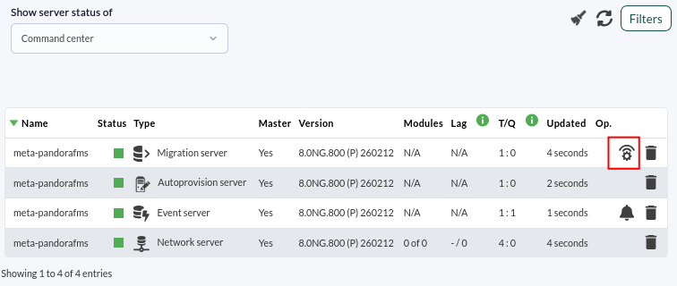{ .diagrama .diagrama-ancho }

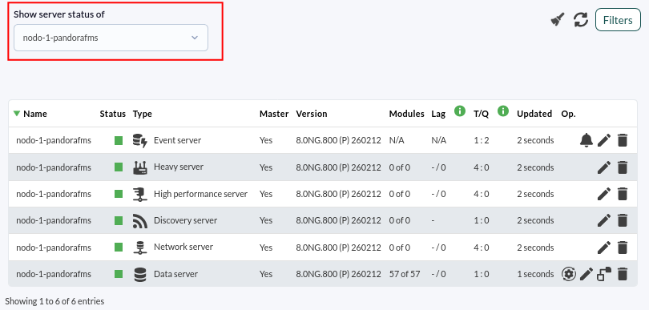{ .diagrama .diagrama-ancho }

**Quels serveurs apparaissent.** La liste ne se remplit pas à la main : la crée
le serveur lui-même au démarrage, avec une ligne pour chaque module qu'il a
actif (ils apparaissent avec la description « Autocreated at startup »). Dans un
Command Center, le serveur démarre quatre modules :

- **Network server** : le seul module du noyau chargé dans un Command
  Center ; les tâches de service du Command Center lui-même, c'est lui qui les
  exécute.
- **Events server** : la réplication des événements depuis les nœuds.
- **Autoprovision server** : assigne les agents qui arrivent sans destination.
- **Migration server** : déplace des agents entre nœuds.

En choisissant un nœud dans **Show server status of**, on voit les serveurs de
ce nœud.

!!! info "Configuration distante, seulement dans le premier"
    L'option de configuration distante ne se montre que dans le premier serveur
    de chaque nom ; les répétés sont des réplicas et s'administrent par
    l'intermédiaire du premier.

La configuration des serveurs de Pandora FMS se trouve dans
[9.3 · Référence complète de configuration du
serveur](../parte-9/9.3-referencia-completa-de-configuracion-del-servidor.md).

### Opérations massives

Les **Bulk operations** du Command Center se font en deux
étapes : on choisit la destination (agents, utilisateurs, modules...) et le type
de tâche (éditer, supprimer...). Dans les opérations sur les agents, on
sélectionne le nœud sur lequel agir.

!!! info "Les champs laissés vides ne sont pas touchés"
    En éditant en bloc, les champs laissés en **No
    change** restent comme ils étaient.

Le nombre d'opérations qu'on peut lancer d'un coup est limité par le jeton
**Limit for bulk operations** : par défaut,
la moitié de la valeur de `max_input_vars` de PHP, avec une plage configurable
de 100 à 2000.

Les opérations massives sont expliquées dans
[12.10 · Opérations massives](../parte-12/12.10-operaciones-masivas.md).

### Collections

Les **Collections**{ .icono-en-linea } sont des conteneurs de fichiers distants et
locaux qui se maintiennent en synchronisation ; on les utilise dans des agents
ou pour déployer de façon massive des scripts et des plugins. Dans un Command
Center, elles s'administrent de façon centralisée. Elles sont développées dans
[2.9 · Collections](../parte-2/2.9-colecciones.md).

## Interface et visualisation

### L'écran d'accueil

La console du Command Center s'organise en trois zones :

1. **L'en-tête.** Le logo, le moteur de recherche global, les notifications, le
   menu d'utilisateur et l'icône d'état des serveurs, qui mène à la gestion des
   serveurs.
2. **Le menu de navigation.** Les onglets de sections : **Monitoring**, **Events**, **Reports**,
   **Screens**, **NetFlow**, **Alerts**, **Centralised management** et **Setup**.
3. **La zone de contenu.** Ce qui s'ouvre dans chaque section. Dans l'écran
   d'accueil, la section **Main** montre des accès directs aux
   utilitaires les plus utilisés : Supervision, Événements, Rapports, Écrans,
   NetFlow (s'il est configuré) et Configuration.

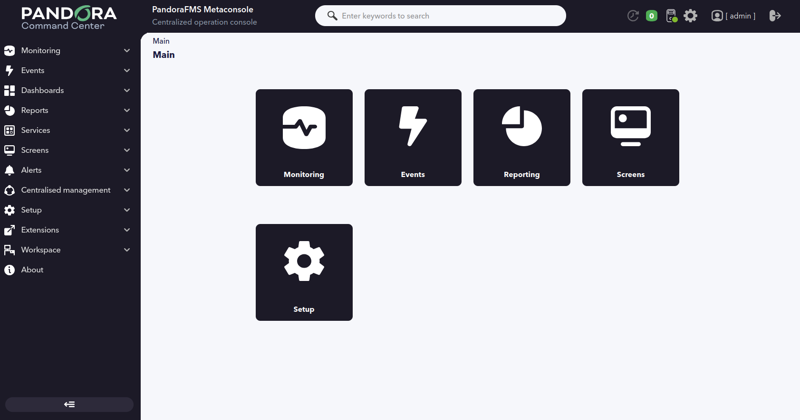{ .diagrama .diagrama-ancho }

Un Command Center qui n'a pas encore été unifié montre l'avertissement que le
système n'est pas centralisé (**System is not centralised**) ; le lien mène
directement à la Merging tool.

Depuis le bloc de supervision, on accède aux vues des agents de tous les
nœuds :

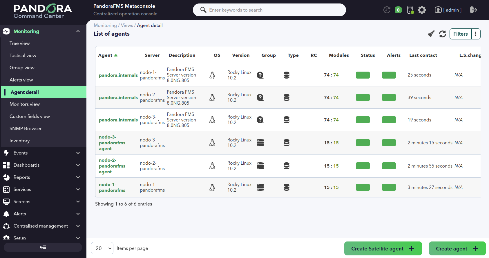{ .diagrama .diagrama-ancho }

La liste d'événements montre les événements du Command Center et de tous les
nœuds, avec des filtres par nœud :

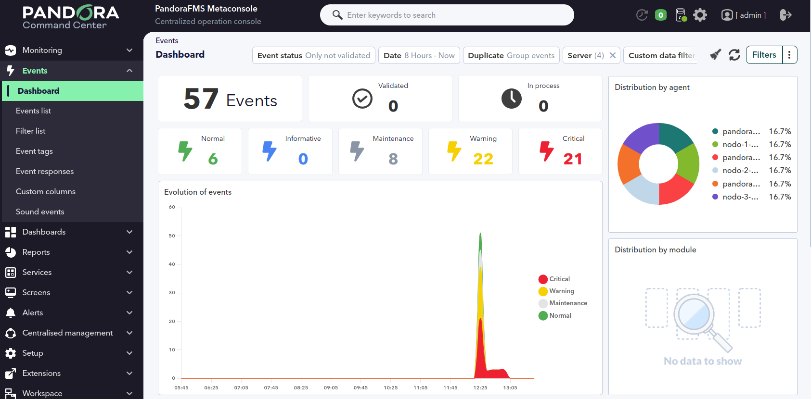{ .diagrama .diagrama-ancho }

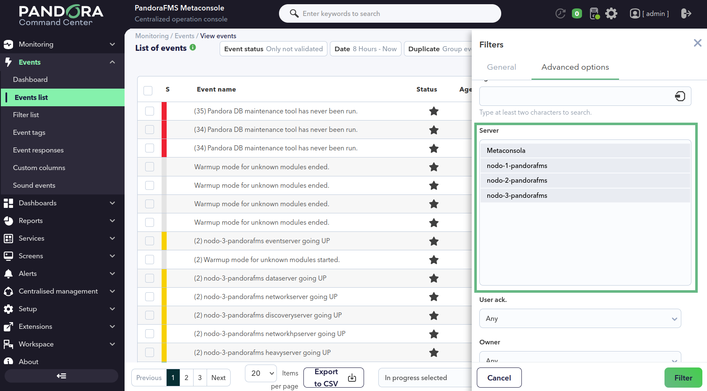{ .diagrama .diagrama-ancho }

Et la vue d'alertes réunit les alertes enregistrées dans chaque nœud :

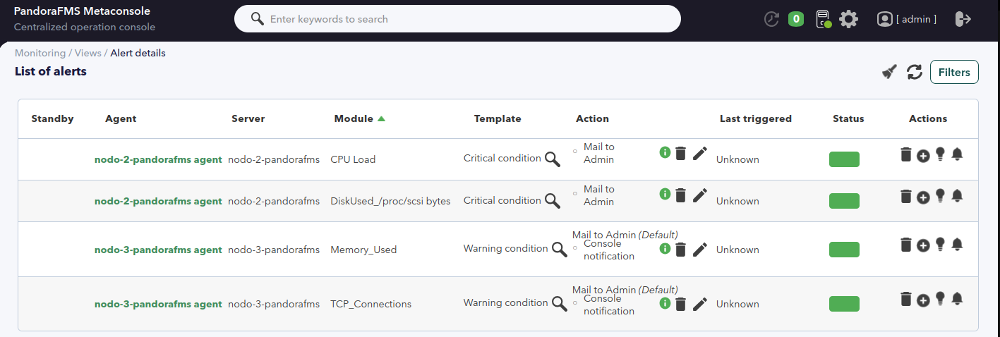{ .diagrama .diagrama-ancho }

Le fonctionnement de la console d'événements se trouve dans
[5.4 · Console d'événements centralisée](../parte-5/5.4-consola-de-eventos-centralizada.md),
et celui des alertes, dans
[5.5 · Alertes et notifications](../parte-5/5.5-alertas-y-notificaciones.md).

### Metasetup

**Metasetup** est l'arbre de configuration du Command Center lui-même. Il vit
dans **Setup → Metasetup** et réunit tant des pages
équivalentes à celles d'un nœud que des pages qui n'existent qu'ici.

| Page | Qu'est-ce que c'est |
|---|---|
| **Consoles setup** | Déclaration et enregistrement des nœuds. Voir « Déclaration et enregistrement des nœuds ». |
| **General setup** | Équivalent centralisé de la configuration générale d'un nœud. |
| **Passwords setup** | Équivalent centralisé de la politique de mots de passe. |
| **Log viewer** | Équivalent centralisé de la visionneuse de logs. |
| **History database** | Équivalent centralisé de l'historique. |
| **Authentication** | Équivalent centralisé de l'authentification. |
| **Visual setup** | Équivalent centralisé de la configuration visuelle. |
| **Performance setup** | Équivalent centralisé des performances. |
| **File manager** | Équivalent centralisé du gestionnaire de fichiers. |
| **Strings translation** | Équivalent centralisé de la traduction de chaînes. |
| **Mail** | Équivalent centralisé du courrier sortant. |
| **Notifications** | Équivalent centralisé des notifications. |
| **Relations rules** | Elles décident à quel nœud appartient un élément qui arrive sans destination. |
| **Warp Update** | Mise à jour des nœuds depuis le Command Center. |

Les pages qui ont un équivalent dans un nœud renvoient à la référence de
configuration de la console : sa section 22 de
[9.2 · Référence complète de configuration de la
console](../parte-9/9.2-referencia-completa-de-configuracion-de-la-consola.md).
Les exclusives (règles de relation et Warp Update) sont développées dans
« Réglages exclusifs du Command Center », dans ce même chapitre.

### Rapports, dashboards et consoles visuelles

**Rapports.** Les rapports du Command Center se génèrent en plusieurs formats
(PDF, CSV, etc.) et s'enregistrent dans le Command Center, mais **les données
sortent des nœuds qu'on choisit**. C'est la différence avec les rapports d'un
nœud. On peut les créer un par un ou au moyen de modèles paramétrables, qui
s'appliquent à un groupe d'agents quand on les demande. Voir
[5.2 · Rapports](../parte-5/5.2-informes.md).

**Dashboards.** Ils fonctionnent comme ceux d'un nœud, avec un avantage : en
cherchant un agent, il suffit d'écrire au moins deux caractères et une liste
triée par nom apparaît, avec le nœud entre parenthèses. Chaque widget peut
s'afficher avec le nom de l'agent et son nœud, ou avec la description qu'on
veut. Les dashboards s'enregistrent dans le Command Center ; en les ouvrant,
ils se connectent aux nœuds pour rapporter l'information la plus récente. Voir
[5.1 · Dashboards](../parte-5/5.1-dashboards.md).

**Consoles visuelles.** Elles offrent en plein écran une vue d'ensemble faite
sur mesure. On peut cliquer sur leurs éléments pour aller vers les agents et
leurs modules, aussi bien avec une session ouverte qu'au moyen d'un lien
public, et elles se mettent à jour selon la période configurée. On peut créer
des consoles pour représenter des services et **en lier les unes aux autres**,
ce qui sert à représenter des pays, des villes ou des zones géographiques.
Voir [5.6 · Consoles visuelles](../parte-5/5.6-consolas-visuales.md).

## Réglages exclusifs du Command Center

Metasetup mélange deux types de pages : celles qui répliquent la configuration
d'un nœud et celles qui n'ont de sens que lorsqu'un Command Center est présent
au-dessus. Les premières ne se répètent pas ici ; leur référence est la section
22 de
[9.2 · Référence complète de configuration de la
console](../parte-9/9.2-referencia-completa-de-configuracion-de-la-consola.md).
Voici les exclusives.

### Règles de relation

Les **Relations rules**{ .icono-en-linea } résolvent à quel nœud appartient un élément qui arrive sans destination. Elles sont pensées pour des équipements spéciaux qui s'identifient par leur passerelle ou par leur IMEI et qui se consultent au travers d'une API distincte de l'API principale, l'**API de l'agent**. Pour qu'elles fonctionnent, il faut avoir activé **Enable Agent API** dans la configuration générale.

La déclaration d'une relation comporte trois champs : le **Type** —**IP Gateway** ou **IMEI**—, la valeur de la **Relation** et la **Node Address**, qui peut être
n'importe lequel des nœuds enregistrés ou une valeur **Custom**. Elle
s'enregistre avec **Insert relation**.

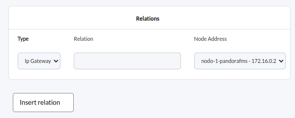{ .diagrama }

Pour en charger beaucoup d'un coup, on importe un fichier CSV avec une relation
par ligne, dans l'ordre `type,règle,nœud` :

```text
gateway,4,192.168.80.37
imei,123456789012345,192.168.80.38
```

Avec **Import file**, on téléverse le fichier. Les lignes qui ne
correspondent pas au format sont rejetées et la console indique lesquelles.

Les relations enregistrées se listent au pied, avec des filtres par type,
valeur ou adresse de nœud. Elles se suppriment une à une avec leur icône, ou en
bloc : on marque les cases et on appuie sur **Delete**.

La requête se lance contre l'API de l'agent avec le paramètre
`get_node_addresses=1`, qui est **obligatoire**, et renvoie un tableau JSON avec
l'adresse ou les adresses du nœud. Pour une passerelle, `gateway=1` :

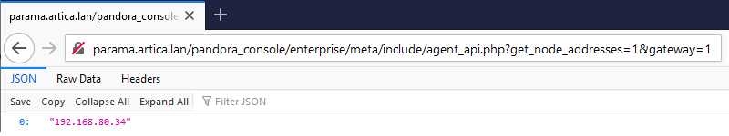{ .diagrama .diagrama-ancho }

Et pour un IMEI, `imei=2` :

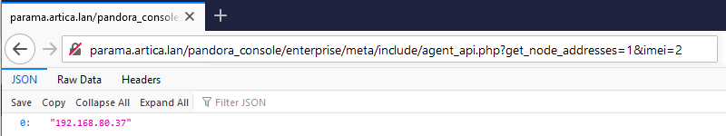{ .diagrama .diagrama-ancho }

Avec **Node Address Default**, on fixe la
réponse qui se renvoie quand il n'y a aucune règle ou qu'aucune ne correspond à
la requête. Elle peut être l'adresse de l'un des nœuds ou une valeur
**Custom**, par exemple un message propre.

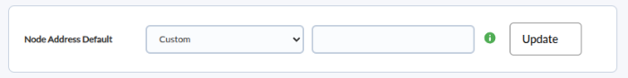{ .diagrama }

L'approvisionnement d'agents qui utilise ces règles est développé dans
[6.6 · Mécanismes d'autoprovisionnement](../parte-6/6.6-mecanismos-de-autoprovision.md).

### Warp Update des nœuds

Le Command Center se met à jour depuis ses propres pages **Warp Update**,
toutes dans **Setup → Metasetup**. Les quatre n'apparaissent
que si **Enable Warp
Update** est actif dans la configuration générale. Le concept de Warp Update et
la procédure générale se trouvent dans
[1.4 · Mises à jour](../parte-1/1.4-actualizaciones.md) ; ici figure ce qui est
propre au Command Center.

- **Warp Update Online**{ .icono-en-linea } : avec une licence de Command Center valide et un accès à internet, met à jour le Command Center de façon automatique.
- **Warp Update Offline**{ .icono-en-linea } : pour mettre à jour ou patcher sans internet. Les fichiers se téléversent dans l'ordre jusqu'à la version nécessaire, parce qu'ils ne sont pas cumulatifs, et il sert tant pour des patchs de console que de serveur ou combinés.
- **Warp Update Journal**{ .icono-en-linea } : l'historique des mises à jour appliquées, avec la version, la date et l'heure et l'utilisateur qui les a demandées. Avec la case **Filter**, on cherche dans l'historique.
- **Warp Update Setup**{ .icono-en-linea } : elle arrive préparée pour la mise à jour en ligne. Avant de toucher à la **Warp Update URL**, au **Use secured Warp Update**, aux données du **Proxy** (serveur, port, utilisateur et mot de passe) ou aux commutateurs **Allow offline patches** et **LTS updates** —qui changent quels paquets le mode hors connexion accepte—, il convient de consulter le support de Pandora FMS.

!!! warning "Mise à jour hors connexion : copiez avant"
    Appliquer des patchs ou des mises à jour hors connexion peut laisser la
    console inutilisable. Faites une copie de sauvegarde complète avant de
    commencer.

Dans le mode hors connexion, la page montre un code d'accès lié à la licence. Il
se copie avec l'icône{ .icono-en-linea }, on ouvre le lien de téléchargement dans un autre onglet, on colle le code, on ouvre la session et on télécharge les fichiers **un par un**. De retour dans la page, on téléverse chaque fichier avec **Browse it**. La taille de chaque fichier doit être inférieure à `post_max_size` et à `upload_max_filesize` de `php.ini`, et le processus se lance avec l'icône verte du coin inférieur droit.

### Notifications et courrier sortant

**Notifications.**{ .icono-en-linea } Le Command Center surveille son propre état et celui du système, et avertit les utilisateurs. Il se configure dans **Setup → Metasetup → Notifications**. En cliquant sur une catégorie, on ajoute ou on abonne les utilisateurs ou groupes qui la reçoivent ; pour **System status**, on peut en plus choisir chaque aspect technique.

Les catégories sont six : **System status**, **Message**, **Pending task**, **Advertisement**, **Official communication** et
**Sugerence**.

Le jeton **Enable user configuration**
permet à chaque utilisateur d'activer ou de désactiver ses notifications de
console et de courrier depuis **Operation → Workspace → Configure user notifications** dans les
nœuds centralisés. Pour qu'elles arrivent par courriel, l'utilisateur doit avoir
son adresse configurée et le serveur de Pandora FMS doit pouvoir envoyer du
courrier.

Il y a une nuance qui surprend : si un utilisateur appartient à un groupe
abonné à une catégorie, il reçoit les notifications de console de cette
catégorie et **ne peut pas les désactiver**, même si le jeton précédent est
actif. Un utilisateur nouveau avec le profil **Pandora Management** ne
s'abonne qu'à **System status** et **Official
communication**, pas aux six ; quand le nœud est déjà centralisé, il entre dans
les catégories du Command Center, et chaque nœud centralisé gère les siennes
séparément.

**Courrier sortant.**{ .icono-en-linea } Dans **Setup → Metasetup → Mail**, on définit l'envoi : l'adresse de sortie (**From dir**), le nom (**From name**), le serveur SMTP (**Server SMTP**), le port (**Port SMTP**), le chiffrement de la connexion (**Encryption** : `SSL`, `SSLv2`, `SSLv3` ou `STARTTLS`) et, si le serveur le demande, utilisateur et mot de passe (**Email user** et **Email password**) et la méthode d'authentification (**SMTP authentication** : `Default`, `LOGIN`, `PLAIN`, `CRAM-MD5` ou `DIGEST-MD5`). Avec **Email test**, on envoie un courriel de test.

!!! warning "Gmail et autres fournisseurs"
    Google peut bloquer l'authentification des applications qu'il considère peu
    sûres ; il faut activer l'accès. Mieux vaut un compte créé seulement pour
    les avertissements du serveur qu'un compte personnel.

Le serveur de Pandora FMS doit pouvoir résoudre, avec son DNS, le serveur de
courrier du domaine (`nslookup -type=mx my.domain`), et le serveur de courrier
doit accepter les envois qui lui arrivent depuis lui. Si l'authentification
n'est pas celle par défaut, on ajuste le jeton `mta_auth` dans
`/etc/pandora/pandora_server.conf` : il vient commenté et accepte `LOGIN`,
`PLAIN`, `CRAM-MD5` et `DIGEST-MD5`.

### Traduction de chaînes et gestionnaire de fichiers

**Strings translation**{ .icono-en-linea } réécrit des chaînes de l'interface de façon personnalisée. On filtre par **Language** et par le texte (**Free text for search (*)** ; vide, il les montre toutes). Trois colonnes apparaissent : la chaîne originale, la traduction actuelle et la personnalisée. On remplit la troisième et on enregistre avec **Update**. Il convient de copier exactement le HTML et le JavaScript qui apparaissent dans le texte ; s'ils se cassent, la chaîne ne s'affichera pas correctement.

**File manager**{ .icono-en-linea } téléverse et supprime des fichiers du dossier d'images de l'installation du Command Center.

!!! warning "Toutes les images ne sont pas dans le gestionnaire"
    Le code du Command Center réutilise quelques images de la console normale.
    Celles-là n'apparaissent pas dans le gestionnaire et il faut les administrer
    à la main dans l'installation. Il ne convient pas de les remplacer à la
    légère.

### Performances et configuration visuelle propres

**Performance setup**{ .icono-en-linea } partage la plus grande partie des options avec la page d'un nœud. Seules ces valeurs existent par le fait même d'avoir un Command Center ; la valeur par défaut est vérifiée dans le code :

| Réglage | Ce qu'il contrôle | Valeur par défaut |
|---|---|---|
| **Migration block size** | Lignes par bloc lors du déplacement d'agents entre nœuds, surtout lors du transfert de leur historique | `300` dans le serveur ; le champ de la console commence à `0` |
| **Max. number of events per node** | Événements qui s'affichent pour chaque nœud | `100 000` |
| **Limit of events per query** | Événements maximum que renvoie une requête | `5 000` |
| **Max. days before purge** | Ancienneté maximale des données numériques avant d'être purgées | `45` (plage 7–365) |
| **Rows limit for SQL report item PDF (per node)** | Lignes maximum d'un item SQL lors de son exportation en PDF ; `0` désactive la limite | `5 000` |

**Visual setup**{ .icono-en-linea } ajoute, par rapport à un nœud, le nombre d'éléments que chaque nœud renvoie dans certaines vues : **Metaconsole elements**, par défaut `100`.

Le reste de la configuration visuelle et des performances est le même que
celui d'un nœud et se trouve dans la section 22 de
[9.2 · Référence complète de configuration de la
console](../parte-9/9.2-referencia-completa-de-configuracion-de-la-consola.md).

### General setup du Command Center

**General setup**{ .icono-en-linea } est la même page que celle d'un nœud —sa référence se trouve dans la section 22 de [9.2 · Référence complète de configuration de la console](../parte-9/9.2-referencia-completa-de-configuracion-de-la-consola.md)— et l'utilisateur s'authentifie contre le Command Center. Ce qui est propre au Command Center, ce sont trois détails : **Auto login in node** (le jeton `JWT_signature`, qui permet de sauter vers un nœud sans redemander les identifiants), l'ancienneté maximale des commentaires d'événements affichés, et l'icône d'édition du fuseau horaire{ .icono-en-linea }.

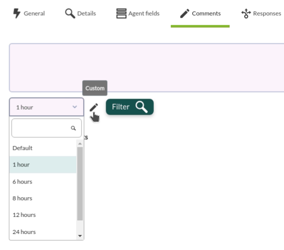{ .diagrama }

### Authentification du Command Center

**Authentication** accepte les mêmes méthodes qu'un nœud —locale, Active Directory, LDAP, SAML et double authentification— et chacune se configure comme là-bas (voir la section 22 de [9.2 · Référence complète de configuration de la console](../parte-9/9.2-referencia-completa-de-configuracion-de-la-consola.md)).

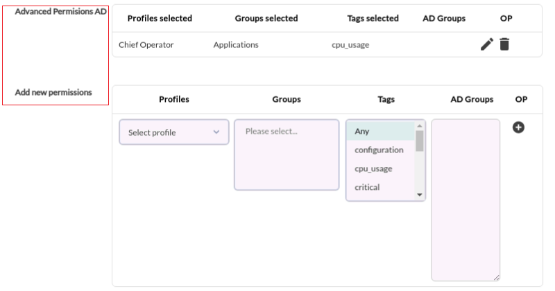{ .diagrama }

La **double authentification** peut être forcée pour tous les utilisateurs.
Quand on l'active, il convient de prévenir : par exemple, avec un message créé
depuis **Workspace → Messages**, qui annonce qu'elle est disponible et comment
l'activer.

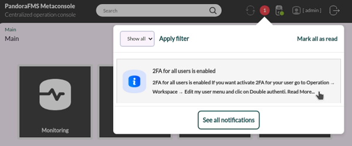{ .diagrama }

Cela vaut la peine de donner un nom propre au second facteur, pour que
l'utilisateur le distingue des autres applications :

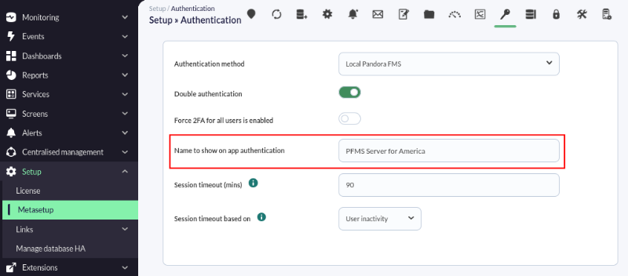{ .diagrama }

### Base de données d'historique du Command Center

**History database**{ .icono-en-linea } garde l'historique des nœuds et se chiffre comme celle du reste de l'environnement : elle partage la même `encryption_passphrase` que les nœuds (voir [9.5 · Chiffrement de la base de données](../parte-9/9.5-cifrado-de-la-base-de-datos.md)). Ce qui change, c'est que ses privilèges s'accordent **par nœud** : le Command Center se connecte à l'historique de chaque nœud avec les identifiants que ce nœud a configurés, et la permission doit s'accorder dans la machine d'historique (voir [12.8 · Grands environnements](../parte-12/12.8-entornos-grandes.md)).

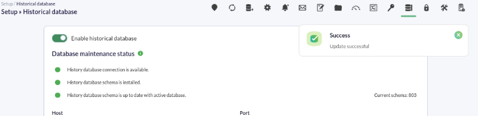{ .diagrama }

### Visionneuse de logs et mots de passe du Command Center

**Log viewer**{ .icono-en-linea } utilise le même collecteur basé sur OpenSearch qu'un nœud ; sa mise en service et ses options se trouvent dans la section 17 de [9.2 · Référence complète de configuration de la console](../parte-9/9.2-referencia-completa-de-configuracion-de-la-consola.md).

**Passwords setup**{ .icono-en-linea } applique la même politique que celle d'un nœud : longueur minimale, expiration, tentatives échouées, historique et liste d'exclusion.


## Extensions

Le Command Center incorpore les mêmes extensions qu'une console, avec quelque
nuance propre. Le concept général se trouve dans
[9.10 · Création d'extensions de
console](../parte-9/9.10-creacion-de-extensiones-de-consola.md).

**DB interface**. Permet d'exécuter des requêtes SQL et de voir le
résultat. C'est un outil pour qui connaît SQL et le schéma de Pandora FMS ;
ce n'est pas pour improviser. Dans un Command Center, de plus, on choisit sur
quelle base on la lance avec **Select query target** : celle du
Command Center lui-même ou celle de n'importe lequel de ses nœuds.

**CSV group import**. Importe des groupes depuis un
fichier avec les champs séparés par des virgules ou par le caractère qu'on
choisit dans **Separator**. On sélectionne le fichier avec **Select a file** et on le lance avec **Go**. Le CSV porte les
champs dans cet ordre : nom du groupe, icône, id du groupe père et propagation
(`1` oui, `0` non).

**Cron jobs**. Ils permettent de programmer dans le Command Center
des opérations périodiques, comme envoyer des logs au format CSV ou exécuter du
code PHP.

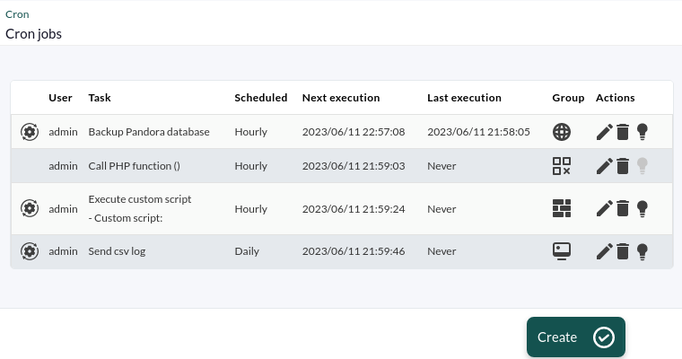{ .diagrama .diagrama-ancho }

Avec **Create**{ .icono-en-linea }, on ajoute une tâche à la liste. Dans la colonne d'actions, chaque ligne s'édite{ .icono-en-linea }, se supprime{ .icono-en-linea } ou s'active et se désactive{ .icono-en-linea }.

**System audit log**. Le Command Center laisse
un registre des opérations qui l'affectent :

- Manipulation des catégories.
- Enregistrement des utilisateurs.
- Événements du système (démarrages de service, cron, etcetera) et erreurs des
  requêtes lancées depuis l'interface de la BD.
- Modifications des nœuds depuis le Command Center.
- Gestion des modules (création, enregistrements échoués, etcetera).
- Gestion des politiques de supervision.
- Changements dans la configuration générale.

Les préférences de filtre peuvent s'enregistrer et se récupérer ; elles
s'éditent{ .icono-en-linea } et se suppriment{ .icono-en-linea } avec les icônes correspondantes.

## Diagnostic

Ce chapitre n'a pas de questions fréquentes propres : elles vivent dans la
Partie 12. Les incidents typiques d'un environnement avec Command Center —que le
serveur d'un nœud ne démarre pas, la suppression d'agents en mode centralisé,
que les événements n'arrivent pas, qu'on ne voie pas l'historique d'un module
ou la récupération d'un nœud tombé en haute disponibilité— se trouvent dans
[12.8 · Grands environnements](../parte-12/12.8-entornos-grandes.md). Pour le
diagnostic général de
Pandora FMS, [9.13 · Troubleshooting avec
Pandora](../parte-9/9.13-troubleshooting-con-pandora.md).

La FAQ du manuel du Command Center n'apporte rien de nouveau : la seule chose
propre (si Discovery fonctionne dans un Command Center, avec ses tâches de
console et son cron) se déplace vers
[12.8 · Grands environnements](../parte-12/12.8-entornos-grandes.md).
