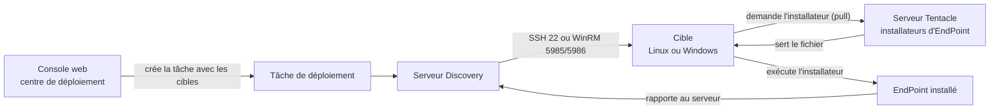
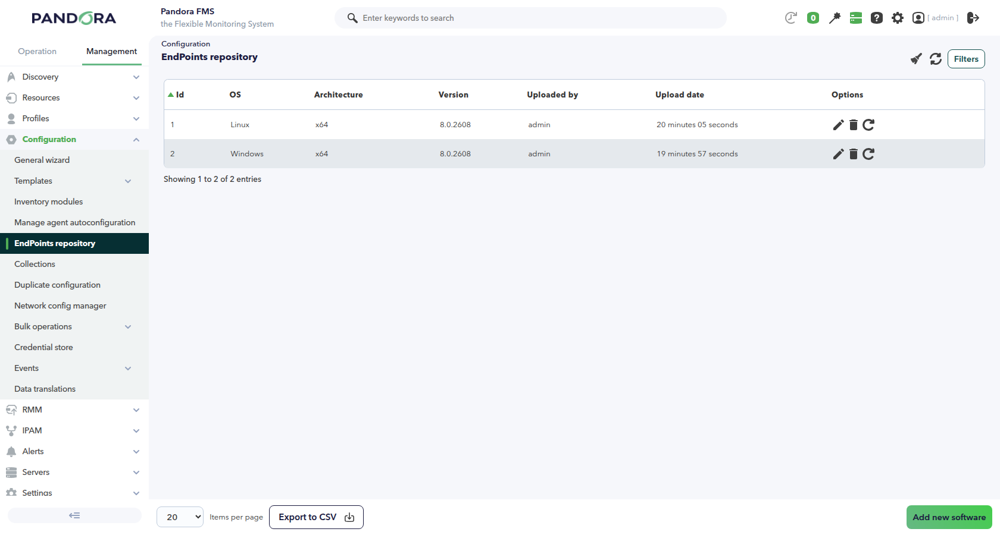
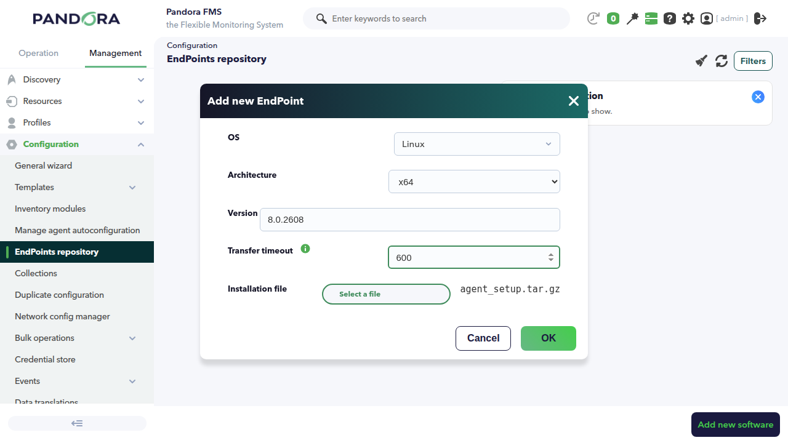
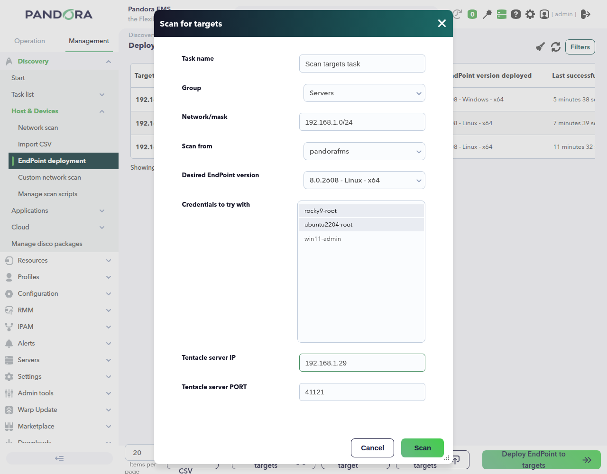
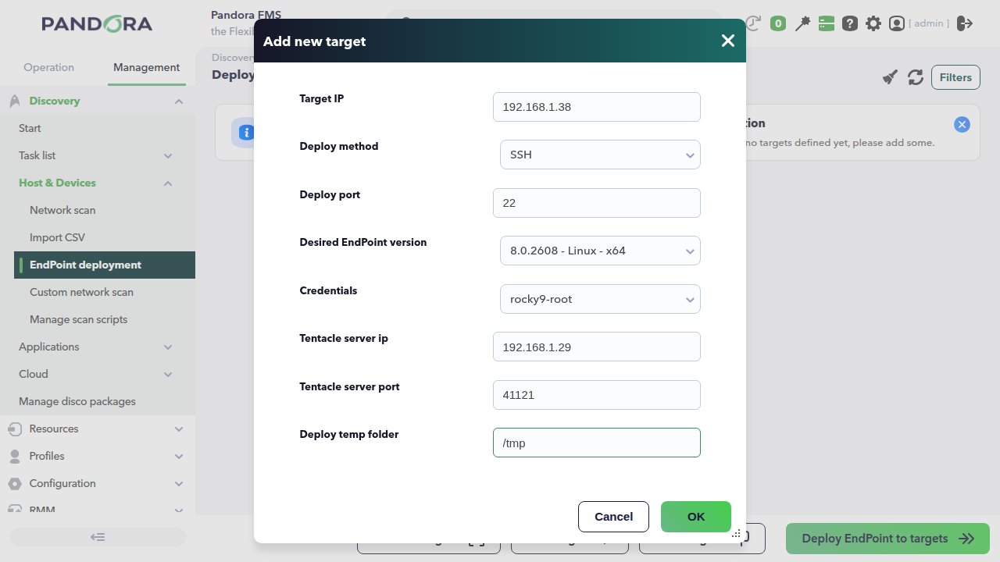
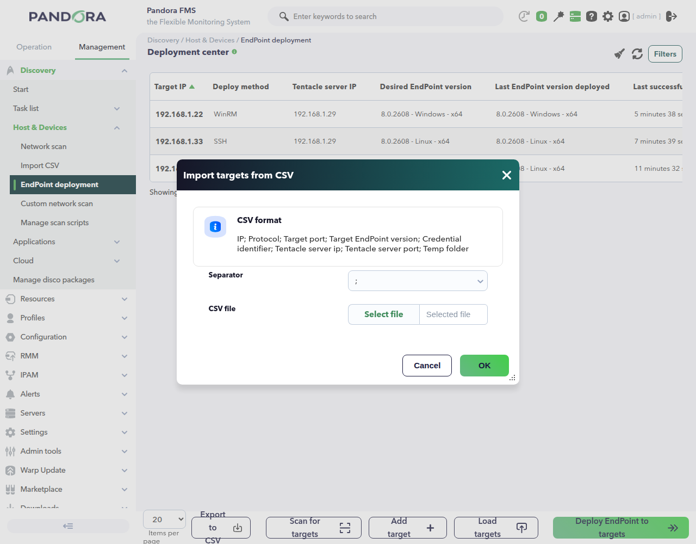
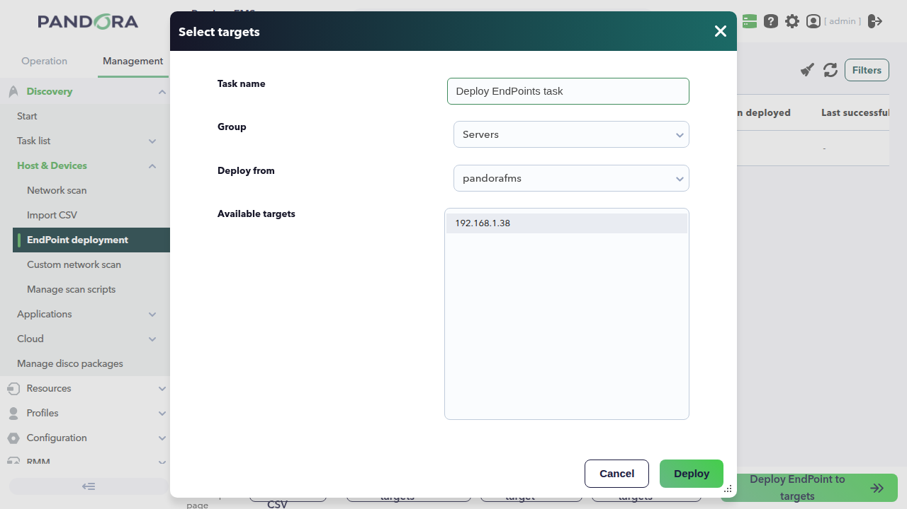
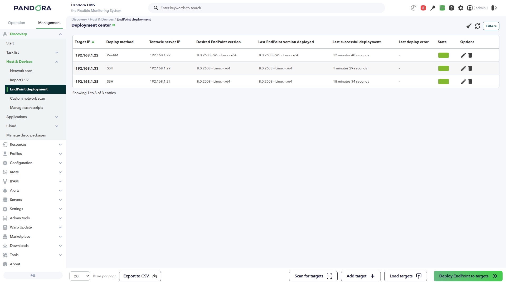
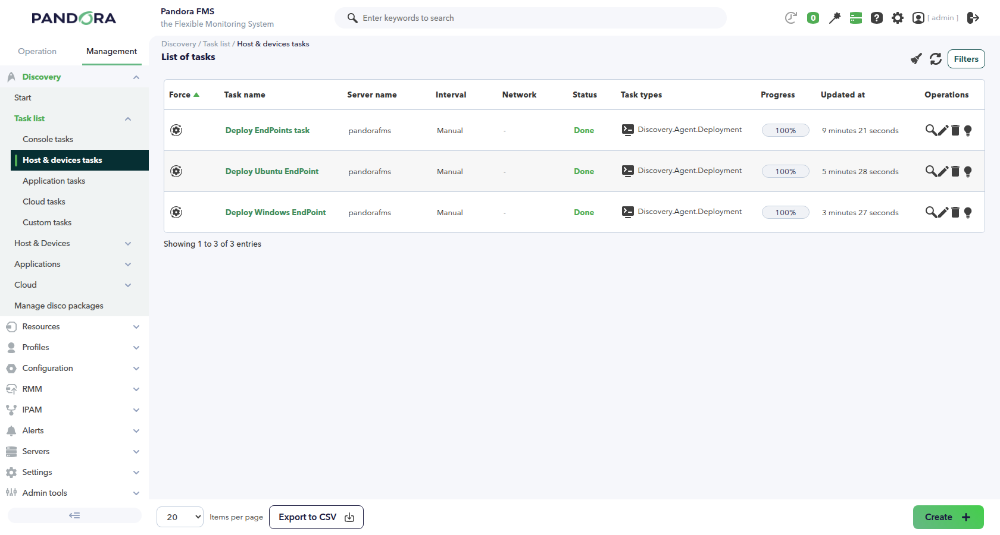

# Distribution et installation automatique des agents

Installer un EndPoint sur une machine, c'est un moment de travail. L'installer
sur cinquante, c'est une après-midi. L'installer sur deux cents, avec des
systèmes d'exploitation différents et des mots de passe que personne n'a notés,
fait partie de ces tâches que l'on repousse jusqu'à ce qu'il n'y ait plus d'autre
choix. Le **centre de déploiement** de Pandora FMS existe pour cela : vous lui
donnez une liste de cibles, un identifiant et une version de l'EndPoint, et il se
charge de faire en sorte que la cible se connecte, télécharge l'installateur,
l'exécute et laisse l'agent rapporter. Sans passer machine par machine et sans
copier vingt fois le même installateur.

L'idée se comprend mieux si on la dit à l'envers de ce qu'elle paraît. Le centre
de déploiement **ne pousse rien** : il ne lance pas un installateur contre la
machine depuis le serveur. Ce qu'il fait, c'est ordonner à la cible de
télécharger l'installateur depuis un serveur Tentacle et de l'exécuter
elle-même. C'est une différence mince dans l'explication et énorme dans la
pratique, parce qu'elle conditionne tout le réseau : la cible doit pouvoir
joindre le Tentacle, et non l'inverse. Tout le reste (l'analyse, l'identifiant,
l'état de la cible) tourne autour de cette connexion.

Dans le laboratoire de ce chapitre, on a déployé des EndPoints sur trois machines
réelles : Rocky Linux 9, Ubuntu 22.04 et Windows 11. Les trois ont fini par
rapporter à la console. Les détails, et quelques nuances, sont dans les pages qui
suivent.

## Introduction : ce qu'il résout et quand l'utiliser

Le centre de déploiement est l'écran depuis lequel on distribue des EndPoints à
des machines déjà localisées ou localisables sur le réseau. Dans la console, il
se trouve dans **Gestion → Discovery → Host et appareils → Déploiement
d'EndPoint**, et la page s'intitule **Centre de déploiement**. Il réunit en un
seul endroit les quatre pièces que l'on manipulait autrefois à la main :
l'**installateur** (le dépôt d'EndPoints), l'**identifiant** avec lequel on
accède à la machine, la **liste de cibles** et la **tâche** qui exécute le
déploiement. Ce qui consistait à copier l'installateur et à entrer sur chaque
machine devient une ligne par machine et un bouton.

Il sert quand plusieurs machines remplissent trois conditions : on peut y entrer
par SSH ou par WinRM, elles peuvent joindre un serveur Tentacle de Pandora FMS et
elles partagent une version d'EndPoint que vous voulez laisser installée. C'est le
cas typique d'un groupe de serveurs Linux, d'un ensemble de postes Windows ou d'un
réseau d'agence avec un serveur Discovery proche. Il sert aussi à réinstaller un
EndPoint resté à moitié fait, toujours avec les précautions décrites dans
[Déployer l'EndPoint](#deployer-lendpoint).

Il ne sert pas à tout. Si la machine n'a ni SSH ni WinRM, le centre ne peut pas y
entrer et il faudra l'installer à la main ou avec l'installateur en ligne de
[1.1 (Installation)](../parte-1/1.1-instalacion.md). Si le réseau empêche la cible
de joindre le Tentacle, le déploiement échouera même si l'identifiant est
correct : le problème ne sera pas l'authentification, il sera le retour. Et s'il
n'y a qu'une machine, ou deux, le détour par la console peut être plus long que
d'exécuter l'installateur une fois.

Il ne faut pas non plus le confondre avec le reste des pièces qui l'entourent. Le
centre **installe l'EndPoint**, il ne configure pas la supervision : les modules,
les politiques et les alertes arrivent ensuite, par les voies de
[2.1 (Supervision avec EndPoints)](../parte-2/2.1-monitorizacion-con-endpoints.md)
et
[2.10 (Politiques de supervision)](../parte-2/2.10-politicas-de-monitorizacion.md).
Et il ne remplace pas la découverte de réseaux de
[2.4 (Découverte de réseaux avec Host et appareils)](../parte-2/2.4-descubrimiento-de-redes-con-host-y-dispositivos.md) :
la découverte trouve des machines ; le centre de déploiement leur installe
l'EndPoint quand vous savez déjà lesquelles c'est.

## Comment cela fonctionne : de la cible à l'EndPoint installé

Le parcours compte six étapes et il vaut la peine de les garder en tête, parce
que chacune laisse une trace différente quand quelque chose échoue.

1. **La cible est enregistrée.** La console conserve son adresse, la méthode
   d'accès (SSH, WinRM ou Secure WinRM), le port, l'identifiant, la version
   d'EndPoint que l'on veut installer, l'adresse et le port du Tentacle et un
   dossier temporaire. La cible, elle, ne sait encore rien.
2. **Une tâche de déploiement est créée.** Quand vous appuyez sur le bouton de
   déploiement, la console crée une tâche avec la liste des cibles
   sélectionnées. La tâche reste activée et avec un intervalle manuel : elle ne
   se répète pas seule à intervalles réguliers, elle s'exécute quand son tour
   arrive.
3. **C'est le serveur Discovery qui l'exécute.** Le serveur de découverte prend
   la tâche et, pour chaque cible, lance l'utilitaire de déploiement. Si le
   serveur Discovery est distant, c'est lui qui doit joindre les cibles ; la
   console ne fait qu'ordonner.
4. **La connexion s'ouvre.** L'utilitaire entre par SSH ou par WinRM avec
   l'identifiant enregistré, vérifie qu'il peut exécuter une commande et, si
   c'est le cas, poursuit.
5. **La cible télécharge l'installateur.** Voici le retournement : la cible ouvre
   une connexion TCP vers le Tentacle, à l'adresse et au port configurés, et
   demande le fichier par son nom. Le Tentacle le sert depuis le répertoire des
   agents. C'est un téléchargement, pas un envoi.
6. **Il s'installe et démarre.** L'installateur place l'EndPoint à sa place,
   configure l'adresse du serveur, active la configuration à distance et démarre
   le service. À partir de là, l'EndPoint commence à rapporter comme n'importe
   quel autre agent.



Le serveur Discovery traite les cibles **une par une dans une même tâche**. Il
n'y a pas de déploiement parallèle qui répartisse la charge entre dix machines :
il y a une file et une cible à la fois. Il n'y a pas non plus de nouvelles
tentatives automatiques. Si une cible échoue, l'erreur est notée et l'on passe à
la suivante ; réessayer est votre décision, avec le bouton qui force la tâche ou
en en créant une autre. Le temps maximal par cible vient du dépôt : l'écran
propose 500 secondes et le serveur coupe l'exécution quand il est épuisé. Une
cible qui reste bloquée ne bloque pas la file pour toujours, mais elle peut
mettre un bon moment à se libérer.

Il y a une conséquence qu'il vaut mieux comprendre dès le début : **« déployé »
signifie que l'installateur a terminé, pas que l'EndPoint rapporte déjà**. La
marque de succès est posée quand l'utilitaire de déploiement se termine sans
erreur ; le premier contact de l'agent peut arriver quelques secondes ou quelques
minutes après. [Suivi : cibles, états et tâches](#suivi-cibles-etats-et-taches)
explique comment distinguer l'un de l'autre.

## Prérequis

Avant d'ajouter la première cible, il faut préparer quatre choses : l'accès aux
machines, le serveur Tentacle, l'identifiant et le dépôt. Si l'une manque, le
déploiement ne commence pas ou échoue au pire moment.

| Exigence | Détail |
|---|---|
| Accès par SSH sous Linux | Port `22` ouvert et authentification par mot de passe. L'utilitaire utilise le mot de passe de l'identifiant ; il n'admet pas de clé privée. L'utilisateur doit pouvoir exécuter l'installateur en root, car l'installateur Linux l'exige |
| Accès par WinRM sous Windows | WinRM ou Secure WinRM activé, PowerShell disponible et un utilisateur administrateur local. Ports par défaut `5985` (WinRM) et `5986` (Secure WinRM) |
| Serveur Tentacle joignable | La cible doit pouvoir ouvrir une connexion TCP au port `41121` du serveur Tentacle. C'est la cible qui lance la connexion, pas le serveur |
| Filtres du Tentacle | Le Tentacle doit servir les installateurs du dépôt. Les filtres `.agent_setup.tar.gz` et `.agent_setup.exe` sont nécessaires dans le répertoire `agent`, et le service doit être redémarré après leur modification |
| Identifiant personnalisé | Un identifiant de type *personnalisé* avec utilisateur et mot de passe, enregistré dans le gestionnaire d'identifiants. C'est son nom qui est conservé dans la cible |
| Dépôt avec installateurs | Au moins un installateur par système d'exploitation et par architecture, chargé dans le dépôt d'EndPoints et synchronisé avec le répertoire des agents du serveur |
| Profil PM | Le centre de déploiement et son entrée de menu exigent le profil **PM**. Le lien vers le gestionnaire d'identifiants exige en plus **UM** |
| Utilitaire de balayage réseau sur le serveur Discovery | Uniquement pour l'analyse des réseaux. Sans lui, l'analyse ne peut pas découvrir d'hôtes |
| Réseau de gestion | Le serveur Discovery doit joindre les ports de déploiement des cibles, et les cibles le Tentacle. Ouvrir le 41121 sur le serveur vers la cible ne sert à rien : la connexion va dans l'autre sens |

Le détail de l'accès à Windows n'est pas un ornement : WinRM est désactivé par
défaut dans beaucoup d'installations et, si le réseau est marqué comme public, le
pare-feu bloque le port même quand le service est démarré. Le guide d'activation
de WinRM reste le point de départ. Au laboratoire, le Windows 11 a eu besoin
d'activer l'écouteur et d'ajouter une règle de pare-feu pour le réseau de
gestion ; sans cela, le port apparaissait fermé depuis le serveur.

Sur l'**utilisateur Linux** : l'installateur vérifie qu'il s'exécute en root et
abandonne sinon. L'utilitaire n'utilise pas `sudo` et n'élève pas les privilèges
de lui-même, l'identifiant doit donc être celui de root ou d'un compte qui
possède déjà les privilèges de root dans la session. Si la machine a SSH mais
n'autorise pas root par mot de passe, le centre de déploiement n'est pas la voie ;
il faudra installer à la main ou changer la politique d'accès.

Sur **Secure WinRM** : il utilise HTTPS et valide le certificat du serveur. Un
certificat auto-signé ou expiré fera échouer la connexion ; pour essayer dans un
laboratoire, il est souvent plus rapide de commencer par WinRM sur `5985` et de
réserver Secure WinRM au moment où le certificat est en règle.

!!! warning "Le Tentacle n'est pas optionnel"
    Le centre de déploiement ne transporte pas l'installateur dans la connexion
    SSH ou WinRM. La cible le télécharge depuis le Tentacle. Si la cible ne
    joint pas le Tentacle, le déploiement échoue avec une erreur de connexion
    même si l'identifiant est correct. C'est l'échec le plus fréquent lors du
    premier essai sur un réseau segmenté.

## Le dépôt d'EndPoints

Le dépôt est le garde-manger du déploiement. Il se trouve dans **Configuration →
Dépôt d'EndPoints** et conserve les installateurs qui sont ensuite servis aux
cibles. Chaque entrée est une combinaison de système d'exploitation,
d'architecture et de version ; il n'y a pas d'entrée « générique » qui vaille
pour tout.

| Champ | Ce que l'on y met |
|---|---|
| OS | `Linux` ou `Windows`. Ce sont les deux systèmes que le centre de déploiement sait installer |
| Architecture | `x64` ou `x86` |
| Version | La version de l'EndPoint, jusqu'à 10 caractères. C'est celle qui s'affiche dans la liste des cibles et celle qui est conservée comme version installée |
| Transfer timeout | Temps maximal, en secondes, accordé au téléchargement et à l'installation de cet installateur. L'écran propose 500 |
| Installation file | Le paquet de l'EndPoint. Pour Linux, un `.tar.gz` ; pour Windows, un `.exe` |

À l'enregistrement, la console copie le fichier dans son magasin et le
synchronise avec le répertoire des agents du serveur, d'où l'installateur est
servi. Il ne faut pas renommer les fichiers à la main ni les déplacer.



L'ajout comporte trois décisions qui comptent :

- **La version ne peut pas se répéter pour le même système et la même
  architecture.** Si une entrée existe déjà avec cette combinaison, la console
  refuse l'ajout. Pour la changer, on modifie l'entrée existante (seulement le
  délai de transfert) ou on la supprime et on la recharge.
- **Le type de fichier est validé au chargement.** La console n'accepte qu'un
  `.tar.gz` pour Linux et un `.exe` pour Windows ; si l'on charge autre chose,
  elle répond par une erreur de fichier d'installation non valide.
- **La synchronisation fait partie de l'ajout.** Il ne suffit pas que le fichier
  soit dans le dépôt : il doit être dans le répertoire des agents du Tentacle.
  L'ajout le fait pour vous ; l'icône d'actualisation de la liste resynchronise
  une entrée existante si la copie du répertoire des agents s'est perdue ou a été
  mise à jour.



Les installateurs s'obtiennent aux mêmes sources que celles décrites dans
[1.1 (Installation)](../parte-1/1.1-instalacion.md). L'installateur en ligne et le
dépôt ne sont pas la même chose : le premier télécharge le paquet depuis les
serveurs de Pandora FMS et l'installe sur la machine ; le second conserve le
paquet que vous chargez pour que le centre de déploiement le serve par Tentacle.
Si vous mettez à jour la version des EndPoints, chargez le nouvel installateur
dans le dépôt avant de changer la version souhaitée des cibles.

## Identifiants et permissions

Le centre de déploiement ne conserve ni utilisateurs ni mots de passe dans la
cible. Il conserve le **nom** d'un identifiant du gestionnaire et le récupère au
moment de déployer. Cette indirection a un avantage évident : quand le mot de
passe des machines change, il est mis à jour une fois dans le gestionnaire et les
cibles utilisent le nouveau au déploiement suivant. Elle a aussi une conséquence :
si vous supprimez l'identifiant, les cibles qui l'utilisaient ne peuvent plus se
déployer et il faut leur en attribuer un autre.

L'identifiant dont ce chapitre a besoin est de type **personnalisé** : un nom, un
utilisateur et un mot de passe. Ce nom est celui que l'on choisit dans le
formulaire d'ajout de cible et celui que l'on écrit dans le CSV ; l'utilisateur et
le mot de passe ne sont pas copiés dans la cible. Dans le gestionnaire,
l'identifiant appartient à un groupe, et ce groupe décide qui le voit. Le détail
des types, des groupes et du chiffrement est dans
[2.2 (Gestionnaire d'identifiants)](../parte-2/2.2-gestor-de-credenciales.md).

!!! warning "Chiffrement des identifiants"
    Si le chiffrement n'est pas activé, l'écran du gestionnaire avertit que les
    identifiants sont conservés sans chiffrement. Un magasin de mots de passe en
    clair est un cadeau pour qui obtient une copie des données.

Quant aux permissions, le centre de déploiement est un écran d'administration :
l'entrée de menu et la page exigent le profil **PM**. Le lien vers le gestionnaire
d'identifiants n'apparaît qu'avec **UM** ; si vous ne l'avez pas, vous pouvez
utiliser un identifiant déjà créé, mais pas en créer un nouveau depuis là. Le
groupe choisi à la création de la tâche de déploiement décide de sa visibilité
dans la liste des tâches, comme pour toute autre tâche de Discovery.

## Trouver des cibles

Il y a trois façons de remplir la liste de cibles : analyser un réseau, en
ajouter une à la main ou charger un CSV. Les trois aboutissent au même endroit,
la liste de cibles, et les trois conservent la même information. La différence est
dans le travail que vous voulez faire et celui que vous voulez laisser à la
console.

Avant de déployer, il vaut mieux savoir quelles cibles sont **valides**. La
console ne propose dans **Cibles disponibles** que celles qui ont un identifiant
et une version d'EndPoint attribués. Une cible sans identifiant, ou avec une
version qui n'existe plus dans le dépôt, n'apparaît pas. Ce n'est pas un caprice :
sans ces deux pièces, le déploiement ne peut pas commencer.

### Analyser un ou plusieurs réseaux

L'analyse est la voie commode quand vous ne savez pas exactement ce qu'il y a sur
le réseau. On lui donne un ou plusieurs réseaux avec leur masque, un serveur
Discovery, une version souhaitée et un ou plusieurs identifiants, et elle fait le
sale travail : elle lance un balayage du réseau, garde les hôtes vivants et, pour
chacun de ceux qui ne sont pas déjà une cible, essaie de se connecter.

L'essai de connexion parcourt trois méthodes dans cet ordre : **SSH sur le 22**,
**WinRM sur le 5985** et **Secure WinRM sur le 5986**. Pour chaque méthode, il
essaie tous les identifiants sélectionnés. La première combinaison qui réussit à
exécuter une commande est celle qui est conservée : la cible est enregistrée avec
cette méthode, ce port et le dossier temporaire correspondant. Si aucune ne
fonctionne, l'hôte est écarté et l'on passe au suivant.



Trois détails évitent des ennuis :

- **L'analyse ne déploie pas.** Elle ne fait qu'ajouter des cibles à la liste.
  Quand elle se termine, il faut encore les sélectionner et lancer le
  déploiement. La tâche d'analyse apparaît dans la liste des tâches avec sa
  progression et son résumé des hôtes vivants et connectés.
- **L'analyse ne touche pas aux cibles existantes.** Si un hôte est déjà dans la
  liste, elle le saute. Cela évite les doublons, mais cela signifie aussi qu'une
  cible avec un mauvais identifiant ne se corrige pas toute seule : il faut la
  modifier ou la supprimer et relancer l'analyse.
- **La première méthode qui fonctionne commande.** Un Windows avec OpenSSH
  activé peut accepter SSH et rester avec la méthode SSH ; le déploiement
  utilisera alors la procédure Linux, qui ne convient pas à une machine Windows.
  Si les machines mélangent les systèmes, vérifiez la méthode choisie par
  l'analyse avant de déployer.

L'analyse peut prendre du temps. Le balayage parcourt le réseau et, pour chaque
hôte vivant, essaie trois méthodes par identifiant ; sur un grand réseau avec
plusieurs identifiants, la tâche peut passer des minutes à travailler. La
progression se voit dans la liste des tâches, et le résumé final indique combien
d'hôtes ont été trouvés et combien ont accepté la connexion.

### Ajouter une cible à la main

L'ajout manuel sert quand vous connaissez déjà l'adresse, la méthode et
l'identifiant. Il est plus rapide qu'une analyse et plus précis : il n'y a pas
d'interprétation qui vaille.

| Champ | Ce qu'il signifie |
|---|---|
| IP de la cible | Adresse de la machine qui va recevoir l'EndPoint |
| Méthode de déploiement | `SSH`, `WinRM` ou `Secure WinRM`. En changeant de méthode, la console ajuste le port et le dossier temporaire aux valeurs de la méthode |
| Port de déploiement | Port de connexion. `22` pour SSH, `5985` pour WinRM, `5986` pour Secure WinRM. Il peut être changé si le service écoute ailleurs |
| Version d'EndPoint souhaitée | Version du dépôt qui va être installée |
| Identifiants | Identifiant personnalisé avec lequel on accède à la machine |
| IP du serveur Tentacle | Adresse du serveur Tentacle que la cible utilisera pour télécharger l'installateur et, ensuite, pour rapporter |
| Port du serveur Tentacle | Port du Tentacle. Par défaut, `41121` |
| Dossier temporaire de déploiement | Dossier temporaire où l'installateur est téléchargé et décompressé. `/tmp` sous Linux, `C:\Windows\Temp` sous Windows |



Le champ où l'on se trompe le plus est l'**IP du serveur Tentacle**. La console
propose l'adresse qu'elle voit elle-même, qui dans une installation normale est
celle du serveur, mais dans un environnement avec des conteneurs ou du NAT peut
être une adresse interne que la cible n'atteint pas. Il faut mettre l'adresse que
la cible peut atteindre, pas celle que la console croit avoir. Si la cible est sur
un autre réseau, cette adresse sera celle de l'interface du serveur sur ce réseau,
pas celle de `localhost`.

L'autre décision est le **dossier temporaire**. Sous Linux, `/tmp` suffit
souvent ; sous Windows, `C:\Windows\Temp` est la valeur par défaut. L'installateur
y est téléchargé, exécuté puis supprimé ; si l'utilisateur n'a pas de droits
d'écriture dans ce dossier, le déploiement échoue avant de commencer.

La console valide le minimum : qu'il y ait une IP, un identifiant, une version et
un protocole. Elle ne vérifie ni le format de l'IP ni la plage du port. Si l'IP
existe déjà, elle répond par un avis de cible déjà définie et ne crée pas de
doublon ; pour la changer, on modifie la cible existante.

### Charger des cibles depuis un CSV

Le CSV est la voie pour enregistrer beaucoup de cibles d'un coup. Le format est
celui qu'affiche l'écran lui-même :

```text
IP; Protocol; Target port; Target EndPoint version; Credential identifier; Tentacle server ip; Tentacle server port; Temp folder
```

Le séparateur se choisit dans le formulaire : `,`, `;`, `:`, `.` ou `#` ; par
défaut, `;`. La première ligne **n'est pas un en-tête** : toutes les lignes sont
traitées comme des cibles. Si vous copiez l'en-tête ci-dessus dans le fichier, la
console essaiera d'enregistrer une cible appelée « IP » et échouera.



Deux valeurs s'écrivent autrement qu'elles n'en ont l'air :

- **Target EndPoint version** est l'**identifiant numérique** du dépôt, pas la
  chaîne de version. Si dans la liste des cibles vous voyez
  `8.0.2608 - Linux - x64`, il faut mettre dans le CSV l'identifiant de cette
  entrée (par exemple `1`), pas le texte. La console vérifie que cet identifiant
  existe et refuse la ligne sinon.
- **Protocol** accepte `SSH`, `HTTP` ou `HTTPS`. `HTTP` est WinRM et `HTTPS` est
  Secure WinRM ; n'écrivez pas « WinRM » ni « Secure WinRM » dans le CSV, car la
  console ne les reconnaît pas comme protocole.

Si l'IP existe déjà, la ligne **met à jour** la cible ; sinon, elle l'**insère**.
Les champs vides sont remplis avec la valeur précédente de la cible, si elle
existe, ou avec les valeurs par défaut : le port de déploiement selon le
protocole, l'adresse du serveur de console pour le Tentacle, `41121` pour le port
et `/tmp` ou `C:\Windows\Temp` pour le dossier temporaire. Le rapport final
indique combien de lignes ont été traitées, combien ont été ajoutées et quelles
erreurs se sont produites ; les erreurs se comptent par ligne, le fichier entier
n'est pas abandonné.

!!! tip "Un petit CSV d'abord"
    Avant de charger deux cents cibles, chargez-en deux. Vérifiez que
    l'identifiant de version et le nom de l'identifiant sont corrects et que le
    séparateur est celui que vous avez choisi. Un CSV mal séparé n'échoue pas de
    manière évidente : il génère une liste d'erreurs par ligne qu'il faut lire une
    à une.

## Déployer l'EndPoint

Avec les cibles dans la liste, le déploiement est l'étape courte. On appuie sur
**Déployer l'EndPoint sur les cibles**, on choisit un nom de tâche, un groupe, le
serveur Discovery qui va l'exécuter et les cibles. La console ne propose que les
cibles qui ont un identifiant et une version ; les autres n'apparaissent pas dans
**Cibles disponibles**.



À la validation, la console crée une tâche de déploiement activée, avec un
intervalle manuel et le groupe choisi. La tâche s'exécute en arrière-plan. Il
n'est pas nécessaire de rester devant l'écran : vous pouvez fermer et revenir plus
tard ; la progression et le résultat restent dans la liste des tâches et dans la
liste des cibles.

Pour chaque cible, l'utilitaire fait ce qui suit :

1. Vérifie que la cible n'est pas déjà en plein déploiement. Si c'est le cas, il
   la saute.
2. Marque la cible comme « en cours de déploiement ».
3. Récupère l'identifiant.
4. Localise l'installateur dans le dépôt.
5. Prépare l'ordre de déploiement et le lance avec un temps maximal.
6. Si l'utilitaire se termine bien, il marque la cible comme déployée, conserve
   la version installée et efface l'erreur précédente. S'il échoue, il marque la
   cible comme non déployée et conserve la sortie de l'erreur. Si le temps
   s'épuise, il conserve « Deployment timeout after N seconds ».

Sous Linux, l'utilitaire télécharge le `.tar.gz` dans le dossier temporaire, le
décompresse, ajuste la configuration de l'EndPoint et exécute l'installateur en
mode non assisté. Si la machine avait déjà un EndPoint, il **conserve sa
configuration existante** et ne réécrit ni l'adresse du serveur ni le port. Sous
Windows, il télécharge le `.exe`, arrête le service s'il existe déjà, l'exécute en
mode silencieux avec l'adresse du serveur et la configuration à distance activée,
ajoute le port si ce n'est pas celui par défaut et démarre le service. S'il
existait déjà une configuration, elle est **conservée** : dans une réinstallation,
l'adresse du serveur et l'état de la configuration à distance ne sont pas
réécrits, et le port n'est ajouté que s'il diffère de celui par défaut. L'adresse
et la configuration à distance indiquées au déploiement s'appliquent quand
l'EndPoint s'installe pour la première fois.

!!! warning "Ce que signifie exactement « déployé »"
    Le centre marque la cible comme déployée quand l'utilitaire de déploiement
    se termine, pas quand l'EndPoint a déjà contacté le serveur. Le premier
    contact de l'agent peut arriver quelques secondes ou quelques minutes après.
    Si l'agent n'apparaît pas dans la console, vérifiez la connectivité et le
    journal de l'EndPoint.

Dans la console, on voit l'alias de l'agent, qui par défaut est le nom de la
machine. Si vous voulez changer la façon dont il apparaît, modifiez l'alias.

Une réinstallation n'est pas un effacement suivi d'une installation propre. Sous
Linux, si la machine avait déjà un EndPoint, l'installateur conserve sa
configuration et n'applique pas la nouvelle adresse du Tentacle. C'est bien pour
ne pas perdre de modules ni de réglages, mais c'est un piège si ce que vous
vouliez était de déplacer l'agent vers un autre serveur : la cible continuera de
pointer vers le serveur précédent. Pour changer de serveur, il faut modifier la
configuration de l'EndPoint sur la machine ou le désinstaller avant de déployer à
nouveau.

## Suivi : cibles, états et tâches

La liste des cibles est le tableau de bord du déploiement. Chaque ligne est une
machine, et chaque donnée raconte une partie de son histoire.

| Champ | Ce qu'il montre |
|---|---|
| IP de la cible | Adresse de la cible. Si l'agent existe déjà dans la console, l'IP est un lien vers sa fiche |
| Méthode de déploiement | SSH, WinRM ou Secure WinRM |
| IP du serveur Tentacle | Adresse du Tentacle qu'utilise la cible |
| Version d'EndPoint souhaitée | Version que l'on veut installer |
| Dernière version d'EndPoint déployée | Dernière version installée correctement, avec son système et son architecture |
| Dernier déploiement réussi | Combien de temps s'est écoulé depuis le dernier déploiement réussi |
| Dernière erreur de déploiement | Sortie de la dernière erreur, s'il y en a eu une |
| État | Indicateur de couleur avec son infobulle |
| Options | Modifier ou supprimer la cible |



L'état se lit par la couleur et par l'infobulle, pas par une étiquette écrite dans
la cellule. Une cible **non déployée** apparaît en bleu ; une cible **déployée
correctement**, en vert ; une cible **en échec**, en rouge. Pendant le
déploiement, la rubrique du dernier déploiement affiche le texte « Déploiement en
cours » et une icône de déverrouillage, et l'état reste en bleu. Cette icône est
la sortie de secours : si le processus est resté bloqué, le déverrouillage libère
la marque, laisse la trace du déverrouillage manuel dans l'erreur et permet de
réessayer ; la ligne apparaît comme en échec jusqu'au déploiement réussi suivant.
Cela n'annule pas le processus en cours sur le serveur ; cela libère seulement la
marque.

Les filtres du haut permettent de chercher par IP, méthode, version, IP du
Tentacle et état. Ils sont utiles quand la liste grandit, mais il vaut mieux
savoir que le filtre par état « Déployé » n'est pas fiable sur cet écran. Pour
savoir si une cible précise va bien, l'état et la dernière erreur sont plus
fiables que ce filtre.

Les tâches vivent dans **Discovery → Liste des tâches → Tâches Host et
appareils**. Chaque déploiement apparaît comme une tâche de déploiement, avec son
état, sa progression et son heure de mise à jour.



Les opérations de la tâche sont celles habituelles de Discovery, avec des
nuances :

- **Forcer** réexécute la tâche avec les mêmes cibles. C'est la façon de
  réessayer un déploiement qui a échoué sans créer de tâche nouvelle.
- **Modifier** ouvre le formulaire de déploiement si la tâche a des cibles, ou
  celui de l'analyse s'il s'agit d'une tâche de réseau. Il permet de changer le
  nom, le groupe, le serveur et les cibles.
- **Activer/Désactiver** active ou désactive la tâche. Une tâche désactivée ne
  s'exécute pas, mais elle n'est pas supprimée.
- **Supprimer** élimine la tâche. Cela ne désinstalle pas l'EndPoint des cibles et
  ne supprime pas les cibles de la liste ; cela supprime seulement la tâche.

Si vous avez utilisé l'analyse pour remplir la liste, la tâche d'analyse et celle
de déploiement sont distinctes. La première ne fait qu'ajouter des cibles ; la
seconde les installe. Ne mélangez pas leurs résultats : le fait que l'analyse se
termine bien ne signifie pas que l'EndPoint est installé.

## Diagnostic et problèmes courants

Quand un déploiement échoue, il y a trois endroits où regarder, dans cet ordre :
la **dernière erreur** de la cible dans la liste, le **journal du serveur** et le
**journal de l'EndPoint** sur la machine elle-même. La dernière erreur donne
souvent l'indice ; le journal du serveur ajoute le contexte de la tâche ; celui
de l'EndPoint dit si l'EndPoint a réussi à démarrer.

| Symptôme | Cause probable | Que faire |
|---|---|---|
| La cible n'apparaît pas dans **Cibles disponibles** | Il lui manque l'identifiant ou la version ; ou l'identifiant ou la version ont été supprimés | Modifiez la cible et attribuez les deux ; vérifiez que la version est toujours dans le dépôt |
| L'authentification échoue ou la connexion est refusée | Utilisateur ou mot de passe incorrects, ou la méthode n'est pas celle qu'attend la machine | Essayez l'identifiant à la main par SSH ou WinRM ; vérifiez la méthode et le port |
| `No route to host` en se connectant au Tentacle | La cible n'atteint ni l'IP ni le port configurés | Corrigez l'IP du Tentacle dans la cible ; vérifiez le port `41121` et le pare-feu |
| Avis indiquant qu'il n'a pas été possible de se connecter au Tentacle | Le Tentacle n'est pas démarré, n'écoute pas à cette adresse ou le filtre ne sert pas le fichier | Vérifiez le service Tentacle, l'adresse et les filtres d'installateurs |
| L'analyse trouve l'hôte mais ne l'ajoute pas | Aucun identifiant ne fonctionne, ou l'hôte existe déjà avec un autre identifiant | Essayez les identifiants à la main ; supprimez l'ancienne cible si vous voulez que l'analyse la recrée |
| Le CSV refuse une ligne parce que la version n'existe pas | On a mis la chaîne de version au lieu de l'identifiant du dépôt | Utilisez l'identifiant numérique de l'entrée du dépôt |
| Le CSV refuse une ligne parce que l'identifiant n'existe pas | Le nom de l'identifiant ne correspond pas exactement | Copiez le nom depuis le gestionnaire, sans espaces ni changement de casse |
| La cible reste en « Déploiement en cours » | Le processus a été interrompu ou le serveur n'a pas libéré la marque | Utilisez le déverrouillage de la cible et relancez le déploiement |
| L'installation épuise le temps maximal | Le téléchargement ou l'installation ont pris plus que le délai de transfert | Augmentez le délai dans le dépôt ou vérifiez le réseau et la taille de l'installateur |
| L'agent n'apparaît pas dans la console | L'EndPoint n'a pas démarré, n'atteint pas le serveur ou le nom a changé | Vérifiez le service, l'adresse et le port du serveur configurés dans l'EndPoint, la connectivité et le journal de l'EndPoint |

L'erreur de Tentacle est la plus facile à diagnostiquer et la plus facile à
éviter. Au laboratoire, une cible dont l'IP du Tentacle avait été changée pour une
adresse inexistante a échoué avec une erreur de connexion (`No route to host`) et
un avis indiquant qu'il n'avait pas été possible de se connecter au Tentacle.
L'identifiant était correct et la connexion SSH fonctionnait ; ce qui ne
fonctionnait pas était le retour vers le Tentacle. Si l'erreur mentionne le
Tentacle, ne perdez pas de temps avec le mot de passe : le problème est dans le
réseau ou dans l'adresse.

Sous Linux, la cible a besoin d'un shell avec les utilitaires habituels de
compression et de gestion de services ; sur un système minimal, le téléchargement
peut échouer même si SSH fonctionne. Sous Windows, elle a besoin de PowerShell et
du service de l'EndPoint ; l'installateur est un `.exe` silencieux.

Pour le diagnostic général du serveur et de l'agent,
[9.13 (Dépannage avec Pandora)](../parte-9/9.13-troubleshooting-con-pandora.md)
rassemble les vérifications qui vont au-delà de ce chapitre.

## Sécurité et bonnes pratiques

Le centre de déploiement déplace des identifiants, installe des logiciels et
démarre des services. Ce n'est pas un écran à laisser ouvert à n'importe qui, et
le réseau sur lequel il s'utilise devrait être traité comme un réseau
d'administration.

Du côté des connexions, il vaut mieux savoir ce que le centre de déploiement fait
et ce qu'il ne fait pas :

- **SSH** accepte la clé d'hôte qu'il trouve et ne la vérifie pas contre une liste
  de confiance. Il utilise l'authentification par mot de passe, pas par clé
  privée. Sur un réseau de gestion maîtrisé, c'est acceptable ; sur un réseau
  ouvert, c'est un risque d'interception.
- **WinRM** utilise NTLM. **Secure WinRM** ajoute TLS et valide le certificat du
  serveur ; si le certificat n'est pas de confiance, la connexion échoue. Pour la
  production, Secure WinRM avec un certificat en règle est l'option raisonnable.
- **Tentacle** sert les installateurs sans mot de passe ni chiffrement par
  défaut. Le trafic circule en clair. Si le réseau n'est pas de confiance,
  configurez les options de sécurité de Tentacle décrites dans
  [9.4 (Référence complète de Tentacle)](../parte-9/9.4-referencia-completa-de-tentacle.md).
- **Les identifiants** sont conservés chiffrés si le chiffrement est activé ;
  sinon, ils sont conservés en clair et l'écran le signale.
- **Le dossier temporaire** sert à télécharger et exécuter l'installateur.
  L'utilitaire supprime l'installateur à la fin, mais tant que le déploiement
  dure, le fichier est là. Sur une machine partagée, utilisez un dossier aux
  permissions restreintes.

Les bonnes pratiques sont celles de tout déploiement massif : essayer d'abord sur
une cible pilote, ne pas lancer deux cents déploiements à la fois sans en avoir vu
un fonctionner, garder dans le dépôt la version que vous voulez installer,
vérifier la méthode choisie par l'analyse et ne pas utiliser le même identifiant
root pour toutes les machines si vous pouvez l'éviter. Le centre de déploiement ne
vous impose rien de tout cela ; il vous le facilite seulement si vous le faites.

## Relation avec les autres formes d'installation

Le centre de déploiement est une pièce de plus du puzzle. Le choix dépend du
nombre de machines, de leur accès à internet et du fait qu'elles soient déjà
localisées.

| Voie | Quand l'utiliser | Où elle est expliquée |
|---|---|---|
| Installateur en ligne | Une ou peu de machines avec accès à internet et une IP de serveur connue | [1.1 (Installation)](../parte-1/1.1-instalacion.md) |
| Installation manuelle | Machines sans réseau de gestion, sans SSH/WinRM ou avec des exigences particulières | [1.1 (Installation)](../parte-1/1.1-instalacion.md) |
| Centre de déploiement | Plusieurs machines accessibles par SSH/WinRM et un Tentacle commun | Ce chapitre |
| Auto-approvisionnement | Machines qui s'enregistrent seules avec une configuration prédéfinie | [6.6 (Mécanismes d'auto-approvisionnement)](6.6-mecanismos-de-autoprovision.md) |
| Découverte avec politiques | Machines déjà supervisées auxquelles on applique une configuration de façon massive | [2.3 (Supervision et découverte automatique avec Discovery)](../parte-2/2.3-monitorizacion-y-descubrimiento-automatico-con-discovery.md) et [2.10 (Politiques de supervision)](../parte-2/2.10-politicas-de-monitorizacion.md) |

Le centre de déploiement laisse l'EndPoint installé. Qu'il rapporte, avec quels
modules et quelles alertes, est une autre conversation : elle commence dans
[2.1 (Supervision avec EndPoints)](../parte-2/2.1-monitorizacion-con-endpoints.md).
Installer l'agent est le début, pas la fin.
