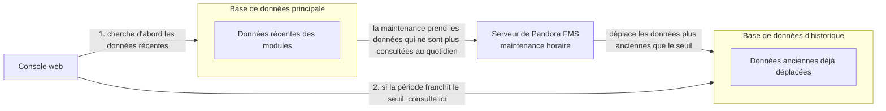
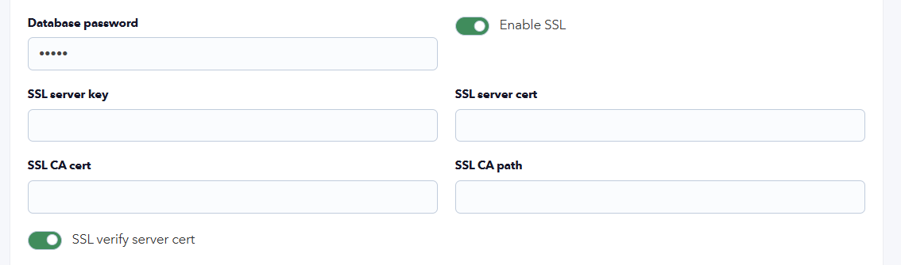
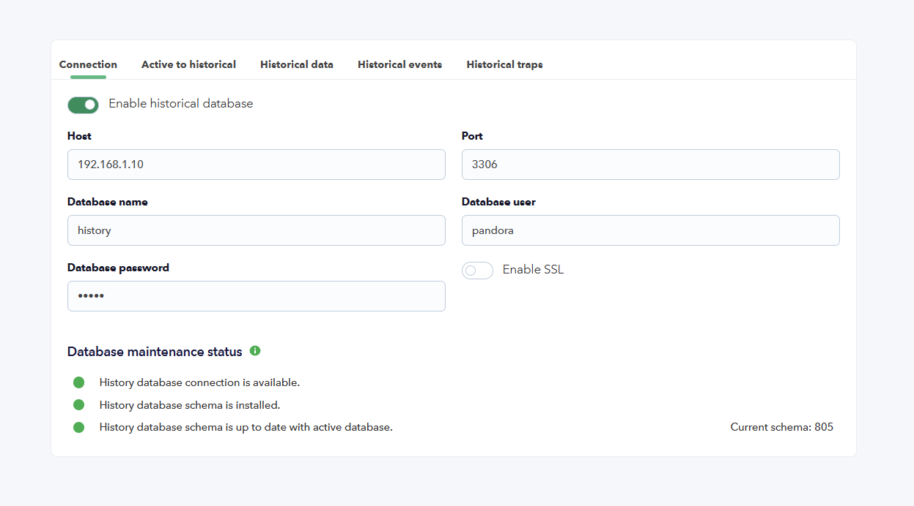
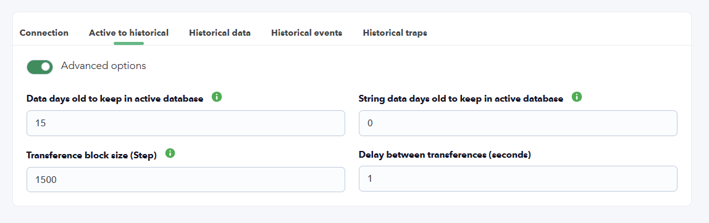
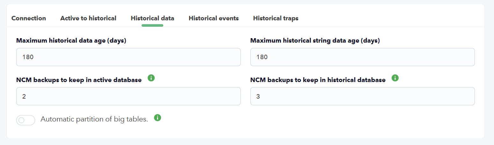
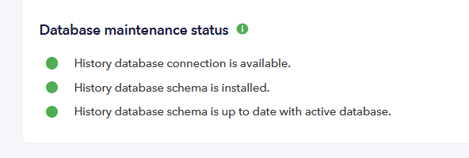
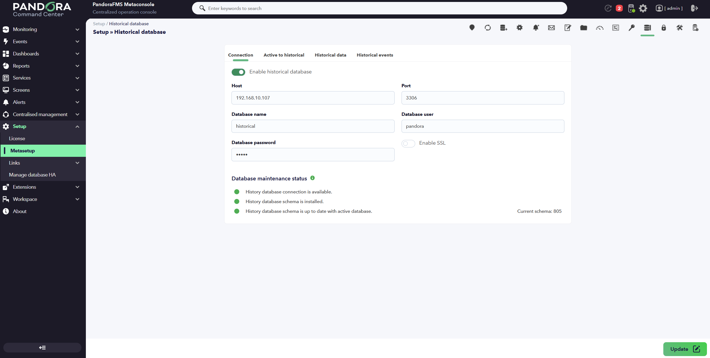

# Base de données d'historique

Une installation de Pandora FMS enregistre tout : la valeur de chaque module,
chaque événement, chaque trap. Avec le temps, cette base de données devient une
archive énorme, et la partie consultée au quotidien est une bande minime, les
derniers jours. La **base de données d'historique** existe précisément pour
cela : les données anciennes partent vers une autre base de données et la
principale respire. L'information n'est ni jetée ni enfermée dans un tiroir :
elle reste disponible, et la console l'interroge de façon transparente quand
vous demandez un graphique ou un rapport qui remonte plus loin que ce que
conserve la base de données active.

## Introduction : ce qu'elle est et quand l'utiliser

La base de données d'historique est une seconde base de données, avec le même
moteur et le même schéma que la principale, vers laquelle le serveur transfère
les données anciennes des modules. L'objectif est double : alléger la base de
données active, qui est celle qui supporte l'écriture constante et les requêtes
du quotidien, et conserver de longues séries temporelles sans qu'elles occupent
la même place que les données récentes. Ce que l'on gagne, c'est de la marge :
une installation à fort volume peut continuer à stocker des mois de données sans
que la base de données active se dégrade. Ce que l'on paie, c'est une pièce de
plus à administrer, avec son propre serveur de base de données, sa sauvegarde et
sa maintenance.

Elle se justifie quand le volume de séries temporelles est élevé et que l'on
veut un historique long sans sacrifier la réponse de la base de données
principale. La base de données d'historique conserve la donnée telle quelle,
seulement ailleurs : elle ne résume pas et ne perd pas de résolution, et c'est
pourquoi elle sert aussi à revoir la minute exacte où quelque chose s'est
produit.

Ce n'est pas non plus une sauvegarde, et il vaut mieux ne pas les confondre. La
base de données d'historique ne protège ni contre un effacement accidentel ni
contre la panne du serveur : c'est une base de données de production de plus,
vivante, avec son propre cycle de purge. C'est à cela que sert la sauvegarde,
traitée dans [6.8 (Sauvegarde et restauration)](6.8-backup-y-restore.md).

La base de données d'historique est **facultative** et livrée désactivée
d'usine. Ce n'est ni une exigence d'installation ni un levier de performance que
l'on active sans réfléchir : c'est une pièce que l'on monte quand le volume la
justifie. L'activer sur une petite installation ajoute du travail en échange de
peu. La décision raisonnable est de l'activer quand la base de données active
commence à être à l'étroit et que la rétention nécessaire dépasse largement ce
qu'il convient de garder dans la base de données principale.

Si vous voulez situer l'historique dans l'ensemble de la plateforme avant de
descendre dans le détail, [1.2 (Introduction et
architecture)](../parte-1/1.2-introduccion-y-arquitectura.md) décrit les
composants et les topologies, et [10.1 (Schéma de la base de
données)](../parte-10/10.1-esquema-de-la-base-de-datos.md) montre le schéma
réel, avec les noms de table qui ne sont pas utilisés ici.

## Comment elle s'insère dans l'architecture

La base de données d'historique utilise le même moteur que la principale, MySQL
8 ou Percona Server for MySQL 8. Ce n'est pas un entrepôt différent avec un
autre format : c'est la même structure, avec les mêmes tables de données, sur un
autre serveur. C'est pourquoi le serveur peut déplacer des lignes d'un endroit à
l'autre sans conversions bizarres, et pourquoi la console peut changer de source
sans que la requête s'en aperçoive.

Le déplacement est exécuté par la **maintenance périodique du serveur**, pas par
la console web. La console se limite à configurer la connexion et les seuils ;
qui transfère les données, c'est l'outil de maintenance de la base de données,
qui tourne toutes les heures via cron. Cela a une conséquence pratique parfois
négligée : configurer l'historique ne déplace rien à l'instant. Les données
commencent à voyager à la passe suivante de la maintenance.

La console, de son côté, conserve sa propre connexion à la base de données
d'historique et décide à chaque requête dans quelle base de données puiser.
Quand vous demandez un graphique ou un rapport, la console regarde l'ancienneté
de la période demandée et, si elle franchit le seuil configuré, change de base
de données. C'est la **requête transparente** : vous ne choisissez pas la base
de données, c'est la console qui la choisit pour vous. Le détail de ce mécanisme
est dans [Consultation depuis la console](#consultation-depuis-la-console).



L'historique cohabite avec le reste de l'architecture sans demander la
permission. Dans un **Command Center**, elle a son propre écran dans le
Metasetup, comme expliqué dans [Exploitation dans des environnements
complexes](#exploitation-dans-des-environnements-complexes) ; dans une topologie
de **haute disponibilité**, elle fait partie de l'ensemble que la maintenance
coordonne, comme on le voit dans [6.9 (Haute
disponibilité)](6.9-alta-disponibilidad-ha.md). Et même si l'usage et la
documentation ancienne la présentent comme obligatoire, la vérité est que le
code n'exige pas que l'historique vive sur un serveur différent de celui de la
base de données principale : c'est une **recommandation**, et une bonne, car
séparer le disque et le CPU des deux bases évite que la maintenance de l'une
étouffe l'autre.

## Exigences et préparation du serveur d'historique

Avant de toucher à la console, il faut préparer le serveur qui va héberger la
seconde base de données. Les exigences sont les mêmes que celles de n'importe
quelle base de données de Pandora FMS, à ceci près qu'ici il n'est pas
nécessaire d'installer le produit : le moteur et une base de données dédiée
suffisent.

| Exigence | Détail |
|---|---|
| Moteur de base de données | MySQL 8 ou Percona Server for MySQL 8, le même que la base de données principale. Le tableau complet des exigences est dans [1.1 (Installation)](../parte-1/1.1-instalacion.md) |
| Base de données dédiée | Une base de données propre pour l'historique, différente de la principale, avec son utilisateur et son mot de passe |
| Privilèges | L'utilisateur a besoin de privilèges sur cette base de données, y compris ceux de créer et de modifier la structure, car le schéma s'installe à la première connexion |
| Connectivité | Accès depuis le serveur de Pandora FMS et depuis la console web vers l'hôte et le port du moteur. Le port par défaut est `3306` |
| Serveur distinct | Héberger l'historique sur un serveur séparé de celui de la base de données principale est **recommandé**, pas exigé. Cela sépare le disque et le CPU, et évite que la maintenance d'une base de données pénalise l'autre |
| Connexion sécurisée (SSL) | Facultative depuis la version 782. Elle se configure avec l'interrupteur **Activer SSL** et les champs de clé, de certificat, de CA, de chemin de la CA et de vérification du certificat du serveur |

L'administrateur du moteur prépare la base de données et l'utilisateur. Sur la
ligne de commande du serveur MySQL qui va héberger l'historique, un jeu
d'instructions comme celui-ci laisse le terrain prêt :

```sql
CREATE USER '<pfms_user_name>' IDENTIFIED BY '<pfms_user_password>';

ALTER USER '<pfms_user_name>'
  IDENTIFIED WITH mysql_native_password BY '<pfms_user_password>';

CREATE DATABASE <historical_database_name>;

GRANT ALL PRIVILEGES
  ON `<historical_database_name>`.*
  TO '<pfms_user_name>'@'<pfms_server_ip_address>';

FLUSH PRIVILEGES;
```

Le nom de la base de données, l'utilisateur et le mot de passe sont ceux que
l'on saisit ensuite sur l'écran de la console. Le schéma ne se crée pas à la
main : c'est la console elle-même qui l'installe à la première connexion, comme
expliqué dans la section suivante.

À propos du **SSL**, il vaut mieux savoir clairement ce qu'est chaque champ.
**Clé SSL du serveur** est le chemin du fichier PEM contenant la clé du serveur
MySQL ; **Certificat SSL du serveur**, celui du certificat de cette clé ;
**Certificat SSL de la CA**, la liste des certificats émis par une autorité de
certification ; **Chemin du certificat SSL de la CA**, le répertoire qui héberge
ces certificats, également au format PEM. Avec **Vérifier le certificat SSL du
serveur** activé, la connexion vérifie le CN du certificat et, s'il ne
correspond pas, ne se connecte pas. C'est l'option recommandée lorsque le moteur
expose une connexion TLS, et l'explication de la configuration sécurisée de la
base de données principale, qui partage les mêmes critères, est dans
[9.5 (Chiffrement de la base de
données)](../parte-9/9.5-cifrado-de-la-base-de-datos.md).




## Activation et connexion depuis la console

L'écran se trouve dans **Réglages → Configuration du système → Base de données
historique**. Tout commence par un interrupteur général, **Activer la base de
données historique**, et un formulaire de connexion qui apparaît lorsqu'on
l'active.

Les champs de connexion sont ceux de n'importe quel client MySQL : **Hôte**,
**Port**, **Nom de la base de données**, **Utilisateur de la base de données**
et **Mot de passe de la base de données**. Le port est fourni avec `3306`, le
standard. Le mot de passe est stocké chiffré, comme le reste des identifiants du
produit. En dessous se trouve le bloc SSL décrit dans la section précédente.



Au moment d'enregistrer, la console effectue deux vérifications qu'il vaut la
peine de connaître, car elles expliquent la moitié des frayeurs :

- Si la base de données d'historique que vous avez saisie est **la même** que
  l'active (même hôte, même port, même nom), la console refuse l'enregistrement
  avec un avertissement clair : la base de données active et l'historique ne
  peuvent pas être la même. C'est une erreur de configuration, pas une panne.
- Si la base de données de destination n'existe pas, ne répond pas ou que
  l'utilisateur n'a pas les permissions, la création de la structure échoue et
  l'interrupteur **Activer la base de données historique** reste désactivé. La
  console ne laisse pas activé un historique dans lequel elle ne peut pas
  écrire.

Quand la connexion fonctionne, la première fois, le **schéma est installé** dans
la base de données de destination. À partir de là, la console compare la version
du schéma de l'historique avec celle de la base de données active et propose
deux actions selon l'état : **Installer le schéma de la base de données**, s'il
n'existe pas encore, et **Mettre à jour le schéma de la base de données**, qui
programme la mise à niveau quand l'historique est resté en retard par rapport à
la base de données principale. Les deux actions sont la même mécanique qui tient
à jour le schéma de la base de données principale, appliquée à la connexion de
l'historique.

Les indicateurs d'état de l'onglet **Connexion** ne sont pas décoratifs : on
peut cliquer dessus pour forcer une vérification. Si vous doutez que la base de
données réponde, cliquer sur l'indicateur de connexion lance une vérification
immédiate, sans attendre le cycle suivant. L'indicateur de schéma installé est
celui qui déclenche l'installation quand elle manque, et celui de schéma à jour
celui qui programme la mise à niveau quand il y a un décalage.

L'écran s'organise en cinq onglets, chacun avec son rôle :

| Onglet | Ce qu'il configure |
|---|---|
| **Connexion** | L'interrupteur général, les données de connexion, le bloc SSL et l'état de la maintenance et du schéma |
| **De la base active à l'historique** | Quelles données sortent de la base de données active et avec quelle ancienneté, la taille de bloc, la pause et les options avancées |
| **Historique des données** | La rétention des données déjà déplacées et le partitionnement automatique des grandes tables |
| **Événements historiques** | Le transfert des événements et leur rétention dans l'historique |
| **Traps historiques** | Le transfert des traps et leur rétention dans l'historique. N'apparaît pas dans le Command Center |

L'inventaire complet des options, avec leur valeur par défaut et leur effet, se
trouve dans [9.2 (Référence complète de configuration de la
console)](../parte-9/9.2-referencia-completa-de-configuracion-de-la-consola.md#31-historique-de-base-de-donnees).
Ici, le chapitre raconte ce que fait chaque chose et comment on l'exploite.

## Ce qui se déplace et quand

La première chose que déplace l'historique, ce sont les **séries numériques**
des modules. À partir d'un seuil d'ancienneté, **15 jours** par défaut, la
donnée cesse d'être dans la base de données active et passe dans l'historique.
Le seuil se règle dans **Jours de données à conserver dans la base active** et
ne peut pas atteindre la limite de purge de la base de données principale : si
la base de données active efface à 45 jours, l'historique n'a pas de sens
configuré à 45, car il arriverait trop tard pour recueillir ce qui a déjà été
purgé.

Les **séries de texte** sont une autre histoire. Par défaut, elles **ne sont pas
transférées** : elles restent dans la base de données active et sont purgées
avec elle. Elles ne partent vers l'historique que si les **options avancées**
sont activées, lesquelles activent le champ **Jours de données de chaîne à
conserver dans la base active**, avec **0 jour** par défaut : les chaînes
n'attendent pas dans la base de données active et commencent à voyager vers
l'historique dès qu'on les active. C'est une décision avec des conséquences, car
les chaînes de texte occupent bien plus qu'un nombre et, si on les active, il
faut configurer leur purge dans l'historique, sinon il grandira sans frein. Ce
point est traité dans [Rétention et purge](#retention-et-purge).

Les **événements** et les **traps** sont facultatifs et voyagent via des
interrupteurs propres : **Activer les événements historiques** et **Activer les
traps historiques**. Chacun a son seuil d'ancienneté dans la base de données
active. Celui des événements, **Jours d'événements à conserver dans la base
active**, est de **6 jours** par défaut, un jour en dessous de la purge des
événements de la base de données principale (**7**). Celui des traps, dans son
onglet, est de **6 jours** par défaut. Les événements, en outre, ne sont
consultés qu'à la génération de rapports, jamais dans la vue des événements en
direct, si bien que les amener dans l'historique grossit la seconde base de
données sans accélérer l'écran le plus regardé : inclure des événements
**augmente de façon notable** le rythme de croissance de l'historique, et c'est
une décision d'espace, pas de performance.

Il y a un cas à part qui explique plus d'une surprise : les **modules à
intervalle court**. Ceux qui s'exécutent avec un intervalle inférieur à
300 secondes vivent dans la base de données active un maximum de **une
semaine**, et ce délai est fixe : il est inscrit dans le code et ne se
configure pas depuis la console. Passé la semaine, leurs données partent vers
l'historique. La raison est de bon sens : un module qui mesure toutes les
quelques secondes génère énormément de volume, et le laisser dans la base de
données active
pendant des mois est la façon la plus rapide de la faire tomber. Ce comportement
cohabite avec le seuil général de 15 jours, qui s'applique aux modules à
intervalle normal.

Le transfert ne se fait pas d'un seul coup. La maintenance envoie les données
par **blocs** dont la taille est fixée par **Taille de bloc de transfert
(Step)**, **1500** lignes par défaut, et attend **Délai entre transferts
(secondes)**, **1** seconde par défaut, entre un bloc et le suivant. L'idée est
de ne pas dévorer la base de données active pendant qu'on la vide : de petits
blocs et des pauses généreuses dérangent moins, au prix d'un transfert plus
long. Si la maintenance pose problème, l'aide du champ elle-même recommande de
baisser la taille du bloc. Les valeurs recommandées sont revues dans
[Référence des options et
dimensionnement](#reference-des-options-et-dimensionnement).




Tout ce va-et-vient est fait par la maintenance périodique. Si vous voulez
comprendre quels modules génèrent quel volume avant de décider des seuils,
[2.1 (Supervision avec des
EndPoints)](../parte-2/2.1-monitorizacion-con-endpoints.md) couvre les
intervalles de module, et [10.1 (Schéma de la base de
données)](../parte-10/10.1-esquema-de-la-base-de-datos.md) montre le détail de
ce qui se déplace au niveau des tables.

## Rétention et purge

La base de données d'historique a son **propre cycle de purge**, avec ses
propres limites. Elle n'hérite pas de celles de la base de données principale :
que la base de données active garde 45 jours de données numériques ne signifie
rien pour l'historique, qui décide toute seule de ce qu'elle conserve. Les
limites par défaut sont **180 jours** pour les données numériques, **180** pour
les séries de texte, **180** pour les événements et **180** pour les traps.
Elles se règlent dans les onglets de données, d'événements et de traps de
l'historique.




Pendant ce temps, la base de données principale purge en même temps et de son
côté, avec des limites bien plus courtes : **45 jours** de données numériques,
**7** de séries de texte, **7** d'événements et **7** de traps. L'ordre compte.
À chaque passe, la maintenance **purge d'abord** de la base de données active ce
qui dépasse sa limite de rétention et **déplace ensuite** vers l'historique ce
qui dépasse le seuil de transfert. C'est pourquoi il convient que le seuil de
transfert reste toujours en dessous de la limite de purge : si la base de
données active efface avant que l'historique ne recueille, la donnée est perdue.
Et si l'historique n'est pas disponible, la base de données active continue de
purger de la même façon : il n'y a pas de file d'attente. C'est pourquoi l'état
de l'historique, visible dans l'onglet **Connexion**, mérite un coup d'œil de
temps en temps.

L'avertissement sérieux est celui des **séries de texte**. Si les options
avancées sont activées pour les transférer, il faut aussi configurer leur
rétention dans l'historique. Si on ne le fait pas, les chaînes s'accumulent dans
la seconde base de données indéfiniment et finissent par occuper un espace que
personne n'avait prévu. La documentation ancienne proposait de le résoudre par
une requête SQL directe sur la base de données ; ici, la recommandation est de
le faire depuis l'écran lui-même, qui est fait pour cela, et de laisser le
détail des tables et des colonnes à [10.1 (Schéma de la base de
données)](../parte-10/10.1-esquema-de-la-base-de-datos.md).

## Partitionnement automatique des grandes tables

Quand l'historique est plein de séries, les tables les plus grandes deviennent
lentes à consulter et lourdes à purger. Le **partitionnement automatique des
grandes tables** répartit ces tables en **partitions mensuelles**, de sorte
qu'une requête de graphique ou de rapport ne touche que les morceaux de la
période qui l'intéresse et que la purge travaille sur des ensembles de lignes
plus petits au lieu de la table entière.

L'interrupteur se trouve dans l'onglet **Historique des données**, sous le nom
**Partitionnement automatique des grandes tables.**, et il est désactivé par
défaut. Quand on l'active, la maintenance crée les partitions qui manquent et en
ajoute une nouvelle au début de chaque mois. Il couvre **trois familles de
données** : les séries numériques, les séries de texte et les traps. Le reste de
la base de données n'est pas partitionné. Le détail du schéma et des noms de
table concernés est dans [10.1 (Schéma de la base de
données)](../parte-10/10.1-esquema-de-la-base-de-datos.md) et dans
[10.2 (Référence des tables)](../parte-10/10.2-referencia-de-tablas.md).

Il existe en outre le **partitionnement manuel**, pour qui préfère contrôler le
processus ou ne veut pas dépendre de l'automatisme. L'opération se fait avec un
`ALTER TABLE` sur la table de séries, en déclarant des partitions par plage sur
l'horodatage, avec une partition finale qui recueille tout ce qui dépasse la
dernière limite :

```sql
ALTER TABLE <tabla_de_series>
  PARTITION BY RANGE (<marca_temporal>) (
    PARTITION <mes_1> VALUES LESS THAN (UNIX_TIMESTAMP('<inicio_del_mes_2>')),
    PARTITION <mes_2> VALUES LESS THAN (UNIX_TIMESTAMP('<inicio_del_mes_3>')),
    /* ... un intervalle par mois ... */
    PARTITION pActual VALUES LESS THAN (MAXVALUE)
  );
```

Chaque mois, il faut réorganiser la partition ouverte pour clôturer le mois qui
s'achève et ouvrir le suivant, avec un `REORGANIZE PARTITION` équivalent. Deux
avertissements de l'expérience : l'opération a besoin de **beaucoup d'espace
libre** sur le disque, car MySQL réécrit la table pendant qu'il la partitionne,
et elle peut prendre des **heures** sur de grandes tables ; dans un cas réel,
partitionner une table de dizaines de millions de lignes a pris environ une
heure et demie. La façon de suivre la progression est de regarder les fichiers
de partition que le moteur crée dans le répertoire de données. Le
partitionnement manuel s'appuie sur les mêmes idées d'optimisation que celles
exposées dans
[6.7 (Optimisation de la base de
données)](6.7-optimizacion-de-la-base-de-datos.md).

## État, maintenance et diagnostic

L'onglet **Connexion** est le tableau de bord de l'historique, et il vaut la
peine de le lire dans l'ordre. D'abord, la **disponibilité de la connexion** :
un indicateur vert avec « La connexion à la base de données historique est
disponible » ou un rouge avec l'erreur concrète. Ensuite, le **schéma
installé** : s'il existe, ou s'il manque et qu'il faut l'installer. Puis, le
**schéma à jour** : si la version de l'historique coïncide avec celle de la
base de données
active ou si elle est restée en retard. Et enfin, la **version de schéma
actuelle** de l'historique, pour la comparer d'un coup d'œil avec celle de la
base de données principale.



L'état de la maintenance de chaque base de données, l'active et l'historique, se
suit depuis la page **Performances** de la console, dans son bloc de
maintenance. Chaque ligne indique quand la maintenance s'est exécutée pour la
dernière fois et affiche un avertissement si trop de temps s'est écoulé. En
pratique, la référence est de **12 heures** : si la maintenance n'a pas tourné
dans ce délai, l'indicateur passe en état problématique. Comme la maintenance
est programmée toutes les heures, douze heures sans s'exécuter signifient que
quelque chose ne va pas.

À cela s'ajoutent les **avertissements du superviseur de la console**, qui
apparaissent dans le système de notifications et couvrent trois cas :

- **Base de données historique non disponible.** L'historique est activé mais la
  console n'arrive pas à se connecter avec la configuration actuelle.
- **Problème de maintenance de la base de données historique.** La maintenance
  ne passe pas par la base de données en **48 heures**. C'est le seuil du
  superviseur, plus souple que l'indicateur de l'écran, et il signale un abandon
  prolongé.
- **Erreur de correspondance de la base de données historique MR.** L'historique
  n'utilise pas le même schéma que la base de données principale, ce qui peut
  produire des anomalies à l'enregistrement des données.

Quand il faut vérifier à la main que la maintenance fonctionne, on lance l'outil
depuis la ligne de commande :

```bash
/usr/bin/pandora_db /etc/pandora/pandora_server.conf
```

Une exécution correcte ne devrait signaler aucune erreur. Le processus laisse sa
trace dans le fichier d'erreurs du serveur, qui est par défaut
`/var/log/pandora/pandora_server.error` et se configure dans le fichier du
serveur lui-même.

Si malgré tout quelque chose ne colle pas, le diagnostic général du produit est
dans [9.13 (Dépannage avec
Pandora)](../parte-9/9.13-troubleshooting-con-pandora.md) et les questions
fréquentes de serveur et de base de données, dans [12.2 (Serveur et base de
données)](../parte-12/12.2-servidor-y-base-de-datos.md) et
[12.8 (Grands environnements)](../parte-12/12.8-entornos-grandes.md).

## Consultation depuis la console

Le charme de l'historique, c'est qu'il ne faut pas s'en souvenir. Quand vous
demandez un graphique ou un rapport avec des données anciennes, la console
**cherche d'abord dans la base de données principale** et, dès que la période
demandée franchit le seuil d'ancienneté configuré, **bascule vers la base de
données d'historique** et continue de puiser là-bas. La requête se répartit
entre les deux bases sans que l'utilisateur le remarque, et le résultat apparaît
comme une série continue. Ce seuil est le même seuil de 15 jours par défaut qui
décide de ce qui se déplace, de sorte que ce qui n'est plus dans la base de
données active est cherché là où il se trouve.

Les rapports bénéficient de la même transparence, comme décrit dans
[5.2 (Rapports)](../parte-5/5.2-informes.md), et les vues métier et de services,
dans [5.3 (Supervision métier et
services)](../parte-5/5.3-monitorizacion-de-negocio-y-servicios.md).

Il convient aussi de savoir **ce que l'historique ne couvre pas**. La **vue des
événements en direct ne consulte pas la base de données d'historique** : les
événements déplacés ne servent qu'à la génération de rapports. Si vous
transférez des événements, vous gagnez de l'historique pour les rapports, mais
vous ne verrez pas les événements anciens sur l'écran des événements. Quelque
chose de semblable se produit avec les traps, dont le traitement est documenté
dans [2.7 (Supervision des traps
SNMP)](../parte-2/2.7-monitorizacion-de-traps-snmp.md). Et il y a des données
qui ne voyagent jamais vers l'historique : la configuration, les agents, les
alertes et tout ce qui n'est pas une série temporelle restent dans la base de
données principale.

## Exploitation dans des environnements complexes

Dans un **Command Center**, l'historique a son propre écran dans **Setup →
Metasetup → Historical database** : c'est la même configuration que celle d'une
console, appliquée à la base de données du Command Center lui-même, et chaque
instance conserve en outre la sienne dans sa console. Un détail pratique : les
données de connexion peuvent être saisies même si le serveur n'est pas encore
lancé, et le **déplacement des données ne commence que lorsque la connexion
réussit**. Or, si au moment d'enregistrer la connexion ne répond pas, la console
**désactive l'interrupteur** de l'historique : il faut le réactiver quand la
destination est disponible. L'onglet des traps n'apparaît pas dans le Command
Center.



Le Command Center dans son ensemble, avec ses nœuds et son modèle de gestion,
est développé dans [6.3 (Command Center)](6.3-command-center.md). Ici, il suffit
de retenir que l'historique du Command Center se configure dans son propre
Metasetup.

En **haute disponibilité**, l'historique fait partie de la topologie et la
maintenance se coordonne entre les nœuds pour ne pas se marcher dessus. Le
scénario complet, avec ses précautions, est dans [6.9 (Haute
disponibilité)](6.9-alta-disponibilidad-ha.md).

Dans une **migration de nœuds**, il y a une étape qui s'oublie facilement :
repointer la connexion de l'historique vers le nouveau serveur. La base de
données principale se déplace avec sa procédure, mais celle de l'historique a sa
propre configuration de connexion et il faut la mettre à jour pour que le nœud
continue de la trouver.

Et pour la **sauvegarde**, il vaut mieux être clair : la copie de la base de
données principale **n'inclut pas** la base de données d'historique. Ce sont
deux bases distinctes sur deux serveurs distincts, et chacune a besoin de sa
propre sauvegarde. La procédure de copie et de restauration de Pandora FMS est
documentée dans [6.8 (Sauvegarde et restauration)](6.8-backup-y-restore.md).

## Référence des options et dimensionnement

Ce chapitre ne répète ni l'inventaire des options ni le tableau de
dimensionnement, et il le fait exprès. La liste complète de chaque champ de
l'écran, avec sa valeur par défaut et son effet, se trouve dans
[9.2 (Référence complète de configuration de la
console)](../parte-9/9.2-referencia-completa-de-configuracion-de-la-consola.md#31-historique-de-base-de-donnees).
Le calcul de la croissance de la base de données selon les agents et les
modules, et la façon de répartir le stockage, se trouvent dans
[9.14 (Analyse volumétrique et conceptions pour la haute
capacité)](../parte-9/9.14-analisis-de-volumetria-y-disenos-para-alta-capacidad.md).
Ici, il ne reste que le critère d'exploitation.

Sur **combien de jours conserver dans la base de données active**, la réponse
courte est le moins possible tout en permettant de travailler à l'aise avec les
données du quotidien. La valeur par défaut, 15 jours, est un bon point de
départ : elle donne de la marge pour regarder le mois en cours sans traîner un
volume inutile. La baisser trop oblige la console à sauter vers l'historique
trop tôt ; la monter trop grossit la base de données la plus sollicitée en
écriture.

Sur la **taille de bloc et la pause**, le code apporte **1500** lignes et
**1** seconde par défaut, mais la recommandation d'exploitation est plus
prudente : **1000** lignes par bloc et **2** secondes de pause. Des blocs plus
petits et des pauses plus longues répartissent mieux la charge et évitent que le
transfert entre en concurrence avec le travail normal de la base de données
active. Sur les installations à disque rapide, le bloc peut être augmenté ; sur
les installations justes, le baisser est le premier levier quand la maintenance
est à la peine.

Et sur la **rétention de l'historique**, la décision est dictée par la
profondeur à laquelle vous avez réellement besoin de consulter. Les 180 jours
par défaut couvrent un semestre, ce qui est plus que ce qu'exigent la plupart
des rapports. L'allonger a un coût direct en espace et en temps de purge ; le
raccourcir libère de la place. Si vous activez les séries de texte,
rappelez-vous que leur rétention doit être configurée explicitement, sinon elles
grandiront sans contrôle, comme averti dans
[Rétention et purge](#retention-et-purge). Pour
ajuster le chiffre à la croissance réelle de la base de données, la référence
est [9.14 (Analyse volumétrique et conceptions pour la haute
capacité)](../parte-9/9.14-analisis-de-volumetria-y-disenos-para-alta-capacidad.md),
et pour le reste des techniques d'optimisation, [6.7 (Optimisation de la base de
données)](6.7-optimizacion-de-la-base-de-datos.md).
