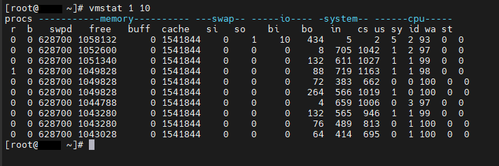
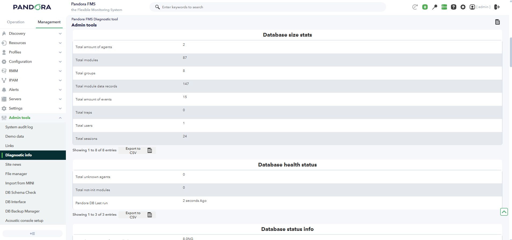
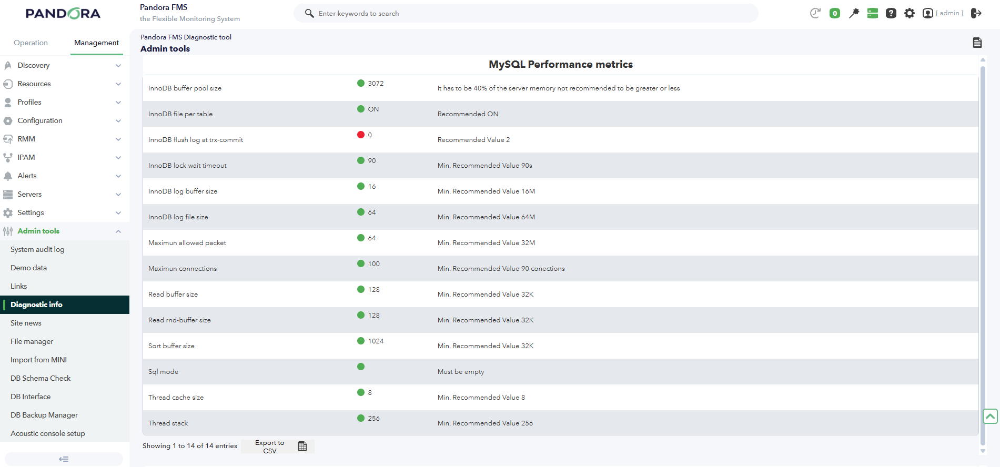
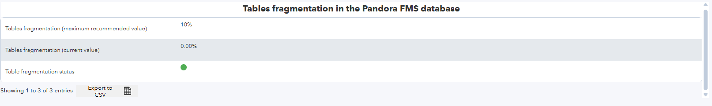
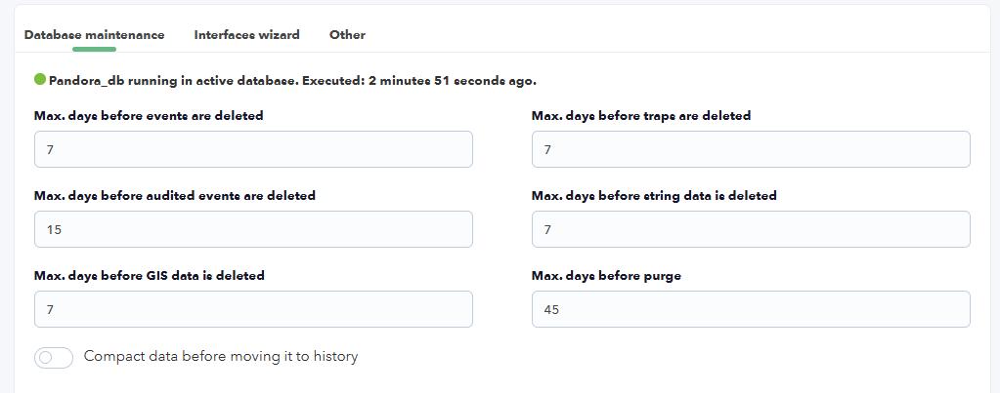
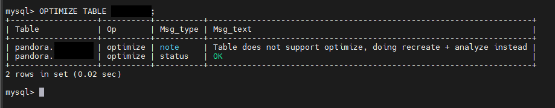
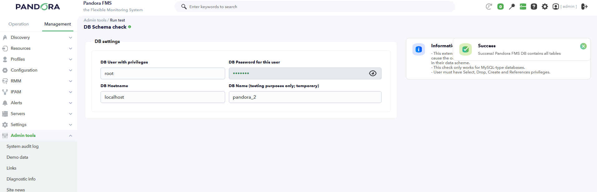

# Optimisation de la base de données

## Introduction : pourquoi la base de données se dégrade

Dans une installation de Pandora FMS, l'écriture ne s'arrête jamais : les modules
livrent leur donnée, les événements s'accumulent et les traps arrivent sans
discontinuer. Les tables de séries temporelles croissent sans répit, la
maintenance périodique purge l'ancien, et l'espace libéré n'est pas toujours
réutilisé correctement. Le résultat, au fil des mois, est une base de données
pleine de trous à l'intérieur. Les requêtes de graphiques et de rapports, qui
sont celles qui lisent le plus, ralentissent peu à peu, et un jour l'écran met du
temps à afficher ce qu'il affichait autrefois tout seul.

C'est cela, la dégradation, et il vaut mieux savoir d'emblée ce qui peut être fait
et ce qui ne peut pas l'être. Pandora FMS **n'optimise pas la base de données à
votre place**. Sa maintenance périodique, qui tourne toutes les heures via cron,
fait quatre choses : elle purge les données qui dépassent leur rétention, elle
vérifie la cohérence de la base, elle contrôle son intégrité référentielle et, si
une base de données historique est configurée, elle y déplace l'ancien. À la fin,
elle horodate l'heure de son dernier passage. Ce qu'elle **ne** fait **pas**,
c'est défragmenter ou reconstruire quoi que ce soit : il n'y a aucun
`OPTIMIZE TABLE` caché dans la maintenance, et la console web n'a aucun bouton
« Optimiser ». Si vous êtes arrivé ici en cherchant ce bouton, je vous épargne la
recherche : il n'existe pas.

D'où le propos de ce chapitre. Il ne s'agit pas ici d'une fonction du produit,
mais de l'administration du moteur, MySQL ou Percona Server for MySQL. C'est vous
qui réglez le moteur, vous qui mesurez la fragmentation, vous qui décidez quand
optimiser et quand reconstruire. Pandora FMS vous donne le diagnostic et la
documentation pour le faire avec discernement.

Les autres pièces du puzzle vivent dans d'autres chapitres et ne sont pas
répétées ici. La base de données historique, sa rétention et le partitionnement
automatique de ses tables sont en
[6.5 (Base de données d'historique)](6.5-base-de-datos-de-historico.md). La
sauvegarde et la restauration, où aboutit la reconstruction, en
[6.8 (Sauvegarde et restauration)](6.8-backup-y-restore.md). Et le
dimensionnement du système, avec la mémoire et le CPU que demande chaque
scénario, en
[9.14 (Analyse volumétrique et conceptions pour la haute capacité)](../parte-9/9.14-analisis-de-volumetria-y-disenos-para-alta-capacidad.md).

## Quelle configuration du moteur apporte Pandora FMS

Pandora FMS fonctionne sur MySQL 8 et sa variante recommandée, Percona Server for
MySQL 8. Les deux sont compatibles entre elles et, par commodité, ce chapitre dit
« MySQL » tout court ; là où il est question d'un test ou d'une valeur
recommandée, il a été fait sur Percona.

La première chose à savoir, c'est que vous ne partez pas de zéro. L'installateur
de Pandora FMS ne se contente pas de laisser le moteur avec les valeurs d'usine :
il écrit un `my.cnf` avec un bloc de paramètres déjà pensé pour le produit. Ce
bloc fixe, entre autres, ces valeurs :

| Paramètre | Valeur | Paramètre | Valeur |
|---|---|---|---|
| `max_allowed_packet` | `64M` | `innodb_lock_wait_timeout` | `90` |
| `innodb_file_per_table` | Activé | `innodb_flush_log_at_trx_commit` | `0` |
| `innodb_flush_method` | `O_DIRECT` | `innodb_log_buffer_size` | `16M` |
| `innodb_log_file_size` | `512M` | `innodb_io_capacity` | `1000` |
| `thread_cache_size` | `32` | `thread_stack` | `256K` |
| `max_connections` | `300` | `key_buffer_size` | `4M` |
| `sql_mode` | Vide | `character-set-server` | `utf8mb4` |
| `read_buffer_size` | `128K` | `read_rnd_buffer_size` | `128K` |
| `sort_buffer_size` | `1M` | `join_buffer_size` | `4M` |

Les deux dernières lignes sont des tampons par session, et non globaux : ils sont
réservés pour chaque connexion. Le moteur utilise `utf8mb4` sur tous les
systèmes, parce que c'est la valeur par défaut de MySQL 8, et l'installateur de
base de données dédiée pour Ubuntu 22.04 le fixe en plus explicitement dans le
fichier. Et le bloc désactive les journaux binaires avec `skip-log-bin`, ce qui
n'est correct que sur un serveur unique, comme on le voit en
[Disque, journaux binaires et charge du
système](#disque-journaux-binaires-et-charge-du-systeme).

Quatre de ces valeurs ne sont pas fixes. L'installateur les adapte au système et
au fait que la base de données soit sur le même serveur ou sur un serveur dédié,
et elles se déplacent entre deux profils : `innodb_log_file_size` entre `64M` et
`512M`, `innodb_io_capacity` entre `100` et `1000`, `thread_cache_size` entre `8`
et `32`, et `max_connections` entre `100` et `300`. Sur les systèmes les plus
récents, et surtout quand le moteur est MySQL 8.4, l'installateur ajoute en outre
deux paramètres qui n'apparaissent pas sur les autres :
`innodb_change_buffering = ALL` et `performance_schema = OFF`. Comme la valeur
exacte dépend de votre cas, ne vous fiez pas au tableau : vérifiez celle que
possède le moteur en marche, ce qui est justement ce qui est expliqué un peu plus
bas.

Le tampon InnoDB est le seul à ne pas avoir de valeur fixe : l'installateur le
calcule à partir de la mémoire du serveur. La règle générale est **40 % de la
RAM**, et dans plusieurs combinaisons de système et d'installateur elle descend à
**25 %** quand le serveur a moins de 7,5 GB. L'idée est qu'il mange une portion
généreuse de la mémoire et laisse le reste au système et au serveur Pandora FMS.
C'est la décision la plus importante de toute la configuration du moteur et elle
est expliquée en détail en
[Réglage fin des paramètres du moteur](#reglage-fin-des-parametres-du-moteur).

**Comment savoir quelle configuration est active.**

Le fichier de configuration n'est pas toujours là où l'on croit, aussi le plus
rapide est-il de le demander au moteur lui-même. Le binaire du serveur imprime,
avec `--verbose`, la liste des fichiers qu'il lit et dans quel ordre :

```bash
mysqld --help --verbose | head -40
```

Avec cela, vous localisez le `my.cnf` qui est réellement appliqué (sur Ubuntu,
c'est généralement `/etc/mysql/my.cnf` ; sur les distributions de la famille
RHEL, `/etc/my.cnf`). Pour voir les valeurs à chaud, sans ouvrir le fichier, on
interroge les variables du moteur :

```sql
SHOW VARIABLES LIKE 'innodb%';
```

Et pour un paramètre précis, la même requête restreinte au nom :

```sql
SHOW VARIABLES LIKE 'innodb_buffer_pool_size';
```

!!! warning "Les paramètres doivent être dans leur section"
    Un paramètre écrit en dehors de la section `[mysqld]` du `my.cnf` n'est pas
    appliqué, et le moteur démarre tranquillement avec la valeur précédente.
    C'est l'erreur la plus fréquente et la plus difficile à voir, parce qu'elle
    ne donne aucun avertissement : la valeur ne change simplement pas. Vérifiez
    toujours la valeur à chaud avec `SHOW VARIABLES`, ne vous fiez pas au
    fichier.

Les exigences du serveur de base de données, avec le système d'exploitation et
les versions admises, sont en
[1.1 (Installation)](../parte-1/1.1-instalacion.md). Le `my.cnf` qu'utilise un
environnement de haute disponibilité n'est pas celui-ci, mais celui de
réplication, décrit en
[6.9 (Haute disponibilité (HA))](6.9-alta-disponibilidad-ha.md). Et si ce que
vous cherchez est la machine nécessaire pour un volume précis, c'est
[9.14 (Analyse volumétrique et conceptions pour la haute capacité)](../parte-9/9.14-analisis-de-volumetria-y-disenos-para-alta-capacidad.md).

## Réglage fin des paramètres du moteur

C'est ici que se trouve le gros du travail d'administration. Le tableau suivant
réunit les paramètres qui comptent, avec la valeur qu'applique Pandora FMS et à
quoi ils servent. Ceux qui portent une valeur fixe sont ceux que écrit
l'installateur ; ceux qui dépendent du système sont indiqués comme tels.

| Paramètre | Valeur qu'applique Pandora FMS | À quoi cela sert |
|---|---|---|
| `innodb_buffer_pool_size` | Calculé : 25 % ou 40 % de la RAM, selon le système | Cache en mémoire des données et des index d'InnoDB. C'est, de loin, le paramètre qui pèse le plus sur les performances |
| `innodb_log_file_size` | `64M` ou `512M`, selon le système | Taille de chaque fichier de journal d'InnoDB |
| `innodb_log_buffer_size` | `16M` | Tampon en mémoire où InnoDB accumule les écritures dans le journal avant de les descendre sur disque |
| `innodb_io_capacity` | `100`, `300` ou `1000`, selon le système | Capacité d'entrée/sortie qu'InnoDB peut demander au disque |
| `innodb_file_per_table` | Activé | Un espace de tables par table, au lieu d'un seul partagé |
| `innodb_flush_log_at_trx_commit` | `0` | Politique d'écriture à la validation de chaque transaction |
| `innodb_flush_method` | `O_DIRECT` | Comment InnoDB écrit sur disque, sans passer par le cache du système d'exploitation |
| `innodb_lock_wait_timeout` | `90` | Secondes qu'une transaction attend un verrou avant d'abandonner |
| `innodb_thread_concurrency` | `0` (valeur par défaut du moteur) | Limite de threads concurrents d'InnoDB ; `0` veut dire « sans limite » |
| `max_allowed_packet` | `64M` | Taille maximale d'un paquet de données entre client et moteur |
| `max_connections` | `100` ou `300`, selon le système | Connexions simultanées admises |
| `thread_cache_size` | `8` ou `32`, selon le système | Threads que le moteur garde en réserve pour les réutiliser |
| `thread_stack` | `256K` | Pile mémoire affectée à chaque thread |
| `key_buffer_size` | `4M` | Tampon de clés, propre à MyISAM. Il n'accélère pas InnoDB |
| `read_buffer_size` | `128K` | Tampon par session pour les lectures séquentielles |
| `read_rnd_buffer_size` | `128K` | Tampon par session pour les lectures dans un ordre dispersé |
| `sort_buffer_size` | `1M` | Tampon par session pour les tris |
| `join_buffer_size` | `4M` | Tampon par session pour les jointures qui n'utilisent pas d'index |
| `sql_mode` | Vide | Mode SQL strict désactivé |

**Le tampon InnoDB : plus de mémoire avant plus de CPU.**

Si vous ne pouvez toucher qu'à un seul paramètre, touchez à celui-ci.
`innodb_buffer_pool_size` est la mémoire où InnoDB met en cache les pages de
données et d'index qu'il lit, et plus il est grand, moins souvent il doit aller
au disque. Dans une base de données de supervision, où le schéma est de beaucoup
lire et d'écrire en continu, cela fait la différence entre une console web qui
répond et une console web qui traîne.

L'expérience avec le produit pointe toujours dans la même direction : **plus de
mémoire rend plus que plus de CPU**. Un système d'entreprise démarre bien avec
4 GB de RAM ; pour un grand environnement, 16 GB est un point de départ
raisonnable. L'installateur calcule déjà la valeur à partir de la mémoire
disponible, mais sur les grosses machines il convient de la revoir, parce que les
pourcentages sont une approximation et le nombre qui compte vraiment est l'espace
qu'occupent les données et les index actifs. Si le tampon tient entièrement en
mémoire, le disque cesse d'être le goulot d'étranglement pour les lectures.

**Journaux d'InnoDB et capacité de disque.**

InnoDB écrit ses changements dans un journal avant de les consolider dans les
tables. L'installateur fixe chaque fichier de journal à `64M` ou `512M`, selon le
système, et son tampon à `16M`. Un journal petit oblige le moteur à le descendre
sur disque plus souvent, et c'est là que se perd la performance ; un journal
grand allonge la récupération après une chute, parce qu'il y a plus à refaire.
Les valeurs de Pandora FMS sont un compromis pensé pour la production à fort
volume de transactions.

`innodb_io_capacity` dit combien d'entrées/sorties InnoDB peut demander au
disque. L'installateur le laisse à une valeur prudente — entre `100` et `1000`,
selon le système — qui suppose un disque capable. Si le disque est différent, le
nombre s'ajuste à ce qu'il supporte. La référence, ce sont les IOPS du disque :

| Type de disque | IOPS approximatives |
|---|---|
| Disque mécanique à 7 500 tr/min | 100 |
| Disque mécanique à 15 000 tr/min | 190 |
| SSD | 1 500 |

Un SSD n'est pas un luxe sur un serveur de base de données de supervision : c'est
la différence entre une maintenance qui se termine à temps et une qui chevauche
la suivante.

`innodb_file_per_table` mérite un paragraphe à part parce qu'il conditionne tout
le reste. Avec l'espace de tables par table activé, chaque table vit dans son
propre fichier. Cela permet de déplacer une table précise vers un autre disque,
de la restaurer sans toucher aux autres et, surtout, que la fragmentation d'une
table n'entraîne pas les autres. Si le paramètre n'est pas activé, toutes les
tables partagent un espace unique et la fragmentation est commune, de sorte que
les performances se dégradent plus tôt. L'installateur l'active d'office, et le
partitionnement manuel des grandes tables l'exige.

**La politique d'écriture à la validation.**

`innodb_flush_log_at_trx_commit` décide de ce que le moteur risque pour aller
plus vite. Avec la valeur `0`, InnoDB regroupe les écritures et les vide environ
une fois par seconde, au lieu de descendre sur disque à chaque transaction. La
contrepartie est claire : en cas de chute, on peut perdre la dernière seconde de
données. Dans une base de données de supervision, cette seconde est une poignée
de valeurs de module, et l'échange vaut la peine. Pandora FMS applique `0` dans
l'installateur ; un environnement de haute disponibilité utilise une autre
valeur, car là la réplication change les règles du jeu et le `my.cnf` est un
autre.

Très lié à cela, `innodb_flush_method = O_DIRECT` évite que les écritures passent
par le cache du système d'exploitation. Dans une base de données qui a déjà son
propre grand tampon, dupliquer le cache dans le système n'aide pas, il gêne.

**Verrous, paquets et concurrence.**

`innodb_lock_wait_timeout` fixe à `90` secondes l'attente maximale d'une
transaction pour un verrou. Si ce temps s'épuise, l'opération échoue et le client
reçoit le classique **« MySQL has gone away »**. Les 90 secondes donnent une
marge pour qu'un blocage ponctuel se résolve seul, sans que le moteur abandonne
du premier coup. Qu'un temps d'attente s'épuise de façon habituelle n'est pas un
réglage manquant : c'est le symptôme que quelque chose d'autre va mal.

`max_allowed_packet` à `64M` permet de déplacer de gros paquets, comme les envois
massifs de données des EndPoints ou une restauration. `max_connections` (à `100`
ou `300`, selon le système) couvre largement les connexions de la console, du
serveur et de la maintenance, chacune avec son petit groupe de connexions.
`thread_cache_size` et `thread_stack` complètent la partie threads : le moteur
garde des threads en réserve (`8` ou `32`, selon le système) pour ne pas les
créer et les détruire à chaque connexion, et affecte 256K de pile à chacun.

Quant à `innodb_thread_concurrency`, la valeur par défaut `0` laisse InnoDB
ouvrir autant de threads qu'il peut. C'est un paramètre avancé et, mal réglé, il
va plus lentement qu'en le laissant tranquille. S'il faut l'affiner sur un
système à forte concurrence, la formule recommandée est le nombre de processeurs
physiques multiplié par deux, plus le nombre de disques où vit InnoDB. En cas de
doute, on le laisse à `0`.

**Les tampons par session.**

Les quatre tampons par session (`read_buffer_size`, `read_rnd_buffer_size`,
`sort_buffer_size` et `join_buffer_size`) sont réservés par connexion, pas une
seule fois. Ils se multiplient par le nombre de connexions simultanées, aussi les
augmenter gaiement gonfle la consommation de mémoire. Les valeurs de Pandora FMS
sont contenues et suffisantes pour les requêtes du produit. `key_buffer_size`, à
`4M`, est un tampon MyISAM et n'accélère pas InnoDB ; il reste à sa valeur basse
parce qu'il n'apporte rien au moteur qu'utilise le produit.

**Ce qui n'existe plus : le cache de requêtes.**

MySQL 8 a retiré le cache de requêtes que les versions précédentes apportaient.
Les paramètres qui le gouvernaient (`query_cache_size`, `query_cache_limit`,
`query_cache_type`) n'existent plus, et le `my.cnf` de Pandora FMS ne les définit
pas. Il n'y a rien à configurer ici : si vous venez d'une installation ancienne
et que ces paramètres sont encore dans le fichier, supprimez-les, car le moteur
actuel ne les reconnaît pas et peut refuser de démarrer. On les retire du
`my.cnf` et on continue.

!!! warning "Chaque changement exige un redémarrage et une vérification"
    Les paramètres du moteur ne s'appliquent pas à chaud : il faut redémarrer le
    service et vérifier qu'il démarre sans erreur et que la console web et le
    serveur se connectent toujours à la base de données. Un `my.cnf` avec une
    erreur de syntaxe ou une valeur hors limites peut laisser le moteur à terre.
    Changez un bloc, redémarrez, vérifiez, et alors seulement passez au suivant.

## Disque, journaux binaires et charge du système

Le goulot d'étranglement habituel d'une base de données n'est ni le CPU ni la
mémoire : c'est le disque. Trois règles d'or, et aucune n'est négociable quand le
volume serre. La première, séparer le système d'exploitation, les données de la
base de données et les journaux de réplication sur des disques différents, pour
qu'ils ne se disputent pas la même tête ni le même contrôleur. La deuxième,
utiliser du SSD. La troisième, quand le client et le moteur sont sur la même
machine, se connecter par socket plutôt que par TCP/IP, ce qui se traduit par une
amélioration d'environ 7,5 % sans rien toucher d'autre : il suffit de ne pas
indiquer de nom d'hôte à la connexion, au lieu de forcer `localhost`.

Les **journaux binaires** sont l'autre pièce du disque. Si vous avez un serveur
unique de Pandora FMS, vous n'en avez pas besoin et l'installateur les désactive
déjà avec `skip-log-bin`. Si vous avez de la haute disponibilité, ils sont
**obligatoires**, parce que la réplication s'appuie sur eux, et le `my.cnf` est
un autre : il porte un bloc de paramètres de réplication et, en plus, une valeur
différente pour la politique d'écriture
(`innodb_flush_log_at_trx_commit = 2`) et une limite de connexions propre
(`200`). Ce fichier, avec ses nœuds et ses précautions, est documenté en
[6.9 (Haute disponibilité (HA))](6.9-alta-disponibilidad-ha.md).

**Comment savoir si le système souffre.**

Avant de toucher à la base de données, il convient de vérifier que le problème
est là où vous croyez. Le système d'exploitation apporte l'outil qu'il faut :

```bash
vmstat 1 10
```

Elle renvoie dix échantillons, un par seconde. Ce qu'il faut regarder est dans
les dernières colonnes. Une sortie d'un système sain a cet aspect :

```text
procs -----------memory---------- ---swap-- -----io---- --system-- -----cpu------
 r  b   swpd   free   buff  cache   si   so    bi    bo   in   cs us sy id wa st
 0  0  46248  78664 154644 576800    0    0     2   147    0    9  7 10 83  0  0
 2  0  46248  78904 154648 576740    0    0     0   184  728 2484 63  6 31  0  0
 0  0  46248  79028 154648 576736    0    0     0    20   35   37  0  1 98  1  0
 1  0  46248  79028 154648 576736    0    0     0     0   28   22  0  0 100  0  0
```

La lecture est directe. La colonne `wa` (attente d'entrée/sortie) au-dessus de 10
signale un problème de disque qu'il faut résoudre. La colonne `sy` (temps
système) ne devrait pas dépasser 10 ou 15. Et `si` et `so` (mémoire d'échange)
devraient être à 0 : sinon, le système utilise le swap, qui est un destructeur de
performance en bonne et due forme. La solution, alors, n'est pas dans la base de
données : il faut augmenter la mémoire ou réduire ce qui la consomme, en
commençant par les threads du serveur et les tampons du moteur.



## Diagnostic de la santé de la base de données

Avant d'optimiser quoi que ce soit, mesurez. La console web n'offre pas d'action
d'optimisation, mais elle offre un diagnostic complet de la base de données, et
il convient de le connaître parce qu'il est la porte d'entrée de tout le reste.



L'outil principal se trouve dans **Outils d'administration → Information de
diagnostic**. Il réunit, sur un seul écran, la taille de la base de données, son
état de santé, des informations sur le moteur et deux blocs qui sont ceux qui
nous intéressent ici :

- Les **variables du moteur comparées aux valeurs recommandées**. Le diagnostic
  parcourt les variables de MySQL et marque en rouge celles qui n'atteignent pas
  le minimum conseillé, avec leur valeur actuelle et la valeur qu'elles devraient
  avoir. Le tableau suivant reprend ces minimums.

| Variable | Valeur recommandée par le diagnostic |
|---|---|
| `innodb_buffer_pool_size` | 250 MB ou plus (l'avertissement lui-même parle de 40 % de la mémoire du serveur) |
| `innodb_file_per_table` | Activé |
| `innodb_lock_wait_timeout` | 90 secondes ou plus |
| `innodb_log_buffer_size` | 16M ou plus |
| `innodb_log_file_size` | 64M ou plus |
| `max_allowed_packet` | 32M ou plus |
| `max_connections` | 90 ou plus |
| `read_buffer_size` | 32K ou plus |
| `read_rnd_buffer_size` | 32K ou plus |
| `sort_buffer_size` | 32K ou plus |
| `thread_cache_size` | 8 ou plus |
| `thread_stack` | 256K ou plus |
| `sql_mode` | Vide |



En plus de ces minimums, le diagnostic compare chaque variable à la valeur qu'il
s'attend à trouver, y compris la politique d'écriture d'InnoDB. Si une variable
apparaît en rouge, revoyez le `my.cnf` : le plus courant est que le paramètre n'ait
pas été appliqué parce qu'il est hors de sa section, ou que quelqu'un l'ait changé
après coup.

Il y a une ligne qui peut sortir en rouge et qu'**il ne faut pas toucher** : celle
de la **politique d'écriture d'InnoDB**. Le diagnostic attend la valeur prudente,
et l'installateur d'un serveur unique applique la rapide, si bien que dans une
installation fraîche cette ligne apparaît en rouge même si rien ne va mal.
Laissez-la telle quelle, avec la valeur qu'a mise l'installateur. Dans un
environnement de haute disponibilité, vous ne la verrez pas ainsi : là le `my.cnf`
utilise la valeur prudente et la ligne arrive en vert, comme il est expliqué en
[Disque, journaux binaires et charge du
système](#disque-journaux-binaires-et-charge-du-systeme).

- La **fragmentation de la table de séries numériques**. Quand elle dépasse
  **10 %**, le diagnostic avertit que la table est fragmentée et qu'elle devrait
  être défragmentée. Elle se mesure dans le même panneau et elle est expliquée en
  [Fragmentation : la mesurer avant de toucher à quoi que ce
  soit](#fragmentation-la-mesurer-avant-de-toucher-a-quoi-que-ce-soit).



Les deux autres outils du menu ont un rôle différent. **Outils d'administration →
Vérifier schéma de la BD** vérifie que la base de données est correcte : il
détecte les tables ou les champs qui manquent après une migration ou une mise à
jour. Pour l'exécuter, l'utilisateur de base de données a besoin des privilèges de
consultation, suppression, création et références. Et **Outils d'administration →
Interface de la BD** permet de lancer des requêtes directement contre la base
depuis la console, utile pour une vérification ponctuelle sans ouvrir un client à
part. Le diagnostic général du produit, au-delà de la base de données, est couvert
en [9.13 (Dépannage avec Pandora)](../parte-9/9.13-troubleshooting-con-pandora.md).

**Le script de diagnostic du serveur.**

Quand il faut ouvrir un incident, la console ne suffit pas : il faut une photo du
serveur. C'est à cela que sert le script de diagnostic, qui s'exécute à la main
sur la machine :

```bash
./pandora_diagnostic.sh
```

Il recueille, dans un unique fichier dans `/tmp/pandora_diag.<date>.data`, les
informations du processeur et de la mémoire, le temps d'activité, les processus
de Pandora FMS en marche, le contenu du `my.cnf` du moteur, la configuration du
serveur (sans mots de passe), la liste de ses journaux, l'utilisation du disque et
un échantillon de `vmstat` et du journal du système. C'est la première pièce que
l'on demande à l'ouverture d'un ticket, parce qu'elle évite vingt questions. Il
s'exécute sur le serveur, pas depuis la console, et son résultat ne se lit pas à
l'écran : c'est un fichier que l'on joint.

**L'état de la maintenance périodique.**

Enfin, l'état de la maintenance de la base de données se surveille depuis
**Réglages → Configuration du système → Performance**, dans l'onglet de maintenance de
la base de données. Cet écran referme le diagnostic par le bas : chaque ligne dit
quand elle s'est exécutée pour la dernière fois et affiche un feu tricolore, si
bien que d'un coup d'œil on sait si la base de données est purgée et contrôlée au
rythme prévu ou si la maintenance s'est arrêtée. Le détail de l'indicateur et de
son seuil est en
[6.5 (Base de données d'historique)](6.5-base-de-datos-de-historico.md), et
l'inventaire complet des options de cet écran, avec sa valeur par défaut, en
[9.2 (Référence complète de configuration de la console)](../parte-9/9.2-referencia-completa-de-configuracion-de-la-consola.md).



## Fragmentation : la mesurer avant de toucher à quoi que ce soit

Une base de données se fragmente comme se fragmente un disque : entre une
insertion et la suivante il y a des suppressions, et l'espace qui reste libre se
répartit en trous. Dans Pandora FMS, le schéma est clair : les tables de séries
temporelles reçoivent des insertions constantes et la purge supprime des séries
anciennes en continu, aussi ces tables sont-elles les premières à accumuler de
l'espace libre inutilisé. Avec le temps, lire un graphique oblige le moteur à
sauter entre les trous et tout va plus lentement.

Mesurer la fragmentation est bon marché et ne change rien, aussi le fait-on
toujours avant de décider. La requête va au catalogue du moteur lui-même, pas aux
tables du produit, et c'est pourquoi elle peut être publiée entière :

```sql
SELECT ENGINE,
       TABLE_NAME,
       ROUND(DATA_LENGTH/1024/1024)  AS data_length,
       ROUND(INDEX_LENGTH/1024/1024) AS index_length,
       ROUND(DATA_FREE/1024/1024)    AS data_free,
       (DATA_FREE/(INDEX_LENGTH+DATA_LENGTH)) AS frag_ratio
  FROM information_schema.tables
 WHERE TABLE_TYPE = 'BASE TABLE'
   AND DATA_FREE > 0
 ORDER BY frag_ratio DESC;
```

Chaque ligne est une table avec de l'espace libre et chaque colonne mesure une
chose : le moteur (`ENGINE`), le nom de la table (`TABLE_NAME`), les mégaoctets de
données (`data_length`), ceux des index (`index_length`), ceux de l'espace libre
(`data_free`) et le quotient entre l'espace libre et l'espace occupé
(`frag_ratio`). Le résultat arrive trié de la fragmentation la plus grande à la
plus petite, aussi les premières lignes sont-elles les candidates.

Deux avertissements pour bien la lire. Le premier, que le quotient trompe sur les
petites tables : une table minuscule avec quelques mégaoctets libres peut donner
un `frag_ratio` très élevé sans que cela importe à personne. Il faut toujours
regarder le quotient **et** les tailles absolues, et retenir les grandes tables
qui ont en plus un quotient élevé. Le second, que les 10 % ne viennent pas de la
requête : c'est le seuil qu'applique le diagnostic de la console web sur la table
de séries numériques, comme on l'a vu en
[Diagnostic de la santé de la base de
données](#diagnostic-de-la-sante-de-la-base-de-donnees). La requête vous donne la
carte ; le seuil, c'est le discernement qui le pose.

!!! warning "Mesurer n'est que mesurer"
    La requête ne touche pas aux données, mais sur un serveur chargé et avec des
    tables énormes elle peut prendre du temps, parce qu'elle oblige à lire le
    catalogue du moteur. Lancez-la à un moment calme. Et n'attendez pas que
    mesurer répare quoi que ce soit : la fragmentation reste là jusqu'à ce que la
    table soit optimisée.

Le détail des tables présentes dans le schéma et de leur nom est en
[10.1 (Schéma de la base de données)](../parte-10/10.1-esquema-de-la-base-de-datos.md)
et en [10.2 (Référence des tables)](../parte-10/10.2-referencia-de-tablas.md). Ici,
et dans tout le chapitre, les tables sont décrites par leur fonction, pas par leur
nom.

## Optimisation des tables

L'opération qui récupère l'espace est `OPTIMIZE TABLE`. Elle s'exécute sur les
tables qui en ont besoin, et la commande, avec le nom de la table renvoyé à la
référence de la partie 10, est celle-ci :

```sql
OPTIMIZE TABLE <table>;
```

Il convient d'optimiser les tables qui croissent et se purgent sans arrêt : les
**tables de séries temporelles** (les numériques et celle des séries de texte), la
**table d'événements**, la **table d'inventaire des modules** et celles des
**agents**, des **modules** et des **états de module**. La liste précise des noms,
avec leur contenu et leur taille habituelle, est en
[10.2 (Référence des tables)](../parte-10/10.2-referencia-de-tablas.md). Quand vous
terminez la série, il convient de rafraîchir le moteur avec :

```sql
FLUSH TABLES;
```

En InnoDB, `OPTIMIZE TABLE` n'est pas une opération magique : le moteur la traduit
en une reconstruction de la table, qui met à jour les statistiques des index et
libère l'espace non utilisé de l'index groupé. C'est ce que dit le manuel de MySQL
lui-même, et cela explique tant son utilité que son coût. Le moteur répond
généralement par un message qui confirme la traduction : **« Table does not support
optimize, doing recreate + analyze instead »**. Ce n'est pas une erreur ; c'est la
façon qu'a InnoDB de dire qu'il va reconstruire.



Et c'est là le problème. Reconstruire une table signifie **la réécrire
entièrement**, aussi l'opération verrouille-t-elle la table et a-t-elle besoin, en
plus, d'assez d'espace libre sur le disque pour héberger la copie pendant qu'elle
se fait. Si le disque est plein, la commande échoue et ne s'exécute pas. Si la
table est très grande, la reconstruction peut prendre des heures et rester
bloquée ; à ce point, elle cesse d'être une alternative et ce qu'il faut faire est
reconstruire la base de données, comme expliqué en
[Reconstruction de la base de données](#reconstruction-de-la-base-de-donnees).

La cadence n'est pas fixée par le produit, elle est fixée par le discernement. Un
environnement normal s'optimise **une fois par an** ; un grand environnement,
**tous les six mois**. Et toujours dans une fenêtre de maintenance, parce que
pendant l'opération la table n'est pas disponible. Pour la procédure de sauvegarde
et de restauration, au cas où quelque chose se tordrait, rendez-vous en
[6.8 (Sauvegarde et restauration)](6.8-backup-y-restore.md).

## Index

Les requêtes qui souffrent le plus dans une installation de Pandora FMS sont
celles des graphiques et des rapports, et presque toutes filtrent par un module et
par une plage de temps. Pour que ces requêtes ne parcourent pas la table entière,
les **tables de séries temporelles** portent deux index : un composé du module et
de l'horodatage, et un autre sur l'horodatage seul. Le premier résout la requête
typique d'un graphique d'un module ; le second couvre les balayages par période.

Pendant des années, la documentation a présenté ces index comme « facultatifs »,
quelque chose qu'il fallait ajouter à la main après l'installation. Ce n'est plus
vrai : le schéma actuel les apporte d'usine. Si vous rencontrez une installation
ancienne où ils manquent, ce n'est pas qu'ils sont désactivés : c'est que le
schéma est incomplet, et il faut les ajouter.

Pour vérifier qu'ils sont là, il y a deux chemins. Le premier, la vérification de
schéma de la console web, **Outils d'administration → Vérifier schéma de la BD**,
qui avertit de ce qui manque.



Le second, demander au moteur les index d'une table précise :

```sql
SHOW INDEX FROM <table>;
```

La sortie renvoie une ligne pour chaque colonne qui compose chaque index, avec son
nom, sa position dans l'index et son unicité. Il suffit de vérifier que les deux
index attendus apparaissent : le composé et celui de l'horodatage. Le nom de la
table précise à interroger est en
[10.2 (Référence des tables)](../parte-10/10.2-referencia-de-tablas.md).

S'ils manquent, on les ajoute avec une instruction comme celle-ci, en remplaçant
les espaces réservés par le nom réel de la table et de ses colonnes, qui sont eux
aussi dans la référence :

```sql
ALTER TABLE <table>
  ADD INDEX <index_name> (<module_column>, <timestamp_column>);
```

!!! warning "Ajouter un index à chaud se remarque"
    Créer un index sur une grande table verrouille et consomme des ressources, et
    dans une installation en production cela se perçoit. Faites-le dans une
    fenêtre de maintenance, avec la sauvegarde récente, et vérifiez ensuite avec
    `SHOW INDEX` que l'index a bien été créé. Pour le diagnostic général des
    incidents, [9.13 (Dépannage avec
    Pandora)](../parte-9/9.13-troubleshooting-con-pandora.md).

## Requêtes lentes

Le moteur peut journaliser les requêtes qui dépassent un seuil, et ce journal est
un excellent outil de diagnostic. C'est aussi un outil qui se paie, parce que
chaque requête enregistrée écrit sur disque et rivalise avec le travail normal. La
recommandation de Pandora FMS est tranchante : **ne le laissez pas activé de façon
permanente**. On l'allume quand il y a un problème, on regarde ce qu'il faut et on
l'éteint.

L'activation se fait dans le `my.cnf`, en ajoutant ces lignes :

```ini
slow_query_log = 1
long_query_time = 2
slow_query_log_file = /var/log/mysql_slow.log
```

Le seuil de `long_query_time` est en secondes : avec `2`, toute requête qui prend
plus de deux secondes est journalisée. Avant de démarrer, il faut créer le fichier
et lui donner les bons droits, parce que le moteur y écrit avec son propre
utilisateur :

```bash
touch /var/log/mysql_slow.log
chown mysql:mysql /var/log/mysql_slow.log
chmod 640 /var/log/mysql_slow.log
```

Ensuite, on redémarre MySQL et on le laisse travailler un moment. Quand vous avez
recueilli assez d'échantillons, on lit le fichier et on cherche les motifs :
requêtes qui se répètent, filtres qui n'exploitent pas un index, tris que l'on
pourrait éviter. De là sortent deux actions possibles : ajouter un index qui
manque (comme on l'a vu en [Index](#index)) ou corriger la requête précise.
L'analyse terminée, on commente les lignes ajoutées dans le `my.cnf` et on
redémarre le service pour revenir à la normale. Le diagnostic des requêtes qui
apparaissent, avec le reste des incidents, est en
[9.13 (Dépannage avec Pandora)](../parte-9/9.13-troubleshooting-con-pandora.md).

## Reconstruction de la base de données

Il y a un point où optimiser cesse de servir. Quand une table est si grande que
`OPTIMIZE TABLE` ne termine pas, reste bloquée ou exige un espace libre qui
n'existe pas, l'alternative est de reconstruire. Et il convient de bien comprendre
ce que cela veut dire, parce que ce n'est pas un réglage du moteur : c'est une
restauration.

Reconstruire implique d'arrêter le service, de faire un vidage complet et cohérent
de la base de données, de la vider et de recharger le vidage. L'effet est le même
que celui d'une optimisation poussée à l'extrême : la base de données reste
compacte et avec des statistiques fraîches. Le prix est un arrêt de service qui
peut durer environ une heure, plus le temps de vidage et de rechargement, qui sur
les grandes bases se mesure en heures. C'est pourquoi la reconstruction est
traitée comme une opération de restauration, avec sa sauvegarde, sa fenêtre et sa
vérification ultérieure, et non comme un réglage que l'on fait un mardi
après-midi.

Le critère de décision est simple : si la table tient dans une fenêtre de
maintenance et qu'il y a de l'espace pour la reconstruction, on optimise ; si elle
ne tient pas, on reconstruit. La procédure complète, avec la reconstruction
partielle d'une base et la reconstruction totale, l'arrêt du service, le vidage
cohérent et le rechargement, vit en
[6.8 (Sauvegarde et restauration)](6.8-backup-y-restore.md). Ici ne reste que la
frontière entre les deux opérations. Si la reconstruction est précédée d'un
problème de performance que l'on ne comprend pas, le diagnostic général est en
[9.13 (Dépannage avec Pandora)](../parte-9/9.13-troubleshooting-con-pandora.md).

## Partitionnement manuel des grandes tables

Répartir une table énorme en morceaux plus petits a deux avantages qui se
remarquent au quotidien. Le premier, qu'une requête par plage de dates ne touche
que la partition qui lui correspond, au lieu de parcourir la table entière. Le
second, que la purge des données anciennes cesse d'être une suppression massive et
devient quelque chose de bien moins coûteux, parce qu'on peut écarter une
partition entière. Dans les installations à fort volume, c'est l'une des
optimisations les plus appréciées.

Le prérequis est l'espace de tables par table, c'est-à-dire `innodb_file_per_table`
activé. Sans lui, le partitionnement n'a pas de sens. L'opération se fait avec un
`ALTER TABLE` qui déclare les partitions par plage sur l'horodatage de la donnée ;
la procédure et la syntaxe complètes sont en
[6.5 (Base de données d'historique)](6.5-base-de-datos-de-historico.md). Là se
trouve aussi le partitionnement **automatique** de l'historique, qui est la voie
recommandée quand il n'est pas besoin de contrôler le processus à la main : il se
configure depuis la console web et n'exige pas d'écrire du SQL. Le partitionnement
manuel est pour qui préfère ce contrôle ou veut partitionner la base de données
active, ce que l'automatique ne couvre pas.

Il convient toutefois de le traiter comme une opération d'administration et non
comme un réglage d'un moment : il faut le planifier avec une fenêtre de
maintenance et une sauvegarde récente, et en 6.5 se trouvent les avertissements de
coût qui accompagnent la procédure. Le schéma sur lequel il s'applique et les noms
précis de table et de colonne sont en
[10.1 (Schéma de la base de données)](../parte-10/10.1-esquema-de-la-base-de-datos.md)
et [10.2 (Référence des tables)](../parte-10/10.2-referencia-de-tablas.md).

## Référence rapide et répartition avec les autres chapitres

Pour finir, l'aide-mémoire. D'abord, les paramètres du moteur et la valeur
qu'applique Pandora FMS, pour les avoir sous la main :

| Paramètre | Valeur | Paramètre | Valeur |
|---|---|---|---|
| `innodb_buffer_pool_size` | 25 % ou 40 % de la RAM, selon le système | `max_allowed_packet` | `64M` |
| `innodb_lock_wait_timeout` | `90` | `innodb_file_per_table` | Activé |
| `innodb_flush_log_at_trx_commit` | `0` (en haute disponibilité, `2`) | `innodb_flush_method` | `O_DIRECT` |
| `innodb_log_file_size` | `64M` ou `512M`, selon le système | `innodb_log_buffer_size` | `16M` |
| `innodb_io_capacity` | `100`, `300` ou `1000`, selon le système | `thread_cache_size` | `8` ou `32`, selon le système |
| `thread_stack` | `256K` | `max_connections` | `100` ou `300`, selon le système |
| `key_buffer_size` | `4M` | `sql_mode` | Vide |
| `read_buffer_size` | `128K` | `read_rnd_buffer_size` | `128K` |
| `sort_buffer_size` | `1M` | `join_buffer_size` | `4M` |

Et les commandes de ce chapitre, dans une liste courte à copier :

```bash
# Localiser le fichier de configuration que le moteur applique
mysqld --help --verbose | head -40

# Mesurer la charge du système
vmstat 1 10
```

```sql
-- Voir les valeurs du moteur à chaud
SHOW VARIABLES LIKE 'innodb%';

-- Mesurer la fragmentation des tables
SELECT ENGINE, TABLE_NAME,
       ROUND(DATA_LENGTH/1024/1024)  AS data_length,
       ROUND(INDEX_LENGTH/1024/1024) AS index_length,
       ROUND(DATA_FREE/1024/1024)    AS data_free,
       (DATA_FREE/(INDEX_LENGTH+DATA_LENGTH)) AS frag_ratio
  FROM information_schema.tables
 WHERE TABLE_TYPE = 'BASE TABLE'
   AND DATA_FREE > 0
 ORDER BY frag_ratio DESC;

-- Optimiser les tables qui en ont besoin et rafraîchir le moteur
OPTIMIZE TABLE <table>;
FLUSH TABLES;

-- Vérifier les index d'une table
SHOW INDEX FROM <table>;
```

La répartition avec les autres chapitres, pour que vous ne cherchiez pas où il
n'y a rien :

| Sujet | Chapitre |
|---|---|
| Base de données d'historique, rétention, purge et partitionnement automatique | [6.5 (Base de données d'historique)](6.5-base-de-datos-de-historico.md) |
| Sauvegarde, restauration et reconstruction de la base de données | [6.8 (Sauvegarde et restauration)](6.8-backup-y-restore.md) |
| Haute disponibilité, réplication binaire et son `my.cnf` | [6.9 (Haute disponibilité (HA))](6.9-alta-disponibilidad-ha.md) |
| Inventaire des options de la console web | [9.2 (Référence complète de configuration de la console)](../parte-9/9.2-referencia-completa-de-configuracion-de-la-consola.md) |
| Référence de configuration du serveur | [9.3 (Référence complète de configuration du serveur)](../parte-9/9.3-referencia-completa-de-configuracion-del-servidor.md) |
| Diagnostic général et incidents | [9.13 (Dépannage avec Pandora)](../parte-9/9.13-troubleshooting-con-pandora.md) |
| Dimensionnement et outils de capacité | [9.14 (Analyse volumétrique et conceptions pour la haute capacité)](../parte-9/9.14-analisis-de-volumetria-y-disenos-para-alta-capacidad.md) |
| Schéma et référence des tables | [10.1 (Schéma de la base de données)](../parte-10/10.1-esquema-de-la-base-de-datos.md) et [10.2 (Référence des tables)](../parte-10/10.2-referencia-de-tablas.md) |
| Questions fréquentes de serveur et base de données | [12.2 (Serveur et base de données)](../parte-12/12.2-servidor-y-base-de-datos.md) et [12.8 (Grands environnements)](../parte-12/12.8-entornos-grandes.md) |

L'idée qui résume le chapitre est celle qui l'ouvrait : Pandora FMS n'optimise pas
la base de données à votre place. Il vous donne le diagnostic, la maintenance qui
purge et contrôle, et la documentation pour que vous la gardiez saine. Le reste
est métier d'administrateur : mesurer avant de toucher, comprendre ce que fait
chaque paramètre, ne pas se fier à un bouton qui n'existe pas et savoir quand la
table est déjà trop grande pour l'optimiser et qu'il faut reconstruire.
