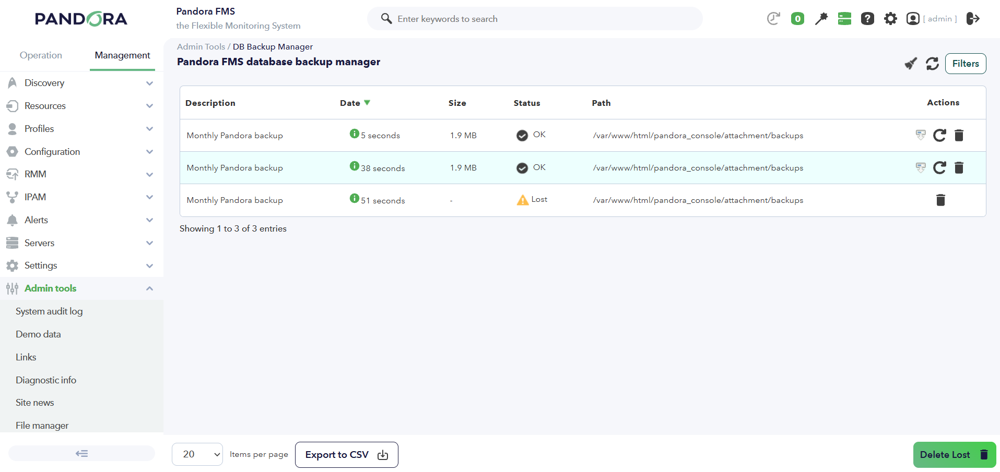
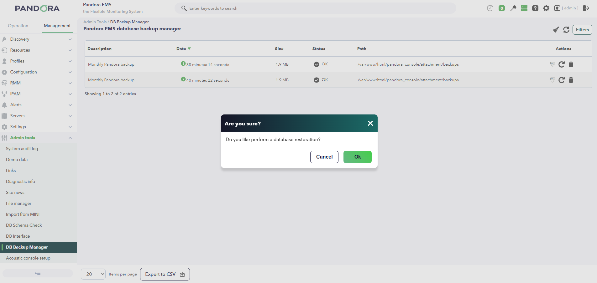

# Sauvegarde et restauration

## Introduction : ce que protège une sauvegarde (et ce qu'elle ne protège pas)

Une sauvegarde ne se remarque pas le jour où on la fait, mais le jour où elle
manque. Et ce jour-là ne ressemble jamais au jour où elle a été programmée : le
serveur ne démarre pas, quelqu'un a effacé ce qu'il ne fallait pas, le disque a
rendu les armes. Ce chapitre sert à faire de ce jour-là un mauvais moment avec
solution plutôt qu'une perte définitive. Ce qui fait la différence, c'est tout ce
qui se fait avant : ce qui est copié, avec quelle commande et si quelqu'un a un
jour vérifié que la copie peut être restaurée.

Ce qui est en jeu, c'est tout ce que l'installation a accumulé : l'historique des
métriques, les événements, les alertes et la configuration qui soutient la
supervision. Un effacement accidentel, un disque qui meurt ou une mise à jour qui
se passe mal l'emportent en un instant.

Avant d'entrer dans le vif du sujet, il convient d'écarter trois confusions qui
coûtent des installations entières.

La **haute disponibilité n'est pas une sauvegarde**. Un environnement en haute
disponibilité réplique la base de données à chaud pour que le service ne tombe
pas, mais il réplique aussi l'erreur : si quelqu'un supprime une table sur le
nœud maître, la suppression arrive au secondaire. La resynchronisation entre
nœuds d'un environnement HA utilise une copie physique des données, pas un dump
logique, et elle est documentée dans [6.9 (Haute disponibilité
(HA))](6.9-alta-disponibilidad-ha.md).

**Migrer n'est pas copier.** Changer d'architecture, de serveur ou de version du
moteur est un déménagement avec ses propres procédures, et ce chapitre ne les
aborde pas : la migration vers la nouvelle architecture de serveurs est dans
[A3 (Compatibilité et migration vers la nouvelle architecture de
serveurs)](../anexos/a3-compatibilidad-y-migracion-a-la-nueva-arquitectura-de-servidores.md)
et les mises à jour dans [1.4 (Mises à
jour)](../parte-1/1.4-actualizaciones.md). Ici, il s'agit de garder ce qui existe
et de le remettre à sa place.

Et la troisième : **une copie sans restauration éprouvée est une promesse, pas
une sauvegarde**. Un fichier compressé que personne n'a jamais ouvert ne protège
de rien. La seule preuve qu'une copie vaut quelque chose, c'est de la restaurer,
même sur une machine de test et avec une base de données de jeu.

Cela posé, voici ce que Pandora FMS propose et ce qu'il ne propose pas. Il
propose la **tâche planifiée de la console**, qui produit un dump de la base de
données principale à la périodicité que vous indiquez ; le **DB Backup
Manager**, qui administre ces copies depuis la console web ; l'utilitaire de
**sauvegarde complète en ligne de commande**, qui ajoute les fichiers au dump ;
et, bien sûr, les **commandes manuelles** de `mysqldump` et `tar`, où l'on finit
toujours quand il faut faire quelque chose à la main.

Ce qu'il ne propose pas, et il vaut mieux le savoir avant de s'y fier : il n'y a
pas de sauvegarde automatique des fichiers (la tâche planifiée ne fait un dump
que de la base de données principale) ni de sauvegarde intégrée de la base de
données
d'historique, qui vit sur un autre serveur et se copie à part, comme expliqué
dans [6.5 (Base de données
d'historique)](6.5-base-de-datos-de-historico.md). La création et la
programmation de la tâche, avec ses paramètres et ses permissions, sont
documentées dans [2.5 (Tâches de
console)](../parte-2/2.5-tareas-de-consola.md) ; ici, on explique ce que cette
tâche produit, ce qu'elle laisse de côté et comment tout se restaure.

Le chapitre suit l'ordre naturel d'une opération réelle : d'abord l'inventaire de
ce qu'il faut copier, ensuite chaque voie de sauvegarde (le dump à la main, la
tâche planifiée, le manager, l'utilitaire en ligne de commande et les fichiers)
et, à la fin, la restauration et la reconstruction de la base de données. La
reconstruction, qui est le dernier recours quand le moteur ne démarre plus, est
renvoyée depuis [6.7 (Optimisation de la base de
données)](6.7-optimizacion-de-la-base-de-datos.md) : le critère pour savoir
quand reconstruire plutôt qu'optimiser est là-bas, et les procédures sont ici.
Le chiffrement de la base de données, qui conditionne ce qui peut être déchiffré
à la restauration, est traité dans [9.5 (Chiffrement de la base de
données)](../parte-9/9.5-cifrado-de-la-base-de-datos.md).

## Ce qu'il faut sauvegarder dans une installation de Pandora FMS

Une installation de Pandora FMS n'est pas une seule chose. C'est une base de
données, des fichiers de configuration, les programmes du serveur, la console
web et, sur chaque machine supervisée, un EndPoint. La sauvegarde doit couvrir
ce qui ne peut pas être reconstruit tout seul :

| Composant | Où il vit | Comment il est copié |
|---|---|---|
| Base de données principale | Le moteur MySQL, normalement sur la même machine que la console | Dump avec `mysqldump` ([à la main](#le-dump-de-la-base-de-donnees-a-la-main)) ou la [tâche planifiée](#la-sauvegarde-planifiee-depuis-la-console) |
| Base de données d'historique | Un autre serveur MySQL, si elle est configurée | Son propre dump ; expliqué dans [6.5 (Base de données d'historique)](6.5-base-de-datos-de-historico.md) |
| Configuration du serveur et des EndPoints | `/etc/pandora` | `tar` ([La sauvegarde des fichiers](#la-sauvegarde-des-fichiers)) |
| Programmes et plugins du serveur | `/usr/share/pandora_server` | `tar` |
| Données du serveur (configuration distante et collections) | `/var/spool/pandora/data_in` | `tar` |
| Console web | `/var/www/html/pandora_console` | `tar`, ou la [sauvegarde complète](#la-sauvegarde-complete-en-ligne-de-commande) |
| EndPoint | Son répertoire d'installation (sous Linux, `/usr/share/pandora_agent`) et sa configuration (`/etc/pandora`) | `tar` |
| Tentacle | `/etc/tentacle` | `tar` |

**La base de données et les fichiers vont ensemble.** C'est la règle la plus
souvent enfreinte et celle qui fait le plus mal. Restaurer une base de données
sans les fichiers laisse une installation qui démarre à moitié : la console
s'ouvre, mais la configuration distante des EndPoints n'est pas là, ou les
plugins du serveur ont disparu. Et inversement : des fichiers sans la base de
données sont une coquille vide. Une vraie sauvegarde complète a les deux
moitiés.

**Gardez la copie hors du serveur copié.** Une sauvegarde qui vit sur le même
disque que les données d'origine protège d'un effacement accidentel, mais pas
d'une panne de disque, ni d'un incendie, ni d'un `rm` trop imaginatif. Sortez-la
de la machine, vers un autre serveur ou un stockage externe, et ne la laissez
pas sur le même système de fichiers.

**Chaque pièce se copie là où elle vit.** Dans une installation distribuée, avec
la base de données sur un serveur, la console sur un autre et les EndPoints
répartis, il n'y a pas de machine d'où tout copier d'un coup : la base de
données est dumpée là où se trouve le moteur et les fichiers de chaque serveur
sont empaquetés sur leur serveur. La sauvegarde complète dans un seul fichier,
celle de [La sauvegarde complète en ligne de
commande](#la-sauvegarde-complete-en-ligne-de-commande), ne vaut que quand tout
cohabite sur la même machine.

!!! warning "Espace et permissions"
    Un dump occupe autant que les données qu'il contient, et les fichiers d'une console avec des images et des extensions peuvent peser lourd. Avant de lancer une sauvegarde, vérifiez que la destination dispose de largement assez d'espace libre : s'arrêter à mi-chemin par disque plein est la façon la plus bête de perdre une sauvegarde. Et gardez les fichiers avec des permissions restreintes : un dump de la base de données contient des utilisateurs, de la configuration et des données de supervision qui ne devraient pas être à la portée de n'importe qui.

## Le dump de la base de données à la main

C'est l'outil de base, celui qui fonctionne tant que le moteur tourne. La
commande est un `mysqldump` avec les deux mêmes options que la tâche planifiée
du produit, et avec des paramètres fictifs pour que vous l'adaptiez à votre
installation :

```bash
mysqldump '<base_de_donnees>' -h '<hote>' -u '<utilisateur>' -p'<mot_de_passe>' --single-transaction --max_allowed_packet=512M | gzip > pandoradb.sql.gz
```

Chaque pièce de la commande a sa raison d'être :

- **`<base_de_donnees>`** : le nom de la base de données ; celui d'une
  installation toute neuve est `pandora`.
- **`-h '<hote>'`** : l'hôte du moteur. Si la base de données vit sur la même
  machine, `127.0.0.1` fait l'affaire ; si elle est distante, son adresse.
- **`-u '<utilisateur>'` et `-p'<mot_de_passe>'`** : les identifiants d'accès à
  la base de données ; dans une installation toute neuve, l'utilisateur est
  `pandora`. Le `-p` se colle au mot de passe, sans espace ; si vous le laissez
  seul, le client vous le demandera au clavier et il ne restera pas écrit dans
  l'historique du terminal.
- **`--single-transaction`** : le dump se fait dans une transaction, de façon
  cohérente, sans bloquer les écritures.
- **`--max_allowed_packet=512M`** : la taille maximale de paquet que le client
  accepte lors du dump. C'est la valeur qu'utilise la tâche planifiée, et sans
  elle une ligne ou un paquet volumineux peut interrompre le dump en cours de
  route.
- **`| gzip > pandoradb.sql.gz`** : le dump est compressé à la volée. Le fichier
  obtenu est celui qui est conservé et celui qui sera restauré ensuite.

Inutile d'ajouter des options de routines, de déclencheurs ou d'événements. Le
schéma du produit n'en définit aucun des trois, et les dumps internes du produit
ne les utilisent pas ; les ajouter ne fait qu'ajouter du bruit à la commande.

**L'historique va à part.** Si vous avez configuré la base de données
d'historique, elle ne se copie pas avec cette commande : elle vit sur un autre
serveur et a besoin de son propre dump, avec les mêmes options et en pointant
vers son hôte et son nom. Le détail de cette base, sa rétention et son
partitionnement sont dans [6.5 (Base de données
d'historique)](6.5-base-de-datos-de-historico.md), et la copie se fait avec le
même modèle :

```bash
mysqldump '<base_d_historique>' -h '<hote_de_l_historique>' -u '<utilisateur>' -p'<mot_de_passe>' --single-transaction --max_allowed_packet=512M | gzip > pandoradb_history.sql.gz
```

!!! warning "Avec le chiffrement actif, la copie ne déchiffre rien toute seule"
    Si la base de données utilise le chiffrement par colonnes, la copie emporte les champs chiffrés tels quels et n'inclut pas la phrase de chiffrement, qui est conservée à part. Sans cette phrase, à la restauration il n'y a rien à déchiffrer et les données chiffrées restent illisibles. La procédure de chiffrement et l'emplacement de la phrase sont dans [9.5 (Chiffrement de la base de données)](../parte-9/9.5-cifrado-de-la-base-de-datos.md).

**Faut-il arrêter les services pour copier ?** Non. Avec `--single-transaction`,
le dump est cohérent même si la supervision continue d'écrire, donc l'arrêt
n'est pas une condition de la copie. L'arrêt concerne la restauration et la
reconstruction, où l'ordre des opérations compte vraiment. Pour copier, il
suffit que le moteur tourne et qu'il y ait de l'espace à la destination.

**Vérifiez le fichier à la fin.** Un dump interrompu à mi-chemin laisse un
fichier qui ressemble à une copie sans en être une. Avant de le valider,
vérifiez que l'archive compressée est complète :

```bash
gzip -t pandoradb.sql.gz
```

Si la commande ne renvoie rien, le fichier est intact. Et si le dump s'est
interrompu en cours de route, c'est le moment de le refaire, pas dans trois
mois.

## La sauvegarde planifiée depuis la console

Programmer une copie pour ne pas avoir à y penser est la chose la plus sensée
que l'on puisse faire en la matière. La **tâche de sauvegarde de la base de
données** se crée et se programme dans la console web, dans **Discovery →
Liste des tâches (Task list)**, onglet **Console tasks**, et sa création, ses
paramètres et ses permissions sont documentés dans [2.5 (Tâches de
console)](../parte-2/2.5-tareas-de-consola.md). Ici, il s'agit d'expliquer ce
qu'elle laisse sur le disque et ce qu'elle n'y laisse pas.

**Ce qu'elle produit.** Chaque exécution crée deux fichiers dans le chemin
configuré :

- Un **dump compressé** de la base de données principale, avec un nom qui porte
  la date.
- Un **résumé en texte** du même nom, avec la version du produit, la date et les
  versions de PHP et de MySQL du serveur. C'est le fichier que l'on consulte
  pour savoir ce que contient chaque copie sans l'ouvrir.

Les deux restent avec des permissions **0600** : seul l'utilisateur qui les a
créés peut les lire. Le chemin par défaut est le dossier de pièces jointes de la
console, `attachment/backups`, et il peut être remplacé par n'importe quel
répertoire disposant des permissions de lecture et d'écriture. La rétention par
défaut correspond aux **trois dernières copies** de cette tâche : au-delà de ce
nombre, les plus anciennes sont supprimées d'elles-mêmes.

Lors de sa création, la tâche vérifie que `mysqldump` existe et que la connexion
à la base de données fonctionne, et valide que le chemin d'enregistrement existe
et est accessible en écriture. Si quelque chose échoue, la tâche n'est pas
créée. C'est un contrôle qui évite la sauvegarde classique qui ne s'est jamais
exécutée parce que le chemin n'existait plus.

!!! warning "Ce que la tâche ne copie pas"
    La tâche planifiée ne fait un dump **que de la base de données principale**. Elle n'inclut ni la base de données d'historique (qui est une autre base, sur un autre serveur), ni les fichiers de configuration, ni la console web, ni les EndPoints. Que personne ne la confonde avec une sauvegarde complète : pour cela, il y a l'utilitaire de [La sauvegarde complète en ligne de commande](#la-sauvegarde-complete-en-ligne-de-commande) ou la combinaison du dump avec les `tar` de [La sauvegarde des fichiers](#la-sauvegarde-des-fichiers).

**Comment on la restaure.** Comme un dump manuel : le fichier compressé que
laisse la tâche s'importe avec `gunzip -c … | mysql …`, comme expliqué dans [La
restauration](#la-restauration). Il n'y a pas de restauration automatique depuis
la console : la restauration se fait à la main.

## Le DB Backup Manager

Le **DB Backup Manager** est l'écran d'administration des copies, dans **Outils
d'administration → Gestionnaire de sauvegarde de la base de données (DB Backup
Manager)**, et seuls les administrateurs de la console web peuvent y entrer. Il
travaille sur le même listage que celui qu'alimente la tâche planifiée : les
copies que la tâche enregistre apparaissent ici, avec le même dossier et le même
registre.

En haut, il y a un filtre par **chemin des copies**, avec la liste des chemins
des copies enregistrées, et un bouton de recherche pour rafraîchir le listage.
Chaque copie affiche sa date, sa taille et un état :

- **OK** : le fichier est à sa place ; il peut être téléchargé et restauré.
- **Perdu** : le registre dit qu'il existe, mais le fichier n'est pas sur le
  disque.
- **En cours** : un dump est en cours d'exécution à ce moment-là.



Sur chaque copie correcte, il y a trois actions : la télécharger sur la machine
locale, la supprimer ou la restaurer ; les perdues et celles en cours ne peuvent
qu'être supprimées. La restauration du manager **n'est pas automatique** : quand
vous appuyez sur le bouton, la console demande confirmation et la restauration
se fait à la main. La procédure complète, avec la syntaxe en vigueur, est dans
[La restauration](#la-restauration).



Quand il y a des copies perdues, le bouton **Supprimer les perdus** apparaît ; il
nettoie d'un coup toutes celles qui sont dans cet état.

!!! note "Un fichier supprimé à la main ne disparaît pas de la liste"
    Le manager ne parcourt pas le disque pour construire le listage : il se fie à son registre. Si quelqu'un supprime un fichier de copie en dehors de la console, la copie ne disparaît pas du listage : elle passe à l'état **Perdu**, et elle y reste jusqu'à ce que vous utilisiez **Supprimer les perdus**. C'est le comportement attendu, et la raison pour laquelle la liste peut afficher des copies qui n'existent plus.

## La sauvegarde complète en ligne de commande

Jusqu'ici, tout copiait la base de données ou les fichiers séparément. Reste le
seul utilitaire du produit qui fait une sauvegarde complète en une seule étape,
et il la fait en ligne de commande : `pandora_backup.sh`. Il est pensé pour les
installations où le serveur et la console partagent la machine, et il laisse un
unique fichier compressé avec :

- Le dump de la base de données.
- Le répertoire complet de la console web.
- La configuration de `/etc/pandora`.
- Les données du serveur de `/var/spool/pandora/data_in`.

Le script se trouve dans `/usr/share/pandora_server/util/pandora_backup.sh`,
s'exécute en **root** et a besoin de `mysqldump` disponible. Sans aucun
paramètre, il affiche son aide, et voici ses options réelles :

| Option | À quoi elle sert |
|---|---|
| `-c <chemin>` | Chemin de la console web (par exemple, `/var/www/html/pandora_console`). De sa configuration, il tire les identifiants de la base de données. |
| `-d <chemin>` | Répertoire où le fichier de sauvegarde est déposé. |
| `-s <fichier>` | Fichier de sauvegarde qui va être restauré. |
| `-f` | À la restauration, restaure aussi les fichiers, pas seulement la base de données. |
| `-q` | Mode silencieux, sans messages. Pour le lancer depuis cron. |
| `-b` | Ne copie ni ne restaure la base de données : seulement les fichiers. |
| `-h` | Affiche l'aide. |

Une sauvegarde se lance ainsi :

```bash
/usr/share/pandora_server/util/pandora_backup.sh -c /var/www/html/pandora_console -d /backup
```

Le résultat est un fichier `pandorafms_backup_<date>.tar.gz` dans le répertoire
de destination.

!!! warning "La restauration est destructive"
    Restaurer avec `-s` ne fusionne rien : le script **supprime la base de données actuelle** et la recrée avant d'importer la copie ; avec `-f`, il écrase en plus les fichiers de l'installation. Si la copie est ancienne ou à moitié faite, le résultat est pire que le problème que vous alliez résoudre. Avant de restaurer, assurez-vous d'avoir une copie récente et que le fichier que vous passez est le bon :

    ```bash
    /usr/share/pandora_server/util/pandora_backup.sh -c /var/www/html/pandora_console -s /backup/pandorafms_backup_2026-10-21-03-00-00.tar.gz -f
    ```

**Quand l'utiliser et quand ne pas l'utiliser.** C'est la voie commode pour un
petit serveur avec tout sur la même machine. Dans un environnement distribué,
avec la base de données sur un serveur, la console sur un autre et les EndPoints
répartis, il ne sert à rien : là, c'est le dump de la base d'un côté et les
`tar` par composant de la section suivante de l'autre.

## La sauvegarde des fichiers

La sauvegarde des fichiers se fait avec `tar`, composant par composant, avec les
chemins réels de l'installation. Le modèle est toujours le même :

```bash
tar -pcvzf pandora_configuration.tar.gz /etc/pandora
tar -pcvzf pandora_server.tar.gz /usr/share/pandora_server
tar -pcvzf pandora_console.tar.gz /var/www/html/pandora_console
tar -pcvzf pandora_data_in.tar.gz /var/spool/pandora/data_in
tar -pcvzf agent.tar.gz /usr/share/pandora_agent
tar -pcvzf tentacle.tar.gz /etc/tentacle
```

Chaque commande empaquette et compresse (`-z`) un composant, en conservant les
permissions et les propriétaires (`-p`), ce qu'il faut pour que la restauration
rende les fichiers exactement tels qu'ils étaient. Celle de la console web
conserve les images, les extensions et les personnalisations ; celle des données
du serveur inclut la configuration distante des EndPoints, les collections et
les fichiers de contrôle. Sur les EndPoints Linux, le répertoire d'installation
est `/usr/share/pandora_agent` ; sur d'autres plateformes, il change, et sa
configuration vit dans `/etc/pandora`, qui passe déjà dans le premier `tar`.

Trois avertissements pour que la sauvegarde des fichiers ne soit pas incomplète :

- **Les plugins du serveur peuvent vivre en dehors** de
  `/usr/share/pandora_server`. Si vous avez des plugins ou des scripts propres
  dans d'autres répertoires, ajoutez un `tar` pour chacun.
- **La copie sort du serveur.** Comme pour le dump : un `tar` qui dort sur le
  même disque ne protège pas de la panne du disque.
- **Les données du serveur portent plus qu'il n'y paraît.** Perdre
  `/var/spool/pandora/data_in`, c'est perdre la configuration que les EndPoints
  avaient déjà appliquée, et cela ne se récupère pas en réinstallant.

Et la restauration de ces fichiers, aussi simple que de décompresser sur place,
est racontée dans [La restauration](#la-restauration).

## La restauration

Restaurer, ce n'est pas décompresser et espérer. Il y a un ordre, et l'ordre
compte parce que chaque étape écrit dans des endroits que la suivante a besoin
de trouver tranquilles.

**1. Arrêtez ce qui écrit.** Arrêtez le serveur de Pandora FMS (`systemctl stop
pandora_server`) et l'EndPoint local s'il est sur la même machine (`systemctl
stop pandora_agent_daemon`). La console web ne doit pas être utilisée pendant
l'import, et le serveur Tentacle peut continuer de fonctionner : il continuera
de recevoir des données des EndPoints et les traitera quand le serveur sera de
retour.

**2. Restaurez la base de données.** Avec le moteur en marche, créez la base de
données si elle n'existe pas :

```sql
CREATE DATABASE <base_de_donnees>;
```

Et importez la copie dedans :

```bash
gunzip -c pandoradb.sql.gz | mysql -h '<hote>' -u root -p <base_de_donnees>
```

!!! warning "Le nom de la base de données doit être le même"
    La copie a été faite sur une base de données portant un nom, et la restaurer sur une autre oblige ensuite à ajuster la configuration de la console et du serveur. Et si la base contient déjà des données, l'import les remplacera sans prévenir : le dump supprime et recrée chaque table. Si vous voulez les conserver, l'alternative est à l'étape 4.

**3. Utilisateurs et permissions.** Si l'utilisateur de base de données de la
console et du serveur existe déjà et que la base restaurée conserve ses
permissions, il n'y a rien à faire. Si vous avez créé une base nouvelle,
donnez-lui l'accès ; et si l'utilisateur s'est perdu (par exemple, après avoir
reconstruit le répertoire de données du moteur), recréez-le avec la même
syntaxe que celle qu'appliquent les installateurs du produit, celle en vigueur
dans MySQL 8 :

```sql
CREATE USER '<utilisateur>'@'%' IDENTIFIED BY '<mot_de_passe>';
ALTER USER '<utilisateur>'@'%' IDENTIFIED WITH caching_sha2_password BY '<mot_de_passe>';
GRANT ALL PRIVILEGES ON <base_de_donnees>.* TO '<utilisateur>'@'%';
```

La forme ancienne en une seule instruction, `GRANT … IDENTIFIED BY …`, est
retirée dans MySQL 8 et échoue : si vous la voyez dans une vieille recette,
remplacez-la par ces trois.

**4. Alternative recommandée : la voie qui n'écrase pas.** Si la base actuelle
contient des données que vous voulez conserver, ne l'importez pas par-dessus
comme à l'étape 2. Les étapes, en bref :

1. Créez la base nouvelle et donnez les permissions à l'utilisateur de la
   console :

    ```sql
    CREATE DATABASE <base_nouvelle>;
    GRANT ALL PRIVILEGES ON <base_nouvelle>.* TO '<utilisateur>'@'%';
    ```

2. Importez la copie dedans :

    ```bash
    gunzip -c pandoradb.sql.gz | mysql -h '<hote>' -u root -p <base_nouvelle>
    ```

3. Pointez la console vers la base nouvelle : dans `include/config.php` de la
   console web, remplacez `$config["dbname"]="<base_de_donnees>";` par
   `$config["dbname"]="<base_nouvelle>";`.
4. Pointez le serveur : dans `/etc/pandora/pandora_server.conf`, remplacez
   `dbname <base_de_donnees>` par `dbname <base_nouvelle>`.
5. Redémarrez le serveur et reconnectez-vous à la console.

**5. Restaurez les fichiers.** Chaque `tar` se décompresse sur place avec
`-C /`, parce que les chemins à l'intérieur du fichier sont absolus :

```bash
tar -xzf pandora_configuration.tar.gz -C /
tar -xzf pandora_server.tar.gz -C /
tar -xzf pandora_console.tar.gz -C /
tar -xzf pandora_data_in.tar.gz -C /
```

En le faisant en root, les permissions et les propriétaires sont rendus
exactement tels qu'ils étaient. Si la console se retrouve avec le mauvais
propriétaire, le serveur web ne pourra pas écrire dans ses dossiers et vous le
remarquerez dès que vous tenterez de téléverser une image.

**6. Le cas « réinstaller et restaurer ».** Quand la machine d'origine n'existe
plus, l'ordre s'inverse : on installe d'abord une installation propre, avec la
même version, en suivant [1.1
(Installation)](../parte-1/1.1-instalacion.md), puis on restaure par-dessus : la
base de données et les fichiers. Ce n'est pas une migration (celle-là est dans
[A3](../anexos/a3-compatibilidad-y-migracion-a-la-nueva-arquitectura-de-servidores.md)) :
c'est remettre à sa place ce qui était là.

**7. Vérifiez.** Une restauration ne se termine pas quand la dernière commande
se termine, mais quand tout fonctionne à nouveau :

- La console web s'ouvre et affiche les agents, les modules et les données
  d'avant.
- Le serveur démarre et traite : `systemctl start pandora_server` et un coup
  d'œil à son journal.
- Le cron de la console tient toujours : l'entrée de `/etc/crontab` qui appelle
  chaque minute le cron de la console est celle qui fait avancer les événements,
  les alertes et la maintenance.
- Les EndPoints rapportent à nouveau. Si l'un d'eux ne le fait pas, sa
  configuration locale ou sa clé d'accès ne sont pas revenues correctement.

Et démarrez dans l'ordre : d'abord le moteur (il tourne déjà), ensuite le
serveur et enfin les EndPoints.

## La reconstruction de la base de données

La reconstruction est le dernier recours, et c'est une restauration, pas un
réglage. [6.7 (Optimisation de la base de
données)](6.7-optimizacion-de-la-base-de-datos.md) explique quand elle s'impose :
quand optimiser une table ne se termine plus, quand le moteur ne démarre pas
après un changement de configuration ou quand la base de données doit être
refaite de zéro. Ici se trouvent les procédures.

**Reconstruction partielle.** Elle sert à ramener une base de données à un état
compact et sain, le service arrêté. Le processus : arrêtez le serveur et laissez
la console web hors d'usage ; ensuite, dumper la base, la supprimer, la recréer
et importer le dump.

```bash
systemctl stop pandora_server
mysqldump '<base_de_donnees>' -h '<hote>' -u '<utilisateur>' -p'<mot_de_passe>' --single-transaction --max_allowed_packet=512M | gzip > /tmp/pandoradb.sql.gz
```

Ensuite, dans le client MySQL :

```sql
DROP DATABASE <base_de_donnees>;
CREATE DATABASE <base_de_donnees>;
```

Puis l'import et le démarrage :

```bash
gunzip -c /tmp/pandoradb.sql.gz | mysql -h '<hote>' -u root -p <base_de_donnees>
systemctl start pandora_server
```

Le dump peut prendre des minutes ou des heures, selon la taille ; l'import, de
même. C'est une opération de fenêtre de maintenance, pas un moment mort entre
deux tâches : sur une installation importante, l'arrêt de service seul se
planifie autour d'une heure, et il faut y ajouter le dump et le rechargement. Le
processus peut être automatisé, mais par sa nature délicate il vaut mieux le
faire à la main, avec la fenêtre réservée et une copie récente déjà faite.

**Reconstruction totale.** Quand le moteur ne démarre pas ou qu'il faut refaire
le répertoire de données (par exemple, après un changement dans `my.cnf` qui
empêche le démarrage), la reconstruction va un pas plus loin et refait le
répertoire de données du moteur. D'abord, si le moteur ne démarre pas, revenez à
la configuration précédente pour qu'il puisse se lever, et profitez-en pour
sortir le dump :

```bash
mysqldump '<base_de_donnees>' -h '<hote>' -u '<utilisateur>' -p'<mot_de_passe>' --single-transaction --max_allowed_packet=512M | gzip > /home/pandora/pandoradb.sql.gz
```

Avec la copie à l'abri, et le serveur de Pandora FMS arrêté (comme dans la
reconstruction partielle), arrêtez le moteur et reconstruisez son répertoire de
données :

```bash
systemctl stop mysql
mv /var/lib/mysql /var/lib/mysql.bak
mkdir /var/lib/mysql
mysqld --initialize --datadir /var/lib/mysql
```

`mysqld --initialize` génère un mot de passe temporaire pour l'utilisateur root ;
notez-le, parce que vous en aurez besoin à l'étape suivante. Ensuite, ajustez
les permissions et démarrez :

```bash
chown -R mysql:mysql /var/lib/mysql
chcon -R system_u:object_r:mysqld_db_t:s0 /var/lib/mysql
systemctl start mysql
```

La commande `chcon` concerne les systèmes avec SELinux (la famille RHEL) ; sur
Ubuntu, elle n'est pas nécessaire. Et dans les distributions de la famille RHEL,
le service s'appelle `mysqld` au lieu de `mysql`.

Connectez-vous avec le mot de passe temporaire, changez-le et laissez la base de
données prête :

```sql
ALTER USER 'root'@'localhost' IDENTIFIED BY '<mot_de_passe>';
CREATE DATABASE <base_de_donnees>;
```

Importez le dump et recréez l'utilisateur de base de données qu'utilisent la
console et le serveur, avec la syntaxe en vigueur (la même que dans [La
restauration](#la-restauration)) :

```bash
gunzip -c /home/pandora/pandoradb.sql.gz | mysql -u root -p <base_de_donnees>
```

```sql
CREATE USER '<utilisateur>'@'%' IDENTIFIED BY '<mot_de_passe>';
ALTER USER '<utilisateur>'@'%' IDENTIFIED WITH caching_sha2_password BY '<mot_de_passe>';
GRANT ALL PRIVILEGES ON <base_de_donnees>.* TO '<utilisateur>'@'%';
```

!!! warning "Il n'y a plus de journaux binaires à supprimer"
    Les anciennes recettes de reconstruction totale supprimaient à la main les fichiers de journal binaire du répertoire de données. Cette étape ne s'applique plus : sur un serveur unique, les installateurs et les déploiements standard de Pandora FMS désactivent les journaux binaires (`skip-log-bin`) ; si vous avez monté le moteur à la main, confirmez que la ligne est bien dans `my.cnf`. Dans un environnement de haute disponibilité, les journaux binaires sont obligatoires, mais là la reconstruction est une autre histoire et elle est racontée dans [6.9 (Haute disponibilité (HA))](6.9-alta-disponibilidad-ha.md).

Enfin, vérifiez que le moteur tourne avec les paramètres que vous attendez, que
la console web et le serveur se connectent à la base de données et que tout
fonctionne. La requête sur les variables sert à confirmer que la configuration
appliquée est bien celle que vous croyez :

```sql
SHOW VARIABLES LIKE 'innodb%';
```

Quand vous l'avez confirmé, supprimez l'ancien répertoire :

```bash
rm -rf /var/lib/mysql.bak
```

Si le serveur est en haute disponibilité, les services sont autres (`pandora_ha`
au lieu de `pandora_server`), et le démarrage, l'arrêt et la resynchronisation
d'un environnement HA sont documentés dans [6.9 (Haute disponibilité
(HA))](6.9-alta-disponibilidad-ha.md).

## Référence rapide et répartition avec les autres chapitres

Pour finir, l'aide-mémoire. Les commandes du chapitre, dans un tableau à copier :

| Pour quoi faire | Commande |
|---|---|
| Dumper la base de données principale | `mysqldump '<base_de_donnees>' -h '<hote>' -u '<utilisateur>' -p'<mot_de_passe>' --single-transaction --max_allowed_packet=512M`\|`gzip > pandoradb.sql.gz` |
| Dumper la base de données d'historique | `mysqldump '<base_d_historique>' -h '<hote_de_l_historique>' -u '<utilisateur>' -p'<mot_de_passe>' --single-transaction --max_allowed_packet=512M`\|`gzip > pandoradb_history.sql.gz` |
| Restaurer un dump | `gunzip -c pandoradb.sql.gz`\|`mysql -h '<hote>' -u root -p <base_de_donnees>` |
| Vérifier qu'un dump est intact | `gzip -t pandoradb.sql.gz` |
| Sauvegarde complète (base et fichiers) | `/usr/share/pandora_server/util/pandora_backup.sh -c /var/www/html/pandora_console -d /backup` |
| Restaurer avec la sauvegarde complète | `/usr/share/pandora_server/util/pandora_backup.sh -c /var/www/html/pandora_console -s <fichier> -f` |
| Copier un composant | `tar -pcvzf <fichier>.tar.gz <chemin>` |

Et la répartition avec les autres chapitres, pour que vous ne cherchiez pas où
il n'y a rien :

| Sujet | Chapitre |
|---|---|
| Créer et programmer la tâche de sauvegarde, avec ses paramètres et ses permissions | [2.5 (Tâches de console)](../parte-2/2.5-tareas-de-consola.md) |
| Base de données d'historique, sa rétention et son partitionnement | [6.5 (Base de données d'historique)](6.5-base-de-datos-de-historico.md) |
| Quand reconstruire plutôt qu'optimiser | [6.7 (Optimisation de la base de données)](6.7-optimizacion-de-la-base-de-datos.md) |
| Haute disponibilité et sa resynchronisation entre nœuds | [6.9 (Haute disponibilité (HA))](6.9-alta-disponibilidad-ha.md) |
| Chiffrement de la base de données et phrase de chiffrement | [9.5 (Chiffrement de la base de données)](../parte-9/9.5-cifrado-de-la-base-de-datos.md) |
| Installation et réinstallation | [1.1 (Installation)](../parte-1/1.1-instalacion.md) |
| Mises à jour | [1.4 (Mises à jour)](../parte-1/1.4-actualizaciones.md) |
| Migration vers la nouvelle architecture de serveurs | [A3 (Compatibilité et migration vers la nouvelle architecture de serveurs)](../anexos/a3-compatibilidad-y-migracion-a-la-nueva-arquitectura-de-servidores.md) |

Et l'idée qui résume le chapitre, la même par laquelle il s'ouvrait : une
sauvegarde ne vaut que si elle a été restaurée au moins une fois. Programmez-la,
gardez-la hors du serveur et, de temps en temps, restaurez-la dans un
environnement de test. Le jour où elle sera vraiment nécessaire, il n'y aura pas
le temps de découvrir qu'elle ne fonctionnait pas.
