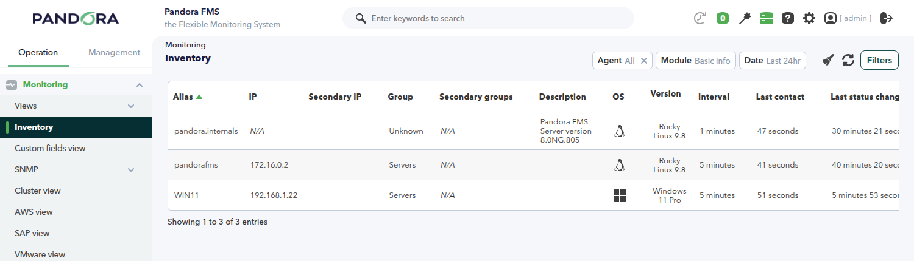
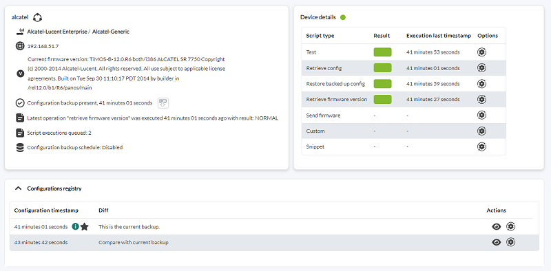
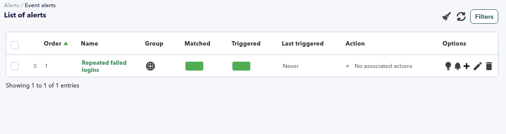

# Conformité : NIS2, ISO 27001 et ENS

Un tableau de bord vert n'est pas une déclaration de conformité. Il peut
signifier que la supervision fonctionne, que les agents remontent des données et
que personne n'a touché à ce qu'il ne fallait pas ; ou il peut signifier que le
tableau de bord regarde ailleurs depuis six mois. La différence entre les deux ne
tient pas à la couleur des widgets, mais à la capacité de répondre à une question
inconfortable : **« prouvez-moi que c'est bien appliqué »**.

Pandora FMS ne signe pas les politiques, ne forme pas le personnel et ne répond
pas devant un organisme de certification. Ce qu'il fait, en revanche, c'est
produire des données, des détections et des preuves qu'une organisation peut
utiliser pour soutenir son programme de conformité. Ce chapitre traite de cela :
quelle fonctionnalité sert à quel article, contrôle ou mesure, et comment
transformer cette relation en preuve qui résiste à un audit.

Ce n'est pas un résumé de NIS2, d'ISO/IEC 27001:2022 ni de l'ENS. C'est un
**tableau de correspondance**. Seuls les points réglementaires qui ont une
fonctionnalité associée apparaissent ; le reste du règlement est laissé de côté
car il ne peut pas être résolu avec un outil de supervision.

## Fonctionnalité, norme et preuve

La première colonne est la fonctionnalité de Pandora FMS. Les trois suivantes sont
des références compactes à ISO/IEC 27001:2022, ENS et NIS2. Les deux dernières
indiquent ce qui peut être couvert ou suivi et ce qui est exporté comme preuve.

| Fonctionnalité de Pandora FMS | ISO/IEC 27001:2022 | ENS (RD 311/2022) | NIS2 | Ce qui peut être couvert ou suivi | Preuve |
|---|---|---|---|---|---|
| **[Inventaire et découverte des actifs](../parte-3/3.1-inventario.md)** | A.5.9, A.8.1 | op.exp.1 | 21.2.i | Inventaire du matériel, des logiciels, des utilisateurs, des services et des correctifs ; découverte réseau ; IPAM ; changements d'inventaire. Couvre l'inventaire ; la classification et le propriétaire de l'actif sont des décisions organisationnelles. | CSV et rapport d'inventaire ; rapport de changements |
| **[Supervision de la disponibilité, des services et des SLA](../parte-5/5.3-monitorizacion-de-negocio-y-servicios.md)** | A.5.29, A.5.30, A.8.6, A.8.16 | op.cont.1–op.cont.4, op.mon.2, op.mon.3 | 21.2.c, 21.2.f | Disponibilité des systèmes et des services, SLA, arrêts planifiés, capacité et continuité technique. Couvre la partie technique de la disponibilité et des SLA ; le plan de continuité et les exercices de crise sont organisationnels. | Rapports de disponibilité et de SLA ; historique des états |
| **[Journaux et collecte](../parte-2/2.19-recoleccion-y-monitorizacion-de-logs.md)** | A.8.15, A.8.16 | op.exp.8, op.mon.3 | 21.2.b, 21.2.f | Collecte, stockage, recherche et conservation des journaux dans OpenSearch. Couvre la collecte et la conservation ; la politique de conservation et le stockage externe sont organisationnels. | Requêtes et exportations de journaux |
| **[Pandora FMS SIEM](7.2-siem.md)** | A.5.7, A.5.24–A.5.28, A.8.15, A.8.16 | op.exp.7, op.exp.8, op.exp.9, op.mon.1, op.mon.3 | 21.2.b, 23 | Normalisation, decoders, règles, corrélation, événements SIEM, MITRE ATT&CK, alertes et chronologie pour la réponse aux incidents. Peut agir comme SIEM d'entreprise s'il couvre les sources, la conservation et la corrélation ; la décision, la notification et la réponse finale sont humaines. | Événements SIEM, alertes, tickets et exportations |
| **[Vulnérabilités et CVE](7.4-analisis-de-vulnerabilidades.md)** | A.8.8 | op.exp.4 | 21.2.e | Détection locale et distante, CVE, gravité, risque par système et évolution dans le temps. Couvre la détection ; la priorisation, le correctif et l'acceptation du risque sont humains. | Rapport de vulnérabilités et évolution du risque |
| **[Durcissement et CIS](7.5-hardening.md)** | A.8.9 | op.exp.2, op.exp.3, op.exp.4 | 21.2.e, 21.2.g | Contrôles CIS, indice de sécurité, écarts et évolution de la configuration. Couvre le contrôle ; la correction et l'exception sont humaines. | Rapport CIS ; tableau de bord de durcissement |
| **[FIM (intégrité des fichiers)](7.6-fim.md)** | A.8.15, A.8.16, A.8.32 | op.exp.5, op.exp.8 | 21.2.b, 21.2.e | Création, suppression et modification de fichiers et répertoires critiques ; intégration SIEM. Couvre la détection ; l'investigation et la réponse sont humaines. | Événements FIM et historique des changements |
| **[Supervision de la sécurité](7.7-monitorizacion-de-seguridad.md)** | A.8.1, A.8.7 | op.exp.6, mp.eq.2 | 21.2.b, 21.2.g, 21.2.i | Mots de passe faibles, SELinux, root distant, ports en écoute, antivirus, pare-feu, correctifs et verrouillage d'écran. Couvre les contrôles techniques ; la correction et la politique de sécurité sont humaines. | Modules de sécurité et événements |
| **[IoC/MISP et règles personnalisées](7.9-integraciones-dinamicas-de-ioc-misp-y-creacion-de-reglas-propias.md)** | A.5.7, A.8.16 | op.exp.7, op.mon.1 | 21.2.b, 21.2.e | Indicateurs de compromission, règles personnalisées, corrélation et analyse des faux positifs. Fournit des indicateurs et des règles ; la qualité des sources et la décision de réponse sont externes. | Règles versionnées et événements générés |
| **[Événements, alertes, réponse et ITSM](../parte-5/5.4-consola-de-eventos-centralizada.md)** | A.5.24–A.5.28, A.8.16 | op.exp.7, op.exp.9, op.mon.3 | 21.2.b, 23 | Détection, journalisation, ticket, escalade, chronologie, accusés de réception et réponse. Couvre la détection, la journalisation et le ticket ; la décision de notification et la communication au CSIRT sont humaines. | Événements, tickets et actions exécutées |
| **[Audit interne](7.8-auditoria-interna.md)** | A.5.33, A.8.15, A.8.16 | op.exp.8, op.exp.9 | 21.2.b, 21.2.f | Actions des utilisateurs, changements, filtres, export et transfert vers un collecteur externe. Couvre la journalisation et l'export ; la révision et la signature de la preuve sont humaines. | CSV, `audit.log` et enregistrement dans le collecteur |
| **[Identités et accès](../parte-4/4.1-grupos-perfiles-y-tags.md)** | A.5.15–A.5.18, A.8.2, A.8.3, A.8.5 | op.acc.1–op.acc.6 | 21.2.i, 21.2.j | Utilisateurs, groupes, profils, tags, ACL, LDAP/AD/SAML, 2FA et politique de mots de passe. Couvre l'authentification et les permissions ; la revue des accès et la sortie des employés sont des processus humains. | Rapport de permissions ; configuration ; audit |
| **[Chiffrement et transport](7.11-configuracion-segura.md)** | A.8.24 | mp.com.2, mp.com.3, mp.si.2, op.exp.10 | 21.2.h | HTTPS, TLS, Tentacle SSL/TLS, chiffrement des mots de passe et de la base de données. Couvre le chiffrement technique ; la politique cryptographique et la garde des clés sont organisationnelles. | Configuration, certificats et garde des clés |
| **[Sauvegarde, haute disponibilité et continuité](../parte-6/6.8-backup-y-restore.md)** | A.5.29, A.5.30, A.8.13, A.8.14 | op.cont.1–op.cont.4, mp.info.6 | 21.2.c | Sauvegardes, restauration, HA, serveurs satellites, Command Center et base de données historique. Couvre la sauvegarde, la restauration et la HA ; le plan de continuité et le test formel sont organisationnels. | Historique des sauvegardes ; test de restauration ; état HA |
| **[Rapports, tableaux de bord et SLA](../parte-5/5.2-informes.md)** | 9.1, 9.2, 9.3, A.5.36 | op.mon.2 | 20, 21.2.a, 21.2.f | KPI, rapports planifiés, vision de la direction, efficacité et suivi des politiques. Fournit des KPI et des rapports ; la revue de direction et la conclusion sont humaines. | Rapports, tableaux de bord et séries historiques |
| **[Gestion des changements et de la configuration](../parte-3/3.6-gestion-de-configuracion-de-equipos-de-red-ncm.md)** | A.8.9, A.8.32 | op.exp.2, op.exp.3, op.exp.5 | 21.2.e | Changements de configuration, NCM, changements d'inventaire, FIM et traçabilité avec les tickets. Fournit des preuves de changement ; l'approbation du changement est externe. | Comparaison NCM ; événements ; tickets de changement |
| **[Automatisation et exploitation](../parte-3/3.4-ejecucion-remota-de-scripts-y-comandos.md)** | A.8.18, A.8.19 | op.exp.5 | 21.2.b, 21.2.e | Exécution distante de scripts et de commandes, déploiement logiciel, arrêts planifiés et actions contrôlées. Exécute des actions contrôlées ; l'autorisation et l'approbation du changement restent humaines. | Tâches exécutées, événements et tickets |
| **[Services externes et fournisseurs](../parte-2/2.15-monitorizacion-entornos-cloud.md)** | A.5.19–A.5.22, A.5.23 | op.ext.1–op.ext.3, op.nub.1 | 21.2.d | Disponibilité et SLA des services des fournisseurs et du cloud, inventaire des actifs externes. Fournit la disponibilité et les SLA ; ne couvre pas la due diligence, les contrats ni l'évaluation du fournisseur. | Rapports de SLA, de disponibilité et alertes |
| **API et intégrations** | A.8.16 | op.exp.7, op.mon.3 | 21.2.b, 21.2.f | Export de données, webhooks, intégration ITSM/SIEM et automatisation des preuves. Automatise l'export et l'intégration ; la conception, l'autorisation et le contrôle de l'intégration sont externes. | Appels, journaux et données exportées |
| **[Configuration sécurisée (7.11)](7.11-configuracion-segura.md)** | A.8.9, A.8.24 | op.exp.2, op.acc.6, mp.com.2, mp.com.3 | 21.2.g, 21.2.h, 21.2.i, 21.2.j | Surface exposée, comptes, HTTPS/TLS, 2FA, audit, politique de mots de passe et verrouillage des comptes. Couvre la configuration technique ; la politique et la revue périodique sont organisationnelles. | Checklist de configuration ; captures ; audit |
| **[Priorisation par criticité et analyse des risques](../parte-4/4.4-buenas-practicas-de-etiquetado-naming-tags.md)** | 6.1, A.5.9 | op.pl.1 | 21.1, 21.2.a | Inventaire, criticité par groupes/tags, vulnérabilités, durcissement et données pour l'analyse des risques. Fournit l'inventaire et les données de risque ; l'analyse, l'acceptation et l'approbation du risque sont humaines. | Inventaire priorisé ; matrice des risques ; rapports |

- **La fonctionnalité d'abord.** La première colonne indique ce que fait Pandora
  FMS ; les trois suivantes identifient seulement le point réglementaire par une
  référence compacte.
- **Ce qui peut être couvert est la deuxième colonne importante.** Elle explique
  ce que l'outil couvre et ce qui reste dehors : politique, décision, formation,
  fournisseur ou signature.
- **La preuve est ce qui s'exporte.** Si elle ne peut pas être répétée, datée et
  conservée, elle ne sert pas à un audit.
- **Les références sont volontairement brèves.** L'article ou le contrôle n'est
  pas transcrit : il est seulement identifié. Le détail se trouve dans la norme.
- **Un même point peut se répéter.** La même obligation est couverte par
  plusieurs fonctionnalités et preuves.

Le tableau n'inclut pas les articles sans fonctionnalité associée. Il n'inclut pas
non plus les mesures de l'ENS purement organisationnelles ni les clauses d'ISO
27001 qui se règlent avec des documents, des procès-verbaux ou des décisions de la
direction. Si une exigence n'apparaît pas, ce n'est pas un oubli : elle ne peut
pas être couverte ou suivie avec Pandora FMS.

## Les normes en une ligne

### ISO/IEC 27001:2022

ISO/IEC 27001:2022 est une norme de système de management, pas un catalogue de
produits. Le tableau retient les clauses 9.1, 9.2 et 9.3 — surveillance, audit
interne et revue de direction — et les contrôles de l'annexe A qui ont une
fonctionnalité associée. La sélection réelle des contrôles découle de l'analyse
des risques et se justifie dans la déclaration d'applicabilité ; Pandora FMS aide
à l'alimenter et à la démontrer, pas à la décider.

### ENS

Le Esquema Nacional de Seguridad espagnol est régi par le décret royal 311/2022.
Le tableau reprend les mesures de l'annexe II qui peuvent être couvertes ou
suivies avec Pandora FMS, notamment celles du cadre opérationnel et celles qui
protègent les communications, l'information et les services. Les mesures
organisationnelles (`org.*`), les mesures relatives au personnel (`mp.per.*`),
aux installations (`mp.if.*`) et au développement sécurisé (`mp.sw.*`) sont
laissées de côté : elles se documentent et se prouvent autrement.

### NIS2

La directive (UE) 2022/2555 impose aux entités essentielles et importantes de
gérer le risque, d'impliquer leur organe de direction et de notifier les
incidents significatifs. Seuls trois articles entrent dans le tableau : l'article
20 (gouvernance et supervision), l'article 21 (mesures de gestion des risques) et
l'article 23 (notification). L'article 23 fixe l'avertissement précoce à 24 heures,
la notification à 72 heures et le rapport final dans le mois qui suit cette
notification.

!!! warning "La transposition de NIS2 n'est pas identique dans tous les pays"
    NIS2 est une directive et chaque État membre l'incorpore à son ordre
    juridique. En Espagne, à la date de cette édition (novembre 2026), le
    processus de transposition est toujours en cours et le cadre NIS1 reste en
    vigueur. Avant d'utiliser ce tableau dans un audit, vérifiez la norme
    nationale applicable.

## Quatre cas d'usage

### Un échantillon pour ISO 27001

L'auditeur demande un échantillon de contrôles. La réponse ne devrait pas être un
ZIP rempli de captures d'écran. Elle devrait être un dossier avec l'inventaire, le
rapport de permissions, l'évolution des vulnérabilités, l'indice de durcissement,
l'historique des sauvegardes, le test de restauration, les événements d'audit et
les tickets de changement. Chaque pièce avec sa date, son filtre et son
responsable.

Le tableau indique quelle fonctionnalité alimente chaque contrôle. Le travail
d'audit commence ensuite : vérifier que l'échantillon est représentatif, que la
période est la bonne et que les exceptions sont justifiées.

### Un audit ENS

Pour l'ENS, le tableau se lit par mesure. `op.exp.1` se prouve avec l'inventaire ;
`op.exp.8`, avec le registre d'audit et les journaux ; `op.exp.2`, `op.exp.3` et
`op.exp.5`, avec NCM et l'inventaire des changements ; `op.mon.2`, avec les
rapports et les tableaux de bord ; `mp.info.6`, avec les sauvegardes et leur
restauration. Les mesures organisationnelles ne sortent pas de la console et ne
doivent pas être présentées comme si c'était le cas.

### Un incident NIS2 contre la montre

Une règle de Pandora FMS SIEM ou un événement FIM détecte quelque chose qui ne
tourne pas rond. Le SIEM normalise et corrèle les journaux ; Pandora FMS ouvre
l'événement avec sa gravité, sa règle et sa référence MITRE, l'étiquette,
l'attribue et peut créer un ticket dans l'ITSM. À partir de là, la chronologie est
reconstruite avec les événements, les journaux OpenSearch, le registre d'audit et
les commentaires du ticket.

C'est ce dont les premières 24 heures ont besoin : savoir ce qui s'est passé,
quand et avec quel impact. Pour les 72 heures, l'évaluation initiale et les
indicateurs de compromission. Pour le rapport final, la cause racine, les mesures
appliquées et l'impact. Pandora FMS aide à détecter, journaliser et exporter ;
**il n'envoie pas la notification au CSIRT et ne décide pas si l'incident est
significatif**. Cette décision reste humaine.

### Pandora FMS SIEM et réponse aux incidents

Pandora FMS SIEM est la pièce qui transforme le bruit des journaux en quelque
chose d'exploitable. Le collecteur stocke le texte ; le SIEM le normalise, le
décode, applique des règles et génère des événements de sécurité. Sans cette
couche, la réponse à un incident se fait avec `grep` et de la mémoire ; avec elle,
il existe une chronologie et une liste d'indicateurs que l'on peut montrer.

Ce n'est pas un complément décoratif : **il peut agir comme SIEM d'entreprise** s'il
couvre les sources, la conservation et la corrélation dont l'organisation a besoin.
Ce qu'il ne remplace pas, c'est l'équipe qui l'exploite ni le reste du programme de
conformité.

Le SIEM s'appuie sur la collecte des journaux dans OpenSearch, nécessite la
licence correspondante et se configure avec des decoders et des règles. Chaque
événement peut porter la gravité, le groupe, la règle, MITRE ATT&CK et les champs
du journal d'origine. À partir de là, on peut alerter, ouvrir un ticket dans
l'ITSM et reconstituer ce qui s'est passé.

#### Ce qu'il apporte à chaque étape

| Étape de réponse | Ce que fait Pandora FMS SIEM | Preuve |
|---|---|---|
| **Préparation** | Définit les sources de journaux, les decoders, les règles, les gravités, la conservation et l'intégration ITSM | Règles versionnées, sources connectées et tests de génération d'événements |
| **Détection** | Normalise et corrèle les journaux ; génère des événements SIEM et déclenche des alertes | Événements SIEM, alertes et horodatages |
| **Analyse et triage** | Permet de rechercher, filtrer, contextualiser et regrouper les événements ; ajoute MITRE, gravité et champs du journal | Requêtes, événements détaillés, commentaires et tableaux de bord |
| **Confinement et réponse** | Lance des réponses à événements, des commandes d'alerte, des scripts, des tickets et des escalades | Tickets, actions exécutées et accusés de réception |
| **Rétablissement et apprentissage** | Clôt l'incident, conserve les preuves, révise les règles et ajuste les détections | Rapport post-incident, changements de règles et KPI |

#### Comment il s'inscrit dans les normes

- **NIS2, article 21.2.b.** Couvre la détection et la gestion des incidents :
  collecte, corrélation, génération d'événements et réponse.
- **NIS2, article 23.** Fournit la chronologie, les indicateurs de compromission et
  les preuves pour l'avertissement à 24 heures, la notification à 72 heures et le
  rapport final. Il n'envoie pas la notification au CSIRT et ne décide pas si
  l'incident est significatif.
- **ISO/IEC 27001:2022.** Alimente A.5.7 (renseignement sur les menaces),
  A.5.24–A.5.28 (gestion des incidents), A.8.15 (journalisation) et A.8.16
  (surveillance).
- **ENS.** Couvre `op.exp.7` (gestion des incidents), `op.exp.8` (journalisation
  de l'activité), `op.exp.9` (journalisation de la gestion des incidents),
  `op.mon.1` (détection d'intrusion) et `op.mon.3` (surveillance).

## Ce que Pandora FMS ne fait pas

- Il ne remplace pas un GRC, un EDR, un IAM ni une CMDB.
- Pandora FMS SIEM **peut remplacer un SIEM d'entreprise** lorsqu'il couvre les
  sources, la conservation et la corrélation nécessaires ; ce qu'il ne remplace
  pas, c'est l'équipe qui l'exploite ni le reste du programme de conformité.
- Il ne rédige pas les politiques, n'approuve pas les risques et ne signe pas les
  déclarations.
- Il ne forme pas le personnel et ne gère pas les contrats des fournisseurs.
- Il ne notifie pas les incidents à l'autorité compétente.
- Il ne garantit pas à lui seul la conformité avec NIS2, ISO 27001 ou l'ENS.
- Il ne couvre pas les mesures organisationnelles de l'ENS ni les clauses de
  leadership, de planification et d'amélioration d'ISO 27001.

Confondre ces choses est le moyen le plus rapide de transformer un outil utile en
promesse non tenue. Le tableau sert à savoir ce qui peut être démontré avec
Pandora FMS et ce qui doit être résolu ailleurs.
