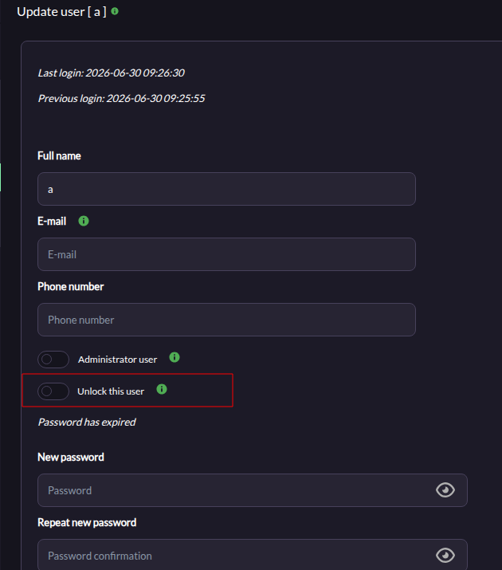

# Configuration sécurisée

Pandora FMS s'installe avec quelques décisions de sécurité déjà prises, mais le
laisser « prêt pour la production » est une autre affaire. Ce chapitre rassemble
ce qu'il faut toucher pour qu'une installation résiste à un audit : ce qui reste
exposé, comment on le chiffre, ce qui est durci dans le système de base et ce qui
s'active dans la plateforme elle-même.

L'idée de fond est simple : **moins vous exposez et plus vous journalisez, moins
vous aurez à corriger ensuite**. Tout ce qui suit est constitué de mesures
concrètes, pas de théorie.

## Surface exposée

La première chose est de savoir ce qui écoute. Et il y a ici un détail qui
surprend ceux qui viennent d'autres outils : **le serveur Pandora FMS n'écoute
aucun port**. Celui qui écoute, c'est le serveur **Tentacle**, qui reçoit les
données des EndPoints ; le serveur Pandora FMS lit seulement les fichiers que
Tentacle dépose sur le disque. Et l'**EndPoint** n'écoute pas non plus : c'est
lui qui lance la connexion vers le serveur.

Les ports qui comptent :

| Composant | Port | Publication |
|---|---|---|
| Console web | 80 (HTTP) et 443 (HTTPS) | Oui, le 443 ; le 80 seulement si vous redirigez |
| API | HTTP/HTTPS de la console | Seulement si vous l'utilisez depuis l'extérieur |
| Tentacle | 41121/TCP | Seulement vers les machines qui rapportent |
| Tentacle RMM | 41123/TCP | Seulement si vous utilisez RMM par Tentacle |
| Base de données (MySQL) | 3306/TCP | **Non**, sauf si elle est distante par conception |
| Console de traps SNMP | 162/UDP | Seulement depuis les équipements qui envoient des traps |

La règle pratique : n'exposez que l'indispensable et laissez le reste à l'écoute
sur `127.0.0.1`. Si la base de données ne sert qu'à la machine elle-même, il n'y a
aucun intérêt à ce qu'elle soit joignable depuis le réseau, et cela se corrige en
une minute (voir le durcissement de MySQL, plus bas).

## Comptes et identifiants

- **Utilisateurs nominatifs.** Chaque personne, son compte. Pas de comptes
  partagés : si vous ne savez pas qui a fait quoi, le journal d'audit ne sert à
  rien.
- **Pas de privilèges superflus.** Chaque utilisateur, avec le profil dont il a
  besoin et rien de plus. C'est ici que trouvent leur place les permissions par
  groupe et l'ACL avancée.
- **Double authentification** sur les comptes ayant accès à la console, et tout
  particulièrement sur les administrateurs.
- **Utilisateurs applicatifs sans accès distant.** Si vous créez des
  utilisateurs pour faire tourner des services, désactivez-leur le *shell* :
  qu'ils ne puissent pas entrer par SSH.
- **Le superutilisateur, avec `sudo`.** Pour tout ce qui demande des privilèges,
  `sudo`, pas une session de `root` ouverte.
- **Des mots de passe de base de données complexes**, et pas ceux d'usine. Le mot
  de passe de MySQL est la clé de tout le reste.
- **Données sensibles chiffrées.** Les identifiants que stocke le produit
  (magasin d'identifiants, mots de passe des modules) peuvent être chiffrés dans
  la base de données (voir plus bas).

## Chiffrement et transport

Tout ce qui circule sur le réseau devrait être chiffré, et Pandora FMS le permet
à chaque étape :

- **Console web en HTTPS.** La console accepte HTTPS avec un certificat du
  serveur web, et il existe un réglage pour **forcer** la connexion en HTTPS.
- **Cookies de session uniquement par SSL.** Dans les environnements sensibles,
  dans `php.ini` :
  ```
  session.cookie_httponly = 1
  session.cookie_secure = 1
  ```
  Attention : avec cela, la console cesse de fonctionner en HTTP. C'est
  exactement le but recherché, mais il faut le savoir avant de l'activer.
- **Base de données par TLS.** La connexion entre le serveur (et la console) et
  MySQL peut être chiffrée avec SSL/TLS.
- **Tentacle avec SSL/TLS.** Tentacle a quatre niveaux : sans chiffrement (par
  défaut), SSL/TLS de base, SSL/TLS avec certificat aux deux extrémités et
  SSL/TLS avec validation de CA, qui est **celui recommandé**.

### Chiffrement des mots de passe

Pandora FMS permet de **chiffrer les mots de passe stockés dans la base de
données**. La clé est générée à partir d'une phrase secrète que vous fournissez,
et elle **n'est pas conservée** dans la base de données : il est impossible de
récupérer les mots de passe à partir d'un dump.

La phrase secrète se configure à deux endroits, `encryption_passphrase`, aussi
bien dans `/etc/pandora/pandora_server.conf` que dans le `config.php` de la
console, puis on lance le script de chiffrement :

```bash
/usr/bin/pandora_encrypt_db /etc/pandora/pandora_server.conf
```

!!! warning "Si vous perdez la phrase, vous perdez les mots de passe"
    La phrase de chiffrement ne peut pas être récupérée. Conservez-la dans un
    endroit sûr ou sauvegardez `config.php` et `pandora_server.conf`. Pour
    déchiffrer (par exemple, avant de changer la phrase), on utilise le même
    script avec `-d`.

## Durcissement du système de base

Le produit est aussi sûr que la machine qui l'héberge. Voici les minimums
attendus du système d'exploitation :

- **Système à jour.** Mettez à jour avant de passer en production, puis de façon
  périodique. L'inventaire de paquets de Pandora FMS aide à localiser les
  versions vulnérables.
- **Audit d'accès actif.** Le journal de sécurité du système (`/var/log/secure`)
  doit être actif et supervisé.
- **SSH durci.** C'est le point le plus critique de tout serveur Linux. Dans
  `/etc/ssh/sshd_config` : changez le port par défaut, mettez
  `PermitRootLogin no`, désactivez `AllowTcpForwarding` et `PermitTunnel`,
  vérifiez (et supprimez si elles sont inutiles) les clés d'accès distant de
  `root`, et mettez un avertissement avec `Banner`.
- **MySQL uniquement en local.** Si la base de données est interne, qu'elle
  écoute seulement sur `127.0.0.1` avec `bind-address = 127.0.0.1` dans
  `[mysqld]` de `/etc/my.cnf`. Vérifiez avec `netstat` qu'elle n'écoute pas
  encore sur `0.0.0.0`.
- **Apache qui ne révèle pas sa version.** Ajoutez `ServerTokens Prod` pour que
  les en-têtes ne révèlent pas la version du serveur web.
- **Moins de services.** Vérifiez avec `netstat -tulpn` (et `lsof`) ce qui écoute
  et pourquoi. Ce dont vous n'avez pas besoin, dehors ; ce qui écoute sur
  `0.0.0.0` sans raison, sur `localhost`.
- **Heure synchronisée.** NTP sur le serveur. En plus des journaux, la double
  authentification dépend du fait que l'heure concorde.

## Configuration sécurisée de la console et du serveur

Déjà dans la plateforme elle-même, ce qu'il vaut mieux verrouiller :

- **Forcer HTTPS** dans la console.
- **API protégée** : liste d'adresses IP autorisées et un **mot de passe
  robuste** pour l'API. Le caractère générique `*` laisse l'API ouverte à
  n'importe qui : ne l'utilisez pas en production.
- **ACL avancée** pour restreindre les sections que voit chaque profil.
- **Journal d'audit activé et exporté** (voir la section suivante).
- **Mode lecture seule** sur les EndPoints les plus sensibles : s'ils n'ont pas
  besoin qu'on leur change la configuration à distance, qu'ils ne l'acceptent
  pas.
- **Limiter qui téléverse des exécutables** (plugins, collections) avec les
  permissions correspondantes.
- **Permissions du fichier de configuration du serveur.** Vérifiez que
  `pandora_server.conf` n'est pas lisible par n'importe qui.
- **Changer le mot de passe administrateur après le premier démarrage.** Ne
  laissez pas le compte d'administration avec le mot de passe du premier
  démarrage.

## Activation de la 2FA

La double authentification est la mesure au meilleur rapport entre l'effort et le
résultat : même si quelqu'un vole votre mot de passe, sans le second facteur il
n'entre pas. Elle s'active dans la configuration globale d'authentification
(**Double authentification**) et chaque utilisateur l'active dans
**Opération → Espace de travail → Modifier mon utilisateur**. Avec **Forcer la
2FA pour tous les utilisateurs**, on l'impose à tout le monde.

Elle nécessite une **application génératrice de codes** sur le téléphone de
l'utilisateur et que le serveur et le téléphone aient **l'heure synchronisée**.
Pour la désactiver pour un utilisateur précis sans passer par la console, il y a
la CLI (`--disable_double_auth`). Le détail des champs se trouve dans la
Partie 04 · Authentification externe.

## Audit

Pandora FMS conserve un **journal d'audit** avec les changements et les actions
importants de la console : quel utilisateur, quelle action, quand et une
description. Il se consulte dans **Gestion → Outils d'administration → Journal
d'audit** (*System audit log*), avec des filtres par action, utilisateur, adresse
IP, texte et plage horaire, et il peut être exporté au format CSV.

!!! warning "Désactivé par défaut"
    Le journal d'audit **n'est pas actif par défaut**. Il s'active dans
    **Gestion → Réglages → Configuration du système → Configuration générale →
    Sécurité**, avec l'option **Activer l'audit des journaux** (*Enable audit
    log*), et on enregistre. Un journal que l'on n'allume pas n'audite rien.

Ce qui est vraiment utile, ce n'est pas de le consulter à la main, mais de le
**centraliser dans un système externe en temps réel**, pour qu'un administrateur
local ne puisse pas effacer ses traces. La voie propre est **Rsyslog**, qui est
déjà installé avec le serveur :

- Dans la console, le journal s'écrit dans
  `/var/www/html/pandora_console/log/audit.log`.
- Un `imfile` de Rsyslog fait un *tail* de ce fichier et le renvoie par TCP vers
  un récepteur externe. On utilise un *ruleset* dédié pour envoyer **uniquement**
  l'audit et pas tout le *journal* du système.
- Sur le récepteur, un autre *ruleset* enregistre les lignes dans un fichier
  propre.

L'annexe technique de centralisation du journal d'audit avec Rsyslog contient la
configuration complète, de bout en bout, avec l'émetteur et le récepteur. Avec
cela, la trace quitte la machine en quelques secondes et reste là où personne de
l'intérieur ne peut y toucher.

## Politique de mots de passe

Dans les installations Enterprise, il existe une **politique de mots de passe**
dans **Configuration → Politique de mots de passe**. C'est elle qui transforme
« mettre un mot de passe » en « mettre un mot de passe qui tient ». Elle
contrôle, entre autres choses :

| Réglage | Ce qu'il fait |
|---|---|
| **Activer la politique de mots de passe** | Active tout le mécanisme |
| **Longueur minimale** | Combien de caractères au minimum |
| **Expiration du mot de passe** | Jours de validité ; `0` = n'expire jamais |
| **Doit contenir des chiffres** et des **symboles** | Exige des types de caractères |
| **Historique** et **comparaison avec le précédent** | Évite de répéter les mots de passe |
| **Appliquer aux administrateurs** | Que la politique s'applique aussi à eux |
| **Forcer le changement au premier démarrage** | Oblige à le changer à la première connexion (génère un nouveau jeton pour l'API) |
| **Utilisateur verrouillé en cas d'échec de connexion** | Durée du verrouillage temporaire |
| **Nombre de tentatives échouées** | Combien d'échecs sont autorisés (au minimum deux) |
| **Maximum de verrouillages temporaires** | Avec `0`, il n'y a jamais de verrouillage permanent ; avec un nombre, l'utilisateur reste **verrouillé définitivement** jusqu'à son déverrouillage |
| **Réinitialisation du mot de passe** et **mots exclus** | Permet le « mot de passe oublié » et interdit certains mots |

## Verrouillage et déverrouillage des comptes

Avec la politique active, un utilisateur qui accumule les échecs est
**verrouillé**, et s'il dépasse le maximum de verrouillages temporaires,
**verrouillé définitivement**. Dans les deux cas, un administrateur le
déverrouille depuis la fiche de l'utilisateur, dans la section Utilisateurs (et
non depuis « Modifier mon utilisateur »).



Et depuis la version 805, également en ligne de commande :

```bash
pandora_manage /etc/pandora/pandora_server.conf --unlock_user <utilisateur>
```

Cette commande est le filet de sécurité pour le cas embarrassant : que le compte
verrouillé soit celui de l'administrateur lui-même.
