# SIEM

Une ligne de *log* isolée n'apporte pas grand-chose. Un « Failed password for
invalid user oracle » sur un serveur SSH est du bruit ; quarante en deux minutes
depuis la même adresse constituent une attaque par force brute, et il vaut mieux
le savoir avant que la quarante et unième tentative ne réussisse. C'est la
différence entre stocker des *logs* et disposer d'un **SIEM** (*Security
Information and Event Management*) : le SIEM lit ce qui a déjà été collecté,
l'interprète, le corrèle et signale ce qui paraît suspect.

Un SIEM réunit deux fonctions. La **gestion des informations de sécurité** (SIM)
collecte et normalise les données ; la **gestion des événements de sécurité**
(SEM) les corrèle et les transforme en événements. Les données peuvent provenir
d'un *log* ordinaire (le journal d'accès d'un Apache), du *log* d'un outil de
sécurité (un pare-feu, un IDS, un *honeypot*, un EDR) ou d'événements déjà
enrichis par un autre SIEM.

Pandora SIEM ne crée pas de chaîne supplémentaire pour cela. Il réutilise la
[collecte de logs](../parte-2/2.19-recoleccion-y-monitorizacion-de-logs.md) et
le même OpenSearch où ces *logs* sont déjà stockés, et il accepte tels quels les
fichiers de *decoders* et de *rules* de Wazuh®. Dans cette partie, l'architecture
générale est décrite dans
[Architecture de sécurité](7.1-arquitectura-de-seguridad-de-pandora.md), la
surveillance quotidienne dans
[Surveillance de la sécurité](7.7-monitorizacion-de-seguridad.md) et la réponse
automatisée dans [SOAR](7.3-soar.md).

!!! info "Événement SIEM, événement Pandora FMS et alerte ne sont pas la même chose"
    Un **événement SIEM** est un document que le SIEM enregistre dans OpenSearch
    lorsqu'une *rule* est satisfaite ; il se consulte dans **Operation → SIEM**.
    Un **événement Pandora FMS** est celui de la
    [console d'événements](../parte-5/5.4-consola-de-eventos-centralizada.md),
    stocké dans la base de données. Une **alerte** est ce qui déclenche des
    actions (courriel, Slack, un *script*). Une alerte SIEM peut créer un
    événement Pandora FMS, mais ce sont trois éléments distincts, chacun avec sa
    propre vue.

Pour profiter de toutes les fonctions du SIEM, il est recommandé d'utiliser des
EndPoints en version **783 ou supérieure**.

## Fonctionnement

Le SIEM travaille en deux étapes, chacune assurée par un serveur différent :

1. **Normalisation.** Le serveur `siemserver` lit les *logs* enregistrés par la
   collecte, leur applique les ***decoders*** et écrit des *logs* normalisés,
   avec leurs champs déjà séparés (utilisateur, IP source, port, action…). Ces
   *logs* normalisés sont temporaires.
2. **Génération d'événements.** Le serveur `siemevents` évalue les ***rules***
   sur les *logs* normalisés. Lorsqu'une *rule* est satisfaite, il écrit un
   **événement SIEM** contenant les informations de la *rule* et du *log* qui
   l'a déclenchée.

La chaîne complète :

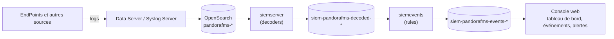

Tout est stocké dans OpenSearch, dans des index **quotidiens** par instance :

| Index | Contenu | Rétention par défaut |
|---|---|---|
| `pandorafms-<identifiant>-<date>` | *Logs* bruts de la collecte | Celle de la collecte de *logs* |
| `siem-pandorafms-decoded-<identifiant>-<date>` | *Logs* normalisés par les *decoders* | 2 jours |
| `siem-pandorafms-events-<identifiant>-<date>` | Événements SIEM | 180 jours |

L'`<identifiant>` est l'identifiant unique du serveur Pandora FMS. Chaque type
d'index a sa propre rétention (voir
[Activation dans la console web](#activation-dans-la-console-web)).

Le `siemserver` dépend de la collecte de *logs* : si le collecteur est
désactivé, il ne fait rien, faute de données à traiter. Il ne remonte pas non
plus indéfiniment dans le temps : à chaque passage, il ne prend que les *logs*
arrivés dans la fenêtre `siem_max_timeframe` (30 jours par défaut) et qu'il n'a
pas encore traités.

!!! warning "Ce qui sort de la fenêtre n'est jamais analysé"
    Si le `siemserver` reste arrêté plus longtemps que `siem_max_timeframe`,
    les *logs* arrivés pendant cette interruption ne sont plus dans la fenêtre
    et ne sont jamais normalisés. Et si la rétention des *logs* décodés est plus
    longue que cette fenêtre, des jours que personne ne consultera sont
    conservés inutilement.

Avec plusieurs serveurs, le **master** répartit le travail : il détecte le
nombre de `siemserver` actifs et, si ce nombre change, il les arrête, les
synchronise et les redémarre.

## Prérequis

| Exigence | Détail |
|---|---|
| Licence Pandora SIEM | Installée sur le serveur. Sans elle, l'onglet de configuration indique que la licence ne permet pas d'activer le SIEM et le serveur ne démarre pas `siemserver`. |
| OpenSearch | Installé et accessible depuis le serveur et la console, avec un utilisateur et un mot de passe s'il utilise l'authentification de base. C'est le même moteur que celui de la [collecte de logs](../parte-2/2.19-recoleccion-y-monitorizacion-de-logs.md). |
| Collecteur de *logs* activé | Sans lui, aucun *log* n'arrive pour être analysé. Le formulaire du SIEM affiche un avertissement s'il est désactivé. |
| Fonctions expérimentales | **Show experimental features** activé dans la configuration générale. Sans cela, ni le menu ni l'onglet du SIEM n'apparaissent. |
| `siemserver` et `siemevents` | Activés dans `pandora_server.conf` sur les serveurs chargés du traitement. |
| EndPoints | Version 783 ou supérieure (recommandé). |
| Ports | Celui d'OpenSearch (`9200` par défaut) et ceux de la collecte de *logs* (`514` si le Syslog Server est utilisé). |
| Autorisations | Administrateur pour configurer le SIEM et gérer les *decoders* et les *rules* (voir [Accès et autorisations](#acces-et-autorisations)). |

## Activation dans la console web

### Afficher les fonctions expérimentales

Le SIEM est masqué derrière un interrupteur sans rapport direct avec lui. Tant
que **Show experimental features** est désactivé, ni le menu **Operation →
SIEM** ni l'onglet de configuration n'apparaissent, et il n'existe aucun moyen
de les trouver.

Allez dans **Management → Settings → System Settings → General Setup**, onglet
**Features**, activez **Show experimental features** et cliquez sur **Update**.

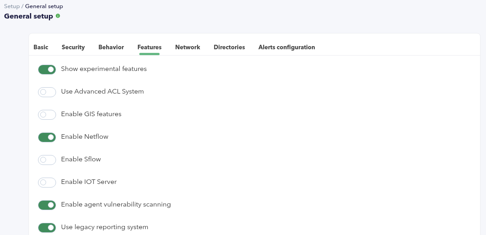{ .captura }

### Le formulaire SIEM

Une fois l'interrupteur activé, **Management → Settings → System Settings →
SIEM** apparaît. Activez **Activate SIEM**, renseignez la connexion à OpenSearch
et cliquez sur **Update**. À côté de l'interrupteur, un indicateur vérifie la
connexion (**OpenSearch is running** lorsqu'il répond).

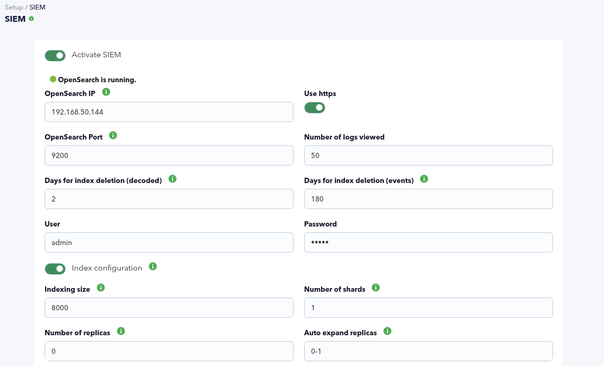{ .captura }

| Champ | Par défaut | Rôle |
|---|---|---|
| **Activate SIEM** | Désactivé | Active le SIEM dans la console. Sans lui, les vues affichent « SIEM disabled » avec un bouton menant ici. |
| **OpenSearch IP** | (vide) | Adresse du serveur OpenSearch qui stocke les *logs* décodés et les événements. |
| **Use https** | Désactivé | Se connecte à OpenSearch en HTTPS. |
| **OpenSearch Port** | `9200` | Port d'OpenSearch. |
| **Number of logs viewed** | `50` | Nombre de *logs* chargés à chaque fois par la vue de recherche sur OpenSearch. |
| **Days for index deletion (decoded)** | `2` | Jours de conservation des *logs* normalisés. `0` désactive la purge. Doit être inférieur ou égal à `siem_max_timeframe`. |
| **Days for index deletion (events)** | `180` | Jours de conservation des événements SIEM. `0` les conserve indéfiniment. |
| **User** / **Password** | (vide) | Identifiants d'OpenSearch, s'il utilise l'authentification de base. |
| **Index configuration** | Replié | Réglages avancés des index (tableau suivant). |

Les réglages avancés de **Index configuration** :

| Champ | Par défaut | Rôle |
|---|---|---|
| **Indexing size** | `8000` | Utilisé comme valeur `ignore_above` du texte du *log* dans OpenSearch : les textes plus longs ne sont pas indexés comme mot-clé. |
| **Number of shards** | `1` | Fragments primaires de chaque index. Défini uniquement à la création de l'index. |
| **Number of replicas** | `0` | Répliques de chaque fragment. |
| **Auto expand replicas** | `0-1` | Ajuste les répliques au nombre de nœuds de données du cluster (par exemple `0-5` ou `0-all`). |

!!! warning "Index sans réplique"
    Avec **Number of replicas** à `0`, le redémarrage d'un nœud OpenSearch rend
    les données indisponibles pendant un moment, et une corruption peut les
    faire perdre. Ne modifiez ces réglages que si vous maîtrisez OpenSearch :
    une configuration erronée peut déstabiliser le système.

!!! info "Ce que fait Update et ce qu'il ne fait pas"
    Lorsque vous cliquez sur **Update**, la console crée dans OpenSearch les
    modèles des index `siem-pandorafms-decoded-*` et `siem-pandorafms-events-*`.
    Les modifications de modèle s'appliquent **à l'index suivant**, c'est-à-dire
    à celui du lendemain. En revanche, **Update** ne démarre **pas** les
    serveurs : cela s'active sur le serveur (section suivante).

!!! warning "Collecteur de logs désactivé : le SIEM n'a rien à analyser"
    Si le collecteur de *logs* est désactivé, le formulaire affiche un
    avertissement et le `siemserver` ne traite rien. Activez-le d'abord, comme
    expliqué dans
    [Collecte et surveillance des logs](../parte-2/2.19-recoleccion-y-monitorizacion-de-logs.md).

Avec [Command Center](../parte-6/6.3-command-center.md), le SIEM se configure
et se consulte sur chaque nœud : la console du Command Center ne comporte pas de
section SIEM.

## Activation sur le serveur

Les deux serveurs du SIEM sont désactivés par défaut. Ils s'activent dans
`/etc/pandora/pandora_server.conf` sur chaque serveur chargé du traitement :

```text
siemserver 1
siemserver_threads 4
siemserver_threshold 5
siemevents 1
siemevents_threads 2
siemevents_threshold 5
siem_max_timeframe 2592000
siem_decoders /usr/share/pandora_server/util/siem/decoders
siem_events_rules /usr/share/pandora_server/util/siem/rules
siem_max_hits_logs -1
```

| Token | Par défaut | Rôle |
|---|---|---|
| `siemserver` | `0` | Active le serveur de normalisation. |
| `siemserver_threads` | `4` | Fils d'exécution du serveur de normalisation. |
| `siemserver_threshold` | `5` | Secondes entre deux passages du serveur de normalisation. |
| `siemevents` | `0` | Active le serveur d'événements. |
| `siemevents_threads` | `2` | Fils d'exécution du serveur d'événements. |
| `siemevents_threshold` | `5` | Secondes entre deux passages du serveur d'événements. |
| `siem_max_timeframe` | `2592000` | Fenêtre, en secondes (30 jours), des *logs* analysés. |
| `siem_decoders` | `/usr/share/pandora_server/util/siem/decoders` | Dossier des fichiers XML de *decoders*. |
| `siem_events_rules` | `/usr/share/pandora_server/util/siem/rules` | Dossier des fichiers XML de *rules*. |
| `siem_max_hits_logs` | `-1` | Nombre maximal de *logs* par requête du serveur d'événements. `-1` signifie sans limite. |

Les modifications prennent effet au redémarrage du serveur :

```bash
systemctl restart pandora_server
```

Au démarrage, le serveur **master** charge les fichiers XML de *decoders* et de
*rules* dans la base de données ; les autres serveurs les lisent depuis
celle-ci. La référence complète des tokens se trouve dans
[Référence de configuration du serveur](../parte-9/9.3-referencia-completa-de-configuracion-del-servidor.md).

!!! warning "`siem_rules` n'existe pas"
    Le token des *rules* est `siem_events_rules`. Si vous trouvez `siem_rules`
    dans une documentation ancienne, ne l'utilisez pas : le serveur ne le
    reconnaît pas et continue de lire le dossier par défaut.

## Collecte de logs pour le SIEM

Le lien entre la [collecte de logs](../parte-2/2.19-recoleccion-y-monitorizacion-de-logs.md)
et le SIEM tient en un seul token : `module_source_type`. C'est le **type** du
*log*, et c'est lui que consultent les *decoders* pour déterminer si un *log*
les concerne. S'il n'est pas indiqué, le *log* conserve le type `syslog`.

Les types déclarés par les *decoders* fournis :

| Type | État par défaut | Utilisation |
|---|---|---|
| `syslog` | Actif | *Syslog* des systèmes Unix et de la plupart des équipements réseau (FortiGate compris). |
| `web-log` | Actif | *Logs* d'accès des serveurs web. |
| `ids` | Actif | Systèmes de détection d'intrusion. |
| `firewall` | Actif | Pare-feu avec un format propre. |
| `ossec` | Actif | Événements MS Windows (canal d'événements). |
| `squid` | Dans `disabled/` | Proxy Squid. |
| `windows` | Dans `disabled/` | Ancien format des événements Windows. |

Les *decoders* désactivés se trouvent dans le sous-dossier `disabled/` de
`siem_decoders` (plus de quatre-vingt-dix fichiers hérités de Wazuh). Le type
`host-information`, qui apparaît dans une documentation ancienne, n'est déclaré
par aucun *decoder*.

!!! warning "Le type est comparé comme une expression régulière, et il n'est pas toujours nécessaire"
    Le `type` d'un *decoder* est comparé au type du *log* comme une expression
    régulière, sans tenir compte de la casse. Et un *decoder* **sans** `<type>`
    (celui de CEF, celui de JSON et d'autres) s'applique à n'importe quel *log*,
    quel que soit son type. Un type inventé n'est donc normalisé que s'il existe
    un *decoder* de ce type ou un *decoder* sans type qui le prend en charge.
    Attention à FortiGate : ses *decoders* déclarent `syslog`, ces *logs*
    doivent donc arriver en tant que `syslog` et non `firewall`.

Dans la console, lors de l'ajout d'un module de *logs* depuis la vue de l'agent,
**Source type** est un champ de texte libre : aucun avertissement n'est affiché
si le type saisi n'existe pas.

!!! note "Entrées de log multilignes"
    Si la collecte envoie une entrée avec le marqueur `{{\n}}`, le serveur la
    décode avant de l'indexer : le SIEM reçoit **un unique événement** avec ses
    sauts de ligne et applique les *decoders* et les *rules* au bloc complet, pas
    à chaque ligne. Le mécanisme est expliqué dans [Entrées de log
    multilignes](../parte-2/2.19-recoleccion-y-monitorizacion-de-logs.md#entrees-de-log-multilignes).

### EndPoint Linux : un fichier de log

Le *log* d'accès complet d'un serveur Apache :

```text
module_begin
module_name apache
module_type log
module_regexp /var/log/httpd/access_log
module_pattern .*
module_source_type web-log
module_end
```

Ces *logs* sont normalisés, entre autres, par les *decoders* `web-accesslog`,
`web-accesslog-ip` et `web-accesslog-domain`, et peuvent produire des événements
tels que **Common web attack**, **XSS (Cross Site Scripting) attempt** ou **SQL
injection attempt**.

### EndPoint MS Windows : le journal des événements

Pour les canaux **Application**, **System** ou **Security**, le nom du canal est
indiqué dans `module_source`. Pour tout autre canal, le chemin complet. Cet
exemple collecte le canal de sécurité et celui de Windows Defender :

```text
module_begin
module_name Windows_LogEvents_Security
module_type log
module_logchannel
module_source Security
module_source_type ossec
module_end

module_begin
module_name Windows_LogchannelEvents_WindowsDefender
module_type log
module_logchannel
module_source Microsoft-Windows-Windows Defender/Operational
module_source_type ossec
module_end
```

Ils sont normalisés par le *decoder* `windows_eventchannel` et peuvent produire
des événements tels que **Windows error event**, **Short-time multiple Windows
Defender warning events** ou **Multiple Windows Defender error events**.

### EndPoint MS Windows : un fichier de log avec un type propre

Un fichier texte sous Windows se collecte comme sous Linux. Voici le *log* d'une
application avec un type inventé :

```text
module_begin
module_name xserver
module_type log
module_regexp C:\server\logs\xserver.log
module_pattern .*
module_source_type xserver
module_end
```

Avec le type `xserver`, ce *log* ne sera normalisé que par un *decoder* qui
déclare `<type>xserver</type>` (ou par un *decoder* sans type). Si ce *decoder*
n'existe pas, le SIEM conservera le *log* sans rien en faire.

Le détail de chaque directive des modules de *logs* se trouve dans
[Collecte et surveillance des logs](../parte-2/2.19-recoleccion-y-monitorizacion-de-logs.md)
et dans la
[référence de configuration de l'EndPoint](../parte-9/9.1-referencia-completa-de-configuracion-del-endpoint.md).

## Accès et autorisations

Le menu **Operation → SIEM** est visible par les administrateurs et par les
utilisateurs disposant de l'autorisation **PM** ou **ER**, et chaque entrée a
son propre contrôle :

- **Dashboard** et **Events** : autorisation **ER**. La validation d'événements
  exige en plus **EW**.
- **Alerts** (la liste d'exploitation des alertes SIEM) : autorisation **LM** ou
  administrateur.
- **Decoders** et **Rules** : administrateurs uniquement.
- **Search** (recherche sur les *logs* décodés) : autorisation **PM**.
- **Index Interface** et **Opensearch interface** : administrateurs uniquement.

La gestion des alertes, dans **Management → Alerts → SIEM Alerts**, exige
l'autorisation **LW** ou le profil administrateur, et dépend également des
fonctions expérimentales.

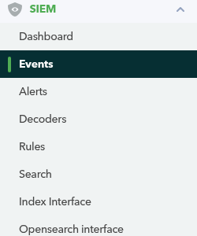{ .captura }

## Tableau de bord et événements

### Tableau de bord

**Operation → SIEM → Dashboard** résume l'état en un coup d'œil : le total des
événements par sévérité, l'évolution des dix niveaux comptant le plus
d'événements, l'évolution des alertes des dix agents les plus actifs, les dix
adresses IP source (SRCIP) les plus fréquentes, les dix techniques
MITRE ATT&CK® les plus vues, les dix agents ayant le plus d'événements et un
tableau des derniers événements. Par défaut, il affiche les dernières 24 heures.

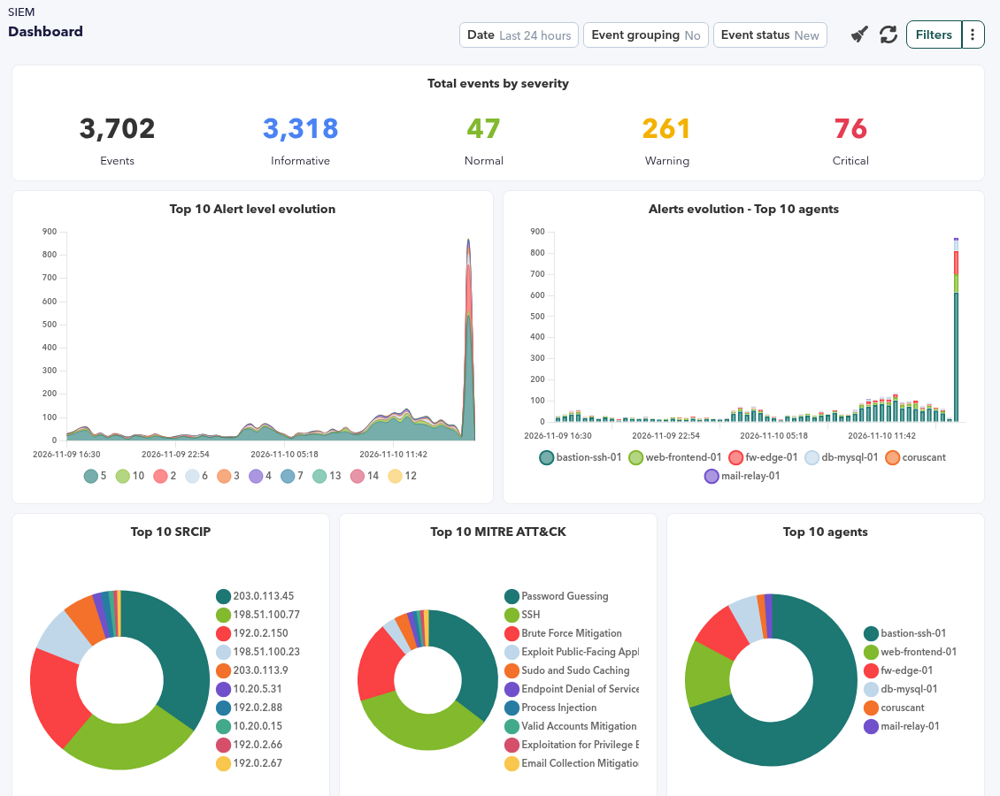{ .captura }

Ces mêmes informations peuvent être ajoutées aux
[tableaux de bord](../parte-5/5.1-dashboards.md) avec les *widgets* du SIEM
(voir [Rapports et tableaux de bord](#rapports-et-tableaux-de-bord)).

### Liste des événements

**Operation → SIEM → Events** présente le tableau complet : sévérité,
description, état, agent, niveau, *decoders* ayant normalisé le *log*, ID de la
*rule*, type et date. Depuis cette vue, les événements s'exportent avec **Export
to CSV** et se valident avec **Validate events** (ou un par un avec l'icône de
chaque ligne).

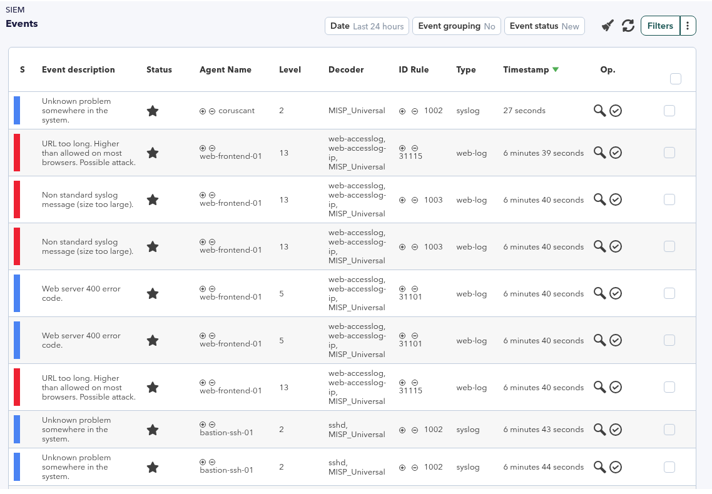{ .captura }

Un événement est créé à l'état **New** et passe à **Validated** lorsqu'il est
validé. Par défaut, le tableau affiche les nouveaux événements des dernières
24 heures.

### Filtres

Le bouton **Filters** ouvre un panneau à trois onglets :

- **General** : recherche libre (dans la description, l'alias de l'agent, le
  *decoder* et le type), ID de l'événement, groupe (avec **Group recursion**
  pour inclure les groupes enfants), groupe SIEM, description, date, **Event
  grouping** (regroupe par description, agent, *rule* et *decoder*), sévérité,
  niveau, ID de *rule*, type, technique MITRE, agent et état.
- **Decoder** : le *decoder* et les champs dynamiques qu'il a extraits, avec les
  opérateurs **is like** (expression régulière) et **is equal to**
  (correspondance exacte).
- **Exclusion filters** : les agents et les *rules* à masquer.

Les filtres s'enregistrent avec **Save filter** et se rechargent avec **Load
filter**.

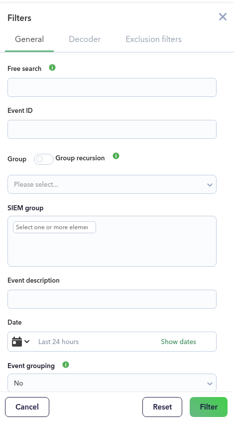{ .captura }

!!! warning "Le regroupement a un coût"
    **Event grouping** effectue une agrégation sur OpenSearch et, avec de
    nombreux événements, peut dégrader les performances de la requête.

### Détail d'un événement

La loupe de chaque ligne ouvre le détail, avec des onglets qui n'apparaissent
que lorsqu'ils ont du contenu :

- **General** : les informations de base de l'événement (ID, description,
  agent, groupe, niveau, sévérité, état, *decoders*, *rule*, texte du *log*,
  type, origine, programme et dates). L'événement peut être validé ici avec
  **Validate event**.
- **Dynamic fields** : les champs extraits par les *decoders* (`srcip`,
  `srcuser`, `srcport`…). Ils proviennent du *decoder*.
- **MITRE ATT&CK** : les techniques associées, avec un lien vers leur fiche.
  Elles proviennent de la *rule*.
- **SIEM groups** : les groupes de la *rule*, qui incluent les références de
  conformité réglementaire (PCI DSS, GDPR, HIPAA, NIST 800-53…). Ils proviennent
  de la *rule*.
- **ITSM tickets** : les tickets associés, uniquement si l'intégration ITSM est
  activée.
- **Responses** : les actions sur l'événement. **Ping to host** lance un ping
  vers l'une des adresses de l'événement ; si ITSM est activé, **Create a ticket
  in Pandora ITSM** et **Add a ticket to the event** sont également disponibles.

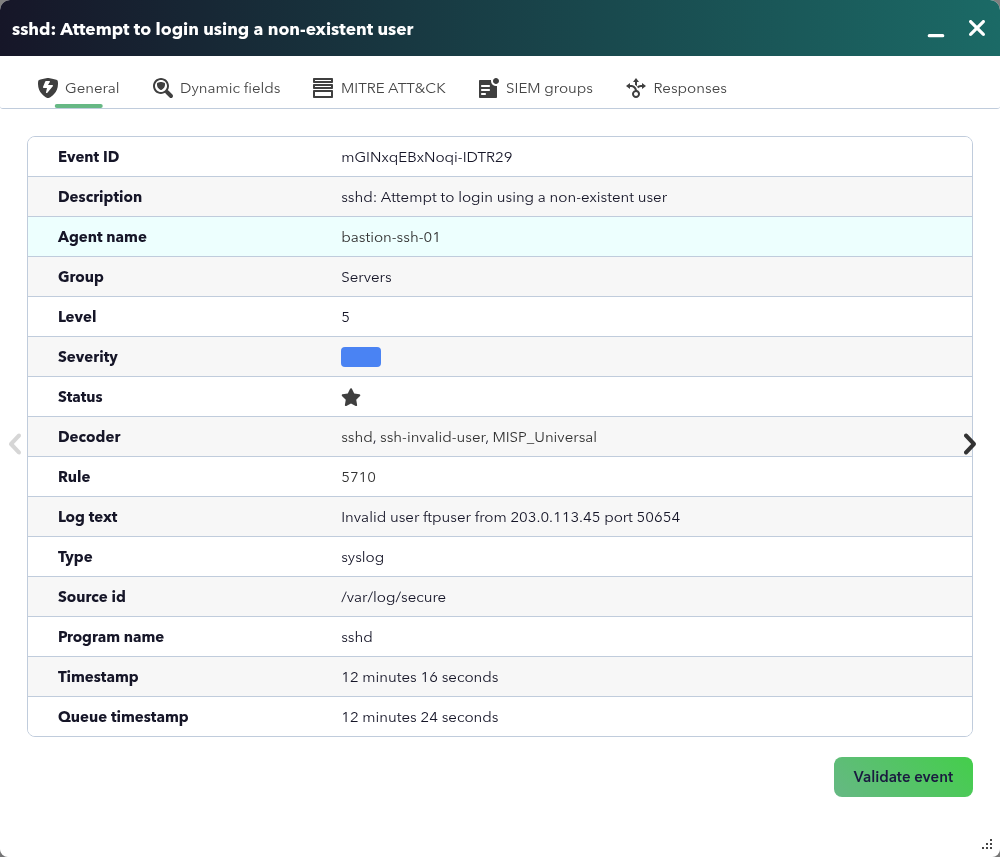{ .captura }

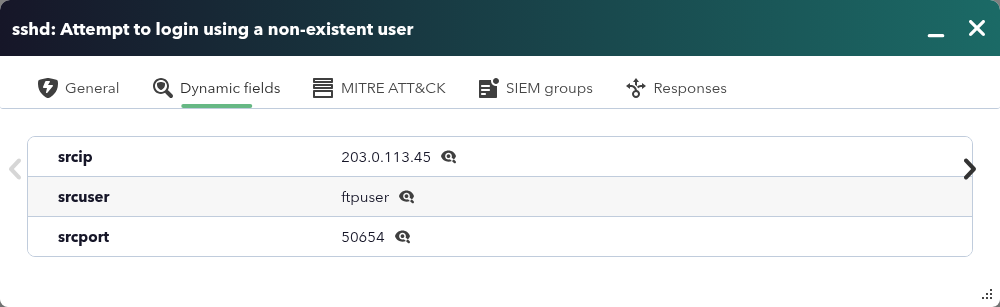{ .captura }

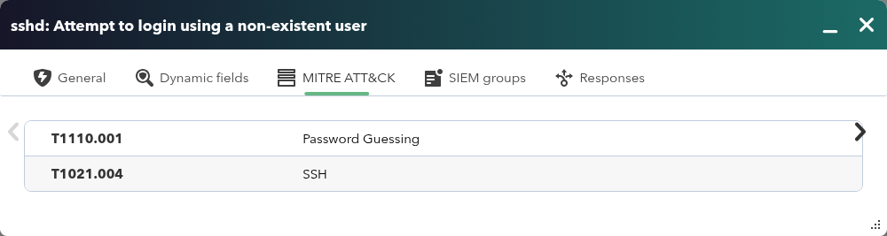{ .captura }

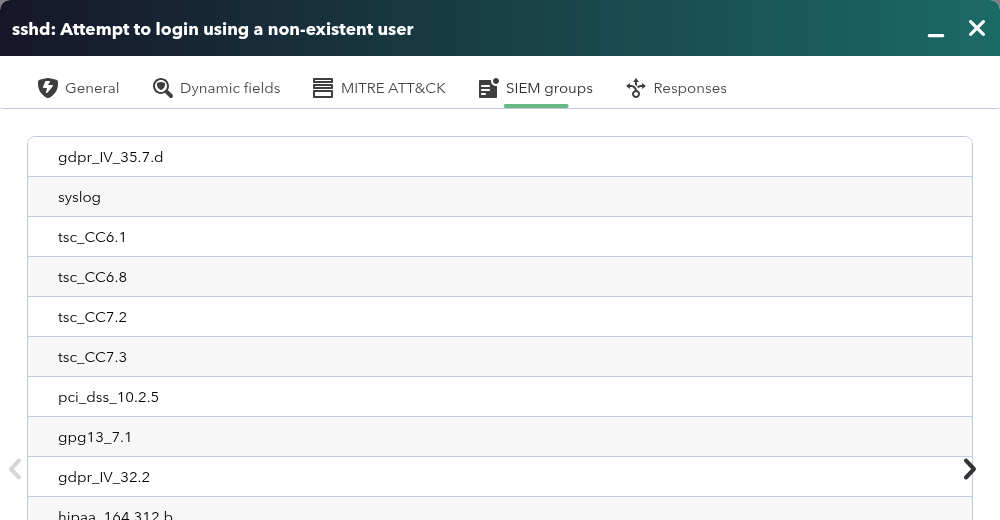{ .captura }

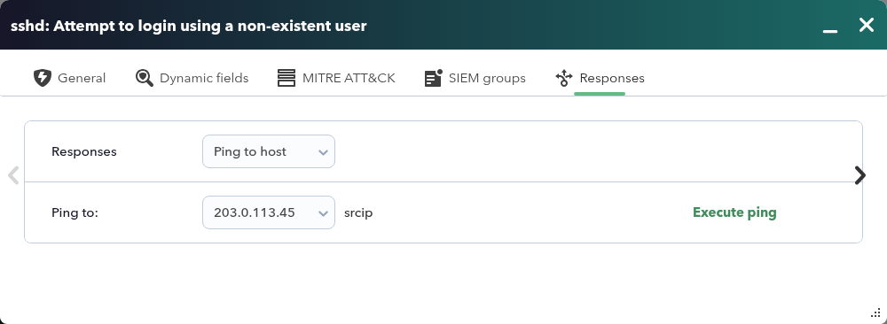{ .captura }

## Decoders

Un *decoder* sait lire un type de *log* : il le reconnaît et le découpe en
champs nommés. Pandora FMS en fournit plusieurs centaines (la plupart hérités de
Wazuh), et il est possible d'ajouter les siens.

### Gestion

Il existe deux méthodes, et il est utile de savoir laquelle est employée :

1. **Fichiers XML** dans le dossier `siem_decoders`. Le master les charge dans
   la base de données au démarrage. Dans la console, ils apparaissent comme
   **Server managed** et peuvent seulement être activés ou désactivés : ils ne
   peuvent être ni modifiés ni supprimés depuis la console.
2. **Console** : **Operation → SIEM → Decoders**. **New decoder** en crée un
   depuis un formulaire, **Upload XML** importe un fichier contenant un ou
   plusieurs *decoders*, et chaque ligne propose l'affichage, la modification,
   la suppression et la désactivation. Les *decoders* créés ici sont stockés
   dans la base de données, ne dépendent d'aucun fichier et sont modifiables.

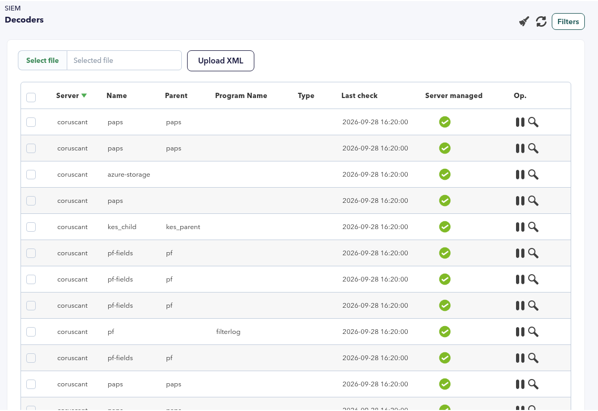{ .captura }

Les colonnes de la liste sont **Server**, **Name**, **Parent**, **Program
Name**, **Type**, **Last check**, **Server managed** et **Op.** L'état
activé/désactivé se filtre depuis **Filters** (**Enabled**), et
**Enable/Disable selected items** modifie plusieurs éléments à la fois.

Le formulaire **New decoder** couvre l'essentiel : **Name**, **Parent**,
**Program name**, **Type**, **Discard**, un ou plusieurs **Prematch** et
**Regex** (chacun avec son type d'expression, **OS Regex** ou **PCRE2**, et son
**Offset**) et **Order**. Pour `var`, `json_null_field`, `fts` ou
`plugin_decoder`, rédigez le XML et importez-le avec **Upload XML**.

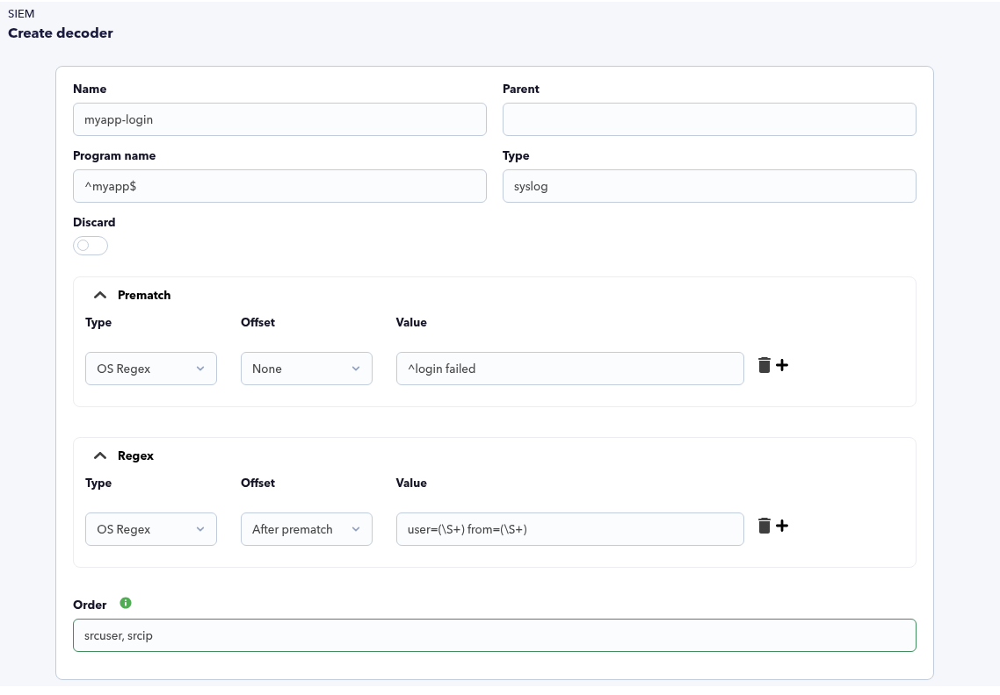{ .captura }

!!! info "Ce qui arrive aux decoders au redémarrage"
    À chaque démarrage, le master supprime les *decoders* issus de fichiers et
    les recharge. Conséquences : ceux qui ne peuvent pas être lus disparaissent
    (même s'ils fonctionnaient auparavant), et **ceux qui ont été désactivés
    depuis la console sont réactivés**. Pour désactiver définitivement un
    *decoder* issu d'un fichier, retirez-le du dossier (par exemple vers
    `disabled/`). Les *decoders* créés depuis la console ne sont pas modifiés.

### Syntaxe

Un fichier de *decoders* peut en contenir autant que nécessaire. La syntaxe
complète :

```xml
<var name="VarName">VarValue</var>

<decoder name="DecoderName" discard="yes|no">
    <parent>DecoderName</parent>
    <program_name type="pcre2">REGEXP</program_name>
    <type>EventType</type>
    <prematch type="pcre2">REGEXP</prematch>
    <prematch offset="after_parent">REGEXP</prematch>
    <prematch offset="after_prematch">REGEXP</prematch>
    <regex type="pcre2">REGEXP</regex>
    <regex offset="after_parent">REGEXP</regex>
    <regex offset="after_regex">REGEXP</regex>
    <order>Field1, Field2.Sub1, Field2.Sub2</order>
    <json_null_field>string|discard</json_null_field>
    <fts>Field1, Field2</fts>
    <plugin_decoder offset="after_parent">JSON_Decoder|KVP_Decoder</plugin_decoder>
</decoder>
```

| Élément | Rôle |
|---|---|
| `var` | Définit une variable utilisée ensuite dans le XML sous la forme `$VarName`. |
| `decoder` | Le *decoder*. `name` est son nom : plusieurs *decoders* peuvent le partager, et ils sont alors tous évalués. `discard` (`yes` ou `no`) exclut de l'évaluation les *logs* qui lui correspondent ; les *decoders* avec `discard="yes"` sont évalués avant les autres, sauf s'ils ont un parent. |
| `parent` | *Decoder* parent, pour construire des hiérarchies. L'enfant n'est évalué que si le parent correspond. |
| `program_name` | Nom du programme qui doit figurer dans l'en-tête du *log* ou dans son `source_id`. Avec `type="pcre2"`, PCRE2 est utilisé ; sinon, OS Regex. |
| `type` | Type de *log* auquel il s'applique. Comparé au type du *log* comme une expression régulière, sans tenir compte de la casse. Sans `type`, le *decoder* s'applique à tous les types. |
| `prematch` | Si le contenu du *log* correspond, un *log* normalisé est généré. Accepte `type` et `offset`. |
| `regex` | Les groupes capturés par cette expression constituent l'information normalisée. Accepte `type` et `offset`. |
| `order` | Noms des champs où sont stockés, dans l'ordre, les groupes capturés par `regex`. |
| `json_null_field` | Traitement des groupes vides : les enregistrer comme chaîne vide (`string`) ou les ignorer (`discard`). |
| `fts` | Champs qui identifient une combinaison « vue pour la première fois » (*first time seen*). Utilisé par la condition `if_fts` des *rules*. |
| `plugin_decoder` | Confie l'analyse à un *plugin* : `JSON_Decoder` (*logs* JSON) ou `KVP_Decoder` (paires `clé=valeur`). Accepte `offset`. |

`program_name`, avec PCRE2 :

```xml
<program_name type="pcre2">^myapp$</program_name>
```

`fts`, tel que l'utilise le *decoder* arpwatch fourni : un *log* avec cette
combinaison d'agent, d'IP et de données supplémentaires est « nouveau » s'il n'a
jamais été vu. Dans `fts`, `name` désigne le nom de l'agent et `location`, le
type du *log*.

```xml
<fts>name, srcip, extra_data</fts>
```

`plugin_decoder`, tel que l'utilisent les *decoders* FortiGate (paires
`clé=valeur`) et celui d'ESET (JSON à partir de la fin du parent) :

```xml
<decoder name="fortigate-firewall-v6-fields">
  <parent>fortigate-firewall-v6</parent>
  <plugin_decoder>KVP_Decoder</plugin_decoder>
</decoder>
```

```xml
<plugin_decoder offset="after_parent">JSON_Decoder</plugin_decoder>
```

!!! warning "`ftscomment` est accepté et ignoré"
    Certains fichiers XML hérités de Wazuh contiennent `<ftscomment>`. Le
    serveur ne le lit pas : il peut rester dans le fichier, mais il n'a aucun
    effet.

### offset

`offset` détermine à partir d'où une expression est évaluée et retire, pour les
vérifications suivantes, le texte qui a déjà correspondu. Valeurs :
`after_parent`, `after_prematch` et `after_regex`.

```xml
<decoder name="my_decoder">
  <prematch type="pcre2">^\d\d\d\d/\d\d/\d\d \d\d:\d\d:\d\d </prematch>
  <regex type="pcre2" offset="after_prematch">(\w):(\d+)</regex>
  <order>srcip,srcport</order>
</decoder>
```

Le `prematch` vérifie que le *log* commence par une date, la `regex` est évaluée
sur ce qui reste **après** cette date, et les deux groupes sont stockés dans
`srcip` et `srcport`. Retirer la date simplifie les groupes de capture.

### Decoders pour les formats génériques

En plus des *decoders* propres aux produits, deux *decoders* de format méritent
d'être connus, car ils servent de point d'entrée à toute source qui n'utilise
pas le format Wazuh. Aucun ne déclare de `<type>` : ils s'appliquent donc à
n'importe quel *log*.

- **CEF** (`0002-pfms_cef_decoder.xml`) : reconnaît les *logs* au format
  *Common Event Format* et découpe leur en-tête en champs.

  ```xml
  <decoder name="cef">
    <prematch type="pcre2">^CEF:</prematch>
    <regex offset="after_prematch" type="pcre2">^(\d+)\|([^|]*)\|([^|]*)\|([^|]*)\|([^|]*)\|([^|]*)\|([^|]*)\|(.*)$</regex>
    <order>cef_version, cef_device_vendor, cef_device_product, cef_device_version, cef_signature_id, cef_name, cef_severity, cef_extension</order>
  </decoder>
  ```

- **JSON** (`0006-json_decoders.xml`) : fait passer les *logs* JSON par le
  *plugin* `JSON_Decoder`, qui transforme chaque clé en champ.

Ces deux *decoders* normalisent, mais ne génèrent pas d'événements à eux seuls :
il faut pour cela une *rule* qui examine leurs champs (par exemple avec
`decoded_as` et `field`).

## Rules

Une *rule* indique quand un *log* normalisé devient un événement. Pandora FMS en
fournit plusieurs milliers (là encore, la plupart issues de Wazuh), et il est
possible d'ajouter les siennes.

### Gestion

Les *rules* se gèrent comme les *decoders* : des fichiers XML dans le dossier
`siem_events_rules`, chargés par le master au démarrage (**Server managed**,
uniquement activables ou désactivables), ou la console, dans **Operation → SIEM
→ Rules**, avec **New rule**, **Upload XML**, modification, suppression et
**Enable/Disable selected items**.

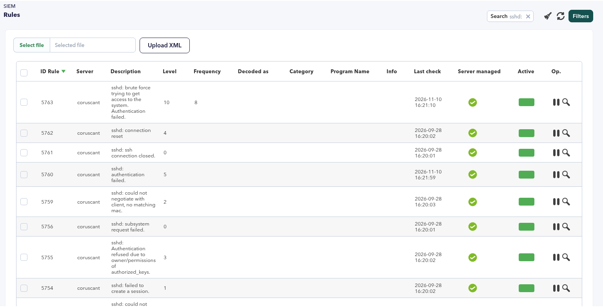{ .captura }

Les colonnes sont **ID Rule**, **Server**, **Description**, **Level**,
**Frequency**, **Decoded as**, **Category**, **Program Name**, **Info**, **Last
check**, **Server managed**, **Active** et **Op.**

Deux différences par rapport aux *decoders* :

- Les *rules* ont un **ID** et **conservent donc leur état désactivé** d'un
  redémarrage à l'autre.
- Elles distinguent **Active** et **Enabled**. *Active* est déterminé par le
  serveur : la *rule* a pu être lue depuis le XML lors du dernier démarrage.
  *Enabled* est décidé par l'administrateur. **Pour qu'une *rule* soit évaluée,
  elle doit être à la fois active et activée.**

Le formulaire **New rule** comprend l'ID, la description, le niveau,
**Overwrite**, **Decoded as**, **Category**, **Program name**, les conditions
**Regex** (avec **Negate**) et **Field**, **Frequency**, **Timeframe**,
**Ignore**, **If matched SID**, **If matched group**, **If SID**, **If group**,
**If level**, **Same ID**, **Different ID**, **Same field** et **Different
field**. Pour `time`, `weekday`, `info`, `mitre`, `group`, `maxsize` ou
`if_fts`, rédigez le XML et importez-le avec **Upload XML**.

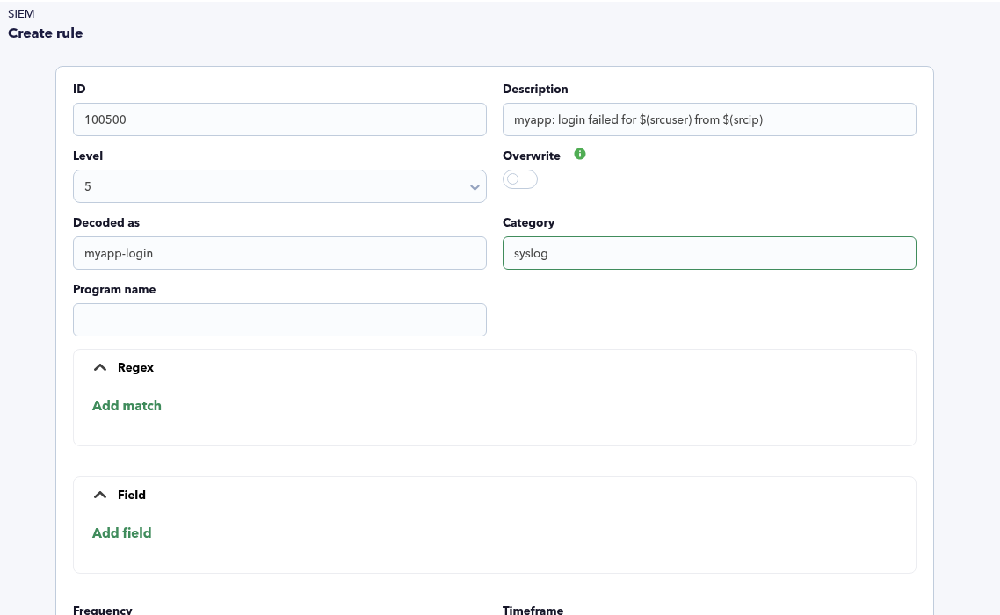{ .captura }

!!! info "Une rule de la console prime sur une rule de fichier ayant le même ID"
    Si une *rule* est créée depuis la console avec le même ID qu'une *rule*
    issue d'un fichier, au démarrage suivant le master conserve celle de la
    console et ignore celle du fichier. Cela permet de remplacer une *rule*
    fournie sans modifier ses fichiers.

!!! warning "L'ordre des ID compte"
    Les *rules* sont évaluées dans l'**ordre numérique croissant**. Si une
    *rule* dépend du résultat d'une autre (avec `if_sid`, par exemple), celle
    dont elle dépend doit avoir un **ID inférieur**. Sinon, au moment où la
    *rule* dépendante interroge l'autre, celle-ci n'a pas encore été évaluée.
    Voir [Ordre d'évaluation](#ordre-devaluation).

### Classification

Chaque *rule* a un niveau compris entre `0` et `15` :

| Niveau | Titre | Description |
|---|---|---|
| 0 | Ignoré | Ne génère aucun événement. Sert à éviter les faux positifs et à regrouper des *rules* : celles-ci sont évaluées avant toutes les autres. |
| 1 | Non classé | Génère un événement informatif. Surtout utilisé par des *rules* de regroupement qui ne doivent pas ressortir. |
| 2 | Notification système de faible priorité | Notifications système ou messages d'état, sans intérêt pour la sécurité. |
| 3 | Événements réussis ou autorisés | Connexions réussies, trafic autorisé par le pare-feu, etc. |
| 4 | Erreur système de faible priorité | Mauvaises configurations ou équipements et applications non utilisés. Sans intérêt pour la sécurité ; généralement dues à des installations par défaut ou à des tests. |
| 5 | Erreur générée par l'utilisateur | Mots de passe oubliés, actions refusées. Sans intérêt pour la sécurité pris isolément. |
| 6 | Attaque de faible importance | Vers ou virus sans effet sur le système, événements IDS fréquents et erreurs fréquentes. |
| 7 | Correspondance de « mots suspects » | Mots tels que « error » ou « bad ». Pour la plupart non classés ; ils peuvent avoir une certaine importance. |
| 8 | Vu pour la première fois | Premier déclenchement d'un événement IDS ou première connexion d'un utilisateur. Également des actions sensibles, comme l'activation d'un *sniffer*. |
| 9 | Erreur de source non valide | Tentatives de connexion avec un utilisateur inconnu ou depuis une source non valide, et erreurs liées au compte d'administration (*root*). Importantes si elles se répètent. |
| 10 | Erreurs multiples générées par l'utilisateur | Plusieurs mots de passe erronés, plusieurs échecs de connexion. Peut indiquer une attaque ou un utilisateur ayant oublié ses identifiants. |
| 11 | Avertissement d'intégrité | Binaires modifiés ou *rootkits* détectés. Peut indiquer une attaque réussie. Également des événements IDS qui seront ignorés en raison de leur répétition. |
| 12 | Événement de haute importance | Erreurs ou avertissements du système, du *kernel*… Peuvent indiquer une attaque contre une application précise. |
| 13 | Erreur inhabituelle de haute importance | Correspond la plupart du temps à un schéma d'attaque courant. |
| 14 | Événement de sécurité de haute importance | Généralement déclenché par corrélation, il indique une attaque. |
| 15 | Attaque grave | Aucun risque de faux positif. Exige une attention immédiate. |

Le niveau détermine la **sévérité** affichée dans la console :

| Sévérité | Niveaux |
|---|---|
| **Informational** | 0 à 6 |
| **Normal** | 7 et 8 |
| **Warning** | 9 à 11 |
| **Critical** | 12 à 15 |

### Syntaxe

```xml
<var name="VarName">VarValue</var>

<group name="GROUP1,GROUP2,">
    <rule id="N" level="N" frequency="N" timeframe="N" ignore="N" overwrite="yes|no" maxsize="N">
        <if_matched_sid>N</if_matched_sid>
        <if_matched_group>GROUP</if_matched_group>
        <same_id />
        <different_id />
        <same_field>Field1</same_field>
        <same_field>Field2.Sub1</same_field>
        <different_field>Field1</different_field>
        <different_field>Field2.Sub1</different_field>
        <description>TEXT</description>
        <match type="pcre2">REGEXP</match>
        <match negate="yes|no">REGEXP</match>
        <regex type="pcre2">REGEXP</regex>
        <regex negate="yes|no">REGEXP</regex>
        <decoded_as>DecoderName</decoded_as>
        <category>EventType</category>
        <field name="Field1">REGEXP</field>
        <field name="Field2.Sub1" negate="yes|no">REGEXP</field>
        <program_name negate="yes|no">REGEXP</program_name>
        <time>TIME-RANGE</time>
        <weekday>DAYS</weekday>
        <if_sid>PARENT1, PARENT2</if_sid>
        <if_group>GROUP</if_group>
        <if_level>N</if_level>
        <if_fts />
        <info type="text|link|cve">TEXT|LINK|CVE</info>
        <group>GROUP1,GROUP2,</group>
        <mitre>
            <id>MITRE_ID</id>
            <id>MITRE_ID</id>
        </mitre>
    </rule>
</group>
```

Attributs de `rule` :

| Attribut | Rôle |
|---|---|
| `id` | Identifiant. Doit être unique, sauf si une autre *rule* est remplacée. |
| `level` | Niveau de l'événement (`0` à `15`). Avec `0`, aucun événement n'est généré, mais la *rule* reste prise en compte par celles qui en dépendent. |
| `frequency` | Nombre de correspondances nécessaires pour générer l'événement. Compté par agent, et non sur l'ensemble des *logs*. |
| `timeframe` | Fenêtre, en secondes, dans laquelle ces correspondances doivent se produire. |
| `ignore` | Secondes au bout desquelles la *rule* réinitialise ses compteurs de `frequency`. |
| `overwrite` | Avec `yes`, remplace la configuration de la *rule* ayant le même ID. Avec `overwrite="yes"` et `level="0"`, la *rule* est évaluée avant toutes les autres et, si elle correspond, exclut le *log* pour toutes les autres. |
| `maxsize` | La *rule* n'est satisfaite que si le *log* dépasse ce nombre de caractères. Sert à détecter des messages anormaux par leur taille. |
| `noalert` | Accepté pour la compatibilité avec Wazuh, sans effet : la *rule* génère son événement quand même. |

Éléments :

| Élément | La *rule* est satisfaite si… |
|---|---|
| `var` | (Définit une variable, comme dans les *decoders*.) |
| `group` | (Regroupe des *rules* ; le nom du groupe sert aussi de condition dans d'autres *rules*.) |
| `if_matched_sid` | La *rule* ayant cet ID a correspondu `frequency` fois dans `timeframe`. |
| `if_matched_group` | Comme `if_matched_sid`, mais pour un groupe. |
| `same_id` / `different_id` | Les correspondances ont le même ID / un ID différent. |
| `same_field` / `different_field` | Les correspondances ont la même valeur / une valeur différente dans ce champ. |
| `description` | (Texte de l'événement. Accepte des marqueurs avec les champs du *log* ; voir l'avertissement ci-dessous.) |
| `match` / `regex` | Le contenu du *log* correspond à l'expression. `type="pcre2"` utilise PCRE2 (OS Regex par défaut) et `negate="yes"` inverse la correspondance. |
| `decoded_as` | Le *log* a été normalisé par le *decoder* indiqué. |
| `category` | Le type du *decoder* correspond. |
| `field` | Le champ indiqué correspond à l'expression. Accepte `negate`. |
| `program_name` | L'origine du *log* correspond. Accepte `negate`. |
| `time` | L'événement se produit dans cette plage horaire. |
| `weekday` | L'événement se produit ces jours-là : `monday` à `sunday`, `weekdays` ou `weekends`. |
| `if_sid` | L'une des *rules* parentes de la liste est satisfaite. |
| `if_group` | Le *log* satisfait une autre *rule* du groupe indiqué. |
| `if_level` | Une autre *rule* de ce même niveau a été satisfaite. |
| `if_fts` | La combinaison de champs du `fts` du *decoder* n'avait jamais été vue (*first time seen*). |
| `info` | (Informations complémentaires de l'événement. `type` vaut `text`, `link` ou `cve`.) |
| `group` | (Liste des groupes de la *rule* ; ils apparaissent dans l'onglet **SIEM groups**.) |
| `mitre` | (Liste des techniques MITRE ATT&CK®, une par `<id>`.) |

!!! warning "Marqueurs `$(Champ)` : uniquement dans description et uniquement avec des noms simples"
    Dans `description`, il est possible d'utiliser les champs du *log*
    normalisé, comme `$(srcuser)` ou `$(object_target)`. Deux limites : le nom
    n'accepte que des lettres, des chiffres et le tiret bas, donc un champ
    imbriqué comme `$(Field2.Sub1)` apparaît tel quel ; et rien n'est remplacé
    dans `info`.

### Cas d'étude : SELinux et PHP

Cette *rule*, fournie avec Pandora FMS, génère un événement lorsque SELinux
empêche PHP d'ouvrir une connexion vers un port qui ne fait pas partie des ports
habituels d'un serveur web :

```xml
<rule id="100201" level="6">
    <decoded_as>setroubleshoot_program</decoded_as>
    <match>/usr/sbin/php-fpm</match>
    <field name="object_target" type="pcre2">^(?!.*\b(9200|3306|80|443)$).*$</field>
    <field name="object_target" type="pcre2">^(?!.*(directory|file) (conf|data_in|cron.lock)).*$</field>
    <description>SELinux prevented /usr/sbin/php-fpm execution on: $(action) access on the $(object_target)</description>
    <mitre>
        <id>T1071.002</id>
    </mitre>
    <group>exec,threat,PHP</group>
</rule>
```

Les connexions aux ports `9200`, `3306`, `80` et `443` ne génèrent pas
d'événement. Les accès aux fichiers ou dossiers de configuration, à `data_in` et
à `cron.lock` non plus. La description utilise deux champs extraits par le
*decoder*.

Les *decoders* qui l'alimentent :

```xml
<decoder name="setroubleshoot">
    <program_name>^setroubleshoot$</program_name>
</decoder>

<decoder name="setroubleshoot_program">
    <parent>setroubleshoot</parent>
    <prematch type="pcre2">(SELinux is preventing|SELinux está negando a)</prematch>
    <regex type="pcre2">(\S+) (?:from|de) (\S+) (?:access on the|el acceso a) (.+?)\. (?:For complete SELinux messages run: sealert -l|Si quiere los mensajes de SELinux completos, ejecute sealert -l) (\S+)$</regex>
    <order>binary,action,object_target,sealert_id</order>
</decoder>

<decoder name="setroubleshoot_program">
    <parent>setroubleshoot</parent>
    <prematch type="pcre2">failed to retrieve rpm info for path</prematch>
    <regex type="pcre2">failed to retrieve rpm info for path (\S+)</regex>
    <order>path</order>
</decoder>
```

Deux *decoders* portent le même nom : ils sont tous deux évalués, et chacun
reconnaît un message différent de `setroubleshoot`.

### Ordre d'évaluation

Voici maintenant le cas inverse : une chaîne de *rules* qui ne fonctionne pas,
et pourquoi. Les *rules* de cet exemple détectent les échecs de connexion sur un
pare-feu FortiGate. Elles sont illustratives : les *rules* FortiGate fournies
aujourd'hui avec Pandora FMS sont numérotées autrement.

```xml
<rule id="81641" level="1">
    <decoded_as>fortigate-firewall-v6</decoded_as>
    <description>Fortigate v6 messages grouped.</description>
</rule>
```

La *rule* 81641 correspond au *log* décodé et démarre la chaîne.

```xml
<rule id="81603" level="0">
    <if_sid>81600,81601,81602,81641</if_sid>
    <description>Fortigate messages grouped.</description>
</rule>
```

La *rule* 81603 dépend de plusieurs *rules*, dont la 81641. Mais 81641 est
**supérieur** à 81603 : au moment où la 81603 est évaluée, la 81641 ne l'a pas
encore été, donc **la 81603 n'est jamais satisfaite**.

```xml
<rule id="81614" level="4">
    <if_sid>81603</if_sid>
    <match>ssl-login-fail</match>
    <description>Fortigate: SSL VPN user failed login attempt.</description>
    <group>authentication_failed,gdpr_IV_32.2,gdpr_IV_35.7.d,gpg13_7.1,hipaa_164.312.b,invalid_login,nist_800_53_AC.7,nist_800_53_AU.14,pci_dss_10.2.4,pci_dss_10.2.5,tsc_CC6.1,tsc_CC6.8,tsc_CC7.2,tsc_CC7.3,</group>
</rule>
```

La *rule* 81614 dépend de la 81603. Son ID est supérieur : elle est donc évaluée
après, comme il se doit. Et une *rule* personnalisée, la 100700, dépend à son
tour de la 81614.

Résultat : la 100700 n'est jamais satisfaite. Ni elle ni la 81614 ne sont en
cause : la chaîne s'est rompue à la 81603, qui n'a jamais pu être satisfaite à
cause de l'ordre des ID. La solution consiste à renuméroter les *rules* pour que
chacune ait un ID supérieur à toutes celles dont elle dépend.

## Expressions régulières

Les *decoders* et les *rules* acceptent deux moteurs : **OS Regex**, celui par
défaut, et **PCRE2**, activé avec `type="pcre2"`. En pratique : utilisez OS
Regex pour les cas simples, plus rapides à écrire, et passez à PCRE2 dès qu'il
faut une alternance dans un groupe, une recherche en avant ou en arrière, ou des
quantificateurs non gourmands.

### OS Regex

Un moteur simple, écrit en C, conçu pour couvrir les expressions les plus
courantes.

| Expression | Correspond à |
|---|---|
| `\w` | `A-Z`, `a-z`, `0-9`, `-`, `@` et `_` |
| `\d` | `0-9` |
| `\s` | Espace ASCII (code 32) |
| `\t` | Tabulation |
| `\p` | ``()*+,-.:;<=>?[]!"'#$%&|{}`` |
| `\W` | Tout ce qui n'est pas `\w` |
| `\D` | Tout ce qui n'est pas `\d` |
| `\S` | Tout ce qui n'est pas `\s` |
| `\.` | N'importe quel caractère |

| Modificateur | Comportement |
|---|---|
| `+` | Une ou plusieurs fois |
| `*` | Zéro ou plusieurs fois |

| Caractère spécial | Comportement |
|---|---|
| `^` | Début du texte |
| `$` | Fin du texte |
| `|` | « Ou » logique entre plusieurs motifs |

Pour utiliser ces caractères littéralement, ils s'échappent avec `\` :

| Caractère | `$` | `(` | `)` | `\` | `|` | `<` |
|---|---|---|---|---|---|---|
| Échappé | `\$` | `\(` | `\)` | `\\` | `\|` | `\<` |

!!! warning "Les limites d'OS Regex"
    - `*` et `+` ne s'appliquent qu'aux expressions avec barre oblique inverse :
      `\d+` est valide, `0+` ne l'est pas.
    - Pas d'alternance dans un groupe : `(foo|bar)` n'est pas autorisé.
    - Pas de retour arrière complexe : `\p*\d*\s*\w*:` ne correspond pas à un
      simple deux-points, car `\p*` le consomme.
    - `.` correspond à un point littéral, et `\.` à n'importe quel caractère
      (l'inverse de l'usage habituel).
    - `\s` ne correspond qu'à l'espace ASCII (32), pas aux tabulations ni aux
      autres espaces.
    - Aucune syntaxe ne permet de rechercher littéralement un accent
      circonflexe, un astérisque ou un signe plus (même si `\p` correspond à
      l'astérisque et au signe plus, entre autres).

### PCRE2

*Perl Compatible Regular Expressions* (PCRE2) ajoute les motifs récursifs, les
assertions avant et arrière, les groupes non capturants, les quantificateurs
non gourmands et des classes de caractères étendues, entre autres. La référence
complète se trouve dans la
[documentation de la syntaxe PCRE2](https://www.pcre.org/current/doc/html/pcre2syntax.html).

| Expression | Correspond à |
|---|---|
| `.` | N'importe quel caractère sauf le saut de ligne |
| `\d` | N'importe quel chiffre décimal (`[0-9]`) |
| `\D` | N'importe quel caractère qui n'est pas un chiffre décimal (`[^0-9]`) |
| `\h` | N'importe quel espace horizontal |
| `\H` | N'importe quel caractère qui n'est pas un espace horizontal |
| `\s` | N'importe quel espace (`[\t\r\n\f]`) |
| `\S` | N'importe quel caractère qui n'est pas un espace (`[^\t\r\n\f]`) |
| `\w` | N'importe quel caractère de « mot » |
| `\W` | N'importe quel caractère qui n'est pas un caractère de « mot » |

| Modificateur | Comportement |
|---|---|
| `?` | 0 ou 1, gourmand |
| `?+` | 0 ou 1, possessif |
| `??` | 0 ou 1, paresseux |
| `*` | 0 ou plus, gourmand |
| `*+` | 0 ou plus, possessif |
| `*?` | 0 ou plus, paresseux |
| `+` | 1 ou plus, gourmand |
| `++` | 1 ou plus, possessif |
| `+?` | 1 ou plus, paresseux |
| `{n}` | Exactement n |
| `{n,m}` | Au moins n et au plus m, gourmand |
| `{n,m}+` | Au moins n et au plus m, possessif |
| `{n,m}?` | Au moins n et au plus m, paresseux |
| `{n,}` | n ou plus, gourmand |
| `{n,}+` | n ou plus, possessif |
| `{n,}?` | n ou plus, paresseux |

| Échappement | Caractère |
|---|---|
| `\f` | Saut de page (hexadécimal `0C`) |
| `\n` | Nouvelle ligne (hexadécimal `0A`) |
| `\r` | Retour chariot (hexadécimal `0D`) |
| `\t` | Tabulation (hexadécimal `09`) |
| `\0dd` | Caractère de code octal `0dd` |
| `\o{ddd..}` | Caractère de code octal `ddd..` |
| `\xhh` | Caractère de code hexadécimal `hh` |
| `\x{hhh..}` | Caractère de code hexadécimal `hhh..` |

## Alertes SIEM

Les événements SIEM ne déclenchent pas les alertes de module ni les alertes
d'événements de la [Partie 5](../parte-5/5.5-alertas-y-notificaciones.md) : ils
ont leurs propres alertes. Celles-ci se gèrent dans **Management → Alerts → SIEM
Alerts** (administrateur ou autorisation **LW**) et réutilisent les mêmes
**actions** que les autres alertes : courriel, Slack, Teams, Telegram, une
commande…

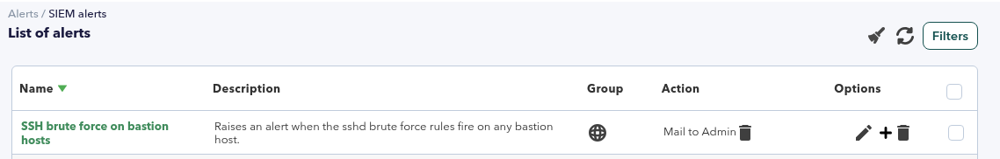{ .captura }

**Create** ouvre un assistant en cinq étapes. L'alerte est enregistrée dès la
première étape franchie, et **Back** permet de revenir en arrière :

1. **Configure** : **Alert name**, **Group**, **Description** et **Severity**.
   La sévérité est la priorité de l'alerte Pandora FMS (celle de l'événement et
   des macros qu'elle génère), et non celle de l'événement SIEM.
2. **Conditions** : modèle de départ (**Load from template**), calendrier
   (**Use special days list** et la vue **Simple** ou **Detailed** par jours et
   heures), nombre minimal et maximal d'alertes (**From** / **To**), seuil de
   temps (**Threshold**) et **Disable event** pour ne pas créer d'événement
   Pandora FMS lors du déclenchement.
3. **Filters** : les événements SIEM pris en compte. **Free search**, **Group**
   (avec **Group recursion**), **SIEM group**, **Event description**,
   **Severity**, **Level**, **ID Rule**, **Type**, **Mitre**, **Agent**,
   **Decoder**, ainsi que les exclusions **Excluded agents** et **Exclude
   Rules**.
4. **Fields** : les champs **Field 1** à **Field 10** transmis aux actions, en
   mode **Basic** ou **Advanced**, ou chargés depuis un modèle.
5. **Triggering** : récapitulatif de la condition de déclenchement et des
   actions. Chaque action s'ajoute avec **Add**, avec sa propre plage **From** /
   **To** et son **Threshold**. **Finish** termine l'assistant.

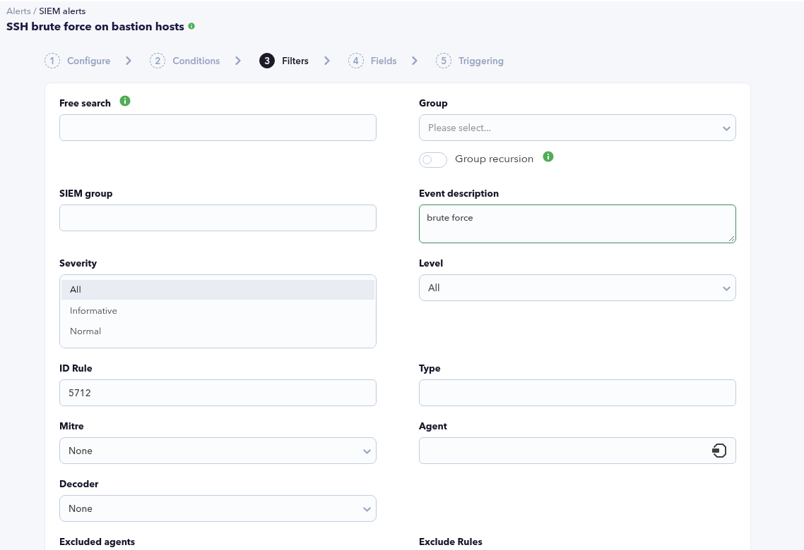{ .captura }

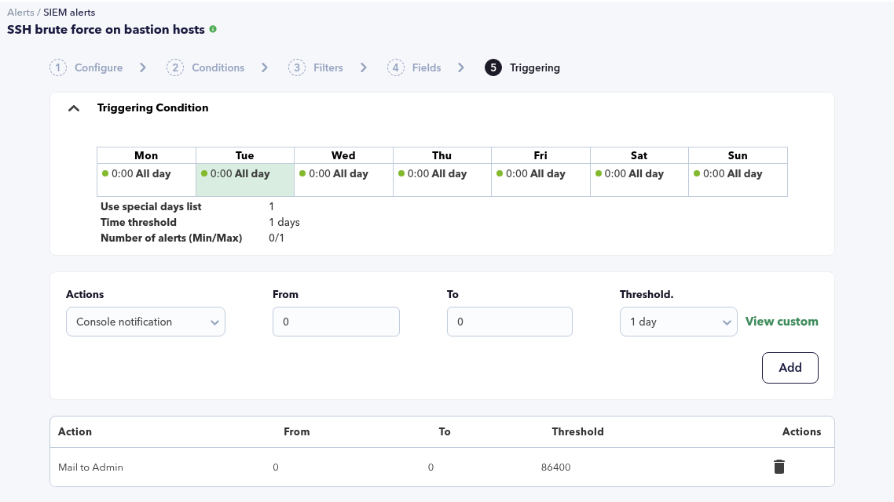{ .captura }

Dans les champs et les actions, en plus des macros habituelles, quatre macros
sont propres au SIEM :

| Macro | Valeur |
|---|---|
| `_event_description_` | Description de l'événement SIEM. |
| `_siem_event_level_` | Niveau (`0` à `15`) de l'événement SIEM. |
| `_event_text_severity_` | Sévérité de l'événement, sous forme de texte. |
| `_group_contact_` | Contact du groupe de l'événement. |

Dans **Operation → SIEM → Alerts**, la liste d'exploitation indique combien de
fois chaque alerte a correspondu (**Matched**) et combien de fois elle s'est
déclenchée (**Triggered**), et permet de la mettre en attente, de l'activer ou
de la désactiver, d'exécuter son action manuellement et de la valider. Le moteur
d'alertes et les actions sont décrits dans
[Alertes et notifications](../parte-5/5.5-alertas-y-notificaciones.md).

## Rapports et tableaux de bord

Pour les [rapports](../parte-5/5.2-informes.md), trois éléments sont
disponibles dans le groupe **SIEM** de l'éditeur de rapports :

| Élément | Contenu |
|---|---|
| **Events list** | La liste des événements SIEM des dernières heures (24 par défaut), avec son propre filtre. |
| **Events graph** | Un graphique des événements par groupes et agents, regroupés selon le champ choisi, en mode simple ou évolution. |
| **Statistics** | Des statistiques d'événements SIEM par groupes et agents. |

Pour les [tableaux de bord](../parte-5/5.1-dashboards.md), trois *widgets* sont
disponibles :

| *Widget* | Contenu |
|---|---|
| **SIEM metrics** | Indicateurs du moteur : *logs* traités, *logs* par seconde (dernière heure et dernier jour), événements traités, événements par seconde (8 heures et dernier jour), *decoders* actifs et *rules* actives. |
| **SIEM statistics** | Statistiques des événements des dernières heures (24 par défaut). |
| **SIEM Top N Events** | Les N événements les plus fréquents (10 par défaut), en mode simple (secteurs, barres ou tableau) ou évolution (lignes, aires ou barres empilées). |

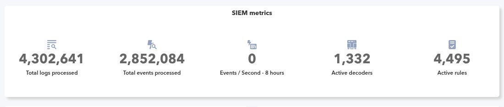{ .captura }

Un *widget* sert à surveiller en temps réel ; un rapport, à rendre compte de ce
qui s'est passé (et à l'envoyer par courriel chaque lundi).

## Exploitation et dépannage

Lorsqu'aucun événement n'apparaît, le plus rapide est de parcourir la chaîne
dans l'ordre, de la licence à l'horloge. Elle se rompt presque toujours dans les
trois premières étapes.

1. **Licence et fonctions expérimentales.** Sans licence Pandora SIEM, pas de serveur ;
   sans **Show experimental features**, pas de menu.
2. **SIEM activé et OpenSearch accessible.** **Activate SIEM** activé et
   l'indicateur du formulaire sur **OpenSearch is running**.
3. **Collecteur de *logs* activé.** Sans lui, il n'y a rien à analyser. Vérifiez
   aussi que les *logs* arrivent dans la visionneuse de la
   [collecte de logs](../parte-2/2.19-recoleccion-y-monitorizacion-de-logs.md).
4. **`siemserver` et `siemevents` démarrés.** Avec leurs tokens à `1` et le
   serveur redémarré. Les erreurs sont écrites dans
   `/var/log/pandora/pandora_server.log`.
5. **Type du *log*.** Les *decoders* avec `<type>` ne s'appliquent que si leur
   expression correspond au `module_source_type` du *log*. Si aucun ne
   correspond et qu'aucun *decoder* sans `<type>` ne le prend en charge, le
   *log* est stocké mais non normalisé. Si le problème se situe dans
   OpenSearch, vérifiez aussi le modèle du collecteur (`pandorafms*`) : c'est le
   `siemserver` lui-même qui le maintient, en y ajoutant les champs `processed`
   et `metadata` et le *pipeline* `add_queue_timestamp`.
6. ***Decoder* ou *rule* désactivés.** Un *decoder* désactivé, ou une *rule*
   qui n'est pas **Active** (elle n'a pas pu être lue) ou pas **Enabled**.
7. **Rétention et fenêtre.** Un `siem_max_timeframe` plus court que la durée
   d'arrêt du serveur, ou un index déjà purgé.
8. **Horloge.** Les index sont quotidiens, et `frequency` et `timeframe` sont
   mesurés en secondes. Un serveur à l'heure incorrecte fausse la corrélation.

!!! tip "Testez avec un log qui doit forcément déclencher un événement"
    Une tentative de connexion SSH avec un utilisateur inexistant génère, dès
    qu'elle est normalisée, un événement **sshd: Attempt to login using a
    non-existent user** (*rule* 5710, niveau 5) avec ses techniques
    MITRE ATT&CK®. Si cet événement apparaît dans **Operation → SIEM →
    Events**, la chaîne fonctionne et le problème se situe dans votre *decoder*
    ou votre *rule*.

Pour surveiller le SIEM lui-même, le *widget* **SIEM metrics** sert de
thermomètre : si le nombre de *logs* traités n'augmente pas, le `siemserver` est
arrêté ou ne reçoit rien ; si les *logs* augmentent mais pas les événements,
examinez les *rules*.
