# SOAR

Détecter une attaque à trois heures du matin ne sert pas à grand-chose si
personne ne la lit avant neuf heures. Le [SIEM](7.2-siem.md) transforme déjà
quarante tentatives de mot de passe échouées en un événement qui indique
« brute force from 198.51.100.77 » ; il reste à agir, sans qu'une personne ait
besoin d'être éveillée. C'est le rôle du **SOAR** (*Security Orchestration,
Automation and Response*) : **orchestrer** les outils déjà en place,
**automatiser** les tâches répétitives de réponse et **répondre** à un incident
en quelques secondes, et non au moment où quelqu'un ouvre sa messagerie.

Dans cette partie, le SIEM détecte et ce chapitre répond. Le volet technique des
alertes (commandes, actions, modèles, escalade et macros) se trouve dans
[Alertes et notifications](../parte-5/5.5-alertas-y-notificaciones.md) ; ce
chapitre explique comment les enchaîner pour répondre à un incident de sécurité,
avec trois exemples complets testés de bout en bout.

!!! warning "Pandora FMS n'a pas de « module SOAR »"
    Inutile de chercher un menu SOAR : il n'existe ni dans la console ni dans le
    code. Dans Pandora FMS, le SOAR est une chaîne d'éléments déjà présents : un
    **événement SIEM** déclenche une **alerte SIEM**, et l'alerte exécute des
    **actions** (un *script* du RMM sur l'EndPoint attaqué, une commande vers
    l'API d'un pare-feu, un ticket dans Pandora ITSM, une notification
    Telegram). Il n'y a rien de nouveau à installer ; en contrepartie, le
    *playbook* est à concevoir par l'administrateur.

## Utilité

Une réponse automatique bien construite permet de :

- **Contenir** : bloquer l'IP d'une attaque par force brute sur l'EndPoint
  lui-même ou sur le pare-feu périmétrique, avec une expiration pour que le
  blocage ne reste pas en place indéfiniment.
- **Remédier sur l'EndPoint** : arrêter un service, terminer un processus ou
  collecter des preuves avec un *script* du RMM.
- **Enregistrer et suivre** : ouvrir un ticket dans Pandora ITSM avec le contexte
  de l'événement, afin que l'incident ait un responsable.
- **Prévenir les bonnes personnes** : Telegram, e-mail, Microsoft Teams ou une
  notification dans la console, selon la gravité et l'horaire.

Il faut aussi savoir dès le départ ce que cette chaîne **ne fait pas**, car cela
change la conception :

- Il n'y a ni éditeur visuel de *playbooks* ni étape d'approbation humaine dans
  l'alerte. Ce qui est automatisé et ce qui ne l'est pas se décide lors de la
  configuration.
- Les alertes SIEM n'ont **pas de récupération**. Si une action bloque une IP,
  rien ne la débloque à la fin de l'attaque : le retour arrière se conçoit dans
  l'action elle-même (un blocage avec expiration).
- Les champs extraits par le *decoder* (`srcip`, `srcuser`, `dstport`…) **ne
  parviennent pas à l'action sous forme de macros**. Il existe une méthode
  propre pour les transmettre, décrite dans
  [Les données de l'événement dans la réponse](#les-donnees-de-levenement-dans-la-reponse).

## Fonctionnement

La chaîne complète, du *log* à la réponse :

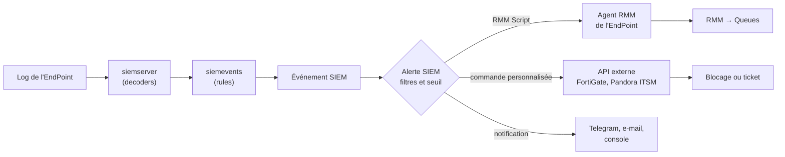

Trois points du parcours comptent pour concevoir la réponse :

1. **Les alertes SIEM sont évaluées à chaque événement SIEM**, au moment où le
   serveur le génère, et non selon une minuterie. Si l'événement correspond aux
   filtres de l'alerte et que le nombre maximal de déclenchements n'est pas
   atteint, les actions s'exécutent immédiatement.
2. **L'événement est associé à un agent de Pandora FMS par son nom.** Le serveur
   recherche l'agent dont le nom correspond à celui de l'événement. Cet agent
   est le « où » de la réponse : les macros d'agent (`_agent_`, `_address_`) en
   proviennent et l'action **RMM Script** vise son agent RMM.
3. **Chaque action s'exécute à un endroit différent.** Les commandes d'alerte
   s'exécutent sur le **serveur de Pandora FMS** ; l'action **RMM Script**
   n'exécute rien sur le serveur : elle **met en file** le *script* pour l'agent
   RMM de l'EndPoint, qui le récupère et l'exécute sur place.

## Prérequis

Chaque flux n'a besoin que des lignes correspondant aux actions utilisées :

| Exigence | Détail |
|---|---|
| Pandora SIEM opérationnel | Licence Pandora SIEM, SIEM activé dans la console web et sur le serveur, et *rules* qui génèrent les événements utiles. Voir [SIEM](7.2-siem.md). |
| Fonctions expérimentales | Le menu des alertes SIEM n'apparaît qu'avec **Show experimental features** activé, comme le reste du SIEM. |
| Autorisations | **LW**, **LM** ou **AD** pour gérer les alertes SIEM ; **LM** pour créer des actions. Voir [Alertes SIEM](../parte-5/5.5-alertas-y-notificaciones.md#alertes-siem). |
| Pour **RMM Script** | Licence **Pandora RMM** ; **serveur RMM activé** sur le serveur de Pandora FMS (`rmmserver 1` ; valeur par défaut `0`) ; agent RMM activé sur l'EndPoint, avec le **même nom** que son agent de Pandora FMS ; *script* enregistré dans **RMM → Scripts**. |
| Pour un ticket dans **Pandora ITSM** | Intégration activée dans **Settings → System Settings → ITSM** (URL de l'API et *token*) et *token* de l'API de Pandora ITSM pour la commande qui crée le ticket. |
| Pour **Pandora Telegram** | *Token* du bot dans la configuration générale de la console (utilisé par la macro `_telegramtoken_`) et ID du chat de destination. |
| Pour bloquer sur **FortiGate** | Accès HTTPS du serveur de Pandora FMS vers la FortiGate et *token* de son API REST, stocké dans un fichier du serveur. |

Le serveur RMM s'active dans `/etc/pandora/pandora_server.conf` ; le répertoire
de travail par défaut existe déjà dans une installation standard :

```ini
rmmserver 1
rmmdir /var/spool/pandora/rmm_server
```

L'agent RMM s'active dans le `pandora_agent.conf` de l'EndPoint (Linux,
MS Windows ou EndPoint Go), en pointant vers le serveur de Pandora FMS :

```ini
rmm_enabled 1
rmm_server 192.168.50.10
rmm_port 41123
```

Redémarrez ensuite les deux services.

## Les composants

### Détection : rules et événements SIEM

La réponse commence par la *rule*. Si la *rule* est bruyante, la réponse
automatique multiplie le bruit : avant d'automatiser quoi que ce soit, vérifiez
dans **Operation → SIEM → Events** que l'événement se déclenche quand il le faut
et seulement dans ce cas. Niveau, groupes, techniques MITRE et *decoders* sont
décrits dans [Rules](7.2-siem.md#rules).

Une technique mérite d'être connue tôt : une ***rule* fille** de celle qui
détecte déjà l'attaque, avec la donnée utile dans sa description. Les marqueurs
`$(Champ)` de la description sont remplacés par la valeur du champ décodé : une
description comme `sshd: brute force from $(srcip)` parvient à l'alerte sous la
forme `sshd: brute force from 198.51.100.77`. C'est ainsi que l'IP arrive à
l'action.

### Décision : alertes SIEM

L'alerte SIEM correspond au « si ceci se produit, faire cela ». Ses filtres sont
ceux de la vue des événements SIEM (recherche libre, groupe, groupe SIEM,
description, gravité, niveau, ID de la *rule*, type, MITRE, *decoder* et agent,
plus les exclusions d'agents et de *rules*), et ses conditions fixent l'horaire,
le seuil et les nombres minimal et maximal de déclenchements. Tous les détails
se trouvent dans [Alertes SIEM](../parte-5/5.5-alertas-y-notificaciones.md#alertes-siem).

Pour répondre, le filtre le plus utile est **ID Rule** : une *rule*, une réponse.

!!! info "Le seuil et le maximum comptent par alerte, pas par IP"
    Le seuil temporel et le nombre maximal de déclenchements s'appliquent à
    l'alerte entière. Si une alerte de blocage a un maximum de 1 en 24 heures,
    elle bloque le premier attaquant de la journée et laisse passer le second.
    Pour les alertes de confinement, utilisez un seuil court (5 minutes) et un
    maximum élevé (10, par exemple) ; pour les alertes de notification,
    l'inverse, afin de ne pas saturer le canal.

### Actions de réponse

Les commandes d'alerte les plus utiles comme réponse, regroupées par fonction :

| Fonction | Commandes | Notes |
|---|---|---|
| Notifier | eMail, Pandora Telegram, Pandora MS Teams, Pandora Slack, Pandora Google chat, Console notification, Generate Notification | Le message contient les données de l'événement grâce aux [macros](#les-donnees-de-levenement-dans-la-reponse). |
| Enregistrer | Monitoring Event, Internal Audit | **Monitoring Event** crée un événement de Pandora FMS à partir de l'événement SIEM. |
| Ouvrir un ticket | Commande personnalisée vers l'API de Pandora ITSM | Voir l'[exemple 2](#exemple-2-attaque-web-reussie-ticket-dans-pandora-itsm). |
| Agir sur l'EndPoint | RMM Script | Nécessite le serveur RMM activé. |
| Agir sur l'EndPoint | Remote agent control | Envoie un ordre en UDP à l'EndPoint (port 41122), dont le serveur UDP doit être activé. |
| Agir hors de Pandora FMS | Commandes personnalisées | Un *script* ou un programme du serveur, avec des macros dans ses champs. Voir l'[exemple 3](#exemple-3-blocage-sur-le-pare-feu-perimetrique-fortigate). |

Une **commande personnalisée** se crée dans **Management → Alerts → Commands** :
c'est une ligne de commande du serveur avec les champs `_field1_` à `_field10_`,
que l'action renseigne. C'est l'élément le plus souple : il ouvre les tickets
dans Pandora ITSM et appelle n'importe quelle API externe, comme dans les
exemples [2](#exemple-2-attaque-web-reussie-ticket-dans-pandora-itsm) et
[3](#exemple-3-blocage-sur-le-pare-feu-perimetrique-fortigate).

### Les données de l'événement dans la réponse

L'action reçoit les données de l'événement sous forme de macros. Voici celles
propres aux alertes SIEM :

| Macro | Contenu |
|---|---|
| `_event_description_` | La description de l'événement, avec les marqueurs `$(Champ)` de la *rule* déjà remplacés. |
| `_siem_event_level_` | Le niveau de la *rule* qui a déclenché l'événement (de 0 à 15). |
| `_event_text_severity_` | La gravité de l'événement en texte, par exemple *Informational*. |
| `_eventTimestamp_` | La date de l'événement en UTC, par exemple `2026-11-12T08:38:43Z`. |
| `_logSource_` | L'origine du *log*, par exemple `/var/log/httpd/access_log`. |
| `_logTimestamp_` | La date du *log*, à l'heure locale du serveur (`2026-11-12 09:38:43`). |
| `_group_contact_` | Le contact du groupe de l'événement, tel qu'il figure dans la fiche du groupe. |

Comme l'événement est associé à un agent, les macros d'agent fonctionnent aussi
(`_agent_`, `_address_`, `_id_agent_`…), ainsi que `_data_`, qui contient le
texte du *log* d'origine. Les autres macros d'alerte sont décrites dans
[Macros d'alerte](../parte-5/5.5-alertas-y-notificaciones.md#macros-dalerte).

!!! info "Les champs décodés ne sont pas des macros : utilisez la description"
    Il n'existe ni `_srcip_` ni équivalent. Pour que l'action reçoive l'IP
    source, créez une *rule* fille avec `$(srcip)` dans sa description, comme
    expliqué dans [Détection](#detection-rules-et-evenements-siem), et faites en
    sorte que le *script* extraie l'IP de `_event_description_`. Les trois
    exemples de ce chapitre procèdent ainsi.

!!! warning "Une macro est un texte écrit par l'attaquant : validez-le"
    Les macros sont insérées telles quelles dans la ligne de commande. Un *log*
    peut contenir des guillemets, des points-virgules ou tout ce que l'attaquant
    souhaite y écrire : ne transmettez pas de champs libres (`_data_`, un nom
    d'utilisateur, une URL) à une commande sans les valider. Les *scripts* des
    exemples n'acceptent qu'une adresse IPv4 et rejettent tout le reste.

### Réponse manuelle

Tout ne mérite pas une réponse automatique. Pour ce qui exige une intervention
humaine, il existe l'onglet **Responses** du
[détail d'un événement SIEM](7.2-siem.md#detail-dun-evenement) (**Ping to host**
et, avec l'intégration Pandora ITSM activée, **Create a ticket in Pandora ITSM**
et **Add a ticket to the event**) et, si l'événement a été transmis à la console
d'événements avec **Monitoring Event**, les
[réponses aux événements](../parte-5/5.4-consola-de-eventos-centralizada.md#reponses-aux-evenements).

## Construire un flux de réponse

Les trois exemples suivent la même procédure, à réaliser dans cet ordre :

1. **Choisir la *rule*** et vérifier dans **Operation → SIEM → Events** que
   l'événement arrive, avec les données utiles dans sa description.
2. **Préparer l'action** : le *script* du RMM, la commande personnalisée ou la
   commande de notification, et l'action qui l'utilise dans
   **Management → Alerts → Actions**.
3. **Créer l'alerte SIEM** dans **Management → Alerts → SIEM Alerts**, avec des
   filtres précis (de préférence par **ID Rule**), le seuil et le nombre maximal
   de déclenchements.
4. **Tester avec un *log* de test** dont on sait qu'il déclenche la *rule*,
   plutôt que d'attendre une véritable attaque.
5. **Vérifier le résultat** : l'alerte déclenchée, la file du RMM, le ticket ou
   le blocage, et `pandora_server.log` si quelque chose n'apparaît pas.

## Exemples

Les trois exemples ont été testés en laboratoire et vont du périmètre le plus
restreint au plus large : le premier agit sur la machine attaquée, le deuxième
laisse une trace dans Pandora ITSM et le troisième ferme la porte pour tout le
réseau.

### Exemple 1 : force brute SSH, blocage sur l'EndPoint et notification Telegram

**Objectif :** lorsqu'un serveur subit une attaque SSH par force brute, bloquer
l'IP source pendant une heure dans le pare-feu du serveur lui-même et prévenir
le SOC sur Telegram.

**1. La *rule* qui transporte l'IP.** La *rule* 5712 détecte déjà la force
brute, mais sa description n'inclut pas l'IP. Créez une *rule* fille qui se
déclenche en même temps que la 5712 et qui ajoute l'IP à la description.
Utilisez un ID qui n'existe pas encore ; dans l'exemple, `100100` :

```xml
<group name="local,sshd,">
  <rule id="100100" level="12">
    <if_sid>5712</if_sid>
    <description>sshd: brute force from $(srcip)</description>
    <mitre>
      <id>T1110</id>
    </mitre>
  </rule>
</group>
```

Créez-la depuis **Operation → SIEM → Rules** ou chargez-la sous forme de
fichier, comme décrit dans [Rules](7.2-siem.md#rules). Avec elle, l'événement
arrive sous la forme `sshd: brute force from 198.51.100.77`.

**2. Le *script* du RMM.** Dans **RMM → Scripts**, créez un *script* pour Linux
avec une entrée de type `string` (dans l'exemple, **Event description**, avec la
macro `_event_text_`). C'est cette macro que l'action renseignera avec la
description de l'événement :

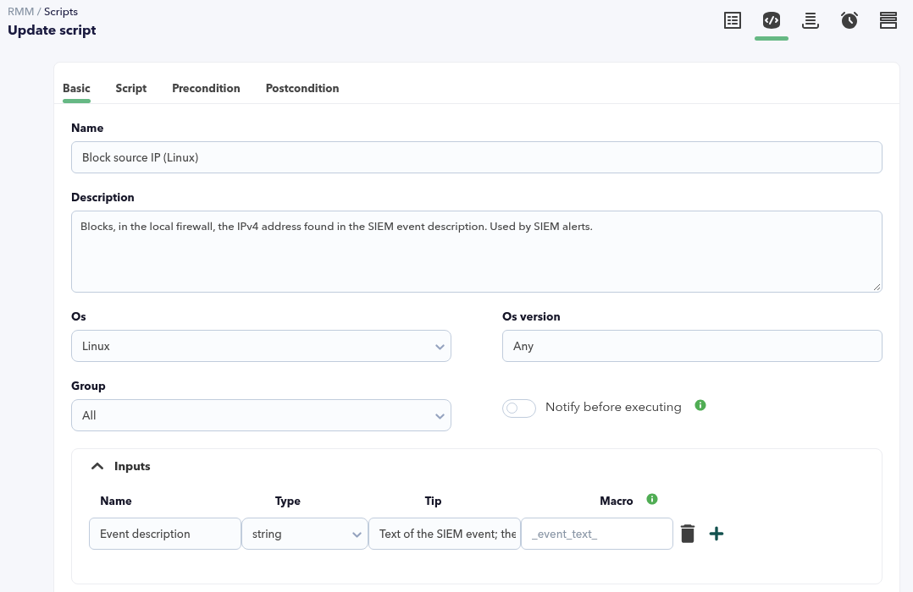{ .captura }

Dans l'onglet **Script**, les paramètres sont `_event_text_`, l'interpréteur
`bash`, l'extension `sh` et ce code, qui extrait la première adresse IPv4 de la
description et la bloque pendant une heure avec `firewalld` (ou avec
`iptables` en l'absence de `firewalld`) :

```bash
#!/bin/bash
# Blocks, in the local firewall, the IPv4 address found in the SIEM event description.
DESC="$*"
IP=$(printf '%s\n' "$DESC" | grep -oE '([0-9]{1,3}\.){3}[0-9]{1,3}' | head -n1)
if [ -z "$IP" ]; then
    echo "No IPv4 address found in: $DESC"
    exit 1
fi
if command -v firewall-cmd >/dev/null 2>&1; then
    firewall-cmd --add-rich-rule="rule family=ipv4 source address=$IP reject" --timeout=1h
else
    iptables -I INPUT -s "$IP" -j DROP
fi
echo "Blocked $IP"
```

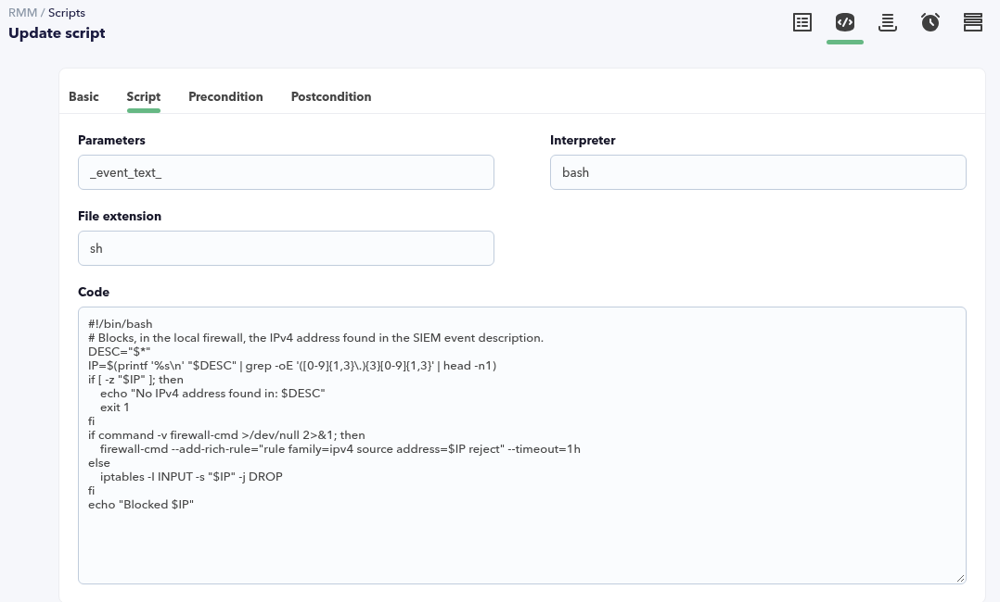{ .captura }

Dans l'onglet **Precondition**, activez la précondition avec les mêmes
paramètres et ce code, qui refuse de bloquer les adresses internes. Si la
précondition se termine avec un code différent de 0, l'exécution échoue et le
*script* n'est pas lancé :

```bash
#!/bin/bash
# Never block internal or loopback addresses.
IP=$(printf '%s\n' "$*" | grep -oE '([0-9]{1,3}\.){3}[0-9]{1,3}' | head -n1)
case "$IP" in
    10.*|192.168.*|127.*) echo "Refusing to block internal address $IP"; exit 1 ;;
esac
exit 0
```

!!! warning "La règle `iptables` n'expire pas"
    `firewall-cmd --timeout=1h` ajoute une règle temporaire qui disparaît
    d'elle-même au bout d'une heure. L'alternative `iptables` n'expire pas :
    l'IP reste bloquée jusqu'à ce que quelqu'un la retire ou que la machine
    redémarre. Si vos serveurs n'utilisent pas `firewalld`, planifiez le
    nettoyage séparément ou utilisez `ipset` avec un délai d'expiration.

**3. Les actions.** Dans **Management → Alerts → Actions**, créez une action
avec la commande **RMM Script**. Dans **Script**, choisissez le *script* créé ;
dans **Fields** apparaît son entrée, **Event description**, qui reçoit
`_event_description_` :

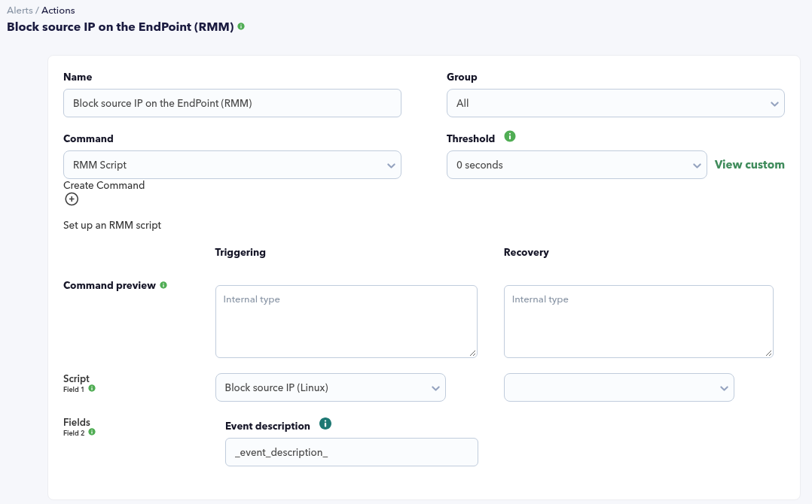{ .captura }

Créez une autre action avec la commande **Pandora Telegram** : dans **Chat ID**,
l'ID du chat du SOC, et dans **Message**, par exemple :

```text
[SIEM] _event_text_severity_ on _agent_: _event_description_. The source IP has been blocked for 1 hour.
```

**4. L'alerte SIEM.** Dans **Management → Alerts → SIEM Alerts**, créez
l'alerte. Dans **Conditions**, un seuil temporel de 5 minutes et un maximum de
10 déclenchements ; dans **Filters**, uniquement **ID Rule** avec `100100` :

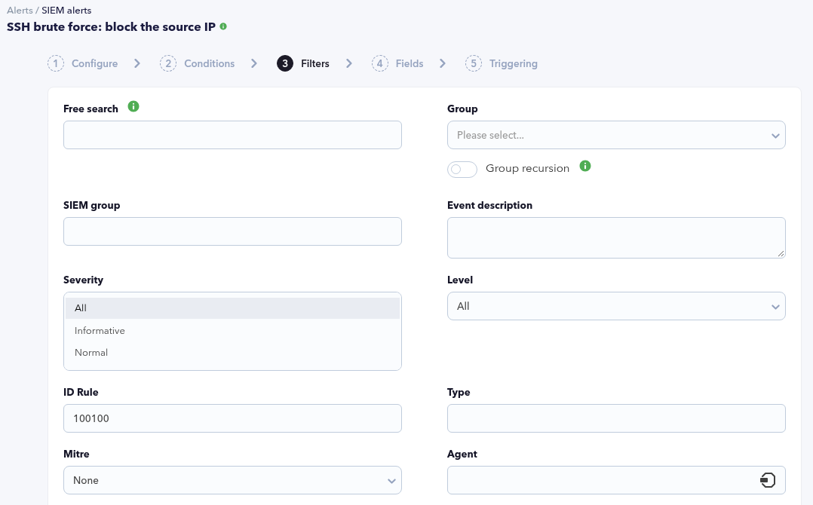{ .captura }

Dans **Triggering**, ajoutez les deux actions :

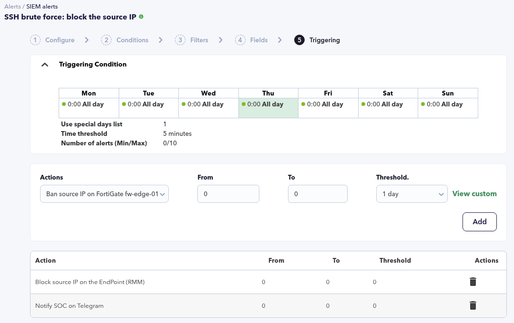{ .captura }

**5. Vérifier le résultat.** Lorsque l'alerte se déclenche, la tâche apparaît
dans **RMM → Queues**, avec l'agent, le *script*, l'état et la sortie du
*script* une fois renvoyée par l'agent RMM :

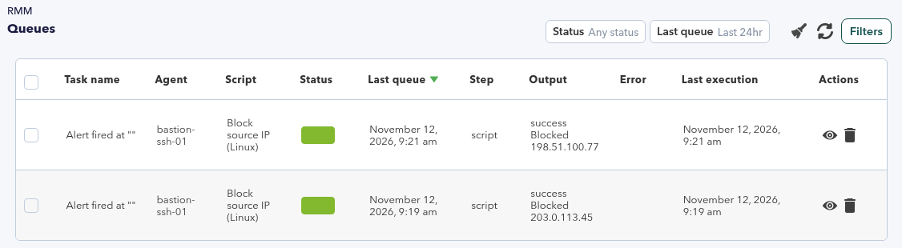{ .captura }

Dans la file, la tâche apparaît sous le nom `Alert fired at ""`, car les alertes
SIEM ne sont pas associées à un module. Si la tâche n'apparaît pas, recherchez
dans `pandora_server.log` les messages qui commencent par `RMM alert action`
(voir [Exploitation et dépannage](#exploitation-et-depannage)).

### Exemple 2 : attaque web réussie, ticket dans Pandora ITSM

**Objectif :** lorsqu'une attaque web obtient une réponse 200 (*rule* 31106,
*A web attack returned code 200 (success)*), ouvrir un ticket dans Pandora ITSM
avec le contexte de l'événement et prévenir par e-mail le contact du groupe.
Rien n'est bloqué ici : une attaque qui a réussi doit être analysée par
quelqu'un, et le ticket lui attribue un responsable.

**1. L'intégration avec Pandora ITSM.** Dans **Management → Settings → System
Settings → ITSM**, activez **Enable Pandora ITSM**, saisissez l'URL de l'API
(`…/api/v2`) et le *token*, puis cliquez sur **Test** avant d'enregistrer avec
**Update** :

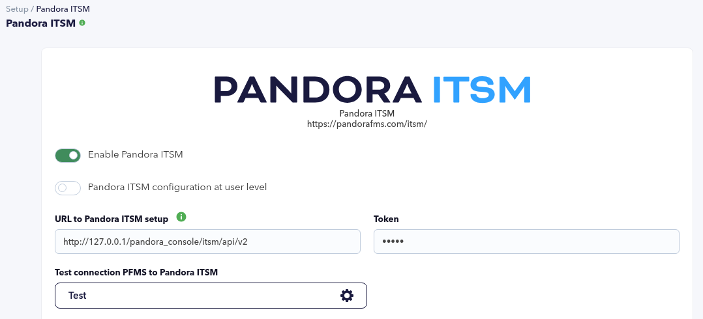{ .captura }

**2. La commande personnalisée.** Le ticket est créé par une commande
personnalisée qui appelle l'API de Pandora ITSM avec `pandora_api_requests`, le
programme d'appels d'API fourni avec le serveur de Pandora FMS. Dans **Management → Alerts →
Commands**, créez la commande avec cette ligne :

```bash
/usr/share/pandora_server/util/plugin/pandora_api_requests --url '_field1_' --method 'post' --headers '_field2_' --data '_field3_' --ssl 'false' -md 'requests'
```

Et trois champs : **ITSM API URL**, **Headers** et **Ticket JSON** :

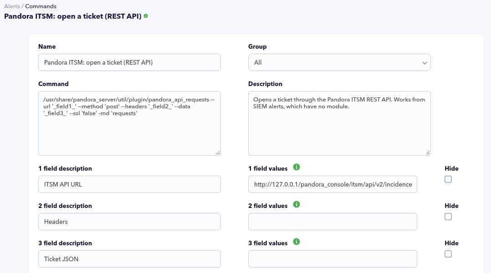{ .captura }

**3. L'action.** Créez une action avec cette commande. Dans le premier champ,
l'URL de l'API de l'intégration suivie de `/incidence`. Avec le Pandora ITSM
intégré à la console, par exemple :

```text
http://127.0.0.1/pandora_console/itsm/api/v2/incidence
```

Dans le deuxième, les en-têtes, séparés par des points-virgules :

```text
Authorization: Bearer <token de l'API de Pandora ITSM>; Content-Type: application/json
```

Et dans le troisième, le corps du ticket en JSON. `idGroup` et `idIncidenceType`
sont les ID du groupe et du type de ticket dans votre Pandora ITSM ; `priority`
accepte `MAINTENANCE`, `INFORMATIVE`, `LOW`, `MEDIUM`, `SERIOUS` et
`VERY_SERIOUS` :

```json
{"title": "[SIEM] _event_text_severity_ on _agent_: _event_description_", "description": "SIEM event level _siem_event_level_ at _eventTimestamp_. Log source: _logSource_. Group contact: _group_contact_.", "idGroup": 4, "priority": "SERIOUS", "status": "NEW", "idIncidenceType": 1}
```

!!! warning "Le JSON n'est pas échappé"
    Les macros sont insérées telles quelles dans le JSON. Un guillemet double
    dans la description le rend invalide, et Pandora ITSM rejette le ticket.
    C'est pourquoi l'exemple n'utilise pas `_data_` (le *log* d'origine, dont le
    contenu est imprévisible) et se limite à des macros au contenu maîtrisé. Pour
    la même raison, le *token* est visible par toute personne autorisée à
    modifier les actions : limitez ses autorisations au strict nécessaire.

Créez une autre action avec la commande **eMail** : `_group_contact_` comme
destinataire et, dans le texte, la description, le niveau et l'origine du *log*.
Le contact provient de la fiche du groupe de l'agent : chaque groupe prévient
ses propres responsables.

**4. L'alerte SIEM.** Créez l'alerte avec **ID Rule** `31106` dans **Filters**,
un seuil temporel d'une heure et un maximum de 5 déclenchements dans
**Conditions**, et les deux actions dans **Triggering**.

**5. Vérifier le résultat.** Avec l'intégration activée, le ticket apparaît dans
**Operation → ITSM → Tickets list** :

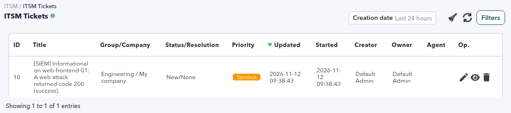{ .captura }

Et dans son détail, la description avec les données de l'événement :

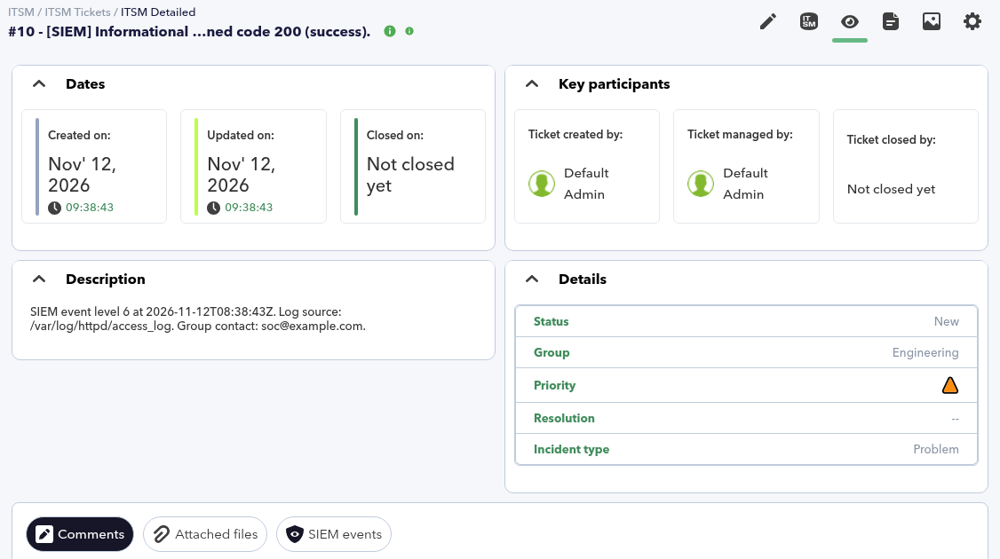{ .captura }

### Exemple 3 : blocage sur le pare-feu périmétrique FortiGate

**Objectif :** l'exemple 1 protège le serveur attaqué ; celui-ci les protège
tous. Avec la même *rule* `100100`, l'IP source est bloquée pendant une heure sur
la FortiGate périmétrique, afin que l'attaquant ne puisse pas tenter sa chance
sur le serveur voisin.

La FortiGate dispose d'un *endpoint* de son API REST pour cela :
`POST /api/v2/monitor/user/banned/add_users`, avec la liste des IP dans
`ip_addresses` et la durée en secondes dans `expiry` (`0` signifie sans
expiration). Comme l'IP doit être extraite de la description de l'événement, une commande personnalisée s'en charge en appelant
un *script* du serveur.

**1. Le *script*.** Créez sur le serveur de Pandora FMS un *script* personnalisé
(dans l'exemple, `/usr/share/pandora_server/util/fortigate_ban_ip.sh`) qui reçoit
trois arguments (l'adresse de la FortiGate, la durée du blocage en secondes et le
texte de l'événement) et qui :

- extrait du texte la première adresse IPv4 et se termine en erreur s'il n'en
  trouve pas ;
- appelle `POST /api/v2/monitor/user/banned/add_users` sur la FortiGate avec
  `ip_addresses` et `expiry`, en s'authentifiant avec un *token* de son API
  REST ;
- lit ce *token* dans un fichier du serveur lisible uniquement par l'utilisateur
  `pandora` (permissions `600`), afin qu'il n'apparaisse dans aucune action de
  la console ;
- vérifie le certificat de la FortiGate au lieu de désactiver la vérification.

Le *token* se génère sur la FortiGate lors de la création d'un administrateur
d'API REST. Testez le *script* à la main depuis le serveur, avec l'utilisateur
`pandora`, avant de le relier à l'alerte.

**2. La commande et l'action.** Dans **Management → Alerts → Commands**, créez
la commande avec cette ligne et trois champs (**FortiGate address**, **Ban time
(seconds)**, avec `3600` par défaut, et **Event text**, avec
`_event_description_` par défaut) :

```bash
/usr/share/pandora_server/util/fortigate_ban_ip.sh '_field1_' '_field2_' '_field3_'
```

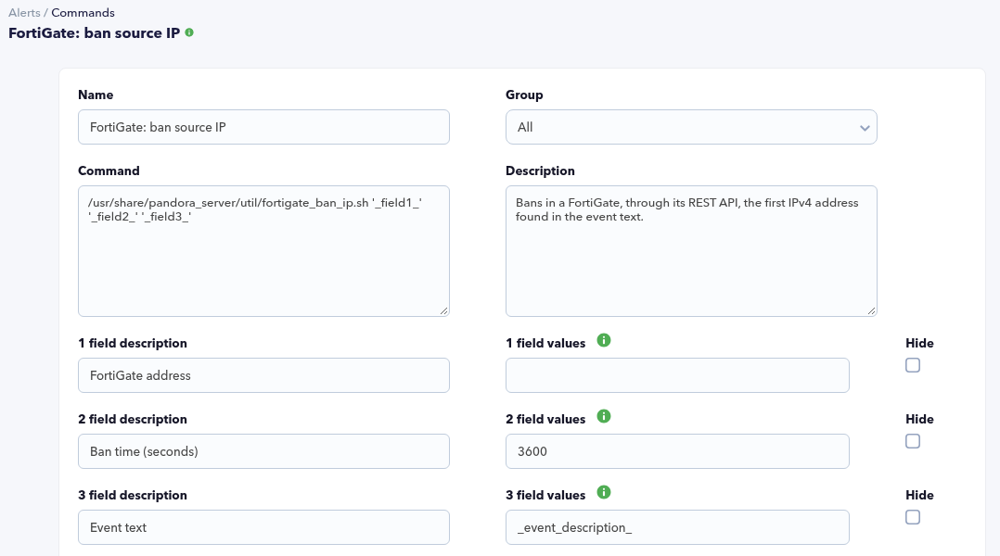{ .captura }

Créez ensuite l'action avec cette commande : l'adresse de la FortiGate dans le
premier champ ; les deux autres conservent leurs valeurs par défaut.

**3. L'alerte SIEM.** Comme dans l'exemple 1 : **ID Rule** `100100`, seuil de
5 minutes, maximum de 10 déclenchements et l'action FortiGate dans
**Triggering**. Il peut s'agir d'une alerte distincte ou d'une action de plus
dans l'alerte de l'exemple 1.

**4. Vérifier le résultat.** Lorsque l'alerte se déclenche, l'IP apparaît dans la
liste des IP bloquées de la FortiGate (en CLI, `diagnose user banned-ip list`) et
disparaît d'elle-même à l'expiration. Si elle n'apparaît pas, exécutez le
*script* à la main avec les mêmes arguments et vérifiez ce qu'il renvoie.

## Automatiser sans perdre le contrôle

Une réponse automatique mal filtrée équivaut à un attaquant supplémentaire,
disposant en plus d'identifiants. Quelques habitudes évitent la plupart des
mauvaises surprises :

- **Commencer par notifier.** Montez d'abord l'alerte avec une notification ou
  un ticket, laissez-la tourner quelques jours et observez ce qu'elle aurait
  bloqué. Une fois la *rule* affinée, ajoutez l'action de confinement.
- **Exclure ce qui ne doit pas être touché** : vos réseaux internes dans la
  précondition du *script*, et les agents et *rules* qui ne doivent pas
  déclencher de réponse dans les filtres d'exclusion de l'alerte.
- **Donner une expiration à chaque blocage.** Les alertes SIEM n'ont pas de
  récupération ; le retour arrière est l'expiration du blocage lui-même
  (`--timeout` dans `firewalld`, `expiry` sur la FortiGate).
- **Adapter le seuil et le maximum à chaque type d'alerte** : court et élevé
  pour le confinement, long et faible pour les notifications.
- **Valider l'entrée des *scripts*** : n'accepter que ce qui est attendu (une
  adresse IPv4) et sortir en erreur dans tous les autres cas.
- **Utiliser les outils du RMM** : la précondition pour écarter ce qui ne doit
  pas être touché et la postcondition pour vérifier que la modification a été
  appliquée. **Notify before executing** ne prévient personne : l'agent RMM
  signale un succès avant l'exécution, ce qui ne sert que pour les *scripts*
  susceptibles d'arrêter l'agent lui-même (un redémarrage, par exemple).
- **Mettre en pause sans supprimer** : l'état **standby** d'une alerte l'arrête
  sans perdre sa configuration. Voir
  [États d'une alerte](../parte-5/5.5-alertas-y-notificaciones.md#etats-dune-alerte-active-desactivee-et-en-veille).
- **Sortir les *tokens* des actions** lorsque c'est possible, comme dans
  l'exemple 3 : dans un fichier du serveur, avec les permissions `600`.

## Exploitation et dépannage

Lorsque la réponse n'arrive pas, trois endroits sont à consulter : la liste des
alertes SIEM (**Operation → SIEM → Alerts**, qui indique si l'alerte s'est
déclenchée), la file du RMM (**RMM → Queues**) et
`/var/log/pandora/pandora_server.log`. Les problèmes les plus fréquents :

| Symptôme | Cause et solution |
|---|---|
| `RMM alert action can't queue script, RMM agent not found` | Aucun agent RMM ne porte le même nom que l'agent de l'événement. Vérifiez le nom de l'agent RMM de l'EndPoint. |
| `RMM alert action can't queue script, RMM script not found` | Le *script* de l'action a été supprimé. Sélectionnez-le à nouveau dans l'action. |
| Le ticket n'est pas créé et aucune erreur n'apparaît | L'intégration Pandora ITSM n'est pas activée, ou le JSON de la commande est invalide (un guillemet dans une macro). |
| L'alerte ne se déclenche pas | Les filtres ne correspondent pas à l'événement, la *rule* ne le génère pas, les fonctions expérimentales sont désactivées ou l'alerte a déjà atteint son nombre maximal de déclenchements dans le seuil. |
| Une macro arrive vide | La donnée ne figure pas dans l'événement, ou il s'agit d'un champ décodé sans marqueur `$(Champ)` dans la description de la *rule*. |

!!! tip "Tester avec un log qui doit forcément déclencher"
    N'attendez pas une attaque pour savoir si la chaîne fonctionne. Générez un
    *log* qui déclenche la *rule* (quelques tentatives SSH échouées contre un
    serveur de test suffisent pour la 5712), consultez l'événement dans
    **Operation → SIEM → Events** et suivez la trace jusqu'à la file du RMM, au
    ticket ou au blocage.
