# Analyse des vulnérabilités

Un serveur qui fait tourner un `openssl` vieux de trois ans ne prévient pas. Il
démarre, répond, passe ses contrôles de disponibilité au vert et reste ainsi
jusqu'au jour où quelqu'un se sert de ce paquet pour entrer. Le problème n'est
pas que personne ne sache que cette version est vulnérable : c'est publié, avec
son identifiant et sa gravité. Le problème, c'est que personne n'a croisé cette
liste avec ce qui est installé sur chaque machine.

C'est ce que fait l'analyse des vulnérabilités de Pandora FMS. L'EndPoint envoie
déjà l'inventaire logiciel de son système (le nom et la version de chaque
paquet) ; le serveur le compare à une base de données de vulnérabilités connues
(les **CVE**) et indique, par système et pour toute l'installation, quels
paquets sont vulnérables, avec quelle gravité et quel risque porte chaque
système. Sous MS Windows, il vérifie en plus les produits Microsoft et les
correctifs (KB) qui leur manquent, et permet de les installer avec le RMM.

Elle se trouve dans le menu **Security**, à côté du
[durcissement](7.5-hardening.md) et du
[contrôle d'intégrité des fichiers (FIM)](7.6-fim.md). Le [SIEM](7.2-siem.md)
surveille ce qui se passe ; ceci surveille ce qui est là.

!!! info "Elle ne scanne pas le réseau et n'attaque pas le système"
    L'analyse ne lance aucun test d'intrusion et ne sonde aucun port : elle
    travaille uniquement avec l'inventaire que l'EndPoint envoie déjà. Elle ne
    génère aucun trafic vers le système analysé et ne demande aucun nouvel
    identifiant. En contrepartie, elle ne voit que ce que l'inventaire déclare :
    un programme que l'inventaire ne collecte pas n'est pas analysé.

Elle vous apporte :

- **La liste des paquets vulnérables de chaque système**, avec la CVE qui les
  touche, sa gravité, son score et la date de détection.
- **Un indicateur de risque** par système et un autre pour l'ensemble, de 0 à
  10, qui indique où regarder en premier.
- **Sous MS Windows**, les vulnérabilités des produits Microsoft d'après les KB
  manquants, la liste des KB installés et la possibilité d'installer ceux qui
  sont en attente avec le RMM.
- **Des modules de supervision** avec le nombre de vulnérabilités de chaque
  système, pour alerter quand il augmente, ainsi que des éléments de rapport et
  un *widget* de tableau de bord.

## CVE et CVSS

Deux sigles suffisent pour lire la vue.

Une **CVE** (*Common Vulnerabilities and Exposures*) est l'identifiant unique
d'une vulnérabilité précise, au format `CVE-année-numéro` (par exemple,
`CVE-2024-6387`). Chaque CVE s'accompagne d'une description, de références vers
les avis des éditeurs et des bases comme la NVD du NIST, et de sa date de
publication. C'est le nom commun qu'éditeurs, chercheurs et administrateurs
utilisent pour parler de la même chose.

Le **CVSS** (*Common Vulnerability Scoring System*) est la façon standard d'en
mesurer la gravité. Il donne un **score** de 0 à 10 et un **vecteur** qui décrit
comment elle s'exploite. La console filtre et regroupe selon ces métriques du
vecteur :

| Métrique | Valeurs | Signification |
|---|---|---|
| **Attack Vector** | Network, Adjacent Network, Local, Physical | D'où elle peut être exploitée : n'importe quel réseau, le réseau local, une session sur le système ou un accès physique. |
| **Attack Complexity** | Low, High | Si l'attaque se reproduit sans conditions particulières (*Low*) ou dépend de circonstances que l'attaquant ne contrôle pas (*High*). |
| **Privileges Required** | None, Low, High | Les privilèges dont l'attaquant a besoin sur le système avant de commencer. |
| **User Interaction** | None, Required | Si un utilisateur doit faire quelque chose (ouvrir un fichier, cliquer sur un lien). |
| Confidentialité, intégrité, disponibilité | None, Low, High | Ce qui est perdu si l'attaque réussit. |

La **gravité** découle du score, selon l'échelle CVSS :

| Score CVSS | Gravité |
|---|---|
| 0,0 | None |
| 0,1-3,9 | Low |
| 4,0-6,9 | Medium |
| 7,0-8,9 | High |
| 9,0-10,0 | Critical |

Si une CVE n'a pas de score, la gravité est déduite de son impact sur la
confidentialité, l'intégrité et la disponibilité.

## Fonctionnement

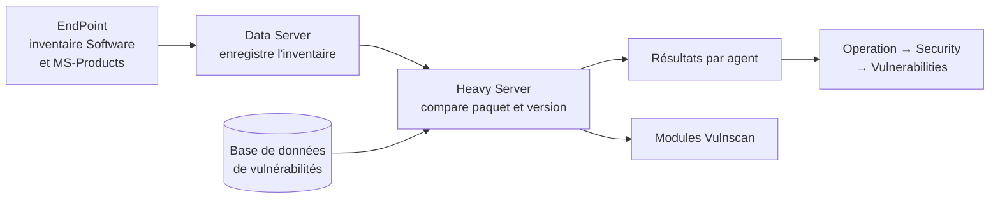

1. L'EndPoint envoie l'inventaire logiciel (le module d'inventaire
   **Software**) et, sous MS Windows, celui des produits Microsoft et de leurs
   KB (le module **MS-Products**).
2. Le **Data Server** enregistre l'inventaire et, si l'analyse est active pour
   cet agent, le marque pour analyse.
3. Le **Heavy Server** récupère les inventaires marqués, compare chaque paquet
   et sa version à la base de données de vulnérabilités (en tenant compte du
   système d'exploitation de l'agent) et enregistre le résultat.
4. La console affiche les résultats et le serveur met à jour les modules
   **Vulnscan** de l'agent.

Ce qu'il faut savoir pour comprendre ce que vous voyez :

- **L'analyse se relance à chaque arrivée de l'inventaire**, pas selon sa propre
  horloge. Les EndPoints envoient l'inventaire tous les 7 jours par défaut, donc
  les résultats se renouvellent une fois par semaine. Si vous mettez un paquet à
  jour, la vulnérabilité disparaît de la vue avec l'inventaire suivant.
- **Chaque analyse remplace la précédente** pour cet agent : la vue montre
  l'état actuel, pas un historique.
- **Sous MS Windows, il y a deux analyses.** Celle de **Software** compare les
  programmes installés à la base de données, qui identifie le logiciel par son
  nom de paquet, comme ceux des distributions Linux (`openssl`, `firefox`) : un
  programme Windows est analysé lorsque son nom correspond à un paquet de la
  base. Celle de **MS-Products** confronte les produits Microsoft aux bulletins
  de sécurité de Microsoft (MSRC) et compte comme en attente les KB manquants,
  en écartant ceux déjà installés et ceux qu'un KB postérieur remplace. Sous MS
  Windows, l'essentiel des résultats vient donc de **MS-Products** : activez les
  deux inventaires.
- **Le risque est la moyenne des scores CVSS** des vulnérabilités du système ou
  du filtre, plafonnée à 10. En dessous de 5, c'est un **Low risk** ; de 5 à
  7,5, un **Medium risk** ; au-dessus de 7,5, un **High risk**. C'est une
  moyenne, pas une somme : un système avec trois vulnérabilités critiques peut
  ressortir plus risqué qu'un autre avec quarante vulnérabilités de faible
  gravité.

## Prérequis

| Prérequis | Détail |
|---|---|
| Version Enterprise | L'analyse des vulnérabilités, sa vue et ses réglages font partie de la version Enterprise. |
| Data Server et Heavy Server | Activés dans `pandora_server.conf` (`dataserver 1` et `heavyserver 1` ; les deux sont activés par défaut). |
| EndPoint | Linux ou MS Windows, version **774 ou ultérieure**. Pour modifier le réglage d'analyse d'un agent précis, il faut en plus la **configuration à distance** activée. |
| Inventaire logiciel | Activé sur l'EndPoint : le *plugin* `inventory` avec `software` sous Linux ; `software_installed.vbs` sous MS Windows et, pour les produits Microsoft, `ms_products.exe`. Ils sont livrés commentés. |
| Base de données de vulnérabilités | Installée avec le serveur dans `/usr/lib/perl5/PandoraFMS/Vulnerabilities`. |
| Permissions | **AR** sur le groupe de l'agent pour voir la vue. **AW** pour installer des KB. |
| Pour installer des KB | Une licence **Pandora RMM** et l'agent RMM sur le système, avec le même nom que son agent Pandora FMS. Voir [Exécution à distance de scripts et de commandes](../parte-3/3.4-ejecucion-remota-de-scripts-y-comandos.md). |

## La base de données de vulnérabilités

Pandora FMS n'interroge aucun service externe pendant l'analyse : la base de
données est livrée avec le serveur. Elle est construite à partir de deux
sources :

- **CVE-Search**, qui rassemble les données de la NVD du NIST, de MITRE et de
  Red Hat.
- **Les dépôts des éditeurs** : Canonical, Red Hat, Debian, Arch Linux, NVD et
  Microsoft Security Updates.

Elle est stockée dans `/usr/lib/perl5/PandoraFMS/Vulnerabilities`, répartie en
fichiers par paquet, par CVE et par produit Microsoft. Le Heavy Server les relit
à chaque analyse, donc **mettre la base à jour ne demande pas de redémarrer le
serveur** : le prochain inventaire qui arrive est déjà comparé aux nouvelles
données.

Les paquets se téléchargent depuis
<https://packages.pandorafms.com/09fee0f1c66c203ff8a2feffbb619f18/> :

| Paquet | Contenu |
|---|---|
| `package_edge.vdb` | Vulnérabilités des 2 dernières années. Le plus léger. |
| `package_lite.vdb` | Vulnérabilités des 5 dernières années. **C'est celui qu'apporte la version 805.** |
| `package_full.vdb` | La base de données complète. |
| `BUILDS/package_build_AAAAMMJJ.vdb` | Paquets incrémentaux : chacun complète les fichiers du précédent. Ils s'appliquent dans l'ordre chronologique. |

Pour la mettre à jour : les `.vdb` sont des fichiers ZIP. Décompressez-les
par-dessus le répertoire de la base, en écrasant ce qui existe, avec un
utilisateur qui a les droits sur ce répertoire :

```bash
unzip -q -o "package_lite.vdb" -d "/usr/lib/perl5/PandoraFMS/Vulnerabilities"
```

Remplacez le nom du fichier par celui du paquet téléchargé (`package_edge.vdb`,
`package_full.vdb`). Avec les paquets incrémentaux, un par un et du plus ancien
au plus récent :

```bash
unzip -q -o "package_build_AAAAMMJJ.vdb" -d "/usr/lib/perl5/PandoraFMS/Vulnerabilities"
```

Si vous avez plusieurs serveurs Pandora FMS, mettez-la à jour sur chaque serveur
qui exécute le Heavy Server : chacun analyse avec sa propre copie.

Pour savoir combien de CVE connaît la base installée, comptez ses fichiers de
CVE :

```bash
ls /usr/lib/perl5/PandoraFMS/Vulnerabilities/CVE | wc -l
```

## Activer l'analyse

Il faut trois choses : l'interrupteur général, un agent qui ne l'a pas
désactivée et l'EndPoint qui envoie l'inventaire logiciel.

### Dans la configuration générale

Dans **Management → Settings → System Settings → General Setup**, onglet
**Features**, l'interrupteur **Enable agent vulnerability scanning** active
l'analyse pour tous les agents qui suivent le réglage général. Il est activé par
défaut.

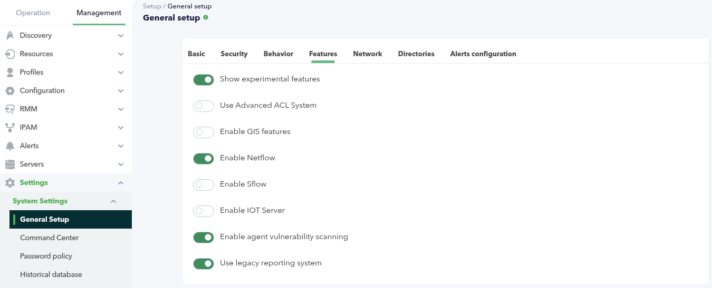

### Sur chaque agent

Dans l'édition de l'agent, onglet **Security**, le champ **Vulnerability
scanning** décide de ce que fait cet agent :

- **Use global settings** (par défaut) : suit l'interrupteur général.
- **Enabled** : il est analysé même si l'interrupteur général est désactivé.
- **Disabled** : il n'est jamais analysé.

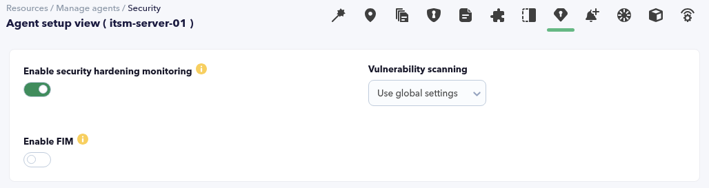

| Réglage de l'agent | Interrupteur général activé | Interrupteur général désactivé |
|---|---|---|
| **Use global settings** | Analysé | Non analysé |
| **Enabled** | Analysé | Analysé |
| **Disabled** | Non analysé | Non analysé |

Ce réglage n'est enregistré que si l'agent a la **configuration à distance**
activée et un EndPoint **774 ou ultérieur**. Le même onglet regroupe le
durcissement et le FIM.

### Inventaire logiciel sur l'EndPoint

L'analyse travaille avec l'inventaire : sans lui, pas de résultats. Dans le
fichier de configuration de l'EndPoint (ou depuis la console, s'il a la
configuration à distance activée) :

Sous **Linux**, le *plugin* d'inventaire avec au moins `software`. Le premier
nombre est l'intervalle en jours :

```text
module_plugin inventory 7 software
```

La ligne livrée commentée dans le fichier de configuration inclut le reste de
l'inventaire (`cpu ram video nic hd cdrom software init_services filesystem
users route`) ; l'une ou l'autre convient, du moment qu'elle contient
`software`.

Sous **MS Windows**, décommentez ces deux blocs. Le premier envoie le logiciel
installé et le second les produits Microsoft et leurs KB :

```text
module_begin
module_plugin cscript.exe //B //t:20 "%PROGRAMFILES%\Pandora_Agent\util\software_installed.vbs"
module_absoluteinterval 7d
module_end

module_begin
module_plugin "%PROGRAMFILES%\Pandora_Agent\util\ms_products.exe"
module_absoluteinterval 7d
module_end
```

Redémarrez le service de l'EndPoint. Les résultats apparaissent à l'arrivée du
premier inventaire. L'inventaire complet est expliqué dans
[Inventaire](../parte-3/3.1-inventario.md).

## Consulter les résultats

### La vue générale

**Operation → Security → Vulnerabilities** rassemble les résultats de tous les
agents que vous voyez (ceux des groupes où vous avez **AR**). Elle comporte
quatre onglets : **Summary**, **Software vulnerabilities**, **Microsoft products
vulnerabilities** et **Windows installed KBs**.

Le menu de filtres est commun aux quatre et a deux onglets :

- **Global** : **Group** (avec **Recursion** pour inclure les sous-groupes) et
  **Agent search**, qui cherche dans l'alias de l'agent.
- **Vulnerabilities** : **Search** (cherche dans le nom du paquet, la CVE et la
  version), **Severity**, **Attack Complexity**, **Privileges Required**,
  **User Interaction** et **Attack Vector**.

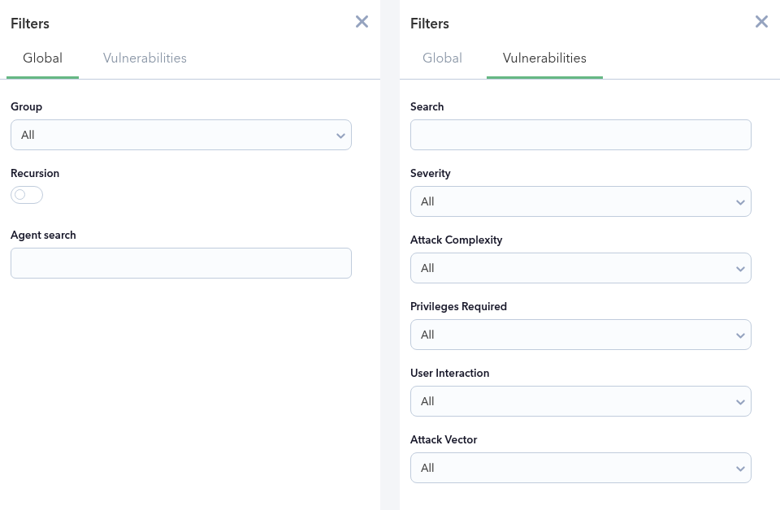

### Summary

La vue d'ensemble, pensée pour décider par où commencer :

- **System risk** : le score de risque du filtre, son niveau (**Low**,
  **Medium** ou **High risk**), le nombre d'agents et de vulnérabilités qui le
  composent et la date de la dernière analyse.
- **Severity** : combien de vulnérabilités ont un impact nul (*None*), faible
  (*Low*) ou élevé (*High*) sur la confidentialité, l'intégrité et la
  disponibilité.
- **Attack Complexity** et **Vulnerabilities by package** : la répartition par
  complexité d'attaque et par paquet.
- **Total summary** : combien de vulnérabilités logicielles, de vulnérabilités
  de produits Microsoft et de KB installés contient le filtre.
- Les tableaux **Privileges Required**, **User Interaction** et **Attack
  Vector**, avec le nombre de vulnérabilités pour chaque valeur.
- **Top vulnerabilities Agents** : les agents qui ont le plus de
  vulnérabilités, avec leur nombre et leur risque.
- **Top vulnerabilities Packages** : les paquets et les CVE qui reviennent le
  plus dans l'installation.

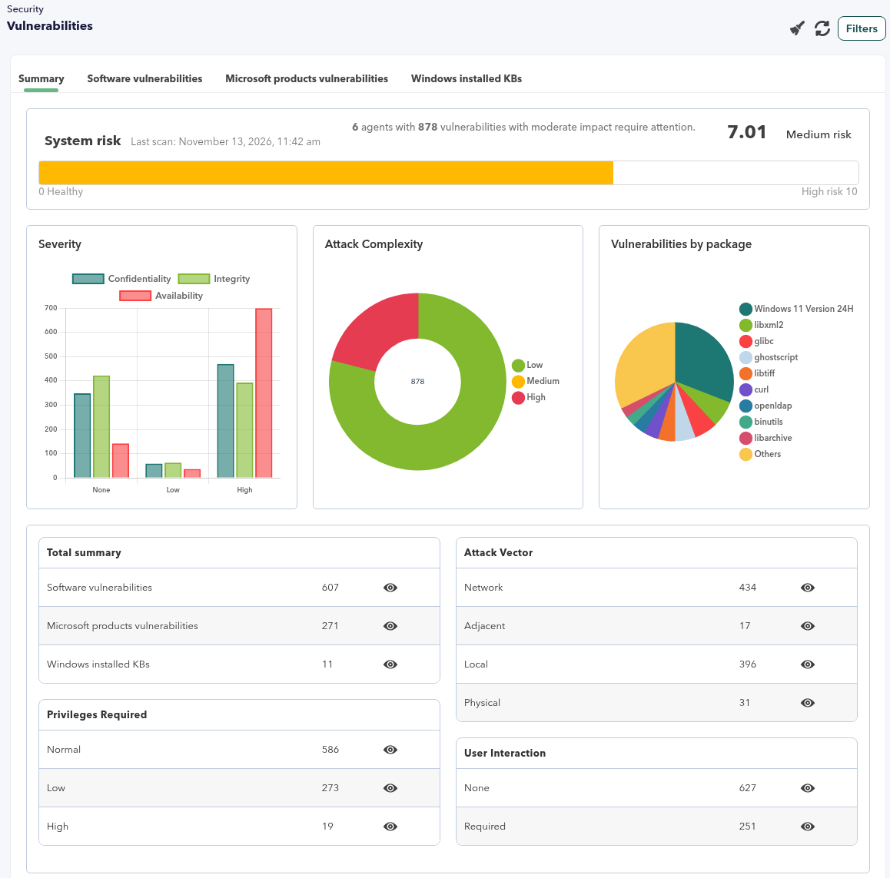

Les deux derniers tableaux répondent à deux questions différentes. Celui des
agents indique quel système traiter en premier ; celui des paquets, quelle mise à
jour corrige le plus de choses d'un coup.

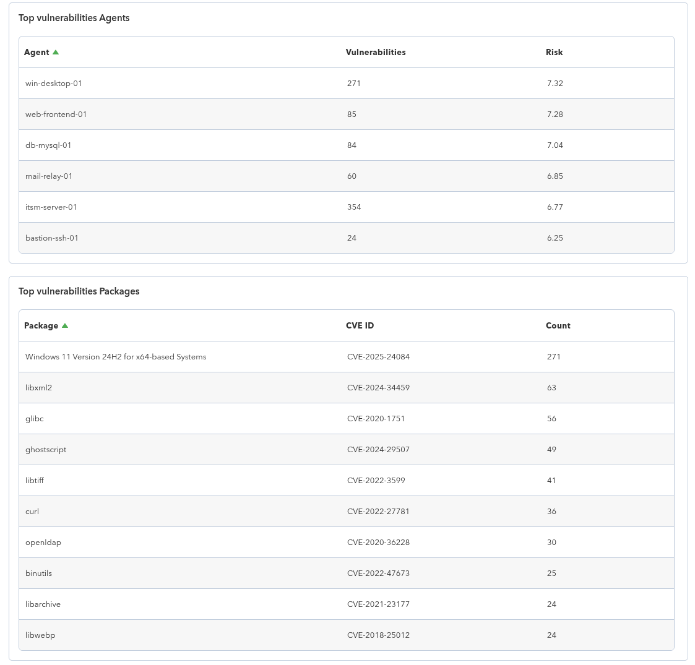

### Software vulnerabilities

Une ligne par vulnérabilité : **Agent**, **Name** (le paquet), **Version**
(celle qui est installée), **CVE**, **Severity**, **Score**, **Detection Time**
et **Details**.

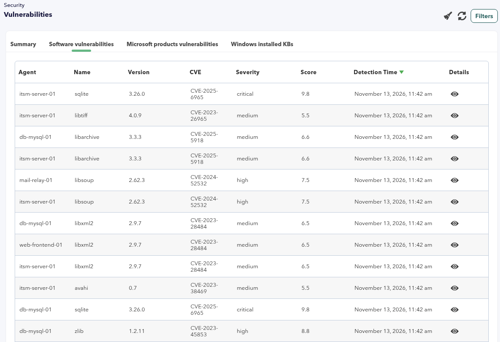

L'icône en forme d'œil de **Details** ouvre la fiche de la vulnérabilité :
paquet, version, CVE, score CVSS, gravité et le vecteur détaillé (**Attack
Vector**, **Attack Complexity**, **Privileges Required**, **User interaction**,
**Scope** et l'impact sur la confidentialité, l'intégrité et la disponibilité).

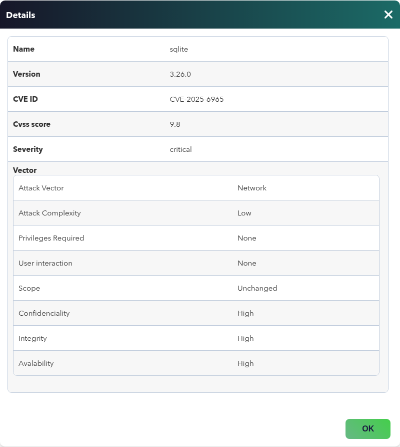

### Microsoft products vulnerabilities et Windows installed KBs

Seuls les EndPoints MS Windows qui envoient l'inventaire **MS-Products** ont des
données ici.

**Microsoft products vulnerabilities** liste les vulnérabilités par bulletin :
**MSRC Document**, **Product**, **KB** (le correctif qui la corrige, avec un lien
vers sa page Microsoft), **Title**, **CVE**, **Severity**, **Score**, **Detection
Time** et **Details**. Seuls les KB en attente apparaissent : ceux qui sont
installés et ceux qu'un KB postérieur remplace ne comptent pas.

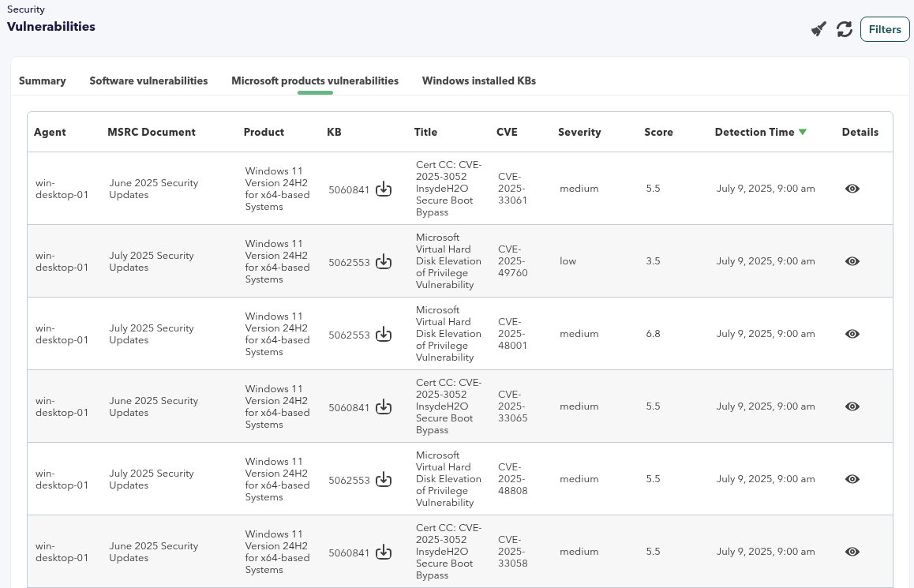

**Windows installed KBs** liste les KB installés sur le système, avec leur
description et les agents qui les ont.

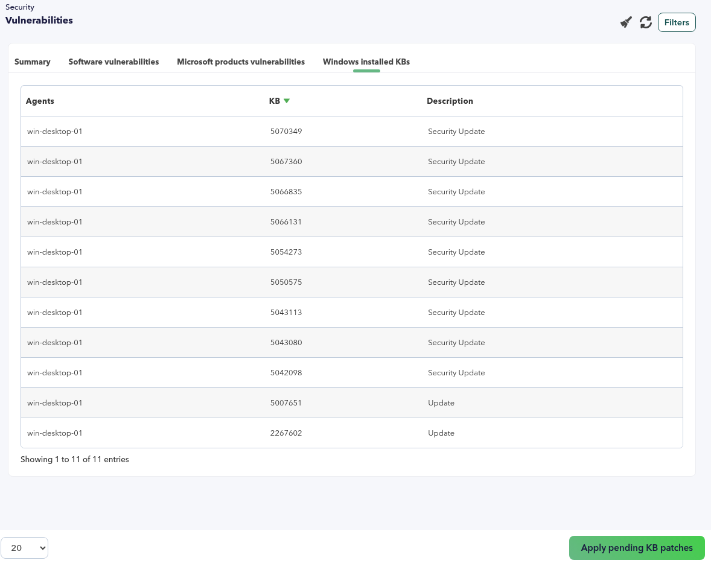

### Vue d'un agent

Dans la vue de l'agent, l'onglet **Vulnerabilities** reprend les quatre mêmes
onglets, filtrés sur ce système. Il apparaît lorsque l'analyse est active pour
l'agent et qu'il y a déjà des résultats.

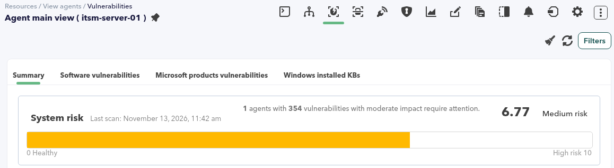

Dans la vue principale de l'agent, le panneau **Security** comporte un
indicateur **Vulnerability** de la couleur de son risque : vert jusqu'à 5, jaune
jusqu'à 7,5 et rouge au-delà.

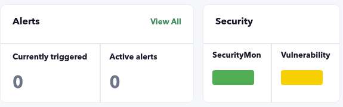

## Appliquer les correctifs Microsoft

Vous pouvez installer les KB en attente avec le RMM sans quitter la vue :

- **Install KB** : l'icône de téléchargement à côté du numéro de KB, sur chaque
  ligne de **Microsoft products vulnerabilities**, installe ce KB sur ce
  système.
- **Apply pending KB patches** : le bouton en bas de l'onglet **Windows
  installed KBs** installe d'un coup tous les KB en attente. Dans la vue
  générale, il couvre **tous les systèmes que vous voyez** (ceux de vos groupes
  avec **AR**) qui ont un agent RMM ; dans l'onglet **Vulnerabilities** d'un
  agent, uniquement les KB de ce système.

Les deux lancent une exécution ponctuelle de la règle RMM **Install Windows
patch from KB (online)** sur l'agent RMM du système, et vous la suivez dans
**RMM → Queues**. Elles demandent la permission **AW**, la licence Pandora RMM
et un agent RMM portant le même nom que l'agent Pandora FMS ; si le système n'a
pas d'agent RMM, **Install KB** n'apparaît pas. La règle installe le module
PowerShell `PSWindowsUpdate` sur le système et télécharge le KB depuis Microsoft
Update, le système a donc besoin d'un accès à Internet.

L'installation modifie l'inventaire du système, mais la vue ne le reflète pas
avant l'arrivée du prochain inventaire **MS-Products**. Le RMM, ses files
d'attente et ses règles sont expliqués dans
[Exécution à distance de scripts et de commandes](../parte-3/3.4-ejecucion-remota-de-scripts-y-comandos.md),
et la stratégie de correctifs dans
[Mise à jour corrective des systèmes](../parte-3/3.5-parcheado-de-sistemas.md).

!!! warning "Planifiez l'installation"
    Beaucoup de KB Microsoft ne s'achèvent qu'au redémarrage du système. Pour
    corriger un serveur précis, utilisez **Install KB** sur sa ligne ou l'onglet
    **Vulnerabilities** de son agent, et faites-le dans une fenêtre de
    maintenance : lancer **Apply pending KB patches** depuis la vue générale,
    qui couvre tous les systèmes que vous voyez, sur des serveurs de production
    en pleine matinée est le moyen le plus rapide de transformer un rapport de
    sécurité en incident de disponibilité.

## Alertes, rapports et tableaux de bord

Chaque analyse crée ou met à jour trois modules dans l'agent, dans le groupe de
modules **Security** :

| Module | Ce qu'il mesure |
|---|---|
| **Vulnscan - Number of vulnerabilities** | Vulnérabilités logicielles trouvées. |
| **Vulnscan - Number of MS vulnerabilities** | Vulnérabilités de produits Microsoft (uniquement MS Windows avec **MS-Products**). |
| **Vulnscan - Number of pending KBs** | KB en attente (uniquement MS Windows avec **MS-Products**). |

Ce sont des modules comme les autres, ils acceptent donc des seuils et des
alertes : un seuil sur **Vulnscan - Number of vulnerabilities** vous prévient
quand quelque chose de nouveau apparaît après un inventaire. La configuration
des alertes est expliquée dans
[Alertes et notifications](../parte-5/5.5-alertas-y-notificaciones.md).

Les [rapports](../parte-5/5.2-informes.md) ont un groupe d'éléments
**Vulnerabilities** : **Severity graph bar**, **Attack complexity doughnut
chart**, **By packages in pie chart**, **Detailed security report**,
**Vulnerabilities of agent**, **Top-N agents with more risk**, **Top-N common
vulnerabilities** et **Top N agents pending Microsoft patches**. Dans les
[tableaux de bord](../parte-5/5.1-dashboards.md), le *widget* **Top N agents
pending Microsoft patches**.

## Exploitation et dépannage

| Symptôme | Ce qu'il faut vérifier |
|---|---|
| L'agent n'a pas d'onglet **Vulnerabilities** | L'analyse est désactivée pour l'agent (**Disabled**, ou **Use global settings** avec l'interrupteur général désactivé) ou il n'y a pas encore de résultats. |
| Aucun résultat après avoir activé l'analyse | L'inventaire logiciel est commenté sur l'EndPoint, le prochain inventaire n'est pas encore arrivé ou le Heavy Server est désactivé. |
| Le champ **Vulnerability scanning** de l'agent n'enregistre pas le changement | L'agent a besoin de la configuration à distance activée et d'un EndPoint 774 ou ultérieur. |
| Un système MS Windows a peu ou pas de vulnérabilités logicielles | C'est normal : la base identifie le logiciel par nom de paquet et beaucoup de programmes Windows sont enregistrés sous un autre nom. Ses résultats viennent de **MS-Products**. |
| Les onglets Microsoft sont vides | L'EndPoint MS Windows n'envoie pas **MS-Products** : il manque le bloc `ms_products.exe`. |
| L'icône **Install KB** n'apparaît pas | Le système n'a pas d'agent RMM portant le même nom que son agent Pandora FMS, ou votre utilisateur n'a pas **AW**. |
| Une vulnérabilité corrigée reste dans la vue | La vue change avec le prochain inventaire ; si l'inventaire a lieu tous les 7 jours, la correction met jusque-là à apparaître. |

Pour vérifier à la main si une version précise d'un paquet a des vulnérabilités
connues, sans attendre le prochain inventaire, utilisez `pandora_manage` sur le
serveur. Il reçoit le nom et la version du paquet tels qu'ils apparaissent dans
l'inventaire et, en option, le système d'exploitation tel que l'agent le
déclare, pour appliquer le même filtre de système d'exploitation que l'analyse :

```bash
pandora_manage /etc/pandora/pandora_server.conf --check_vulnerabilities <logiciel> <version> [<systeme_exploitation>]
```

Il renvoie une liste JSON avec une entrée par CVE qui touche cette version, avec
les mêmes données que la console (gravité, score, vecteur CVSS, description et
références). Une liste vide (`[]`) signifie que la base ne connaît aucune
vulnérabilité pour cette version. Par exemple, pour `openssl` 3.0.7 (sortie
réduite à une entrée et à ses champs principaux) :

```bash
pandora_manage /etc/pandora/pandora_server.conf --check_vulnerabilities openssl 3.0.7
```

```json
[
  {
    "product": "openssl",
    "version": "3.0.7",
    "cve": "CVE-2024-5535",
    "severity": "critical",
    "score": 9.1,
    "vector": "CVSS:3.1/AV:N/AC:L/PR:N/UI:N/S:U/C:H/I:N/A:H",
    …
  },
  …
]
```

Pour suivre une analyse sur le serveur, montez le niveau de journalisation à
`verbosity 10` dans `pandora_server.conf`. `pandora_server.log` affiche alors le
début et la fin de chaque analyse et chaque vulnérabilité trouvée :

```text
Started Software vulnerabilities scan for agent [agent-name]
Found vulnerability CVE-2024-6387 on agent [agent-name] for product: openssh-server
Finished Software vulnerabilities scan for agent [agent-name]
```

Remettez le niveau de journalisation à sa valeur une fois terminé : avec
`verbosity 10`, le journal grossit vite.
