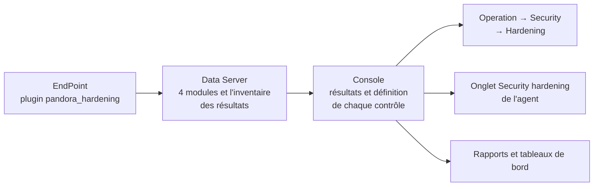
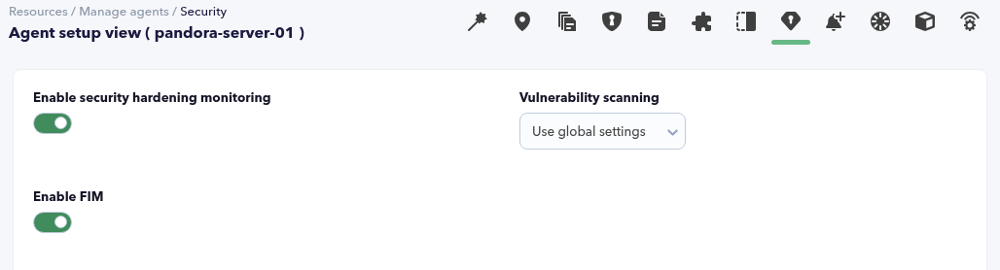
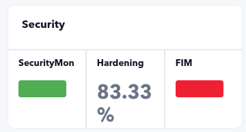
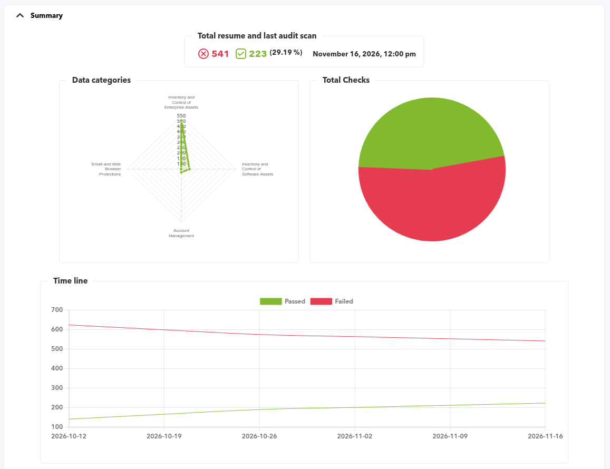
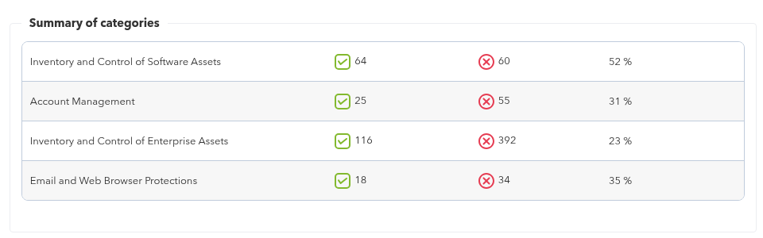
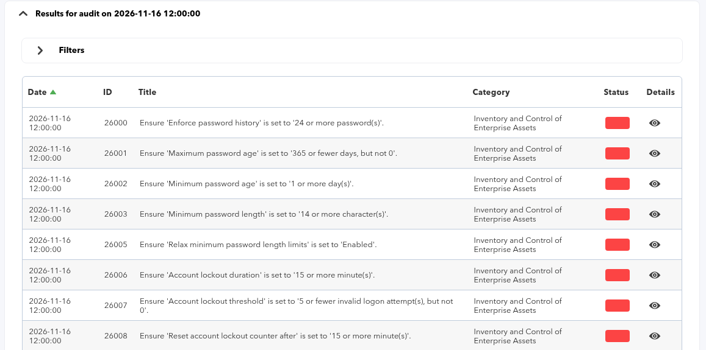
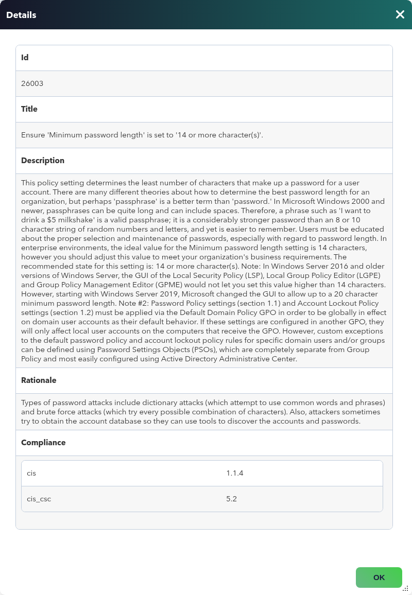
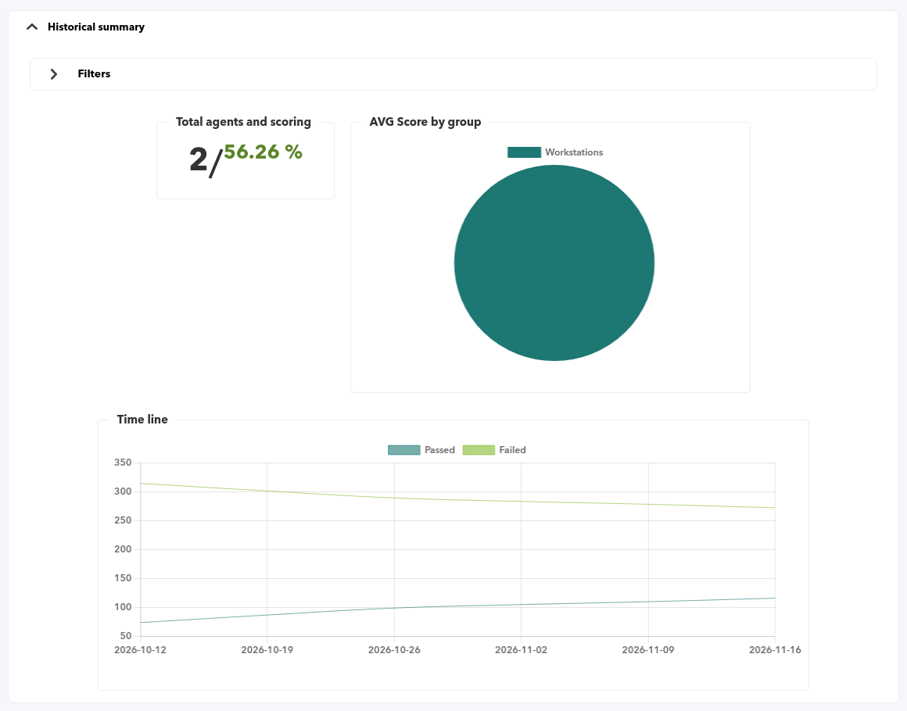
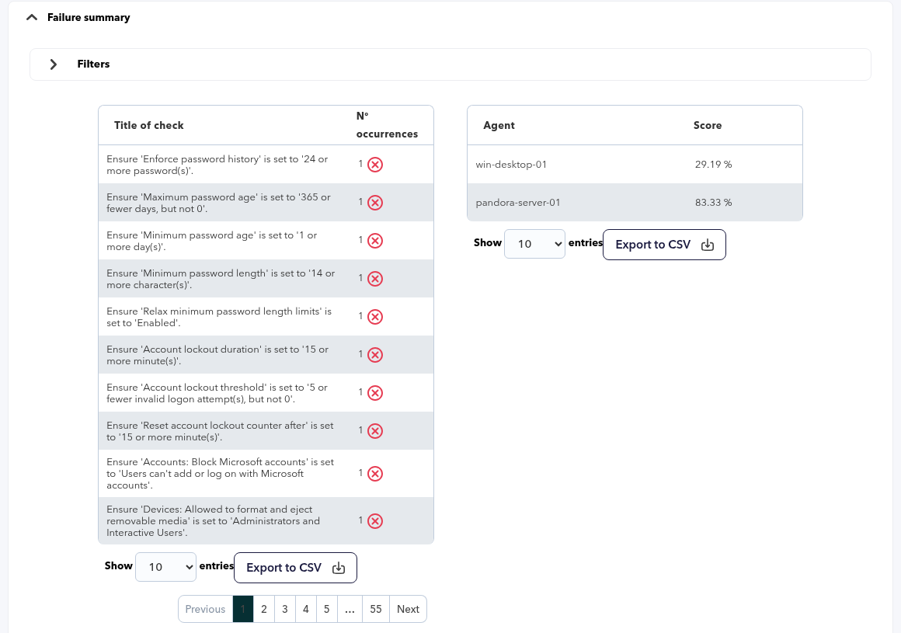
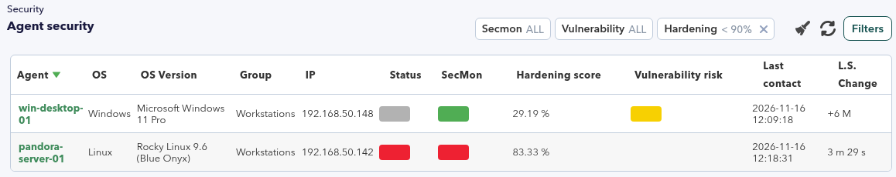

# Durcissement

Un serveur tout juste installé arrive avec le compte invité, des mots de passe
de six caractères qui n'expirent jamais et une douzaine de services que
personne n'a demandés. Il fonctionne, et c'est tout ce qu'on lui demande le
premier jour. Le problème vient après, quand cette configuration par défaut
reste telle quelle pendant des années et que quelqu'un de l'extérieur la connaît
mieux que celui qui l'administre.

Le durcissement (*hardening*) consiste à fermer ces portes : retirer ce qui est
en trop, renforcer ce qui reste et vérifier que cela tient. C'est ce dernier
point qu'on oublie, car une configuration sûre se dégrade toute seule : une mise
à jour qui change une valeur, un technicien pressé, un service activé « juste
pour essayer ». Ce n'est donc pas une tâche qu'on fait une fois, mais un audit
qu'on répète.

Pandora FMS réalise cet audit depuis l'EndPoint. Il vérifie chaque système par
rapport aux recommandations des **CIS Benchmarks** (les guides de configuration
sécurisée du *Center for Internet Security*), lui attribue un score et conserve
l'historique pour que vous voyiez s'il s'améliore ou se dégrade.
L'[analyse des vulnérabilités](7.4-analisis-de-vulnerabilidades.md) vous dit
quels paquets installés ont des failles connues ; le durcissement vous dit
comment est configuré ce que vous avez. Ce sont deux questions différentes et il
vaut mieux se poser les deux.

!!! info "Il audite, il ne corrige pas"
    L'audit se contente de mesurer : il ne modifie aucune configuration du
    système. Il vous dit quels contrôles échouent et pourquoi ils comptent ; la
    correction, c'est vous qui la décidez et l'appliquez.

Il vous apporte :

- **Un score par système**, de 0 à 100, avec le pourcentage de contrôles
  réussis.
- **Le résultat de chaque contrôle**, avec sa description, sa justification et
  ses références dans les cadres de conformité (CIS, PCI DSS, NIST, ISO 27001…).
- **L'évolution dans le temps**, par système et pour toute l'installation.
- **Des modules de supervision** avec le score et le nombre de contrôles, pour
  alerter quand il baisse, ainsi que des éléments de rapport et un *widget* de
  tableau de bord.

## Fonctionnement



1. Le *plugin* `pandora_hardening` s'exécute sur l'EndPoint et lance les
   contrôles qui correspondent à son système d'exploitation.
2. Il envoie le résultat avec les données de l'EndPoint : quatre modules avec
   les totaux et le score, et un inventaire avec le résultat de chaque contrôle.
3. La console croise cet inventaire avec la définition de chaque contrôle
   (titre, description, justification et références) et l'affiche dans les
   vues, les rapports et les *widgets*.

Ce qu'il faut savoir pour comprendre ce que vous voyez :

- **C'est l'EndPoint qui fait l'audit**, avec ses propres commandes et en local.
  Le serveur ne se connecte pas au système et n'a besoin d'aucun identifiant.
- **Il se répète tous les 7 jours** (`module_absoluteinterval 7d`). Si vous
  corrigez quelque chose, le changement apparaît au prochain audit.
- **Chaque contrôle se termine dans l'un de trois états :** **Passed** (réussi),
  **Failed** (échoué) ou **Skipped** (non applicable : il concerne une autre
  version du système d'exploitation ou cherche un composant qui n'est pas
  installé).
- **Le score est réussis / (réussis + échoués) × 100.** Les non applicables ne
  comptent pas : un serveur sans serveur web ne réussit ni n'échoue les
  contrôles d'Apache.
- **Chaque système d'exploitation a ses contrôles.** Un poste MS Windows peut
  dépasser le millier de résultats et une distribution Linux minimale n'en avoir
  que quelques dizaines d'applicables. Comparez l'évolution de chaque système
  avec lui-même plutôt que le score de deux systèmes différents.

## Prérequis

| Prérequis | Détail |
|---|---|
| Version Enterprise | L'audit de durcissement, ses vues et ses rapports font partie de la version Enterprise. |
| EndPoint | Linux ou MS Windows, version **774 ou ultérieure**. Le *plugin* `pandora_hardening` s'installe avec l'EndPoint (`/usr/share/pandora_agent/plugins/` sous Linux, `%PROGRAMFILES%\Pandora_Agent\util\` sous MS Windows). |
| Configuration à distance | Activée sur l'EndPoint pour activer l'audit depuis la console. Sans elle, il s'active dans le fichier de configuration de l'EndPoint. |
| Permissions | **AR** sur le groupe de l'agent pour voir les résultats. Pour l'activer depuis la console, la permission de modifier l'agent. |

## Activer l'audit

### Depuis la console

Dans l'édition de l'agent, onglet **Security**, activez **Enable security
hardening monitoring** et cliquez sur **Update**. La console ajoute le bloc du
*plugin* à la configuration à distance de l'EndPoint, qui le récupère à son
intervalle suivant et lance le premier audit.



L'interrupteur n'est utilisable que si l'agent a la configuration à distance
activée et un EndPoint 774 ou ultérieur ; sinon, il apparaît désactivé et un
avertissement vous indique lequel des deux manque. Le même onglet regroupe le
réglage de l'[analyse des vulnérabilités](7.4-analisis-de-vulnerabilidades.md)
et le [FIM](7.6-fim.md).

### Dans le fichier de configuration de l'EndPoint

Le fichier de configuration de l'EndPoint contient le bloc en commentaire.
Décommentez-le ou ajoutez-le :

Sous **Linux** :

```text
module_begin
module_plugin /usr/share/pandora_agent/plugins/pandora_hardening -t 150
module_absoluteinterval 7d
module_end
```

Sous **MS Windows** :

```text
module_begin
module_plugin "%PROGRAMFILES%\Pandora_Agent\util\pandora_hardening.exe" -t 150
module_absoluteinterval 7d
module_end
```

- `-t` est le temps maximal, en secondes, de chaque commande que lance l'audit.
  Sans lui, c'est 60 secondes.
- `module_absoluteinterval 7d` fait que l'audit s'exécute une fois tous les 7
  jours, même si l'EndPoint envoie des données toutes les quelques minutes.

!!! info "À quelle fréquence auditer"
    Sept jours, c'est un bon équilibre. Vous pouvez aller jusqu'à 30, mais ne
    raccourcissez pas : un audit quotidien ne vous apprend rien de nouveau et
    remplit la base de données de résultats répétés.

Pour l'activer sur de nombreuses machines à la fois, ajoutez le bloc à une
[politique de supervision](../parte-2/2.10-politicas-de-monitorizacion.md) et
appliquez-la au groupe. Sous MS Windows, l'installateur de l'EndPoint propose
aussi la case **Enable Hardening monitoring**, qui laisse le bloc activé dès
l'installation.

### Politiques personnalisées

Le *plugin* intègre son propre jeu de politiques, des fichiers YAML avec la
définition de chaque contrôle. Pour les adapter (désactiver un contrôle qui ne
s'applique pas dans votre organisation ou changer une valeur attendue) :

1. Téléchargez les politiques par défaut depuis le
   [Marketplace de Pandora FMS](https://marketplace.pandorafms.com/entries/hardening-default-policies)
   et décompressez-les.
2. Modifiez les fichiers `.yml` dont vous avez besoin.
3. Copiez le répertoire complet, avec ses sous-répertoires, vers un chemin que
   l'EndPoint de chaque système peut lire.
4. Ajoutez `--policy-dir` et ce chemin à la ligne du *plugin* :

```text
module_plugin /usr/share/pandora_agent/plugins/pandora_hardening -t 150 --policy-dir /chemin/vers/les/politiques
```

Le *plugin* lit tous les fichiers `.yml` de ce répertoire. Si le chemin n'existe
pas ou n'est pas un répertoire, il ne fait pas l'audit.

## Catégories des contrôles

La console regroupe les contrôles en catégories portant les noms des **CIS
Controls**, le catalogue de contrôles de sécurité du CIS :

- **Inventory and Control of Enterprise Assets**
- **Inventory and Control of Software Assets**
- **Data Protection**
- **Secure Configuration of Enterprise Assets and Software**
- **Account Management**
- **Access Control Management**
- **Continuous Vulnerability Management**
- **Audit Log Management**
- **Email and Web Browser Protections**

Chaque système n'affiche que les catégories dans lesquelles il a des contrôles,
et les vues, les filtres et les rapports de durcissement utilisent ces mêmes
catégories.

## Consulter les résultats

### Vue d'un agent

Dans la vue principale de l'agent, le panneau **Security** résume sa sécurité :
**SecurityMon** (le pire état des modules du groupe **Security**), **Hardening**
(son score) et, s'ils sont actifs, **Vulnerability** et **FIM**.



Le détail se trouve dans l'onglet **Security hardening** de la vue de l'agent.
Son bloc **Summary** rassemble :

- **Total resume and last audit scan :** les contrôles échoués et réussis, le
  score et la date du dernier audit.
- **Data categories** et **Total Checks :** la répartition par catégorie et
  entre réussis et échoués.
- **Time line :** l'évolution des réussis et des échoués à chaque audit.



- **Summary of categories :** pour chaque catégorie, les réussis, les échoués et
  le pourcentage de réussis. C'est là que vous décidez par où commencer.



En dessous, **Results for audit on** liste les contrôles du dernier audit :
date, identifiant, titre, catégorie et état. Ses **Filters** filtrent par
catégorie et par état (**Passed**, **Fail** ou **Skipped**), et **Export to
CSV** télécharge la liste. **History data** affiche les résultats des audits
précédents entre les dates que vous choisissez.



L'œil de **Details** ouvre la fiche du contrôle : son identifiant, le titre, la
description, la justification (**Rationale**) et les références dans les cadres
de conformité (**Compliance**), comme la section du CIS Benchmark.



### Vue générale

**Operation → Security → Hardening** rassemble tous les agents qui font l'audit
et que vous pouvez voir. Elle a trois blocs, chacun avec ses propres
**Filters** :

- **Historical summary :** le nombre d'agents et leur score moyen (**Total
  agents and scoring**), la moyenne par groupe (**AVG Score by group**) et
  l'évolution des réussis et des échoués (**Time line**). Il se filtre par
  groupe et par dates.



- **Category summary :** pour la catégorie que vous choisissez dans ses filtres,
  la répartition des contrôles (**Vulnerabilities**) et les échoués de chaque
  agent (**Checks failed by agent**).
- **Failure summary :** les contrôles qui échouent le plus dans l'installation,
  avec le nombre d'agents sur lesquels ils échouent (**Nº occurrences**), le
  score de chaque agent et la répartition des échoués par catégorie (**Data
  category failed**).



Les deux tableaux de **Failure summary** répondent à des questions différentes.
Celui des contrôles vous dit quelle correction répare le plus de systèmes à la
fois ; celui des agents, quel système va le plus mal.

### Agent security

**Operation → Security → Agent security** place chaque agent sur une ligne avec
son état de sécurité : **SecMon**, **Hardening score** et **Vulnerability
risk**. Elle se filtre par groupe, par alias et par score de durcissement
(**All**, ou en dessous d'un pourcentage, de **< 90%** à **< 10%**), ainsi que
par **Secmon** et **Vulnerability**.



## Corriger et auditer à nouveau

L'audit vous donne la liste de ce qui échoue ; le travail de correction vous
revient. Un cycle raisonnable :

1. Commencez par **Summary of categories** sur l'agent ou par **Failure
   summary** dans la vue générale, pour choisir quoi traiter en premier.
2. Ouvrez les **Details** du contrôle. Le titre indique déjà la valeur attendue
   (par exemple, *Ensure 'Minimum password length' is set to '14 or more
   character(s)'*) ; la description et la justification expliquent pourquoi,
   et la référence du CIS Benchmark vous mène à la procédure complète de
   correction.
3. Appliquez le changement sur le système, ou sur tous à la fois avec une
   stratégie de groupe ou votre outil de gestion de configuration.
4. Attendez le prochain audit : le contrôle passe à **Passed** et le score
   monte dans **Time line**.

Si un contrôle n'a pas de sens dans votre organisation, adaptez la politique
(voir [Politiques personnalisées](#politiques-personnalisees)) au lieu de vivre
avec un échec permanent qu'on finit par ne plus lire.

!!! warning "Testez avant de corriger en production"
    Les contrôles appliquent la recommandation générale du CIS, pas les besoins
    de votre service. Désactiver un ancien protocole ou durcir la politique de
    mots de passe peut bloquer une application qui en dépendait. Testez chaque
    changement sur un système de test et appliquez-le pendant une fenêtre de
    maintenance : la seule chose pire qu'un audit au rouge, c'est un serveur au
    vert qui ne rend plus de service.

## Alertes, rapports et tableaux de bord

Chaque audit crée ou met à jour quatre modules dans l'agent, dans le groupe de
modules **Security** :

| Module | Ce qu'il mesure |
|---|---|
| **Hardening - Passed checks** | Contrôles réussis. |
| **Hardening - Failed checks** | Contrôles échoués. |
| **Hardening - Not applied checks** | Contrôles non applicables à ce système. |
| **Hardening - Score** | Pourcentage de contrôles réussis, de 0 à 100. |

Ce sont des modules comme les autres, ils acceptent donc des seuils et des
alertes. Avec des seuils sur **Hardening - Score** (par exemple, **Critical** de
0 à 50 et **Warning** de 50 à 70), le module change d'état quand le score
baisse, et une alerte vous prévient que quelqu'un a défait le travail. La
configuration des alertes est expliquée dans
[Alertes et notifications](../parte-5/5.5-alertas-y-notificaciones.md).

Les [rapports](../parte-5/5.2-informes.md) ont le groupe d'éléments **Security
hardening** :

| Élément | Ce qu'il affiche |
|---|---|
| **Top-N agents with the worst score** | Les agents ayant le plus mauvais score, filtrés par groupe. |
| **Top-N most frequent failed checks** | Les contrôles qui échouent sur le plus d'agents. |
| **Top-N checks failed by category** | Les catégories ayant le plus de contrôles échoués. |
| **Vulnerabilities by category** | Les réussis, les échoués et, si vous le souhaitez, les non applicables d'une catégorie. |
| **List of checks** | La liste détaillée des derniers contrôles d'un agent, par catégorie et par état. |
| **Scoring by date** | Le dernier score de chaque agent dans la période du rapport. |
| **Evolution** | L'évolution quotidienne de la moyenne des réussis et des échoués. |

Dans les [tableaux de bord](../parte-5/5.1-dashboards.md), le *widget*
**Security Hardening** affiche n'importe lequel de ces sept types, choisi dans
son option **Data type**.

## Exploitation et dépannage

| Symptôme | Ce qu'il faut vérifier |
|---|---|
| L'interrupteur **Enable security hardening monitoring** est désactivé | L'agent n'a pas la configuration à distance activée ou son EndPoint est antérieur à la 774. L'avertissement à côté de l'interrupteur indique lequel. |
| Aucune donnée n'arrive après l'activation | L'EndPoint n'a pas encore récupéré la configuration (attendez son intervalle suivant) ou le bloc est toujours en commentaire dans son fichier de configuration. |
| Beaucoup de contrôles en **Skipped** | C'est normal : ce sont des contrôles d'une autre version du système ou de composants qui ne sont pas installés, et ils ne comptent pas dans le score. |
| L'audit interrompt des commandes | Augmentez la valeur de `-t` dans la ligne du *plugin*. |
| Le score ne change pas après une correction | La vue change avec le prochain audit, tous les 7 jours. |
| Le *plugin* avec `--policy-dir` n'envoie pas de résultats | Le chemin n'existe pas ou n'est pas un répertoire accessible à l'EndPoint. |

Pour voir ce qu'a fait le *plugin* sur un EndPoint Linux, exécutez-le à la main
en tant que `root` et examinez sa sortie, qui est la même que celle que reçoit
le serveur :

```bash
/usr/share/pandora_agent/plugins/pandora_hardening -t 150
```
