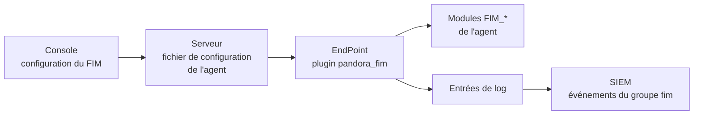
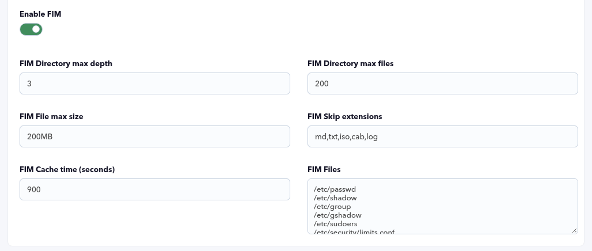
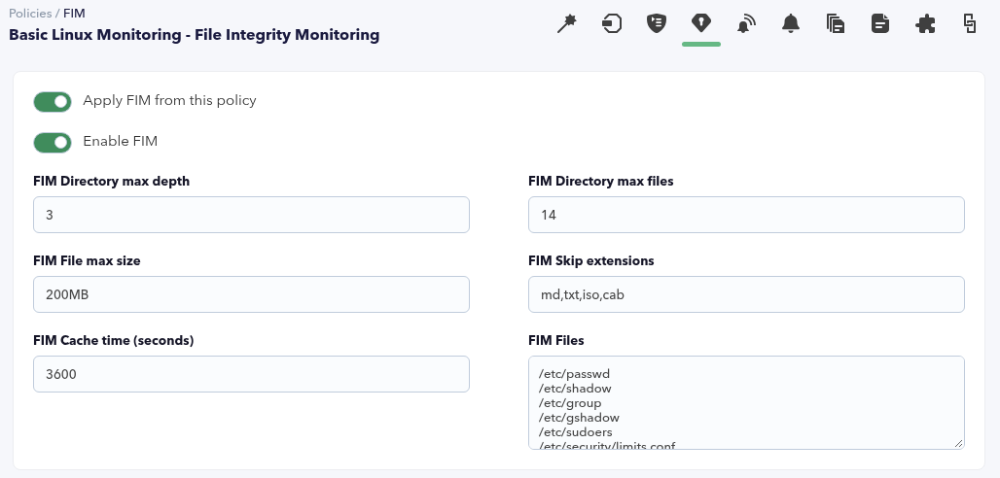
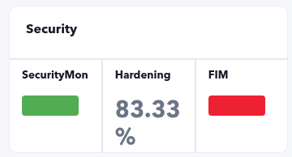
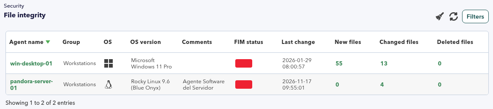
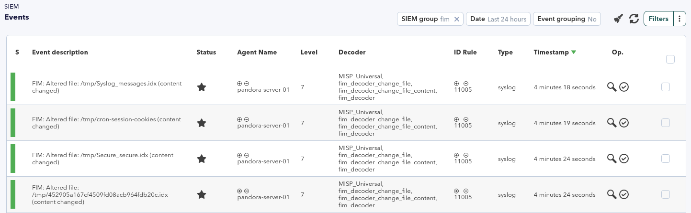

# FIM

Celui qui entre dans un système sans autorisation laisse rarement un mot. Il
laisse une ligne de plus dans `/etc/passwd`, un utilisateur de plus dans
`sudoers`, une entrée dans `hosts` qui envoie le trafic des mises à jour
ailleurs, ou un `svchost.exe` qui n'est plus celui qu'a installé Microsoft. Ce
sont de petits changements dans des fichiers que presque personne n'ouvre, et
c'est justement pour cela qu'ils fonctionnent : le serveur démarre toujours,
les services répondent et la supervision habituelle affiche tout au vert.

Le **FIM** (*File Integrity Monitoring*, contrôle de l'intégrité des fichiers)
surveille ces fichiers et vous prévient quand quelqu'un les crée, les modifie
ou les supprime. Il ne vous dit pas si le changement est bon ou mauvais, car
seul celui qui administre le système le sait ; il vous dit qu'il a eu lieu,
quand et dans quel fichier. Le [durcissement](7.5-hardening.md) vérifie que la
configuration est sûre ; le FIM, que personne n'y a touché depuis.

Pandora FMS le fait depuis l'EndPoint, sous Linux et sous MS Windows. Il vous
apporte :

- **Des modules dans chaque agent** avec l'état de l'intégrité et le nombre de
  fichiers nouveaux, modifiés et supprimés, qui acceptent des alertes comme
  n'importe quel autre module.
- **Une vue d'ensemble** avec l'état de tous les agents qui surveillent des
  fichiers.
- **Un événement du [SIEM](7.2-siem.md) pour chaque fichier concerné**, avec le
  chemin et ce qui a changé : taille, permissions, propriétaire ou contenu.

## Fonctionnement



1. Vous configurez le FIM dans la console, sur l'agent ou dans une politique.
   La console enregistre cette configuration sur le serveur, dans un fichier
   propre à chaque agent.
2. À chaque intervalle, l'EndPoint vérifie si sa configuration du FIM a changé
   et, le cas échéant, la télécharge.
3. Si le FIM est activé, l'EndPoint exécute le *plugin* `pandora_fim`, qui
   parcourt les fichiers et répertoires de la liste et les compare avec ce
   qu'il a vu la fois précédente.
4. Le *plugin* envoie les modules du FIM et une entrée de *log* pour chaque
   fichier nouveau, modifié ou supprimé. Le SIEM transforme ces entrées en
   événements.

Ce qu'il faut savoir pour comprendre ce que vous voyez :

- **Pour chaque fichier, il compare** son existence, sa taille, ses
  permissions et son propriétaire, et son contenu (avec un *hash*).
- **Le contrôle se répète à chaque intervalle de l'EndPoint.** Ce qui est
  modifié puis rétabli entre deux contrôles n'est pas vu.
- **Un fichier est considéré comme supprimé** lorsqu'il n'a pas été vu depuis
  plus longtemps que la valeur de **FIM Cache time (seconds)**.
- **La configuration à distance n'est pas nécessaire.** L'EndPoint télécharge
  la configuration du FIM à part, même sans configuration à distance activée.

## Prérequis

| Prérequis | Détail |
|---|---|
| Version Enterprise | Le FIM, sa configuration et sa vue font partie de la version Enterprise. |
| EndPoint | Linux ou MS Windows, version **784 ou ultérieure**. Le *plugin* `pandora_fim` s'installe avec l'EndPoint. |
| Permissions | **AR** sur le groupe de l'agent pour voir les résultats. Pour le configurer, la permission de modifier l'agent ou la politique. |
| SIEM | Pour voir le détail de chaque fichier modifié. Voir [SIEM](7.2-siem.md). |

## Activer le FIM sur un agent

Dans **Management → Resources → Manage agents**, modifiez l'agent et ouvrez
l'onglet **Security**. Activez **Enable FIM**, ajustez les champs et cliquez
sur **Update**.



| Champ | Par défaut | Ce qu'il fait |
|---|---|---|
| **FIM Directory max depth** | `3` | Niveaux de sous-répertoires parcourus dans chaque répertoire de la liste. |
| **FIM Directory max files** | `14` | Nombre maximal de fichiers surveillés dans chaque répertoire. |
| **FIM File max size** | `200MB` | Taille maximale des fichiers surveillés dans les répertoires. Elle s'indique avec la valeur et l'unité. |
| **FIM Skip extensions** | `md,txt,iso,cab` | Extensions ignorées dans les répertoires, séparées par des virgules. |
| **FIM Cache time (seconds)** | `3600` | Secondes pendant lesquelles un fichier peut ne pas être vu avant d'être considéré comme supprimé. |
| **FIM Files** | Selon le système d'exploitation | Fichiers et répertoires surveillés, un par ligne (voir la section suivante). |

Les quatre premières limites ne concernent que les répertoires. Elles évitent
qu'un répertoire trop générique (`C:\Windows\System32`, par exemple) ne dévore
les ressources du système : mieux vaut surveiller quelques fichiers bien
choisis que parcourir la moitié du disque à chaque intervalle.

L'interrupteur n'est utilisable qu'avec un EndPoint 784 ou ultérieur et si
l'agent ne reçoit pas le FIM d'une politique ; sinon, il apparaît désactivé et
un avertissement en indique la raison. La configuration arrive à l'EndPoint à
son intervalle suivant.

### Fichiers et répertoires à surveiller

**FIM Files** accepte un chemin par ligne. Ce peut être un fichier ou un
répertoire, et trois autres choses sont possibles :

- **Caractères génériques** (`*`, `?` et `[…]`) pour les chemins qui changent
  d'un système à l'autre. Par exemple, le dossier de démarrage de tous les
  utilisateurs de MS Windows :

    ```text
    C:\Users\*\AppData\Roaming\Microsoft\Windows\Start Menu\Programs\Startup\
    ```

- **Exclusions** : une ligne qui commence par `exclude` retire un chemin ou un
  motif de ce que surveillent les autres lignes :

    ```text
    /opt/myapp
    exclude /opt/myapp/*.tmp
    ```

- **Commentaires** : les lignes qui commencent par `#` sont ignorées. Elles
  servent à laisser un chemin prêt et à l'activer en cas de besoin :

    ```text
    #exclude /opt/myapp/*.tmp
    ```

Quand vous activez le FIM, la console propose une liste selon le système
d'exploitation de l'agent. Sous **Linux** :

```text
/etc/passwd
/etc/shadow
/etc/group
/etc/gshadow
/etc/sudoers
/etc/security/limits.conf
/etc/hosts
/etc/hostname
/etc/resolv.conf
/etc/ssh/sshd_config
/etc/fstab
/etc/crontab
```

Sous **MS Windows**, les ruches du registre système, les binaires
habituellement usurpés et le fichier `hosts` :

```text
C:\Windows\System32\config\SAM
C:\Windows\System32\config\SYSTEM
C:\Windows\System32\config\SECURITY
C:\Windows\System32\config\SOFTWARE
C:\Windows\System32\config\DEFAULT
C:\Windows\System32\winlogon.exe
C:\Windows\System32\lsass.exe
C:\Windows\System32\services.exe
C:\Windows\System32\smss.exe
C:\Windows\System32\svchost.exe
C:\Windows\System32\csrss.exe
C:\Windows\System32\winload.exe
C:\Windows\System32\ntoskrnl.exe
C:\Windows\System32\drivers\etc\hosts
C:\Windows\explorer.exe
C:\Windows\System32\cmd.exe
C:\Windows\system32\WindowsPowerShell\v1.0\powershell.exe
C:\Windows\System32\wscript.exe
C:\Windows\System32\cscript.exe
C:\Windows\System32\taskmgr.exe
C:\Windows\SysWOW64\kernel32.dll
C:\Windows\SysWOW64\user32.dll
C:\Windows\SysWOW64\advapi32.dll
C:\Windows\SysWOW64\gdi32.dll
C:\Windows\SysWOW64\ntdll.dll
C:\Windows\SysWOW64\ole32.dll
C:\Windows\SysWOW64\shell32.dll
C:\Windows\SysWOW64\ws2_32.dll
C:\Windows\SysWOW64\cmd.exe
C:\Windows\SysWOW64\WindowsPowerShell\v1.0\powershell.exe
C:\Windows\SysWOW64\wscript.exe
C:\Windows\SysWOW64\regsvr32.exe
C:\Windows\SysWOW64\mshta.exe
```

Ajoutez les fichiers de configuration de vos services (le serveur web, la base
de données, vos propres applications) et retirez ce qui ne s'applique pas.

!!! tip "Écartez les répertoires qui changent tout seuls"
    Un répertoire de fichiers temporaires, de *logs* ou de caches change à
    chaque intervalle, et le FIM vous préviendra de chaque changement.
    Excluez-le avec `exclude` ou avec **FIM Skip extensions** : si
    l'avertissement se déclenche toujours, vous l'ignorerez aussi le jour où il
    comptera.

## Activer le FIM avec des politiques

Pour configurer le FIM sur de nombreux agents à la fois, utilisez une
[politique de supervision](../parte-2/2.10-politicas-de-monitorizacion.md).
Dans **Management → Resources → Manage policies**, modifiez la politique et
ouvrez l'onglet **File Integrity Monitoring**. Il contient les mêmes champs que
l'agent et deux interrupteurs :



| Apply FIM from this policy | Enable FIM | Ce qui se passe sur les agents de la politique |
|---|---|---|
| Désactivé | Indifférent | La politique ne touche pas au FIM : chaque agent garde le sien. |
| Activé | Activé | La politique configure le FIM avec ses valeurs et active les modules du FIM. |
| Activé | Désactivé | La politique désactive le FIM et ses modules. |

La troisième combinaison sert à couper le FIM sur tout un groupe d'agents en
une seule fois. Les changements arrivent aux agents lorsque la politique est
appliquée.

Tant qu'un agent reçoit le FIM d'une politique, son onglet **Security** affiche
les champs verrouillés et l'avertissement **This agent has a FIM policy**, avec
un lien vers la politique. Les changements se font dans la politique.

!!! warning "Politiques pour MS Windows"
    L'onglet de la politique propose toujours la liste de fichiers de Linux.
    Dans une politique pour des agents MS Windows, remplacez-la par la liste MS
    Windows de la section précédente.

## Consulter les résultats

### Modules de l'agent

Chaque agent avec le FIM activé a cinq modules :

| Module | Ce qu'il mesure |
|---|---|
| `FIM_status` | État de l'intégrité des fichiers surveillés. Il passe en critique quand le FIM détecte des changements. |
| `FIM_status_last_change` | Date et heure du dernier changement d'état de `FIM_status`. |
| `FIM_new` | Fichiers nouveaux détectés lors du dernier contrôle. |
| `FIM_changed` | Fichiers modifiés lors du dernier contrôle. |
| `FIM_deleted` | Fichiers supprimés détectés lors du dernier contrôle. |

Quand vous désactivez le FIM, la console désactive ces modules ; quand vous le
réactivez, elle les réactive.

Dans la vue principale de l'agent, le panneau **Security** affiche **FIM** avec
l'état de l'intégrité. Un clic vous mène aux événements du SIEM de cet agent.



### Vue File integrity

**Operation → Security → File integrity** rassemble tous les agents avec le FIM
activé : leur groupe, leur système d'exploitation, l'état (**FIM status**), la
date du dernier changement (**Last change**) et les fichiers nouveaux,
modifiés et supprimés. Ses **Filters** filtrent par agent et par état :
**Fired** (avec des changements) ou **Not fired** (sans changement).



Le nom de chaque agent mène à sa configuration du FIM, et les compteurs, à ses
événements du SIEM.

### Événements du SIEM

Le détail de chaque changement se trouve dans le SIEM. Les règles du groupe
`fim` sont fournies par défaut et génèrent un événement de niveau 7 pour chaque
fichier :

| Événement | Quand |
|---|---|
| `FIM: New file: <chemin>` | Un nouveau fichier apparaît. |
| `FIM: Altered file: <chemin> new size <octets>` | La taille change. |
| `FIM: Altered file: <chemin> new access <propriétaire>(<permissions>)` | Les permissions ou le propriétaire changent. |
| `FIM: Altered file: <chemin> (content changed)` | Le contenu change. |
| `FIM: Deleted file: <chemin>` | Un fichier disparaît. |

Pour tous les voir, dans **Operation → SIEM → Events**, filtrez par **SIEM
group** `fim`.



## Alertes

Les modules du FIM acceptent des alertes comme n'importe quel autre module. La
plus directe est une alerte sur `FIM_status` quand il passe en critique : elle
vous prévient dès que le FIM détecte un changement sur l'agent. La
configuration des alertes est expliquée dans
[Alertes et notifications](../parte-5/5.5-alertas-y-notificaciones.md).

Si vous voulez des avertissements par fichier (par exemple, uniquement quand
`sudoers` change), utilisez les alertes du [SIEM](7.2-siem.md) sur les
événements du groupe `fim`.

## Exploitation et dépannage

| Symptôme | Ce qu'il faut vérifier |
|---|---|
| **Enable FIM** est désactivé | L'EndPoint est antérieur à la 784 ou l'agent reçoit le FIM d'une politique. L'avertissement à côté de l'interrupteur indique lequel. |
| Les modules du FIM n'apparaissent pas après l'activation | L'EndPoint n'a pas encore téléchargé la configuration : attendez son intervalle suivant. Sous Linux, son *log* enregistre `FIM configuration updated` quand il la reçoit. |
| Il y a des changements à chaque intervalle sans que personne ne touche à rien | La liste contient des répertoires qui changent tout seuls (temporaires, *logs*, caches). Excluez-les avec `exclude` ou avec **FIM Skip extensions**. |
| L'EndPoint consomme trop de ressources | Réduisez **FIM Directory max depth**, **FIM Directory max files** ou **FIM File max size**, ou remplacez les répertoires génériques par des fichiers précis. |
| Les compteurs changent, mais il n'y a pas d'événements dans le SIEM | Le SIEM ne reçoit pas les *logs* de cet agent. Voir [SIEM](7.2-siem.md). |
| Les changements sur l'agent ne sont pas enregistrés | L'agent reçoit le FIM d'une politique : modifiez-le dans la politique. |
