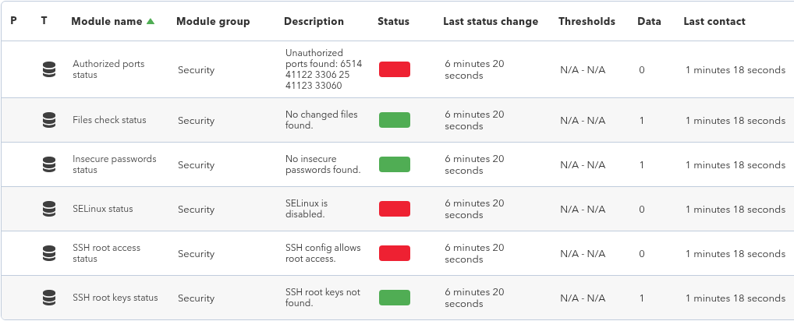
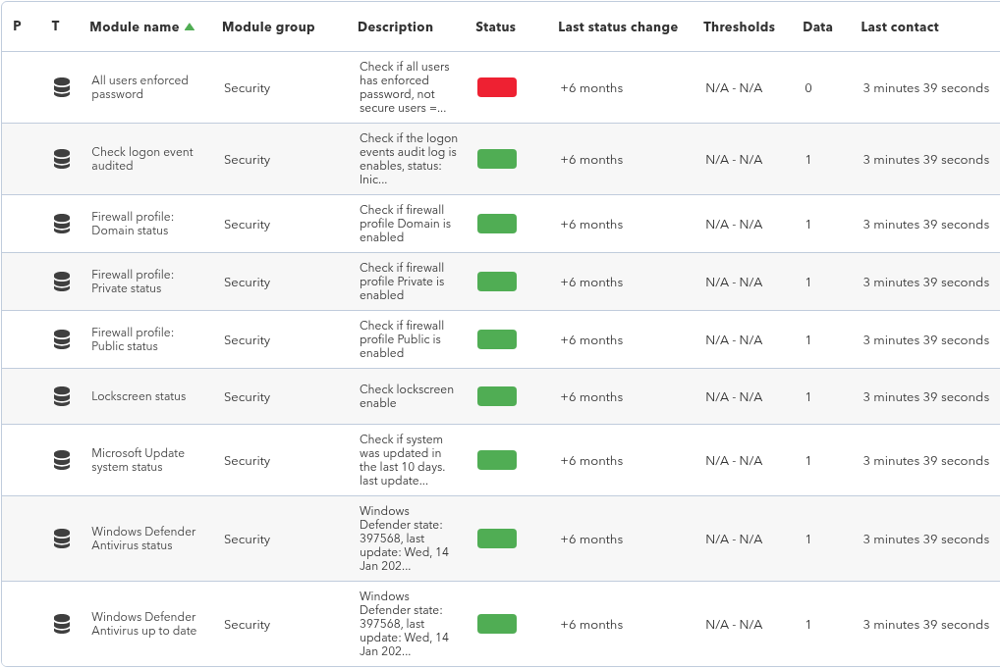
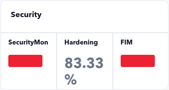

# Supervision de la sécurité

Les incidents graves commencent rarement par une attaque brillante. Ils
commencent par un utilisateur `admin` dont le mot de passe est `admin`, par un
serveur de test qui laisse root entrer par SSH ou par un port que quelqu'un a
ouvert pour une démo il y a deux ans et que personne n'a jamais refermé. Ce
sont de petites négligences, sur des machines que personne ne regarde parce
qu'elles « ne servent qu'aux tests », et c'est pour cela qu'elles marchent :
l'attaquant ne cherche pas la porte blindée, il cherche la fenêtre restée
ouverte.

Pandora FMS travaille la sécurité sur trois fronts :

- **Il supervise l'infrastructure de sécurité** comme n'importe quelle
  autre : sauvegardes, antivirus, VPN, pare-feu, IDS/IPS, SIEM, *honeypots*,
  systèmes d'authentification, stockage ou collecte de *logs*. Au fond, ce
  sont des services, des processus, des ports et des *logs*, et ils se
  surveillent avec les mêmes outils que le reste.
- **Il se protège lui-même**, avec l'authentification à deux facteurs (2FA),
  les mots de passe chiffrés dans la base de données et son propre journal
  d'audit ([Configuration sécurisée](7.11-configuracion-segura.md)),
  l'[authentification externe](../parte-4/4.2-autenticacion-externa-y-centralizacion-de-accesos.md)
  et l'envoi de données chiffré en SSL/TLS avec
  [Tentacle](../parte-9/9.4-referencia-completa-de-tentacle.md).
- **Il apporte ses propres fonctions de sécurité** :

| Fonction | Ce qu'elle fait |
|---|---|
| [SIEM](7.2-siem.md) | Collecte et corrèle les *logs* et les événements de sécurité. |
| [SOAR](7.3-soar.md) | Automatise la réponse quand le SIEM détecte quelque chose. |
| [Analyse des vulnérabilités](7.4-analisis-de-vulnerabilidades.md) | Cherche les vulnérabilités connues dans les logiciels des systèmes Linux, MS Windows et distants. |
| [Durcissement](7.5-hardening.md) | Évalue dans le temps le niveau de sécurité de la configuration des systèmes Linux et MS Windows. |
| [FIM](7.6-fim.md) | Vous prévient quand quelqu'un crée, modifie ou supprime des fichiers critiques sous Linux ou MS Windows. |
| **Plugins de sécurité** | Vérifient l'essentiel à chaque intervalle de l'EndPoint, sous Linux et MS Windows. Ils sont le sujet de ce chapitre. |

L'entreprise qui développe Pandora FMS est certifiée ISO 27001 et est CNA
(*CVE Numbering Authority*) de MITRE : elle enregistre elle-même les CVE de
ses propres vulnérabilités. Sa
[politique de sécurité](https://pandorafms.com/fr/securite/) est publique et
ouverte aux auditeurs indépendants.

Les plugins de sécurité sont deux programmes légers, l'un pour Linux et
l'autre pour MS Windows, que l'EndPoint exécute à chaque intervalle (cinq
minutes par défaut). Chaque vérification devient un module, normal si tout
est en ordre et critique s'il trouve quelque chose. Ils ne remplacent ni le
durcissement ni le FIM, mais ils surveillent sans relâche ce qui ne devrait
jamais faillir.

## Prérequis

| Prérequis | Détail |
|---|---|
| EndPoint pour Linux | Version **774 ou ultérieure**, qui installe le plugin `pandora_security_check`. Il faut Perl sur le système et un EndPoint exécuté en root (c'est le cas par défaut) pour lire `/etc/shadow`. |
| EndPoint pour MS Windows | Version **775 ou ultérieure**, qui installe `pandora_security_win.exe`. Les options `--metrics` et `--verbose` arrivent avec la **805**. |
| Configuration de l'EndPoint | Accès à son `pandora_agent.conf`, sur le système lui-même ou depuis la console web avec la [configuration à distance](../parte-2/2.1-monitorizacion-con-endpoints.md#configuration-distante-depuis-la-console-web). |

## Plugin de sécurité pour Linux

L'EndPoint pour Linux est livré avec le plugin installé mais désactivé. Pour
l'activer, modifiez `/etc/pandora/pandora_agent.conf`, cherchez cette ligne
et retirez le `#` du début :

```text
module_plugin perl /usr/share/pandora_agent/plugins/pandora_security_check --conf /usr/share/pandora_agent/plugins/pandora_security_check.conf
```

Le plugin et son fichier de configuration se trouvent dans
`/usr/share/pandora_agent/plugins/`, le dossier vers lequel pointe
`/etc/pandora/plugins`. Redémarrez l'EndPoint : les modules apparaissent dans
la console après la première exécution.

Si l'agent a la configuration à distance activée, faites la modification
depuis la console web : l'EndPoint remplace son fichier local par celui du
serveur. Pour l'activer sur de nombreux systèmes à la fois, ajoutez la même
ligne comme
[plugin d'EndPoint dans une politique](../parte-2/2.10-politicas-de-monitorizacion.md#2108-plugins-dendpoint-dans-une-politique).

### Vérifications et modules

Chaque vérification crée un module de type *generic_proc* dans le groupe
**Security** : il vaut `1` (normal) si tout est en ordre et `0` (critique)
s'il trouve quelque chose. La description du module indique ce qu'il a
trouvé.

| Module | Ce qu'il vérifie | Il passe en critique si… |
|---|---|---|
| `SELinux status` | L'état de SELinux, avec `sestatus`. | SELinux est désactivé ou son état est impossible à déterminer (`sestatus` n'existe pas). |
| `SSH root access status` | La directive `PermitRootLogin` de `/etc/ssh/sshd_config`. | Elle a une valeur autre que `no` (y compris `prohibit-password`) ou le fichier est illisible. |
| `SSH root keys status` | Les clés SSH de type RSA dans `/root/.ssh` et ses sous-dossiers, sans compter `authorized_keys` ni `known_hosts`. | Il en trouve une. La description liste les fichiers. |
| `Authorized ports status` | Les ports TCP en écoute, en IPv4 et IPv6, sauf ceux qui n'écoutent que sur `127.0.0.1` ou `::1`. | L'un d'eux ne figure pas dans la liste des ports autorisés. La description indique lesquels. |
| `Files check status` | L'empreinte MD5 de chaque fichier de la liste, comparée à celle de l'exécution précédente. | Un fichier a changé depuis l'exécution précédente. La description indique lesquels. |
| `Insecure passwords status` | Les mots de passe de `/etc/shadow`, comparés au dictionnaire et au nom de chaque utilisateur. | Un utilisateur a un mot de passe du dictionnaire ou identique à son nom. La description indique lesquels. |

Trois d'entre elles méritent une explication :

- **Clés de root.** Il ne cherche pas qui peut se connecter en root sur ce
  système (c'est dans `authorized_keys`), mais les clés avec lesquelles root
  peut se connecter sans mot de passe à **d'autres** machines. Celui qui
  prend la main sur ce système les emporte en cadeau.
- **Fichiers.** Le plugin garde les empreintes d'une exécution à l'autre ; la
  première ne fait que prendre la référence. L'état critique dure **une
  exécution** : à la suivante, la nouvelle empreinte devient la référence et
  le module revient à normal. C'est pourquoi ce module réclame une
  [alerte](#alertes). Pour savoir ce qui a changé dans chaque fichier,
  utilisez le [FIM](7.6-fim.md).
- **Mots de passe.** Le dictionnaire contient 100 des mots de passe les plus
  utilisés au monde. Ajoutez ceux qui circulent dans votre organisation : le
  nom de l'entreprise suivi de l'année a un succès que vous n'imaginez pas.
  Les comptes sans mot de passe utilisable (`*`, `!!`, `!locked` ou `!*` dans
  `/etc/shadow`) ne sont pas vérifiés.

!!! tip "Sans SELinux, sans ce module"
    Sur les distributions qui n'utilisent pas SELinux (Debian et Ubuntu, par
    exemple, utilisent AppArmor), `SELinux status` sera toujours critique.
    Désactivez cette vérification avec `--check_selinux 0`.

### Personnaliser les listes

Les ports autorisés, les fichiers surveillés et les mots de passe du
dictionnaire viennent de deux sources qui s'additionnent : les listes
internes du plugin et son fichier de configuration,
`pandora_security_check.conf`. Le fichier a trois blocs, `[PORTS]`, `[FILES]`
et `[PASSWORDS]`, avec une entrée par ligne. Voici le fichier livré :

```text
[PORTS]
22
80
443
41121
8080

[FILES]
/etc/httpd/httpd.conf
/etc/my.cnf
/etc/sudoers
/etc/passwd
/etc/hosts

[PASSWORDS]
pandora
PANDORA
P4nd0r4
password
root
linux
admin
```

| Liste | Listes internes | Le fichier livré ajoute |
|---|---|---|
| Ports autorisés | `22`, `80` | `443`, `41121` (Tentacle), `8080` |
| Fichiers surveillés | `/etc/shadow`, `/etc/passwd`, `/etc/hosts`, `/etc/resolv.conf`, `/etc/ssh/sshd_config`, `/etc/rsyslog.conf` | `/etc/httpd/httpd.conf`, `/etc/my.cnf`, `/etc/sudoers` |
| Mots de passe | 100 mots de passe courants | `pandora`, `PANDORA`, `P4nd0r4`, `root`, `linux`, `admin` |

Ajoutez les ports des services que le système doit offrir, les fichiers de
configuration de vos applications et les mots de passe à bannir. Les fichiers
qui n'existent pas sont simplement ignorés. Si vous préférez que seul votre
fichier compte, sans les listes internes, ajoutez `--include_defaults 0` à la
ligne du plugin.

### Options du plugin

| Option | Ce qu'elle fait |
|---|---|
| `--conf <fichier>` | Fichier de configuration avec les blocs `[PORTS]`, `[FILES]` et `[PASSWORDS]`. |
| `--check_selinux {0,1}` | Active (`1`) ou désactive (`0`) la vérification de SELinux. |
| `--check_ssh_root_access {0,1}` | Active ou désactive la vérification de l'accès de root par SSH. |
| `--check_ssh_root_keys {0,1}` | Active ou désactive la recherche des clés SSH de root. |
| `--check_ports {0,1}` | Active ou désactive la vérification des ports. |
| `--check_files {0,1}` | Active ou désactive la vérification des fichiers. |
| `--check_passwords {0,1}` | Active ou désactive la vérification des mots de passe. |
| `--include_defaults {0,1}` | Avec `0`, ignore les listes internes et n'utilise que celles du fichier de configuration. |
| `--integrity_file <fichier>` | Fichier où sont gardées les empreintes des fichiers surveillés. Par défaut, un fichier dans `/tmp`. |

Toutes les vérifications sont actives par défaut. Par exemple, sur Ubuntu,
sans SELinux et avec les empreintes hors de `/tmp` :

```text
module_plugin perl /usr/share/pandora_agent/plugins/pandora_security_check --conf /usr/share/pandora_agent/plugins/pandora_security_check.conf --check_selinux 0 --integrity_file /var/lib/pandora_security_check.integrity
```

## Plugin de sécurité pour MS Windows

L'EndPoint pour MS Windows est livré avec `pandora_security_win.exe` dans le
dossier `util` de son installation, lui aussi désactivé. Pour l'activer,
modifiez son `pandora_agent.conf`, cherchez le bloc **Pandora basic security
check plugin for windows** et retirez le `#` des trois lignes du module :

```text
# Pandora basic security check plugin for windows.
module_begin
module_plugin "%PROGRAMFILES%\Pandora_Agent\util\pandora_security_win.exe" --conf "%PROGRAMFILES%\Pandora_Agent\util\pandora_security_win.conf" 2> nul
module_end
```

Redémarrez le service de l'EndPoint (`PandoraFMSAgent`) : les modules
apparaissent après la première exécution. Ce qui a été dit pour Linux sur la
configuration à distance et les politiques vaut aussi ici.

### Vérifications et modules

Tous les modules sont de type *generic_proc* dans le groupe **Security**,
comme sous Linux.

| Module | Ce qu'il vérifie | Il passe en critique si… |
|---|---|---|
| `<antivirus> Antivirus status` | Chaque antivirus enregistré dans le Centre de sécurité Windows, de Microsoft ou d'un éditeur tiers. Par exemple, `Windows Defender Antivirus status`. | L'antivirus n'est pas actif. |
| `<antivirus> Antivirus up to date` | Les signatures de ce même antivirus. | Les signatures ne sont pas à jour. |
| `Lockscreen status` | Qu'aucune stratégie ne désactive l'écran de verrouillage (valeurs de registre `DisableLockScreen` et `NoLockScreen`). | L'une des deux le désactive. |
| `Microsoft Update system status` | La date de la dernière mise à jour installée avec Windows Update. | 10 jours ou plus se sont écoulés. |
| `Firewall profile: Domain status`, `Firewall profile: Private status` et `Firewall profile: Public status` | Chacun des trois profils du pare-feu Windows. | Ce profil est désactivé. |
| `All users enforced password` | Que tous les comptes d'utilisateur exigent un mot de passe. | L'un d'eux ne l'exige pas. La description indique combien. |
| `Check logon event audited` | Que l'audit des ouvertures de session enregistre les succès et les échecs, avec `auditpol`. | Il n'enregistre pas les deux (les succès seuls ne suffisent pas). |

MS Windows Server n'a pas de Centre de sécurité Windows : les modules
d'antivirus ne sont pas créés, et c'est normal.

### Systèmes dans d'autres langues

`auditpol` répond dans la langue du système : le plugin doit donc savoir
comment s'appelle la sous-catégorie d'ouverture de session et quels textes
signifient « succès et échec » et « aucun audit ». C'est dans
`pandora_security_win.conf`, dans le même dossier `util`. Il est livré en
anglais, avec les textes espagnols commentés à côté :

```text
auditpol_logon_category = Logon
#auditpol_logon_category = Inicio de sesión

auditpol_logon_success_conf = Success and Failure
#auditpol_logon_success_conf = Aciertos y errores

auditpol_logon_noaudit_conf = No Auditing
#auditpol_logon_noaudit_conf = Sin auditoría
```

Sur un MS Windows en espagnol, commentez les trois lignes en anglais et
retirez le `#` des trois lignes en espagnol. Dans toute autre langue, le
français compris, écrivez les textes exactement comme
`auditpol /get /category:*` les affiche sur ce système.

### Options du plugin

| Option | Ce qu'elle fait |
|---|---|
| `--conf <fichier>` | Fichier de configuration avec les textes d'`auditpol`. |
| `-m`, `--metrics` | Vérifications à exécuter : `all` (par défaut), `Antivirus`, `Lockscreen`, `Windows_update`, `Firewall`, `Password` et `Logon`. Accepte plusieurs valeurs, séparées par des espaces. Depuis la 805. |
| `-v`, `--verbose` | Écrit les erreurs sur la sortie d'erreur. Utile pour lancer le plugin à la main et voir ce qui échoue. Depuis la 805. |

Par exemple, pour ne garder que le pare-feu, les mots de passe et l'audit :

```text
module_plugin "%PROGRAMFILES%\Pandora_Agent\util\pandora_security_win.exe" --conf "%PROGRAMFILES%\Pandora_Agent\util\pandora_security_win.conf" --metrics Firewall Password Logon 2> nul
```

## Consulter les résultats

Les modules apparaissent dans la vue de l'agent, dans le groupe **Security**,
à côté de ceux du durcissement, de l'analyse des vulnérabilités et du FIM
s'ils sont actifs. Pour ne voir que ce groupe, ouvrez **Filters** sur la liste
des modules et choisissez **Security** dans **Module group**. La colonne
**Description** indique ce que chaque vérification a trouvé : quels ports,
quels fichiers, quels utilisateurs.





Dans la même vue, le panneau **Security** résume le groupe dans
**SecurityMon** : critique si un module du groupe **Security** l'est,
avertissement si l'un d'eux est en avertissement et normal si tous vont bien.
Comme le groupe comprend aussi les modules du durcissement, des
vulnérabilités et du FIM, **SecurityMon** est le feu tricolore de sécurité de
tout l'agent.



## Alertes

Comme ce sont des modules *generic_proc*, n'importe quel modèle d'alerte pour
modules critiques leur convient. Leur mise en place est décrite dans
[Alertes et notifications](../parte-5/5.5-alertas-y-notificaciones.md).

Donnez-en une à `Files check status`, quoi qu'il arrive. Son état critique
dure une exécution : à la suivante, il revient à normal, et même si
l'événement reste, si personne ne le regarde, le changement passe inaperçu.
Les autres modules restent critiques tant que le problème est là.

## Exploitation et dépannage

| Symptôme | Ce qu'il faut vérifier |
|---|---|
| Les modules n'apparaissent pas | La ligne du plugin est encore commentée ou l'EndPoint n'a pas été redémarré. Avec la configuration à distance activée, la modification doit se faire depuis la console web. |
| Les modules n'apparaissent pas sous Linux, avec la ligne active | Que Perl est installé : le plugin est un script Perl. |
| `SELinux status` toujours critique | La distribution n'utilise pas SELinux : ajoutez `--check_selinux 0`. |
| `Authorized ports status` critique à cause d'un service légitime | Ajoutez son port au bloc `[PORTS]` de `pandora_security_check.conf`. |
| `Insecure passwords status` critique avec « Can not read /etc/shadow » | L'EndPoint ne s'exécute pas en root. |
| `Files check status` normal alors qu'un fichier a changé | L'état critique dure une exécution. Consultez les événements du module ou donnez-lui une alerte. |
| Les modules d'antivirus manquent sous MS Windows | Ils ne sont pas créés sous MS Windows Server : il n'y a pas de Centre de sécurité Windows. |
| `Check logon event audited` n'apparaît pas ou est toujours critique | Le système est dans une autre langue : ajustez `pandora_security_win.conf`. Si rien ne change, vérifiez avec `auditpol` que les succès et les échecs sont audités. |
| `Microsoft Update system status` critique | Le système n'a installé aucune mise à jour Windows Update depuis 10 jours ou plus. |
