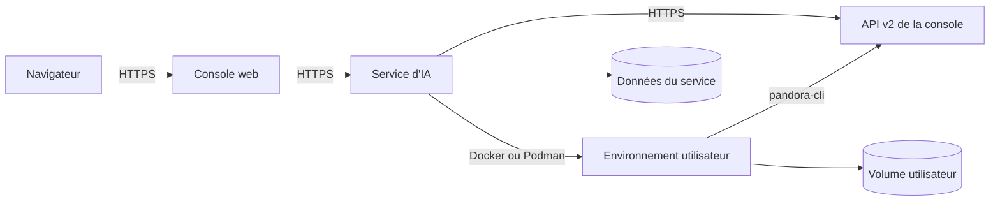
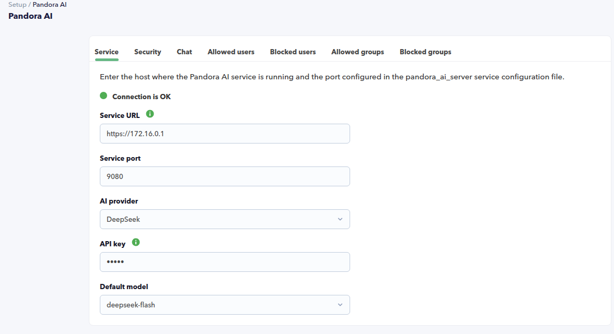
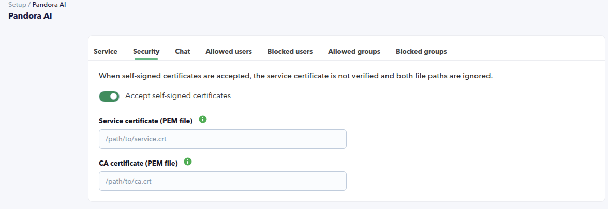
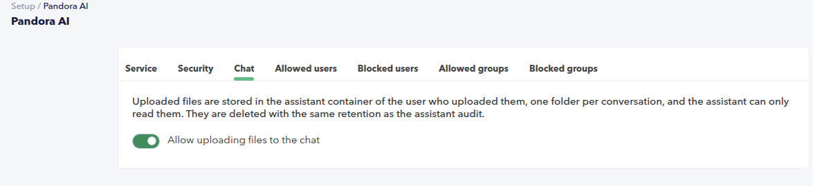
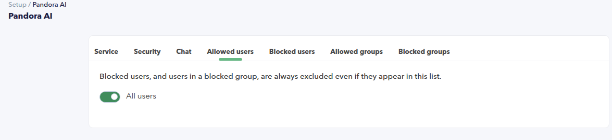
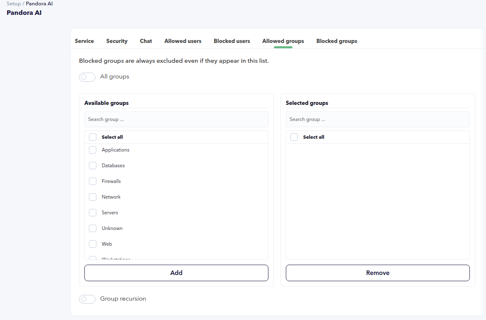

# Introduction et installation

Pandora AI est un assistant d'intelligence artificielle intégré à la console web.
Chaque utilisateur dialogue avec lui pour consulter l'état de la plateforme
(agents, modules, événements, alertes, serveurs, inventaire et audit) et pour
exécuter des actions avec les mêmes permissions que dans la console. Ce n'est pas
un chat générique isolé : il connaît le produit parce qu'il travaille contre l'API
de la console via `pandora-cli`, et chaque utilisateur le fait dans un
environnement séparé.

L'assistant n'est pas activé par défaut. Le service est installé avec le serveur
Pandora FMS, mais il ne démarre pas tout seul et la fonctionnalité est désactivée
dans la console tant qu'un administrateur ne l'active pas et ne la configure pas.
Cette page couvre l'installation, la configuration et la mise en service ;
l'utilisation quotidienne est expliquée dans
[Utilisation du chat](8.2-uso-del-chat.md), les tâches programmées dans
[Automatisation des tâches](8.3-automatizacion-de-tareas.md), et les permissions
et le modèle de sécurité dans [Sécurité](8.4-seguridad.md).

## Architecture

L'assistant repose sur quatre pièces. La console ne parle jamais au fournisseur
d'IA : elle parle à son propre service, et ce service prépare un environnement
isolé pour chaque utilisateur.

| Pièce | Où elle vit | Ce qu'elle fait |
|---|---|---|
| Console web | Serveur Pandora FMS | Interface du chat, permissions et configuration |
| Service d'IA | Serveur Pandora FMS ou autre machine | Unique sortie vers le fournisseur et vers les environnements utilisateur |
| Environnement utilisateur | Moteur Docker ou Podman du service | Exécute l'assistant et `pandora-cli` |
| Volume utilisateur | Dossier de données du service | Stocke les sessions et les pièces jointes |

L'environnement de chaque utilisateur est **éphémère** : il est créé à l'usage de
l'assistant et supprimé après inactivité ou à l'arrêt du service. Ce qui persiste,
c'est son volume : la conversation et les fichiers sont donc encore là à
l'utilisation suivante.



L'assistant a des règles fixes : il ne peut écrire dans Pandora FMS que via
`pandora-cli`, il n'accède ni à la base de données ni aux fichiers du système, et
il ne peut lire que les fichiers que l'utilisateur téléverse dans sa session. Les
détails sont dans [Sécurité](8.4-seguridad.md).

## Prérequis

| Prérequis | Détail |
|---|---|
| Version | Pandora FMS Enterprise 8.0NG.806 ou supérieure |
| Moteur de conteneurs | Docker ou Podman sur la machine du service, accessible par le service |
| Image de l'assistant | `pandorafms/pandorafms-pi-runner:latest` disponible dans le moteur ; téléchargée automatiquement si le registre est accessible |
| API de la console | Accessible en HTTPS depuis le service |
| Liste d'accès à l'API | L'IP du service doit figurer dans **IP list with API access** |
| Fournisseur d'IA | Fournisseur souscrit, sa clé et un modèle |
| Disque | De l'espace pour les données de chaque utilisateur et pour l'audit |
| Ressources | CPU et mémoire pour un environnement par utilisateur actif et jusqu'à quatre tâches programmées simultanées |
| Réseau | Port 9080 entre la console et le service ; accès sortant vers le fournisseur d'IA |
| Permissions | Un administrateur de la console pour activer et configurer |

Il n'y a pas de licence « Pandora AI » à activer : la fonctionnalité est régie par
l'interrupteur **Enable Pandora AI** des paramètres généraux.

!!! warning "La clé du fournisseur est stockée dans la base de données"
    Si la base de données de la console n'a pas de `encryption_passphrase`
    configurée, la clé du fournisseur est stockée sans chiffrement et la page de
    configuration le signale. Configurez le chiffrement avant d'enregistrer la
    clé ; la procédure est dans
    [Chiffrement de la base de données](../parte-9/9.5-cifrado-de-la-base-de-datos.md).

## Installation

Le service s'installe de deux manières : avec le serveur Pandora FMS ou à partir
d'un paquet autonome, utile pour le placer sur une autre machine. Dans les deux
cas, le binaire, les *skills* et le fichier de configuration sont les mêmes.

### Avec le serveur Pandora FMS

L'installateur du serveur copie le service et crée son unité systemd :

| Élément | Chemin |
|---|---|
| Binaire du service | `/usr/bin/pandora_ai_server` |
| CLI utilisée par l'assistant | `/usr/bin/pandora-cli` |
| Configuration | `/opt/pandorafms/pandora_ai/pandora_ai_server.conf` |
| *Skills* de l'assistant | `/opt/pandorafms/pandora_ai/skills` |
| Données | `/opt/pandorafms/pandora_ai` |
| Unité | `/etc/systemd/system/pandora_ai_server.service` |

Si le fichier de configuration existe déjà, l'installateur ne l'écrase pas : il
laisse le nouveau sous le nom `pandora_ai_server.conf.new` pour une fusion
manuelle.

!!! warning "Le service est installé, mais il ne démarre pas"
    L'installateur le dit à la fin : `pandora_ai_server` ne démarre **pas** tout
    seul. Tant qu'il n'est pas démarré, le test de connexion de la console échoue
    et l'assistant ne répond pas.

```sh
systemctl daemon-reload
systemctl start pandora_ai_server
systemctl status pandora_ai_server
```

### Sur une machine séparée

Le paquet `pandorafms_ai_server.tar.gz` contient le binaire, `pandora-cli`, les
*skills*, le fichier de configuration et un installateur :

```sh
tar xzf pandorafms_ai_server.tar.gz
cd pandora_ai_server
./pandora_ai_server_installer --install
```

L'installateur utilise les mêmes chemins, accepte `--destdir` pour installer dans
un autre répertoire et laisse la configuration existante intacte (il génère un
`.new`). La machine doit disposer du moteur de conteneurs, d'une connectivité
HTTPS avec l'API de la console et d'un accès sortant au fournisseur d'IA. Pour le
désinstaller :

```sh
./pandora_ai_server_installer --uninstall
```

La désinstallation supprime le binaire et l'unité, mais **conserve** la
configuration, les *skills* et les données.

### Vérifier que le service répond

`GET /health` ne demande pas d'authentification et permet de distinguer un
service arrêté d'une console mal configurée :

```sh
curl -k https://127.0.0.1:9080/health
# {"status":"ok"}
```

S'il répond, le service est vivant. S'il ne répond pas, le problème n'est pas
dans la configuration de la console : consultez `journalctl -u pandora_ai_server`.

## Configuration du service

Le service se configure **uniquement par fichier** : la console enregistre la
connexion, le fournisseur et les permissions, mais les chemins, le moteur de
conteneurs, les limites et la rétention vivent dans `pandora_ai_server.conf`.

| Bloc | Clés | Par défaut | Quand le modifier |
|---|---|---|---|
| Serveur | `listen_host`, `listen_port` | `127.0.0.1`, `9080` | Console sur une autre machine : écouter sur l'IP réseau et ouvrir le port uniquement à la console |
| TLS | `tls_auto_generate`, `tls_cert`, `tls_key` | `1`, vide, vide | Certificat propre : `tls_auto_generate = 0` et les deux chemins |
| API de la console | `pandora_api_url`, `pandora_api_accept_self_signed`, `pandora_api_cert`, `pandora_api_ca` | `https://127.0.0.1/pandora_console/api/v2/`, `1` | Autre URL, ou vérification du certificat de la console |
| Conteneur | `container_image`, `container_bin`, `container_user`, `cli_bin`, `skills_path`, `container_cpus`, `container_memory_mb` | `pandorafms/pandorafms-pi-runner:latest`, `docker`, `1001:1001`, `/usr/bin/pandora-cli`, `/opt/pandorafms/pandora_ai/skills`, `1`, `2048` | Podman, chemins différents ou plus de ressources |
| Agent | `agent_prompt` | vide | Instructions supplémentaires du client : elles complètent le comportement, ne le remplacent jamais |
| Stockage | `storage_path` | `/opt/pandorafms/pandora_ai` | Autre disque ou chemin |
| Tâches programmées | `scheduled_max_containers` | `4` | Plus de concurrence, avec plus de ressources |
| Diagnostic | `debug`, `debug_path` | `0`, `/opt/pandorafms/pandora_ai/debug/` | Investiguer une panne ; les traces peuvent contenir la conversation |
| Délais | `request_timeout` | `60` | Modèles lents |
| Nettoyage | `cleanup_interval_seconds`, `container_expiration_seconds`, `session_expiration_seconds`, `audit_expiration_seconds`, `uploaded_files_expiration_seconds` | `3600`, `604800`, `604800`, `2592000`, `2592000` | Autre rétention ; voir [Audit](8.5-auditoria.md) |
| Arrêt | `stop_containers_on_shutdown` | `1` | Conserver les environnements à l'arrêt ; les volumes sont conservés de toute façon |

Deux avertissements qui évitent un après-midi de diagnostic :

- Avec `tls_auto_generate = 1`, le certificat est généré **à chaque démarrage**.
  Si la console n'accepte pas les certificats auto-signés, utilisez un certificat
  propre ; épingler le certificat auto-signé cesse de fonctionner après un
  redémarrage du service.
- Le dossier de données (`storage_path`) doit être accessible en écriture par le
  service pour que chaque utilisateur puisse enregistrer ses sessions et ses
  pièces jointes.

Lorsque la console et le service sont sur des machines différentes, les deux
directions doivent être accessibles : console → service et service → API de la
console. N'ouvrez que le port du service et limitez la source à la console.

## Configuration dans la console

La configuration se trouve dans **Management → Settings → System Settings →
Pandora AI**, et seul un administrateur la voit.

Avant d'y entrer, activez **Enable Pandora AI** dans **General Setup**. Sans cet
interrupteur, ni la section ni le menu utilisateur n'apparaissent, et l'icône du
chat signale que la fonctionnalité est désactivée.

### Service

L'onglet **Service** relie la console au service et choisit le fournisseur.

{ .captura }

| Champ | Par défaut | Ce qu'il fait |
|---|---|---|
| **Service URL** | `https://127.0.0.1` | Adresse du service ; seul HTTPS est accepté |
| **Service port** | `9080` | Port du service |
| **AI provider** | — | Fournisseur ; la liste est fournie par le service |
| **API key** | (vide) | Clé globale du fournisseur ; vide conserve l'actuelle |
| **Default model** | (vide) | Modèle par défaut ; la liste est fournie par le service |

**Test connection** teste les valeurs du formulaire, pas celles qui sont
enregistrées : on peut donc vérifier avant de cliquer sur **Update**. L'état est
aussi vérifié à l'ouverture de la page. En cas d'échec, le message rappelle de
démarrer le service.

La liste des fournisseurs et des modèles est fournie par le service. Si vous
ajoutez un nouveau fournisseur, il apparaît sans mettre à jour la console.

### Security

L'onglet **Security** décide si la console accepte le certificat du service.

{ .captura }

| Champ | Par défaut | Ce qu'il fait |
|---|---|---|
| **Accept self-signed certificates** | Activé | Accepte le certificat du service sans le vérifier ; les deux chemins suivants sont ignorés |
| **Service certificate (PEM file)** | (vide) | Certificat du service, lorsque la vérification est activée |
| **CA certificate (PEM file)** | (vide) | Autorité de certification qui a signé le certificat du service |

Tant que les certificats auto-signés sont acceptés, les chemins ne sont pas
utilisés. C'est pratique pour un test et raisonnable si le service garde son
certificat par défaut ; en production, un certificat propre et l'autorité de
certification sont l'option stable.

### Chat

L'onglet **Chat** ne contient qu'un réglage : **Allow uploading files to the
chat**, activé par défaut.

{ .captura }

Les fichiers téléversés par un utilisateur sont stockés dans son espace et
l'assistant ne peut que les lire. Ils sont supprimés avec la même rétention que
l'audit.

### Utilisateurs et groupes

Les quatre onglets restants décident qui peut utiliser l'assistant. **Allowed
users** et **Blocked users** travaillent avec des utilisateurs ; **Allowed
groups** et **Blocked groups** avec des groupes et, si activé, leurs
sous-groupes.

{ .captura }

{ .captura }

La règle qui résout presque toutes les questions : **le blocage l'emporte
toujours**. Un utilisateur bloqué, ou appartenant à un groupe bloqué, n'utilise
pas Pandora AI même s'il figure dans la liste des autorisés ou si **All users**
est actif. La précédence complète et l'effet de chaque liste sont dans
[Sécurité](8.4-seguridad.md).

## Skills de l'assistant

Les *skills* sont les instructions qui apprennent à l'assistant à réaliser une
tâche d'une manière précise. Le produit en installe trois par défaut :

| *Skill* | Objet |
|---|---|
| `default-pandora-create-agent` | Créer ou enregistrer un agent |
| `default-pandora-create-module` | Créer un module sur un agent |
| `default-pandora-create-report` | Créer un rapport |

Vous pouvez ajouter vos propres *skills* dans le dossier `skills_path` du
service. Les *skills* du client sont conservées lors de la mise à jour ; les
`default-*` sont remplacées à chaque mise à jour. Une *skill* propre doit
simplement porter un nom qui ne commence pas par `default-` : l'installateur ne
remplace que celles-là.

## Mise en service

L'ordre compte : chaque étape vérifie la précédente.

1. Installez le serveur, ou le paquet autonome du service.
2. Vérifiez le moteur de conteneurs avec `docker info` ou `podman info`, et que
   l'image de l'assistant est disponible.
3. Ajustez `pandora_ai_server.conf` : écoute, URL de l'API, chemins et ressources.
4. Démarrez le service et vérifiez `/health` et le journal.
5. Placez la console en HTTPS et ajoutez l'IP du service dans **IP list with API
   access**.
6. Activez **Enable Pandora AI**.
7. Remplissez **Service** et cliquez sur **Test connection** jusqu'à obtenir
   l'état vert.
8. Réglez les certificats dans **Security**.
9. Décidez qui peut l'utiliser dans les onglets d'utilisateurs et de groupes.
10. Si vous voulez des pièces jointes, activez-les dans **Chat** ; si vous voulez
    des tâches programmées, créez-les comme expliqué dans
    [Automatisation des tâches](8.3-automatizacion-de-tareas.md).
11. Ouvrez l'icône de l'assistant, envoyez une requête simple et vérifiez que la
    conversation apparaît dans [Audit](8.5-auditoria.md).

## Exploitation et maintenance

- **Environnements utilisateur** : supprimés après inactivité (une semaine par
  défaut) et à l'arrêt du service si `stop_containers_on_shutdown = 1`. Les
  données du volume ne sont pas touchées.
- **Nettoyage** : une passe par heure applique la rétention des environnements,
  des sessions, de l'audit et des pièces jointes.
- **Diagnostic** : avec `debug = 1`, chaque tour écrit un journal avec les outils
  utilisés, les temps et les erreurs, ainsi qu'une revue du modèle lui-même
  lorsque le tour a utilisé des outils, a été lent ou a échoué. Il peut contenir
  la conversation : traitez-le comme une information sensible.
- **Mise à jour** : l'installateur remplace le binaire, l'unité et les *skills*
  `default-*`. Les *skills* du client sont conservées. Si la configuration a
  changé, un fichier `.new` apparaît et doit être fusionné à la main.
- **Sauvegarde** : le dossier de données du service (sessions, pièces jointes et
  audit) et le fichier de configuration. Les environnements ne sont pas
  sauvegardés : ils sont recréés.
- **Ressources** : chaque utilisateur actif peut avoir un environnement avec ses
  limites, et les tâches programmées ajoutent des environnements jusqu'à
  `scheduled_max_containers`. Surveillez le disque et la mémoire.
- **Command Center** : chaque console parle à son propre service. Il n'existe pas
  de vue centralisée de l'audit de plusieurs nœuds ; dans un Command Center,
  chaque nœud est configuré et audité séparément.

## Dépannage

| Symptôme | Cause probable | Quoi vérifier |
|---|---|---|
| **Test connection** en rouge | Service arrêté | `systemctl status pandora_ai_server` et `journalctl` |
| | URL ou port incorrects | `listen_host` et `listen_port` face aux valeurs du formulaire |
| | Certificat non accepté | **Security** : accepter les auto-signés ou installer certificat et AC |
| | Pare-feu | Port 9080 entre console et service |
| La console répond 401 ou 403 | IP du service hors de la liste | **IP list with API access** |
| | Utilisateur sans permission | Listes d'utilisateurs et de groupes ; le blocage l'emporte |
| L'environnement utilisateur ne démarre pas | Docker ou Podman inaccessible | `docker info` ou `podman info` |
| | Image indisponible | `docker images` et accès au registre |
| | Permissions du dossier de données | Le service doit pouvoir écrire dans `storage_path` |
| | Limites de ressources | `container_cpus` et `container_memory_mb` |
| L'assistant dit qu'il ne peut pas | `pandora-cli` indisponible | `cli_bin` dans la configuration du service |
| Les réponses sont lentes ou échouent | Modèle ou fournisseur | Clé, modèle par défaut et `request_timeout` |
| Pas de notifications | Cron de la console arrêté ou source non configurée | Cron et préférences de notification de l'utilisateur |
| L'audit est vide | Rétention ou permissions | Rétention et profil |
| Le disque se remplit | Sessions, pièces jointes ou audit | Rétention et taille de `storage_path` |

L'ordre d'élimination est toujours le même : `/health` écarte le service,
**Test connection** écarte la console, le journal du service écarte
l'environnement utilisateur et l'audit écarte l'utilisateur.
