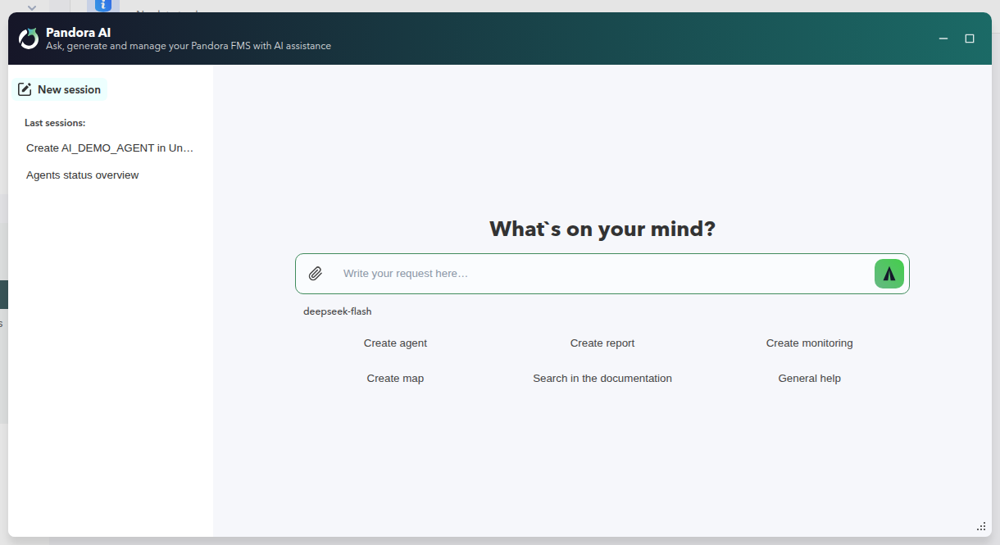
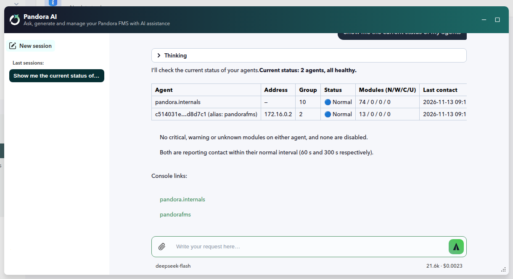
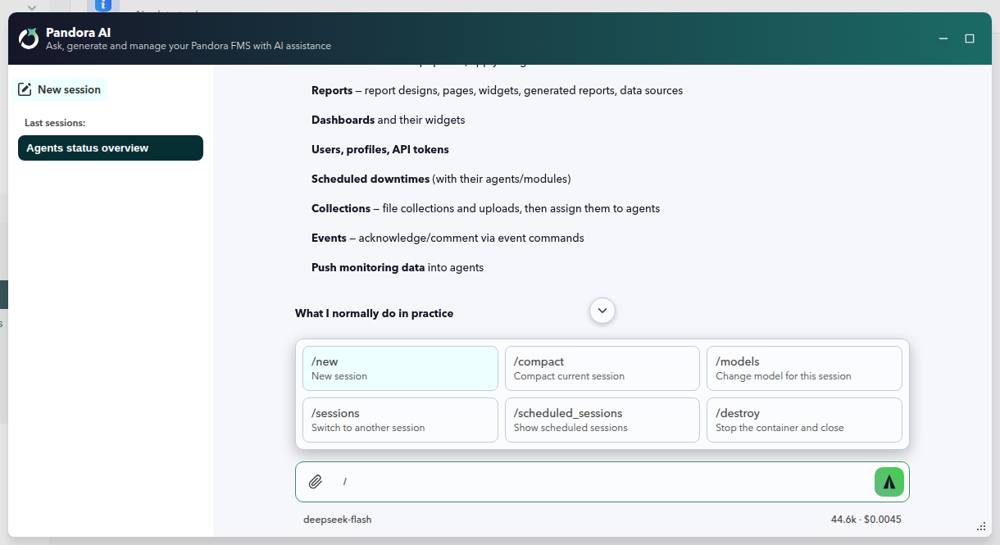
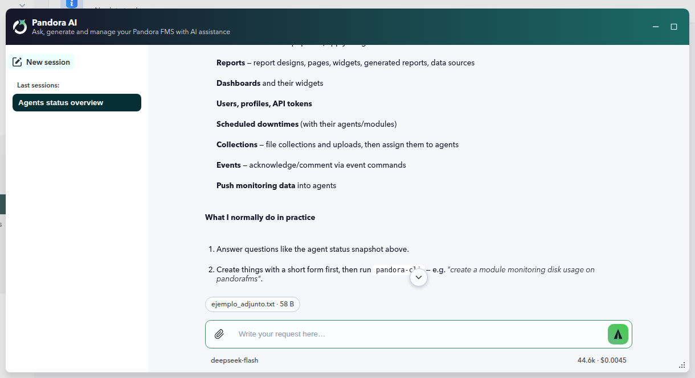

# Utilisation du chat

La fenêtre de l'assistant est l'endroit où l'on travaille avec Pandora AI. Elle
sert à interroger l'état de la plateforme, demander une action et vérifier ce qui
a été fait, dans la même conversation. Cette page explique comment s'y déplacer,
quelles commandes existent et ce que l'assistant peut ou ne peut pas faire.

L'installation et la configuration sont dans
[Introduction et installation](8.1-introduccion-e-instalacion.md). Les tâches qui
s'exécutent seules sont expliquées dans
[Automatisation des tâches](8.3-automatizacion-de-tareas.md) ; les permissions et
les limites dans [Sécurité](8.4-seguridad.md) ; et ce qui est enregistré dans
[Audit](8.5-auditoria.md).

## L'assistant dans la console

Le point d'entrée est une icône dans la barre supérieure de la console, à gauche
des autres icônes de droite, visible sur tous les écrans. Ce n'est pas une entrée
de menu : elle ouvre et ferme la fenêtre du chat, qui s'anime depuis l'icône. La
fenêtre peut être réduite, agrandie et restaurée.

L'icône a deux états :

- **Active** : ouvre le chat.
- **Désactivée** : elle apparaît en gris et signale que Pandora AI n'est pas
  activée ou que l'utilisateur n'a pas la permission. Cela se corrige dans les
  paramètres généraux ou dans les listes d'accès.

Le menu **Workspace → Pandora AI** n'ouvre pas le chat : il mène aux tâches
programmées de l'utilisateur.

## Conversations et sessions

La fenêtre comporte une barre latérale avec les sessions et une zone de
conversation. La barre permet de commencer une nouvelle session et de revenir à
une précédente ; le modèle nomme chaque session d'après ce qui a été dit, et ce
nom est celui qui apparaît ensuite dans l'audit.

{ .captura }

Au démarrage, l'écran propose plusieurs tâches (créer un agent, un rapport, une
surveillance ou une carte, chercher dans la documentation ou demander une aide
générale) et rappelle ce que l'assistant sait faire. Ce sont des raccourcis, pas
des limites : toute demande peut être saisie.

{ .captura }

Dans la conversation, chaque réponse peut contenir des tableaux, des liens vers
la console et le résultat des actions exécutées. Le bloc **Thinking** se déplie
pour montrer le raisonnement du modèle avant la réponse.

## Commandes

Saisir `/` ouvre la palette de commandes :

{ .captura }

| Commande | Ce qu'elle fait |
|---|---|
| `/new` | Démarre une nouvelle session sans supprimer la précédente |
| `/compact` | Résume l'ancien contexte pour continuer avec moins de *tokens* ; l'audit n'est pas supprimé |
| `/models` | Change le modèle de cette session ; le modèle par défaut n'est pas modifié |
| `/sessions` | Passe à une autre conversation |
| `/scheduled_sessions` | Affiche les conversations générées par les tâches programmées |
| `/destroy` | Ferme la session et libère l'environnement de l'utilisateur |

## Modèle et consommation

La barre inférieure affiche le modèle de la session et la consommation cumulée :
tokens et coût estimé. Le modèle se change avec `/models` ; le changement vaut
pour cette conversation et se perd au démarrage d'une nouvelle.

## Plusieurs onglets

Si le même compte ouvre l'assistant dans deux onglets, un seul détient la session
active. L'autre signale que la session a changé et propose de passer à l'actuelle
ou de rester. C'est une protection pour ne pas mélanger les conversations ni
perdre le fil.

## Compactage

`/compact` demande à l'assistant de résumer l'ancien contexte et de continuer avec
ce résumé. C'est utile pour les conversations longues : la consommation baisse et
le travail peut continuer sans traîner tout l'historique. La conversation
d'origine n'est pas perdue dans l'audit.

## Joindre des fichiers

Si **Allow uploading files to the chat** est activé (il l'est par défaut), le
compositeur affiche un trombone et accepte le glisser-déposer. Les pièces jointes
apparaissent sous forme de vignettes avec le nom et la taille, et peuvent être
retirées avant l'envoi.

{ .captura }

Les fichiers sont stockés dans l'espace de l'utilisateur, un dossier par
conversation, et l'assistant ne peut que les lire. Il ne peut ni les modifier, ni
les renommer, ni les exécuter. Ils sont supprimés avec la rétention de l'audit,
30 jours par défaut.

!!! warning "Une pièce jointe est une donnée, pas une instruction"
    L'assistant traite le contenu d'un fichier comme une information à lire,
    jamais comme des ordres à obéir. Malgré cela, ne téléversez pas de fichiers
    contenant des identifiants ou des données personnelles que vous ne voulez pas
    envoyer au fournisseur d'IA.

La taille maximale est imposée par PHP (`upload_max_filesize`) ; le service n'en
ajoute pas d'autre.

## Comment il exécute des actions

L'assistant peut consulter des informations et exécuter des changements, mais il
ne touche ni à la base de données ni aux fichiers du système. Pour créer,
modifier ou supprimer quoi que ce soit dans Pandora FMS, il utilise
`pandora-cli`, qui appelle l'API avec le même utilisateur qui pose la question.
Cela implique deux choses :

- **Il hérite des permissions de l'utilisateur** : si l'utilisateur ne peut pas
  supprimer un agent, l'assistant non plus.
- **Tout passe par l'API** : ce qui ne peut pas être fait avec la CLI n'est pas
  fait. L'assistant le dit et s'arrête ; il ne cherche pas de contournements,
  n'installe pas de logiciels et n'exécute pas les pièces jointes.

Pour demander des données, il utilise des formulaires dans le chat : champs de
texte, listes déroulantes, autocomplétion d'agents et de groupes, validation et
un résumé avant confirmation. La même demande produit le même formulaire, dans le
même ordre, pour n'importe quel utilisateur.

L'assistant travaille avec les *skills* installées dans le service : créer des
agents, créer des modules et créer des rapports par défaut, plus celles que le
client ajoute. La liste et la manière de les mettre à jour sont dans
[Skills de l'assistant](8.1-introduccion-e-instalacion.md#skills-de-lassistant).

Lorsque l'assistant ne peut pas faire quelque chose, il le dit clairement. C'est
la bonne réponse : ce n'est pas une panne de l'outil, c'est la limite qui protège
la plateforme. Si l'opération est importante et n'existe pas comme commande, la
voie est d'étendre la CLI ou l'API, pas de demander à l'assistant d'improviser.

## Limites et bonnes pratiques

- **Instructions précises** : quoi consulter, quoi faire si une donnée manque et
  à quoi doit ressembler la réponse.
- **Coût** : chaque demande consomme des tokens ; ajustez le modèle et consultez
  la consommation dans [Audit](8.5-auditoria.md).
- **Données sensibles** : ne saisissez pas d'identifiants ni de données
  personnelles ; la conversation est auditée.
- **Actions destructrices** : le chat exécute avec les permissions de
  l'utilisateur. Vérifiez avant de demander des suppressions ou des changements
  massifs et utilisez des comptes aux permissions minimales.
- **Pièces jointes** : seulement celles nécessaires ; elles sont conservées
  30 jours.
- **En cas d'échec** : regardez la conversation, l'audit et, si le service ne
  répond pas, le journal du service.
