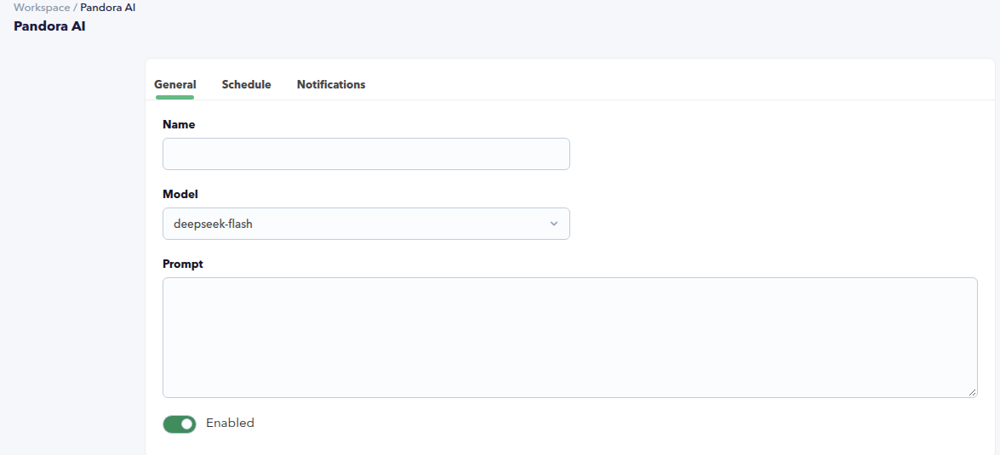
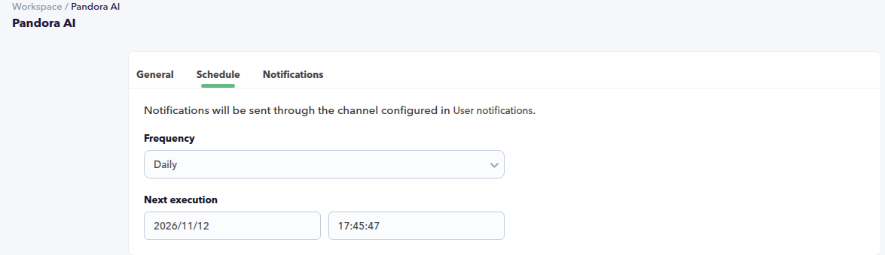
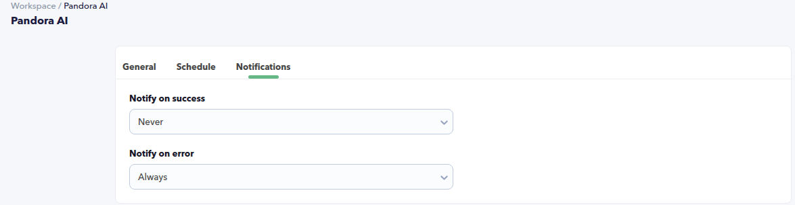
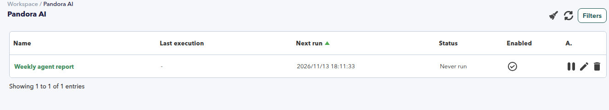

# Automatisation des tâches

Une tâche programmée est une instruction qui s'exécute sans personne devant, dans
son propre environnement, à la fréquence choisie, et qui rend compte du résultat.
Elle sert à ce que l'on sait déjà faire et qui doit être répété : un rapport
hebdomadaire, une revue d'agents, un résumé d'événements.

Cette page couvre uniquement les tâches programmées. L'utilisation du chat est
dans [Utilisation du chat](8.2-uso-del-chat.md) ; l'installation dans
[Introduction et installation](8.1-introduccion-e-instalacion.md) ; les
permissions dans [Sécurité](8.4-seguridad.md) ; et l'enregistrement des exécutions
dans [Audit](8.5-auditoria.md).

## Où elles se gèrent

- **Workspace → Pandora AI** : l'utilisateur voit et gère **ses** tâches. Cela
  n'apparaît que s'il peut utiliser Pandora AI.
- **Management → Settings → System Settings → Pandora AI → Scheduled tasks** :
  l'administrateur voit les tâches de tous les utilisateurs et peut les modifier.
  Il ne peut pas créer une tâche au nom d'un autre utilisateur depuis ici.

## Créer une tâche

Le formulaire comporte trois onglets.

{ .captura }

**General** :

| Champ | Ce qu'il fait |
|---|---|
| **Name** | Nom de la tâche ; utilisé dans la liste et les notifications |
| **Model** | Modèle de l'exécution ; s'il est vide, le modèle par défaut est utilisé |
| **Prompt** | L'instruction complète. C'est le seul guide de l'assistant : plus elle est précise, mieux c'est |
| **Enabled** | Active ou désactive la tâche sans la supprimer |

{ .captura }

**Schedule** :

| Champ | Ce qu'il fait |
|---|---|
| **Frequency** | `Hourly`, `Daily`, `Weekly`, `Monthly` ou `Yearly` |
| **Next execution** | Date et heure de la première exécution ; la suivante est calculée à partir de là |

{ .captura }

**Notifications** :

| Champ | Valeurs | Ce qu'il fait |
|---|---|---|
| **Notify on success** | `Never`, `Only if the user asks in the prompt`, `Always` | Avertit lorsque la tâche se termine bien |
| **Notify on error** | Les mêmes | Avertit lorsque la tâche échoue |

!!! note "À propos de « Only if the user asks in the prompt »"
    Dans cette version, seule la valeur **Always** génère une notification. Si
    vous choisissez « Only if the user asks in the prompt », la tâche s'exécute
    mais n'avertit pas.

## Notifications

Les notifications sont envoyées par la source **Pandora AI** et utilisent les
canaux configurés par l'utilisateur dans **User notifications** (console et
courriel). Si aucun n'est actif, rien n'est envoyé.

L'avis comprend le nom de la tâche et le résultat, avec un lien vers la liste des
tâches. Les échecs sont aussi enregistrés dans l'audit du système.

## Exécution

Les tâches sont lancées par le **cron de la console**. Si le cron n'est pas
actif, les tâches ne s'exécutent pas, même si elles sont activées et que leur
heure est arrivée.

Chaque tâche s'exécute dans son propre environnement et le nombre simultané est
limité par `scheduled_max_containers` (quatre par défaut). Un utilisateur
n'exécute pas deux tâches à la fois : la seconde attend la passe suivante.

L'exécution est **non interactive** :

- Elle ne peut pas poser de questions ni utiliser de formulaires.
- Si une donnée, une permission ou une action manque, elle se termine par une
  erreur claire.
- La réponse est fournie en HTML, pas en Markdown, car elle est envoyée par
  courriel et par la console.

Si l'utilisateur a perdu la permission ou si Pandora AI est désactivée, la tâche
échoue avec une erreur explicite. Elle n'est pas relancée en boucle.

Chaque exécution laisse une **session programmée**, qui peut être ouverte depuis
la barre latérale du chat avec `/scheduled_sessions`. L'historique de la tâche
n'est pas supprimé lorsque la tâche est supprimée : la conversation reste dans
l'audit.

## La liste

{ .captura }

| Colonne | Ce qu'elle montre |
|---|---|
| **Name** | Nom de la tâche |
| **User** | Propriétaire de la tâche ; visible uniquement dans la vue d'administration |
| **Last run** | Dernière exécution |
| **Next run** | Prochaine échéance |
| **Status** | `Never run`, `Running`, `Success` ou `Error` |
| **Enabled** | Si elle est active |
| **A.** | Exécuter maintenant, modifier, supprimer et activer ou désactiver |

**Run now** met la tâche en file pour la passe suivante. Supprimer la tâche ne
supprime pas la conversation auditée.

## Limites et bonnes pratiques

- **Instructions précises** : quoi consulter, quoi faire si une donnée manque et
  à quoi doit ressembler la réponse. Les tâches programmées ne peuvent pas poser
  de questions.
- **Coût** : chaque exécution consomme des tokens ; ajustez la fréquence et le
  modèle, et consultez la consommation dans [Audit](8.5-auditoria.md).
- **Données sensibles** : ne mettez pas d'identifiants ni de données personnelles
  dans l'instruction ; le prompt est audité.
- **Actions destructrices** : la tâche exécute avec les permissions de son
  propriétaire. Vérifiez l'instruction et utilisez des comptes aux permissions
  minimales.
- **Chat ou tâche** : le chat pour explorer et décider ; la tâche pour ce que
  l'on sait déjà faire et qui doit être répété.
- **En cas d'échec** : regardez l'état de la tâche, la dernière erreur et l'audit ;
  ensuite, le journal du service.
