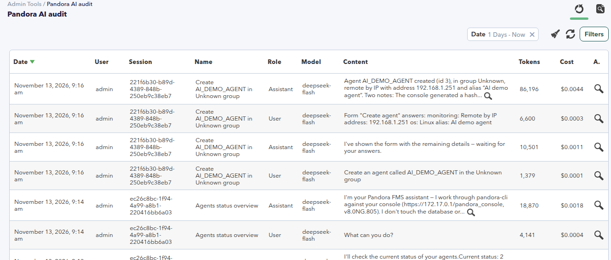
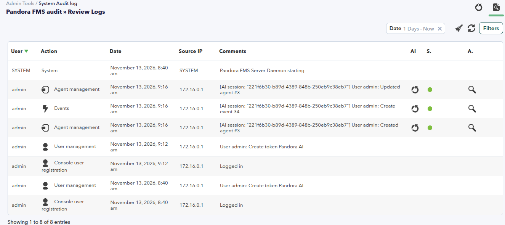

# Audit

Pandora AI laisse deux pistes différentes et complémentaires : ce qui a été dit
dans le chat et ce qui a été fait dans la console. La première est conservée par
le service d'IA ; la seconde par l'audit du système Pandora FMS. Savoir laquelle
consulter, et comment passer de l'une à l'autre, fait la moitié du travail
lorsqu'il faut reconstituer une action.

Cette page couvre les deux vues, la rétention et la sauvegarde. L'installation est
dans [Introduction et installation](8.1-introduccion-e-instalacion.md) ;
l'utilisation dans [Utilisation du chat](8.2-uso-del-chat.md) ; les tâches
programmées dans [Automatisation des tâches](8.3-automatizacion-de-tareas.md) ; et
les permissions dans [Sécurité](8.4-seguridad.md).

## Deux registres

| Registre | Où le consulter | Ce qu'il stocke | À quoi il sert |
|---|---|---|---|
| Audit Pandora AI | **Admin tools → System audit log → Pandora AI** | Utilisateurs, sessions, messages, événements de session et compactages | Savoir ce qui a été demandé, ce que le modèle a répondu et combien cela a coûté |
| Audit du système | **Admin tools → System audit log** | Les actions de la console, marquées avec la session d'IA qui les a lancées | Savoir ce qui a été fait et le relier à la conversation |

L'audit Pandora AI est conservé même si la tâche est supprimée ou si
l'environnement de l'utilisateur est recyclé. Ce qui expire est le fichier de
session et les pièces jointes, pas l'enregistrement de ce qui a été dit.

Il ne stocke pas les pièces jointes elles-mêmes (elles vivent dans l'espace de
l'utilisateur et expirent avec leur propre rétention), ni les identifiants, ni les
traces de diagnostic (seulement si `debug` est actif).

## Audit de Pandora AI

Chemin : **Admin tools → System audit log**, onglet **Pandora AI**. Il exige le
profil **PM** ou les droits d'administrateur de la console. Il n'apparaît que si
**Enable Pandora AI** est actif.

{ .captura }

Le tableau comporte une ligne **par message**, pas par conversation :

| Colonne | Contenu |
|---|---|
| **Date** | Date et heure du message, au format de la console |
| **User** | Utilisateur à l'origine de la demande |
| **Session** | Identifiant de la session ; le même qui relie l'audit du système |
| **Name** | Nom de la conversation, donné par le modèle |
| **Role** | `User` ou `Assistant` |
| **Model** | Modèle qui a répondu |
| **Content** | Extrait du message ; la loupe ouvre le texte complet |
| **Tokens** | Tokens consommés par ce message |
| **Cost** | Coût estimé de ce message |
| **A.** | Ouvre le détail de la session |

Filtres disponibles :

- **Date** : plage de dates ; le dernier jour par défaut.
- **Free search** : recherche libre dans le contenu et le nom de la session.
- **User**, **AI session**, **Role** et **Model**.

Le filtre **AI session** est le même identifiant que celui utilisé par l'audit du
système, et permet d'arriver ici depuis une action précise.

L'ouverture du détail d'une session (**A.**) montre la conversation complète et,
si elles existent, les **événements** de la session (changements de modèle,
compactages et autres actions) et les **compactages** avec leur résumé et les
tokens avant et après. Le contenu est affiché avec sa mise en forme.

Le tableau peut être exporté en CSV avec le bouton inférieur, comme les autres
listes de la console.

## Audit du système avec session d'IA

Chaque action exécutée par l'assistant est enregistrée comme celle de n'importe
quel utilisateur, mais avec une donnée supplémentaire : la **session d'IA** qui
l'a lancée.

{ .captura }

Dans **Admin tools → System audit log** :

- La colonne **AI** affiche une icône sur les lignes issues d'une conversation.
- Le filtre **AI session** permet de chercher par identifiant de session.
- Cliquer sur l'icône ouvre l'**audit Pandora AI filtré par cette session**. S'il
  n'y avait pas de plage de dates, la vue l'élargit pour que la conversation
  apparaisse même si elle est ancienne.

La différence conceptuelle :

- **Message** est ce qui a été dit dans le chat et vit dans l'audit d'IA.
- **Action** est ce qui a été exécuté dans la console et vit dans l'audit du
  système.
- Une conversation peut avoir des messages sans actions (consultations) et une
  action peut avoir plusieurs messages derrière elle (demander une donnée, la
  corriger, exécuter).

L'audit du système conserve aussi les **échecs des tâches programmées**, avec leur
identifiant et l'erreur, ainsi que les tentatives d'accès refusées par les
permissions.

## Rétention et sauvegarde

Il existe quatre horloges différentes, toutes dans la configuration du service :

| Quoi | Clé | Par défaut | Ce qui se passe à l'expiration |
|---|---|---|---|
| Environnement inactif | `container_expiration_seconds` | 604800 (7 jours) | L'environnement est supprimé ; les données sont conservées |
| Session sans messages | `session_expiration_seconds` | 604800 (7 jours) | Le fichier de session est supprimé ; l'audit est conservé |
| Audit | `audit_expiration_seconds` | 2592000 (30 jours) | Les messages sont supprimés ; les utilisateurs sont conservés |
| Pièces jointes | `uploaded_files_expiration_seconds` | 2592000 (30 jours) | Le fichier du volume est supprimé |

Le nettoyage s'exécute toutes les `cleanup_interval_seconds` (3600 par défaut) ;
`0` le désactive. À l'arrêt du service, `stop_containers_on_shutdown = 1`
supprime les environnements, mais pas les volumes ni l'audit.

Conséquences pratiques :

- La conversation reste lisible même après le recyclage de l'environnement ; ce
  qui expire est le fichier de session, pas l'audit.
- Une pièce jointe est supprimée au bout de 30 jours même si la conversation qui
  la mentionne reste dans l'audit : le message reste, le fichier non.
- La **sauvegarde** comprend le dossier de données du service (sessions, pièces
  jointes et audit) et le fichier de configuration. Les environnements ne sont pas
  sauvegardés : ils sont recréés.
- Pour **restaurer**, arrêtez le service, restaurez le dossier de données et la
  configuration, puis démarrez. Les environnements sont créés à la prochaine
  utilisation du chat.
- Lors d'une **mise à jour**, l'installateur conserve la configuration et les
  données. S'il existe une nouvelle version du fichier, il laisse un `.new` à
  fusionner à la main.

## Usage pratique et confidentialité

À quoi cela sert au quotidien :

- **Support** : reconstituer ce qu'un utilisateur a demandé, ce que l'assistant a
  répondu et quelle action a été exécutée, avec la conversation et la trace
  reliées.
- **Coût** : voir la consommation par utilisateur, session et modèle, et repérer
  les tâches programmées qui dépensent plus que prévu.
- **Conformité** : démontrer qui a demandé un changement et quand, avec le contenu
  de la demande.
- **Qualité** : repérer les instructions que l'assistant n'a pas su résoudre et les
  transformer en améliorations des *skills* ou de la CLI.

Limites et avertissements :

- L'audit stocke **le texte des prompts et des réponses**. Il peut contenir des
  données personnelles ou des secrets saisis par l'utilisateur : traitez-le comme
  une information sensible et appliquez la rétention de l'entreprise.
- Pour la conformité, l'audit du système reste la référence.
- L'export CSV extrait le contenu du tableau ; vérifiez où il est enregistré.
- Le fournisseur externe a sa propre rétention ; l'audit local ne la contrôle pas.
- Il ne remplace pas l'audit interne du système : ils se complètent.

La recommandation est l'inverse de l'habitude : lorsqu'une action du système n'est
pas comprise, ouvrez la conversation depuis l'icône **AI** ; lorsqu'une
conversation n'est pas comprise, regardez les actions qu'elle a générées.
