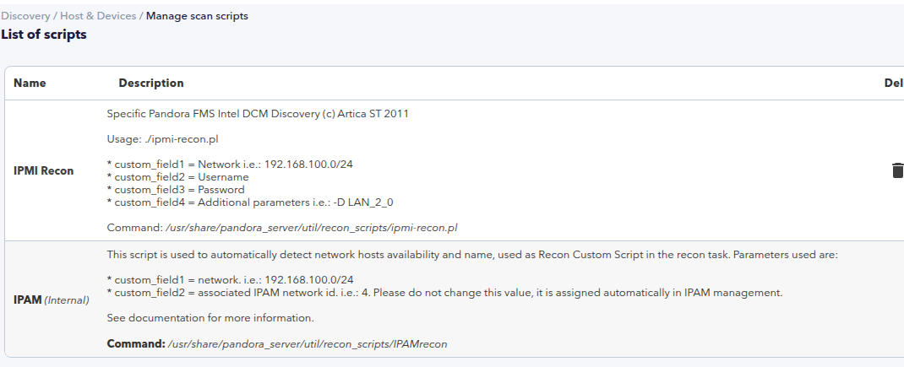
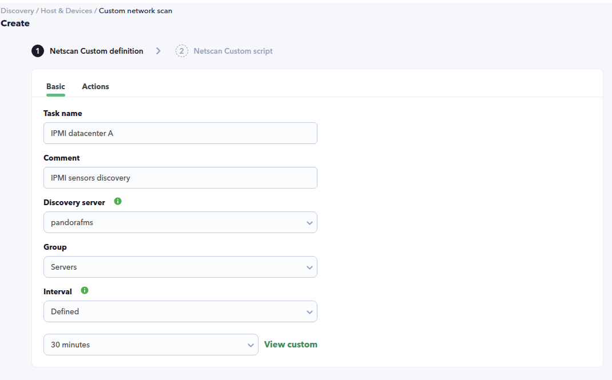
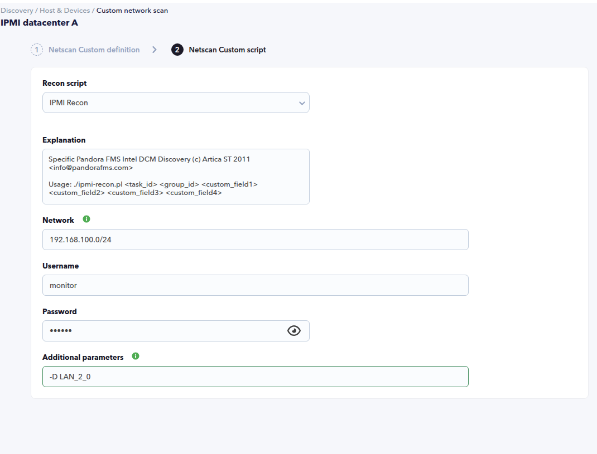

# Découverte automatique avancée : IPMI et tâches de reconnaissance personnalisées

L'analyse de réseau de Discovery couvre la plupart des cas, mais pas tous.
Lorsqu'un actif parle un protocole que l'analyse ne comprend pas, ou lorsqu'il
faut créer des agents et des modules avec une logique propre, Discovery peut
exécuter un script. Ce chapitre explique ce mécanisme et le parcourt de bout en
bout avec IPMI, l'exemple livré avec le produit.

## Ce qu'est la découverte avancée

Pandora FMS découvre les actifs de trois façons. Il faut choisir la bonne avant
d'écrire quoi que ce soit :

| Voie | Ce qui s'exécute | Quand l'utiliser | Où elle est expliquée |
|---|---|---|---|
| Analyse de réseau (Network scan) | Le moteur heuristique de Discovery, avec SNMP, WMI et commandes distantes | Réseaux généraux et équipements qui parlent SNMP ou WMI | 2.4 |
| Tâche de reconnaissance personnalisée (Custom network scan) | Un script enregistré par l'utilisateur | Protocoles ou inventaires non couverts par l'analyse, ou créations avec des règles propres | Ce chapitre |
| Paquet `.disco` (Applications, Cloud et Custom) | Un plugin Discovery avec ses propres étapes | Intégrations constructeur ou cloud déjà empaquetées | 2.3 et 9.7 |

Les deux premières se créent depuis **Discovery → Host & Devices**. La troisième
s'installe comme un paquet et ajoute ses propres sections au menu de Discovery.
Elles ne sont pas interchangeables : un paquet `.disco` apporte la logique
prête ; une tâche personnalisée oblige à l'écrire, mais n'impose pas de modèle de
données. L'analyse de réseau est expliquée en
[2.4](../parte-2/2.4-descubrimiento-de-redes-con-host-y-dispositivos.md) ; les
paquets `.disco`, en
[2.3](../parte-2/2.3-monitorizacion-y-descubrimiento-automatico-con-discovery.md)
et [9.7](../parte-9/9.7-creacion-de-plugins-de-discovery.md).

Créer ou modifier des tâches exige la permission **AW**. Enregistrer les scripts
exige **PM**, car le script s'exécute sur le serveur Discovery avec les
privilèges de ce service.

## Tâches de reconnaissance personnalisées

### Enregistrer le script

Le script s'enregistre avant de créer la tâche, dans **Management → Discovery →
Host & Devices → Manage scan scripts** (dans la console en français, « Gérer les
scripts d'analyse »). Chaque script déclare où il se trouve et quelles données
il lui faut :

| Champ | Ce qu'il indique |
|---|---|
| Name | Nom affiché dans le sélecteur de scripts. |
| Script full path | Chemin absolu de l'exécutable sur le serveur Discovery. |
| Description | Texte affiché comme « Explication » lors de la création de la tâche. |
| Macro | Chaque donnée nécessaire au script : description, valeur par défaut, aide et, pour un identifiant, « Cacher la valeur ». |

Les macros sont numérotées automatiquement (`_field1_`, `_field2_`…) et transmises
au script dans cet ordre. « Cacher la valeur » transforme le champ en mot de
passe lors de la création de la tâche ; cela ne chiffre pas la valeur, cela la
masque seulement à l'écran. La description accepte plusieurs lignes et s'affiche
comme explication générale. Chaque macro affiche aussi son propre texte d'aide
sous forme d'infobulle à la deuxième étape : il faut donc répartir l'information,
le format commun dans la description et celui de chaque donnée dans son aide.

Un script propre doit être exécutable sur le serveur Discovery : chemin absolu,
droit d'exécution et, s'il s'agit d'un script interprété, la bonne ligne
*shebang* en première ligne. Les scripts internes, comme IPAM, ne peuvent pas
être modifiés depuis cet écran ; le script IPMI Recon peut l'être, même s'il
n'est pas nécessaire d'y toucher. Le script interne IPAM est décrit en
[3.7](../parte-3/3.7-gestion-de-ip-ipam.md).



### Créer la tâche

La tâche se crée dans **Management → Discovery → Host & Devices → Custom
network scan** (« Analyse de réseau personnalisée »). L'assistant comporte deux
étapes. La première définit les données communes :

| Champ | Ce qu'il faut indiquer |
|---|---|
| Task name | Nom de la tâche. Il doit être unique. |
| Comment | Description libre pour identifier la tâche dans la liste. |
| Discovery server | Serveur qui exécutera le script. Il doit être de type Discovery et être actif ; si aucun n'est choisi, la tâche ne s'exécute jamais. |
| Group | Groupe attribué aux agents créés par le script. |
| Interval | `Defined` pour une périodicité fixe ou `Manual` pour ne l'exécuter qu'à la demande. La console recommande de ne pas descendre sous 5 minutes. |
| Generate event on error | Génère un événement si la tâche se termine en erreur. |
| Execute alert action on error | Exécute une ou plusieurs actions d'alerte dans ce même cas. |

Les deux derniers champs se trouvent dans l'onglet **Actions**. Ils sont
enregistrés avec la tâche, mais l'erreur n'est pas déduite du code de sortie du
script : c'est le script lui-même qui fixe l'état (voir « Ce que le script reçoit
et ce qu'il doit faire »).

L'exemple de ce chapitre utilise une tâche nommée « IPMI datacenter A », dans le
groupe « Servers », avec un intervalle de 30 minutes.



La deuxième étape sélectionne le script et renseigne ses macros :



À la fin, la tâche apparaît dans **Discovery → Task list**, onglet **Host &
devices tasks**. Elle n'apparaît pas dans **Custom tasks** : cet onglet est
réservé aux tâches d'un paquet `.disco` de la section Custom, qui sont autre
chose.

### Ce que le script reçoit et ce qu'il doit faire

Le serveur exécute le chemin enregistré avec trois groupes d'arguments, dans cet
ordre :

1. L'identifiant de la tâche.
2. L'identifiant du groupe.
3. La valeur de chaque macro, dans l'ordre où elles ont été définies.

Pour la tâche d'exemple, la ligne d'exécution ressemble à ceci :

```text
/usr/bin/perl /usr/share/pandora_server/util/recon_scripts/ipmi-recon.pl "12" "2" "192.168.100.0/24" "monitor" "s3cret" "-D LAN_2_0"
```

Le script fourni est enregistré pour utiliser l'interpréteur Perl du serveur : le
serveur ajoute donc `/usr/bin/perl` devant la commande (ou celui indiqué par
`PERL5BIN_PERL`, avec les options de `PERL5_OPT`). Un script propre exécutable se
lance sans interpréteur ajouté.

Le serveur **n'interprète pas la sortie** du script. Il ne crée ni agents ni
modules à partir de ce que le script écrit sur la sortie standard : le script
doit créer lui-même ses découvertes, via l'API v2 (voir
[13.1](../parte-13/13.1-primeros-pasos-y-autenticacion.md) et la
[référence des endpoints](../parte-13/13.4-referencia-de-endpoints/index.md)) ou
en envoyant son propre XML de données. La sortie n'est conservée que pour le
diagnostic, et uniquement lorsque le serveur fonctionne avec `verbosity 10` : la
commande est enregistrée dans `<répertoire des logs>/discovery/task.<id>.cmd` et
la sortie dans `task.<id>.out`, à côté des logs du serveur.

!!! warning "Le mot de passe reste dans le journal de la commande"
    Avec `verbosity 10`, le serveur écrit dans `discovery/task.<id>.cmd` la ligne
    de commande complète, avec les valeurs des macros et donc le mot de passe. Le
    fichier `.out` ne contient que la sortie du script. Protégez le répertoire des
    journaux et ne laissez pas `verbosity 10` actif en permanence en production.

L'état de la tâche n'est pas non plus déduit du code de sortie. Un `exit 1` ne
marque pas la tâche comme échouée et ne déclenche pas à lui seul les actions
d'erreur : c'est le script qui laisse l'état approprié. Il faut donc que le
script journalise ses propres erreurs et que la tâche soit contrôlée par son
résultat, pas seulement par l'état affiché dans la liste.

## Découverte IPMI

IPMI (**Intelligent Platform Management Interface**) est l'interface par
laquelle les cartes mères et les contrôleurs de gestion exposent la température,
la tension, les ventilateurs, l'alimentation et d'autres capteurs, même lorsque
le système d'exploitation n'est pas démarré. Pandora FMS le supervise avec un
plugin et le découvre avec un script de reconnaissance enregistré par défaut.

### Prérequis

| Prérequis | Détail |
|---|---|
| FreeIPMI | Le plugin utilise `ipmi-sensors` ; le script de découverte utilise `ipmiping` et `ipmi-sensors`. Sur RHEL, Rocky Linux et dérivés, l'installer avec `dnf install freeipmi` ; sur Debian et Ubuntu, avec `apt install freeipmi-tools`. |
| Réseau | Le serveur Discovery doit joindre le contrôleur via RMCP, UDP 623. Ouvrir le port sur le pare-feu du serveur et sur celui du réseau de l'équipement. |
| Identifiants | Utilisateur et mot de passe IPMI avec droit de lecture des capteurs. Les identifiants par défaut du constructeur ne fonctionnent pas toujours. |
| Serveur Discovery | La tâche s'exécute sur un serveur de type Discovery, avec `reconserver` ou `discoveryserver` actif (voir [9.3](../parte-9/9.3-referencia-completa-de-configuracion-del-servidor.md)). |
| Plugin IPMI Plugin | Il doit exister avec ce nom exact. Il est enregistré par défaut et ne peut pas être supprimé ; s'il est renommé, le script ne trouve plus le plugin avec lequel il crée les modules. |
| Permissions | AW pour créer la tâche ; PM pour enregistrer ou modifier les scripts. |

### Le plugin et le script fournis

Il y a deux pièces et il ne faut pas les confondre :

- **IPMI Plugin** lit un capteur précis. C'est le plugin exécuté par les modules
  créés ensuite.
- **IPMI Recon** parcourt un réseau, détecte les contrôleurs et crée les agents
  et les modules. C'est le script sélectionné dans la tâche.

Le plugin déclare cinq macros :

| Macro | Contenu |
|---|---|
| Target IP | Adresse du contrôleur IPMI. |
| Username | Utilisateur IPMI. |
| Password | Mot de passe ; enregistré masqué. |
| Sensor | Identifiant du capteur à lire. |
| Additional Options | Options supplémentaires pour `ipmi-sensors`, par exemple `-D LAN_2_0`. |

Le script IPMI Recon en déclare quatre :

| Macro | Contenu |
|---|---|
| Network | Réseau à parcourir, par exemple `192.168.100.0/24`. |
| Username | Utilisateur IPMI utilisé sur tous les équipements trouvés. |
| Password | Mot de passe IPMI ; enregistré masqué. |
| Additional parameters | Options supplémentaires pour `ipmi-sensors`, par exemple `-D LAN_2_0` pour forcer IPMI 2.0. |

L'option `-D LAN_2_0` change le pilote utilisé par `ipmi-sensors` ; elle ne
change pas le balayage du réseau, qui se fait avec `ipmiping` (IPMI 1.5). Si le
contrôleur ne répond qu'en IPMI 2.0, l'équipement peut ne pas apparaître lors du
balayage alors que la lecture fonctionne à la main.

Le plugin exécute `ipmi-sensors` pour le capteur indiqué et renvoie la valeur. Si
le capteur n'a pas de valeur numérique, il renvoie l'*event bitmask* converti en
décimal, qui est la façon dont IPMI représente les états discrets. Le script de
découverte exécute `ipmi-sensors` avec les seuils et les unités complètes afin de
pouvoir créer les modules avec leurs limites.

Le script fourni est enregistré pour s'exécuter avec le Perl du serveur
(`use_server_perl`) : le serveur le lance avec `/usr/bin/perl` et n'exige pas de
droit d'exécution sur le fichier.

### Créer la tâche IPMI

La procédure est la même que pour toute tâche personnalisée :

1. Ouvrir **Management → Discovery → Host & Devices → Custom network scan**.
2. Renseigner le nom, le commentaire, le serveur Discovery, le groupe et
   l'intervalle. Dans l'exemple : « IPMI datacenter A », groupe « Servers »,
   30 minutes.
3. Passer à la deuxième étape et sélectionner **IPMI Recon**. Ne pas
   sélectionner de plugin : le script l'utilise en interne.
4. Renseigner le réseau, l'utilisateur et le mot de passe des contrôleurs.
   Ajouter `-D LAN_2_0` dans « Additional parameters » uniquement si les
   équipements en ont besoin.
5. Cliquer sur **Finish**.

La tâche est programmée. Avec un intervalle manuel, elle se lance à la demande
depuis la liste des tâches avec l'action d'exécution forcée.

### Quels agents et modules il crée

Le script parcourt le réseau avec `ipmiping`. Pour chaque adresse qui répond :

1. Il résout le nom par DNS inverse. S'il n'y a pas de nom, il utilise l'adresse
   IP.
2. Il cherche un agent portant ce nom. S'il n'existe pas, il le crée avec le
   groupe de la tâche, le système d'exploitation **Network** et un intervalle de
   300 secondes.
3. Il génère un événement de détection avec le texte
   `[RECON] New Intel DCM host [nom] detected on network [réseau]`.
4. Il exécute `ipmi-sensors` contre le contrôleur et crée un module pour chaque
   capteur renvoyé par l'outil, nommé « Type: Sensor » (par exemple,
   « Temperature: CPU Temp ») avec l'unité correspondante.

Les modules sont de type plugin et utilisent **IPMI Plugin** ; chacun relit donc
son capteur à chaque intervalle de l'agent. Le type de module et les seuils
dépendent du type de capteur :

| Famille | Exemples | Module | Seuils |
|---|---|---|---|
| Numériques | Température, tension, courant, ventilateur, refroidissement | Numérique (`generic_data`) | Copie les seuils du capteur : avertissement et critique, inversés pour alerter à la sortie de la plage. |
| Indicateurs | Sécurité physique, tentative de violation, firmware, interruption critique, erreur de démarrage | Numérique (`generic_data`) | Seuil critique préparé pour la valeur d'alerte. |
| Composés | Processeur, alimentation, mémoire, watchdog, LAN, batterie | Numérique (`generic_data`) | Sans seuils. |
| Texte | Emplacement, carte, châssis, FRU, session, changement de version, `OEM Reserved` | Texte (`generic_data_string`) | Sans seuils. |

Un type absent du tableau n'est pas écarté : le script crée le module avec la
branche générique correspondante, et il convient de vérifier le résultat sur
l'agent.

Pendant le parcours du réseau, le script met à jour l'état de la tâche avec le
pourcentage de progression. À la fin, il laisse l'état interne à terminé (-1),
mais n'écrit pas le résumé d'exécution ; la liste peut donc encore afficher
« En attente » alors que l'exécution est finie. Elle n'affiche « Terminé » que
lorsque le résumé n'est pas vide.

Un détail important : le script ne crée des modules que lorsqu'il crée l'agent.
Si l'agent existe déjà, il n'ajoute pas les capteurs manquants. Pour ajouter de
nouveaux capteurs, il faut les ajouter à la main ou supprimer l'agent et
relancer la tâche.

### Capteurs OEM et limites

Les capteurs OEM n'ont pas de type standard dans `ipmi-sensors`, mais la
découverte ne les écarte pas : elle crée un module pour chaque capteur renvoyé
par l'outil. `OEM Reserved` est traité comme du texte (`generic_data_string`) ;
un type absent du tableau est créé avec le module générique appliqué par le
script. Si la valeur nécessite une commande OEM spécifique (`ipmi-oem`), elle
s'ajoute à la main comme module de plugin ; la procédure est décrite en
[9.9](../parte-9/9.9-creacion-de-plugins-remotos.md).

Avant de programmer la tâche, il faut vérifier ces limites :

- Le balayage utilise `ipmiping` (IPMI 1.5). Les options supplémentaires
  n'affectent que `ipmi-sensors` ; un équipement qui ne répond qu'en IPMI 2.0
  peut ne pas être détecté.
- Si les identifiants ne sont pas valides, l'équipement est quand même détecté
  parce qu'il répond au ping IPMI, mais l'agent est créé sans modules. Il faut
  tester la lecture à la main avant de créer la tâche.
- Relancer la tâche sur un agent existant n'ajoute pas de nouveaux modules.
- Seuls les capteurs renvoyés par `ipmi-sensors` sont créés ; le journal
  d'événements (SEL), l'inventaire FRU et les autres données IPMI ne font pas
  partie de la découverte.

Pour la supervision distante en général, et pour le reste des contrôles réseau,
voir [2.6](../parte-2/2.6-monitorizacion-de-redes.md). Pour le diagnostic d'une
tâche qui ne produit pas le résultat attendu, poursuivre avec la section suivante
ou avec [9.13](../parte-9/9.13-troubleshooting-con-pandora.md).

## Écrire son propre script de reconnaissance

Un script propre peut être écrit dans n'importe quel langage que le serveur peut
exécuter. L'important est de respecter le contrat :

- **Exécutable** : chemin absolu, droit d'exécution et *shebang* s'il s'agit
  d'un script interprété. Le serveur le lance tel quel, sauf s'il est enregistré
  pour utiliser le Perl du serveur, comme IPMI Recon, auquel cas il ajoute
  `/usr/bin/perl` devant.
- **Arguments dans l'ordre** : identifiant de la tâche, identifiant du groupe et
  valeurs des macros. Les valeurs peuvent arriver vides ; il faut les valider
  avant de les utiliser.
- **Ne pas dépendre de la sortie** : le serveur ne lit pas ce que vous imprimez.
  Créez les agents et les modules via l'API
  ([13.4](../parte-13/13.4-referencia-de-endpoints/index.md))
  ou en envoyant votre propre XML.
- **Idempotent** : avant de créer un agent, vérifiez s'il existe déjà ; avant de
  créer un module, vérifiez s'il est déjà présent. Ainsi, la tâche peut être
  relancée sans rien dupliquer.
- **Avec son propre état** : laissez la tâche dans l'état approprié. Le code de
  sortie ne suffit pas pour que la liste la marque comme échouée.
- **Sans secrets dans la sortie** : les identifiants arrivent en arguments ; ne
  les imprimez pas et ne les écrivez pas dans des fichiers. La ligne de commande
  est enregistrée dans le `.cmd` avec `verbosity 10` (voir l'avertissement
  ci-dessus).

Un squelette minimal en Bash :

```bash
#!/bin/bash
set -euo pipefail

task_id="$1"
group_id="$2"
network="$3"
username="$4"
password="$5"
extra="${6:-}"

# 1. Découvrir les équipements de $network.
# 2. Pour chaque équipement, vérifier si l'agent existe et le créer s'il manque.
# 3. Créer ou mettre à jour ses modules.
# 4. Journaliser les erreurs et laisser la tâche dans le bon état.
```

La création des agents et des modules se fait via l'API ; le détail des
endpoints et de l'authentification est en
[13.1](../parte-13/13.1-primeros-pasos-y-autenticacion.md).
Ce formulaire n'a pas de sélecteur d'identifiants pour le gestionnaire de
[2.2](../parte-2/2.2-gestor-de-credenciales.md) : les identifiants dont le script
a besoin sont transmis comme macros. Si le script veut interroger le
gestionnaire lui-même, il doit le faire depuis son propre code, ce qui sort du
cadre de ce chapitre.

## Diagnostic

Lorsque la tâche se termine mais qu'il n'y a pas d'agents, ou que les agents
n'ont pas de modules, le problème vient généralement de l'un de ces contrôles :

| Symptôme | Ce qu'il faut vérifier |
|---|---|
| La tâche ne crée aucun agent | Le serveur Discovery existe et est actif ; le script a le droit d'exécution ; le réseau est joignable depuis ce serveur. |
| L'équipement n'apparaît pas dans le balayage | `ipmiping` contre l'adresse ; UDP 623 ; le contrôleur n'est pas uniquement IPMI 2.0. |
| L'agent apparaît sans modules | Identifiants IPMI ; `ipmi-sensors` renvoie des capteurs à la main ; le plugin conserve le nom « IPMI Plugin ». |
| La tâche reste en « En attente » alors qu'elle est terminée | Le script fourni n'écrit pas le résumé d'exécution ; sans résumé, la liste n'affiche pas « Terminé ». Vérifier la date de mise à jour et les agents créés. |
| Le script ne s'exécute pas | Chemin complet, droit d'exécution et *shebang* ; consulter le log du serveur. |
| Il n'y a aucune trace de l'exécution | Passer `verbosity` à 10 temporairement et chercher `task.<id>.cmd` et `task.<id>.out` dans le répertoire `discovery/` des logs ; le fichier `.cmd` contiendra les identifiants. |

Deux contrôles manuels évitent la moitié du diagnostic :

```sh
ipmiping 192.168.100.10 -c 2 -t 1
ipmi-sensors -h 192.168.100.10 -u monitor -p 'mot de passe' -D LAN_2_0 \
  --ignore-not-available-sensors
```

Le premier indique si l'équipement répond à la découverte. Le second indique si
les identifiants et le pilote sont corrects et quels capteurs seront créés. Si le
second échoue, la tâche créera l'agent mais pas les modules.

Pour le diagnostic général de la supervision distante, poursuivre en
[9.13](../parte-9/9.13-troubleshooting-con-pandora.md).
